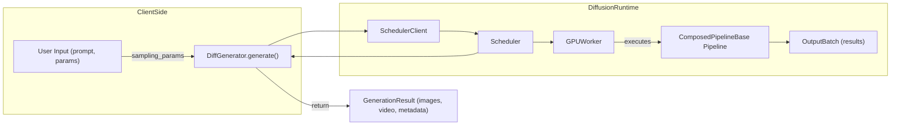
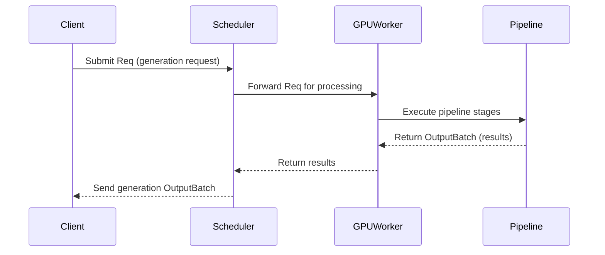
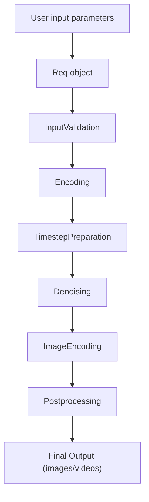

<!-- source: DeepWiki mcp.deepwiki.com · repo microsoft/llm-42 · page 10.1 Diffusion Runtime Architecture · fetched 2026-10-26 -->

# Diffusion Runtime Architecture

<details>
<summary>Relevant source files</summary>

The following files were used as context for generating this wiki page:

- [python/sglang/cli/generate.py](python/sglang/cli/generate.py)
- [python/sglang/cli/main.py](python/sglang/cli/main.py)
- [python/sglang/cli/serve.py](python/sglang/cli/serve.py)
- [python/sglang/cli/utils.py](python/sglang/cli/utils.py)
- [python/sglang/multimodal_gen/apps/webui/README.md](python/sglang/multimodal_gen/apps/webui/README.md)
- [python/sglang/multimodal_gen/apps/webui/main.py](python/sglang/multimodal_gen/apps/webui/main.py)
- [python/sglang/multimodal_gen/benchmarks/bench_serving.py](python/sglang/multimodal_gen/benchmarks/bench_serving.py)
- [python/sglang/multimodal_gen/configs/models/dits/flux.py](python/sglang/multimodal_gen/configs/models/dits/flux.py)
- [python/sglang/multimodal_gen/configs/models/dits/qwenimage.py](python/sglang/multimodal_gen/configs/models/dits/qwenimage.py)
- [python/sglang/multimodal_gen/configs/pipeline_configs/__init__.py](python/sglang/multimodal_gen/configs/pipeline_configs/__init__.py)
- [python/sglang/multimodal_gen/configs/pipeline_configs/base.py](python/sglang/multimodal_gen/configs/pipeline_configs/base.py)
- [python/sglang/multimodal_gen/configs/pipeline_configs/flux.py](python/sglang/multimodal_gen/configs/pipeline_configs/flux.py)
- [python/sglang/multimodal_gen/configs/pipeline_configs/qwen_image.py](python/sglang/multimodal_gen/configs/pipeline_configs/qwen_image.py)
- [python/sglang/multimodal_gen/configs/sample/qwenimage.py](python/sglang/multimodal_gen/configs/sample/qwenimage.py)
- [python/sglang/multimodal_gen/configs/sample/sampling_params.py](python/sglang/multimodal_gen/configs/sample/sampling_params.py)
- [python/sglang/multimodal_gen/registry.py](python/sglang/multimodal_gen/registry.py)
- [python/sglang/multimodal_gen/runtime/entrypoints/__init__.py](python/sglang/multimodal_gen/runtime/entrypoints/__init__.py)
- [python/sglang/multimodal_gen/runtime/entrypoints/cli/generate.py](python/sglang/multimodal_gen/runtime/entrypoints/cli/generate.py)
- [python/sglang/multimodal_gen/runtime/entrypoints/diffusion_generator.py](python/sglang/multimodal_gen/runtime/entrypoints/diffusion_generator.py)
- [python/sglang/multimodal_gen/runtime/entrypoints/http_server.py](python/sglang/multimodal_gen/runtime/entrypoints/http_server.py)
- [python/sglang/multimodal_gen/runtime/entrypoints/openai/common_api.py](python/sglang/multimodal_gen/runtime/entrypoints/openai/common_api.py)
- [python/sglang/multimodal_gen/runtime/entrypoints/openai/image_api.py](python/sglang/multimodal_gen/runtime/entrypoints/openai/image_api.py)
- [python/sglang/multimodal_gen/runtime/entrypoints/openai/protocol.py](python/sglang/multimodal_gen/runtime/entrypoints/openai/protocol.py)
- [python/sglang/multimodal_gen/runtime/entrypoints/openai/utils.py](python/sglang/multimodal_gen/runtime/entrypoints/openai/utils.py)
- [python/sglang/multimodal_gen/runtime/entrypoints/openai/video_api.py](python/sglang/multimodal_gen/runtime/entrypoints/openai/video_api.py)
- [python/sglang/multimodal_gen/runtime/entrypoints/utils.py](python/sglang/multimodal_gen/runtime/entrypoints/utils.py)
- [python/sglang/multimodal_gen/runtime/launch_server.py](python/sglang/multimodal_gen/runtime/launch_server.py)
- [python/sglang/multimodal_gen/runtime/managers/gpu_worker.py](python/sglang/multimodal_gen/runtime/managers/gpu_worker.py)
- [python/sglang/multimodal_gen/runtime/managers/scheduler.py](python/sglang/multimodal_gen/runtime/managers/scheduler.py)
- [python/sglang/multimodal_gen/runtime/models/registry.py](python/sglang/multimodal_gen/runtime/models/registry.py)
- [python/sglang/multimodal_gen/runtime/models/vision_utils.py](python/sglang/multimodal_gen/runtime/models/vision_utils.py)
- [python/sglang/multimodal_gen/runtime/pipelines/qwen_image.py](python/sglang/multimodal_gen/runtime/pipelines/qwen_image.py)
- [python/sglang/multimodal_gen/runtime/pipelines_core/__init__.py](python/sglang/multimodal_gen/runtime/pipelines_core/__init__.py)
- [python/sglang/multimodal_gen/runtime/pipelines_core/composed_pipeline_base.py](python/sglang/multimodal_gen/runtime/pipelines_core/composed_pipeline_base.py)
- [python/sglang/multimodal_gen/runtime/pipelines_core/executors/parallel_executor.py](python/sglang/multimodal_gen/runtime/pipelines_core/executors/parallel_executor.py)
- [python/sglang/multimodal_gen/runtime/pipelines_core/executors/pipeline_executor.py](python/sglang/multimodal_gen/runtime/pipelines_core/executors/pipeline_executor.py)
- [python/sglang/multimodal_gen/runtime/pipelines_core/executors/sync_executor.py](python/sglang/multimodal_gen/runtime/pipelines_core/executors/sync_executor.py)
- [python/sglang/multimodal_gen/runtime/pipelines_core/schedule_batch.py](python/sglang/multimodal_gen/runtime/pipelines_core/schedule_batch.py)
- [python/sglang/multimodal_gen/runtime/pipelines_core/stages/__init__.py](python/sglang/multimodal_gen/runtime/pipelines_core/stages/__init__.py)
- [python/sglang/multimodal_gen/runtime/pipelines_core/stages/base.py](python/sglang/multimodal_gen/runtime/pipelines_core/stages/base.py)
- [python/sglang/multimodal_gen/runtime/pipelines_core/stages/decoding.py](python/sglang/multimodal_gen/runtime/pipelines_core/stages/decoding.py)
- [python/sglang/multimodal_gen/runtime/pipelines_core/stages/encoding.py](python/sglang/multimodal_gen/runtime/pipelines_core/stages/encoding.py)
- [python/sglang/multimodal_gen/runtime/pipelines_core/stages/image_encoding.py](python/sglang/multimodal_gen/runtime/pipelines_core/stages/image_encoding.py)
- [python/sglang/multimodal_gen/runtime/pipelines_core/stages/input_validation.py](python/sglang/multimodal_gen/runtime/pipelines_core/stages/input_validation.py)
- [python/sglang/multimodal_gen/runtime/pipelines_core/stages/timestep_preparation.py](python/sglang/multimodal_gen/runtime/pipelines_core/stages/timestep_preparation.py)
- [python/sglang/multimodal_gen/runtime/server_args.py](python/sglang/multimodal_gen/runtime/server_args.py)
- [python/sglang/multimodal_gen/runtime/utils/hf_diffusers_utils.py](python/sglang/multimodal_gen/runtime/utils/hf_diffusers_utils.py)
- [python/sglang/multimodal_gen/runtime/utils/logging_utils.py](python/sglang/multimodal_gen/runtime/utils/logging_utils.py)
- [python/sglang/multimodal_gen/runtime/utils/perf_logger.py](python/sglang/multimodal_gen/runtime/utils/perf_logger.py)

</details>


This section documents the detailed architecture and implementation of the diffusion runtime within the LLM-42 multimodal generation subsystem (`multimodal_gen`). It covers the main runtime components: `DiffGenerator`, the scheduler, GPU worker, pipeline stages such as denoising, image encoding, and input validation, as well as the base composed pipeline. Additionally, it explains the OpenAI-compatible image and video API endpoints that expose this runtime functionality.

---

## 1. Purpose and Scope

The diffusion runtime supports generating images and videos from text and/or images using diffusion transformer-based models. The runtime is designed for high-performance GPU inference with a distributed multi-GPU setup. It orchestrates requests from HTTP or API clients through a scheduler, dispatches to GPU workers, and executes a modular pipeline composed of various stages (denoising, encoding, validation).

This page focuses on:

- The **DiffGenerator** class, which clients use to drive image/video generation requests.
- The **Scheduler** and **GPUWorker** architecture that manage processing loops and model execution.
- The **pipeline stages** involved in generation, such as conditioning, denoising, and image encoding.
- The **ComposedPipelineBase**, the extensible base class underlying all diffusion pipelines.
- The OpenAI-compatible API routes implemented for image/video generation endpoints.

---

## 2. DiffGenerator: The High-Level Generator Interface

The `DiffGenerator` class is the main unified interface to generate images or videos using diffusion models. It exposes a user-friendly interface aligned with popular frameworks like HuggingFace Diffusers, abstracting away distributed scheduling and GPU execution.

### Key Features

- Accepts a variety of generation parameters, including prompts, guidance scales, seeds, image sizes, and model-specific options.
- Supports local mode, where it launches and manages a local diffusion scheduler server, or remote mode for connecting to a running scheduler.
- Constructs one or more generation requests from user parameters, sends them to the scheduler, waits for completion, and collects results.
- Returns rich generation results that include generated image/video tensors, audio (if applicable), timing and profiling information, and output file paths.

### Main Methods

- `__init__(server_args)`: Initializes with server arguments defining model paths, device configs, and pipeline settings.
- `from_pretrained(...)` and `from_server_args(...)`: Constructors for creating an instance from config arguments.
- `generate(sampling_params_kwargs)`: Prepares generation requests using `SamplingParams`, sends to scheduler sequentially, and returns generation results.
- `_start_local_server_if_needed()`: Starts scheduler server processes locally if no remote server is specified.
- `_check_remote_scheduler()`: Ensures connectivity when connecting to a remote scheduler.

### Workflow Summary

Clients call `generate()` passing inference parameters. The generator prepares per-prompt requests (`Req` dataclass instances), submits each to the scheduler client, and returns the results.



Sources:  
- `python/sglang/multimodal_gen/runtime/entrypoints/diffusion_generator.py:54-315`()

---

## 3. Scheduler and GPU Worker Architecture

### Scheduler

The `Scheduler` class implements the main event loop responsible for:

- Listening for requests from external clients over ZeroMQ (ZMQ).
- Managing request queues and dispatching computation batches to GPU worker processes.
- Handling administrative messages (LoRA updates, shutdown requests).
- Performing server warmup with dummy requests.

The scheduler is single-node but supports orchestrating multiple GPUs with dedicated `GPUWorker` instances. The rank 0 process runs the scheduler event loop and communicates with GPU workers via IPC.

### GPUWorker

`GPUWorker` manages:

- GPU device initialization, including distributed launch environment variables.
- Loading the diffusion pipeline via `build_pipeline` (returns a subclass of `ComposedPipelineBase`).
- Distributed model parallelism setup, including tensor parallel, stage parallel groups.
- Executing forward passes and denoising loops by invoking pipeline methods.
- Optional layerwise offloading of model parts for memory management.
- Profiling and memory usage analysis.

Workers run in separate processes pinned to individual GPUs.

### Interaction

The scheduler forwards requests to `GPUWorker.execute_forward()` which runs the functional pipeline on the GPU and returns an `OutputBatch` containing results and timings.



Sources:  
- `python/sglang/multimodal_gen/runtime/managers/scheduler.py:46-313`()  
- `python/sglang/multimodal_gen/runtime/managers/gpu_worker.py:64-215`()

---

## 4. Pipeline: ComposedPipelineBase and Stages

### Overview

The diffusion runtime uses a modular **pipeline** abstraction. The base class `ComposedPipelineBase` represents a modular inference pipeline composed of stages such as:

- **Input validation** (sanitizing and normalizing user inputs)
- **Encoding** (tokenizing and embedding texts/images)
- **Timestep preparation** (scheduling diffusion noise steps)
- **Denoising** (running the diffusion model forward passes)
- **Image encoding** (decoding latent embeddings back to images)
- **Result postprocessing** (formatting outputs)

Each stage receives and returns a `Req` dataclass instance carrying all relevant tensors and metadata across the pipeline.

### The `Req` Dataclass

`Req` encapsulates the complete pipeline execution state, including:

- Sampling parameters, prompts, and seeds.
- Embeddings for conditionings (text, image, audio).
- Intermediate latents and noise tensors.
- Timesteps and scheduler-specific parameters.
- Output tensors and file paths.
- Timing and profiling data.

It implements attribute delegation to its embedded `SamplingParams`.

### Pipeline Construction

The `GPUWorker` constructs the pipeline instance using the function `build_pipeline(server_args)`. The resulting pipeline implements the full multimodal generation workflow for a specific diffusion model and configuration.

Denoising and encoding stages are executed sequentially on the GPU within `execute_forward()`.

### Data Flow Example

1. User inputs processed into a `Req` object.
2. Input validation stage sanitizes inputs.
3. Prompt text encoded into embeddings.
4. Scheduler sets timesteps for diffusion steps.
5. Denoising loop runs network forward passes, updating latents.
6. Final latents decoded into output images or video frames.
7. Output saved or returned to the client.



Sources:  
- `python/sglang/multimodal_gen/runtime/pipelines_core/schedule_batch.py:37-212`  
- `python/sglang/multimodal_gen/runtime/pipelines_core/composed_pipeline_base.py:41-93`()

---

## 5. OpenAI-Compatible Image/Video API Endpoints

The runtime exposes HTTP API endpoints compatible with OpenAI’s image and video generation specs via FastAPI routers:

### Image Generation Endpoint

- Route: `/v1/images/generations`
- Accepts requests with fields like `prompt`, `n`, `size`, `response_format`, `seed`, `guidance_scale`, and more.
- Constructs `SamplingParams` from request data and generates the `Req`.
- Sends requests to the async scheduler client.
- Saves generated images locally or uploads to cloud.
- Returns results either as base64 JSON or URLs depending on `response_format`.

### Image Editing Endpoint

- Route: `/v1/images/edits`
- Accepts optional input images or URLs, masks, and a prompt.
- Supports mask-based image editing.

### Key Utilities

- `build_sampling_params()` creates normalized sampling parameter objects.
- `save_image_to_path()` handles local file saving and base64 encoding.
- `process_generation_batch()` sends requests to scheduler and awaits results.

### Example FastAPI Router Flow

```mermaid
flowchart LR
    HTTPClient -->|POST /v1/images/generations| FastAPI["FastAPI Router"]
    FastAPI -->|build_sampling_params()| SamplingParams
    SamplingParams -->|prepare_request()| Req
    Req --> SchedulerClient["AsyncSchedulerClient"]
    SchedulerClient --> Scheduler
    Scheduler --> GPUWorker
    GPUWorker --> Pipeline
    Pipeline --> OutputBatch
    OutputBatch --> SchedulerClient
    SchedulerClient --> FastAPI
    FastAPI --> HTTPClient["Response with generated images/videos"]
```

Sources:  
- `python/sglang/multimodal_gen/runtime/entrypoints/openai/image_api.py:1-165`  
- `python/sglang/multimodal_gen/runtime/entrypoints/openai/utils.py:1-194`()

---

## 6. Summary Diagram: Natural Language to Code Entity Mapping

This diagram maps the natural language system components to their key code entities:

```mermaid
graph LR
    subgraph "Diffusion Runtime System"
    DiffGeneratorClass["DiffGenerator\n(python/sglang/multimodal_gen/runtime/entrypoints/diffusion_generator.py)"]
    SchedulerClass["Scheduler\n(python/sglang/multimodal_gen/runtime/managers/scheduler.py)"]
    GPUWorkerClass["GPUWorker\n(python/sglang/multimodal_gen/runtime/managers/gpu_worker.py)"]
    PipelineBaseClass["ComposedPipelineBase\n(python/sglang/multimodal_gen/runtime/pipelines_core/composed_pipeline_base.py)"]
    ReqClass["Req dataclass\n(python/sglang/multimodal_gen/runtime/pipelines_core/schedule_batch.py)"]
    ImageApiRouter["OpenAI Image API\n(python/sglang/multimodal_gen/runtime/entrypoints/openai/image_api.py)"]
    end

    UserInput["User Input (prompt, params)"] --> DiffGeneratorClass
    DiffGeneratorClass --> SchedulerClass
    SchedulerClass --> GPUWorkerClass
    GPUWorkerClass --> PipelineBaseClass
    PipelineBaseClass --> ReqClass
    ImageApiRouter --> DiffGeneratorClass

    DiffGeneratorClass -.-> ImageApiRouter
```



This mapping helps developers find the relevant files when navigating the diffusion runtime implementation.

---

## 7. Summary

The diffusion runtime in LLM-42 is a carefully architected multilayer system integrating:

- **DiffGenerator:** The user-facing generator for image/video synthesis.
- **Scheduler:** The main coordination loop managing requests and dispatching to GPU workers.
- **GPUWorker:** Executes inference with fine-grained control and distributed setups.
- **ComposedPipelineBase and pipeline stages:** Functional modular pipeline design for image/video diffusion workflows.
- **OpenAI-compatible API:** HTTP FastAPI endpoints that expose generative capabilities compliant with popular formats.

This architecture facilitates extensibility to support multiple diffusion models, workloads, and targets while ensuring efficient GPU utilization and deterministic, reproducible generation.

---

# References and Source Files

- `python/sglang/multimodal_gen/runtime/entrypoints/diffusion_generator.py:54-315`  
- `python/sglang/multimodal_gen/runtime/managers/scheduler.py:46-313`  
- `python/sglang/multimodal_gen/runtime/managers/gpu_worker.py:64-215`  
- `python/sglang/multimodal_gen/runtime/pipelines_core/schedule_batch.py:37-212`  
- `python/sglang/multimodal_gen/runtime/pipelines_core/composed_pipeline_base.py:41-93`  
- `python/sglang/multimodal_gen/runtime/entrypoints/openai/image_api.py:1-165`  
- `python/sglang/multimodal_gen/runtime/entrypoints/openai/utils.py:1-194`

---

