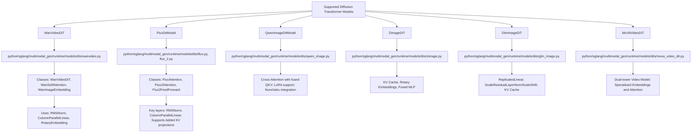

<!-- source: DeepWiki mcp.deepwiki.com · repo microsoft/llm-42 · page 10.2 Supported DiT Models and LoRA · fetched 2026-10-26 -->

# Supported DiT Models and LoRA

<details>
<summary>Relevant source files</summary>

The following files were used as context for generating this wiki page:

- [docs/diffusion/api/cli.md](docs/diffusion/api/cli.md)
- [docs/diffusion/ci_perf.md](docs/diffusion/ci_perf.md)
- [docs/diffusion/compatibility_matrix.md](docs/diffusion/compatibility_matrix.md)
- [docs/diffusion/contributing.md](docs/diffusion/contributing.md)
- [docs/diffusion/environment_variables.md](docs/diffusion/environment_variables.md)
- [docs/diffusion/index.md](docs/diffusion/index.md)
- [docs/diffusion/installation.md](docs/diffusion/installation.md)
- [docs/diffusion/performance/attention_backends.md](docs/diffusion/performance/attention_backends.md)
- [python/sglang/multimodal_gen/configs/models/dits/base.py](python/sglang/multimodal_gen/configs/models/dits/base.py)
- [python/sglang/multimodal_gen/configs/models/dits/zimage.py](python/sglang/multimodal_gen/configs/models/dits/zimage.py)
- [python/sglang/multimodal_gen/envs.py](python/sglang/multimodal_gen/envs.py)
- [python/sglang/multimodal_gen/runtime/layers/activation.py](python/sglang/multimodal_gen/runtime/layers/activation.py)
- [python/sglang/multimodal_gen/runtime/layers/attention/backends/sparse_video_gen_2_attn.py](python/sglang/multimodal_gen/runtime/layers/attention/backends/sparse_video_gen_2_attn.py)
- [python/sglang/multimodal_gen/runtime/layers/attention/selector.py](python/sglang/multimodal_gen/runtime/layers/attention/selector.py)
- [python/sglang/multimodal_gen/runtime/layers/lora/linear.py](python/sglang/multimodal_gen/runtime/layers/lora/linear.py)
- [python/sglang/multimodal_gen/runtime/layers/rotary_embedding.py](python/sglang/multimodal_gen/runtime/layers/rotary_embedding.py)
- [python/sglang/multimodal_gen/runtime/loader/component_loaders/adapter_loader.py](python/sglang/multimodal_gen/runtime/loader/component_loaders/adapter_loader.py)
- [python/sglang/multimodal_gen/runtime/loader/component_loaders/bridge_loader.py](python/sglang/multimodal_gen/runtime/loader/component_loaders/bridge_loader.py)
- [python/sglang/multimodal_gen/runtime/loader/component_loaders/component_loader.py](python/sglang/multimodal_gen/runtime/loader/component_loaders/component_loader.py)
- [python/sglang/multimodal_gen/runtime/loader/component_loaders/image_encoder_loader.py](python/sglang/multimodal_gen/runtime/loader/component_loaders/image_encoder_loader.py)
- [python/sglang/multimodal_gen/runtime/loader/component_loaders/scheduler_loader.py](python/sglang/multimodal_gen/runtime/loader/component_loaders/scheduler_loader.py)
- [python/sglang/multimodal_gen/runtime/loader/component_loaders/text_encoder_loader.py](python/sglang/multimodal_gen/runtime/loader/component_loaders/text_encoder_loader.py)
- [python/sglang/multimodal_gen/runtime/loader/component_loaders/transformer_loader.py](python/sglang/multimodal_gen/runtime/loader/component_loaders/transformer_loader.py)
- [python/sglang/multimodal_gen/runtime/loader/component_loaders/vae_loader.py](python/sglang/multimodal_gen/runtime/loader/component_loaders/vae_loader.py)
- [python/sglang/multimodal_gen/runtime/loader/component_loaders/vl_encoder_loader.py](python/sglang/multimodal_gen/runtime/loader/component_loaders/vl_encoder_loader.py)
- [python/sglang/multimodal_gen/runtime/loader/component_loaders/vocoder_loader.py](python/sglang/multimodal_gen/runtime/loader/component_loaders/vocoder_loader.py)
- [python/sglang/multimodal_gen/runtime/loader/fsdp_load.py](python/sglang/multimodal_gen/runtime/loader/fsdp_load.py)
- [python/sglang/multimodal_gen/runtime/loader/utils.py](python/sglang/multimodal_gen/runtime/loader/utils.py)
- [python/sglang/multimodal_gen/runtime/models/bridges/mova_dual_tower.py](python/sglang/multimodal_gen/runtime/models/bridges/mova_dual_tower.py)
- [python/sglang/multimodal_gen/runtime/models/dits/causal_wanvideo.py](python/sglang/multimodal_gen/runtime/models/dits/causal_wanvideo.py)
- [python/sglang/multimodal_gen/runtime/models/dits/flux.py](python/sglang/multimodal_gen/runtime/models/dits/flux.py)
- [python/sglang/multimodal_gen/runtime/models/dits/flux_2.py](python/sglang/multimodal_gen/runtime/models/dits/flux_2.py)
- [python/sglang/multimodal_gen/runtime/models/dits/glm_image.py](python/sglang/multimodal_gen/runtime/models/dits/glm_image.py)
- [python/sglang/multimodal_gen/runtime/models/dits/hunyuanvideo.py](python/sglang/multimodal_gen/runtime/models/dits/hunyuanvideo.py)
- [python/sglang/multimodal_gen/runtime/models/dits/mova_audio_dit.py](python/sglang/multimodal_gen/runtime/models/dits/mova_audio_dit.py)
- [python/sglang/multimodal_gen/runtime/models/dits/mova_video_dit.py](python/sglang/multimodal_gen/runtime/models/dits/mova_video_dit.py)
- [python/sglang/multimodal_gen/runtime/models/dits/qwen_image.py](python/sglang/multimodal_gen/runtime/models/dits/qwen_image.py)
- [python/sglang/multimodal_gen/runtime/models/dits/wanvideo.py](python/sglang/multimodal_gen/runtime/models/dits/wanvideo.py)
- [python/sglang/multimodal_gen/runtime/models/dits/zimage.py](python/sglang/multimodal_gen/runtime/models/dits/zimage.py)
- [python/sglang/multimodal_gen/runtime/pipelines/comfyui_zimage_pipeline.py](python/sglang/multimodal_gen/runtime/pipelines/comfyui_zimage_pipeline.py)
- [python/sglang/multimodal_gen/runtime/pipelines_core/lora_pipeline.py](python/sglang/multimodal_gen/runtime/pipelines_core/lora_pipeline.py)
- [python/sglang/multimodal_gen/runtime/pipelines_core/stages/denoising_dmd.py](python/sglang/multimodal_gen/runtime/pipelines_core/stages/denoising_dmd.py)
- [python/sglang/multimodal_gen/runtime/platforms/cpu.py](python/sglang/multimodal_gen/runtime/platforms/cpu.py)
- [python/sglang/multimodal_gen/runtime/platforms/cuda.py](python/sglang/multimodal_gen/runtime/platforms/cuda.py)
- [python/sglang/multimodal_gen/runtime/platforms/interface.py](python/sglang/multimodal_gen/runtime/platforms/interface.py)
- [python/sglang/multimodal_gen/runtime/platforms/mps.py](python/sglang/multimodal_gen/runtime/platforms/mps.py)
- [python/sglang/multimodal_gen/runtime/platforms/rocm.py](python/sglang/multimodal_gen/runtime/platforms/rocm.py)
- [python/sglang/multimodal_gen/runtime/utils/common.py](python/sglang/multimodal_gen/runtime/utils/common.py)

</details>


This page documents the diffusion transformer (DiT) models supported in the LLM-42 multimodal diffusion subsystem, specifically covering the following models: Wan, Flux, HunyuanVideo, Qwen-Image, Z-Image, GLM-Image, and MoVA. It explains how these models are instantiated and loaded (including use of Fully Sharded Data Parallel/FSDP), how LoRA adapters are integrated, and describes the model registry coordinating them.

---

## Purpose and Scope

LLM-42 supports a range of diffusion transformer models (DiTs) for image and video generation tasks within its diffusion runtime subsystem. Each model architecture is implemented as a PyTorch module subclass, often adapted or copied from existing open-source projects. This wiki section:

- Details the key model implementations and their foundational design choices.
- Describes how these models are loaded efficiently in a distributed setup using FSDP.
- Explains support for runtime loading and application of LoRA adapters to these DiT models.
- Provides details on the centralized model registry enabling seamless model selection and instantiation in the pipeline.

The focus is on deep technical details including data flow, key classes, functions, how LoRA adapter layers wrap base modules, and the distributed model loading techniques used for scalability and memory efficiency.


---

## Supported Diffusion Transformer Models

The supported DiT model families implemented in `python/sglang/multimodal_gen/runtime/models/dits/` include:

| Model Name      | Main Implementation Class    | Key Features                                          | Source Files                                      |
|-----------------|------------------------------|-------------------------------------------------------|--------------------------------------------------|
| **Wan**         | `WanVideoDiT`                | Flexible video/image transformer, specialized attention, RMSNorm | `wanvideo.py`                                    |
| **Flux**        | `FluxDitModel`               | Attention with added key-value projections, LayerNorm variants | `flux.py`, `flux_2.py`                           |
| **HunyuanVideo**| `HunyuanVideoDiT`            | Video-focused DiT with specific normalization and attention | `hunyuanvideo.py`                                |
| **Qwen-Image**  | `QwenImageDitModel`          | Cross-attention with fused QKV projections, advanced LoRA compatibility | `qwen_image.py`                                  |
| **Z-Image**     | `ZImageDiT`                  | KV caching, rotary embeddings, fused feed-forward layers | `zimage.py`                                      |
| **GLM-Image**   | `GlmImageDiT`                | Layer-norm scale-shift, ReplicatedLinear, multimodal timestep embedding | `glm_image.py`                                   |
| **MoVA**        | `MoVAVideoDiT`               | Multimodal video DiT with dual towers, visual and temporal embeddings | `mova_video_dit.py`                              |

Each model defines:

- Transformer blocks using attention layers tailored for diffusion tasks.
- Custom embedding modules supporting time, text, and sometimes image or video inputs.
- Rotary positional encodings or specialized embeddings.
- Normalization forms like RMSNorm, LayerNorm variants, or AdaLayerNorm.
- Adaptations for tensor parallelism with Column/RowParallelLinear layers.
- LoRA-aware linear layers for efficient fine-tuning.

### Wan Video DiT Highlights

- Implements video transformer blocks with spatial-temporal attention.
- Uses RMSNorm for normalization.
- Uses parallel linear layers and rotary embeddings.
- Imports from `sglang.multimodal_gen.runtime.layers` for core components.

### Flux DiT Highlights

- Attention layers support optional additional key-value projections for cross-modal conditioning.
- Extensive RMSNorm usage.
- `FluxAttention` and `Flux2Attention` define subtle attention variants.
- Feedforward layers support `geglu` style activations.

### Qwen-Image DiT Highlights

- Incorporates fused QKV projections when available.
- Supports advanced quantization and Nunchaku integration.
- Flexible LoRA injection supported through wrapping modules.

### Z-Image DiT Highlights

- Supports fused gate + up-projection linear layers for MLP.
- Rotary embeddings applied with flashinfer kernels for performance.
- KV caching abstraction supports fast autoregressive decoding.

### GLM-Image DiT Highlights

- Uses ReplicatedLinear layers for timestep and text projections.
- Scale-Shift LayerNorm variant for residual normalization.
- Maintains layer-wise KV caches.
- Embeddings dedicated to timestep and image conditioning.

### MoVA Video DiT Highlights

- Multimodal dual-tower transformer architecture.
- Separate branches for audio and video embeddings.
- Specialized attention and feedforward layers for video denoising.

---

## Model Loading with FSDP (Fully Sharded Data Parallel)

Given the large sizes of DiT models and hardware memory constraints, LLM-42 supports loading these models using FSDP for sharded parameter storage and efficient inference.

### Core Functionality

- `maybe_load_fsdp_model` (in `runtime/loader/fsdp_load.py`) supports:

  - Model instantiation under `torch.device("meta")` to avoid memory allocation prior to weight loading.
  - Configuring FSDP with mixed precision policies for CPU offload, shard dimensions, and mixed dtype support.
  - Initializing a device mesh for sharding parameters across available device axes (`replicate`, `shard`).
  - Applying sharding to selected modules of the DiT using custom shard conditions defined per model architecture.
  - Loading model weights from safetensors or PyTorch formats with dtype casting.
  - Ensuring all model parameters and buffers are set to not require gradients to reduce inference overhead.

- FSDP shards model layers based on shard conditions, e.g., sharding transformer blocks while excluding small modules irrelevant for inference.

- Supports offloading to CPU to manage limited GPU memory when needed.

- Handles proper parameter state dict key mapping between HuggingFace format and this codebase's custom names.

### Offloading and Parallelism

- CPU offload supported via `CPUOffloadPolicy`.

- Uses `torch.distributed._tensor` and `DeviceMesh` to orchestrate parameter distribution.

- Mixed precision policies control the precision of parameters, reductions, and outputs to balance performance and numerical accuracy.

---

## LoRA Adapter Injection and Runtime Management

LLM-42 supports LoRA (Low-Rank Adaptation) adapters for efficient parameter-efficient fine-tuning of large diffusion models.

### LoRAPipeline Overview (`pipelines_core/lora_pipeline.py`)

- Manages loading, tracking, and applying multiple LoRA adapters dynamically at runtime, supporting multiple named adapters with different strengths.

- Maintains dictionaries mapping module names and LoRA weight tensors keyed by nickname and target layers.

- Loads LoRA weights from safetensors or HuggingFace formatted weights through normalization utilities.

- Supports applying LoRA adapters to subsets of the model, e.g., only to certain transformer submodules.

- Tracks merge/unmerge states of LoRA weights to optimize inference speed without permanently modifying base weights.

- Wraps linear layers targeted for LoRA with `BaseLayerWithLoRA`, a subclass of `nn.Module` modifying the forward propagation.

- Offers strong integration with distributed sharded models, avoiding offloading conflicts via context managers and temporary disabling of layerwise offload while updating LoRA weights.

### LoRA Linear Layers (`layers/lora/linear.py`)

- `BaseLayerWithLoRA` wraps base linear layers (e.g., `ColumnParallelLinear`, `RowParallelLinear`), overriding `forward` to add LoRA delta:

  ```
  output = base_layer(x) + (x @ lora_A.T @ lora_B.T) * (lora_alpha / lora_rank) * strength
  ```

- Supports multiple LoRA adapters simultaneously by maintaining a list of (A, B) weight pairs and summing their contributions.

- Merge and unmerge LoRA weights into base weights for optimized inference.

- Works seamlessly with DTensor and tensor parallelism.

### LoRA Adapter Data Flow

1. LoRA weights are loaded and normalized into `(lora_A, lora_B)` tensors per target layer.

2. The original model linear layers are replaced with `BaseLayerWithLoRA` wrappers that hold references to these tensors.

3. During forward pass, the additional LoRA delta is computed and added to the base layer output.

4. Strength parameters allow scaling the LoRA contribution dynamically.

---

## Model Registry and Instantiation

A central model registry maps model architecture names to their constructors and loading utilities. This registry enables the diffusion runtime to:

- Select the requested DiT architecture based on configuration or inference request.

- Instantiate the model with proper initialization parameters.

- Load pretrained weights from checkpoint locations or remote hubs.

- Apply FSDP sharding if configured.

- Enable LoRA adapter injection if specified.

The registry supports key functions to ease model access in the runtime pipeline, allowing transparent switching and addition of new DiTs.

---

## Diagrams

### Diagram 1: Natural Language Model Names to Code Entities



### Diagram 2: Model Loading and LoRA Integration Flow

```mermaid
flowchart TD
    subgraph Model Loading
        A[Configuration: Model type, Weights, Device, FSDP flags]
        B[maybe_load_fsdp_model()]
        C[Instantiate DiT Model Class]
        D[Initialize under torch.device("meta")]
        E[Apply FSDP sharding via shard_model()]
        F[Load weights (safetensors or .pt)]
        G[Set parameters requires_grad=False]
        H[Return loaded model instance]
    end

    subgraph LoRA Loading and Injection
        I[LoRAPipeline Initialization]
        J[Load LoRA weights from path]
        K[Normalize LoRA state dicts]
        L[Convert target linear layers with BaseLayerWithLoRA]
        M[Set LoRA weights in BaseLayerWithLoRA wrappers]
        N[Manage LoRA adapter switch and merge/unmerge]
    end

    A --> B --> C --> D --> E --> F --> G --> H
    H --> I --> J --> K --> L --> M --> N
```

---

## Summary

LLM-42 diffusion subsystem provides scalable support for multiple modern DiT models with advanced parallelism and precision management. Efficient FSDP loading combined with dynamically injected LoRA adapters enables rapid experimentation and inference with large diffusion transformers without prohibitive compute/memory costs.

---

## References for More Details

- Wan Video DiT implementation and design: [`runtime/models/dits/wanvideo.py:1-375`](python/sglang/multimodal_gen/runtime/models/dits/wanvideo.py)
- Flux DiT details and attention variants: [`runtime/models/dits/flux.py:1-164`](python/sglang/multimodal_gen/runtime/models/dits/flux.py), [`runtime/models/dits/flux_2.py:1-284`](python/sglang/multimodal_gen/runtime/models/dits/flux_2.py)
- Qwen Image DiT with LoRA and fused QKV: [`runtime/models/dits/qwen_image.py:1-49135`](python/sglang/multimodal_gen/runtime/models/dits/qwen_image.py)
- Z-Image DiT and KV cache: [`runtime/models/dits/zimage.py:1-16763`](python/sglang/multimodal_gen/runtime/models/dits/zimage.py)
- GLM Image DiT architecture and timestep embeddings: [`runtime/models/dits/glm_image.py:1-27673`](python/sglang/multimodal_gen/runtime/models/dits/glm_image.py)
- FSDP model loading utilities: [`runtime/loader/fsdp_load.py:1-174`](python/sglang/multimodal_gen/runtime/loader/fsdp_load.py)
- LoRA pipeline and runtime adapter management: [`runtime/pipelines_core/lora_pipeline.py:1-32969`](python/sglang/multimodal_gen/runtime/pipelines_core/lora_pipeline.py)
- Base LoRA Linear layer for wrapping: [`runtime/layers/lora/linear.py:1-13877`](python/sglang/multimodal_gen/runtime/layers/lora/linear.py)
- Platform abstractions (needed for device-aware loading): [`runtime/platforms/interface.py:1-5656`](python/sglang/multimodal_gen/runtime/platforms/interface.py)

---

Sources:  
`python/sglang/multimodal_gen/runtime/models/dits/wanvideo.py`  
`python/sglang/multimodal_gen/runtime/models/dits/flux.py`  
`python/sglang/multimodal_gen/runtime/models/dits/flux_2.py`  
`python/sglang/multimodal_gen/runtime/models/dits/qwen_image.py`  
`python/sglang/multimodal_gen/runtime/models/dits/zimage.py`  
`python/sglang/multimodal_gen/runtime/models/dits/glm_image.py`  
`python/sglang/multimodal_gen/runtime/models/dits/mova_video_dit.py`  
`python/sglang/multimodal_gen/runtime/loader/fsdp_load.py`  
`python/sglang/multimodal_gen/runtime/pipelines_core/lora_pipeline.py`  
`python/sglang/multimodal_gen/runtime/layers/lora/linear.py`  
`python/sglang/multimodal_gen/runtime/platforms/interface.py`

---

