<!-- source: DeepWiki mcp.deepwiki.com · repo microsoft/llm-42 · page 11 Platform Support · fetched 2026-10-26 -->

# Platform Support

Relevant source files

The following files were used as context for generating this wiki page:

- [.github/workflows/nightly-test-amd.yml](.github/workflows/nightly-test-amd.yml)
- [.github/workflows/nightly-test-intel.yml](.github/workflows/nightly-test-intel.yml)
- [.github/workflows/nightly-test-npu.yml](.github/workflows/nightly-test-npu.yml)
- [.github/workflows/pr-test-amd.yml](.github/workflows/pr-test-amd.yml)
- [.github/workflows/pr-test-npu.yml](.github/workflows/pr-test-npu.yml)
- [.github/workflows/pr-test-xeon.yml](.github/workflows/pr-test-xeon.yml)
- [.github/workflows/pr-test-xpu.yml](.github/workflows/pr-test-xpu.yml)
- [.github/workflows/release-branch-cut.yml](.github/workflows/release-branch-cut.yml)
- [.github/workflows/release-docker-npu-nightly.yml](.github/workflows/release-docker-npu-nightly.yml)
- [.github/workflows/release-docker-npu.yml](.github/workflows/release-docker-npu.yml)
- [docker/Dockerfile](docker/Dockerfile)
- [docker/npu.Dockerfile](docker/npu.Dockerfile)
- [docker/xeon.Dockerfile](docker/xeon.Dockerfile)
- [docker/xpu.Dockerfile](docker/xpu.Dockerfile)
- [docs/platforms/cpu_server.md](docs/platforms/cpu_server.md)
- [docs/platforms/xpu.md](docs/platforms/xpu.md)
- [python/sglang/srt/models/deepseek_janus_pro.py](python/sglang/srt/models/deepseek_janus_pro.py)
- [python/sglang/srt/models/minicpmv.py](python/sglang/srt/models/minicpmv.py)
- [scripts/ci/npu/npu_ci_install_dependency.sh](scripts/ci/npu/npu_ci_install_dependency.sh)
- [sgl-kernel/Makefile](sgl-kernel/Makefile)
- [sgl-kernel/pyproject.toml](sgl-kernel/pyproject.toml)
- [sgl-kernel/pyproject_cpu.toml](sgl-kernel/pyproject_cpu.toml)
- [sgl-kernel/pyproject_rocm.toml](sgl-kernel/pyproject_rocm.toml)
- [sgl-kernel/python/sgl_kernel/version.py](sgl-kernel/python/sgl_kernel/version.py)
- [test/registered/amd/accuracy/mi30x/test_kimi_k25_eval_amd.py](test/registered/amd/accuracy/mi30x/test_kimi_k25_eval_amd.py)
- [test/registered/amd/accuracy/mi35x/test_kimi_k25_eval_mi35x.py](test/registered/amd/accuracy/mi35x/test_kimi_k25_eval_mi35x.py)

This section provides a high-level overview of the diverse hardware platforms supported by LLM-42 beyond the primary NVIDIA CUDA backend. While NVIDIA GPU support is integral to the project, expanding platform compatibility is essential for wider adoption, optimized performance, and flexibility in deployment environments. The project implements distinct platform backends, kernel builds, and runtime integrations tailored to each supported hardware architecture.

Supported additional platforms include:

- **AMD GPUs via ROCm**
- **Intel CPUs (Xeon with AMX) and Intel Arc GPUs (XPU)**
- **Huawei Ascend NPUs**

Detailed technical specifics, build instructions, configurations, performance flags, and CI workflows are provided in dedicated child pages linked below.

---

## 11.1 AMD ROCm Support

LLM-42 extends GPU acceleration to AMD hardware through ROCm support, integrating AMD-specific compute kernels and execution backends. Key features include:

- A custom `aiter` kernel implementation optimized for AMD GPUs.
- Integration of a Triton HIP backend enabling JIT-compiled kernels targeting AMD architectures.
- A ROCm-specific Dockerfile `docker/rocm.Dockerfile` for building container images with ROCm drivers and dependencies.
- ROCm-enabled builds of the sgl-kernel (custom CUDA/C++ kernels), allowing kernel code compilation targeting ROCm platform.
- Inclusion of AMD-specific performance tuning environment flags such as `SGLANG_ROCM_FUSED_DECODE_MLA` to optimize fused decode and MLA operations.
- A dedicated continuous integration workflow `.github/workflows/pr-test-amd.yml` ensures unit tests, integration tests, and nightly accuracy/performance runs on AMD hardware, maintaining high reliability of the AMD backend.

For a deeper technical dive including kernel architecture, build commands, runtime flags, and testing details, see the child page [AMD ROCm Support](#11.1).

---

## 11.2 Intel CPU (Xeon) and XPU Support

To widen hardware coverage, LLM-42 supports Intel Xeon CPUs augmented by AMX instructions, as well as Intel Arc GPUs (referred to as XPU here). Highlights include:

- Use of a CPU-optimized kernel path, enabled via the `SGLANG_USE_CPU_ENGINE` flag, which leverages AMX Tile Matrix Multiply instructions available on modern Xeon processors.
- CPU-specific kernel implementations provide accelerated matrix operations and attention computations tailored for Xeon architecture.
- Support for Intel Arc GPUs through a specialized XPU backend that implements attention kernels utilizing Intel GPU features.
- Docker images such as `docker/xeon.Dockerfile` and `docker/xpu.Dockerfile` provide ready-to-use containerized environments targeting these platforms.
- Optimizations include OpenMP (OMP) thread binding to maximize efficiency on multi-core CPUs.
- A dedicated CI workflow `.github/workflows/pr-test-xeon.yml` performs building, unit testing, and validation on Xeon hardware with AMX support and XPU GPU platforms.

For comprehensive implementation notes, Docker build configurations, and runtime usage instructions, consult the Intel CPU and XPU child page [Intel CPU (Xeon) and XPU Support](#11.2).

---

## 11.3 Ascend NPU Support

LLM-42 further supports Huawei Ascend NPUs for high-throughput inference acceleration, integrating tightly with Ascend's hardware and software stack:

- Ascend-specific Docker image `docker/npu.Dockerfile` provides an environment pre-configured for Ascend Compute Architecture and CANN drivers.
- Backend modules such as `ascend_backend.py` implement NPU-specific attention, Mixture-of-Experts (MoE), and quantization operators.
- The system utilizes MemFabric-Hybrid technology to efficiently manage transfer of key-value caches (KV) for attention layers across Ascend devices.
- Ascend-specific CI testing workflows, such as `.github/workflows/pr-test-npu.yml`, validate correctness and performance of the platform integration.
- NPU-related configuration flags and environment variables tune resource management, stream counts, and memory allocation behaviors specific to Ascend hardware.

Detailed deployment instructions, backend implementation insights, and performance tuning guidelines are found in the Ascend NPU child page [Ascend NPU Support](#11.3).

---

## Relationship of Platform Support to Code Entities

The LLM-42 codebase maintains platform-specific submodules, configuration files, and Docker builds that correspond closely to these hardware platforms. Below is a conceptual mermaid diagram linking natural language platform terms to notable code entities and workflows:

```mermaid
flowchart TD
  subgraph Platforms
    CUDA["NVIDIA CUDA"]
    ROCm["AMD ROCm"]
    Xeon["Intel Xeon CPU"]
    XPU["Intel Arc GPU (XPU)"]
    NPU["Huawei Ascend NPU"]
  end

  subgraph Dockerfiles
    D_CUDA["docker/Dockerfile (CUDA)"]
    D_ROCM["docker/rocm.Dockerfile"]
    D_XEON["docker/xeon.Dockerfile"]
    D_XPU["docker/xpu.Dockerfile"]
    D_NPU["docker/npu.Dockerfile"]
  end

  subgraph KernelBuild
    SK_CUDA["sgl-kernel (CUDA)"]
    SK_ROCM["sgl-kernel ROCm Build"]
    SK_CPU["sgl-kernel CPU Build"]
    SK_NPU["NPU kernel modules"]
  end

  subgraph CIWorkflows
    CI_AMD[".github/workflows/pr-test-amd.yml"]
    CI_XEON[".github/workflows/pr-test-xeon.yml"]
    CI_XPU[".github/workflows/pr-test-xpu.yml"]
    CI_NPU[".github/workflows/pr-test-npu.yml"]
  end

  ROCm -->|Uses| D_ROCM
  ROCm -->|Builds| SK_ROCM
  ROCm -->|Tested by| CI_AMD

  Xeon -->|Uses| D_XEON
  Xeon -->|Builds| SK_CPU
  Xeon -->|Tested by| CI_XEON

  XPU -->|Uses| D_XPU
  XPU -->|Tested by| CI_XPU

  NPU -->|Uses| D_NPU
  NPU -->|Includes| SK_NPU
  NPU -->|Tested by| CI_NPU

  CUDA -->|Uses| D_CUDA
  CUDA -->|Builds| SK_CUDA
```

**Diagram: Platform to Code Entity Mapping (Dockerfiles, Kernel Builds, CI)**

---

## Integration and Commonalities

- All platforms share the SGLang runtime and kernel extension infrastructure but load platform-specific kernel binaries and utilize specialized backend modules according to hardware features.
- The core SGLang kernel (`sgl-kernel`) supports multi-platform building through separate pyproject files and build targets:
  - `pyproject.toml` for CUDA
  - `pyproject_rocm.toml` for AMD ROCm
  - `pyproject_cpu.toml` for Intel CPU (Xeon)
- CI workflows for each platform ensure isolated validation and avoid cross-platform interference.
- Environment variables and runtime flags distinguish platform usage (e.g., `SGLANG_ROCM_FUSED_DECODE_MLA` for AMD, `SGLANG_USE_CPU_ENGINE` for Intel CPU).
- Docker containers encapsulate dependencies and driver stacks specific to each hardware, isolating platform environments cleanly.

---

## Links to Platform-Specific Child Pages

For detailed technical documentation, building instructions, performance tuning, kernel implementation details, and testing guidance, please refer to the following child pages:

- [AMD ROCm Support](#11.1)
- [Intel CPU (Xeon) and XPU Support](#11.2)
- [Ascend NPU Support](#11.3)

---

# Summary Table of Platform Support Components

| Platform          | Dockerfile              | Kernel Build           | Key Runtime Flag(s)                 | CI Workflow File               | Notes                                 |
|-------------------|-------------------------|------------------------|-----------------------------------|-------------------------------|---------------------------------------|
| NVIDIA CUDA       | `docker/Dockerfile`     | `sgl-kernel` (default) | Default                           | `.github/workflows/pr-test.yml` (general) | Primary platform                      |
| AMD ROCm          | `docker/rocm.Dockerfile`| `sgl-kernel` ROCm build| `SGLANG_ROCM_FUSED_DECODE_MLA`    | `.github/workflows/pr-test-amd.yml`       | Uses HIP, Triton HIP backend          |
| Intel Xeon CPU    | `docker/xeon.Dockerfile`| `sgl-kernel` CPU build | `SGLANG_USE_CPU_ENGINE`            | `.github/workflows/pr-test-xeon.yml`      | AMX instruction support               |
| Intel Arc GPU (XPU)| `docker/xpu.Dockerfile`| Shared with Xeon CPU?   | see Intel XPU backend             | `.github/workflows/pr-test-xpu.yml`       | Specialized attention backend         |
| Huawei Ascend NPU | `docker/npu.Dockerfile` | NPU kernel modules      | Ascend-specific runtime parameters| `.github/workflows/pr-test-npu.yml`       | MemFabric-Hybrid KV transfer supports |

---

# Notes

This "Platform Support" parent page is intended to provide a concise overview and navigation hub for platform-specific support. For implementation-specific details and instructions on building/running/debugging on each supported platform, always refer to the dedicated child pages listed above.

---

**Sources:**

- Dockerfiles: `docker/rocm.Dockerfile`, `docker/xeon.Dockerfile`, `docker/xpu.Dockerfile`, `docker/npu.Dockerfile`, `docker/Dockerfile`
- CI files: `.github/workflows/pr-test-amd.yml`, `.github/workflows/pr-test-xeon.yml`, `.github/workflows/pr-test-xpu.yml`, `.github/workflows/pr-test-npu.yml`, `.github/workflows/nightly-test-amd.yml`
- Kernel builds and pyproject files: `sgl-kernel/pyproject.toml`, `sgl-kernel/pyproject_rocm.toml`, `sgl-kernel/pyproject_cpu.toml`
- Build scripts and environment flags mentioned across Dockerfiles and CI workflows
- Repository folder structure and naming conventions mapped by inspection of the above files

---

