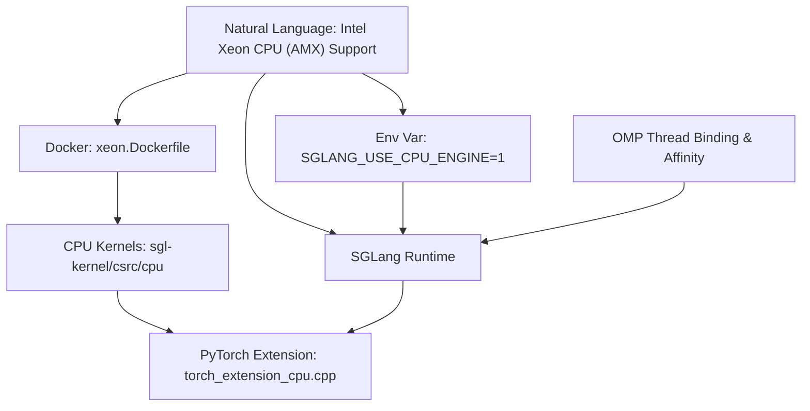
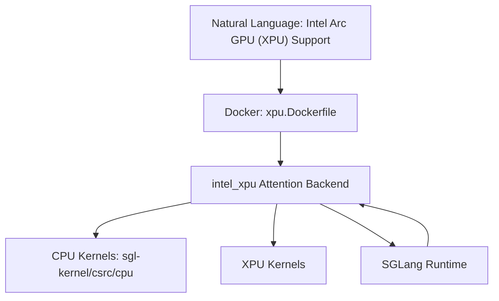

<!-- source: DeepWiki mcp.deepwiki.com · repo microsoft/llm-42 · page 11.2 Intel CPU (Xeon) and XPU Support · fetched 2026-10-26 -->

# Intel CPU (Xeon) and XPU Support

<details>
<summary>Relevant source files</summary>

The following files were used as context for generating this wiki page:

- [docker/Dockerfile](docker/Dockerfile)
- [docker/xeon.Dockerfile](docker/xeon.Dockerfile)
- [docker/xpu.Dockerfile](docker/xpu.Dockerfile)
- [docs/platforms/cpu_server.md](docs/platforms/cpu_server.md)
- [docs/platforms/xpu.md](docs/platforms/xpu.md)
- [python/sglang/srt/configs/update_config.py](python/sglang/srt/configs/update_config.py)
- [python/sglang/srt/layers/attention/intel_amx_backend.py](python/sglang/srt/layers/attention/intel_amx_backend.py)
- [sgl-kernel/Makefile](sgl-kernel/Makefile)
- [sgl-kernel/csrc/cpu/common.h](sgl-kernel/csrc/cpu/common.h)
- [sgl-kernel/csrc/cpu/gemm.cpp](sgl-kernel/csrc/cpu/gemm.cpp)
- [sgl-kernel/csrc/cpu/gemm.h](sgl-kernel/csrc/cpu/gemm.h)
- [sgl-kernel/csrc/cpu/gemm_fp8.cpp](sgl-kernel/csrc/cpu/gemm_fp8.cpp)
- [sgl-kernel/csrc/cpu/gemm_int8.cpp](sgl-kernel/csrc/cpu/gemm_int8.cpp)
- [sgl-kernel/csrc/cpu/moe.cpp](sgl-kernel/csrc/cpu/moe.cpp)
- [sgl-kernel/csrc/cpu/moe_fp8.cpp](sgl-kernel/csrc/cpu/moe_fp8.cpp)
- [sgl-kernel/csrc/cpu/moe_int8.cpp](sgl-kernel/csrc/cpu/moe_int8.cpp)
- [sgl-kernel/csrc/cpu/norm.cpp](sgl-kernel/csrc/cpu/norm.cpp)
- [sgl-kernel/csrc/cpu/qkv_proj.cpp](sgl-kernel/csrc/cpu/qkv_proj.cpp)
- [sgl-kernel/csrc/cpu/rope.cpp](sgl-kernel/csrc/cpu/rope.cpp)
- [sgl-kernel/csrc/cpu/topk.cpp](sgl-kernel/csrc/cpu/topk.cpp)
- [sgl-kernel/csrc/cpu/torch_extension_cpu.cpp](sgl-kernel/csrc/cpu/torch_extension_cpu.cpp)
- [sgl-kernel/csrc/cpu/vec.h](sgl-kernel/csrc/cpu/vec.h)
- [sgl-kernel/pyproject.toml](sgl-kernel/pyproject.toml)
- [sgl-kernel/pyproject_cpu.toml](sgl-kernel/pyproject_cpu.toml)
- [sgl-kernel/pyproject_rocm.toml](sgl-kernel/pyproject_rocm.toml)
- [sgl-kernel/python/sgl_kernel/version.py](sgl-kernel/python/sgl_kernel/version.py)
- [test/srt/cpu/test_activation.py](test/srt/cpu/test_activation.py)
- [test/srt/cpu/test_gemm.py](test/srt/cpu/test_gemm.py)
- [test/srt/cpu/test_mla.py](test/srt/cpu/test_mla.py)
- [test/srt/cpu/test_moe.py](test/srt/cpu/test_moe.py)
- [test/srt/cpu/test_norm.py](test/srt/cpu/test_norm.py)
- [test/srt/cpu/test_qkv_proj_with_rope.py](test/srt/cpu/test_qkv_proj_with_rope.py)
- [test/srt/cpu/test_rope.py](test/srt/cpu/test_rope.py)
- [test/srt/cpu/test_shared_expert.py](test/srt/cpu/test_shared_expert.py)
- [test/srt/cpu/test_topk.py](test/srt/cpu/test_topk.py)
- [test/srt/cpu/utils.py](test/srt/cpu/utils.py)

</details>


This section details the support for Intel Xeon CPUs with AMX (Advanced Matrix Extensions) and Intel Arc GPUs (XPU) within the LLM-42 codebase. It covers the specialized Docker environments, CPU kernel extensions, environment configuration flags, OpenMP thread binding strategies, and the integration of the `intel_xpu` attention backend for efficient inference execution on these platforms.

---

## Overview

Intel-based support in LLM-42 enables highly optimized inference on CPU servers equipped with 4th generation or newer Intel Xeon Scalable processors featuring AMX instructions, as well as on Intel Arc GPUs. The system is designed to leverage instruction-level parallelism, CPU extensions, and heterogeneous compute architectures concurrently for efficient and deterministic LLM inference.

Support spans the following:

- Dockerfiles tailored for Intel Xeon CPU servers and Intel Arc GPUs.
- Custom CPU kernel extensions taking advantage of AMX BF16 and AVX-512 capabilities.
- Runtime configuration via environment variable `SGLANG_USE_CPU_ENGINE` signaling CPU engine usage.
- OpenMP thread binding optimizations to improve CPU core usage and NUMA-awareness.
- The `intel_xpu` attention backend that manages workload execution across CPU and Arc GPU devices.

---

## Docker Environments: xeon.Dockerfile and xpu.Dockerfile

### xeon.Dockerfile

The `xeon.Dockerfile` is a Docker build definition tailored for setting up LLM-42 with full Intel Xeon CPU support.

- It installs system dependencies including development libraries, MPI, NUMA support, and Intel-specific performance libraries.
- Python 3.12 is configured, and Python pip setup uses U.V. (astral.sh "uv") package manager for isolated installs.
- The Intel AMX-capable kernel extensions are built from the `sgl-kernel` CPU submodule.
- Environment variables such as `SGLANG_USE_CPU_ENGINE=1` are set within containers to enable the CPU kernel engine.
- Example usage includes mapping shared memory and networking for high-throughput inference serving.

The Dockerfile excerpt references installation of packages and environment configuration for optimal Intel CPU usage and can be found at `docker/xeon.Dockerfile:1-188` with environment setup instructions from `docs/platforms/cpu_server.md:3-191`.

### xpu.Dockerfile

The `xpu.Dockerfile` sets up an environment to support inference on Intel Arc GPUs, often used alongside or instead of Xeon CPUs.

- Defines the core runtime with Intel XPU drivers and dependencies installed.
- Mirrors CUDA-like stack usage but adapted for Intel Arc hardware.
- Prepares the system to load Intel-specific runtime libraries and drivers needed for the `intel_xpu` backend.
- Supports combined usage with CPU engine extensions.

This Dockerfile is located in `docker/xpu.Dockerfile`.

---

## CPU Kernel Extensions in sgl-kernel/csrc/cpu

Core CPU kernel implementations optimized for Intel Xeon AMX and AVX-512 instruction sets reside in the `sgl-kernel/csrc/cpu` directory.

- Implementation files include key CUDA kernel analogs rewritten and optimized for CPU:
  - `gemm.cpp` and `gemm_int8.cpp` implement matrix-multiplication optimized for AMX BF16 and INT8.
  - `norm.cpp` and `rope.cpp` provide RMSNorm, LayerNorm, and rotary position embeddings with fused CPU kernels.
  - `moe.cpp`, `moe_int8.cpp`, and `moe_fp8.cpp` implement Mixture-of-Experts fused operations.
  - `topk.cpp` covers expert selection with optimized top-k implementations.
- `torch_extension_cpu.cpp` registers these kernels as PyTorch extensions, exposing them as `torch.ops.sgl_kernel.*` operations usable by the SGLang runtime.
- Kernels exploit Intel AMX BF16 extensions and AVX512 intrinsics for floating point conversion and vectorized computation shown in `vec.h`.
- Tests in `test/srt/cpu/` verify kernel correctness and performance under CPU execution.

The main CPU kernel entry points can be found in `sgl-kernel/csrc/cpu/torch_extension_cpu.cpp:70-220`.

### Notable Kernel Extensions

- **Rotary Embedding:** The fused rotary embeddings kernel uses AVX512 and AMX instructions to accelerate positional encoding computations on the CPU, with tests in `test/srt/cpu/test_rope.py`.
- **RMSNorm and LayerNorm:** Optimized fused normalization layers serve key transformer layers efficiently on CPU with AMX support (`norm.cpp`).
- **Mixture-of-Experts:** Expert routing and fused experts kernel implementations facilitate MoE models on CPU (`moe.cpp` and variants).

---

## Environment Variable: SGLANG_USE_CPU_ENGINE

To leverage the CPU extension kernels with Xeon AMX support and enable the CPU-based inference engine, the environment variable `SGLANG_USE_CPU_ENGINE=1` must be set.

This flag:

- Activates the CPU engine within the runtime.
- Switches the attention backend and other low-level kernels to CPU variants.
- Influences threading and binding strategies (see next section).

Example export:

```bash
export SGLANG_USE_CPU_ENGINE=1
```

This is documented in the source comments and usage instructions in `docs/platforms/cpu_server.md:134-166`.

---

## OpenMP Thread Binding and CPU Affinity

To extract maximum performance on multi-socket Intel Xeon platforms, LLM-42 leverages OpenMP threading with explicit thread binding and CPU affinity settings.

- The system binds threads to specific CPU cores or NUMA nodes to minimize cross-socket memory traffic.
- This improves cache locality and reduces latency.
- Details are configurable and enforced by runtime initialization code in the CPU kernel libraries (`sgl-kernel/csrc/cpu/*`), typically integrated with PyTorch's thread pool or environment variables like `OMP_PROC_BIND`.

Thread management ensures efficient parallelism when running CPU-based kernels, especially for attention computation and mixture-of-experts routing.

---

## Intel_XPU Attention Backend

The `intel_xpu` attention backend enables inference using Intel's heterogeneous compute hardware — comprising Intel Xeon CPUs with AMX extensions and Intel Arc GPUs.

### Design and Data Flow

- The backend manages device selection and workload partitioning between the CPU and Intel Arc GPU.
- Attention kernels are dispatched conditionally based on the compute resource available.
- Uses CPU kernel extensions for parts benefiting from AMX instructions.
- Offloads compute-heavy attention blocks to Intel Arc GPU through specifically implemented GPU kernels.

### Key Classes and Functions

- The attention backend class registers itself among pluggable backends for attention in the SGLang runtime.
- Implements `forward` methods leveraging the registered CPU kernels (e.g., `decode_attention_cpu` in `torch_extension_cpu.cpp`) and XPU device kernels.
- Controls memory synchronization and manages cache/coalescing strategies suitable for both CPU and XPU.

### Integration

The backend integrates with the LLM-42 scheduler and runtime components that handle token generation and KV cache management, transparently switching between devices depending on workload characteristics and hardware availability.

---

## Summary Mermaid Diagrams

### Diagram 1: Natural Language Space to Code Entity Space — Intel CPU (Xeon) Support



### Diagram 2: Natural Language Space to Code Entity Space — Intel XPU Backend



---

## Implementation Highlights

| Topic                 | Location/Files                                                 | Summary                                                                                       |
|-----------------------|----------------------------------------------------------------|------------------------------------------------------------------------------------------------|
| Dockerfile CPU Setup  | `docker/xeon.Dockerfile:1-188`                                | Installs libraries, CPUs, compilers, and dependencies for Intel Xeon CPU build environment.   |
| Dockerfile XPU Setup  | `docker/xpu.Dockerfile`                                       | Installs Intel Arc GPU runtime and dependencies.                                              |
| CPU Kernels           | `sgl-kernel/csrc/cpu/*.cpp`, especially `torch_extension_cpu.cpp:70-220` | Implements fused kernels for attention, GEMM, MoE, RMSNorm leveraging AMX and AVX512.         |
| PyTorch Kernel Binding | `sgl-kernel/csrc/cpu/torch_extension_cpu.cpp`                | Registers CPU kernels as PyTorch ops for use in SGLang frontend and runtime.                  |
| Environment Config    | `docs/platforms/cpu_server.md:135-166`                        | Describes `SGLANG_USE_CPU_ENGINE` variable and system library environment variables.          |
| Thread Binding        | In kernels and runtime; use OpenMP binding and CPU affinity for NUMA optimization. | Enhances parallel execution on multi-core Xeon servers.                                      |
| Attention Backend     | `python/sglang/srt/layers/attention/intel_amx_backend.py`     | Provides attention operator implementations for Intel XPU heterogeneous execution backend.    |
| Rotary Embedding Tests| `test/srt/cpu/test_rope.py`                                   | Tests verifying correctness and performance of CPU rotary embedding kernel with AMX support.  |

---

This page completes the detailed documentation for Intel CPU (Xeon) and Intel XPU (Arc GPU) platform support within the LLM-42 codebase. For additional information on related platforms, please refer to adjacent sections on AMD ROCm and Huawei Ascend NPU support.

---

### Sources
- `docker/xeon.Dockerfile:1-188`  
- `docker/xpu.Dockerfile`  
- `sgl-kernel/csrc/cpu/torch_extension_cpu.cpp:20-220`  
- `sgl-kernel/csrc/cpu/vec.h:1-170`  
- `docs/platforms/cpu_server.md:3-191`  
- `python/sglang/srt/layers/attention/intel_amx_backend.py`  
- `test/srt/cpu/test_rope.py`

---

