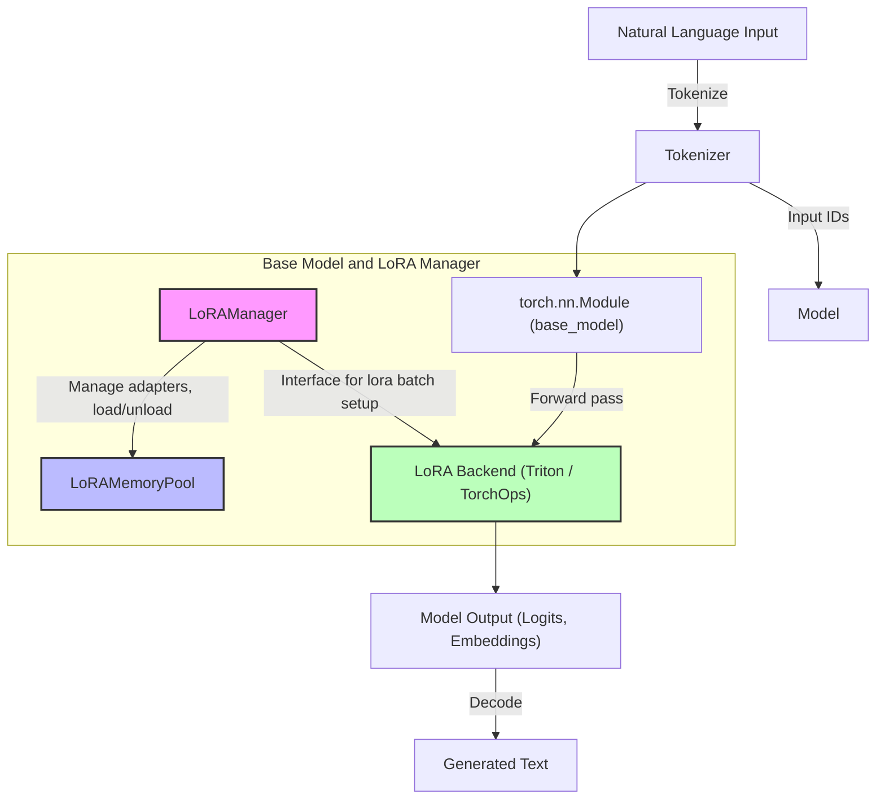
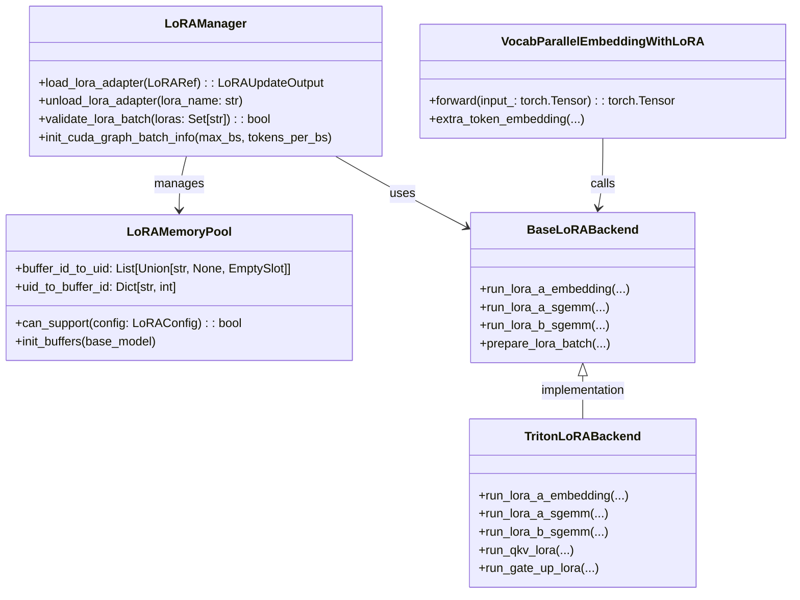

<!-- source: DeepWiki mcp.deepwiki.com · repo microsoft/llm-42 · page 12 LoRA and Dynamic Adapters · fetched 2026-10-26 -->

# LoRA and Dynamic Adapters

Relevant source files

The following files were used as context for generating this wiki page:

- [python/sglang/srt/lora/backend/base_backend.py](python/sglang/srt/lora/backend/base_backend.py)
- [python/sglang/srt/lora/backend/triton_backend.py](python/sglang/srt/lora/backend/triton_backend.py)
- [python/sglang/srt/lora/layers.py](python/sglang/srt/lora/layers.py)
- [python/sglang/srt/lora/lora.py](python/sglang/srt/lora/lora.py)
- [python/sglang/srt/lora/lora_manager.py](python/sglang/srt/lora/lora_manager.py)
- [python/sglang/srt/lora/mem_pool.py](python/sglang/srt/lora/mem_pool.py)
- [python/sglang/srt/lora/utils.py](python/sglang/srt/lora/utils.py)
- [python/sglang/test/lora_utils.py](python/sglang/test/lora_utils.py)
- [python/sglang/test/runners.py](python/sglang/test/runners.py)
- [test/registered/lora/test_lora_backend.py](test/registered/lora/test_lora_backend.py)
- [test/registered/lora/test_lora_eviction.py](test/registered/lora/test_lora_eviction.py)
- [test/registered/lora/test_lora_overlap_loading.py](test/registered/lora/test_lora_overlap_loading.py)
- [test/registered/lora/test_lora_qwen3.py](test/registered/lora/test_lora_qwen3.py)
- [test/registered/lora/test_lora_tp.py](test/registered/lora/test_lora_tp.py)
- [test/registered/lora/test_lora_update.py](test/registered/lora/test_lora_update.py)
- [test/registered/lora/test_multi_lora_backend.py](test/registered/lora/test_multi_lora_backend.py)
- [test/registered/rl/test_lora_load_from_tensor.py](test/registered/rl/test_lora_load_from_tensor.py)

This section delves into the runtime management of Low-Rank Adaptation (LoRA) adapters within the LLM-42 inference engine. LoRA enables fine-tuning large language models (LLMs) by introducing low-rank parameter updates. Managing potentially thousands of LoRA adapters concurrently, with dynamic loading, memory pooling, overlap loading, and eviction policies, is critical for scalable and efficient serving.

The page covers the architecture and implementation details of `LoRAManager` (the core runtime manager), the `LoRAMemoryPool` (memory layout and allocation for LoRA weights), the `LoRAOverlapLoader` (asynchronous adapter loading to enable overlap with inference), eviction strategies for memory-constrained serving, and the integration of multiple LoRAs in a single inference batch. It also describes the differences and support offered by the two LoRA backends: the `triton` backend leveraging custom Triton kernels, and the `torch_ops` fallback.

---

## 12.1 Overview and Purpose

Large-scale deployment of LoRA adapters requires dynamic runtime management to achieve:

- **Efficient memory usage:** LoRA adapters have varying shapes and ranks, necessitating consolidated memory layouts to avoid fragmentation.
- **Dynamic loading and unloading:** Support concurrent serving of thousands of adapters, which cannot all fit in GPU memory simultaneously.
- **Batching multiple adapters:** Support multi-LoRA serving where a single minibatch may apply different LoRAs to tokens or requests.
- **Overlap loading:** Asynchronously load LoRA weights from storage concurrently with inference, to reduce latency.
- **Eviction policies:** Free memory by evicting less-used adapters, based on configurable policies like Least Recently Used (LRU).
- **Backend abstraction:** Support optimized LoRA computation via specialized Triton kernels or fallback implementations with torch.

The key runtime entity is the `LoRAManager` which orchestrates all above responsibilities at runtime.

---

## 12.2 LoRAManager: Core Runtime Manager

`LoRAManager` is the main orchestrator of LoRA runtime logic. It holds the mapping of loaded adapters, manages the memory pool, coordinates loading/unloading, and interfaces to the LoRA backend for actual forward path execution.

### Key attributes and construction

- `base_model`: The original transformer model module with LoRA adapters inserted as wrappers.
- `base_hf_config`: Huggingface model config to interpret layer count, targets.
- `max_loras_per_batch`: Max distinct LoRA adapters that can be active in a single forward batch.
- `device`: GPU device where adapter weights and computation run.
- `lora_backend`: Instance of a subclass of `BaseLoRABackend` implementing kernels (`triton` by default).
- `memory_pool`: LoRAMemoryPool instance managing the allocation of LoRA weights consolidated buffers.
- `lora_refs`: Dictionary of currently loaded LoRA metadata referenced by their IDs.
- `eviction_policy`: Eviction policy instance controlling which adapters to evict (e.g. LRU).
- Flags and parameters like `enable_lora_overlap_loading` to control async overlap loads.

### Main responsibilities

- **Load LoRA Adapters (`load_lora_adapter`)**: Loads a new adapter by reading config, validating shape compatibility with the memory pool, loading weights, and inserting the adapter into memory.
- **Unload Adapters**: Remove adapters from memory and update metadata.
- **Validate Batches**: Ensures that the set of LoRA adapters for a given forward batch fits memory and resource constraints.
- **Fetch/Replace Weights**: Interfaces with the memory pool to fetch or evict adapter weights as needed.
- **Batch Preparation**: Prepare batch information (such as rank and scaling factors) and pass to backend for efficient fused execution.
- **Support for Multi-LoRA Batching**: Handle batches with token-level or sequence-level mixing of LoRA adapters.

### Initialization flow

- At startup, the manager initializes the memory pool with pre-configured parameters like max rank, target modules, and device layout.
- It initializes the backend (`triton` or other).
- Can preload adapters or support on-demand loading with overlap.

### LoRA Update Result

Loading functions return a `LoRAUpdateOutput` message summarizing success or potential error messages, with loaded adapter names for observability.

---

## 12.3 LoRAMemoryPool: Memory Layout and Management

The `LoRAMemoryPool` class manages consolidated GPU buffers holding all loaded LoRA weight matrices for efficient fused computation.

### Design concepts

- **Slot-based allocation:** The pool contains fixed buffer slots indexed by buffer IDs. Each slot can host one adapter.
- **Buffers for A and B matrices:** LoRA adapters are decomposed into low-rank matrices A and B. Separate buffers are maintained:
  - `A_buffer`: Row-major tensors for A weights.
  - `B_buffer`: Column-major tensors for B weights.
- **Support for stacked modules:** Certain modules (like QKV or gate-up projections) stack multiple LoRA weight blocks per layer. The buffer sizing accounts for this.
- **Per-module and per-layer buffers:** The pool maintains separate buffers keyed by module names and layers.
- **Embedding and LM head LoRA buffers:** Special buffers for embedding and vocabulary parallel layers.
- **Tracking of loaded adapters:** Mappings of adapter UIDs to buffer indices and vice versa.
- **Eviction:** Uses attached eviction policies to free slots when memory is exhausted.

### Allocation and shape inference

Functions infer the shape of buffers based on:

- LoRA rank and adapter shape.
- Target modules enabled.
- Model parallelism settings if applicable.
- Added tokens in vocabulary size (currently limited).

### Buffer Initialization

Buffers are preallocated on the model's device with shape parameters consistent across all loaded adapters, enabling fast indexing and dispatch.

---

## 12.4 Overlap Loading with LoRAOverlapLoader

Asynchronous loading with overlap allows fetching LoRA adapter weights from disk or network storage concurrently with ongoing inference to avoid stalls.

- `LoRAOverlapLoader` manages load events (`lora_to_overlap_load_event` dictionary) indexed by LoRA names.
- Uses CUDA events and streams to track asynchronous load completion.
- Tracks load status as `NOT_LOADED`, `LOADING`, or `LOADED`.
- Enforces maximum concurrent load capacity to avoid resource exhaustion.
- On load request, it checks if loading is possible under current capacity and initiates async load by delegating to `LoRAManager.fetch_new_loras`.
- Periodically checks load completion to mark adapters as ready for usage.

Overlap loading is enabled by the flag `enable_lora_overlap_loading` configured in `LoRAManager`.

---

## 12.5 Eviction Policies

LoRA adapters consume GPU VRAM proportional to rank and module size. To support thousands of simultaneous adapters beyond memory limits, basic eviction policies are used.

- Current implementation supports LRU eviction:
  - Tracks "last use" timestamps or access counts.
  - Evicts least recently used adapters when new loads require space.
- Eviction is controlled via `lora_eviction_policy` server argument.
- On eviction, the pool clears allocated buffer slots and the manager removes adapter references.
- Adapters can be dynamically loaded/unloaded transparently from the application's perspective.

---

## 12.6 Multi-LoRA Serving and Segmented Batching

LLM-42 supports using multiple different LoRA adapters in a single inference batch. This is done by segmenting batches where each segment uses one adapter, enabling token-level adapter mixing.

- The `LoRAManager` and backend cooperate to prepare a `LoRABatchInfo` structure describing segments, indices, ranks, scalings, and permutations.
- The memory pool consolidates the buffers for all active adapters for the batch.
- Backends like Triton run fused CUDA kernels executing per-segment LoRA weighted computations.
- This model facilitates multi-tenant serving scenarios where different requests or tokens are routed to different adapters dynamically.

---

## 12.7 LoRA Backend Implementations

The LoRA forward implementations are abstracted behind the `BaseLoRABackend` interface, allowing flexibility in kernel implementations.

### Triton Backend

- Implemented in `TritonLoRABackend` subclass.
- Uses custom Triton CUDA kernels for fused LoRA matrix multiplications.
- Methods include:
  - `run_lora_a_embedding`: performs efficient embedding lookup with LoRA A weights.
  - `run_lora_a_sgemm` and `run_lora_b_sgemm`: perform segment-wise GEMM for low-rank matrices.
  - Specialized QKV and gate-up projection fused kernels.
- Supports CUDA Graph mode optimizations for lower runtime overhead.
- Coordination of batch info buffers and asynchronous data transfers.

### Torch Ops Fallback Backend

- Implements the same interface but falls back to pure PyTorch operations.
- Less performant but ensures compatibility and easier debugging.

---

## 12.8 LoRA Linear Layers Integration

LoRA is integrated into the model by augmenting linear layers with LoRA-aware wrappers `BaseLayerWithLoRA` and specialized subclasses such as `VocabParallelEmbeddingWithLoRA` to handle embeddings with LoRA.

- The wrapper layers hold references to base layers and manage LoRA parameters.
- During the forward pass, the wrappers:
  - Compute base outputs of the underlying layer.
  - Compute low-rank LoRA modifications using backend fused kernels.
  - Add LoRA output correction to base output to get the adapted result.
- Special handling exists for embedding layers to process tokens that may be beyond the base vocabulary size.
- Methods for slicing LoRA weights according to tensor parallel rank are supported.
- The layering design separates LoRA-aware computation cleanly from base model logic.

---

## 12.9 Data Flow Summary with Mermaid Diagram

This diagram maps the conceptual roles to the main code entities:`LoRAManager`, `LoRAMemoryPool`, and `LoRABackend` collaboratively support LoRA enhanced forward passes in the overall model serving pipeline.

---

## 12.10 Key Classes and Functions Mapped to Components

This class diagram positions runtime classes to their roles:

- `LoRAManager`: Runtime adapter lifecycle and batch management.
- `LoRAMemoryPool`: Memory allocation and buffer management.
- `BaseLoRABackend` and `TritonLoRABackend`: LoRA kernel execution abstraction.
- `VocabParallelEmbeddingWithLoRA`: Layer wrapper demonstrating LoRA application during forward.

---

## 12.11 Summary

The LLM-42 codebase supports scalable, dynamic deployment of thousands of concurrent LoRA adapters via a layered design comprising:

- `LoRAManager` that mediates adapter lifecycle, memory usage, batch validation, and eviction.
- A centralized memory pooling system abstracted by `LoRAMemoryPool` providing flexible buffer management over A and B matrices.
- Async overlap loader to prefetch adapters while serving requests with minimal blocking.
- Pluggable execution kernels with a high-performance Triton backend and a PyTorch fallback.
- Layer wrappers enabling LoRA injection transparently into embedding and linear layers.
- Support for multi-LoRA batching with segmented workloads efficiently fused by specialized CUDA kernels.

This architecture enables the system to handle complex multi-tenant LoRA serving scenarios efficiently with flexible runtime adapter loading and unloading, fitting within constrained GPU resources.

---

## Sources

- `python/sglang/srt/lora/lora_manager.py:50-180`, `python/sglang/srt/lora/lora_manager.py:119-152`  
- `python/sglang/srt/lora/mem_pool.py:46-140`  
- `python/sglang/srt/lora/lora.py:38-148`  
- `python/sglang/srt/lora/backend/base_backend.py:8-180`  
- `python/sglang/srt/lora/backend/triton_backend.py:15-207`  
- `python/sglang/srt/lora/layers.py:27-187`  
- `test/registered/lora/test_lora_overlap_loading.py:23-162`  
- `test/registered/lora/test_lora_eviction.py:57-147`  
- `python/sglang/srt/lora/utils.py:9-196`

---

