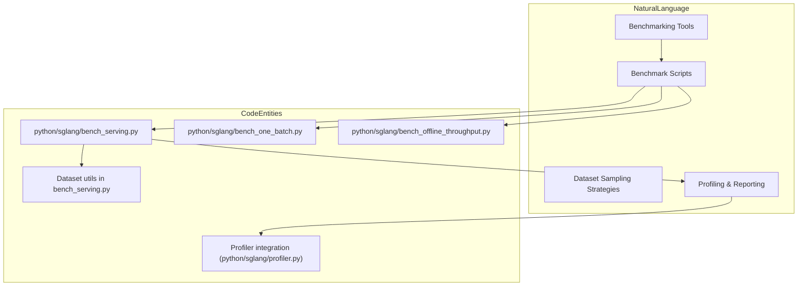

<!-- source: DeepWiki mcp.deepwiki.com · repo microsoft/llm-42 · page 13 Testing, Benchmarking, and CI/CD · fetched 2026-10-26 -->

# Testing, Benchmarking, and CI/CD

<details>
<summary>Relevant source files</summary>

The following files were used as context for generating this wiki page:

- [.codespellrc](.codespellrc)
- [.github/CI_PERMISSIONS.json](.github/CI_PERMISSIONS.json)
- [.github/CODEOWNERS](.github/CODEOWNERS)
- [.github/ISSUE_TEMPLATE/1-bug-report.yml](.github/ISSUE_TEMPLATE/1-bug-report.yml)
- [.github/ISSUE_TEMPLATE/2-feature-request.yml](.github/ISSUE_TEMPLATE/2-feature-request.yml)
- [.github/MAINTAINER.md](.github/MAINTAINER.md)
- [.github/labeler.yml](.github/labeler.yml)
- [.github/pull_request_template.md](.github/pull_request_template.md)
- [.github/update_ci_permission.py](.github/update_ci_permission.py)
- [.github/workflows/cancel-pr-workflow-on-merge.yml](.github/workflows/cancel-pr-workflow-on-merge.yml)
- [.github/workflows/cancel-unfinished-pr-tests.yml](.github/workflows/cancel-unfinished-pr-tests.yml)
- [.github/workflows/labeler.yml](.github/workflows/labeler.yml)
- [.github/workflows/lint.yml](.github/workflows/lint.yml)
- [.github/workflows/pr-gate.yml](.github/workflows/pr-gate.yml)
- [.github/workflows/pr-test.yml](.github/workflows/pr-test.yml)
- [.github/workflows/slash-command-handler.yml](.github/workflows/slash-command-handler.yml)
- [.pre-commit-config.yaml](.pre-commit-config.yaml)
- [docs/developer_guide/contribution_guide.md](docs/developer_guide/contribution_guide.md)
- [python/sglang/README.md](python/sglang/README.md)
- [python/sglang/bench_offline_throughput.py](python/sglang/bench_offline_throughput.py)
- [python/sglang/bench_one_batch.py](python/sglang/bench_one_batch.py)
- [python/sglang/bench_one_batch_server.py](python/sglang/bench_one_batch_server.py)
- [python/sglang/bench_serving.py](python/sglang/bench_serving.py)
- [python/sglang/profiler.py](python/sglang/profiler.py)
- [python/sglang/srt/layers/torchao_utils.py](python/sglang/srt/layers/torchao_utils.py)
- [python/sglang/test/test_utils.py](python/sglang/test/test_utils.py)
- [scripts/code_sync/guideline.md](scripts/code_sync/guideline.md)
- [test/srt/run_suite.py](test/srt/run_suite.py)

</details>


This section provides a high-level overview of the testing, benchmarking, and continuous integration/continuous deployment (CI/CD) infrastructure within the LLM-42 codebase. It introduces the major components and workflows that ensure code correctness, performance validation, and reliable deployment. Detailed technical information and specific scripts/tools are covered in dedicated child pages.

---

## Purpose and Scope

LLM-42 employs a comprehensive system for testing correctness, benchmarking performance metrics, and automating CI/CD pipelines. This infrastructure supports multiple target hardware platforms (NVIDIA GPUs, AMD GPUs, Intel CPUs/XPU, Huawei Ascend NPUs, etc.), ensuring robust and reproducible results across diverse environments.

The testing ecosystem includes unit tests, integration tests, nightly regression tests, and hardware-specific test runners. Benchmarking tools measure latency, throughput, and determinism metrics using various datasets and sampling strategies. The CI/CD workflows automate test execution on pull requests, scheduled runs, and monitor failures for rapid feedback and quality assurance.

This parent page summarizes the overall architecture and how the main components relate to each other. For in-depth details, please see the linked child pages:
- [Test Framework and CI Workflows](#13.1)
- [Benchmarking Tools](#13.2)
- [Debug Utilities and Profiling](#13.3)

---

## 1. Test Framework and CI/CD Workflows

### Overview

The testing framework orchestrates the discovery, partitioning, and execution of tests across different hardware environments and compute configurations. Core test orchestration is handled by the `run_suite.py` script, which maintains categorized test suites such as `per-commit-amd`, `per-commit-cpu`, and various Ascend NPU suites. Tests are grouped and auto-partitioned to enable distributed parallel execution, balancing run time estimates fairly among workers.

Tests are primarily written in Python's `unittest` style and organized by target hardware backends (CUDA, ROCm, Xeon CPU, XPU, Ascend NPU). The framework supports temporary disabling of flaky or in-progress tests and maintains a registry system for suites to facilitate CI use.

### CI Workflows

The main CI pipeline is configured in `.github/workflows/pr-test.yml`. It triggers on pull requests, scheduled intervals, and manual dispatch. The workflow dynamically detects changed files to selectively run relevant test subsets unless a full test run is requested.

Concurrency is managed to avoid conflicts across builds. The workflow includes stages for change detection, kernel build verification, nightly test execution, and hardware-specific test dispatch (e.g., B200, H200 GPUs, Ascend NPUs). There are mechanisms to force continuation on errors for scheduled runs and automatic parallel test partitioning for scale.

Authorized contributors with special permissions can trigger reruns for specific test stages or the entire CI. Failure analysis scripts and CI monitoring tools help with identifying flakes and root causes.

### Diagram: Test Framework and CI Workflows to Code Mapping

```mermaid
flowchart TB
    subgraph NaturalLanguage
        Direction1["Test Suites"]
        Direction2["CI Workflow (GitHub Actions)"]
        Direction3["Hardware-specific Test Runners"]
        Direction4["Test Partitioning & Scheduling"]
    end

    subgraph CodeEntities
        SuiteDef["Defined in test/srt/run_suite.py"]
        CIConfig["GitHub workflow config: .github/workflows/pr-test.yml"]
        RunnerScripts["Hardware runners (B200, H200, Ascend) in test/registered/"]
        PartitionFunc["auto_partition() in run_suite.py"]
    end

    Direction1 -->|Defines| SuiteDef
    Direction2 -->|Configured by| CIConfig
    Direction3 -->|Scripts in test/registered/ handle| RunnerScripts
    Direction4 -->|Function auto_partition() partitions workload| PartitionFunc

    CIConfig --> RunnerScripts
    CIConfig --> SuiteDef
    RunnerScripts --> PartitionFunc
```

---

## 2. Benchmarking Tools

### Overview

LLM-42 provides sophisticated benchmarking tools to measure inference performance and scalability across various models and hardware configurations. Benchmarks focus on online serving latency, offline throughput, and end-to-end system responsiveness.

Key benchmarking scripts include:
- `bench_serving.py`: Measures metrics like Time To First Token (TTFT), Inter-Token Latencies (ITL), and Tokens Per Device (TPD) during online streaming scenarios with client-server interactions.
- `bench_one_batch.py`: Profiles single static batches without server overhead to isolate kernel and core runtime latencies.
- `bench_offline_throughput.py`: Benchmarks raw throughput in offline mode with controlled request sets.

These tools use configurable datasets such as ShareGPT, random synthetic inputs, and MMMU (multi-modal multi-unit) samples with flexible sampling strategies. Profiling hooks enable deep performance introspection with support for CPU, GPU, and specialized hardware profilers.

### Benchmarking Integration and Reporting

Benchmarks can be run with built-in correctness checks and optionally record detailed profiling traces. Output results can be saved in JSONL format and converted to pydantic models for structured analysis.

### Diagram: Benchmarking Tools to Code Mapping



---

## 3. Debug Utilities and Profiling

### Overview

Beyond performance benchmarking, the codebase contains extensive debug utilities to facilitate development and diagnose runtime issues. This includes tensor dumping utilities that capture intermediate tensors for offline inspection and comparison.

A specialized dump comparator aids in locating discrepancies across hardware or code changes. Integration with CUDA coredump support helps capture native-level faults on GPU platforms to diagnose crashes.

Furthermore, an advanced profiler endpoint is embedded in the runtime, which can be triggered dynamically to capture detailed execution traces. Profilers come with mixins for the scheduler and runtime checker modules to correlate performance and correctness issues.

---

## Relationships and Workflow Integration

The testing framework drives the CI/CD system by running subsets of tests on demand or on schedule. Benchmarking tools are used both independently and as part of longer running nightly or release validation workflows for performance regression detection. Debug and profiling utilities support both test failures and benchmark investigations.

This integrated infrastructure ensures:
- Code changes are continuously tested on multiple hardware.
- Performance is regularly validated and profiled.
- Failures can be traced and diagnosed with tensor dumps and coredumps.
- Developers have tools for correctness and speed assurance across the diverse LLM-42 ecosystem.

---

## Child Pages for Details

For detailed information about each sub-area with technical specifics, code snippets, and usage instructions, please refer to the following pages:

- **[Test Framework and CI Workflows](#13.1)**  
  Covers test orchestration with `run_suite.py`, hardware-specific test runners, CI workflows (`pr-test.yml`), and failure monitoring.

- **[Benchmarking Tools](#13.2)**  
  Describes performance benchmarking scripts including `bench_serving.py`, sampling strategies, and profiler tool usage.

- **[Debug Utilities and Profiling](#13.3)**  
  Details debugging tools such as tensor dumper, dump comparator, CUDA coredump integration, and the profiler endpoint with scheduler mixins.

---

# Summary Table

| Topic                      | Description                                                    | Main Files / Locations                          |
|----------------------------|----------------------------------------------------------------|------------------------------------------------|
| Test Framework & CI        | Test suites definition, auto partitioning, PR-triggered CI    | `test/srt/run_suite.py`, `.github/workflows/pr-test.yml` |
| Benchmarking Tools         | Latency/throughput benchmarks, datasets, profiling            | `python/sglang/bench_serving.py`, `bench_one_batch.py`, `bench_offline_throughput.py` |
| Debug & Profiling Utilities | Tensor dumps, comparators, CUDA core dumps, runtime profiling | `python/sglang/dumper.py`, `python/sglang/profiler.py`  |

---

# References

- Test Suites and Orchestration: `test/srt/run_suite.py:1-180`  
- CI Workflow Configuration: `.github/workflows/pr-test.yml:1-200`  
- Benchmarking Scripts: `python/sglang/bench_serving.py:1-300`  
- Benchmark One Batch: `python/sglang/bench_one_batch.py:1-180`  
- Offline Throughput Benchmark: `python/sglang/bench_offline_throughput.py:1-150`  
- Debug and Profiling Utilities: (See linked child pages)

Sources:  
`test/srt/run_suite.py`, `.github/workflows/pr-test.yml`, `python/sglang/bench_serving.py`, `python/sglang/bench_one_batch.py`, `python/sglang/bench_offline_throughput.py`, `python/sglang/test/test_utils.py`

---

