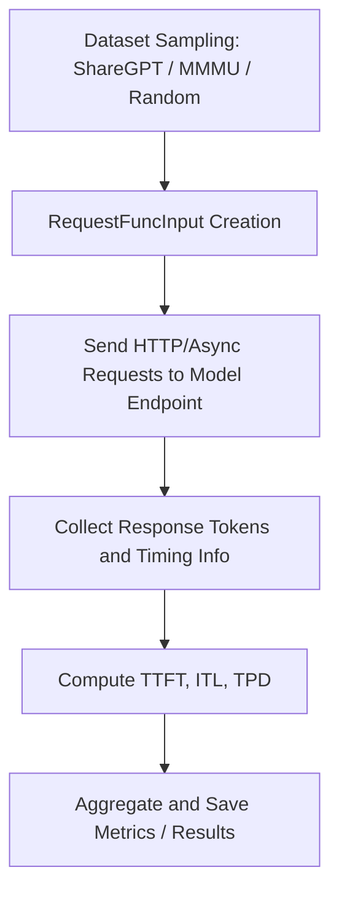
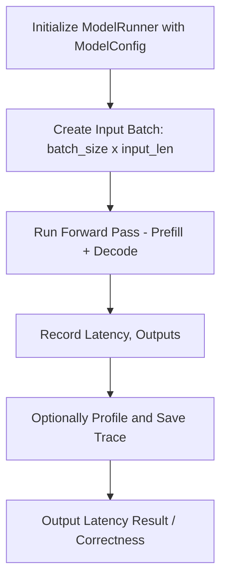
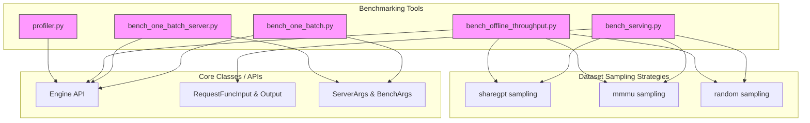

<!-- source: DeepWiki mcp.deepwiki.com · repo microsoft/llm-42 · page 13.2 Benchmarking Tools · fetched 2026-10-26 -->

# Benchmarking Tools

Relevant source files

The following files were used as context for generating this wiki page:

- [.github/workflows/pr-test.yml](.github/workflows/pr-test.yml)
- [benchmark/generative_agents/bench_other.py](benchmark/generative_agents/bench_other.py)
- [benchmark/gpt_oss/README.md](benchmark/gpt_oss/README.md)
- [benchmark/gsm8k/bench_sglang.py](benchmark/gsm8k/bench_sglang.py)
- [benchmark/hellaswag/bench_sglang.py](benchmark/hellaswag/bench_sglang.py)
- [benchmark/json_decode_regex/bench_other.py](benchmark/json_decode_regex/bench_other.py)
- [benchmark/json_decode_regex/bench_sglang.py](benchmark/json_decode_regex/bench_sglang.py)
- [benchmark/line_retrieval/bench_sglang.py](benchmark/line_retrieval/bench_sglang.py)
- [benchmark/llm_judge/bench_other.py](benchmark/llm_judge/bench_other.py)
- [benchmark/llm_judge/bench_sglang.py](benchmark/llm_judge/bench_sglang.py)
- [benchmark/long_json_decode/bench_other.py](benchmark/long_json_decode/bench_other.py)
- [benchmark/long_json_decode/bench_sglang.py](benchmark/long_json_decode/bench_sglang.py)
- [benchmark/mmmu/README.md](benchmark/mmmu/README.md)
- [benchmark/mmmu/bench_hf.py](benchmark/mmmu/bench_hf.py)
- [benchmark/mmmu/bench_sglang.py](benchmark/mmmu/bench_sglang.py)
- [benchmark/mmmu/eval_utils.py](benchmark/mmmu/eval_utils.py)
- [benchmark/mtbench/README.md](benchmark/mtbench/README.md)
- [benchmark/mtbench/bench_other.py](benchmark/mtbench/bench_other.py)
- [benchmark/mtbench/bench_sglang.py](benchmark/mtbench/bench_sglang.py)
- [benchmark/mtbench/bench_sglang_eagle.py](benchmark/mtbench/bench_sglang_eagle.py)
- [benchmark/multi_chain_reasoning/bench_other.py](benchmark/multi_chain_reasoning/bench_other.py)
- [benchmark/multi_chain_reasoning/bench_sglang.py](benchmark/multi_chain_reasoning/bench_sglang.py)
- [benchmark/multi_document_qa/bench_other.py](benchmark/multi_document_qa/bench_other.py)
- [benchmark/multi_document_qa/bench_sglang.py](benchmark/multi_document_qa/bench_sglang.py)
- [benchmark/multi_turn_chat/bench_sglang.py](benchmark/multi_turn_chat/bench_sglang.py)
- [benchmark/multi_turn_chat/long_prompt_multi_turn.py](benchmark/multi_turn_chat/long_prompt_multi_turn.py)
- [benchmark/react/bench_sglang.py](benchmark/react/bench_sglang.py)
- [benchmark/tree_of_thought_v0/bench_sglang.py](benchmark/tree_of_thought_v0/bench_sglang.py)
- [docs/advanced_features/dp_for_multi_modal_encoder.md](docs/advanced_features/dp_for_multi_modal_encoder.md)
- [docs/basic_usage/deepseek_v3.md](docs/basic_usage/deepseek_v3.md)
- [docs/basic_usage/glm45.md](docs/basic_usage/glm45.md)
- [docs/basic_usage/glmv.md](docs/basic_usage/glmv.md)
- [docs/basic_usage/gpt_oss.md](docs/basic_usage/gpt_oss.md)
- [docs/basic_usage/sampling_params.md](docs/basic_usage/sampling_params.md)
- [docs/developer_guide/bench_serving.md](docs/developer_guide/bench_serving.md)
- [docs/developer_guide/benchmark_and_profiling.md](docs/developer_guide/benchmark_and_profiling.md)
- [docs/developer_guide/development_guide_using_docker.md](docs/developer_guide/development_guide_using_docker.md)
- [docs/developer_guide/setup_github_runner.md](docs/developer_guide/setup_github_runner.md)
- [docs/references/multi_node_deployment/lws_pd/lws_pd_deploy.md](docs/references/multi_node_deployment/lws_pd/lws_pd_deploy.md)
- [docs/references/production_request_trace.md](docs/references/production_request_trace.md)
- [python/sglang/README.md](python/sglang/README.md)
- [python/sglang/bench_offline_throughput.py](python/sglang/bench_offline_throughput.py)
- [python/sglang/bench_one_batch.py](python/sglang/bench_one_batch.py)
- [python/sglang/bench_one_batch_server.py](python/sglang/bench_one_batch_server.py)
- [python/sglang/bench_serving.py](python/sglang/bench_serving.py)
- [python/sglang/profiler.py](python/sglang/profiler.py)
- [python/sglang/srt/layers/quantization/kv_cache.py](python/sglang/srt/layers/quantization/kv_cache.py)
- [python/sglang/srt/layers/torchao_utils.py](python/sglang/srt/layers/torchao_utils.py)
- [python/sglang/srt/tracing/trace.py](python/sglang/srt/tracing/trace.py)
- [python/sglang/test/attention/test_flashattn_backend.py](python/sglang/test/attention/test_flashattn_backend.py)
- [python/sglang/test/attention/test_flashattn_mla_backend.py](python/sglang/test/attention/test_flashattn_mla_backend.py)
- [python/sglang/test/few_shot_gsm8k.py](python/sglang/test/few_shot_gsm8k.py)
- [python/sglang/test/few_shot_gsm8k_engine.py](python/sglang/test/few_shot_gsm8k_engine.py)
- [python/sglang/test/run_eval.py](python/sglang/test/run_eval.py)
- [python/sglang/test/simple_eval_common.py](python/sglang/test/simple_eval_common.py)
- [python/sglang/test/simple_eval_gpqa.py](python/sglang/test/simple_eval_gpqa.py)
- [python/sglang/test/simple_eval_gsm8k.py](python/sglang/test/simple_eval_gsm8k.py)
- [python/sglang/test/simple_eval_humaneval.py](python/sglang/test/simple_eval_humaneval.py)
- [python/sglang/test/simple_eval_math.py](python/sglang/test/simple_eval_math.py)
- [python/sglang/test/simple_eval_mmlu.py](python/sglang/test/simple_eval_mmlu.py)
- [python/sglang/test/simple_eval_mmmu_vlm.py](python/sglang/test/simple_eval_mmmu_vlm.py)
- [python/sglang/test/test_utils.py](python/sglang/test/test_utils.py)
- [test/srt/run_suite.py](test/srt/run_suite.py)

This page documents the performance benchmarking tools provided in the LLM-42 codebase for evaluating the latency, throughput, and other metrics of the model serving system. It covers the main benchmarking scripts, dataset sampling strategies, detailed performance metrics collected, and the profiling utility integrated with the runtime. These tools are essential for quantifying the performance impact of various configuration and code changes and for systematically comparing different hardware setups and model variants.

---

## 1. Overview and Purpose

The benchmarking tools in this repository are designed to measure and analyze the performance of the LLM inference engine under different scenarios:

- **bench_serving.py**: Benchmarks online serving latency and related metrics with dynamic request workloads. It measures **TTFT** (Time To First Token), **ITL** (Inter-Token Latency), and **TPD** (Tokens Per Device), among others.

- **bench_one_batch.py / bench_one_batch_server.py**: Benchmarks latency for running a single static batch without a server and with a server respectively, useful for fine-grained latency analysis.

- **bench_offline_throughput.py**: Benchmarks offline throughput by running batches through the engine programmatically without network overhead.

- **Dataset sampling strategies**: Implements multiple sampling strategies such as ShareGPT, MMMU, and randomized datasets to generate representative or synthetic inputs for benchmarking.

- **profiler.py**: A profiling utility to start and stop runtime profiling sessions remotely, collecting detailed kernel and operation traces.

Together, these tools enable comprehensive performance evaluations from microbenchmarks (single batch latency) to end-to-end online serving scenarios with realistic workloads.

---

## 2. bench_serving.py — Online Serving Benchmark with Dynamic Requests

`bench_serving.py` simulates an online scenario where a sequence of dynamic requests (varying prompt length and output length) is sent to a model serving endpoint. It collects detailed timing information for each request and aggregates metrics that characterize serving performance.

### Key Features

- Supports multiple datasets: ShareGPT, MMMU for image-text multimodal workloads, randomly generated sequences, and others.
  
- Measures:
  - **TTFT (Time To First Token)**: The time elapsed from the request start until the first generated token is received.
  - **ITL (Inter-Token Latency)**: Latency between consecutive tokens generated.
  - **TPD (Tokens Per Device)**: Throughput measure aggregating tokens processed per device per time.

- Supports deterministic request flagging (`is_deterministic`), tracked in results to evaluate determinism overhead.

- Handles image inputs for multimodal models by sending image data URLs or encodings as part of the request.

### Architecture & Data Flow

- Sampling strategies produce batches of `RequestFuncInput` objects describing prompts, expected output lengths, and metadata.

- Requests are sent asynchronously via aiohttp sessions.

- Response streaming is parsed token-by-token to time token production latencies.

- Results aggregate per-request and overall batch statistics.

### Important Classes / Functions

- `RequestFuncInput` / `RequestFuncOutput`: Data classes to represent input request parameters and output results including timing information.

- `async_request_sglang()`: Sends a single asynchronous HTTP request to the SGLang serving endpoint, streams partial token results, and measures TTFT/ITL.

- `run_benchmark()`: Runs the full benchmark by sampling request inputs, sending them, collecting outputs, and reporting aggregated metrics.

- Dataset sampling functions:
  - `get_dataset()` — Loads datasets like ShareGPT or MMMU.
  - `sample_sharegpt_requests()`, `sample_mmmu_requests()`, `sample_random_requests()` — Sample requests accordingly.

- Utilities for request header management and error handling.

---

## 3. bench_one_batch.py and bench_one_batch_server.py — Single Batch Latency Benchmarks

- **bench_one_batch.py** benchmarks latency by running a single batch of requests directly in-process using low-level APIs (no server launched). This is suited for microbenchmarking latency without network overhead.

- **bench_one_batch_server.py** launches a real server instance and benchmarks single-batch latency via HTTP requests through the server.

### Key Concepts

- Both accept server configuration arguments (`ServerArgs`) and benchmark configuration (`BenchArgs`).

- Supports batch sizes, input and output length specifications.

- Supports correctness testing by comparing outputs against references.

- Supports profiling with `torch.profiler` or CUDA profiler (`nsys`) to gather detailed GPU kernel timelines.

### Benchmark Workflow (for bench_one_batch.py)

### Profiling Support

- Profiling is done via `torch.profiler` or CUDA profiler hooks integrated in the benchmark run.

- Can save traces for offline analysis (`chrome_trace.json`).

- Profiling activities are selectable via CLI flags.

---

## 4. bench_offline_throughput.py — Offline Throughput Benchmark

Measures throughput of the inference engine by programmatically running many prompts offline using the Engine Python API, avoiding HTTP and server overhead.

### Supported Datasets / Sampling

- Supports dataset options similar to `bench_serving.py` — ShareGPT, MMMU, random inputs, etc.

- Samples batches of requests according to user parameters (num_prompts, context/output length).

### Core Components

- Uses the `Engine` API to load models and run forward passes sequentially or concurrently.

- Aggregates throughput statistics of tokens processed per second.

- Supports flagging deterministic requests to measure overhead.

---

## 5. Dataset Sampling Strategies

Dataset sampling is integral for meaningful benchmarks. LLM-42 supports:

- **ShareGPT Sampling**: Samples real dialogue interactions for conversations benchmarking.

- **MMMU Sampling**: For multimodal models (image + text) used in MMMU multimodal benchmarks.

- **Random Sampling**: Generates random token sequences with configurable input/output length and ratio variability for synthetic workloads.

Sampling modules create representative `DatasetRow` objects subsequently converted to `RequestFuncInput` to drive benchmark requests.

---

## 6. Profiler Tool

`profiler.py` provides a command-line interface to trigger remote profiling operations on the server or runtime endpoint. It can:

- Start profiling, capturing detailed performance traces.

- Stop profiling and download trace logs.

- Integrate with Torch Profiler or system-level profilers like NVIDIA Nsight Systems (nsys).

This tool facilitates tracing bottlenecks in decode, verify, rollback stages and CUDA kernel executions.

---

## 7. Summary Diagram: Benchmarking Tools and Code Entity Mapping

---

## 8. Usage Summary

| Script                    | Purpose                                   | Input Mode        | Key Metrics          | Profiling Support | Notes                                        |
|---------------------------|-------------------------------------------|-------------------|----------------------|-------------------|----------------------------------------------|
| `bench_serving.py`         | Online serving latency benchmark           | HTTP / async      | TTFT, ITL, TPD       | Yes               | Supports multimodal and random datasets      |
| `bench_one_batch.py`       | Single batch latency without server        | Direct API        | Batch latency        | Yes               | Fine-grained, no network overhead            |
| `bench_one_batch_server.py`| Single batch latency with server            | HTTP              | Batch latency        | Yes               | Server instance launched internally          |
| `bench_offline_throughput.py` | Offline throughput measurement          | Internal Engine   | Tokens/sec throughput | Partial           | Avoids network overhead, engine-level throughput |
| `profiler.py`              | Start/stop profiling on runtime endpoint   | Command line      | Trace logs           | N/A               | Coordinate with server for detailed profiling|

---

## 9. References to Source Files

- `bench_serving.py`: Defines `RequestFuncInput`, `RequestFuncOutput`, async request functions, dataset sampling and `run_benchmark()` orchestration [python/sglang/bench_serving.py:1-452]()

- `bench_one_batch.py`: Single batch latency microbenchmark with profiling support, including `BenchArgs`, `start_profile()`, `stop_profile()` abstractions [python/sglang/bench_one_batch.py:1-244]()

- `bench_one_batch_server.py`: Benchmarks latency via HTTP requests with launched server [python/sglang/bench_one_batch_server.py:1-50]()

- `bench_offline_throughput.py`: Offline throughput benchmark using Engine API and dataset sampling [python/sglang/bench_offline_throughput.py:1-160]()

- MMMU benchmark using sglang serving is demonstrated in `benchmark/mmmu/bench_sglang.py` [benchmark/mmmu/bench_sglang.py:1-217]()

- Profiling tool entrypoint and utilities are in `profiler.py` [python/sglang/profiler.py:1-135]()

---

This completes the comprehensive technical documentation of the benchmarking tools subsystem in the LLM-42 codebase. These tools provide the framework to evaluate and optimize the inference engine's performance in different deployment modes and workloads.

---

