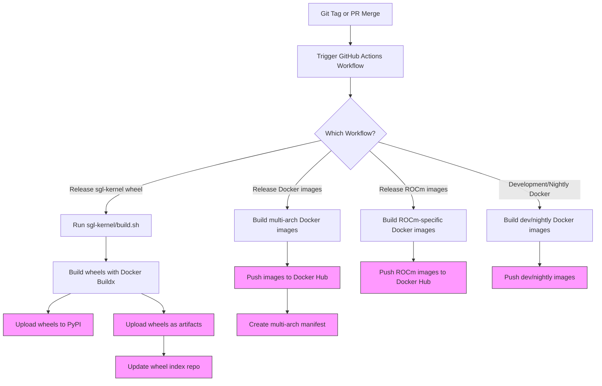
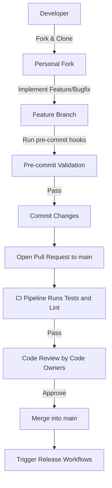

<!-- source: DeepWiki mcp.deepwiki.com · repo microsoft/llm-42 · page 14 Release and Developer Workflows · fetched 2026-10-26 -->

# Release and Developer Workflows

<details>
<summary>Relevant source files</summary>

The following files were used as context for generating this wiki page:

- [.codespellrc](.codespellrc)
- [.github/CI_PERMISSIONS.json](.github/CI_PERMISSIONS.json)
- [.github/CODEOWNERS](.github/CODEOWNERS)
- [.github/ISSUE_TEMPLATE/1-bug-report.yml](.github/ISSUE_TEMPLATE/1-bug-report.yml)
- [.github/ISSUE_TEMPLATE/2-feature-request.yml](.github/ISSUE_TEMPLATE/2-feature-request.yml)
- [.github/MAINTAINER.md](.github/MAINTAINER.md)
- [.github/labeler.yml](.github/labeler.yml)
- [.github/pull_request_template.md](.github/pull_request_template.md)
- [.github/update_ci_permission.py](.github/update_ci_permission.py)
- [.github/workflows/bot-bump-kernel-version-to-sglang.yml](.github/workflows/bot-bump-kernel-version-to-sglang.yml)
- [.github/workflows/bot-bump-kernel-version.yml](.github/workflows/bot-bump-kernel-version.yml)
- [.github/workflows/bot-bump-sglang-version.yml](.github/workflows/bot-bump-sglang-version.yml)
- [.github/workflows/cancel-pr-workflow-on-merge.yml](.github/workflows/cancel-pr-workflow-on-merge.yml)
- [.github/workflows/cancel-unfinished-pr-tests.yml](.github/workflows/cancel-unfinished-pr-tests.yml)
- [.github/workflows/labeler.yml](.github/workflows/labeler.yml)
- [.github/workflows/lint.yml](.github/workflows/lint.yml)
- [.github/workflows/open-pr-copy-from-oss.yml](.github/workflows/open-pr-copy-from-oss.yml)
- [.github/workflows/open-pr-copy-to-oss.yml](.github/workflows/open-pr-copy-to-oss.yml)
- [.github/workflows/pr-gate.yml](.github/workflows/pr-gate.yml)
- [.github/workflows/release-docker-amd-nightly.yml](.github/workflows/release-docker-amd-nightly.yml)
- [.github/workflows/release-docker-amd-rocm720-nightly.yml](.github/workflows/release-docker-amd-rocm720-nightly.yml)
- [.github/workflows/release-docker-amd.yml](.github/workflows/release-docker-amd.yml)
- [.github/workflows/release-docker-dev.yml](.github/workflows/release-docker-dev.yml)
- [.github/workflows/release-docker.yml](.github/workflows/release-docker.yml)
- [.github/workflows/release-pypi-nightly.yml](.github/workflows/release-pypi-nightly.yml)
- [.github/workflows/release-pypi-pr.yml](.github/workflows/release-pypi-pr.yml)
- [.github/workflows/release-pypi.yml](.github/workflows/release-pypi.yml)
- [.github/workflows/release-tag.yml](.github/workflows/release-tag.yml)
- [.github/workflows/release-whl-kernel.yml](.github/workflows/release-whl-kernel.yml)
- [.github/workflows/slash-command-handler.yml](.github/workflows/slash-command-handler.yml)
- [.pre-commit-config.yaml](.pre-commit-config.yaml)
- [benchmark/kernels/elementwise/benchmark_concat_mla.py](benchmark/kernels/elementwise/benchmark_concat_mla.py)
- [docs/developer_guide/contribution_guide.md](docs/developer_guide/contribution_guide.md)
- [python/sglang/srt/grpc/grpc_request_manager.py](python/sglang/srt/grpc/grpc_request_manager.py)
- [scripts/code_sync/check_commits.py](scripts/code_sync/check_commits.py)
- [scripts/code_sync/copy_from_oss.py](scripts/code_sync/copy_from_oss.py)
- [scripts/code_sync/copy_to_oss.py](scripts/code_sync/copy_to_oss.py)
- [scripts/code_sync/guideline.md](scripts/code_sync/guideline.md)
- [scripts/code_sync/install_github_cli.sh](scripts/code_sync/install_github_cli.sh)
- [scripts/code_sync/utils.py](scripts/code_sync/utils.py)
- [scripts/release/README.md](scripts/release/README.md)
- [scripts/release/bump_kernel_version.py](scripts/release/bump_kernel_version.py)
- [scripts/release/bump_kernel_version_to_sglang.py](scripts/release/bump_kernel_version_to_sglang.py)
- [scripts/release/bump_sglang_version.py](scripts/release/bump_sglang_version.py)
- [scripts/release/check_kernel_version_to_sglang.py](scripts/release/check_kernel_version_to_sglang.py)
- [scripts/release/commit_and_pr.sh](scripts/release/commit_and_pr.sh)
- [scripts/release/commit_and_pr_kernel_to_sglang.sh](scripts/release/commit_and_pr_kernel_to_sglang.sh)
- [scripts/release/test_utils.py](scripts/release/test_utils.py)
- [scripts/release/utils.py](scripts/release/utils.py)
- [scripts/update_nightly_whl_index.py](scripts/update_nightly_whl_index.py)
- [scripts/update_pr_whl_index.py](scripts/update_pr_whl_index.py)
- [sgl-kernel/Dockerfile](sgl-kernel/Dockerfile)
- [sgl-kernel/build.sh](sgl-kernel/build.sh)
- [sgl-kernel/csrc/elementwise/concat_mla.cu](sgl-kernel/csrc/elementwise/concat_mla.cu)
- [sgl-kernel/csrc/elementwise/utils.cuh](sgl-kernel/csrc/elementwise/utils.cuh)

</details>


This page details the release automation processes, code synchronization between internal and open-source repositories, contribution guidelines, and pre-commit hooks used in LLM-42. It targets developers and maintainers working on the codebase, providing in-depth explanations of scripts, workflows, and the development lifecycle.

---

## 1. Release Automation

The release automation for LLM-42 includes version bumping for both the main Python package (`sglang`) and the high-performance kernel (`sgl-kernel`), publishing Python wheels to PyPI, and building/pushing Docker images for different architectures and CUDA/ROCm versions. The workflows are primarily powered by GitHub Actions defined in `.github/workflows/`.

### 1.1 Version Bumping

- Version bumping scripts (`bump_sglang_version.py` and `bump_kernel_version.py` under `scripts/release/`) are used to update version identifiers in source files before release. A specific workflow bot (`bot-bump-sglang-version.yml` and `bot-bump-kernel-version.yml`) triggers automatic version bumps based on git tags or PR merges.
- Version files like `python/sglang/sglang/version.py` and `sgl-kernel/python/sgl_kernel/version.py` hold the current version string.

### 1.2 Python Wheel (sgl-kernel) Release

- The kernel wheel build and release process is governed by `.github/workflows/release-whl-kernel.yml`.
- It triggers on pushes to the `main` branch or manually via workflow dispatch.
- This workflow builds wheels for multiple Python and CUDA versions, supporting both `x86_64` and `aarch64` architectures using separate build runners.
- `sgl-kernel/build.sh` is the main shell script that builds the wheels using Docker Buildx with caching enabled (ccache support).
- After building, the wheels are uploaded to PyPI with the help of `twine`, with the PyPI token stored securely in GitHub secrets.
- Wheels are also uploaded as artifacts for further usage.
- The workflow updates a wheel index repository (`sgl-project/whl`) for tracking releases.

### 1.3 Docker Image Releases

- Docker image releases happen via `.github/workflows/release-docker.yml` (for stable releases) and `.github/workflows/release-docker-dev.yml` (for development/nightly builds).
- The release Docker workflow triggers on tags following semantic versioning tags (e.g., `v0.5.7`) or manual dispatch.
- The Dockerfile used supports multi-stage builds to produce both full framework and optimized runtime images.
- Images are built for multiple CUDA versions (e.g., 12.9.1, 13.0.1) and architectures (amd64/x86_64 and arm64/aarch64).
- ROCm (AMD GPU) Docker images are handled by specialized workflows such as `.github/workflows/release-docker-amd.yml` and `.github/workflows/release-docker-amd-nightly.yml`.
- Images are tagged following a pattern like `v{version}-cu129-amd64` or `dev-x86-my-test` for dev builds and pushed to Docker Hub (`lmsysorg/sglang`).
- Multi-arch manifests are created combining amd64 and arm64 images to simplify pulls across platforms.

---

## 2. Code Synchronization Between Internal and OSS Repos

The project maintains scripts to synchronize code changes bidirectionally between the internal repository and the open-source repository, ensuring parity and controlled contribution flow.

- `scripts/code_sync/copy_to_oss.py` manages copying changes from the internal repo to the open-source repo.
- `scripts/code_sync/copy_from_oss.py` manages copying changes from the open-source repo back into the internal one.
- `scripts/code_sync/check_commits.py` checks commit histories and formatting compliance during sync.
- Utilities used by these scripts reside in `scripts/code_sync/utils.py`.
- Contribution guidelines regarding code sync and commit standards are documented in `scripts/code_sync/guideline.md`.

These scripts primarily check file diffs, exclude non-essential files, fixup commit messages, and push corresponding branches to target repositories in a controlled manner.

---

## 3. Contribution Guidelines

Contribution guidelines for LLM-42 are documented comprehensively in `docs/developer_guide/contribution_guide.md`. Key highlights include:

### 3.1 Setting Up Development

- Contributors should fork the main repository and clone their fork.
- Build from source instructions guide usage of the build system for SGLang and its kernels.
  
### 3.2 Code Style and Formatting

- Pre-commit hooks enforce consistent style, linting, and formatting.
- Developers must install pre-commit and run checks before committing:
  ```bash
  pip3 install pre-commit
  pre-commit install
  pre-commit run --all-files
  ```
- Guidelines on avoiding code duplication, minimizing device synchronization, and optimizing runtime-critical paths are emphasized.

### 3.3 Testing

- Adding unit tests is mandatory for new features or bug fixes.
- Tests use Python's unittest framework.
- Accuracy tests and benchmarks should be run for output-influencing code changes.
  
### 3.4 Pull Request Process

- Developers should create feature branches, not push directly to `main`.
- At least one Code Owner from `.github/CODEOWNERS` must approve PRs.
- CI workflows provide mechanisms to trigger and rerun tests using PR comments like `/tag-run-ci-label` or `/rerun-failed-ci`.
- The CI permissions are maintained in `.github/CI_PERMISSIONS.json`.
- Merge Oncalls manage the final PR merge approvals.

---

## 4. Pre-Commit Hooks

The project enforces code hygiene with robust pre-commit hooks configured in `.pre-commit-config.yaml`. The configuration includes:

- Commons hooks for trailing whitespace removal, symlink checks, YAML, TOML, and syntax correctness.
- Isort for import sorting, with exclusions for gRPC generated code files.
- Ruff for linting Python code, focusing on specific error codes and auto-fixing issues.
- Black for consistent Python formatting (not running on gRPC generated proto files).
- Codespell for spell checking with a custom `.codespellrc` configuration.
- Clang-format for C/C++/CUDA code formatting, aligning with the style files in the `sgl-kernel` directory.
- Custom local hooks for checking Chinese characters in the multimodal generation code area and sorting the `CI_PERMISSIONS.json`.
  
Developers must ensure these hooks pass before code submission to maintain code quality and consistency across the codebase.

---

## 5. Key Automation and Utility Scripts Summary

| Script/Workflow | Location | Purpose |
|-----------------|-----------|---------|
| Kernel build script | `sgl-kernel/build.sh` | Builds sgl-kernel wheels with caching and multi-arch support. Invoked in release CI. |
| Kernel release workflow | `.github/workflows/release-whl-kernel.yml` | Automated GitHub Actions workflow for building and distributing sgl-kernel Python wheels. |
| Docker release workflow | `.github/workflows/release-docker.yml` & AMD variant `.github/workflows/release-docker-amd.yml` | Release automation for Docker images across CUDA, ROCm, and CPU archs. |
| Developer pre-commit config | `.pre-commit-config.yaml` | Defines all pre-commit hooks for linting, formatting, and validation before git push. |
| Contribution guidelines | `docs/developer_guide/contribution_guide.md` | Documentation for pipeline, coding standards, testing, review, and CI process. |
| Code sync scripts | `scripts/code_sync/copy_to_oss.py`, `copy_from_oss.py` | Scripts to keep internal and OSS repos in sync respecting commit and PR processes. |

---

## 6. Release Automation Data Flow Diagram



---

## 7. Developer Workflow to Contribution Diagram



---

## 8. Summary

The release and developer workflows in LLM-42 are streamlined for automated building, testing, and deployment pipelines that:

- Enable multi-architecture Python wheel builds and distribution.
- Support robust Docker image releases for both NVIDIA CUDA and AMD ROCm GPU platforms.
- Maintain strict contribution standards through comprehensive guidelines and enforced pre-commit hooks.
- Synchronize internal and open-source repositories to ensure codebase consistency.
- Use GitHub Actions to orchestrate and automate workflows efficiently with concurrency and caching.

This approach provides high confidence in release quality and developer productivity.

---

### Sources:

- `.github/workflows/release-whl-kernel.yml:1-145`  
- `.github/workflows/release-docker.yml:1-210`  
- `.github/workflows/release-docker-dev.yml:1-192`  
- `.github/workflows/release-docker-amd.yml:1-92`  
- `sgl-kernel/build.sh:1-145`  
- `docs/developer_guide/contribution_guide.md:1-130`  
- `.pre-commit-config.yaml:1-84`  
- `.github/CI_PERMISSIONS.json`  
- `scripts/code_sync/copy_to_oss.py`  
- `scripts/code_sync/copy_from_oss.py`  
- `scripts/code_sync/check_commits.py`  
- `scripts/code_sync/utils.py`  
- `scripts/code_sync/guideline.md`

---

