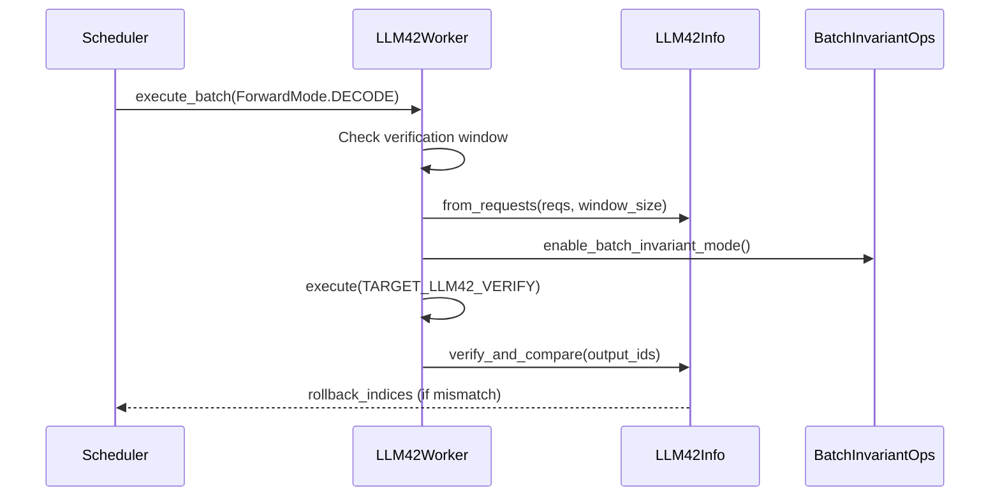

<!-- source: DeepWiki mcp.deepwiki.com · repo microsoft/llm-42 · page 2 LLM-42: Deterministic Inference Engine · fetched 2026-10-26 -->

# LLM-42: Deterministic Inference Engine

<details>
<summary>Relevant source files</summary>

The following files were used as context for generating this wiki page:

- [docs/references/environment_variables.md](docs/references/environment_variables.md)
- [python/sglang/srt/batch_invariant_ops/__init__.py](python/sglang/srt/batch_invariant_ops/__init__.py)
- [python/sglang/srt/batch_invariant_ops/batch_invariant_ops.py](python/sglang/srt/batch_invariant_ops/batch_invariant_ops.py)
- [python/sglang/srt/environ.py](python/sglang/srt/environ.py)
- [python/sglang/srt/layers/activation.py](python/sglang/srt/layers/activation.py)
- [python/sglang/srt/layers/communicator.py](python/sglang/srt/layers/communicator.py)
- [python/sglang/srt/layers/flashinfer_comm_fusion.py](python/sglang/srt/layers/flashinfer_comm_fusion.py)
- [python/sglang/srt/layers/layernorm.py](python/sglang/srt/layers/layernorm.py)
- [python/sglang/srt/layers/rotary_embedding.py](python/sglang/srt/layers/rotary_embedding.py)
- [python/sglang/srt/llm42/__init__.py](python/sglang/srt/llm42/__init__.py)
- [python/sglang/srt/llm42/llm42_info.py](python/sglang/srt/llm42/llm42_info.py)
- [python/sglang/srt/llm42/llm42_worker.py](python/sglang/srt/llm42/llm42_worker.py)
- [python/sglang/srt/managers/scheduler_runtime_checker_mixin.py](python/sglang/srt/managers/scheduler_runtime_checker_mixin.py)
- [python/sglang/srt/utils/common.py](python/sglang/srt/utils/common.py)

</details>


The LLM-42 engine provides a high-performance, deterministic inference subsystem for SGLang. Standard LLM serving often suffers from non-determinism due to floating-point summation order variations in multi-tenant GPU batches. LLM-42 addresses this using the **Decode-Verify-Rollback (DVR)** protocol and **Batch-Invariant Operations**.

## Overview

LLM-42 ensures bit-wise identical outputs for the same request regardless of other requests in the batch. It achieves this by combining two layers of protection:
1.  **Batch-Invariant Kernels**: Low-level GPU operations (MatMul, RMSNorm) that produce identical results regardless of batch composition.
2.  **DVR Protocol**: A windowed verification mechanism that periodically checks the integrity of generated tokens against a "ground-truth" deterministic pass and rolls back the state if a mismatch is detected.

### System Architecture: LLM-42 Integration

The following diagram shows how LLM-42 components wrap the standard `TpModelWorker` and interact with the SGLang scheduler.

**LLM-42 Component Interaction**
```mermaid
graph TD
    subgraph "Scheduler Process"
        [Scheduler] --> [LLM42Worker]
    end

    subgraph "LLM42Worker (Wrapper)"
        [LLM42Worker] -- "Intercepts" --> [ForwardMode.DECODE]
        [LLM42Worker] -- "Creates" --> [LLM42Info]
        [LLM42Info] -- "Uses" --> [FixedSizeVerificationPool]
    end

    subgraph "Model Execution"
        [LLM42Worker] -- "Executes" --> [TpModelWorker]
        [TpModelWorker] -- "Calls" --> [BatchInvariantOps]
    end

    [LLM42Info] -- "Rollback" --> [Req.output_ids]
```
Sources: [python/sglang/srt/llm42/llm42_worker.py:12-17](), [python/sglang/srt/llm42/llm42_info.py:36-44]()

## Core Subsystems

### DVR Protocol: Decode, Verify, Rollback
The DVR protocol is the primary algorithm for maintaining long-term determinism. It allows the engine to run at high speed using potentially non-deterministic optimizations during the "Decode" phase, while using a "Verify" phase to ensure correctness.
*   **Windowed Generation**: Tokens are generated in windows of a configurable size.
*   **Grouped Verification**: Multiple requests are batched into a `TARGET_LLM42_VERIFY` forward pass.
*   **Fixed-Size Padding**: To ensure the verification pass itself is deterministic, the `FixedSizeVerificationPool` pads batches to a constant shape using dummy resources.

For details, see [DVR Protocol: Decode, Verify, Rollback](#2.1).

Sources: [python/sglang/srt/llm42/llm42_worker.py:38-46](), [python/sglang/srt/llm42/llm42_info.py:102-121]()

### Batch-Invariant Operations
LLM-42 provides specialized CUDA and Triton kernels that eliminate numerical divergence. 
*   **Deterministic MatMul**: Implements persistent Triton kernels and DeepGEMM wrappers that avoid non-deterministic atomic operations.
*   **RMSNorm**: A `rms_norm_batch_invariant` implementation ensures that normalization results do not shift when requests are added or removed from a batch.
*   **Monkey-Patching**: The `enable_batch_invariant_mode` context manager allows the system to dynamically toggle these kernels during specific forward passes.

For details, see [Batch-Invariant Operations](#2.2).

Sources: [python/sglang/srt/batch_invariant_ops/batch_invariant_ops.py:37-42](), [python/sglang/srt/layers/layernorm.py:139-154]()

### Configuration and Runtime Integration
LLM-42 is integrated into the SGLang server via command-line arguments and environment variables.
*   **Activation**: Controlled via `--enable-llm42`.
*   **Tuning**: Parameters like `--llm42-window-size` and `--llm42-verify-batch-size` allow balancing between performance and verification frequency.
*   **Environment**: Variables like `SGLANG_ENABLE_LLM42` and `SGLANG_BATCH_INVARIANT_OPS_ENABLE_MM_DEEPGEMM` provide fine-grained control over kernel selection.

For details, see [Determinism Configuration and Flags](#2.3).

Sources: [python/sglang/srt/environ.py:223-228](), [docs/references/environment_variables.md:73-80]()

## Code Entity Map

The following table and diagram map the high-level LLM-42 concepts to specific classes and files in the codebase.

| Concept | Code Entity | File Path |
| :--- | :--- | :--- |
| **Verification Worker** | `LLM42Worker` | [python/sglang/srt/llm42/llm42_worker.py:12]() |
| **Batch Padding** | `FixedSizeVerificationPool` | [python/sglang/srt/llm42/llm42_worker.py:38]() |
| **Metadata Tracking** | `LLM42Info` | [python/sglang/srt/llm42/llm42_info.py:36]() |
| **Deterministic Ops** | `batch_invariant_ops` | [python/sglang/srt/batch_invariant_ops/batch_invariant_ops.py:1]() |
| **Invariant Norm** | `RMSNorm` | [python/sglang/srt/layers/layernorm.py:91]() |

**Logic Flow to Code Mapping**

Sources: [python/sglang/srt/llm42/llm42_worker.py:12-15](), [python/sglang/srt/llm42/llm42_info.py:102-110](), [python/sglang/srt/batch_invariant_ops/batch_invariant_ops.py:41]()

---

