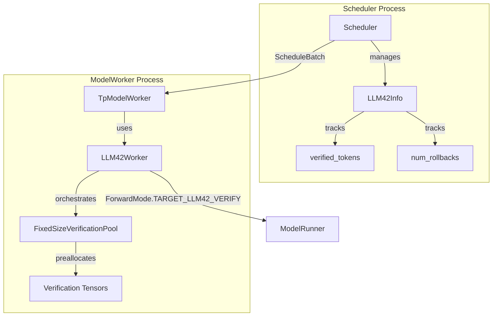
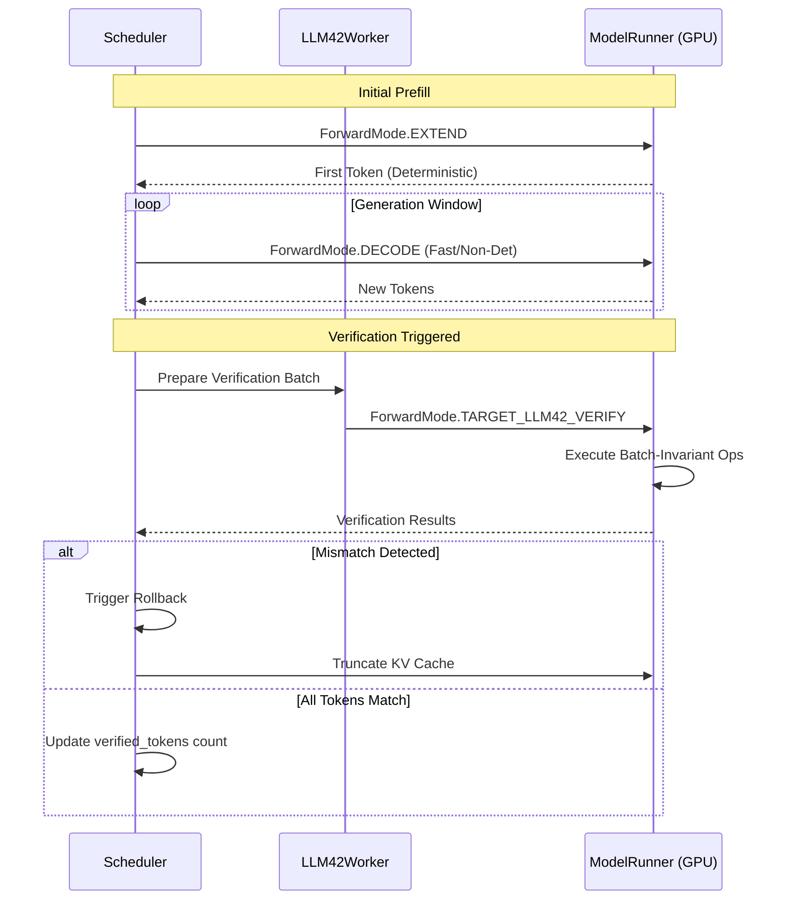

<!-- source: DeepWiki mcp.deepwiki.com · repo microsoft/llm-42 · page 2.1 DVR Protocol: Decode, Verify, Rollback · fetched 2026-10-26 -->

# DVR Protocol: Decode, Verify, Rollback

Relevant source files

The following files were used as context for generating this wiki page:

- [python/sglang/srt/entrypoints/http_server.py](python/sglang/srt/entrypoints/http_server.py)
- [python/sglang/srt/layers/logits_processor.py](python/sglang/srt/layers/logits_processor.py)
- [python/sglang/srt/layers/sampler.py](python/sglang/srt/layers/sampler.py)
- [python/sglang/srt/llm42/__init__.py](python/sglang/srt/llm42/__init__.py)
- [python/sglang/srt/llm42/llm42_info.py](python/sglang/srt/llm42/llm42_info.py)
- [python/sglang/srt/llm42/llm42_worker.py](python/sglang/srt/llm42/llm42_worker.py)
- [python/sglang/srt/managers/detokenizer_manager.py](python/sglang/srt/managers/detokenizer_manager.py)
- [python/sglang/srt/managers/io_struct.py](python/sglang/srt/managers/io_struct.py)
- [python/sglang/srt/managers/multi_tokenizer_mixin.py](python/sglang/srt/managers/multi_tokenizer_mixin.py)
- [python/sglang/srt/managers/schedule_batch.py](python/sglang/srt/managers/schedule_batch.py)
- [python/sglang/srt/managers/scheduler.py](python/sglang/srt/managers/scheduler.py)
- [python/sglang/srt/managers/scheduler_metrics_mixin.py](python/sglang/srt/managers/scheduler_metrics_mixin.py)
- [python/sglang/srt/managers/scheduler_output_processor_mixin.py](python/sglang/srt/managers/scheduler_output_processor_mixin.py)
- [python/sglang/srt/managers/scheduler_runtime_checker_mixin.py](python/sglang/srt/managers/scheduler_runtime_checker_mixin.py)
- [python/sglang/srt/managers/scheduler_update_weights_mixin.py](python/sglang/srt/managers/scheduler_update_weights_mixin.py)
- [python/sglang/srt/managers/tokenizer_communicator_mixin.py](python/sglang/srt/managers/tokenizer_communicator_mixin.py)
- [python/sglang/srt/managers/tokenizer_manager.py](python/sglang/srt/managers/tokenizer_manager.py)
- [python/sglang/srt/managers/tp_worker.py](python/sglang/srt/managers/tp_worker.py)
- [python/sglang/srt/metrics/collector.py](python/sglang/srt/metrics/collector.py)
- [python/sglang/srt/model_executor/cuda_graph_runner.py](python/sglang/srt/model_executor/cuda_graph_runner.py)
- [python/sglang/srt/model_executor/forward_batch_info.py](python/sglang/srt/model_executor/forward_batch_info.py)
- [python/sglang/srt/model_executor/model_runner.py](python/sglang/srt/model_executor/model_runner.py)
- [python/sglang/srt/sampling/sampling_batch_info.py](python/sglang/srt/sampling/sampling_batch_info.py)
- [python/sglang/srt/sampling/sampling_params.py](python/sglang/srt/sampling/sampling_params.py)
- [python/sglang/srt/server_args.py](python/sglang/srt/server_args.py)

The **DVR (Decode, Verify, Rollback)** protocol is the core algorithmic framework of LLM-42, designed to ensure bit-wise deterministic LLM inference while maintaining the performance benefits of batching and hardware-specific optimizations. It operates by allowing high-throughput speculative decoding in a "potentially non-deterministic" mode, followed by periodic exact verification using batch-invariant operations.

## Overview of the DVR Algorithm

The DVR protocol addresses the challenge where parallel reductions in GPU kernels (like those in FlashAttention or MoE) can produce non-deterministic results due to the non-associativity of floating-point addition when batch compositions change.

The protocol follows a cyclical three-stage pipeline:
1.  **Decode**: The engine generates tokens rapidly in a standard, high-performance "decode" mode.
2.  **Verify**: Periodically, a "window" of generated tokens is re-processed using deterministic, batch-invariant kernels.
3.  **Rollback**: If the verification output deviates from the previously generated tokens, the system rolls back the KV cache and sequence state to the last known-good token and resumes generation.

### The Verification Window
Generation is partitioned into windows of size `llm42_window_size` [python/sglang/srt/server_args.py:275-275](). Verification is not performed for every single token but in grouped batches to amortize the overhead of deterministic kernels.

## System Architecture: Code Entity Space

The implementation of the DVR protocol is primarily contained within the `sglang.srt.llm42` module and integrated into the `Scheduler` and `ModelRunner`.

### Code Entity Mapping
The following diagram maps the logical components of the DVR protocol to their specific class implementations in the codebase.

**Sources:** [python/sglang/srt/managers/scheduler.py:1-150](), [python/sglang/srt/llm42/llm42_info.py:1-50](), [python/sglang/srt/llm42/llm42_worker.py:1-100]()

## Implementation Details

### 1. LLM42Info: Sequence-level State
Every request (`Req`) in LLM-42 is associated with an `LLM42Info` object. This class maintains the determinism metadata for that specific sequence.

*   **`verified_tokens`**: The number of tokens in the sequence that have been bit-wise verified against the reference deterministic implementation [python/sglang/srt/managers/scheduler_output_processor_mixin.py:179-181]().
*   **`num_rollbacks`**: A counter for how many times this specific request has failed verification and triggered a rollback [python/sglang/srt/managers/io_struct.py:127-130]().

### 2. LLM42Worker and FixedSizeVerificationPool
The `LLM42Worker` resides within the `TpModelWorker`. It manages the `FixedSizeVerificationPool`, which pre-allocates the memory required for verification batches to avoid runtime allocation overhead.

When the `Scheduler` decides to verify a batch, it sets the `ForwardMode` to `TARGET_LLM42_VERIFY` [python/sglang/srt/model_executor/forward_batch_info.py:87-89]().

### 3. Token-level Comparison and Rollback
The verification happens in the `ModelRunner` during the forward pass. The system compares the logits or sampled tokens from the deterministic "Verify" pass against the original tokens generated during the "Decode" pass.

If a mismatch is detected:
1.  **Identify Divergence**: The system finds the first index $i$ where $Token_{verify}[i] \neq Token_{decode}[i]$.
2.  **KV Cache Truncation**: The `Scheduler` invokes `release_kv_cache` to truncate the KV cache back to the index $i-1$ [python/sglang/srt/managers/scheduler_output_processor_mixin.py:99-100]().
3.  **Request Retraction**: The request is moved back to the prefill or decode queue to be re-processed from the divergence point.

## DVR Data Flow

The following diagram illustrates the lifecycle of a request under the DVR protocol, specifically how it transitions between different `ForwardMode` states.

**Sources:** [python/sglang/srt/model_executor/forward_batch_info.py:74-118](), [python/sglang/srt/managers/scheduler_output_processor_mixin.py:173-184](), [python/sglang/srt/managers/schedule_batch.py:66-72]()

## Key Classes and Functions

| Entity | Location | Role |
| :--- | :--- | :--- |
| `ForwardMode.TARGET_LLM42_VERIFY` | [python/sglang/srt/model_executor/forward_batch_info.py:89]() | Enum flag that triggers deterministic, fixed-shape reduction kernels in the model forward pass. |
| `LLM42Info` | `python/sglang/srt/llm42/llm42_info.py` | Stores sequence-specific metadata like `llm42_verified_tokens` and rollback statistics. |
| `LLM42Worker` | `python/sglang/srt/llm42/llm42_worker.py` | Manages the verification pool and provides utilities for the worker-side DVR logic. |
| `FixedSizeVerificationPool` | `python/sglang/srt/llm42/llm42_worker.py` | Pre-allocates GPU memory for verification to ensure predictable performance during the "Verify" phase. |
| `process_batch_result_prefill` | [python/sglang/srt/managers/scheduler_output_processor_mixin.py:124-184]() | Handles the transition of the first token from prefill to verified status. |

**Sources:** [python/sglang/srt/model_executor/forward_batch_info.py:87-115](), [python/sglang/srt/managers/scheduler_output_processor_mixin.py:173-184](), [python/sglang/srt/llm42/llm42_worker.py:1-50]()

---

