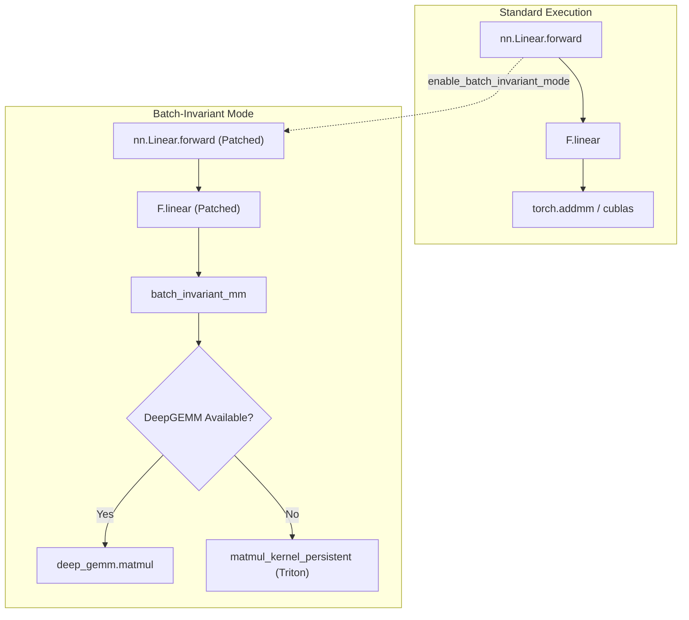
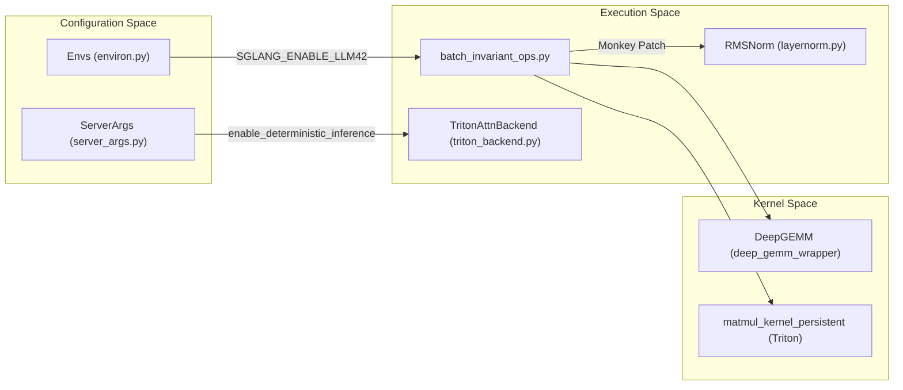

<!-- source: DeepWiki mcp.deepwiki.com · repo microsoft/llm-42 · page 2.2 Batch-Invariant Operations · fetched 2026-10-26 -->

# Batch-Invariant Operations

Relevant source files

The following files were used as context for generating this wiki page:

- [docs/references/environment_variables.md](docs/references/environment_variables.md)
- [python/sglang/srt/batch_invariant_ops/__init__.py](python/sglang/srt/batch_invariant_ops/__init__.py)
- [python/sglang/srt/batch_invariant_ops/batch_invariant_ops.py](python/sglang/srt/batch_invariant_ops/batch_invariant_ops.py)
- [python/sglang/srt/environ.py](python/sglang/srt/environ.py)
- [python/sglang/srt/layers/activation.py](python/sglang/srt/layers/activation.py)
- [python/sglang/srt/layers/attention/double_sparsity_backend.py](python/sglang/srt/layers/attention/double_sparsity_backend.py)
- [python/sglang/srt/layers/attention/flashattention_backend.py](python/sglang/srt/layers/attention/flashattention_backend.py)
- [python/sglang/srt/layers/attention/flashinfer_backend.py](python/sglang/srt/layers/attention/flashinfer_backend.py)
- [python/sglang/srt/layers/attention/flashinfer_mla_backend.py](python/sglang/srt/layers/attention/flashinfer_mla_backend.py)
- [python/sglang/srt/layers/attention/triton_backend.py](python/sglang/srt/layers/attention/triton_backend.py)
- [python/sglang/srt/layers/attention/triton_ops/decode_attention.py](python/sglang/srt/layers/attention/triton_ops/decode_attention.py)
- [python/sglang/srt/layers/attention/triton_ops/double_sparsity_attention.py](python/sglang/srt/layers/attention/triton_ops/double_sparsity_attention.py)
- [python/sglang/srt/layers/attention/triton_ops/extend_attention.py](python/sglang/srt/layers/attention/triton_ops/extend_attention.py)
- [python/sglang/srt/layers/attention/triton_ops/prefill_attention.py](python/sglang/srt/layers/attention/triton_ops/prefill_attention.py)
- [python/sglang/srt/layers/communicator.py](python/sglang/srt/layers/communicator.py)
- [python/sglang/srt/layers/flashinfer_comm_fusion.py](python/sglang/srt/layers/flashinfer_comm_fusion.py)
- [python/sglang/srt/layers/layernorm.py](python/sglang/srt/layers/layernorm.py)
- [python/sglang/srt/layers/rotary_embedding.py](python/sglang/srt/layers/rotary_embedding.py)
- [python/sglang/srt/utils/common.py](python/sglang/srt/utils/common.py)
- [python/sglang/test/test_deterministic.py](python/sglang/test/test_deterministic.py)
- [python/sglang/test/test_deterministic_utils.py](python/sglang/test/test_deterministic_utils.py)

The **Batch-Invariant Operations** module is a critical component of the LLM-42 Deterministic Inference Engine. In standard LLM serving, GPU kernels (especially MatMul and Attention) often use non-deterministic algorithms like atomic additions or dynamic tiling strategies that depend on the specific composition of a batch. This leads to bit-wise differences in outputs when the same request is processed in different batch contexts.

SGLang ensures bit-wise identical GPU outputs regardless of batch composition through the `batch_invariant_ops` module, deterministic Triton/DeepGEMM kernels, and a global monkey-patching mechanism.

## Core Mechanism: Batch-Invariant Mode

SGLang provides a global state to toggle batch-invariant execution. When enabled, standard `torch.nn.Linear` and `torch.nn.functional.linear` operations are monkey-patched to use deterministic alternatives.

### Key Functions
*   `enable_batch_invariant_mode()`: Enables the global flag and applies monkey-patches to `torch.nn.Linear` and `torch.nn.functional.linear` [python/sglang/srt/batch_invariant_ops/batch_invariant_ops.py:304-332]().
*   `disable_batch_invariant_mode()`: Restores original torch functions and disables the flag [python/sglang/srt/batch_invariant_ops/batch_invariant_ops.py:335-345]().
*   `is_batch_invariant_mode_enabled()`: Returns the current status of the global flag [python/sglang/srt/batch_invariant_ops/batch_invariant_ops.py:300-301]().

### Implementation Data Flow
The following diagram illustrates how a standard linear layer call is redirected when batch-invariant mode is active.

**Diagram: Linear Layer Redirection**

Sources: [python/sglang/srt/batch_invariant_ops/batch_invariant_ops.py:270-332]()

## Deterministic Matrix Multiplication

To achieve determinism, SGLang avoids standard cuBLAS/cuDNN calls which may use non-deterministic algorithms. Instead, it utilizes persistent kernels where the accumulation order is fixed.

### Triton Persistent Kernel
The `matmul_kernel_persistent` is a Triton-based implementation that ensures determinism by:
1.  Using a fixed tiling strategy (`BLOCK_SIZE_M`, `BLOCK_SIZE_N`, `BLOCK_SIZE_K`) [python/sglang/srt/batch_invariant_ops/batch_invariant_ops.py:89-91]().
2.  Iterating through tiles in a deterministic order using `tl.range` over `NUM_SMS` [python/sglang/srt/batch_invariant_ops/batch_invariant_ops.py:108-109]().
3.  Accumulating partial results in a single thread block without relying on cross-block atomic operations [python/sglang/srt/batch_invariant_ops/batch_invariant_ops.py:125-144]().

### DeepGEMM Integration
For NVIDIA Hopper (SM90) and Blackwell (SM100) GPUs, SGLang prefers **DeepGEMM** if `SGLANG_BATCH_INVARIANT_OPS_ENABLE_MM_DEEPGEMM` is set to `1` [python/sglang/srt/batch_invariant_ops/batch_invariant_ops.py:23-25](). DeepGEMM provides high-performance deterministic kernels specifically optimized for these architectures.

Sources: [python/sglang/srt/batch_invariant_ops/batch_invariant_ops.py:75-166](), [python/sglang/srt/batch_invariant_ops/batch_invariant_ops.py:228-255]()

## Batch-Invariant Attention Backends

The Attention backends also incorporate logic to handle determinism when LLM-42 is enabled.

### Triton Attention Backend
The `TritonAttnBackend` detects the determinism requirement via `model_runner.server_args.enable_deterministic_inference` or `enable_llm42` [python/sglang/srt/layers/attention/triton_backend.py:120-123]().
*   **Fixed Split Tile Size**: It enforces a `split_tile_size` (default 256) to ensure the KV cache is partitioned identically regardless of batch size [python/sglang/srt/layers/attention/triton_backend.py:128-130]().
*   **Static KV Splits**: While dynamic splitting is usually preferred for performance, LLM-42 mode uses deterministic logic to compute `num_kv_splits` [python/sglang/srt/layers/attention/triton_backend.py:131-132]().

### FlashInfer Backend
Debug flags allow bypassing attention during development to isolate non-determinism in other layers:
*   `SGLANG_SKIP_DECODE_ATTN`
*   `SGLANG_SKIP_EXTEND_ATTN`
*   `SGLANG_SKIP_VERIFY_ATTN`
[python/sglang/srt/layers/attention/flashinfer_backend.py:43-45]()

Sources: [python/sglang/srt/layers/attention/triton_backend.py:118-157](), [python/sglang/srt/layers/attention/flashinfer_backend.py:41-55]()

## Layer-Specific Invariance

Beyond MatMul, other normalization and activation layers are adjusted for LLM-42.

### RMSNorm
The `RMSNorm` layer checks `is_batch_invariant_mode_enabled()` during the forward pass. If enabled, it switches from the optimized `fused_add_rmsnorm` (which might have floating-point variations) to `rms_norm_batch_invariant` [python/sglang/srt/layers/layernorm.py:139-141]().

### Activation Functions
Standard activation functions like `SiluAndMul` and `GeluAndMul` are generally batch-invariant by nature as they are element-wise. However, SGLang provides `forward_native` implementations as fallbacks to ensure consistency with reference models when `rl_on_policy_target` is set [python/sglang/srt/layers/activation.py:66-71]().

**Diagram: Code Entity Mapping for Determinism**
This diagram maps the high-level determinism concepts to the specific classes and modules in the codebase.

Sources: [python/sglang/srt/environ.py:159-220](), [python/sglang/srt/layers/layernorm.py:91-124](), [python/sglang/srt/batch_invariant_ops/batch_invariant_ops.py:37-42]()

## Environment Variables

| Variable | Description | Default |
| :--- | :--- | :--- |
| `SGLANG_BATCH_INVARIANT_OPS_ENABLE_MM_DEEPGEMM` | Use DeepGEMM for MatMul in invariant mode. | `1` |
| `SGLANG_TRITON_DECODE_SPLIT_TILE_SIZE` | Tile size for deterministic Triton attention. | `256` |
| `SGLANG_USE_TRITON_RMSNORM` | Force Triton-based invariant RMSNorm. | `""` |
| `SGLANG_BATCH_INVARIANT_OPS_ENABLE_MM_COMPARISON_TEST` | Enable cross-check between kernels. | `0` |

Sources: [python/sglang/srt/batch_invariant_ops/batch_invariant_ops.py:23-32](), [python/sglang/srt/layers/attention/triton_backend.py:128-130](), [python/sglang/srt/layers/layernorm.py:123-125]()

---

