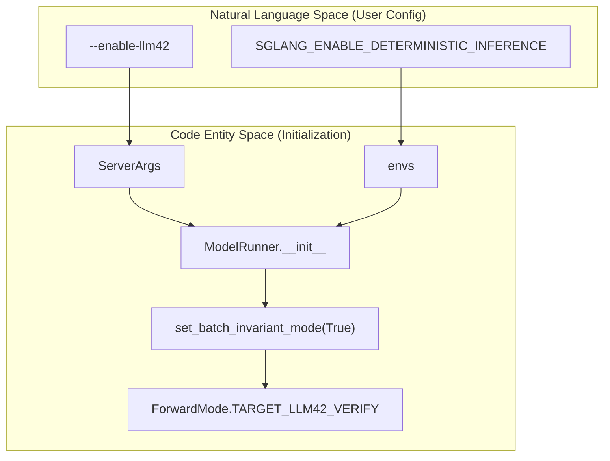
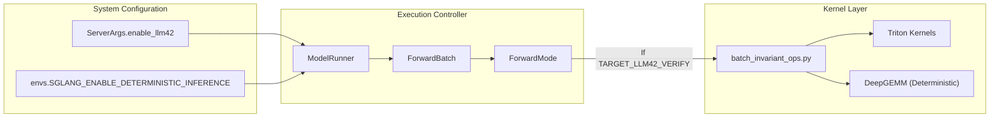

<!-- source: DeepWiki mcp.deepwiki.com · repo microsoft/llm-42 · page 2.3 Determinism Configuration and Flags · fetched 2026-10-26 -->

# Determinism Configuration and Flags

Relevant source files

The following files were used as context for generating this wiki page:

- [docs/advanced_features/server_arguments.md](docs/advanced_features/server_arguments.md)
- [docs/basic_usage/deepseek_v32.md](docs/basic_usage/deepseek_v32.md)
- [docs/references/environment_variables.md](docs/references/environment_variables.md)
- [python/sglang/srt/batch_invariant_ops/__init__.py](python/sglang/srt/batch_invariant_ops/__init__.py)
- [python/sglang/srt/batch_invariant_ops/batch_invariant_ops.py](python/sglang/srt/batch_invariant_ops/batch_invariant_ops.py)
- [python/sglang/srt/disaggregation/mooncake/utils.py](python/sglang/srt/disaggregation/mooncake/utils.py)
- [python/sglang/srt/entrypoints/http_server.py](python/sglang/srt/entrypoints/http_server.py)
- [python/sglang/srt/environ.py](python/sglang/srt/environ.py)
- [python/sglang/srt/layers/activation.py](python/sglang/srt/layers/activation.py)
- [python/sglang/srt/layers/attention/cutlass_mla_backend.py](python/sglang/srt/layers/attention/cutlass_mla_backend.py)
- [python/sglang/srt/layers/attention/flashmla_backend.py](python/sglang/srt/layers/attention/flashmla_backend.py)
- [python/sglang/srt/layers/attention/nsa/dequant_k_cache.py](python/sglang/srt/layers/attention/nsa/dequant_k_cache.py)
- [python/sglang/srt/layers/attention/nsa/index_buf_accessor.py](python/sglang/srt/layers/attention/nsa/index_buf_accessor.py)
- [python/sglang/srt/layers/attention/nsa/nsa_indexer.py](python/sglang/srt/layers/attention/nsa/nsa_indexer.py)
- [python/sglang/srt/layers/attention/nsa/quant_k_cache.py](python/sglang/srt/layers/attention/nsa/quant_k_cache.py)
- [python/sglang/srt/layers/attention/nsa/tilelang_kernel.py](python/sglang/srt/layers/attention/nsa/tilelang_kernel.py)
- [python/sglang/srt/layers/attention/nsa/utils.py](python/sglang/srt/layers/attention/nsa/utils.py)
- [python/sglang/srt/layers/attention/nsa_backend.py](python/sglang/srt/layers/attention/nsa_backend.py)
- [python/sglang/srt/layers/attention/trtllm_mla_backend.py](python/sglang/srt/layers/attention/trtllm_mla_backend.py)
- [python/sglang/srt/layers/attention/utils.py](python/sglang/srt/layers/attention/utils.py)
- [python/sglang/srt/layers/communicator.py](python/sglang/srt/layers/communicator.py)
- [python/sglang/srt/layers/communicator_nsa_cp.py](python/sglang/srt/layers/communicator_nsa_cp.py)
- [python/sglang/srt/layers/flashinfer_comm_fusion.py](python/sglang/srt/layers/flashinfer_comm_fusion.py)
- [python/sglang/srt/layers/layernorm.py](python/sglang/srt/layers/layernorm.py)
- [python/sglang/srt/layers/logits_processor.py](python/sglang/srt/layers/logits_processor.py)
- [python/sglang/srt/layers/rotary_embedding.py](python/sglang/srt/layers/rotary_embedding.py)
- [python/sglang/srt/layers/sampler.py](python/sglang/srt/layers/sampler.py)
- [python/sglang/srt/managers/data_parallel_controller.py](python/sglang/srt/managers/data_parallel_controller.py)
- [python/sglang/srt/managers/detokenizer_manager.py](python/sglang/srt/managers/detokenizer_manager.py)
- [python/sglang/srt/managers/io_struct.py](python/sglang/srt/managers/io_struct.py)
- [python/sglang/srt/managers/multi_tokenizer_mixin.py](python/sglang/srt/managers/multi_tokenizer_mixin.py)
- [python/sglang/srt/managers/schedule_batch.py](python/sglang/srt/managers/schedule_batch.py)
- [python/sglang/srt/managers/scheduler.py](python/sglang/srt/managers/scheduler.py)
- [python/sglang/srt/managers/scheduler_metrics_mixin.py](python/sglang/srt/managers/scheduler_metrics_mixin.py)
- [python/sglang/srt/managers/scheduler_output_processor_mixin.py](python/sglang/srt/managers/scheduler_output_processor_mixin.py)
- [python/sglang/srt/managers/scheduler_update_weights_mixin.py](python/sglang/srt/managers/scheduler_update_weights_mixin.py)
- [python/sglang/srt/managers/tokenizer_communicator_mixin.py](python/sglang/srt/managers/tokenizer_communicator_mixin.py)
- [python/sglang/srt/managers/tokenizer_manager.py](python/sglang/srt/managers/tokenizer_manager.py)
- [python/sglang/srt/managers/tp_worker.py](python/sglang/srt/managers/tp_worker.py)
- [python/sglang/srt/mem_cache/utils.py](python/sglang/srt/mem_cache/utils.py)
- [python/sglang/srt/metrics/collector.py](python/sglang/srt/metrics/collector.py)
- [python/sglang/srt/model_executor/cuda_graph_runner.py](python/sglang/srt/model_executor/cuda_graph_runner.py)
- [python/sglang/srt/model_executor/forward_batch_info.py](python/sglang/srt/model_executor/forward_batch_info.py)
- [python/sglang/srt/model_executor/model_runner.py](python/sglang/srt/model_executor/model_runner.py)
- [python/sglang/srt/sampling/sampling_batch_info.py](python/sglang/srt/sampling/sampling_batch_info.py)
- [python/sglang/srt/sampling/sampling_params.py](python/sglang/srt/sampling/sampling_params.py)
- [python/sglang/srt/server_args.py](python/sglang/srt/server_args.py)
- [python/sglang/srt/utils/common.py](python/sglang/srt/utils/common.py)
- [python/sglang/test/attention/test_trtllm_mla_backend.py](python/sglang/test/attention/test_trtllm_mla_backend.py)
- [test/manual/layers/attention/nsa/test_index_buf_accessor.py](test/manual/layers/attention/nsa/test_index_buf_accessor.py)
- [test/registered/hicache/test_nsa_pool_host_unit.py](test/registered/hicache/test_nsa_pool_host_unit.py)
- [test/registered/kernels/test_nsa_indexer.py](test/registered/kernels/test_nsa_indexer.py)

This page provides a technical reference for the configuration arguments and environment variables used to enable and tune deterministic inference in LLM-42. Determinism in LLM-42 is achieved through the **Decode-Verify-Rollback (DVR)** protocol, which ensures bit-wise identical outputs regardless of batching conditions.

## Overview of Determinism Flags

Determinism configuration is primarily handled through `ServerArgs` and the `envs` system. The core mechanism involves forcing the runtime into a "Batch-Invariant" mode where all GPU operations (especially reductions and matrix multiplications) produce identical results regardless of how requests are grouped in a batch.

### Core Server Arguments

The following arguments are defined in `python/sglang/srt/server_args.py` and control the high-level behavior of the LLM-42 deterministic engine:

| Argument | Type | Description |
| :--- | :--- | :--- |
| `--enable-llm42` | `bool` | Enables the LLM-42 deterministic inference engine. [python/sglang/srt/server_args.py:275-300]() |
| `--llm42-window-size` | `int` | The number of tokens generated in the optimistic decode phase before a verification check is triggered. [python/sglang/srt/server_args.py:310-315]() |
| `--llm42-verify-batch-size` | `int` | The batch size used during the verification phase. Larger batches improve throughput but may increase latency. [python/sglang/srt/server_args.py:320-325]() |
| `--attention-backend` | `str` | Must be set to a deterministic backend (e.g., `flashinfer`, `fa3`, or `triton`) when LLM-42 is enabled. [python/sglang/srt/server_args.py:154-157]() |

### Environment Variables

The `envs` class in `python/sglang/srt/environ.py` manages low-level toggles:

*   `SGLANG_ENABLE_DETERMINISTIC_INFERENCE`: A global toggle that forces the runtime to use deterministic kernels and batch-invariant paths. [python/sglang/srt/environ.py:225-230]()
*   `SGLANG_REPRODUCIBLE_BATCHING`: Internal flag used to ensure the scheduler maintains request ordering necessary for bit-wise reproducibility. [python/sglang/srt/environ.py:235-240]()

**Sources:** [python/sglang/srt/server_args.py:154-325](), [python/sglang/srt/environ.py:225-240]()

---

## Data Flow: From Flag to Execution

When `--enable-llm42` is set, the `ModelRunner` initializes the batch-invariant execution environment. This involves monkey-patching standard operations and configuring the `ForwardMode` to handle specialized verification passes.

### Logic Flow for Determinism Initialization

The diagram below shows how configuration flags propagate from the `ServerArgs` to the low-level kernel execution.

"Determinism Initialization Flow"

**Sources:** [python/sglang/srt/model_executor/model_runner.py:189-190](), [python/sglang/srt/model_executor/forward_batch_info.py:89-115]()

---

## LLM-42 Specific Forward Modes

The determinism engine introduces specialized execution modes for the `ModelRunner`. These modes are defined in the `ForwardMode` enum.

### ForwardMode Definitions
In `python/sglang/srt/model_executor/forward_batch_info.py`, specific modes are reserved for LLM-42:

1.  **`TARGET_LLM42_VERIFY`**: Used during the LLM-42 verification phase. It replays a window of tokens using fixed-shape reductions to verify consistency with the initial decode-phase output. [python/sglang/srt/model_executor/forward_batch_info.py:87-89]()
2.  **`is_target_llm42_verify()`**: A helper method in `ForwardMode` to check if the current batch requires deterministic verification logic. [python/sglang/srt/model_executor/forward_batch_info.py:146-148]()

### Verification Logic in ModelRunner
When `ForwardMode.TARGET_LLM42_VERIFY` is active, the `ModelRunner` bypasses standard non-deterministic optimizations (like certain CUDA graph captures that might involve variable-sized padding) and uses `batch_invariant_ops`.

**Sources:** [python/sglang/srt/model_executor/forward_batch_info.py:74-148](), [python/sglang/srt/model_executor/model_runner.py:122-135]()

---

## Batch-Invariant Configuration

Batch-invariance is the technical foundation of LLM-42. It ensures that $f(A \cup B) = f(A) \cup f(B)$ for any requests $A$ and $B$.

### Global State Management
The state is managed via `python/sglang/srt/batch_invariant_ops/batch_invariant_ops.py`:
*   `set_batch_invariant_mode(enabled: bool)`: Sets the global process-level flag. [python/sglang/srt/model_executor/model_runner.py:189]()
*   `is_batch_invariant_mode_enabled()`: Checked by linear layers and attention backends to decide whether to use deterministic Triton kernels or standard CuBLAS/FlashAttention paths. [python/sglang/srt/model_executor/model_runner.py:189]()

### Relationship between Entities

"Batch-Invariant Operation Mapping"

**Sources:** [python/sglang/srt/model_executor/model_runner.py:189-190](), [python/sglang/srt/batch_invariant_ops/batch_invariant_ops.py:1-20]()

---

## Summary Table: Configuration Reference

| Flag | Default | Code Location | Impact |
| :--- | :--- | :--- | :--- |
| `--enable-llm42` | `False` | `server_args.py` | Toggles the DVR protocol. |
| `--llm42-window-size` | `8` | `server_args.py` | Defines the frequency of bit-wise verification. |
| `SGLANG_ENABLE_DETERMINISTIC_INFERENCE` | `False` | `environ.py` | Forces deterministic math kernels globally. |
| `TARGET_LLM42_VERIFY` | N/A | `forward_batch_info.py` | Forward mode for replaying tokens deterministically. |

**Sources:** [python/sglang/srt/server_args.py:275-325](), [python/sglang/srt/environ.py:160-250](), [python/sglang/srt/model_executor/forward_batch_info.py:74-100]()

---

