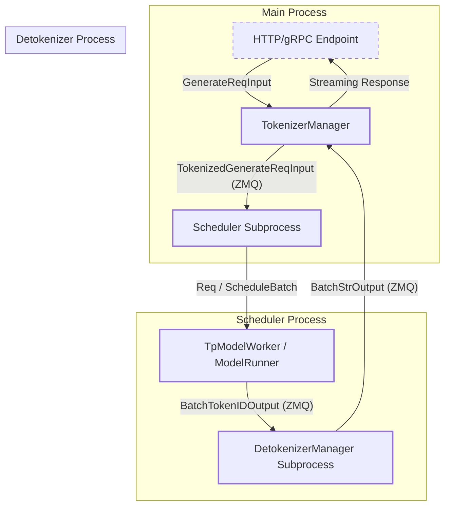
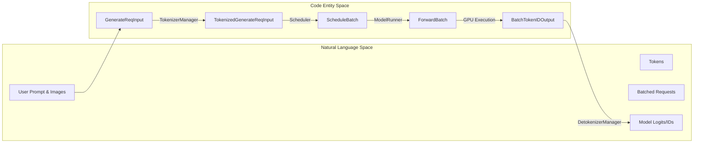

<!-- source: DeepWiki mcp.deepwiki.com · repo microsoft/llm-42 · page 3 SGLang Runtime (SRT) Core Architecture · fetched 2026-10-26 -->

# SGLang Runtime (SRT) Core Architecture

Relevant source files

The following files were used as context for generating this wiki page:

- [README.md](README.md)
- [benchmark/deepseek_v3/README.md](benchmark/deepseek_v3/README.md)
- [docker/rocm.Dockerfile](docker/rocm.Dockerfile)
- [docs/get_started/install.md](docs/get_started/install.md)
- [docs/platforms/amd_gpu.md](docs/platforms/amd_gpu.md)
- [docs/platforms/ascend_npu.md](docs/platforms/ascend_npu.md)
- [python/pyproject.toml](python/pyproject.toml)
- [python/pyproject_cpu.toml](python/pyproject_cpu.toml)
- [python/pyproject_other.toml](python/pyproject_other.toml)
- [python/pyproject_xpu.toml](python/pyproject_xpu.toml)
- [python/sglang/__init__.py](python/sglang/__init__.py)
- [python/sglang/srt/entrypoints/engine.py](python/sglang/srt/entrypoints/engine.py)
- [python/sglang/srt/entrypoints/http_server.py](python/sglang/srt/entrypoints/http_server.py)
- [python/sglang/srt/layers/logits_processor.py](python/sglang/srt/layers/logits_processor.py)
- [python/sglang/srt/layers/sampler.py](python/sglang/srt/layers/sampler.py)
- [python/sglang/srt/managers/detokenizer_manager.py](python/sglang/srt/managers/detokenizer_manager.py)
- [python/sglang/srt/managers/io_struct.py](python/sglang/srt/managers/io_struct.py)
- [python/sglang/srt/managers/multi_tokenizer_mixin.py](python/sglang/srt/managers/multi_tokenizer_mixin.py)
- [python/sglang/srt/managers/schedule_batch.py](python/sglang/srt/managers/schedule_batch.py)
- [python/sglang/srt/managers/scheduler.py](python/sglang/srt/managers/scheduler.py)
- [python/sglang/srt/managers/scheduler_metrics_mixin.py](python/sglang/srt/managers/scheduler_metrics_mixin.py)
- [python/sglang/srt/managers/scheduler_output_processor_mixin.py](python/sglang/srt/managers/scheduler_output_processor_mixin.py)
- [python/sglang/srt/managers/scheduler_update_weights_mixin.py](python/sglang/srt/managers/scheduler_update_weights_mixin.py)
- [python/sglang/srt/managers/tokenizer_communicator_mixin.py](python/sglang/srt/managers/tokenizer_communicator_mixin.py)
- [python/sglang/srt/managers/tokenizer_manager.py](python/sglang/srt/managers/tokenizer_manager.py)
- [python/sglang/srt/managers/tp_worker.py](python/sglang/srt/managers/tp_worker.py)
- [python/sglang/srt/metrics/collector.py](python/sglang/srt/metrics/collector.py)
- [python/sglang/srt/model_executor/cuda_graph_runner.py](python/sglang/srt/model_executor/cuda_graph_runner.py)
- [python/sglang/srt/model_executor/forward_batch_info.py](python/sglang/srt/model_executor/forward_batch_info.py)
- [python/sglang/srt/model_executor/model_runner.py](python/sglang/srt/model_executor/model_runner.py)
- [python/sglang/srt/sampling/sampling_batch_info.py](python/sglang/srt/sampling/sampling_batch_info.py)
- [python/sglang/srt/sampling/sampling_params.py](python/sglang/srt/sampling/sampling_params.py)
- [python/sglang/srt/server_args.py](python/sglang/srt/server_args.py)
- [python/sglang/version.py](python/sglang/version.py)

The SGLang Runtime (SRT) is a high-performance inference engine designed for large language models (LLMs) and vision-language models (VLMs). It utilizes a multi-process architecture to parallelize tokenization, scheduling, model execution, and detokenization, ensuring maximum throughput and low latency.

## Multi-Process Engine Overview

The `Engine` class serves as the main entry point for the SGLang runtime [python/sglang/srt/entrypoints/engine.py:118-130](). It orchestrates three primary components that run in separate processes to avoid Python's Global Interpreter Lock (GIL) bottlenecks:

1.  **TokenizerManager**: Runs in the main process. It handles HTTP/gRPC requests, manages multimodal data, and converts text into token IDs [python/sglang/srt/managers/tokenizer_manager.py:14-14]().
2.  **Scheduler**: Runs as a subprocess. It manages the request queue, allocates KV cache memory, and determines batch composition for the GPU [python/sglang/srt/managers/scheduler.py:14-14]().
3.  **DetokenizerManager**: Runs as a subprocess. It converts output token IDs from the model back into text and streams them to the client [python/sglang/srt/managers/detokenizer_manager.py:1-20]().

The processes communicate via ZeroMQ (ZMQ) using IPC or TCP sockets [python/sglang/srt/entrypoints/engine.py:129-130]().

### System Architecture Diagram

The following diagram illustrates the flow of a request through the SRT core components and the associated code entities.

**SRT Process and Data Flow**

Sources: [python/sglang/srt/entrypoints/engine.py:118-130](), [python/sglang/srt/managers/tokenizer_manager.py:14-14](), [python/sglang/srt/managers/scheduler.py:14-14](), [python/sglang/srt/managers/io_struct.py:14-17]()

## Core Components

### TokenizerManager
The `TokenizerManager` is responsible for the front-end lifecycle of a request. It manages the `AsyncDynamicbatchTokenizer` to handle high-concurrency tokenization [python/sglang/srt/managers/tokenizer_manager.py:46-46]() and utilizes an `AsyncMMDataProcessor` for multimodal inputs like images and videos [python/sglang/srt/managers/tokenizer_manager.py:47-47]().

### Scheduler
The `Scheduler` is the brain of SRT. it maintains the `RadixCache` for prefix matching and manages GPU memory pools [python/sglang/srt/managers/scheduler.py:178-180](). It transforms high-level `ScheduleBatch` objects into `ModelWorkerBatch` structures for the GPU workers [python/sglang/srt/managers/schedule_batch.py:27-38]().
For details, see [Request Lifecycle and Scheduling](#3.1).

### ModelRunner
The `ModelRunner` executes the actual model forward pass on the GPU. It wraps the model architecture and provides optimized execution paths via `CudaGraphRunner` for the decode phase [python/sglang/srt/model_executor/model_runner.py:118-121](). It also manages the KV cache via `ModelRunnerKVCacheMixin` [python/sglang/srt/model_executor/model_runner.py:130-132]().
For details, see [Model Execution and CUDA Graph Runner](#3.2).

### DetokenizerManager
The `DetokenizerManager` receives `BatchTokenIDOutput` from the scheduler process. It performs incremental detokenization to minimize latency for streaming responses before sending `BatchStrOutput` back to the `TokenizerManager` [python/sglang/srt/managers/io_struct.py:52-55]().

## Code Entity Mapping

The following diagram maps the logical runtime stages to the specific classes and data structures used in the codebase.

**Natural Language to Code Entity Mapping**

Sources: [python/sglang/srt/managers/io_struct.py:177-183](), [python/sglang/srt/managers/schedule_batch.py:143-150](), [python/sglang/srt/model_executor/forward_batch_info.py:122-127]()

## Subsystem Navigation

SRT's complexity is divided into several specialized subsystems covered in the following child pages:

*   **[Request Lifecycle and Scheduling](#3.1)**: Details on the `Scheduler`, request stages (`EXTEND`, `DECODE`), and the `RadixCache` system.
*   **[Model Execution and CUDA Graph Runner](#3.2)**: Details on `ModelRunner`, `TpModelWorker`, and how CUDA graphs are captured and replayed for decode performance.
*   **[KV Cache and Memory Management](#3.3)**: Details on `ReqToTokenPool`, `MHATokenToKVPool`, and hierarchical caching (`HiCache`).
*   **[Distributed Parallelism](#3.4)**: How SRT handles Tensor Parallelism (TP) and Pipeline Parallelism (PP) across multiple GPUs and nodes.
*   **[Prefill-Decode Disaggregation](#3.5)**: The architecture for separating prefill and decode phases onto different instances for improved efficiency.

Sources: [python/sglang/srt/managers/scheduler.py:143-155](), [python/sglang/srt/model_executor/model_runner.py:14-14](), [python/sglang/srt/model_executor/cuda_graph_runner.py:14-14](), [python/sglang/srt/managers/schedule_batch.py:64-74]()

---

