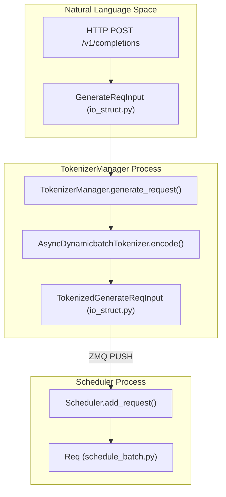
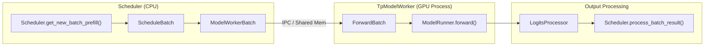

<!-- source: DeepWiki mcp.deepwiki.com · repo microsoft/llm-42 · page 3.1 Request Lifecycle and Scheduling · fetched 2026-10-26 -->

# Request Lifecycle and Scheduling

Relevant source files

The following files were used as context for generating this wiki page:

- [python/sglang/srt/entrypoints/http_server.py](python/sglang/srt/entrypoints/http_server.py)
- [python/sglang/srt/layers/logits_processor.py](python/sglang/srt/layers/logits_processor.py)
- [python/sglang/srt/layers/radix_attention.py](python/sglang/srt/layers/radix_attention.py)
- [python/sglang/srt/layers/sampler.py](python/sglang/srt/layers/sampler.py)
- [python/sglang/srt/managers/detokenizer_manager.py](python/sglang/srt/managers/detokenizer_manager.py)
- [python/sglang/srt/managers/io_struct.py](python/sglang/srt/managers/io_struct.py)
- [python/sglang/srt/managers/multi_tokenizer_mixin.py](python/sglang/srt/managers/multi_tokenizer_mixin.py)
- [python/sglang/srt/managers/schedule_batch.py](python/sglang/srt/managers/schedule_batch.py)
- [python/sglang/srt/managers/schedule_policy.py](python/sglang/srt/managers/schedule_policy.py)
- [python/sglang/srt/managers/scheduler.py](python/sglang/srt/managers/scheduler.py)
- [python/sglang/srt/managers/scheduler_metrics_mixin.py](python/sglang/srt/managers/scheduler_metrics_mixin.py)
- [python/sglang/srt/managers/scheduler_output_processor_mixin.py](python/sglang/srt/managers/scheduler_output_processor_mixin.py)
- [python/sglang/srt/managers/scheduler_update_weights_mixin.py](python/sglang/srt/managers/scheduler_update_weights_mixin.py)
- [python/sglang/srt/managers/tokenizer_communicator_mixin.py](python/sglang/srt/managers/tokenizer_communicator_mixin.py)
- [python/sglang/srt/managers/tokenizer_manager.py](python/sglang/srt/managers/tokenizer_manager.py)
- [python/sglang/srt/managers/tp_worker.py](python/sglang/srt/managers/tp_worker.py)
- [python/sglang/srt/mem_cache/base_prefix_cache.py](python/sglang/srt/mem_cache/base_prefix_cache.py)
- [python/sglang/srt/mem_cache/chunk_cache.py](python/sglang/srt/mem_cache/chunk_cache.py)
- [python/sglang/srt/mem_cache/common.py](python/sglang/srt/mem_cache/common.py)
- [python/sglang/srt/mem_cache/mamba_radix_cache.py](python/sglang/srt/mem_cache/mamba_radix_cache.py)
- [python/sglang/srt/mem_cache/radix_cache.py](python/sglang/srt/mem_cache/radix_cache.py)
- [python/sglang/srt/mem_cache/radix_cache_cpp.py](python/sglang/srt/mem_cache/radix_cache_cpp.py)
- [python/sglang/srt/mem_cache/storage/lmcache/lmc_radix_cache.py](python/sglang/srt/mem_cache/storage/lmcache/lmc_radix_cache.py)
- [python/sglang/srt/mem_cache/swa_radix_cache.py](python/sglang/srt/mem_cache/swa_radix_cache.py)
- [python/sglang/srt/metrics/collector.py](python/sglang/srt/metrics/collector.py)
- [python/sglang/srt/model_executor/cuda_graph_runner.py](python/sglang/srt/model_executor/cuda_graph_runner.py)
- [python/sglang/srt/model_executor/forward_batch_info.py](python/sglang/srt/model_executor/forward_batch_info.py)
- [python/sglang/srt/model_executor/model_runner.py](python/sglang/srt/model_executor/model_runner.py)
- [python/sglang/srt/sampling/sampling_batch_info.py](python/sglang/srt/sampling/sampling_batch_info.py)
- [python/sglang/srt/sampling/sampling_params.py](python/sglang/srt/sampling/sampling_params.py)
- [python/sglang/srt/server_args.py](python/sglang/srt/server_args.py)
- [python/sglang/srt/speculative/eagle_info.py](python/sglang/srt/speculative/eagle_info.py)
- [python/sglang/srt/speculative/eagle_info_v2.py](python/sglang/srt/speculative/eagle_info_v2.py)
- [python/sglang/srt/speculative/eagle_worker_v2.py](python/sglang/srt/speculative/eagle_worker_v2.py)
- [test/registered/radix_cache/test_mamba_unittest.py](test/registered/radix_cache/test_mamba_unittest.py)
- [test/registered/radix_cache/test_radix_cache_unit.py](test/registered/radix_cache/test_radix_cache_unit.py)
- [test/registered/radix_cache/test_swa_unittest.py](test/registered/radix_cache/test_swa_unittest.py)

This page describes the end-to-end journey of a request within the SGLang Runtime (SRT). It covers the transition from high-level HTTP inputs to scheduled batches, prefix-aware cache matching, and final output processing.

## 1. Request Ingestion and Tokenization

Requests enter the system via the `TokenizerManager`, which handles the conversion of raw text or multimodal data into a format suitable for the scheduler.

- **HTTP Entrypoint**: The FastAPI server in `http_server.py` receives `GenerateReqInput` objects [python/sglang/srt/entrypoints/http_server.py:104]().
- **Tokenization**: The `TokenizerManager` uses `AsyncDynamicbatchTokenizer` to process strings into `input_ids` [python/sglang/srt/managers/tokenizer_manager.py:46]().
- **Multimodal Processing**: If images or videos are present, `AsyncMMDataProcessor` handles feature extraction or placeholder insertion [python/sglang/srt/managers/tokenizer_manager.py:47]().
- **State Management**: Each request is tracked via a `ReqState` object, which stores timing metrics and incremental output buffers [python/sglang/srt/managers/tokenizer_manager.py:129-179]().

### Data Flow: Entry to Scheduler
The following diagram illustrates the transformation of a request from an external API call into the internal `Req` object used by the scheduler.

**Diagram: Request Ingestion Pipeline**

**Sources:** [python/sglang/srt/entrypoints/http_server.py:104](), [python/sglang/srt/managers/tokenizer_manager.py:129-179](), [python/sglang/srt/managers/scheduler.py:147-150]().

---

## 2. Scheduling and Batching

The `Scheduler` is the central coordinator of the SRT. It maintains queues of pending requests and organizes them into batches for the GPU workers.

### 2.1 Scheduling Policies
The scheduler uses a `SchedulePolicy` (defaulting to FCFS) to determine the order of execution.
- **FCFS**: First-Come-First-Served logic [python/sglang/srt/managers/schedule_policy.py:151]().
- **Chunked Prefill**: Large requests can be split into chunks to avoid starving decode requests [python/sglang/srt/model_executor/forward_batch_info.py:80-81]().

### 2.2 RadixCache Prefix Matching
Before a request is scheduled for a full prefill, the `Scheduler` queries the `RadixCache` to find existing KV cache prefixes.
- **Prefix Matching**: The `match_prefix` function in `RadixCache` traverses a radix tree to find the longest common prefix of `input_ids` [python/sglang/srt/mem_cache/radix_cache.py:180]().
- **Cache Hits**: If a prefix is found, the scheduler only needs to compute the "extend" portion of the sequence, significantly reducing TTFT (Time To First Token).

### 2.3 The Batching Lifecycle
Requests progress through three primary data structures as they move toward the GPU:
1.  **`ScheduleBatch`**: High-level metadata managed by the CPU scheduler [python/sglang/srt/managers/schedule_batch.py:149]().
2.  **`ModelWorkerBatch`**: A subset of data sent to the `TpModelWorker` [python/sglang/srt/managers/schedule_batch.py:145]().
3.  **`ForwardBatch`**: Low-level GPU tensors used by the `ModelRunner` [python/sglang/srt/model_executor/forward_batch_info.py:124]().

**Diagram: Batch Transformation and Execution**

**Sources:** [python/sglang/srt/managers/schedule_batch.py:25-38](), [python/sglang/srt/model_executor/forward_batch_info.py:17-28](), [python/sglang/srt/managers/scheduler.py:143-150]().

---

## 3. Forward Pass Modes

The scheduler categorizes the forward pass into different `ForwardMode` types to optimize GPU kernel selection:

| Mode | Description | Code Entity |
| :--- | :--- | :--- |
| `EXTEND` | Standard prefill for new tokens. | `ForwardMode.EXTEND` [python/sglang/srt/model_executor/forward_batch_info.py:77]() |
| `DECODE` | Generating one token for existing sequences. | `ForwardMode.DECODE` [python/sglang/srt/model_executor/forward_batch_info.py:79]() |
| `MIXED` | Simultaneous prefill and decode (Chunked Prefill). | `ForwardMode.MIXED` [python/sglang/srt/model_executor/forward_batch_info.py:81]() |
| `TARGET_VERIFY` | Speculative decoding verification pass. | `ForwardMode.TARGET_VERIFY` [python/sglang/srt/model_executor/forward_batch_info.py:86]() |
| `TARGET_LLM42_VERIFY` | LLM-42 DVR deterministic verification. | `ForwardMode.TARGET_LLM42_VERIFY` [python/sglang/srt/model_executor/forward_batch_info.py:89]() |

**Sources:** [python/sglang/srt/model_executor/forward_batch_info.py:74-104]()

---

## 4. Output Processing and Detokenization

Once the `ModelRunner` completes a forward pass, the results flow back through the `Scheduler` to the user.

1.  **Result Collection**: The `Scheduler` receives `GenerationBatchResult` containing `next_token_ids` and `logits` [python/sglang/srt/managers/scheduler.py:177]().
2.  **Output Processing**: `SchedulerOutputProcessorMixin` handles the logic for updating request states and checking finish reasons (e.g., EOS token, max length) [python/sglang/srt/managers/scheduler_output_processor_mixin.py:41]().
3.  **Detokenization**: Token IDs are sent to the `DetokenizerManager`. It performs incremental decoding using a `DecodeStatus` tracker to handle multi-byte UTF-8 characters correctly [python/sglang/srt/managers/detokenizer_manager.py:63-72]().
4.  **Streaming**: The `TokenizerManager` receives the detokenized strings and pushes them to the client via HTTP streaming [python/sglang/srt/managers/tokenizer_manager.py:151-153]().

### LLM-42 DVR Integration
During the output phase, if `enable_llm42` is active, the first token from prefill is marked as verified [python/sglang/srt/managers/scheduler_output_processor_mixin.py:179-181](). Subsequent decode tokens are verified in windows via the `TARGET_LLM42_VERIFY` mode to ensure batch-invariant determinism.

**Sources:** [python/sglang/srt/managers/detokenizer_manager.py:74-90](), [python/sglang/srt/managers/scheduler_output_processor_mixin.py:124-185](), [python/sglang/srt/managers/tokenizer_manager.py:129-179]().

---

