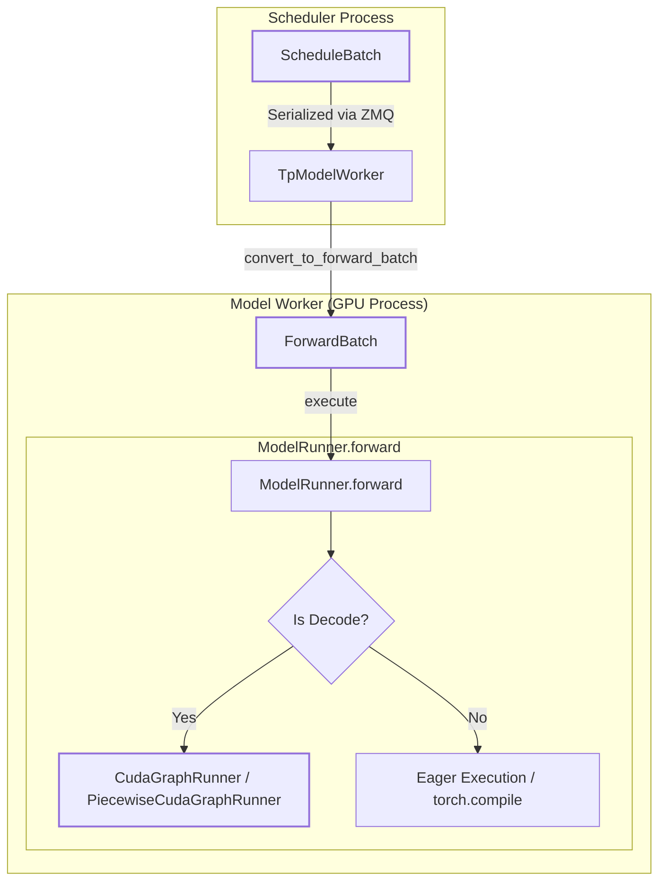
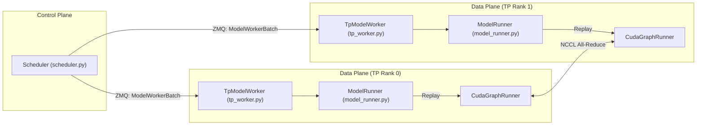

<!-- source: DeepWiki mcp.deepwiki.com · repo microsoft/llm-42 · page 3.2 Model Execution and CUDA Graph Runner · fetched 2026-10-26 -->

# Model Execution and CUDA Graph Runner

Relevant source files

The following files were used as context for generating this wiki page:

- [python/sglang/multimodal_gen/runtime/layers/usp.py](python/sglang/multimodal_gen/runtime/layers/usp.py)
- [python/sglang/srt/compilation/backend.py](python/sglang/srt/compilation/backend.py)
- [python/sglang/srt/compilation/compilation_config.py](python/sglang/srt/compilation/compilation_config.py)
- [python/sglang/srt/compilation/compile.py](python/sglang/srt/compilation/compile.py)
- [python/sglang/srt/compilation/compiler_interface.py](python/sglang/srt/compilation/compiler_interface.py)
- [python/sglang/srt/compilation/cuda_piecewise_backend.py](python/sglang/srt/compilation/cuda_piecewise_backend.py)
- [python/sglang/srt/compilation/piecewise_context_manager.py](python/sglang/srt/compilation/piecewise_context_manager.py)
- [python/sglang/srt/entrypoints/http_server.py](python/sglang/srt/entrypoints/http_server.py)
- [python/sglang/srt/layers/attention/fla/utils.py](python/sglang/srt/layers/attention/fla/utils.py)
- [python/sglang/srt/layers/elementwise.py](python/sglang/srt/layers/elementwise.py)
- [python/sglang/srt/layers/logits_processor.py](python/sglang/srt/layers/logits_processor.py)
- [python/sglang/srt/layers/moe/router.py](python/sglang/srt/layers/moe/router.py)
- [python/sglang/srt/layers/sampler.py](python/sglang/srt/layers/sampler.py)
- [python/sglang/srt/managers/detokenizer_manager.py](python/sglang/srt/managers/detokenizer_manager.py)
- [python/sglang/srt/managers/io_struct.py](python/sglang/srt/managers/io_struct.py)
- [python/sglang/srt/managers/multi_tokenizer_mixin.py](python/sglang/srt/managers/multi_tokenizer_mixin.py)
- [python/sglang/srt/managers/schedule_batch.py](python/sglang/srt/managers/schedule_batch.py)
- [python/sglang/srt/managers/scheduler.py](python/sglang/srt/managers/scheduler.py)
- [python/sglang/srt/managers/scheduler_metrics_mixin.py](python/sglang/srt/managers/scheduler_metrics_mixin.py)
- [python/sglang/srt/managers/scheduler_output_processor_mixin.py](python/sglang/srt/managers/scheduler_output_processor_mixin.py)
- [python/sglang/srt/managers/scheduler_update_weights_mixin.py](python/sglang/srt/managers/scheduler_update_weights_mixin.py)
- [python/sglang/srt/managers/tokenizer_communicator_mixin.py](python/sglang/srt/managers/tokenizer_communicator_mixin.py)
- [python/sglang/srt/managers/tokenizer_manager.py](python/sglang/srt/managers/tokenizer_manager.py)
- [python/sglang/srt/managers/tp_worker.py](python/sglang/srt/managers/tp_worker.py)
- [python/sglang/srt/metrics/collector.py](python/sglang/srt/metrics/collector.py)
- [python/sglang/srt/model_executor/cuda_graph_runner.py](python/sglang/srt/model_executor/cuda_graph_runner.py)
- [python/sglang/srt/model_executor/forward_batch_info.py](python/sglang/srt/model_executor/forward_batch_info.py)
- [python/sglang/srt/model_executor/model_runner.py](python/sglang/srt/model_executor/model_runner.py)
- [python/sglang/srt/model_executor/piecewise_cuda_graph_runner.py](python/sglang/srt/model_executor/piecewise_cuda_graph_runner.py)
- [python/sglang/srt/sampling/sampling_batch_info.py](python/sglang/srt/sampling/sampling_batch_info.py)
- [python/sglang/srt/sampling/sampling_params.py](python/sglang/srt/sampling/sampling_params.py)
- [python/sglang/srt/server_args.py](python/sglang/srt/server_args.py)
- [python/sglang/srt/tokenizer/tiktoken_tokenizer.py](python/sglang/srt/tokenizer/tiktoken_tokenizer.py)
- [python/sglang/srt/utils/patch_torch.py](python/sglang/srt/utils/patch_torch.py)
- [test/registered/cuda_graph/test_piecewise_cuda_graph_2_gpu.py](test/registered/cuda_graph/test_piecewise_cuda_graph_2_gpu.py)
- [test/registered/cuda_graph/test_piecewise_cuda_graph_large_1_gpu.py](test/registered/cuda_graph/test_piecewise_cuda_graph_large_1_gpu.py)
- [test/registered/cuda_graph/test_piecewise_cuda_graph_small_1_gpu.py](test/registered/cuda_graph/test_piecewise_cuda_graph_small_1_gpu.py)

The Model Execution subsystem is responsible for performing forward passes of the transformer models on the GPU. It bridges the high-level scheduling logic with low-level GPU operations, utilizing optimizations such as **CUDA Graphs** and `torch.compile` to minimize CPU overhead and kernel launch latency during the decode phase.

## ModelRunner and Forward Execution

The `ModelRunner` class is the central entity for executing model forward passes. It manages the model's weights, device buffers, and the execution of different forward modes (Prefill/Extend, Decode, and Verify).

### Forward Modes
The execution logic varies significantly based on the `ForwardMode` defined in the batch metadata:
*   **EXTEND (Prefill):** Processes new input tokens and populates the KV cache. This is typically compute-bound.
*   **DECODE:** Generates one token at a time for a batch of requests. This is typically memory-bound and sensitive to CPU overhead.
*   **TARGET_VERIFY:** Used in speculative decoding to verify multiple draft tokens in a single target model pass.
*   **TARGET_LLM42_VERIFY:** Used in the LLM-42 DVR protocol to replay a window of tokens under deterministic fixed-shape reductions [python/sglang/srt/model_executor/forward_batch_info.py:87-89]().

### Data Flow: Scheduler to GPU
The transition from request management to GPU execution involves a series of data structure transformations:
1.  `ScheduleBatch`: Managed by the `Scheduler`, contains high-level CPU-side data [python/sglang/srt/managers/schedule_batch.py:29-30]().
2.  `ModelWorkerBatch`: A subset of the schedule batch containing only data needed for the GPU forward pass [python/sglang/srt/managers/schedule_batch.py:31-33]().
3.  `ForwardBatch`: Managed by `ModelRunner`, containing low-level GPU tensors and attention metadata [python/sglang/srt/model_executor/forward_batch_info.py:26-27]().

### Diagram: Execution Data Flow
"Natural Language Space" to "Code Entity Space" mapping for model execution.

Sources: [python/sglang/srt/managers/schedule_batch.py:25-38](), [python/sglang/srt/model_executor/model_runner.py:1-14]()

---

## CudaGraphRunner

To mitigate the overhead of launching hundreds of small kernels during the decode phase, SGLang uses `CudaGraphRunner`. It captures the sequence of GPU operations for a fixed batch size into a single graph that can be replayed with minimal CPU intervention [python/sglang/srt/model_executor/cuda_graph_runner.py:14-15]().

### Capture Strategy
SGLang captures graphs for a predefined set of batch sizes (e.g., powers of 2 or common sizes defined in `cuda_graph_bs`) [python/sglang/srt/model_executor/cuda_graph_runner.py:192-200](). During inference, the runner pads the current batch to the nearest captured size.

### Key Components
*   **GraphInputBuffers:** Manages the static GPU buffers (input IDs, position IDs, KV cache pointers) that are updated before each graph replay [python/sglang/srt/model_executor/input_buffers.py:1-20]().
*   **Capture Mode:** A context manager `model_capture_mode` is used to signal layers that they are being recorded, allowing them to use static shapes or pre-allocated buffers [python/sglang/srt/model_executor/cuda_graph_runner.py:102-109]().

Sources: [python/sglang/srt/model_executor/cuda_graph_runner.py:118-135](), [python/sglang/srt/model_executor/input_buffers.py:1-20]()

---

## Piecewise CUDA Graphs

For very large models or scenarios where a single CUDA graph would exceed memory limits (due to the static allocation of intermediate tensors), SGLang implements `PiecewiseCudaGraphRunner`.

Instead of capturing the entire model as one graph, it breaks the model into "pieces" (e.g., groups of transformer layers). This allows for:
1.  **Memory Savings:** Intermediate activations can be managed more flexibly between pieces.
2.  **Partial Compilation:** Specific segments can be optimized with `torch.compile` while others remain in eager mode.
3.  **Better Scalability:** Easier to manage on multi-GPU setups where collective operations (All-Reduce) might be interspersed with compute [python/sglang/srt/model_executor/piecewise_cuda_graph_runner.py:1-30]().

Sources: [python/sglang/srt/model_executor/piecewise_cuda_graph_runner.py:1-30](), [python/sglang/srt/model_executor/model_runner.py:133-135]()

---

## torch.compile Integration

SGLang integrates with `torch.compile` to optimize the model's computation graph. This is particularly useful for fusing element-wise operations and optimizing kernel selection.

*   **Patching:** The `patch_model` context manager is used to wrap the model's forward function with `torch.compile` [python/sglang/srt/model_executor/cuda_graph_runner.py:142-165]().
*   **Configuration:** Custom settings such as `max-autotune-no-cudagraphs` are used to ensure compatibility with SGLang's manual CUDA graph management [python/sglang/srt/model_executor/cuda_graph_runner.py:161-163]().
*   **Multi-Platform Support:** SGLang handles platform-specific compilation flags, such as enabling dynamic shapes on AMD ROCm (`_is_hip`) [python/sglang/srt/model_executor/cuda_graph_runner.py:164-165]().

Sources: [python/sglang/srt/model_executor/cuda_graph_runner.py:142-189](), [python/sglang/srt/utils/patch_torch.py:1-50]()

---

## TpModelWorker

The `TpModelWorker` acts as a wrapper around `ModelRunner` in a distributed environment. In a Tensor Parallel (TP) setup, each GPU runs one `TpModelWorker` process.

### Responsibilities
1.  **Distributed Initialization:** Sets up NCCL/MSCCLPP communicators and process groups via `initialize_model_parallel` [python/sglang/srt/model_executor/model_runner.py:61-64]().
2.  **Batch Dispatch:** Receives `ModelWorkerBatch` from the scheduler and invokes `ModelRunner.forward` [python/sglang/srt/managers/tp_worker.py:61-63]().
3.  **Weight Management:** Handles dynamic weight updates (e.g., for LoRA or online weight loading) across all TP ranks [python/sglang/srt/managers/tp_worker.py:93-100]().

### Diagram: Distributed Execution Architecture
Association of system components with code entities for distributed execution.

Sources: [python/sglang/srt/managers/tp_worker.py:14-45](), [python/sglang/srt/model_executor/model_runner.py:56-65](), [python/sglang/srt/distributed/parallel_state.py:1-50]()

### Execution Summary Table

| Feature | Component | Purpose |
| :--- | :--- | :--- |
| **Decode Optimization** | `CudaGraphRunner` | Eliminates kernel launch overhead for small batch generation [python/sglang/srt/model_executor/cuda_graph_runner.py:1-15](). |
| **Memory Management** | `GraphInputBuffers` | Provides static memory addresses for CUDA Graph replay [python/sglang/srt/model_executor/input_buffers.py:1-20](). |
| **Large Model Support** | `PiecewiseCudaGraphRunner` | Splits model into smaller graphs to fit in memory [python/sglang/srt/model_executor/piecewise_cuda_graph_runner.py:1-30](). |
| **Kernel Fusion** | `torch.compile` | Optimizes transformer layers and fuses element-wise ops [python/sglang/srt/model_executor/cuda_graph_runner.py:142-165](). |
| **Parallelism** | `TpModelWorker` | Orchestrates execution across multiple GPUs (Tensor Parallel) [python/sglang/srt/managers/tp_worker.py:14-45](). |

Sources: [python/sglang/srt/model_executor/model_runner.py:1-150](), [python/sglang/srt/model_executor/cuda_graph_runner.py:1-200](), [python/sglang/srt/managers/tp_worker.py:1-100]()

---

