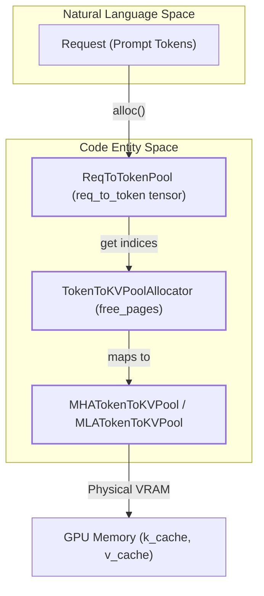
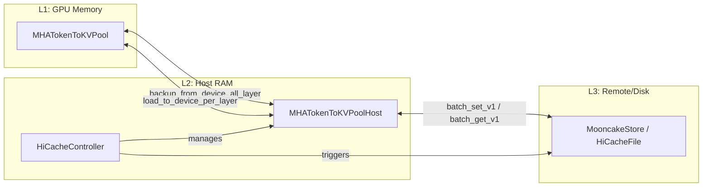

<!-- source: DeepWiki mcp.deepwiki.com · repo microsoft/llm-42 · page 3.3 KV Cache and Memory Management · fetched 2026-10-26 -->

# KV Cache and Memory Management

Relevant source files

The following files were used as context for generating this wiki page:

- [docs/advanced_features/hicache.rst](docs/advanced_features/hicache.rst)
- [docs/advanced_features/hicache_best_practices.md](docs/advanced_features/hicache_best_practices.md)
- [docs/advanced_features/hicache_design.md](docs/advanced_features/hicache_design.md)
- [docs/advanced_features/hicache_storage_runtime_attach_detach.md](docs/advanced_features/hicache_storage_runtime_attach_detach.md)
- [python/sglang/srt/distributed/device_communicators/mooncake_transfer_engine.py](python/sglang/srt/distributed/device_communicators/mooncake_transfer_engine.py)
- [python/sglang/srt/managers/cache_controller.py](python/sglang/srt/managers/cache_controller.py)
- [python/sglang/srt/managers/schedule_policy.py](python/sglang/srt/managers/schedule_policy.py)
- [python/sglang/srt/mem_cache/allocator.py](python/sglang/srt/mem_cache/allocator.py)
- [python/sglang/srt/mem_cache/base_prefix_cache.py](python/sglang/srt/mem_cache/base_prefix_cache.py)
- [python/sglang/srt/mem_cache/chunk_cache.py](python/sglang/srt/mem_cache/chunk_cache.py)
- [python/sglang/srt/mem_cache/common.py](python/sglang/srt/mem_cache/common.py)
- [python/sglang/srt/mem_cache/hicache_storage.py](python/sglang/srt/mem_cache/hicache_storage.py)
- [python/sglang/srt/mem_cache/hiradix_cache.py](python/sglang/srt/mem_cache/hiradix_cache.py)
- [python/sglang/srt/mem_cache/mamba_radix_cache.py](python/sglang/srt/mem_cache/mamba_radix_cache.py)
- [python/sglang/srt/mem_cache/memory_pool.py](python/sglang/srt/mem_cache/memory_pool.py)
- [python/sglang/srt/mem_cache/memory_pool_host.py](python/sglang/srt/mem_cache/memory_pool_host.py)
- [python/sglang/srt/mem_cache/radix_cache.py](python/sglang/srt/mem_cache/radix_cache.py)
- [python/sglang/srt/mem_cache/radix_cache_cpp.py](python/sglang/srt/mem_cache/radix_cache_cpp.py)
- [python/sglang/srt/mem_cache/storage/__init__.py](python/sglang/srt/mem_cache/storage/__init__.py)
- [python/sglang/srt/mem_cache/storage/backend_factory.py](python/sglang/srt/mem_cache/storage/backend_factory.py)
- [python/sglang/srt/mem_cache/storage/hf3fs/hf3fs_client.py](python/sglang/srt/mem_cache/storage/hf3fs/hf3fs_client.py)
- [python/sglang/srt/mem_cache/storage/hf3fs/hf3fs_usrbio_client.py](python/sglang/srt/mem_cache/storage/hf3fs/hf3fs_usrbio_client.py)
- [python/sglang/srt/mem_cache/storage/hf3fs/storage_hf3fs.py](python/sglang/srt/mem_cache/storage/hf3fs/storage_hf3fs.py)
- [python/sglang/srt/mem_cache/storage/lmcache/lmc_radix_cache.py](python/sglang/srt/mem_cache/storage/lmcache/lmc_radix_cache.py)
- [python/sglang/srt/mem_cache/storage/mooncake_store/README.md](python/sglang/srt/mem_cache/storage/mooncake_store/README.md)
- [python/sglang/srt/mem_cache/storage/mooncake_store/mooncake_store.py](python/sglang/srt/mem_cache/storage/mooncake_store/mooncake_store.py)
- [python/sglang/srt/mem_cache/storage/mooncake_store/test_mooncake_store.py](python/sglang/srt/mem_cache/storage/mooncake_store/test_mooncake_store.py)
- [python/sglang/srt/mem_cache/storage/nixl/README.md](python/sglang/srt/mem_cache/storage/nixl/README.md)
- [python/sglang/srt/mem_cache/storage/nixl/hicache_nixl.py](python/sglang/srt/mem_cache/storage/nixl/hicache_nixl.py)
- [python/sglang/srt/mem_cache/storage/nixl/nixl.config.toml.sample](python/sglang/srt/mem_cache/storage/nixl/nixl.config.toml.sample)
- [python/sglang/srt/mem_cache/storage/nixl/nixl_utils.py](python/sglang/srt/mem_cache/storage/nixl/nixl_utils.py)
- [python/sglang/srt/mem_cache/storage/nixl/test_hicache_nixl_storage.py](python/sglang/srt/mem_cache/storage/nixl/test_hicache_nixl_storage.py)
- [python/sglang/srt/mem_cache/swa_radix_cache.py](python/sglang/srt/mem_cache/swa_radix_cache.py)
- [python/sglang/srt/model_executor/model_runner_kv_cache_mixin.py](python/sglang/srt/model_executor/model_runner_kv_cache_mixin.py)
- [python/sglang/srt/speculative/eagle_info.py](python/sglang/srt/speculative/eagle_info.py)
- [python/sglang/srt/speculative/eagle_info_v2.py](python/sglang/srt/speculative/eagle_info_v2.py)
- [python/sglang/srt/speculative/eagle_worker_v2.py](python/sglang/srt/speculative/eagle_worker_v2.py)
- [test/registered/hicache/test_hicache_storage_runtime_attach_detach.py](test/registered/hicache/test_hicache_storage_runtime_attach_detach.py)
- [test/registered/radix_cache/test_mamba_unittest.py](test/registered/radix_cache/test_mamba_unittest.py)
- [test/registered/radix_cache/test_radix_cache_unit.py](test/registered/radix_cache/test_radix_cache_unit.py)
- [test/registered/radix_cache/test_swa_unittest.py](test/registered/radix_cache/test_swa_unittest.py)

This page details the memory management subsystem of the SGLang Runtime (SRT), focusing on GPU memory pools, prefix caching mechanisms (RadixCache), and the hierarchical caching system (HiCache).

## Overview and Purpose

The memory management system is designed to maximize throughput and minimize latency by efficiently reusing KV cache across requests and managing data movement between GPU (L1), Host RAM (L2), and Remote Storage (L3). The architecture uses a page-aligned allocation strategy to support complex scheduling like chunked prefill and prefix matching.

## GPU Memory Pools

SGLang manages GPU memory through specialized pools that separate request metadata from physical KV data.

### Request-to-Token Mapping
The `ReqToTokenPool` maps a unique request ID to its specific token locations in the physical KV cache [python/sglang/srt/mem_cache/memory_pool.py:126-135](). It uses a 2D tensor of shape `(size, max_context_len)` to store indices [python/sglang/srt/mem_cache/memory_pool.py:144-146]().

### Token-to-KV Allocators
The `BaseTokenToKVPoolAllocator` manages indices within the physical KV cache [python/sglang/srt/mem_cache/allocator.py:35-45]().
*   **TokenToKVPoolAllocator**: Manages standard unpaged allocations [python/sglang/srt/mem_cache/allocator.py:117-128]().
*   **PagedTokenToKVPoolAllocator**: Handles page-aligned allocations, allowing for more flexible memory reuse [python/sglang/srt/model_executor/model_runner_kv_cache_mixin.py:11-14]().

### Physical KV Pools
Different attention backends utilize specialized physical pools:
*   **MHATokenToKVPool**: Standard Multi-Head Attention pool [python/sglang/srt/mem_cache/memory_pool.py:317-320]().
*   **MLATokenToKVPool**: Specialized for Multi-Head Latent Attention (MLA), storing compressed latent vectors [python/sglang/srt/mem_cache/memory_pool.py:531-540]().
*   **NSATokenToKVPool**: Supports Native Sparse Attention with indexer KV cache overhead [python/sglang/srt/model_executor/model_runner_kv_cache_mixin.py:70-80]().

### Memory Pool Data Flow
The following diagram illustrates how requests are mapped to physical GPU memory.

**GPU Memory Mapping Architecture**

Sources: [python/sglang/srt/mem_cache/memory_pool.py:126-146](), [python/sglang/srt/mem_cache/allocator.py:117-128](), [python/sglang/srt/model_executor/model_runner_kv_cache_mixin.py:15-25]()

## RadixCache and Variants

The `RadixCache` is the core of SGLang's prefix caching system. It manages KV cache as a radix tree where nodes represent sequences of tokens [python/sglang/srt/mem_cache/radix_cache.py:22-30]().

### Core Implementation
*   **TreeNode**: Represents a prefix. It tracks `lock_ref` to prevent eviction during active inference and `last_access_time` for LRU eviction [python/sglang/srt/mem_cache/radix_cache.py:97-122]().
*   **Eviction Strategies**: Supports LRU, LFU, FIFO, FILO, and MRU via `EvictionStrategy` classes [python/sglang/srt/mem_cache/radix_cache.py:52-60]().

### Variants
| Variant | Class Name | Purpose |
| :--- | :--- | :--- |
| **Sliding Window** | `SWARadixCache` | Manages hybrid full and sliding window attention (SWA) caches [python/sglang/srt/mem_cache/swa_radix_cache.py:19-26](). |
| **Mamba** | `MambaRadixCache` | Specialized for Mamba-based models with linear state params [python/sglang/srt/mem_cache/mamba_radix_cache.py:1-5](). |
| **Chunk** | `ChunkCache` | Used when prefix matching is disabled; manages cache per request lifecycle [python/sglang/srt/mem_cache/chunk_cache.py:29-40](). |

Sources: [python/sglang/srt/mem_cache/radix_cache.py:97-122](), [python/sglang/srt/mem_cache/swa_radix_cache.py:58-94](), [python/sglang/srt/mem_cache/chunk_cache.py:29-49]()

## HiCache: Hierarchical Caching System

HiCache (Hierarchical Cache) extends the RadixCache to support multiple tiers of memory: GPU (L1), Host RAM (L2), and Remote Storage (L3).

### Tiered Architecture
1.  **L1 (GPU)**: Managed by `MHATokenToKVPool` or `MLATokenToKVPool`.
2.  **L2 (Host)**: Managed by `HostKVCache`. This pool is significantly larger than GPU memory and uses `cudaHostRegister` for fast pinned memory transfers [python/sglang/srt/mem_cache/memory_pool_host.py:136-155]().
3.  **L3 (Storage)**: Managed by `HiCacheStorage` backends like Mooncake or HF3FS [python/sglang/srt/mem_cache/hicache_storage.py:65-70]().

### Key Components
*   **HiRadixCache**: The top-level cache class that coordinates between `RadixCache` logic and hierarchical transfers [python/sglang/srt/mem_cache/hiradix_cache.py:51-60]().
*   **HiCacheController**: Manages asynchronous data movement (prefetching and write-through) between tiers [python/sglang/srt/mem_cache/hiradix_cache.py:121-135]().
*   **Storage Backends**:
    *   **Mooncake**: Distributed KV cache transfer engine [python/sglang/srt/mem_cache/storage/mooncake_store/mooncake_store.py:28-40]().
    *   **HF3FS**: High-performance filesystem backend [python/sglang/srt/mem_cache/storage/hf3fs/storage_hf3fs.py:1-5]().
    *   **NIXL**: Shared memory / local storage backend [python/sglang/srt/mem_cache/storage/nixl/hicache_nixl.py:1-5]().

**HiCache Data Flow and Code Entities**

Sources: [python/sglang/srt/mem_cache/hiradix_cache.py:121-135](), [python/sglang/srt/mem_cache/memory_pool_host.py:205-220](), [python/sglang/srt/mem_cache/hicache_storage.py:76-98]()

## Implementation Details

### Prefix Matching and Hashing
Prefixes are identified using SHA256 hashes of token sequences [python/sglang/srt/mem_cache/hicache_storage.py:16-31](). The `compute_node_hash_values` function generates these hashes per page, enabling position-aware identification across the hierarchy [python/sglang/srt/mem_cache/radix_cache.py:201-215]().

### Scheduling Integration
The `SchedulePolicy` determines how requests interact with the cache:
*   **LPM (Longest Prefix Match)**: Prioritizes requests that hit the most cached tokens [python/sglang/srt/managers/schedule_policy.py:80-82]().
*   **CacheAwarePolicy**: Uses the `tree_cache` to calculate request priority [python/sglang/srt/managers/schedule_policy.py:97-105]().

### Memory Profiling
`ModelRunnerKVCacheMixin` provides `profile_max_num_token` to calculate the maximum possible KV cache size based on available GPU memory and model architecture (MLA vs MHA) [python/sglang/srt/model_executor/model_runner_kv_cache_mixin.py:116-141]().

Sources: [python/sglang/srt/mem_cache/hicache_storage.py:16-31](), [python/sglang/srt/managers/schedule_policy.py:93-116](), [python/sglang/srt/model_executor/model_runner_kv_cache_mixin.py:116-141]()

---

