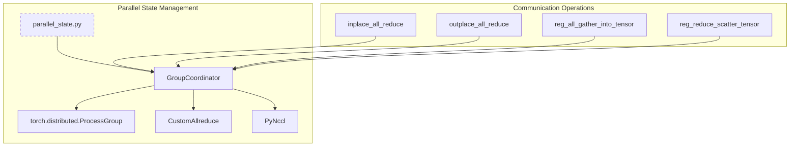
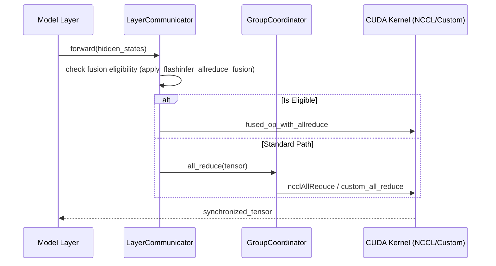

<!-- source: DeepWiki mcp.deepwiki.com · repo microsoft/llm-42 · page 3.4 Distributed Parallelism · fetched 2026-10-26 -->

# Distributed Parallelism

Relevant source files

The following files were used as context for generating this wiki page:

- [docs/references/environment_variables.md](docs/references/environment_variables.md)
- [python/sglang/srt/batch_invariant_ops/__init__.py](python/sglang/srt/batch_invariant_ops/__init__.py)
- [python/sglang/srt/batch_invariant_ops/batch_invariant_ops.py](python/sglang/srt/batch_invariant_ops/batch_invariant_ops.py)
- [python/sglang/srt/disaggregation/ascend/conn.py](python/sglang/srt/disaggregation/ascend/conn.py)
- [python/sglang/srt/disaggregation/ascend/transfer_engine.py](python/sglang/srt/disaggregation/ascend/transfer_engine.py)
- [python/sglang/srt/disaggregation/base/__init__.py](python/sglang/srt/disaggregation/base/__init__.py)
- [python/sglang/srt/disaggregation/base/conn.py](python/sglang/srt/disaggregation/base/conn.py)
- [python/sglang/srt/disaggregation/common/__init__.py](python/sglang/srt/disaggregation/common/__init__.py)
- [python/sglang/srt/disaggregation/common/conn.py](python/sglang/srt/disaggregation/common/conn.py)
- [python/sglang/srt/disaggregation/decode.py](python/sglang/srt/disaggregation/decode.py)
- [python/sglang/srt/disaggregation/fake/__init__.py](python/sglang/srt/disaggregation/fake/__init__.py)
- [python/sglang/srt/disaggregation/fake/conn.py](python/sglang/srt/disaggregation/fake/conn.py)
- [python/sglang/srt/disaggregation/mooncake/__init__.py](python/sglang/srt/disaggregation/mooncake/__init__.py)
- [python/sglang/srt/disaggregation/mooncake/conn.py](python/sglang/srt/disaggregation/mooncake/conn.py)
- [python/sglang/srt/disaggregation/nixl/__init__.py](python/sglang/srt/disaggregation/nixl/__init__.py)
- [python/sglang/srt/disaggregation/nixl/conn.py](python/sglang/srt/disaggregation/nixl/conn.py)
- [python/sglang/srt/disaggregation/prefill.py](python/sglang/srt/disaggregation/prefill.py)
- [python/sglang/srt/disaggregation/utils.py](python/sglang/srt/disaggregation/utils.py)
- [python/sglang/srt/distributed/communication_op.py](python/sglang/srt/distributed/communication_op.py)
- [python/sglang/srt/distributed/device_communicators/cuda_wrapper.py](python/sglang/srt/distributed/device_communicators/cuda_wrapper.py)
- [python/sglang/srt/distributed/device_communicators/custom_all_reduce.py](python/sglang/srt/distributed/device_communicators/custom_all_reduce.py)
- [python/sglang/srt/distributed/device_communicators/custom_all_reduce_utils.py](python/sglang/srt/distributed/device_communicators/custom_all_reduce_utils.py)
- [python/sglang/srt/distributed/device_communicators/hpu_communicator.py](python/sglang/srt/distributed/device_communicators/hpu_communicator.py)
- [python/sglang/srt/distributed/device_communicators/pynccl.py](python/sglang/srt/distributed/device_communicators/pynccl.py)
- [python/sglang/srt/distributed/device_communicators/pynccl_wrapper.py](python/sglang/srt/distributed/device_communicators/pynccl_wrapper.py)
- [python/sglang/srt/distributed/device_communicators/shm_broadcast.py](python/sglang/srt/distributed/device_communicators/shm_broadcast.py)
- [python/sglang/srt/distributed/device_communicators/xpu_communicator.py](python/sglang/srt/distributed/device_communicators/xpu_communicator.py)
- [python/sglang/srt/distributed/parallel_state.py](python/sglang/srt/distributed/parallel_state.py)
- [python/sglang/srt/environ.py](python/sglang/srt/environ.py)
- [python/sglang/srt/layers/activation.py](python/sglang/srt/layers/activation.py)
- [python/sglang/srt/layers/communicator.py](python/sglang/srt/layers/communicator.py)
- [python/sglang/srt/layers/dp_attention.py](python/sglang/srt/layers/dp_attention.py)
- [python/sglang/srt/layers/flashinfer_comm_fusion.py](python/sglang/srt/layers/flashinfer_comm_fusion.py)
- [python/sglang/srt/layers/layernorm.py](python/sglang/srt/layers/layernorm.py)
- [python/sglang/srt/layers/rotary_embedding.py](python/sglang/srt/layers/rotary_embedding.py)
- [python/sglang/srt/managers/scheduler_dp_attn_mixin.py](python/sglang/srt/managers/scheduler_dp_attn_mixin.py)
- [python/sglang/srt/managers/scheduler_pp_mixin.py](python/sglang/srt/managers/scheduler_pp_mixin.py)
- [python/sglang/srt/utils/common.py](python/sglang/srt/utils/common.py)

SGLang (SRT) provides a comprehensive suite of distributed parallelism strategies to scale LLM inference across multiple GPUs and nodes. It supports **Tensor Parallelism (TP)**, **Pipeline Parallelism (PP)**, **Data Parallelism (DP)**, **Expert Parallelism (EP)**, and a specialized **DP-Attention** (DeepSpeed-style Data Parallel Attention) for long-context scenarios.

## Model Parallel State Management

The core of SGLang's distributed infrastructure is managed by `parallel_state.py`, which initializes and maintains process groups for various parallelism modes.

### GroupCoordinator
The `GroupCoordinator` class wraps PyTorch `ProcessGroup` and routes communication to specialized backends like NCCL, custom all-reduce kernels, or MSCCLPP based on tensor size and hardware capability [python/sglang/srt/distributed/parallel_state.py:175-203]().

### Communicator Backends
SGLang implements several optimized communicators:
*   **Custom All-Reduce**: High-performance kernels for small-to-medium message sizes that bypass standard NCCL overhead [python/sglang/srt/distributed/parallel_state.py:203]().
*   **PyNccl**: A Python wrapper around NCCL for better control and integration with CUDA graphs [python/sglang/srt/distributed/parallel_state.py:201]().
*   **MSCCLPP**: Used for multi-node GPU communication optimizations [python/sglang/srt/distributed/parallel_state.py:202]().

### Entity Mapping: Parallel State to Code
The following diagram illustrates how distributed concepts map to specific classes and functions within the `parallel_state.py` module.

**Parallel State Architecture**

Sources: [python/sglang/srt/distributed/parallel_state.py:109-203]()

## Parallelism Strategies

### Tensor Parallelism (TP)
TP splits weights and activations across GPUs within a node. SGLang uses `tensor_model_parallel_all_reduce` to synchronize partial results after linear layers [python/sglang/srt/layers/communicator.py:23-28]().

### Data Parallelism & DP-Attention
DP-Attention is a specialized mode where the attention computation is parallelized across GPUs while maintaining the model weights.
*   **Scatter Modes**: SGLang defines `ScatterMode` (SCATTERED, TP_ATTN_FULL, FULL) to manage how data is distributed across the DP ranks [python/sglang/srt/layers/communicator.py:104-123]().
*   **Buffers**: Uses `get_global_dp_buffer` and `get_local_dp_buffer` to manage memory for all-gather and reduce-scatter operations during attention [python/sglang/srt/layers/communicator.py:47-48]().

### Expert Parallelism (EP)
Used in MoE models (e.g., DeepSeek), EP distributes experts across different ranks. It utilizes `get_moe_a2a_backend` for All-to-All communication [python/sglang/srt/layers/communicator.py:52-53]().

### Pipeline Parallelism (PP)
PP splits model layers across different GPUs or nodes. SGLang coordinates PP ranks through `scheduler_pp_mixin.py` and manages KV cache transfer during handoffs [python/sglang/srt/disaggregation/prefill.py:106-107]().

Sources: [python/sglang/srt/layers/communicator.py:104-168](), [python/sglang/srt/disaggregation/prefill.py:86-128]()

## LayerCommunicator Infrastructure

The `LayerCommunicator` provides a high-level abstraction for layers to perform collective operations without being coupled to specific distributed backends.

### Collective Operations
The infrastructure supports:
1.  **All-Reduce Fusion**: Fusing All-Reduce with other operations (like LayerNorm) to reduce kernel launch overhead, controlled by `apply_flashinfer_allreduce_fusion` [python/sglang/srt/layers/communicator.py:91-101]().
2.  **Input Scattering**: `AttnTpContext` allows for `attn_tp_input_scattered`, where inputs are only gathered when strictly necessary for the attention computation [python/sglang/srt/layers/communicator.py:169-196]().

**Layer Communication Data Flow**

Sources: [python/sglang/srt/layers/communicator.py:91-101](), [python/sglang/srt/distributed/parallel_state.py:132-174]()

## Prefill-Decode Disaggregation Transfer

SGLang supports disaggregating Prefill and Decode phases onto different instances. This requires high-performance KV cache transfer backends.

| Backend | Implementation Class | Purpose |
| :--- | :--- | :--- |
| **Mooncake** | `MooncakeKVManager` | RDMA-based transfer using Mooncake engine [python/sglang/srt/disaggregation/mooncake/conn.py:167-180]() |
| **NIXL** | `NixlKVManager` | Transfer using the NIXL agent and plugins [python/sglang/srt/disaggregation/nixl/conn.py:155-186]() |
| **Gloo** | `GlooGroup` | Standard PyTorch CPU-based coordination [python/sglang/srt/disaggregation/prefill.py:98-101]() |

### KV Transfer Lifecycle
1.  **Bootstrap**: Handshake between prefill and decode ranks via `PrefillBootstrapQueue` [python/sglang/srt/disaggregation/prefill.py:86-109]().
2.  **Pre-allocation**: Decode rank allocates memory in `DecodePreallocQueue` [python/sglang/srt/disaggregation/decode.py:205-213]().
3.  **Transfer**: Data is moved via RDMA (Mooncake/NIXL).
4.  **Commit**: Request moves to the running batch on the decode server [python/sglang/srt/disaggregation/decode.py:17-19]().

Sources: [python/sglang/srt/disaggregation/mooncake/conn.py:167-204](), [python/sglang/srt/disaggregation/nixl/conn.py:155-186](), [python/sglang/srt/disaggregation/decode.py:1-19]()

## Configuration and Environment Variables

Distributed behavior is tuned via several environment variables:

| Variable | Description |
| :--- | :--- |
| `SGLANG_CUSTOM_ALLREDUCE_ALGO` | Force algorithm: `oneshot`, `twoshot`, `1stage`, or `2stage` [docs/references/environment_variables.md:47]() |
| `SGLANG_SYMM_MEM_PREALLOC_GB_SIZE` | Preallocated GPU buffer size for NCCL symmetric memory pool [docs/references/environment_variables.md:46]() |
| `SGLANG_DISAGGREGATION_THREAD_POOL_SIZE` | Number of threads for KV sender in disaggregation [python/sglang/srt/disaggregation/mooncake/conn.py:187-191]() |
| `SGLANG_ENABLE_TP_MEMORY_INBALANCE_CHECK` | Check for memory imbalance across TP ranks [python/sglang/srt/environ.py:215]() |

Sources: [docs/references/environment_variables.md:46-47](), [python/sglang/srt/environ.py:208-215](), [python/sglang/srt/disaggregation/mooncake/conn.py:187-199]()

---

