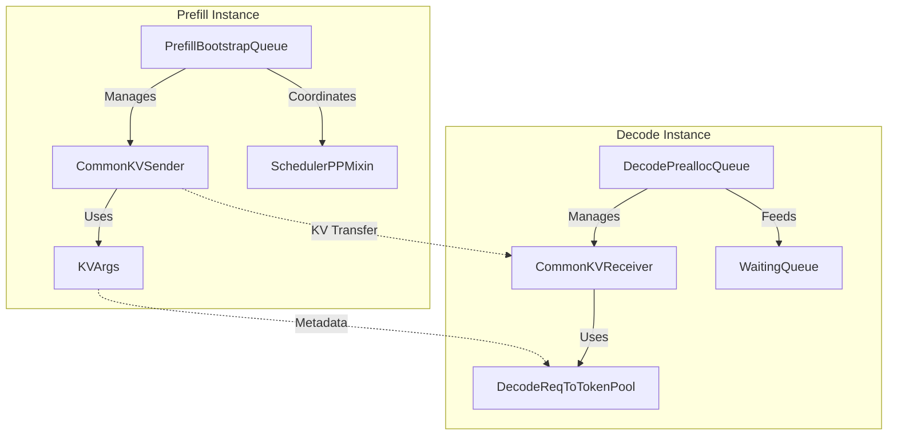
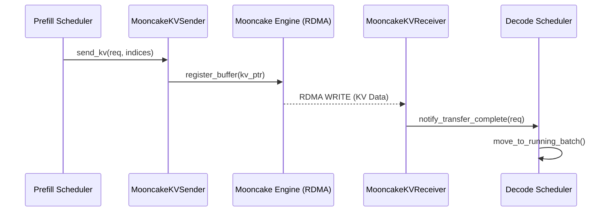

<!-- source: DeepWiki mcp.deepwiki.com · repo microsoft/llm-42 · page 3.5 Prefill-Decode Disaggregation · fetched 2026-10-26 -->

# Prefill-Decode Disaggregation

Relevant source files

The following files were used as context for generating this wiki page:

- [docs/advanced_features/hicache.rst](docs/advanced_features/hicache.rst)
- [docs/advanced_features/hicache_best_practices.md](docs/advanced_features/hicache_best_practices.md)
- [docs/advanced_features/hicache_design.md](docs/advanced_features/hicache_design.md)
- [docs/advanced_features/hicache_storage_runtime_attach_detach.md](docs/advanced_features/hicache_storage_runtime_attach_detach.md)
- [python/sglang/srt/disaggregation/ascend/conn.py](python/sglang/srt/disaggregation/ascend/conn.py)
- [python/sglang/srt/disaggregation/ascend/transfer_engine.py](python/sglang/srt/disaggregation/ascend/transfer_engine.py)
- [python/sglang/srt/disaggregation/base/__init__.py](python/sglang/srt/disaggregation/base/__init__.py)
- [python/sglang/srt/disaggregation/base/conn.py](python/sglang/srt/disaggregation/base/conn.py)
- [python/sglang/srt/disaggregation/common/__init__.py](python/sglang/srt/disaggregation/common/__init__.py)
- [python/sglang/srt/disaggregation/common/conn.py](python/sglang/srt/disaggregation/common/conn.py)
- [python/sglang/srt/disaggregation/decode.py](python/sglang/srt/disaggregation/decode.py)
- [python/sglang/srt/disaggregation/fake/__init__.py](python/sglang/srt/disaggregation/fake/__init__.py)
- [python/sglang/srt/disaggregation/fake/conn.py](python/sglang/srt/disaggregation/fake/conn.py)
- [python/sglang/srt/disaggregation/mooncake/__init__.py](python/sglang/srt/disaggregation/mooncake/__init__.py)
- [python/sglang/srt/disaggregation/mooncake/conn.py](python/sglang/srt/disaggregation/mooncake/conn.py)
- [python/sglang/srt/disaggregation/nixl/__init__.py](python/sglang/srt/disaggregation/nixl/__init__.py)
- [python/sglang/srt/disaggregation/nixl/conn.py](python/sglang/srt/disaggregation/nixl/conn.py)
- [python/sglang/srt/disaggregation/prefill.py](python/sglang/srt/disaggregation/prefill.py)
- [python/sglang/srt/disaggregation/utils.py](python/sglang/srt/disaggregation/utils.py)
- [python/sglang/srt/distributed/device_communicators/mooncake_transfer_engine.py](python/sglang/srt/distributed/device_communicators/mooncake_transfer_engine.py)
- [python/sglang/srt/managers/cache_controller.py](python/sglang/srt/managers/cache_controller.py)
- [python/sglang/srt/managers/scheduler_dp_attn_mixin.py](python/sglang/srt/managers/scheduler_dp_attn_mixin.py)
- [python/sglang/srt/managers/scheduler_pp_mixin.py](python/sglang/srt/managers/scheduler_pp_mixin.py)
- [python/sglang/srt/mem_cache/hicache_storage.py](python/sglang/srt/mem_cache/hicache_storage.py)
- [python/sglang/srt/mem_cache/hiradix_cache.py](python/sglang/srt/mem_cache/hiradix_cache.py)
- [python/sglang/srt/mem_cache/memory_pool.py](python/sglang/srt/mem_cache/memory_pool.py)
- [python/sglang/srt/mem_cache/memory_pool_host.py](python/sglang/srt/mem_cache/memory_pool_host.py)
- [python/sglang/srt/mem_cache/storage/__init__.py](python/sglang/srt/mem_cache/storage/__init__.py)
- [python/sglang/srt/mem_cache/storage/backend_factory.py](python/sglang/srt/mem_cache/storage/backend_factory.py)
- [python/sglang/srt/mem_cache/storage/hf3fs/hf3fs_client.py](python/sglang/srt/mem_cache/storage/hf3fs/hf3fs_client.py)
- [python/sglang/srt/mem_cache/storage/hf3fs/hf3fs_usrbio_client.py](python/sglang/srt/mem_cache/storage/hf3fs/hf3fs_usrbio_client.py)
- [python/sglang/srt/mem_cache/storage/hf3fs/storage_hf3fs.py](python/sglang/srt/mem_cache/storage/hf3fs/storage_hf3fs.py)
- [python/sglang/srt/mem_cache/storage/mooncake_store/README.md](python/sglang/srt/mem_cache/storage/mooncake_store/README.md)
- [python/sglang/srt/mem_cache/storage/mooncake_store/mooncake_store.py](python/sglang/srt/mem_cache/storage/mooncake_store/mooncake_store.py)
- [python/sglang/srt/mem_cache/storage/mooncake_store/test_mooncake_store.py](python/sglang/srt/mem_cache/storage/mooncake_store/test_mooncake_store.py)
- [python/sglang/srt/mem_cache/storage/nixl/README.md](python/sglang/srt/mem_cache/storage/nixl/README.md)
- [python/sglang/srt/mem_cache/storage/nixl/hicache_nixl.py](python/sglang/srt/mem_cache/storage/nixl/hicache_nixl.py)
- [python/sglang/srt/mem_cache/storage/nixl/nixl.config.toml.sample](python/sglang/srt/mem_cache/storage/nixl/nixl.config.toml.sample)
- [python/sglang/srt/mem_cache/storage/nixl/nixl_utils.py](python/sglang/srt/mem_cache/storage/nixl/nixl_utils.py)
- [python/sglang/srt/mem_cache/storage/nixl/test_hicache_nixl_storage.py](python/sglang/srt/mem_cache/storage/nixl/test_hicache_nixl_storage.py)
- [test/registered/hicache/test_hicache_storage_runtime_attach_detach.py](test/registered/hicache/test_hicache_storage_runtime_attach_detach.py)

Prefill-Decode (PD) disaggregation is an architectural pattern in LLM-42 that separates the compute-intensive prefill phase from the memory-bandwidth-intensive decode phase across different server instances. This separation allows for independent scaling of prefill and decode resources, optimizing throughput and reducing Time-to-First-Token (TTFT) by preventing long prefill jobs from blocking decode iterations.

Sources: `[python/sglang/srt/disaggregation/prefill.py:1-18]()`, `[python/sglang/srt/disaggregation/decode.py:1-19]()`.

## Architecture Overview

The disaggregation framework relies on a specialized handshake protocol and high-speed Key-Value (KV) transfer backends. The system coordinates between "Prefill" instances (which compute KV caches for new requests) and "Decode" instances (which consume these caches to generate tokens).

### High-Level Data Flow
1.  **Handshake**: The Prefill server initiates a bootstrap handshake with a Decode server to pre-allocate memory.
2.  **Prefill Execution**: The Prefill server runs the forward pass to generate KV caches and the first output token's metadata.
3.  **KV Transfer**: KV caches and metadata are transferred via a high-speed backend (Mooncake, NIXL, or Ascend).
4.  **Decode Execution**: The Decode server receives the KV cache and begins autoregressive generation.

### Disaggregation Code Entity Map
The following diagram maps the logical disaggregation components to their specific class implementations in the codebase.

**Disaggregation Component Mapping**

Sources: `[python/sglang/srt/disaggregation/prefill.py:86-109]()`, `[python/sglang/srt/disaggregation/decode.py:205-220]()`, `[python/sglang/srt/disaggregation/common/conn.py:20-25]()`.

---

## Prefill Side Implementation

### PrefillBootstrapQueue
The `PrefillBootstrapQueue` is responsible for requests currently in the "bootstrapping" phase—meaning they are performing handshakes and pre-allocating memory on the target decode instance.

-   **Initialization**: It initializes a `BaseKVManager` based on the configured `TransferBackend` (e.g., Mooncake, NIXL) `[python/sglang/srt/disaggregation/prefill.py:128-138]()`.
-   **Metadata Management**: It utilizes `MetadataBuffers` to store the first output token's IDs, logprobs, and hidden states for transfer to the decode node `[python/sglang/srt/disaggregation/utils.py:84-141]()`.
-   **Bootstrap Protocol**: It manages the `KVSender` which handles the ZMQ-based or RDMA-based handshake with the decode server.

### Pipeline Parallelism (PP) Coordination
In disaggregated mode, the `SchedulerPPMixin` provides a specialized event loop `event_loop_pp_disagg_prefill`. This loop ensures that all PP ranks reach a consensus on which requests have finished bootstrapping before proceeding to execution.

-   **Consensus**: Uses `poll_and_all_reduce` across the `gloo_group` to ensure all ranks are ready for a specific request `[python/sglang/srt/disaggregation/utils.py:40-53]()`.
-   **Transfer Initiation**: Once prefill is complete, the KV cache is pushed to the decode instance via the backend's sender implementation `[python/sglang/srt/managers/scheduler_pp_mixin.py:147-165]()`.

Sources: `[python/sglang/srt/disaggregation/prefill.py:86-138]()`, `[python/sglang/srt/managers/scheduler_pp_mixin.py:147-165]()`.

---

## Decode Side Implementation

### DecodePreallocQueue
The `DecodePreallocQueue` handles requests that have initiated a handshake from a prefill server but have not yet finished KV transfer.

-   **Memory Pre-allocation**: It calls `DecodeReqToTokenPool.alloc()` to reserve KV slots before the transfer begins `[python/sglang/srt/disaggregation/decode.py:119-138]()`.
-   **Transfer Monitoring**: It polls the `KVReceiver` to check if the data transfer from the prefill server is complete `[python/sglang/srt/disaggregation/decode.py:9-12]()`.

### DecodeReqToTokenPool
A specialized memory pool `DecodeReqToTokenPool` is used on decode instances. Unlike the standard `ReqToTokenPool`, it accounts for `pre_alloc_size`. This allows the server to track memory that is currently being filled by incoming transfers, preventing over-subscription of the GPU KV cache.

Sources: `[python/sglang/srt/disaggregation/decode.py:76-112]()`, `[python/sglang/srt/disaggregation/decode.py:205-225]()`.

---

## KV Transfer Backends

LLM-42 supports multiple backends for moving KV cache data between instances.

| Backend | Implementation Class | Characteristics |
| :--- | :--- | :--- |
| **Mooncake** | `MooncakeKVManager` | Uses RDMA via the Mooncake Transfer Engine. Supports zero-copy transfers and custom memory pools `[python/sglang/srt/disaggregation/mooncake/conn.py:167-180]()`. |
| **NIXL** | `NixlKVManager` | Utilizes the NIXL agent for high-performance interconnects `[python/sglang/srt/disaggregation/nixl/conn.py:155-178]()`. |
| **Ascend** | `AscendKVManager` | Optimized for Huawei Ascend NPUs using MemFabric-Hybrid `[python/sglang/srt/disaggregation/ascend/conn.py:1-20]()`. |

### Transfer Lifecycle (Mooncake Example)
The following diagram illustrates the interaction between the `MooncakeKVManager` and the hardware-level transfer engine.

**Mooncake Transfer Logic**

Sources: `[python/sglang/srt/disaggregation/mooncake/conn.py:178-205]()`, `[python/sglang/srt/disaggregation/decode.py:1-19]()`.

---

## Data Structures and Metadata

### MetadataBuffers
When a prefill is completed, it's not just the KV cache that is sent. The first token generated by the prefill must also be sent to the decode node to continue generation. `MetadataBuffers` manages these tensors:
- `output_ids`: The first generated token ID `[python/sglang/srt/disaggregation/utils.py:112]()`.
- `output_hidden_states`: Required for certain speculative decoding or reward model scenarios `[python/sglang/srt/disaggregation/utils.py:135-137]()`.
- `bootstrap_room`: A unique ID used to validate that the metadata received matches the request handshake `[python/sglang/srt/disaggregation/utils.py:139-141]()`.

### KVArgs
`KVArgs` is the primary configuration object passed between ranks and instances to describe the memory layout of the transfer. It includes:
- `kv_data_ptrs`: Memory addresses for the KV cache layers `[python/sglang/srt/disaggregation/prefill.py:146-149]()`.
- `page_size`: The block size of the paged attention mechanism `[python/sglang/srt/disaggregation/prefill.py:165]()`.
- `state_type`: Supports "swa" (Sliding Window), "mamba" (Hybrid), or "nsa" (Native Sparse Attention) `[python/sglang/srt/disaggregation/prefill.py:181-192]()`.

Sources: `[python/sglang/srt/disaggregation/utils.py:84-141]()`, `[python/sglang/srt/disaggregation/prefill.py:138-192]()`.

---

