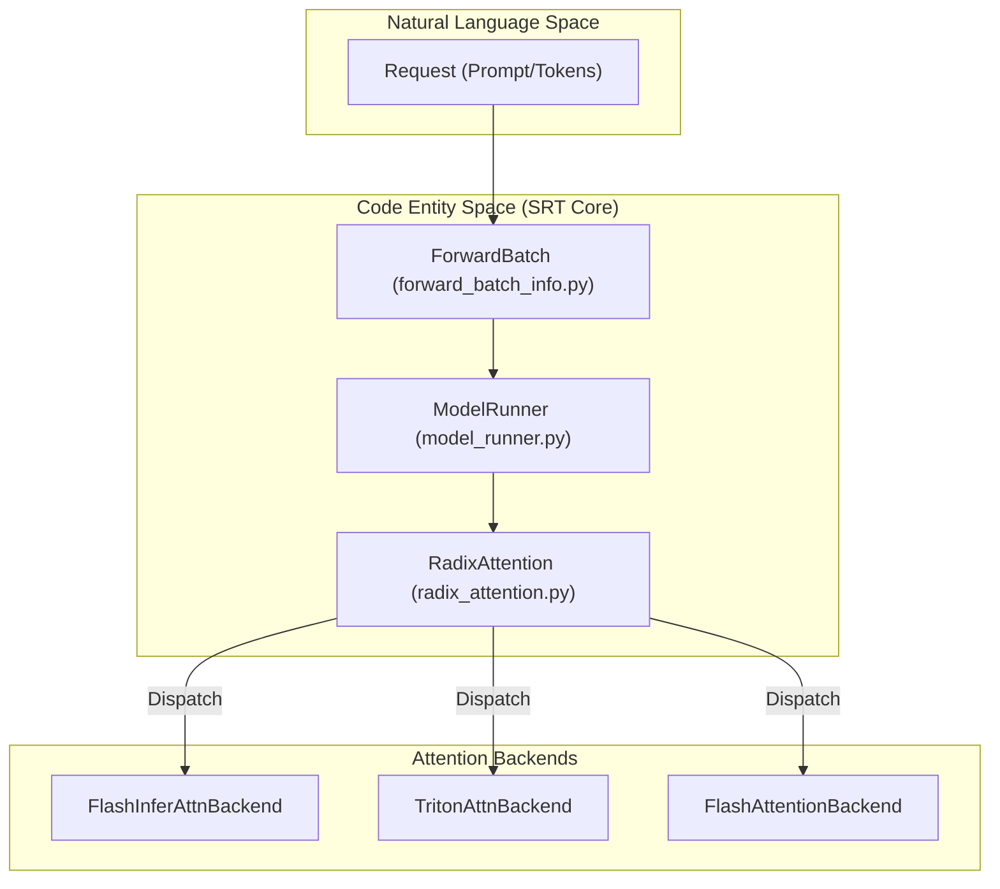
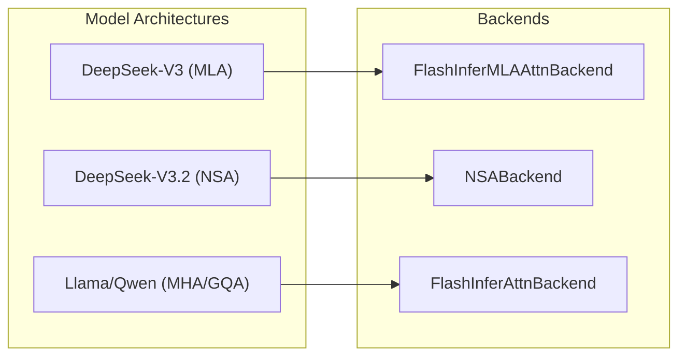

<!-- source: DeepWiki mcp.deepwiki.com · repo microsoft/llm-42 · page 4 Attention Backends · fetched 2026-10-26 -->

# Attention Backends

Relevant source files

The following files were used as context for generating this wiki page:

- [docs/advanced_features/server_arguments.md](docs/advanced_features/server_arguments.md)
- [docs/basic_usage/deepseek_v32.md](docs/basic_usage/deepseek_v32.md)
- [python/sglang/srt/disaggregation/mooncake/utils.py](python/sglang/srt/disaggregation/mooncake/utils.py)
- [python/sglang/srt/layers/attention/cutlass_mla_backend.py](python/sglang/srt/layers/attention/cutlass_mla_backend.py)
- [python/sglang/srt/layers/attention/double_sparsity_backend.py](python/sglang/srt/layers/attention/double_sparsity_backend.py)
- [python/sglang/srt/layers/attention/flashattention_backend.py](python/sglang/srt/layers/attention/flashattention_backend.py)
- [python/sglang/srt/layers/attention/flashinfer_backend.py](python/sglang/srt/layers/attention/flashinfer_backend.py)
- [python/sglang/srt/layers/attention/flashinfer_mla_backend.py](python/sglang/srt/layers/attention/flashinfer_mla_backend.py)
- [python/sglang/srt/layers/attention/flashmla_backend.py](python/sglang/srt/layers/attention/flashmla_backend.py)
- [python/sglang/srt/layers/attention/nsa/dequant_k_cache.py](python/sglang/srt/layers/attention/nsa/dequant_k_cache.py)
- [python/sglang/srt/layers/attention/nsa/index_buf_accessor.py](python/sglang/srt/layers/attention/nsa/index_buf_accessor.py)
- [python/sglang/srt/layers/attention/nsa/nsa_indexer.py](python/sglang/srt/layers/attention/nsa/nsa_indexer.py)
- [python/sglang/srt/layers/attention/nsa/quant_k_cache.py](python/sglang/srt/layers/attention/nsa/quant_k_cache.py)
- [python/sglang/srt/layers/attention/nsa/tilelang_kernel.py](python/sglang/srt/layers/attention/nsa/tilelang_kernel.py)
- [python/sglang/srt/layers/attention/nsa/utils.py](python/sglang/srt/layers/attention/nsa/utils.py)
- [python/sglang/srt/layers/attention/nsa_backend.py](python/sglang/srt/layers/attention/nsa_backend.py)
- [python/sglang/srt/layers/attention/triton_backend.py](python/sglang/srt/layers/attention/triton_backend.py)
- [python/sglang/srt/layers/attention/triton_ops/decode_attention.py](python/sglang/srt/layers/attention/triton_ops/decode_attention.py)
- [python/sglang/srt/layers/attention/triton_ops/double_sparsity_attention.py](python/sglang/srt/layers/attention/triton_ops/double_sparsity_attention.py)
- [python/sglang/srt/layers/attention/triton_ops/extend_attention.py](python/sglang/srt/layers/attention/triton_ops/extend_attention.py)
- [python/sglang/srt/layers/attention/triton_ops/prefill_attention.py](python/sglang/srt/layers/attention/triton_ops/prefill_attention.py)
- [python/sglang/srt/layers/attention/trtllm_mla_backend.py](python/sglang/srt/layers/attention/trtllm_mla_backend.py)
- [python/sglang/srt/layers/attention/utils.py](python/sglang/srt/layers/attention/utils.py)
- [python/sglang/srt/layers/communicator_nsa_cp.py](python/sglang/srt/layers/communicator_nsa_cp.py)
- [python/sglang/srt/managers/data_parallel_controller.py](python/sglang/srt/managers/data_parallel_controller.py)
- [python/sglang/srt/mem_cache/utils.py](python/sglang/srt/mem_cache/utils.py)
- [python/sglang/test/attention/test_trtllm_mla_backend.py](python/sglang/test/attention/test_trtllm_mla_backend.py)
- [test/manual/layers/attention/nsa/test_index_buf_accessor.py](test/manual/layers/attention/nsa/test_index_buf_accessor.py)
- [test/registered/hicache/test_nsa_pool_host_unit.py](test/registered/hicache/test_nsa_pool_host_unit.py)
- [test/registered/kernels/test_nsa_indexer.py](test/registered/kernels/test_nsa_indexer.py)

The SGLang Runtime (SRT) employs a pluggable attention backend system designed to provide high-performance attention kernels across various hardware platforms (NVIDIA, AMD, Intel, Ascend) and model architectures (Standard MHA, MLA, NSA). The system abstracts the complexity of KV cache management, metadata preparation, and kernel dispatching through the `AttentionBackend` base class [python/sglang/srt/layers/attention/base_attn_backend.py:12-12]().

## System Overview

The attention system is structured to handle three primary execution modes: **Extend** (prefill with cached prefix), **Decode** (single-token generation), and **Verify** (speculative decoding verification) [python/sglang/srt/layers/attention/flashinfer_backend.py:7-8](). Each backend implements specialized logic for managing `ForwardBatch` metadata, such as cumulative sequence lengths (`cu_seqlens`) and paged KV cache indices.

### Backend Selection and Dispatch
Backends are initialized within the `ModelRunner` and dispatched based on model configuration and server arguments. For example, standard models default to `FlashInferAttnBackend` or `TritonAttnBackend`, while DeepSeek-V3 models utilize specialized MLA or NSA backends [docs/basic_usage/deepseek_v32.md:63-69]().

### Data Flow: From Scheduler to Kernel
The following diagram illustrates how high-level request metadata is transformed into kernel-specific structures.

**Attention Metadata Transformation Pipeline**

Sources: [python/sglang/srt/model_executor/forward_batch_info.py:26-26](), [python/sglang/srt/layers/radix_attention.py:24-24](), [python/sglang/srt/layers/attention/flashinfer_backend.py:127-127]()

---

## Standard Attention Backends

The standard backends support Multi-Head Attention (MHA) and Grouped-Query Attention (GQA). They are optimized for different hardware and use cases:

*   **FlashInferBackend**: The primary high-performance backend for NVIDIA GPUs. It utilizes `BatchDecodeWithPagedKVCacheWrapper` and `BatchPrefillWithPagedKVCacheWrapper` from the FlashInfer library to handle paged KV caches efficiently [python/sglang/srt/layers/attention/flashinfer_backend.py:62-67]().
*   **FlashAttentionBackend**: Supports FlashAttention-2, FA3 (Hopper), and FA4 (Blackwell) kernels. It manages complex metadata like `cu_seqlens_q` and `cu_seqlens_k` for variable-length sequences [python/sglang/srt/layers/attention/flashattention_backend.py:24-36]().
*   **TritonBackend**: A highly customizable backend written in Triton. It is used for platforms where specialized libraries might not be available or when custom attention logic (like specific logit capping) is required [python/sglang/srt/layers/attention/triton_backend.py:55-56]().

For details on implementation and metadata lifecycle, see [Standard Attention Backends (FlashInfer, FlashAttention, Triton)](#4.1).

---

## MLA and Specialized Backends

Modern architectures like DeepSeek-V3 introduce complex attention patterns that require specialized backends:

*   **Multi-Head Latent Attention (MLA)**: Optimized for DeepSeek-V2/V3. Backends like `FlashInferMLAAttnBackend` and `TRTLLMMLABackend` handle latent vector compression and absorption of weights into the attention kernels [python/sglang/srt/layers/attention/flashinfer_mla_backend.py:35-37](), [python/sglang/srt/layers/attention/trtllm_mla_backend.py:17-20]().
*   **Native Sparse Attention (NSA)**: Supports the fine-grained sparse attention mechanism used in DeepSeek-V3.2. It involves a "lightning indexer" to identify top-k blocks for attention [python/sglang/srt/layers/attention/nsa/nsa_indexer.py:137-137](), [docs/basic_usage/deepseek_v32.md:3-4]().

**Specialized Architecture Mapping**

Sources: [python/sglang/srt/layers/attention/flashinfer_mla_backend.py:1-10](), [python/sglang/srt/layers/attention/nsa_backend.py:11-11](), [docs/basic_usage/deepseek_v32.md:63-69]()

For details on sparse kernels and latent attention optimizations, see [MLA and Specialized Attention Backends](#4.2).

---

## Key Features

### Paged KV Cache Management
All backends interface with the `ReqToTokenPool` and `TokenToKVPool` to manage memory. The backends translate logical request indices into physical memory offsets using `page_table` structures [python/sglang/srt/layers/attention/flashattention_backend.py:59-62]().

### Deterministic Inference
Backends support a deterministic mode (enabled via `--enable-deterministic-inference`) which ensures bit-wise identical outputs regardless of batching. In the `TritonAttnBackend`, this is achieved by using fixed split tile sizes for KV decomposition [python/sglang/srt/layers/attention/triton_backend.py:120-132]().

### Hardware Portability
The backend system abstracts hardware-specific implementations:
*   **NVIDIA**: FlashInfer, FlashAttention, TRT-LLM kernels.
*   **AMD**: `aiter` kernels and Triton HIP backends [python/sglang/srt/layers/attention/nsa_backend.py:54-61]().
*   **Intel/Ascend**: Specialized backends (e.g., `tilelang`) for NPU/HPU support [docs/basic_usage/deepseek_v32.md:66-67]().

Sources: [python/sglang/srt/layers/attention/triton_backend.py:120-132](), [python/sglang/srt/layers/attention/nsa_backend.py:54-61](), [docs/basic_usage/deepseek_v32.md:63-69]()

---

