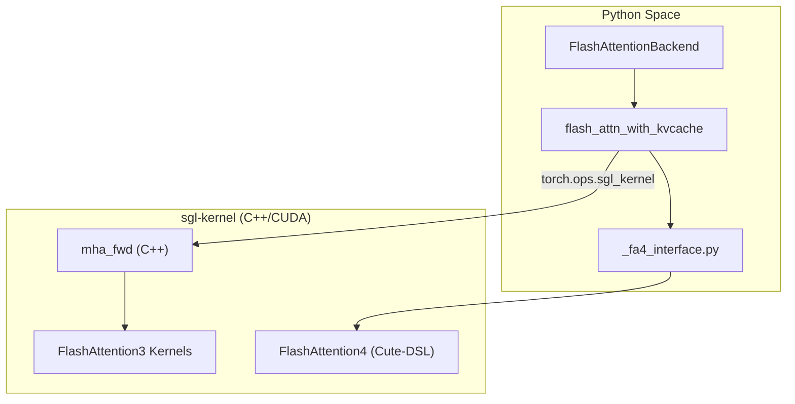
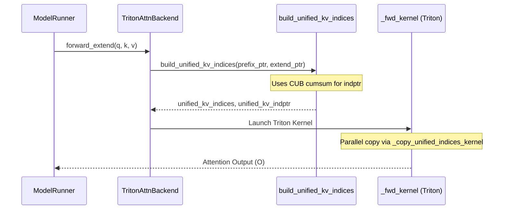

<!-- source: DeepWiki mcp.deepwiki.com · repo microsoft/llm-42 · page 4.1 Standard Attention Backends (FlashInfer, FlashAttention, Triton) · fetched 2026-10-26 -->

# Standard Attention Backends (FlashInfer, FlashAttention, Triton)

Relevant source files

The following files were used as context for generating this wiki page:

- [python/sglang/srt/layers/attention/double_sparsity_backend.py](python/sglang/srt/layers/attention/double_sparsity_backend.py)
- [python/sglang/srt/layers/attention/flashattention_backend.py](python/sglang/srt/layers/attention/flashattention_backend.py)
- [python/sglang/srt/layers/attention/flashinfer_backend.py](python/sglang/srt/layers/attention/flashinfer_backend.py)
- [python/sglang/srt/layers/attention/flashinfer_mla_backend.py](python/sglang/srt/layers/attention/flashinfer_mla_backend.py)
- [python/sglang/srt/layers/attention/triton_backend.py](python/sglang/srt/layers/attention/triton_backend.py)
- [python/sglang/srt/layers/attention/triton_ops/decode_attention.py](python/sglang/srt/layers/attention/triton_ops/decode_attention.py)
- [python/sglang/srt/layers/attention/triton_ops/double_sparsity_attention.py](python/sglang/srt/layers/attention/triton_ops/double_sparsity_attention.py)
- [python/sglang/srt/layers/attention/triton_ops/extend_attention.py](python/sglang/srt/layers/attention/triton_ops/extend_attention.py)
- [python/sglang/srt/layers/attention/triton_ops/prefill_attention.py](python/sglang/srt/layers/attention/triton_ops/prefill_attention.py)
- [sgl-kernel/README.md](sgl-kernel/README.md)
- [sgl-kernel/analyze_whl_kernel_sizes.py](sgl-kernel/analyze_whl_kernel_sizes.py)
- [sgl-kernel/cmake/utils.cmake](sgl-kernel/cmake/utils.cmake)
- [sgl-kernel/csrc/flash_extension.cc](sgl-kernel/csrc/flash_extension.cc)
- [sgl-kernel/include/sgl_flash_kernel_ops.h](sgl-kernel/include/sgl_flash_kernel_ops.h)
- [sgl-kernel/include/sgl_kernel_torch_shim.h](sgl-kernel/include/sgl_kernel_torch_shim.h)
- [sgl-kernel/python/sgl_kernel/_fa4_interface.py](sgl-kernel/python/sgl_kernel/_fa4_interface.py)
- [sgl-kernel/python/sgl_kernel/flash_attn.py](sgl-kernel/python/sgl_kernel/flash_attn.py)
- [sgl-kernel/tests/test_flash_attention.py](sgl-kernel/tests/test_flash_attention.py)
- [sgl-kernel/tests/test_flash_attention_4.py](sgl-kernel/tests/test_flash_attention_4.py)

This page provides a technical deep dive into the standard attention backends supported by the SGLang Runtime (SRT). These backends implement the core attention mechanism for both prefill (extend) and decode phases, supporting advanced features like paged KV cache, sliding windows, and deterministic execution.

## Overview

SGLang utilizes a pluggable attention backend system where different implementations can be selected based on hardware capabilities and performance requirements [python/sglang/srt/layers/attention/flashinfer_backend.py:4-8](). The primary backends include:

*   **FlashInfer**: Optimized for high throughput and diverse attention patterns (Sliding Window, MLA, Cascade).
*   **FlashAttention (FA3/FA4)**: High-performance kernels for Hopper and Blackwell architectures.
*   **Triton**: A flexible backend used for customization and ensuring bit-wise determinism.

### Backend Metadata Lifecycle
Each backend manages its own metadata to track sequence lengths, cumulative offsets (`indptr`), and memory mapping for paged KV caches. This metadata is typically initialized once per forward pass and reused across layers [python/sglang/srt/layers/attention/flashattention_backend.py:39-45]().

Sources: [python/sglang/srt/layers/attention/flashinfer_backend.py:3-16](), [python/sglang/srt/layers/attention/flashattention_backend.py:39-82]()

---

## FlashInfer Backend

`FlashInferAttnBackend` is the primary high-performance backend. it supports multiple operators including `extend` (prefill with cached prefix) and `decode` [python/sglang/srt/layers/attention/flashinfer_backend.py:7-8]().

### Key Components
*   **Wrappers**: Uses `BatchDecodeWithPagedKVCacheWrapper` and `BatchPrefillWithPagedKVCacheWrapper` from the FlashInfer library [python/sglang/srt/layers/attention/flashinfer_backend.py:62-67]().
*   **Multi-Item Scoring**: Supports specific attention patterns for sequences with multiple items separated by delimiters using `MultiItemScoringParams` [python/sglang/srt/layers/attention/flashinfer_backend.py:77-103]().
*   **Sliding Window**: Dispatches to specialized wrappers when `sliding_window_size` is configured [python/sglang/srt/layers/attention/flashinfer_backend.py:169-171]().

### Data Flow: Decode Phase
1.  **Metadata Prep**: `DecodeMetadata` is created containing the wrappers [python/sglang/srt/layers/attention/flashinfer_backend.py:107-108]().
2.  **Indices Creation**: Triton-based kernels generate KV indices for paged access [python/sglang/srt/layers/attention/flashinfer_backend.py:22]().
3.  **Forward Call**: The backend invokes the wrapper's `forward` method, which utilizes a global workspace buffer to minimize allocation overhead [python/sglang/srt/layers/attention/flashinfer_backend.py:119-120]().

Sources: [python/sglang/srt/layers/attention/flashinfer_backend.py:61-180]()

---

## FlashAttention Backend (FA3/FA4)

The `FlashAttentionBackend` integrates the latest FlashAttention kernels (v3 and v4) for NVIDIA architectures. It is specifically optimized for SM80 (Ampere) and SM90 (Hopper) [sgl-kernel/python/sgl_kernel/flash_attn.py:20-32]().

### Implementation Detail
*   **FA3 Support**: Enabled for CUDA 12.3+ on SM80/SM90 devices [sgl-kernel/python/sgl_kernel/flash_attn.py:29-32]().
*   **FA4 Integration**: Utilizes the `Cute-DSL` version of FlashAttention for Hopper and Blackwell architectures [sgl-kernel/python/sgl_kernel/_fa4_interface.py:1-5]().
*   **Local Attention**: Implements local/sliding window attention by breaking sequences into "virtual" batches [python/sglang/srt/layers/attention/flashattention_backend.py:142-166]().

### FlashAttention Entity Mapping
The following diagram illustrates how the Python interface interacts with the underlying `sgl-kernel` C++ extensions.

**Diagram: FlashAttention Interface to Kernel Mapping**

Sources: [python/sglang/srt/layers/attention/flashattention_backend.py:24-37](), [sgl-kernel/python/sgl_kernel/flash_attn.py:39-74](), [sgl-kernel/include/sgl_flash_kernel_ops.h:45-85]()

---

## Triton Backend and Determinism

`TritonAttnBackend` provides a highly customizable attention implementation. A critical role of this backend in LLM-42 is supporting **Batch-Invariant Operations** for deterministic inference [python/sglang/srt/layers/attention/triton_backend.py:118-123]().

### Deterministic Mechanism
When `enable_deterministic` is set (via `--enable-llm42` or `--enable-deterministic-inference`), the backend:
1.  **Fixed Tile Size**: Uses a fixed `split_tile_size` (default 256) instead of dynamic splitting [python/sglang/srt/layers/attention/triton_backend.py:127-130]().
2.  **Static KV Splits**: Disables dynamic split heuristics to ensure the attention reduction tree remains identical regardless of batch composition [python/sglang/srt/layers/attention/triton_backend.py:132]().
3.  **Capped Splits**: Limits the maximum number of KV splits to prevent excessive buffer allocation while maintaining correctness [python/sglang/srt/layers/attention/triton_backend.py:146-155]().

### Unified KV Indices
For prefill (extend) operations, Triton uses `build_unified_kv_indices` to merge prefix indices and new token indices into a single contiguous buffer, which is required for CUDA graph compatibility [python/sglang/srt/layers/attention/triton_ops/extend_attention.py:171-216]().

**Diagram: Triton Attention Data Flow**

Sources: [python/sglang/srt/layers/attention/triton_backend.py:55-158](), [python/sglang/srt/layers/attention/triton_ops/extend_attention.py:171-216](), [python/sglang/srt/layers/attention/triton_ops/decode_attention.py:45-180]()

---

## Specialized Backends

### Double Sparsity Backend
The `DoubleSparseAttnBackend` implements a two-stage sparse attention mechanism:
1.  **Approximate Scoring**: Computes a rough attention score to identify "heavy" tokens [python/sglang/srt/layers/attention/double_sparsity_backend.py:76-81]().
2.  **Sparse Selection**: Only the top-K (`heavy_token_num`) tokens are involved in the full attention computation [python/sglang/srt/layers/attention/double_sparsity_backend.py:32-37]().

### Multi-Head Latent Attention (MLA)
FlashInfer-based MLA (`FlashInferMlaAttnBackend`) optimizes DeepSeek-style architectures by utilizing `BatchMLAPagedAttentionWrapper`. It supports ragged prefill and paged decoding to handle latent vector projections efficiently [python/sglang/srt/layers/attention/flashinfer_mla_backend.py:4-10]().

Sources: [python/sglang/srt/layers/attention/double_sparsity_backend.py:16-51](), [python/sglang/srt/layers/attention/flashinfer_mla_backend.py:70-151]()

---

