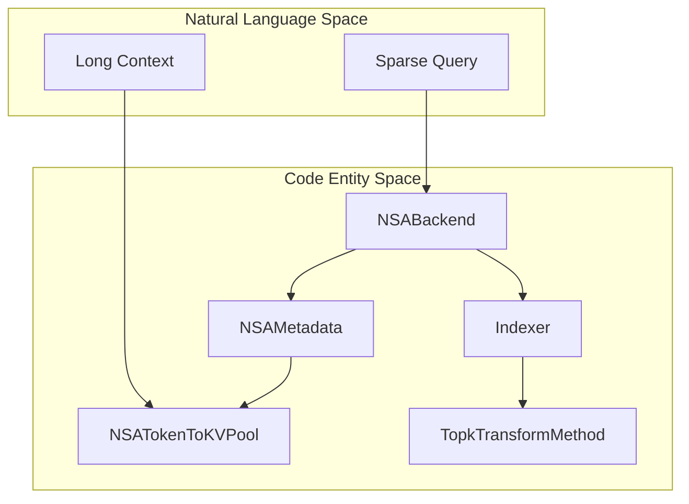
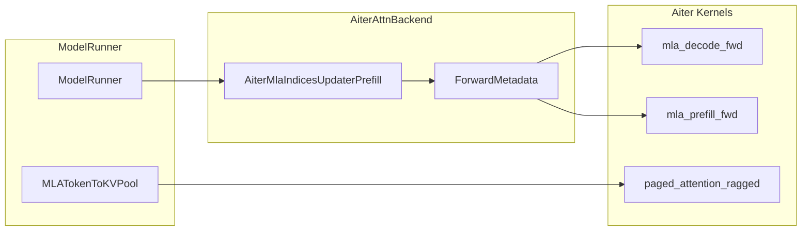

<!-- source: DeepWiki mcp.deepwiki.com · repo microsoft/llm-42 · page 4.2 MLA and Specialized Attention Backends · fetched 2026-10-26 -->

# MLA and Specialized Attention Backends

Relevant source files

The following files were used as context for generating this wiki page:

- [benchmark/kernels/all_reduce/benchmark_aiter.py](benchmark/kernels/all_reduce/benchmark_aiter.py)
- [benchmark/kernels/all_reduce/benchmark_mscclpp.py](benchmark/kernels/all_reduce/benchmark_mscclpp.py)
- [docs/advanced_features/server_arguments.md](docs/advanced_features/server_arguments.md)
- [docs/basic_usage/deepseek_v32.md](docs/basic_usage/deepseek_v32.md)
- [python/sglang/srt/configs/__init__.py](python/sglang/srt/configs/__init__.py)
- [python/sglang/srt/disaggregation/mooncake/utils.py](python/sglang/srt/disaggregation/mooncake/utils.py)
- [python/sglang/srt/distributed/device_communicators/pymscclpp.py](python/sglang/srt/distributed/device_communicators/pymscclpp.py)
- [python/sglang/srt/distributed/device_communicators/quick_all_reduce.py](python/sglang/srt/distributed/device_communicators/quick_all_reduce.py)
- [python/sglang/srt/layers/attention/aiter_backend.py](python/sglang/srt/layers/attention/aiter_backend.py)
- [python/sglang/srt/layers/attention/attention_registry.py](python/sglang/srt/layers/attention/attention_registry.py)
- [python/sglang/srt/layers/attention/cutlass_mla_backend.py](python/sglang/srt/layers/attention/cutlass_mla_backend.py)
- [python/sglang/srt/layers/attention/fla/layernorm_gated.py](python/sglang/srt/layers/attention/fla/layernorm_gated.py)
- [python/sglang/srt/layers/attention/flashmla_backend.py](python/sglang/srt/layers/attention/flashmla_backend.py)
- [python/sglang/srt/layers/attention/hybrid_linear_attn_backend.py](python/sglang/srt/layers/attention/hybrid_linear_attn_backend.py)
- [python/sglang/srt/layers/attention/mamba/mamba.py](python/sglang/srt/layers/attention/mamba/mamba.py)
- [python/sglang/srt/layers/attention/mamba/ops/mamba_ssm.py](python/sglang/srt/layers/attention/mamba/ops/mamba_ssm.py)
- [python/sglang/srt/layers/attention/nsa/dequant_k_cache.py](python/sglang/srt/layers/attention/nsa/dequant_k_cache.py)
- [python/sglang/srt/layers/attention/nsa/index_buf_accessor.py](python/sglang/srt/layers/attention/nsa/index_buf_accessor.py)
- [python/sglang/srt/layers/attention/nsa/nsa_indexer.py](python/sglang/srt/layers/attention/nsa/nsa_indexer.py)
- [python/sglang/srt/layers/attention/nsa/quant_k_cache.py](python/sglang/srt/layers/attention/nsa/quant_k_cache.py)
- [python/sglang/srt/layers/attention/nsa/tilelang_kernel.py](python/sglang/srt/layers/attention/nsa/tilelang_kernel.py)
- [python/sglang/srt/layers/attention/nsa/utils.py](python/sglang/srt/layers/attention/nsa/utils.py)
- [python/sglang/srt/layers/attention/nsa_backend.py](python/sglang/srt/layers/attention/nsa_backend.py)
- [python/sglang/srt/layers/attention/trtllm_mla_backend.py](python/sglang/srt/layers/attention/trtllm_mla_backend.py)
- [python/sglang/srt/layers/attention/utils.py](python/sglang/srt/layers/attention/utils.py)
- [python/sglang/srt/layers/communicator_nsa_cp.py](python/sglang/srt/layers/communicator_nsa_cp.py)
- [python/sglang/srt/layers/radix_linear_attention.py](python/sglang/srt/layers/radix_linear_attention.py)
- [python/sglang/srt/managers/data_parallel_controller.py](python/sglang/srt/managers/data_parallel_controller.py)
- [python/sglang/srt/mem_cache/utils.py](python/sglang/srt/mem_cache/utils.py)
- [python/sglang/srt/models/kimi_linear.py](python/sglang/srt/models/kimi_linear.py)
- [python/sglang/srt/models/qwen3_next.py](python/sglang/srt/models/qwen3_next.py)
- [python/sglang/srt/models/qwen3_next_mtp.py](python/sglang/srt/models/qwen3_next_mtp.py)
- [python/sglang/srt/utils/hf_transformers_utils.py](python/sglang/srt/utils/hf_transformers_utils.py)
- [python/sglang/test/attention/test_trtllm_mla_backend.py](python/sglang/test/attention/test_trtllm_mla_backend.py)
- [sgl-kernel/benchmark/bench_cutlass_mla.py](sgl-kernel/benchmark/bench_cutlass_mla.py)
- [sgl-kernel/csrc/attention/cutlass_mla_kernel.cu](sgl-kernel/csrc/attention/cutlass_mla_kernel.cu)
- [sgl-kernel/csrc/attention/cutlass_sm100_mla/device/sm100_mla.hpp](sgl-kernel/csrc/attention/cutlass_sm100_mla/device/sm100_mla.hpp)
- [sgl-kernel/csrc/attention/cutlass_sm100_mla/kernel/sm100_fmha_mla_reduction.hpp](sgl-kernel/csrc/attention/cutlass_sm100_mla/kernel/sm100_fmha_mla_reduction.hpp)
- [sgl-kernel/csrc/attention/cutlass_sm100_mla/kernel/sm100_fmha_mla_tma_warpspecialized.hpp](sgl-kernel/csrc/attention/cutlass_sm100_mla/kernel/sm100_fmha_mla_tma_warpspecialized.hpp)
- [sgl-kernel/csrc/attention/cutlass_sm100_mla/kernel/sm100_mla_tile_scheduler.hpp](sgl-kernel/csrc/attention/cutlass_sm100_mla/kernel/sm100_mla_tile_scheduler.hpp)
- [sgl-kernel/csrc/grammar/apply_token_bitmask_inplace_cuda.cu](sgl-kernel/csrc/grammar/apply_token_bitmask_inplace_cuda.cu)
- [sgl-kernel/python/sgl_kernel/attention.py](sgl-kernel/python/sgl_kernel/attention.py)
- [sgl-kernel/tests/test_cutlass_mla.py](sgl-kernel/tests/test_cutlass_mla.py)
- [test/manual/layers/attention/nsa/test_index_buf_accessor.py](test/manual/layers/attention/nsa/test_index_buf_accessor.py)
- [test/manual/test_quick_allreduce.py](test/manual/test_quick_allreduce.py)
- [test/registered/attention/test_kda_kernels.py](test/registered/attention/test_kda_kernels.py)
- [test/registered/hicache/test_nsa_pool_host_unit.py](test/registered/hicache/test_nsa_pool_host_unit.py)
- [test/registered/kernels/test_nsa_indexer.py](test/registered/kernels/test_nsa_indexer.py)
- [test/registered/models/test_kimi_linear_models_pcg.py](test/registered/models/test_kimi_linear_models_pcg.py)
- [test/registered/models/test_qwen3_next_models_pcg.py](test/registered/models/test_qwen3_next_models_pcg.py)

Multi-Head Latent Attention (MLA) and Native Sparse Attention (NSA) are advanced attention mechanisms designed to reduce KV cache memory footprints and improve inference efficiency in long-context scenarios. SGLang provides a pluggable backend system to support these architectures across various hardware platforms (NVIDIA, AMD) and kernel libraries (FlashMLA, Triton, CUTLASS, TRT-LLM).

## Multi-Head Latent Attention (MLA) Backends

MLA, introduced by DeepSeek-V2, compresses the KV cache by projecting keys and values into a low-rank latent space. SGLang supports multiple high-performance backends for MLA.

### Backend Implementations

| Backend Class | Description | Hardware |
| :--- | :--- | :--- |
| `FlashInferMLAAttnBackend` | Uses FlashInfer kernels for MLA decoding. | NVIDIA (Hopper+) |
| `FlashMLABackend` | Integrates the `flash_mla` library for high-throughput MLA. | NVIDIA (Hopper/Blackwell) |
| `CutlassMLABackend` | Uses custom CUTLASS-based kernels for MLA operations. | NVIDIA (Blackwell SM100) |
| `TRTLLMMLABackend` | Leverages TRT-LLM MLA kernels via FlashInfer interfaces. | NVIDIA (Blackwell) |

### MLA Data Flow and Optimization
The MLA implementation involves projecting the latent vector into `nope` (non-rope) and `rope` (rotary positional embedding) components. The `mla_quantize_and_rope_for_fp8` utility handles the transformation and quantization for FP8 execution [python/sglang/srt/layers/attention/trtllm_mla_backend.py:25-26]().

For speculative decoding, the `FlashInferMLAMultiStepDraftBackend` supports multi-step verification of draft tokens [python/sglang/srt/layers/attention/trtllm_mla_backend.py:19-20]().

**Sources:**
- [python/sglang/srt/layers/attention/trtllm_mla_backend.py:1-40]()
- [python/sglang/srt/layers/attention/flashinfer_mla_backend.py:17-20]()
- [python/sglang/srt/layers/attention/utils.py:21-26]()

## Native Sparse Attention (NSA)

Native Sparse Attention (NSA) utilizes a "lightning indexer" to identify important blocks in long sequences, enabling fine-grained sparsity [docs/basic_usage/deepseek_v32.md:3-4]().

### NSA Architecture and Indexing
The `Indexer` class is the core component that performs Top-K selection on sequence logits to determine sparse attention patterns [python/sglang/srt/layers/attention/nsa/nsa_indexer.py:137-165]().

**Key Components:**
- **Indexer Metadata**: `BaseIndexerMetadata` provides interfaces for sequence lengths and page tables [python/sglang/srt/layers/attention/nsa/nsa_indexer.py:56-75]().
- **Top-K Transform**: Supports `PAGED` (indices to page table) and `RAGGED` (indices to non-paged KV) methods [python/sglang/srt/layers/attention/nsa_backend.py:153-157]().
- **KV Cache Management**: Includes `quantize_k_cache` and `dequantize_k_cache_paged` for efficient memory usage [python/sglang/srt/layers/attention/nsa_backend.py:12-23]().

### NSA System Diagram
The following diagram illustrates the relationship between the high-level `NSABackend` and the underlying indexing and memory structures.

**NSA Entity Relationship**

**Sources:**
- [python/sglang/srt/layers/attention/nsa_backend.py:83-157]()
- [python/sglang/srt/layers/attention/nsa/nsa_indexer.py:137-200]()
- [docs/basic_usage/deepseek_v32.md:1-10]()

## Hybrid Linear Attention (Mamba and FLA)

SGLang supports hybrid models like Qwen3-Next and Kimi-Linear that combine standard attention with linear attention (e.g., Gated Delta Net) or Mamba-based state-space models [python/sglang/srt/models/qwen3_next.py:202-210]().

### Backend Capabilities
The `HybridLinearAttnBackend` manages state for both convolutional and SSM layers [python/sglang/srt/layers/attention/hybrid_linear_attn_backend.py:11-30]().

*   **Mamba Integration**: Uses `causal_conv1d_update` and `mamba_ssm` kernels to maintain recurrent states [python/sglang/srt/layers/attention/hybrid_linear_attn_backend.py:25-30]().
*   **FLA (Flash Linear Attention)**: Integrates `fused_recurrent_gated_delta_rule_update` and `chunk_gated_delta_rule` for efficient linear attention computation [python/sglang/srt/layers/attention/hybrid_linear_attn_backend.py:12-18]().
*   **State Tracking**: The `track_mamba_state_if_needed_kernel` (Triton) efficiently copies `conv_states` and `ssm_states` across batches [python/sglang/srt/layers/attention/hybrid_linear_attn_backend.py:104-126]().

**Sources:**
- [python/sglang/srt/layers/attention/hybrid_linear_attn_backend.py:1-100]()
- [python/sglang/srt/models/qwen3_next.py:1-50]()
- [python/sglang/srt/models/kimi_linear.py:166-177]()

## AMD Platform: Aiter Backend

For AMD ROCm hardware, SGLang provides the `AiterAttnBackend`, which leverages the `aiter` kernel library [python/sglang/srt/layers/attention/aiter_backend.py:99-105]().

### Aiter Features
- **MLA Support**: Implements `mla_decode_fwd` and `mla_prefill_fwd` for AMD GPUs [python/sglang/srt/layers/attention/aiter_backend.py:41-45]().
- **FP8 Execution**: Supports FP8 prefill attention on `gfx95` (MI300/MI350) architectures [python/sglang/srt/layers/attention/aiter_backend.py:58-60]().
- **Persistence**: Features an MLA persist design for FP8 KV cache via `SGLANG_AITER_MLA_PERSIST` [python/sglang/srt/layers/attention/aiter_backend.py:55-56]().

**Aiter Backend Data Flow**

**Sources:**
- [python/sglang/srt/layers/attention/aiter_backend.py:29-70]()
- [python/sglang/srt/layers/attention/aiter_backend.py:191-205]()

## Specialized Kernel Registry

Attention backends are selected dynamically based on the model configuration and server arguments.

| Argument | Options | Impact |
| :--- | :--- | :--- |
| `--nsa-prefill-backend` | `flashmla_sparse`, `flashmla_kv`, `fa3`, `tilelang`, `trtllm` | Sets the kernel for sparse prefill [docs/basic_usage/deepseek_v32.md:63-69](). |
| `--nsa-decode-backend` | `tilelang`, `aiter`, `trtllm` | Sets the kernel for sparse decoding [docs/basic_usage/deepseek_v32.md:63-69](). |
| `SGLANG_ROCM_FUSED_DECODE_MLA` | `True`, `False` | Enables fused kernels on AMD [docs/advanced_features/server_arguments.md:1-10](). |

**Sources:**
- [docs/basic_usage/deepseek_v32.md:60-75]()
- [python/sglang/srt/layers/attention/nsa_backend.py:70-80]()

---

