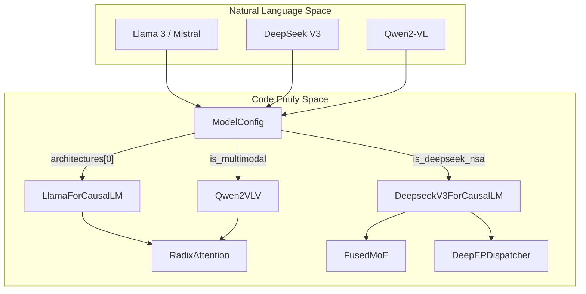
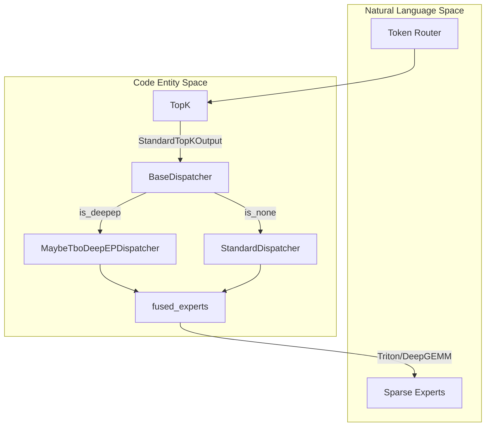

<!-- source: DeepWiki mcp.deepwiki.com · repo microsoft/llm-42 · page 5 Model Support · fetched 2026-10-26 -->

# Model Support

Relevant source files

The following files were used as context for generating this wiki page:

- [python/sglang/srt/configs/model_config.py](python/sglang/srt/configs/model_config.py)
- [python/sglang/srt/layers/linear.py](python/sglang/srt/layers/linear.py)
- [python/sglang/srt/layers/moe/ep_moe/layer.py](python/sglang/srt/layers/moe/ep_moe/layer.py)
- [python/sglang/srt/layers/moe/fused_moe_triton/fused_moe.py](python/sglang/srt/layers/moe/fused_moe_triton/fused_moe.py)
- [python/sglang/srt/layers/moe/fused_moe_triton/layer.py](python/sglang/srt/layers/moe/fused_moe_triton/layer.py)
- [python/sglang/srt/layers/moe/moe_runner/deep_gemm.py](python/sglang/srt/layers/moe/moe_runner/deep_gemm.py)
- [python/sglang/srt/layers/moe/token_dispatcher/__init__.py](python/sglang/srt/layers/moe/token_dispatcher/__init__.py)
- [python/sglang/srt/layers/moe/token_dispatcher/base.py](python/sglang/srt/layers/moe/token_dispatcher/base.py)
- [python/sglang/srt/layers/moe/token_dispatcher/deepep.py](python/sglang/srt/layers/moe/token_dispatcher/deepep.py)
- [python/sglang/srt/layers/moe/token_dispatcher/standard.py](python/sglang/srt/layers/moe/token_dispatcher/standard.py)
- [python/sglang/srt/layers/moe/topk.py](python/sglang/srt/layers/moe/topk.py)
- [python/sglang/srt/layers/moe/utils.py](python/sglang/srt/layers/moe/utils.py)
- [python/sglang/srt/layers/quantization/__init__.py](python/sglang/srt/layers/quantization/__init__.py)
- [python/sglang/srt/layers/quantization/fp8.py](python/sglang/srt/layers/quantization/fp8.py)
- [python/sglang/srt/layers/quantization/fp8_kernel.py](python/sglang/srt/layers/quantization/fp8_kernel.py)
- [python/sglang/srt/layers/quantization/fp8_utils.py](python/sglang/srt/layers/quantization/fp8_utils.py)
- [python/sglang/srt/layers/quantization/modelopt_quant.py](python/sglang/srt/layers/quantization/modelopt_quant.py)
- [python/sglang/srt/layers/vocab_parallel_embedding.py](python/sglang/srt/layers/vocab_parallel_embedding.py)
- [python/sglang/srt/models/chatglm.py](python/sglang/srt/models/chatglm.py)
- [python/sglang/srt/models/commandr.py](python/sglang/srt/models/commandr.py)
- [python/sglang/srt/models/dbrx.py](python/sglang/srt/models/dbrx.py)
- [python/sglang/srt/models/deepseek.py](python/sglang/srt/models/deepseek.py)
- [python/sglang/srt/models/deepseek_nextn.py](python/sglang/srt/models/deepseek_nextn.py)
- [python/sglang/srt/models/deepseek_v2.py](python/sglang/srt/models/deepseek_v2.py)
- [python/sglang/srt/models/gemma.py](python/sglang/srt/models/gemma.py)
- [python/sglang/srt/models/grok.py](python/sglang/srt/models/grok.py)
- [python/sglang/srt/models/llama.py](python/sglang/srt/models/llama.py)
- [python/sglang/srt/models/llava.py](python/sglang/srt/models/llava.py)
- [python/sglang/srt/models/llavavid.py](python/sglang/srt/models/llavavid.py)
- [python/sglang/srt/models/minicpm.py](python/sglang/srt/models/minicpm.py)
- [python/sglang/srt/models/mixtral.py](python/sglang/srt/models/mixtral.py)
- [python/sglang/srt/models/mixtral_quant.py](python/sglang/srt/models/mixtral_quant.py)
- [python/sglang/srt/models/qwen.py](python/sglang/srt/models/qwen.py)
- [python/sglang/srt/models/qwen2.py](python/sglang/srt/models/qwen2.py)
- [python/sglang/srt/models/qwen2_moe.py](python/sglang/srt/models/qwen2_moe.py)
- [python/sglang/srt/models/qwen3.py](python/sglang/srt/models/qwen3.py)
- [python/sglang/srt/models/qwen3_moe.py](python/sglang/srt/models/qwen3_moe.py)
- [python/sglang/srt/models/stablelm.py](python/sglang/srt/models/stablelm.py)
- [python/sglang/test/test_block_fp8.py](python/sglang/test/test_block_fp8.py)

SGLang provides a flexible and high-performance framework for executing a wide variety of model architectures. The system is designed to handle diverse structural patterns, ranging from standard dense transformers to complex Mixture-of-Experts (MoE) and multi-modal Vision-Language Models (VLMs).

The core of the model support system lies in the `ModelConfig` class, which parses HuggingFace configurations and derives necessary metadata for the SGLang Runtime (SRT) [python/sglang/srt/configs/model_config.py:85-106](). Models are implemented as `torch.nn.Module` subclasses that utilize SGLang's optimized layers, such as `RadixAttention` [python/sglang/srt/layers/radix_attention.py]() and various parallel linear layers [python/sglang/srt/layers/linear.py]().

## Architecture Categories

The codebase categorizes models based on their architectural features and data modalities.

### Dense Language Models
Standard transformer architectures where every parameter is used for every token. This includes the Llama family, Qwen (dense variants), Mistral, and Gemma. These models typically use `RadixAttention` for KV cache management and `MergedColumnParallelLinear` / `RowParallelLinear` for MLP blocks [python/sglang/srt/models/qwen2.py:72-85]().
For details, see [Dense Language Models](#5.1).

### Mixture-of-Experts (MoE) Models
Architectures that use sparse routing to activate only a subset of "experts" for each token, such as DeepSeek-V2/V3, Mixtral, and Qwen2-MoE. SGLang provides specialized MoE kernels (Triton, DeepGEMM, CUTLASS) and dispatchers (DeepEP) to optimize the high communication overhead inherent in MoE inference [python/sglang/srt/layers/moe/fused_moe_triton/layer.py:95-146]().
For details, see [Mixture-of-Experts (MoE) Models](#5.2).

### Vision-Language Models (VLMs)
Multimodal models that process both visual (image/video) and textual inputs. These models integrate vision encoders (like CLIP or SigLIP) with LLM backbones. SGLang supports architectures like Qwen2-VL, LLaVA, and InternVL, utilizing a specialized `mm_utils` pipeline for multimodal processing [python/sglang/srt/configs/model_config.py:168-183]().
For details, see [Vision-Language Models (VLMs)](#5.3).

### Speculative Decoding
A performance optimization technique where a smaller "draft" model predicts tokens that are then verified in parallel by a larger "target" model. SGLang supports advanced speculative algorithms like EAGLE and EAGLE-v2, which use tree-based sampling and specialized workers to accelerate generation [python/sglang/srt/configs/model_config.py:98-102]().
For details, see [Speculative Decoding](#5.4).

### Diffusion Language Models (dLLMs)
Support for discrete diffusion-based language models such as LLaDA. These models operate differently from standard autoregressive transformers by iteratively refining a sequence of masked tokens [python/sglang/srt/configs/model_config.py:171-173]().
For details, see [Diffusion Language Models (dLLMs)](#5.5).

## Model Registry and Dispatch

The system uses a registry-based approach to map model types to their implementations. The `ModelConfig` identifies the architecture from the `hf_config` and selects the appropriate `ModelImpl` [python/sglang/srt/configs/model_config.py:47-51]().

### Model to Code Entity Mapping
The following diagram illustrates how high-level model categories map to specific code entities and implementation files within the SRT.

**Model Architecture Dispatch**

Sources: [python/sglang/srt/configs/model_config.py:54-67](), [python/sglang/srt/models/deepseek_v2.py:123-147](), [python/sglang/srt/models/qwen2.py:169-177]()

## Layer Composition

Models are built using standardized layers that handle parallelism and quantization automatically.

| Layer Type | Code Entity | Purpose |
| :--- | :--- | :--- |
| **Attention** | `RadixAttention` | Paged KV cache attention with prefix caching support. |
| **Linear** | `ColumnParallelLinear` | Tensor-parallel weight splitting for MLP/Attention. |
| **MoE** | `FusedMoE` | Fused expert execution with integrated routing. |
| **Embedding** | `VocabParallelEmbedding` | Parallelized token embedding lookup. |
| **Normalization** | `RMSNorm` | Root Mean Square Layer Normalization. |

Sources: [python/sglang/srt/layers/radix_attention.py](), [python/sglang/srt/layers/linear.py:34-37](), [python/sglang/srt/layers/moe/fused_moe_triton/layer.py:156-175](), [python/sglang/srt/layers/vocab_parallel_embedding.py]()

### Expert Execution Flow
For MoE models, the execution flow bridges the gap between the router and the expert kernels.

**MoE Execution Bridge**

Sources: [python/sglang/srt/layers/moe/topk.py:202-210](), [python/sglang/srt/layers/moe/fused_moe_triton/layer.py:95-146](), [python/sglang/srt/layers/moe/fused_moe_triton/fused_moe.py:202-222]()

---

