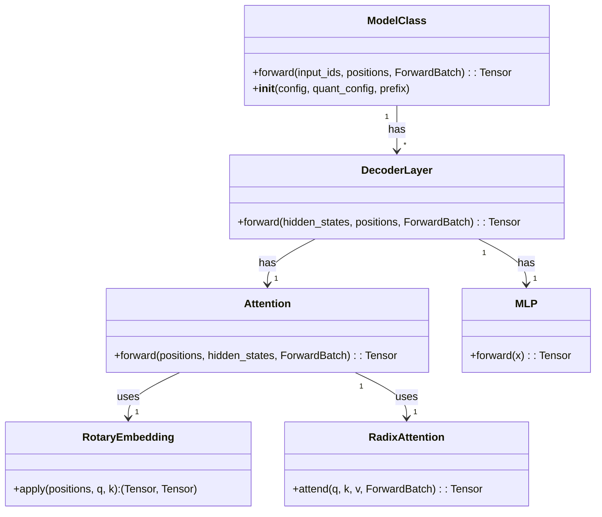

<!-- source: DeepWiki mcp.deepwiki.com · repo microsoft/llm-42 · page 5.1 Dense Language Models · fetched 2026-10-26 -->

# Dense Language Models

<details>
<summary>Relevant source files</summary>

The following files were used as context for generating this wiki page:

- [.github/actions/upload-cuda-coredumps/action.yml](.github/actions/upload-cuda-coredumps/action.yml)
- [.github/workflows/nightly-test-nvidia.yml](.github/workflows/nightly-test-nvidia.yml)
- [docs/advanced_features/rfork.md](docs/advanced_features/rfork.md)
- [python/sglang/jit_kernel/benchmark/bench_fused_add_rmsnorm.py](python/sglang/jit_kernel/benchmark/bench_fused_add_rmsnorm.py)
- [python/sglang/jit_kernel/benchmark/bench_qknorm_across_heads.py](python/sglang/jit_kernel/benchmark/bench_qknorm_across_heads.py)
- [python/sglang/jit_kernel/csrc/elementwise/fused_add_rmsnorm.cuh](python/sglang/jit_kernel/csrc/elementwise/fused_add_rmsnorm.cuh)
- [python/sglang/jit_kernel/csrc/elementwise/qknorm_across_heads.cuh](python/sglang/jit_kernel/csrc/elementwise/qknorm_across_heads.cuh)
- [python/sglang/jit_kernel/include/sgl_kernel/source_location.h](python/sglang/jit_kernel/include/sgl_kernel/source_location.h)
- [python/sglang/jit_kernel/include/sgl_kernel/vec.cuh](python/sglang/jit_kernel/include/sgl_kernel/vec.cuh)
- [python/sglang/jit_kernel/norm.py](python/sglang/jit_kernel/norm.py)
- [python/sglang/jit_kernel/tests/test_fused_add_rmsnorm.py](python/sglang/jit_kernel/tests/test_fused_add_rmsnorm.py)
- [python/sglang/jit_kernel/tests/test_qknorm_across_heads.py](python/sglang/jit_kernel/tests/test_qknorm_across_heads.py)
- [python/sglang/srt/configs/load_config.py](python/sglang/srt/configs/load_config.py)
- [python/sglang/srt/debug_utils/cuda_coredump.py](python/sglang/srt/debug_utils/cuda_coredump.py)
- [python/sglang/srt/layers/quantization/blockwise_int8.py](python/sglang/srt/layers/quantization/blockwise_int8.py)
- [python/sglang/srt/layers/quantization/moe_wna16.py](python/sglang/srt/layers/quantization/moe_wna16.py)
- [python/sglang/srt/layers/quantization/w8a8_fp8.py](python/sglang/srt/layers/quantization/w8a8_fp8.py)
- [python/sglang/srt/layers/quantization/w8a8_int8.py](python/sglang/srt/layers/quantization/w8a8_int8.py)
- [python/sglang/srt/model_loader/loader.py](python/sglang/srt/model_loader/loader.py)
- [python/sglang/srt/model_loader/remote_instance_weight_loader_utils.py](python/sglang/srt/model_loader/remote_instance_weight_loader_utils.py)
- [python/sglang/srt/model_loader/weight_utils.py](python/sglang/srt/model_loader/weight_utils.py)
- [python/sglang/srt/models/baichuan.py](python/sglang/srt/models/baichuan.py)
- [python/sglang/srt/models/chatglm.py](python/sglang/srt/models/chatglm.py)
- [python/sglang/srt/models/commandr.py](python/sglang/srt/models/commandr.py)
- [python/sglang/srt/models/dbrx.py](python/sglang/srt/models/dbrx.py)
- [python/sglang/srt/models/deepseek.py](python/sglang/srt/models/deepseek.py)
- [python/sglang/srt/models/gemma.py](python/sglang/srt/models/gemma.py)
- [python/sglang/srt/models/gemma2.py](python/sglang/srt/models/gemma2.py)
- [python/sglang/srt/models/gpt2.py](python/sglang/srt/models/gpt2.py)
- [python/sglang/srt/models/grok.py](python/sglang/srt/models/grok.py)
- [python/sglang/srt/models/llama.py](python/sglang/srt/models/llama.py)
- [python/sglang/srt/models/llava.py](python/sglang/srt/models/llava.py)
- [python/sglang/srt/models/llavavid.py](python/sglang/srt/models/llavavid.py)
- [python/sglang/srt/models/minicpm.py](python/sglang/srt/models/minicpm.py)
- [python/sglang/srt/models/minicpm3.py](python/sglang/srt/models/minicpm3.py)
- [python/sglang/srt/models/mixtral.py](python/sglang/srt/models/mixtral.py)
- [python/sglang/srt/models/mixtral_quant.py](python/sglang/srt/models/mixtral_quant.py)
- [python/sglang/srt/models/olmo.py](python/sglang/srt/models/olmo.py)
- [python/sglang/srt/models/olmo2.py](python/sglang/srt/models/olmo2.py)
- [python/sglang/srt/models/olmoe.py](python/sglang/srt/models/olmoe.py)
- [python/sglang/srt/models/qwen.py](python/sglang/srt/models/qwen.py)
- [python/sglang/srt/models/qwen2.py](python/sglang/srt/models/qwen2.py)
- [python/sglang/srt/models/qwen2_moe.py](python/sglang/srt/models/qwen2_moe.py)
- [python/sglang/srt/models/qwen3.py](python/sglang/srt/models/qwen3.py)
- [python/sglang/srt/models/qwen3_moe.py](python/sglang/srt/models/qwen3_moe.py)
- [python/sglang/srt/models/stablelm.py](python/sglang/srt/models/stablelm.py)
- [python/sglang/srt/models/utils.py](python/sglang/srt/models/utils.py)
- [python/sglang/srt/models/xverse.py](python/sglang/srt/models/xverse.py)
- [python/sglang/srt/models/xverse_moe.py](python/sglang/srt/models/xverse_moe.py)
- [python/sglang/test/ci/ci_utils.py](python/sglang/test/ci/ci_utils.py)
- [python/sglang/test/ci/run_with_retry.py](python/sglang/test/ci/run_with_retry.py)
- [scripts/ci/utils/publish_traces.py](scripts/ci/utils/publish_traces.py)
- [test/registered/debug_utils/test_cuda_coredump_smoke.py](test/registered/debug_utils/test_cuda_coredump_smoke.py)

</details>


This section (5.1) details the implementation and integration of supported *dense* transformer language models in the LLM-42 codebase. It covers the key transformer architectures, the model registry, weight loading patterns, and guidelines on how to add new dense models. Dense models supported include Llama, Qwen2/3, Gemma, Mistral, GPT-2, Baichuan, and others.

---

## Purpose and Scope

LLM-42 provides inference-only implementations of various dense language models, compatible with HuggingFace model weights and configurations. These models are used with the deterministic decode-verify-rollback inference scheme implemented in the system.

This wiki page explains:

- Supported model architectures and their core modules
- The model registry maintaining model mapping for dynamic loading
- Patterns for loading pretrained weights efficiently and correctly
- How to extend the framework by adding new transformer architectures

---

## Supported Dense Transformer Architectures

The following transformer architectures for dense language models have dedicated implementations in the codebase:

| Model Name          | Key Implementation File(s)                      | Remarks                                         |
|---------------------|-------------------------------------------------|------------------------------------------------|
| **Llama**           | `python/sglang/srt/models/llama.py`              | Compatible with HuggingFace LLaMA config/weights. Implements RMSNorm, fused MLP, rotary embeddings, radix attention.       |
| **Qwen2**           | `python/sglang/srt/models/qwen2.py`               | Qwen2 model adapted from Llama2 structure, with specific MLP and attention layers using rotary embeddings and radix attention. |
| **Qwen3**           | `python/sglang/srt/models/qwen3.py`               | Builds on Qwen2, extends with RMSNorm q/k norms and updated rotary embeddings.              |
| **Gemma**           | `python/sglang/srt/models/gemma.py`                | Dense transformer with specific attention and MLP layers (file not fully shown but referenced).           |
| **Mistral**         | `python/sglang/srt/models/mistral.py` (not shown completely) | Similar to Llama in some design aspects, with token-level adaptions.       |
| **GPT-2**           | `python/sglang/srt/models/gpt2.py` (not shown, but known)    | Sharded paralleled transformer with GPT-2 style attention mechanisms.        |
| **Baichuan**         | `python/sglang/srt/models/baichuan.py` (not shown, but part of model registry)  | Implements Baichuan-specific transformer layers and adaptations.               |

These models typically implement:

- A stack of transformer decoder layers with multi-headed attention and fused feed-forward network (FFN/MLP) layers
- Rotary positional embeddings (RoPE/Yarn style) applied during attention projection
- Tensor parallelism-friendly linear layers (`QKVParallelLinear`, `RowParallelLinear`, `MergedColumnParallelLinear`)
- Attention optimized with radix-based dedicated kernels (`RadixAttention`)
- Optional activation and weight quantization support

### Model Class Patterns

Most models follow a similar class layering:

- **MLP Module**: Implements fused gate-up and down projections with activation (usually SiLU or GELU), e.g. `LlamaMLP`, `Qwen2MLP`, `Qwen2MoeMLP`.
- **Attention Module**: Multi-headed QKV projections with rotary embeddings and radix attention kernel, e.g. `LlamaAttention`, `Qwen2Attention`.
- **Decoder Layer**: Combines attention, layer norm, MLP, usually split across multiple classes/files.
- **Model Class**: Stacks of decoder layers, embedding layers, output layers, with parallelism-aware sharding.

---

## Model Registry and Dynamic Model Loading

The system uses a centralized **model registry** that maps model family names and configuration classes to implementation classes and weight loaders. This allows:

- Dynamic lookup and instantiation of model classes based on model configuration or user request.
- Unified weight loading pipeline abstracting the file format differences and distributed sharding.
- Easy extensibility for new models by registering them in the registry.

The primary entrypoint for loading dense models is in:

- `python/sglang/srt/model_loader/loader.py`  
  This module manages parsing model configs, downloading weights, loading safetensors or PyTorch weights, and supports device-placement context managers.

The registry references:

- `default_weight_loader` from `weight_utils.py` for generic HuggingFace-compatible loading.
- Model architecture classes from the model implementation files (e.g., `llama.py`, `qwen2.py`).

---

## Weight Loading Patterns and Utilities

- **Weight format support:** PyTorch `.pt`, `safetensors`, HF Hub downloads, GGUF (experimental).
- **Weight iterator functions:** Provide multi-threaded, buffered reading of weights per tensor.
- **Device context:** Parameters can be temporarily moved to GPU or CPU during loading for efficiency (`device_loading_context`).
- **Shared pointer detection:** To avoid duplicated weights in converted safetensor files.
- **Quantization configs:** Loaded along with weights to enable quantized inference on supported hardware.

The key weight loading utilities are in `weight_utils.py`. Some notable functions and classes:

- `default_weight_loader`: loads weights based on the format and configuration.
- `get_quant_config`: derives quantization configs from model or HF configs.
- Locking and concurrency-safe file downloads.
- Conversion helpers between weight formats.

---

## Adding a New Dense Model

To add a new dense transformer model architecture:

1. **Implement the model code:**
   - Create new files or modules in `python/sglang/srt/models/` for your model.
   - Follow existing patterns for attention, MLP, layer norm, and model stacking.
   - Use existing primitives like `QKVParallelLinear` and `RadixAttention` to benefit from tensor parallelism and optimized kernels.
   - Define a model class that inherits from `nn.Module` and implement the forward logic.
   - Provide a weight loader that correctly loads your model's weights and maps state dict keys.

2. **Register your model:**
   - Add an entry for your model in the **model registry** (likely in the loader or config files).
   - Specify your model config class, model class, and weight loader method.
   - This integration enables the system to detect and load your model dynamically.

3. **Test model loading and inference:**
   - Validate that model weights load correctly and inference runs across available parallelism setups.
   - Use existing test infrastructure to ensure compliance and determinism guarantees.

---

## Data Flow Diagram: From Natural Language Model Name to Code Entities

```mermaid
flowchart TD
    subgraph "Natural Language Space"
        ModelName("Model Name (e.g. \"llama\", \"qwen2\")")
    end

    subgraph "Code Entity Space"
        ModelRegistry["Model Registry\n(python/sglang/srt/model_loader/loader.py)"]
        WeightLoader["Weight Loader\n(weight_utils.py → default_weight_loader)"]
        ModelClass["Model Class Implementation\n(e.g., llama.py: LlamaForCausalLM)"]
    end

    ModelName -->|Look-up| ModelRegistry
    ModelRegistry -->|Instantiates| ModelClass
    ModelRegistry -->|Loads weights via| WeightLoader
    WeightLoader --> ModelClass
```

*Explanation*: The user or system specifies the model name like "llama" or "qwen2". The Model Registry (in `loader.py`) maps this name to the corresponding model implementation class and weight loader. The weight loader fetches the weight files and loads them into the model class instance.

Sources:  
`python/sglang/srt/model_loader/loader.py:1-187`  
`python/sglang/srt/model_loader/weight_utils.py:1-230`  
`python/sglang/srt/models/llama.py:15-350`  
`python/sglang/srt/models/qwen2.py:1-190`  
`python/sglang/srt/models/qwen3.py:1-230`

---

## Architecture Diagram: Dense Model Components and Their Interactions



*Explanation*: The model class composes multiple decoder layers. Each decoder layer includes an attention module implementing rotary embeddings and radix attention, and an MLP feed-forward module. This modular design is consistent across dense models (e.g., Llama, Qwen2/3). Quantization, tensor parallelism, and distributed communication are additionally integrated within these modules.

Sources:  
`python/sglang/srt/models/llama.py:65-350`  
`python/sglang/srt/models/qwen2.py:62-190`  
`python/sglang/srt/models/qwen3.py:40-230`

---

## Detailed Class and Implementation Highlights

### Llama Model (`llama.py`)

- **LlamaMLP**: Implements the fused gate and up projection (`MergedColumnParallelLinear`), activation (SiLU), and down projection (`RowParallelLinear`). Supports quantization config and tensor parallel ranks. Throws if unsupported activation. [llama.py:65-117]()

- **LlamaAttention**: Multi-headed QKV projections with rotary embeddings applied. Uses `RadixAttention` kernel. Supports tensor parallelism in splitting heads and KV heads. Handles Neox-style rotary embedding if specified. [llama.py:119-250]()

- **LlamaForCausalLM** wraps embeddings, multiple decoder layers, final layer norm, and vocab head, fully integrated with forward batch info and pipeline-parallel interfaces. [llama.py:251-350]()

---

### Qwen2 Model (`qwen2.py`)

- **Qwen2MLP**: Similar to LlamaMLP, fused gate up and down projections with SiLU activation. May switch dtype for RL policy targets. [qwen2.py:62-101]()

- **Qwen2Attention**: Attention module with QKV linear projections using `QKVParallelLinear` and rotary embeddings with RadixAttention. Accommodates replicated or partitioned KV heads depending on parallel size. [qwen2.py:102-191]()

- **Qwen2DecoderLayer**: Combines attention, MLP, and normalization with prefix for tensor parallel behavior and optional alt CUDA streams. [qwen2.py:192-333]()

- **Qwen2ForCausalLM** stacks decoder layers and integrates with cache and vocab output. [qwen2.py:334-372]()

---

### Qwen3 Model (`qwen3.py`)

- Derives from Qwen2 but adds RMSNorm for q and k projections and new rotary embedding styles (`MRotaryEmbedding`).

- Updates QKV normalization and introduces updated model parallel and attention parallel ranks.

- Uses RowParallelLinear for output projection and supports NPU-specific routines. [qwen3.py:40-230]()

---

### Weight Loading Utilities (`model_loader/weight_utils.py`)

- Handles lock-based concurrent downloads using `filelock`.

- Supports conversion between `.pt` and `.safetensors` formats ensuring tensor equality.

- Provides prefix key rewriting helpers for model weight keys.

- Implements quantization config reading from HF configs or GGUF types.

- Supports multi-threaded buffered iteration over weights and filtering for inference-only scopes. [weight_utils.py:1-236]()

---

## How to Add a New Dense Transformer Architecture

1. **Implement Model Layer Classes**:  
   Use existing base classes `MergedColumnParallelLinear`, `RowParallelLinear`, `QKVParallelLinear`, and `RadixAttention` as primitives to build MLPs, attentions, and decoder layers.

2. **Apply Rotary Embeddings**:  
   Use `get_rope()` to obtain rotary embeddings compatible with your model's positional strategies.

3. **Integrate Parallelism**:  
   Respect tensor model parallel ranks and sizes via `get_tensor_model_parallel_rank()` and the distributed framework.

4. **Define the Main Model Class**:  
   Stack decoder layers, implement input embeddings and output heads with parallelism sharding.

5. **Weight Loading**:  
   Register model config and loader; adapt key renaming and weight format loading in `weight_utils.py` and `loader.py`.

6. **Register the Model**:  
   Add your new model and config class to the global registry, enabling the system to choose it dynamically.

7. **Testing and Validation**:  
   Add tests verifying model weight loading, inference correctness, and determinism adherence.

---

## Summary

The dense language models subsystem in LLM-42 is a modular, extensible, inference-only framework designed to support a wide range of transformer model families with:

- Efficient weight loading and caching mechanisms
- Support for tensor parallelism and pipeline parallelism
- Optimized rotary embeddings and radix attention kernels
- Comprehensive quantization support (see subsystems in other sections)
- A unified model registry system to dynamically instantiate models

This design facilitates the integration of new transformer models and ensures deterministic, high-performance inference in multi-GPU and multi-node environments.

---

# References to Key Files and Lines

- Model Loader and Registry: `python/sglang/srt/model_loader/loader.py:1-187`  
- Weight Utilities and Loading: `python/sglang/srt/model_loader/weight_utils.py:1-236`  
- Llama model implementation: `python/sglang/srt/models/llama.py:15-350`  
- Qwen2 model implementation: `python/sglang/srt/models/qwen2.py:62-190`  
- Qwen3 model implementation: `python/sglang/srt/models/qwen3.py:40-230`  
- Mixtral and Gemma models also exist with similar patterns (not fully shown).

Sources:  
`python/sglang/srt/model_loader/loader.py`  
`python/sglang/srt/model_loader/weight_utils.py`  
`python/sglang/srt/models/llama.py`  
`python/sglang/srt/models/qwen2.py`  
`python/sglang/srt/models/qwen3.py`

---

