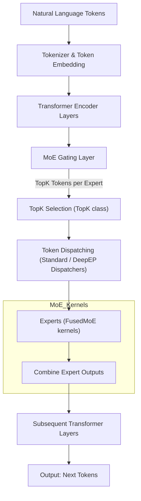
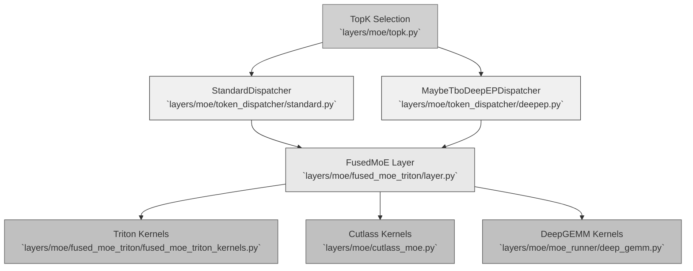

<!-- source: DeepWiki mcp.deepwiki.com · repo microsoft/llm-42 · page 5.2 Mixture-of-Experts (MoE) Models · fetched 2026-10-26 -->

# 5.2 Mixture-of-Experts (MoE) Models

<details>
<summary>Relevant source files</summary>

The following files were used as context for generating this wiki page:

- [benchmark/kernels/fused_moe_triton/README.md](benchmark/kernels/fused_moe_triton/README.md)
- [benchmark/kernels/fused_moe_triton/benchmark_sglang_fused_moe_triton.py](benchmark/kernels/fused_moe_triton/benchmark_sglang_fused_moe_triton.py)
- [benchmark/kernels/fused_moe_triton/benchmark_torch_compile_fused_moe.py](benchmark/kernels/fused_moe_triton/benchmark_torch_compile_fused_moe.py)
- [benchmark/kernels/fused_moe_triton/benchmark_vllm_vs_sglang_fused_moe_triton.py](benchmark/kernels/fused_moe_triton/benchmark_vllm_vs_sglang_fused_moe_triton.py)
- [benchmark/kernels/fused_moe_triton/tuning_client.py](benchmark/kernels/fused_moe_triton/tuning_client.py)
- [benchmark/kernels/fused_moe_triton/tuning_fused_moe_triton.py](benchmark/kernels/fused_moe_triton/tuning_fused_moe_triton.py)
- [benchmark/kernels/fused_moe_triton/tuning_fused_moe_triton_sep.py](benchmark/kernels/fused_moe_triton/tuning_fused_moe_triton_sep.py)
- [benchmark/kernels/fused_moe_triton/tuning_text.json](benchmark/kernels/fused_moe_triton/tuning_text.json)
- [python/sglang/srt/configs/model_config.py](python/sglang/srt/configs/model_config.py)
- [python/sglang/srt/eplb/eplb_manager.py](python/sglang/srt/eplb/eplb_manager.py)
- [python/sglang/srt/eplb/expert_distribution.py](python/sglang/srt/eplb/expert_distribution.py)
- [python/sglang/srt/eplb/expert_location.py](python/sglang/srt/eplb/expert_location.py)
- [python/sglang/srt/eplb/expert_location_dispatch.py](python/sglang/srt/eplb/expert_location_dispatch.py)
- [python/sglang/srt/eplb/expert_location_updater.py](python/sglang/srt/eplb/expert_location_updater.py)
- [python/sglang/srt/layers/linear.py](python/sglang/srt/layers/linear.py)
- [python/sglang/srt/layers/moe/cutlass_moe.py](python/sglang/srt/layers/moe/cutlass_moe.py)
- [python/sglang/srt/layers/moe/cutlass_w4a8_moe.py](python/sglang/srt/layers/moe/cutlass_w4a8_moe.py)
- [python/sglang/srt/layers/moe/ep_moe/kernels.py](python/sglang/srt/layers/moe/ep_moe/kernels.py)
- [python/sglang/srt/layers/moe/ep_moe/layer.py](python/sglang/srt/layers/moe/ep_moe/layer.py)
- [python/sglang/srt/layers/moe/fused_moe_triton/configs/README.md](python/sglang/srt/layers/moe/fused_moe_triton/configs/README.md)
- [python/sglang/srt/layers/moe/fused_moe_triton/configs/triton_3_2_0/E=257,N=128,device_name=NVIDIA_H20,dtype=fp8_w8a8,block_shape=[128, 128].json](python/sglang/srt/layers/moe/fused_moe_triton/configs/triton_3_2_0/E=257,N=128,device_name=NVIDIA_H20,dtype=fp8_w8a8,block_shape=[128, 128].json)
- [python/sglang/srt/layers/moe/fused_moe_triton/configs/triton_3_2_0/E=257,N=256,device_name=NVIDIA_H20,dtype=fp8_w8a8,block_shape=[128, 128].json](python/sglang/srt/layers/moe/fused_moe_triton/configs/triton_3_2_0/E=257,N=256,device_name=NVIDIA_H20,dtype=fp8_w8a8,block_shape=[128, 128].json)
- [python/sglang/srt/layers/moe/fused_moe_triton/configs/triton_3_5_1/E=257,N=256,device_name=NVIDIA_H200,dtype=fp8_w8a8,block_shape=[128, 128].json](python/sglang/srt/layers/moe/fused_moe_triton/configs/triton_3_5_1/E=257,N=256,device_name=NVIDIA_H200,dtype=fp8_w8a8,block_shape=[128, 128].json)
- [python/sglang/srt/layers/moe/fused_moe_triton/configs/triton_3_5_1/E=257,N=256,device_name=NVIDIA_H200,dtype=fp8_w8a8,block_shape=[128, 128]_down.json](python/sglang/srt/layers/moe/fused_moe_triton/configs/triton_3_5_1/E=257,N=256,device_name=NVIDIA_H200,dtype=fp8_w8a8,block_shape=[128, 128]_down.json)
- [python/sglang/srt/layers/moe/fused_moe_triton/configs/triton_3_5_1/E=80,N=640,device_name=NVIDIA_H200,dtype=fp8_w8a8,block_shape=[128, 128].json](python/sglang/srt/layers/moe/fused_moe_triton/configs/triton_3_5_1/E=80,N=640,device_name=NVIDIA_H200,dtype=fp8_w8a8,block_shape=[128, 128].json)
- [python/sglang/srt/layers/moe/fused_moe_triton/configs/triton_3_5_1/E=80,N=640,device_name=NVIDIA_H200,dtype=fp8_w8a8,block_shape=[128, 128]_down.json](python/sglang/srt/layers/moe/fused_moe_triton/configs/triton_3_5_1/E=80,N=640,device_name=NVIDIA_H200,dtype=fp8_w8a8,block_shape=[128, 128]_down.json)
- [python/sglang/srt/layers/moe/fused_moe_triton/fused_moe.py](python/sglang/srt/layers/moe/fused_moe_triton/fused_moe.py)
- [python/sglang/srt/layers/moe/fused_moe_triton/fused_moe_triton_kernels.py](python/sglang/srt/layers/moe/fused_moe_triton/fused_moe_triton_kernels.py)
- [python/sglang/srt/layers/moe/fused_moe_triton/layer.py](python/sglang/srt/layers/moe/fused_moe_triton/layer.py)
- [python/sglang/srt/layers/moe/moe_runner/deep_gemm.py](python/sglang/srt/layers/moe/moe_runner/deep_gemm.py)
- [python/sglang/srt/layers/moe/token_dispatcher/__init__.py](python/sglang/srt/layers/moe/token_dispatcher/__init__.py)
- [python/sglang/srt/layers/moe/token_dispatcher/base.py](python/sglang/srt/layers/moe/token_dispatcher/base.py)
- [python/sglang/srt/layers/moe/token_dispatcher/deepep.py](python/sglang/srt/layers/moe/token_dispatcher/deepep.py)
- [python/sglang/srt/layers/moe/token_dispatcher/standard.py](python/sglang/srt/layers/moe/token_dispatcher/standard.py)
- [python/sglang/srt/layers/moe/topk.py](python/sglang/srt/layers/moe/topk.py)
- [python/sglang/srt/layers/moe/utils.py](python/sglang/srt/layers/moe/utils.py)
- [python/sglang/srt/layers/quantization/__init__.py](python/sglang/srt/layers/quantization/__init__.py)
- [python/sglang/srt/layers/quantization/fp8.py](python/sglang/srt/layers/quantization/fp8.py)
- [python/sglang/srt/layers/quantization/fp8_kernel.py](python/sglang/srt/layers/quantization/fp8_kernel.py)
- [python/sglang/srt/layers/quantization/fp8_utils.py](python/sglang/srt/layers/quantization/fp8_utils.py)
- [python/sglang/srt/layers/quantization/modelopt_quant.py](python/sglang/srt/layers/quantization/modelopt_quant.py)
- [python/sglang/srt/layers/quantization/w4afp8.py](python/sglang/srt/layers/quantization/w4afp8.py)
- [python/sglang/srt/layers/vocab_parallel_embedding.py](python/sglang/srt/layers/vocab_parallel_embedding.py)
- [python/sglang/srt/models/deepseek_nextn.py](python/sglang/srt/models/deepseek_nextn.py)
- [python/sglang/srt/models/deepseek_v2.py](python/sglang/srt/models/deepseek_v2.py)
- [python/sglang/test/test_block_fp8.py](python/sglang/test/test_block_fp8.py)
- [python/sglang/test/test_cutlass_moe.py](python/sglang/test/test_cutlass_moe.py)
- [python/sglang/test/test_cutlass_w4a8_moe.py](python/sglang/test/test_cutlass_w4a8_moe.py)
- [sgl-kernel/benchmark/bench_fp8_blockwise_group_gemm.py](sgl-kernel/benchmark/bench_fp8_blockwise_group_gemm.py)
- [sgl-kernel/csrc/cutlass_extensions/common.hpp](sgl-kernel/csrc/cutlass_extensions/common.hpp)
- [sgl-kernel/csrc/cutlass_extensions/gemm/cutlass_gemm_caller.cuh](sgl-kernel/csrc/cutlass_extensions/gemm/cutlass_gemm_caller.cuh)
- [sgl-kernel/csrc/cutlass_extensions/gemm/dispatch_policy.hpp](sgl-kernel/csrc/cutlass_extensions/gemm/dispatch_policy.hpp)
- [sgl-kernel/csrc/cutlass_extensions/gemm/fp8_blockwise_gemm_sm90_dispatch.cuh](sgl-kernel/csrc/cutlass_extensions/gemm/fp8_blockwise_gemm_sm90_dispatch.cuh)
- [sgl-kernel/csrc/moe/cutlass_moe/w4a8/w4a8_get_group_starts.cuh](sgl-kernel/csrc/moe/cutlass_moe/w4a8/w4a8_get_group_starts.cuh)
- [sgl-kernel/csrc/moe/cutlass_moe/w4a8/w4a8_grouped_mm_c3x.cu](sgl-kernel/csrc/moe/cutlass_moe/w4a8/w4a8_grouped_mm_c3x.cu)
- [sgl-kernel/csrc/moe/cutlass_moe/w4a8/w4a8_grouped_mm_c3x.cuh](sgl-kernel/csrc/moe/cutlass_moe/w4a8/w4a8_grouped_mm_c3x.cuh)
- [sgl-kernel/csrc/moe/cutlass_moe/w4a8/w4a8_moe_data.cu](sgl-kernel/csrc/moe/cutlass_moe/w4a8/w4a8_moe_data.cu)
- [sgl-kernel/csrc/moe/fp8_blockwise_moe_kernel.cu](sgl-kernel/csrc/moe/fp8_blockwise_moe_kernel.cu)
- [sgl-kernel/rename_wheels.sh](sgl-kernel/rename_wheels.sh)
- [sgl-kernel/tests/test_cutlass_w4a8_moe_mm.py](sgl-kernel/tests/test_cutlass_w4a8_moe_mm.py)
- [sgl-kernel/tests/test_fp8_blockwise_moe.py](sgl-kernel/tests/test_fp8_blockwise_moe.py)

</details>


This page details the implementation, data flow, key components, and technical considerations of Mixture-of-Experts (MoE) models in the LLM-42 codebase. It focuses on MoE implementations including DeepSeek-V2/V3, Qwen2-MoE, Mixtral, and extends to MoE gating, TopK expert selection, token dispatching strategies (Standard and DeepEP), fused MoE kernels (Triton, DeepGEMM, CUTLASS), and Expert Parallel Load Balancing (EPLB).

---

## 1. Introduction and Supported Architectures

MoE models in LLM-42 enable routing tokens dynamically to different "expert" subnetworks, increasing model capacity efficiently. This supports state-of-the-art architectures:

- DeepSeek-V2 and DeepSeek-V3
- Qwen2-MoE
- Mixtral
- Additional MoE architectures with MoE layers in transformer blocks

These models require specialized handling for sparse routing, expert selection, and expert computation, underpinned by various dispatchers, TopK selectors, and fused kernels for maximum throughput.

---

## 2. MoE Gating and TopK Selection

### 2.1 Gating and TopK Output

The gating mechanism determines which experts handle each token. The main component computing this is TopK, which identifies the top ranked experts per token by their gate logits.

- **`TopK` class** encapsulates the selection logic including:

  - Configurable `top_k` (number of experts per token)
  - Grouped top-k variants for expert grouping
  - Output formats (`STANDARD`, `TRITON_KERNEL`, `BYPASSED`)
  - Scoring functions such as softmax or sigmoid
  - Routing bias and scaling for routed expert weights

- **TopK outputs**:

  - **StandardTopKOutput**: Contains `topk_weights`, `topk_ids`, and `router_logits` tensors.
  - **TritonKernelTopKOutput**: Uses specialized `RoutingData`, gather and scatter indices for kernel routing.
  - **BypassedTopKOutput**: Holds hidden states and routing info without explicit TopK, used for specialized dispatch.

The TopK selections form the basis of which expert(s) a token is sent to.

### 2.2 Implementation Highlights

- TopK is implemented with fine platform support for CUDA, HIP, CPU, and XPU backends.
- For CUDA, Triton fused kernels and FlashInfer fused topk kernels are optionally leveraged.
- Supports advanced routing methods including AITER backend's biased_grouped_topk.
- The modular `TopKConfig` enables parameter tuning and routing function overrides.

This functionality is primarily implemented in `python/sglang/srt/layers/moe/topk.py` lines 5–37470.

---

## 3. Token Dispatching: Standard and DeepEP

Token dispatching moves tokens to experts after TopK gating.

### 3.1 StandardDispatcher

The classic method:

- Groups tokens by expert assigned.
- Dispatches them in batches for expert forward.
- Then recombines expert outputs back.

This dispatcher is implemented as `StandardDispatcher` class in `token_dispatcher/standard.py`. It uses conventional routing and recombination without overlap optimizations.

### 3.2 DeepEP Dispatcher (MaybeTboDeepEPDispatcher)

Deep Expert Parallelism (DeepEP) dispatcher extends dispatching with overlapping computation:

- Overlaps dispatch, compute, and communications.
- Supports asynchronous token routing for improved latency.
- Relies on batch overlap scheduling and fused kernels for dispatch and combine.

The class `MaybeTboDeepEPDispatcher` implements this strategy and adapts to hardware backend capabilities. Found in `token_dispatcher/deepep.py`.

### 3.3 Other Dispatchers

- `FlashinferDispatcher`: Uses FlashInfer fused dispatch and combine.
- `NpuFuseEPDispatcher` and `MoriEPDispatcher`: Specialized for Ascend and Mori platforms.

Dispatcher selection is auto-determined by `create_moe_dispatcher` in `fused_moe_triton/layer.py` lines 90–146 based on A2A backend type.

---

## 4. Fused MoE Kernels

MoE expert computation involves applying expert-level feed-forward networks efficiently.

### 4.1 FusedMoE Kernel Overview

- Combines gate up-projection and expert down projection weights.
- Supports multiple quantization schemes: FP8, FP4, INT8, INT4.
- Applies token-wise gating weights and activation functions (e.g., SiLU).

### 4.2 Implementations

- **Triton fused kernels**:

  - Implemented in `layers/moe/fused_moe_triton/layer.py`—central `FusedMoE` class.
  - Uses low-level Triton kernels in `fused_moe_triton_kernels.py`.
  - Optimized for NVIDIA GPUs.

- **DeepGEMM fused MoE**:

  - For platforms supporting DeepGEMM (e.g., some AMD).
  - Integrated into `moe_runner/deep_gemm.py`.

- **CUTLASS fused MoE**:

  - Uses CUTLASS-based kernels for FP8/INT8 operations.
  - See `layers/moe/cutlass_moe.py` for CUTLASS-specific fused kernels and parameter setup.

### 4.3 Forward Path

Fused MoE performs:

- Dispatch of tokens and routing weights.
- Expert computation via fused kernels.
- Reduction and combination of expert outputs.

The key entry points:

- `fused_experts` function in `layers/moe/fused_moe_triton/fused_moe.py`
- `FusedMoE.forward` performs fused expert computations and gating.

---

## 5. DeepSeek-V2/V3 and Model Integration

DeepSeek-V2 and V3 are inference-only MoE transformer models with specialized MoE implementations.

### 5.1 Model Class

- Defined in `models/deepseek_v2.py` (lines 10–34661 approx).
- Mixes the MoE fused kernel layers with transformer blocks.
- Handles routing, expert parallelism, and batching internally.
- Supports multiple dispatch and routing modes.

### 5.2 MoE Layer Integration

- Uses `FusedMoE` or `DeepEPMoE` depending on expert parallel mode.
- Integrates TopK gating and dispatching.
- Modular to adapt to hardware backends and MoE runtimes.

---

## 6. Expert Parallel Load Balancing (EPLB)

EPLB is a runtime system to:

- Dynamically track and rebalance expert workloads across distributed devices.
- Minimize expert overload imbalances.
- Improve throughput and utilization.

### 6.1 Components

- `expert_location_dispatch.py`: Contains `ExpertLocationDispatchInfo` which maintains expert-to-device mappings.
- `expert_distribution.py`: Records global expert usage statistics.
- Integration hooks in `deepseek_v2.py` and `fused_moe_triton/layer.py` apply EPLB info to routing and load balancing.

---

## 7. Data Flow Summary



Sources: `layers/moe/topk.py`, `layers/moe/fused_moe_triton/layer.py`, `models/deepseek_v2.py`

---

## 8. Natural Language to Code Entity Mapping: Model Architecture and Dispatcher

```mermaid
flowchart LR
    subgraph Model
      DS2[DeepSeekV2 Model\n`deepseek_v2.py`]
      Qwen[Qwen2-MoE Model\n`deepseek_v2.py` + custom]
      Mixtral[Mixtral Model\n`deepseek_v2.py` + custom]
    end

    subgraph Expert_Parallel
      EP_MOE[DeepEPMoE class\n`layers/moe/ep_moe/layer.py`]
      FusedMoE[FusedMoE class\n`layers/moe/fused_moe_triton/layer.py`]
      Dispatcher[MoE Dispatcher\n`layers/moe/fused_moe_triton/layer.py`: create_moe_dispatcher()]
    end

    DS2 --> EP_MOE
    DS2 --> FusedMoE
    Qwen --> FusedMoE
    Mixtral --> FusedMoE
    Dispatcher --> EP_MOE
    Dispatcher --> FusedMoE

    style DS2 fill:#f0f0f0,stroke:#333,stroke-width:1px
    style Qwen fill:#f0f0f0,stroke:#333,stroke-width:1px
    style Mixtral fill:#f0f0f0,stroke:#333,stroke-width:1px
    style EP_MOE fill:#e8e8e8,stroke:#555,stroke-width:1px
    style FusedMoE fill:#e8e8e8,stroke:#555,stroke-width:1px
    style Dispatcher fill:#d8d8d8,stroke:#777,stroke-width:1px
```

Sources: `models/deepseek_v2.py`, `layers/moe/fused_moe_triton/layer.py`, `layers/moe/ep_moe/layer.py`

---

## 9. Code Entity to Low-Level Kernel Mapping: Dispatch and Fused Kernel Calls



Sources: `layers/moe/topk.py`, `layers/moe/fused_moe_triton/layer.py`, `layers/moe/fused_moe_triton/fused_moe_triton_kernels.py`, `layers/moe/cutlass_moe.py`, `layers/moe/moe_runner/deep_gemm.py`

---

## 10. Summary of Core Classes and Functions

| Component                          | Role                                                            | Key File & Lines                            |
|----------------------------------|-----------------------------------------------------------------|---------------------------------------------|
| `TopK`                           | Expert gating and top-k expert selection                        | `layers/moe/topk.py:200-37470`              |
| `StandardDispatcher`             | Standard token dispatch and combine                             | `layers/moe/token_dispatcher/standard.py`   |
| `MaybeTboDeepEPDispatcher`       | Token dispatch overlapping compute and communications (DeepEP) | `layers/moe/token_dispatcher/deepep.py`     |
| `FusedMoE`                      | Fused expert layer (gating + expert FFN)                       | `layers/moe/fused_moe_triton/layer.py:156-53700` |
| `fused_experts`                  | Custom operator invoking fused expert kernels                  | `layers/moe/fused_moe_triton/fused_moe.py:80-23000` |
| `DeepEPMoE`                     | Expert Parallel implementation for DeepEP                      | `layers/moe/ep_moe/layer.py:60-20900`       |
| `ExpertLocationDispatchInfo`     | Stores and manages EPLB expert location metadata               | `eplb/expert_location_dispatch.py`          |
| `get_global_expert_distribution_recorder` | Records global expert usage for EPLB                       | `eplb/expert_distribution.py`                |
| `create_moe_dispatcher()`        | Factory to choose dispatcher by A2A backend                    | `layers/moe/fused_moe_triton/layer.py:90-147`|

---

## 11. Additional Details

### 11.1 MoE Support for Quantization

- MoE fused kernels support FP8, FP4, INT8, INT4 quantization with mixed precision.
- Integration with quantization configs like `Fp8Config`, `ModelOptFp8Config`, and methods in `layers/quantization/fp8.py` and `modelopt_quant.py`.
- Dispatch and fused kernels dynamically select quantization paths.

### 11.2 Acceleration Backends

- CUDA: Triton fused kernels, CUTLASS kernels, FlashInfer.
- HIP: Native fused kernels with AITER support.
- NPU: Specialized fused kernels and dispatchers like `NpuFuseEPDispatcher`.
- CPU with AMX acceleration: Partial support.

---

# End of 5.2 Mixture-of-Experts (MoE) Models

---

### Sources:

- `python/sglang/srt/models/deepseek_v2.py` [1-34661]()
- `python/sglang/srt/layers/moe/fused_moe_triton/layer.py` [20-53700]()
- `python/sglang/srt/layers/moe/topk.py` [1-37477]()
- `python/sglang/srt/layers/moe/token_dispatcher/standard.py` [few lines; dispatcher classes referenced]()
- `python/sglang/srt/layers/moe/token_dispatcher/deepep.py` [few lines; dispatcher classes referenced]()
- `python/sglang/srt/layers/moe/fused_moe_triton/fused_moe.py` [60-23000]()
- `python/sglang/srt/layers/moe/ep_moe/layer.py` [60-20900]()
- `python/sglang/srt/eplb/expert_location_dispatch.py` [all]()
- `python/sglang/srt/eplb/expert_distribution.py` [all]()
- `python/sglang/srt/layers/moe/cutlass_moe.py` [for CUTLASS kernels]()
- `python/sglang/srt/layers/moe/moe_runner/deep_gemm.py` [for DeepGEMM kernels]()
- `python/sglang/srt/layers/quantization/fp8.py` [recommended for quantization background]()
- `python/sglang/srt/layers/quantization/modelopt_quant.py` [recommended for quantization background]()

---

