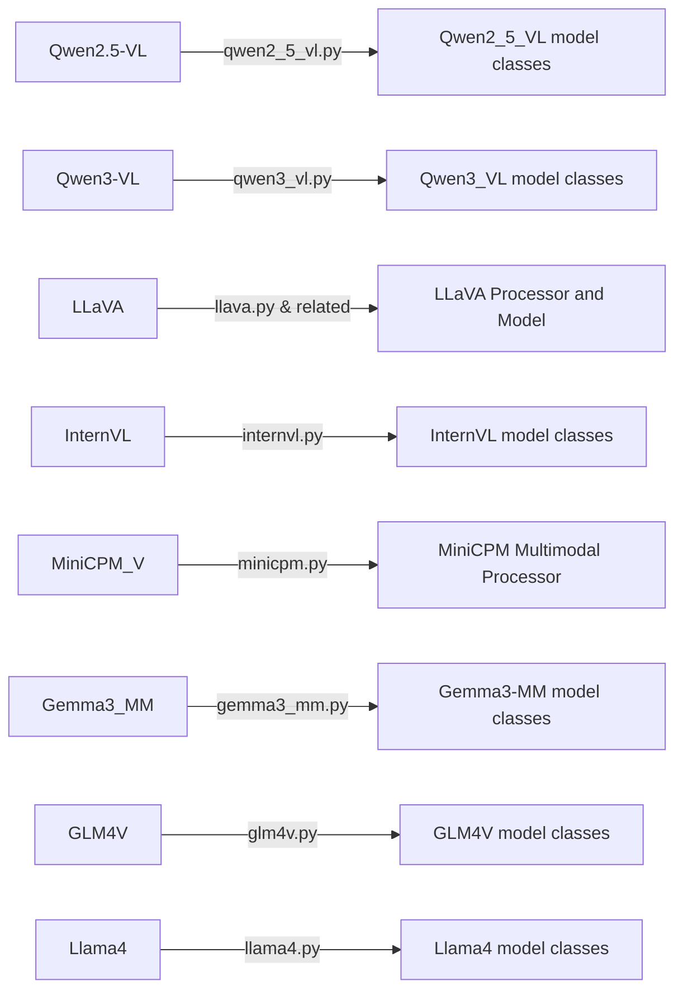
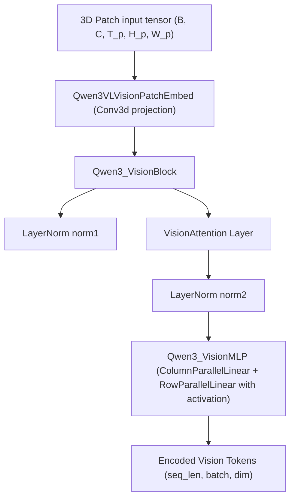
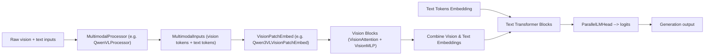

<!-- source: DeepWiki mcp.deepwiki.com · repo microsoft/llm-42 · page 5.3 Vision-Language Models (VLMs) · fetched 2026-10-26 -->

# Vision-Language Models (VLMs)

Relevant source files

The following files were used as context for generating this wiki page:

- [python/sglang/srt/configs/internvl.py](python/sglang/srt/configs/internvl.py)
- [python/sglang/srt/configs/olmo3.py](python/sglang/srt/configs/olmo3.py)
- [python/sglang/srt/layers/attention/vision.py](python/sglang/srt/layers/attention/vision.py)
- [python/sglang/srt/layers/attention/vision_utils.py](python/sglang/srt/layers/attention/vision_utils.py)
- [python/sglang/srt/managers/mm_utils.py](python/sglang/srt/managers/mm_utils.py)
- [python/sglang/srt/models/clip.py](python/sglang/srt/models/clip.py)
- [python/sglang/srt/models/gemma3_causal.py](python/sglang/srt/models/gemma3_causal.py)
- [python/sglang/srt/models/gemma3_mm.py](python/sglang/srt/models/gemma3_mm.py)
- [python/sglang/srt/models/glm4.py](python/sglang/srt/models/glm4.py)
- [python/sglang/srt/models/glm4_moe.py](python/sglang/srt/models/glm4_moe.py)
- [python/sglang/srt/models/glm4_moe_nextn.py](python/sglang/srt/models/glm4_moe_nextn.py)
- [python/sglang/srt/models/glm4v.py](python/sglang/srt/models/glm4v.py)
- [python/sglang/srt/models/glm4v_moe.py](python/sglang/srt/models/glm4v_moe.py)
- [python/sglang/srt/models/glm_ocr.py](python/sglang/srt/models/glm_ocr.py)
- [python/sglang/srt/models/glm_ocr_nextn.py](python/sglang/srt/models/glm_ocr_nextn.py)
- [python/sglang/srt/models/interns1.py](python/sglang/srt/models/interns1.py)
- [python/sglang/srt/models/internvl.py](python/sglang/srt/models/internvl.py)
- [python/sglang/srt/models/kimi_vl.py](python/sglang/srt/models/kimi_vl.py)
- [python/sglang/srt/models/llama4.py](python/sglang/srt/models/llama4.py)
- [python/sglang/srt/models/ministral3.py](python/sglang/srt/models/ministral3.py)
- [python/sglang/srt/models/mllama.py](python/sglang/srt/models/mllama.py)
- [python/sglang/srt/models/mllama4.py](python/sglang/srt/models/mllama4.py)
- [python/sglang/srt/models/pixtral.py](python/sglang/srt/models/pixtral.py)
- [python/sglang/srt/models/qwen2_5_vl.py](python/sglang/srt/models/qwen2_5_vl.py)
- [python/sglang/srt/models/qwen2_vl.py](python/sglang/srt/models/qwen2_vl.py)
- [python/sglang/srt/models/qwen3_vl.py](python/sglang/srt/models/qwen3_vl.py)
- [python/sglang/srt/models/qwen3_vl_moe.py](python/sglang/srt/models/qwen3_vl_moe.py)
- [python/sglang/srt/models/siglip.py](python/sglang/srt/models/siglip.py)
- [python/sglang/srt/multimodal/internvl_vit_cuda_graph_runner.py](python/sglang/srt/multimodal/internvl_vit_cuda_graph_runner.py)
- [python/sglang/srt/multimodal/processors/base_processor.py](python/sglang/srt/multimodal/processors/base_processor.py)
- [python/sglang/srt/multimodal/processors/deepseek_vl_v2.py](python/sglang/srt/multimodal/processors/deepseek_vl_v2.py)
- [python/sglang/srt/multimodal/processors/gemma3.py](python/sglang/srt/multimodal/processors/gemma3.py)
- [python/sglang/srt/multimodal/processors/gemma3n.py](python/sglang/srt/multimodal/processors/gemma3n.py)
- [python/sglang/srt/multimodal/processors/glm4v.py](python/sglang/srt/multimodal/processors/glm4v.py)
- [python/sglang/srt/multimodal/processors/internvl.py](python/sglang/srt/multimodal/processors/internvl.py)
- [python/sglang/srt/multimodal/processors/janus_pro.py](python/sglang/srt/multimodal/processors/janus_pro.py)
- [python/sglang/srt/multimodal/processors/kimi_vl.py](python/sglang/srt/multimodal/processors/kimi_vl.py)
- [python/sglang/srt/multimodal/processors/llava.py](python/sglang/srt/multimodal/processors/llava.py)
- [python/sglang/srt/multimodal/processors/minicpm.py](python/sglang/srt/multimodal/processors/minicpm.py)
- [python/sglang/srt/multimodal/processors/mllama4.py](python/sglang/srt/multimodal/processors/mllama4.py)
- [python/sglang/srt/multimodal/processors/phi4mm.py](python/sglang/srt/multimodal/processors/phi4mm.py)
- [python/sglang/srt/multimodal/processors/pixtral.py](python/sglang/srt/multimodal/processors/pixtral.py)
- [python/sglang/srt/multimodal/processors/qwen_vl.py](python/sglang/srt/multimodal/processors/qwen_vl.py)
- [python/sglang/srt/utils/cuda_ipc_transport_utils.py](python/sglang/srt/utils/cuda_ipc_transport_utils.py)

This section 5.3 covers the architecture, implementation, and data flow of multimodal Large Language Models (LLMs) with vision-language capabilities supported by the LLM-42 codebase. It details the core VLM models such as Qwen2.5-VL, Qwen3-VL, LLaVA, InternVL, MiniCPM-V, Gemma3-MM, GLM4V, Llama4, and others. The page explains how image and video inputs are processed, encoded, and integrated with text tokens, covering multimodal processors, vision encoders, multimodal MLP and attention blocks, and the multimodal utils pipeline (`mm_utils`). 

The explanation makes extensive use of code entities to help developers locate the relevant classes and functions for each conceptual component, supported by mermaid diagrams bridging natural language concepts with specific code classes and modules.

---

## Purpose and Scope

Vision-Language Models (VLMs) extend text LLMs by incorporating non-text input modalities (images, videos, audio) to perform multimodal understanding and generation. The LLM-42 project offers deterministic inference engines for several state-of-the-art (SoTA) multimodal transformer models, designed to run on various GPUs, supporting distributed parallelism and quantization.

This page digs into the detailed implementations of VLMs in the repository, focusing on:

- Core multimodal transformer architectures that fuse vision and language data
- Vision encoder building blocks: patch embedding, vision transformer blocks, and specialized MLPs and attention components for images and videos
- Multimodal data processing, including how image/video tokens are managed and integrated into text sequences
- The `mm_utils` pipeline for multimodal data padding, embedding, and GPU tensor transport to efficiently handle batch processing
- Support for efficient vision attention mechanisms and rotary positional embeddings in vision models
- Key classes and methods in model files that implement VLMs such as Qwen2.5-VL, Qwen3-VL, InternVL, GLM4V, and Llama4

Although other related modalities like audio are mentioned, the main emphasis is on vision-language fusion models and their GPU-optimized implementations.

---

## 1. Supported Vision-Language Models in LLM-42

The codebase includes full implementations and inference wrappers for multiple VLMs, including:

| Model Name           | Code Module                                        | Description / Comments                    |
|----------------------|---------------------------------------------------|------------------------------------------|
| **Qwen2.5-VL**       | `python/sglang/srt/models/qwen2_5_vl.py`          | Based on Qwen2.5 multimodal architecture adapted from HuggingFace transformers. Uses MergedColumnParallelLinear and VisionAttention layers. |
| **Qwen3-VL**          | `python/sglang/srt/models/qwen3_vl.py`             | Next-gen Qwen3 multimodal model with 3D patch embeddings, vision MLP/attention blocks, and rotary embedding. |
| **LLaVA**             | (Processor under `llava.py` and model not fully shown) | Large Language and Vision Assistant model supporting image-text inputs. |
| **InternVL**           | `python/sglang/srt/models/internvl.py`              | Intern Vision-Language model featuring VisionAttention, InternVisionEmbeddings, and InternMLP layers. |
| **MiniCPM-V**          | (Processor in `minicpm.py`)                         | Lightweight CPM multimodal model focused on vision-language tasks. |
| **Gemma3-MM**          | `python/sglang/srt/models/gemma3_mm.py`             | Multimodal Gemma3 model emphasizing vision-token integration. |
| **GLM4V**              | `python/sglang/srt/models/glm4v.py`                 | GLM vision-extended model with VisionAttention and VisionMLP blocks. |
| **Llama4**             | `python/sglang/srt/models/llama4.py`                 | Vision-extended LLaMA model incorporating vision transformers and MoE experts. |

Each model contains specialized versions of vision-related modules (patch embedding, attention, MLPs) that interface with the common transformer backbone supporting deterministic GPU execution.

### Diagram: Supported VLMs to Code Modules

Sources: `python/sglang/srt/models/qwen2_5_vl.py:24-188`(), `python/sglang/srt/models/qwen3_vl.py:15-200`(), `python/sglang/srt/models/internvl.py:1-187`(), `python/sglang/srt/models/glm4v.py:18-189`(), `python/sglang/srt/models/llama4.py:17-190`(), `python/sglang/srt/multimodal/processors/llava.py`(), `python/sglang/srt/multimodal/processors/minicpm.py`(), `python/sglang/srt/models/gemma3_mm.py`()

---

## 2. Vision Modality Processing and Data Flow

Vision-Language models require input preprocessing and handling pipelines that convert raw images/videos into token embeddings consumable by the transformer.

### 2.1. Multimodal Processors

The package `sglang.srt.multimodal.processors` implements modality-specific preprocessing, loading, and batching logic. Processors provide:

- Input parsing and loading utilities for images (`PIL`), videos (`decord`), and audios as arrays
- Resizing, normalization, temporal frame selection, and patching
- Extraction of special tokens corresponding to vision inputs (e.g., `<image>`, `<video>`)
- Conversion of raw data into feature tensors or embedded tokens

`BaseMultimodalProcessor` is the abstract base class defining this interface and common utilities for derived processors specialized by model (e.g., Qwen, InternVL, GLM4V) [python/sglang/srt/multimodal/processors/base_processor.py:174-3344]().

The `qwen_vl.py` processor shows Qwen-specific implementations including video frame sampling, smart resizing, and processing into 3D patch embeddings [python/sglang/srt/multimodal/processors/qwen_vl.py:1-220](). Similar files implement InternVL, GLM4V processors.

### 2.2. Multimodal Input Representation

Once loaded and preprocessed, multimodal inputs are represented internally as batched tensors with corresponding metadata:

- `MultimodalInputs`: Container for modality-labeled data items, such as images/videos, with their properties (shape, special token IDs)
- `MultimodalDataItem`: Individual modality data with optional spatial/temporal metadata

Special tokens like `<image>` and related token IDs are managed via `MultimodalSpecialTokens` and used to embed multimodal sequences compatible with text tokens [python/sglang/srt/managers/schedule_batch.py]().

### 2.3. Multimodal Embedding and Padding Utilities

The module `sglang.srt.managers.mm_utils` handles multimodal token padding patterns, embedding routines, and tensor transport optimizations:

- `MultiModalityDataPaddingPatternMultimodalTokens` defines token-level padding across modalities for batch consistency
- `general_mm_embed_routine` aligns vision features with text tokens in batch forward passes
- GPU buffer preallocation and management of tensor transport via IPC (`TransportProxyTensor`) support efficient inter-process sharing of large vision feature tensors [python/sglang/srt/managers/mm_utils.py:1-910]()

---

## 3. Vision Encoders and Fusion Layers

Vision inputs are converted into embedding tokens via vision patch embedding layers, followed by specialized transformer blocks with vision-specific attention mechanisms.

### 3.1. Vision Patch Embedding

Vision patch embedding layers reshape raw image/video data into tokens via convolutional or linear projections:

- `Qwen2VisionPatchEmbed`, `Qwen3VLVisionPatchEmbed`: 3D Conv layers for spatiotemporal patches [qwen2_vl.py:178-201](), [qwen3_vl.py:120-150]()
- `InternVisionEmbeddings`: 2D patch embedding with class token and positional embeddings [internvl.py:96-167]()
- `Glm4vVisionPatchEmbed`, `Llama4MultiModalProjector`: similar specialized patch embedding layers accommodating config parameters and quantization [glm4v.py:191-260](), [mllama4.py:11-145]()

### 3.2. Vision Attention Blocks

Vision transformer blocks augment text transformers with vision-attention using:

- `VisionAttention`: Multi-head attention customized for vision tokens, supporting QKV parallelism, flatten batch mode, num_dummy_heads for padding, rotary embeddings, and quantization [layers/attention/vision.py:119-700]().
- Model-specific vision transformer blocks compose vision attention and MLP layers with normalization, residual connections, e.g.:

  - `Qwen2VisionBlock` and `Qwen3_VisionBlock` implement separate MLPs and VisionAttention with RMSNorm or LayerNorm [qwen2_vl.py:122-180](), [qwen3_vl.py:150-190]()
  - `Glm4vVisionBlock` employs RMSNorm and VisionAttention with Silu activation MLP [glm4v.py:119-188]()
  - `InternVisionEmbeddings` and `InternAttention` combined in `InternVisionEmbeddings` and `InternAttention` classes [internvl.py:51-100]()

### 3.3. Vision MLPs and Fusion

Specialized MLPs for vision patches use parallel linear layers and act functions like Silu:

- `Qwen2_5_VLMLP` and `Qwen3_VisionMLP` use merged column and row parallel linear layers for efficient tensor parallelism [qwen2_5_vl.py:86-137](), [qwen3_vl.py:70-118]()
- `Glm4vVisionMLP` implements a gate+up fusion MLP with Silu and parallel linear layers [glm4v.py:77-117]()
- `Llama4VisionMLP` and associated pixel shuffle MLP for spatial rearrangement [mllama4.py:47-142]()

### Diagram: Vision Encoder Layer Data Flow and Classes in Qwen3-VL

Sources: `python/sglang/srt/models/qwen3_vl.py:120-200`, `python/sglang/srt/layers/attention/vision.py:120-230`, `python/sglang/srt/models/qwen3_vl.py:78-118`()

---

## 4. Multimodal Model Inference Path and Forward Pass

### 4.1. Model Entry Point & ForwardBatch Interface

Multimodal models subclass HuggingFace-style `ForConditionalGeneration` classes supporting inference with vision-text inputs. For example, `Qwen2_5_VLForConditionalGeneration` inherits from `Qwen2ForCausalLM` and extends with vision embedding functionality [python/sglang/srt/models/qwen2_5_vl.py:278-420]().

The computation follows:

- Input multimodal tokens are embedded via vision encoders (patch embedding + vision transformer blocks)
- Vision tokens are concatenated/merged with text tokens to form full sequences
- Positional embeddings or rotary embeddings are applied on both modalities
- Standard transformer blocks process the combined token sequence
- The output logits are computed for language modeling or generation tasks

All forward passes hinge on `ForwardBatch` objects carrying tensor batches, modality info, and device context. The model methods use utility functions like `general_mm_embed_routine` to handle vision-text fusion in batch embedding [managers/mm_utils.py:40-200]().

### 4.2. GPU Acceleration and CUDA Graphs

Vision transformers employ CUDA Graph runners for optimizing repeated kernel launches when performing patch embedding or vision attention:

- `ViTCudaGraphRunner` accelerates ViT-type patch embedding and attention for Qwen3 and Qwen2.5 VL [python/sglang/srt/multimodal/vit_cuda_graph_runner.py]()
- `InternViTCudaGraphRunner` customizes CUDA Graph acceleration for InternVL vision blocks [python/sglang/srt/multimodal/internvl_vit_cuda_graph_runner.py]()

### Diagram: Multimodal Forward Pass Dataflow with Key Code Entities

Sources: `python/sglang/srt/models/qwen3_vl.py:15-200`, `python/sglang/srt/models/qwen2_5_vl.py:24-188`, `python/sglang/srt/managers/mm_utils.py:40-200`, `python/sglang/srt/multimodal/vit_cuda_graph_runner.py`()

---

## 5. Multimodal Utilities and Token Management (`mm_utils`)

The multimodal utilities module `sglang.srt.managers.mm_utils` offers critical infrastructure for vision-language modeling:

- **Token Padding and Alignment:** Defines padding patterns for vision token sequences to align with text tokens in batches ensuring consistent tensor shapes
- **Embedding Routine:** `general_mm_embed_routine` integrates raw vision features with multimodal text tokens embedding during forward pass
- **Transport Proxy Tensors:** Enables efficient IPC (Inter-Process Communication) sharing of GPU tensors to optimize throughput and minimize memory copying overhead
- **Buffer Preallocation:** Preallocates large feature buffers on GPU to reduce fragmentation and optimize memory management in multimodal workflows

Example APIs expose runtime flags and functions to initialize buffers, reset offsets, and attempt tensor copying to preallocated buffers [managers/mm_utils.py:30-320]().

---

## 6. Summary and Developer Notes

- VLMs in LLM-42 are modular transformer models integrating vision patch embedding and vision transformer blocks with standard LLM text backbones.
- VisionAttention is a re-usable attention layer designed for vision patches with support for flattened batches and rotary embeddings.
- Vision MLPs use merged column and row parallel linear layers for efficient tensor parallelism.
- Multimodal processors handle input loading/preprocessing for images and videos, converting them into feature tensors structured around special tokens.
- The `mm_utils` pipeline synchronizes vision tokens with text tokens in batch inputs and manages efficient GPU memory transports.
- CUDA graph and multi-stream execution mechanisms accelerate repeated vision patch embedding and attention kernels.
- Distributed parallelism (tensor, pipeline, data-parallel) and quantization are supported transparently in vision-language models.
- The layered abstractions ease adding new VLM architectures: define vision embeddings, embedding fusion routine, and the multimodal forward function.

---

This concludes the technical details for Section 5.3 Vision-Language Models (VLMs) in LLM-42.

---

# Appendix: Key Classes and Files Reference Table

| Concept                      | Key Code Symbols                        | Source File (Lines)                      |
|-----------------------------|---------------------------------------|-----------------------------------------|
| Qwen2.5-VL model             | `Qwen2_5_VLForConditionalGeneration`, `Qwen2_5_VisionBlock` | `models/qwen2_5_vl.py:24-188`           |
| Qwen3-VL model               | `Qwen3VLForConditionalGeneration`, `Qwen3_VisionBlock`         | `models/qwen3_vl.py:15-200`              |
| VisionAttention layer        | `VisionAttention`                      | `layers/attention/vision.py:118-700`    |
| Multimodal processors        | `BaseMultimodalProcessor`, `QwenVLProcessor`                   | `multimodal/processors/base_processor.py:174-3300` `multimodal/processors/qwen_vl.py` |
| Multimodal utils             | `general_mm_embed_routine`, `TransportProxyTensor`             | `managers/mm_utils.py:40-300`            |
| InternVL model               | `InternVisionEmbeddings`, `InternAttention`                    | `models/internvl.py:50-180`               |
| GLM4V model                 | `Glm4vVisionBlock`, `Glm4vVisionMLP`                           | `models/glm4v.py:118-190`                 |
| Llama4 vision modules        | `Llama4VisionEncoderLayer`, `Llama4VisionMLP`                  | `models/mllama4.py:50-180`                |
| CUDA Graph Runners           | `ViTCudaGraphRunner`, `InternViTCudaGraphRunner`               | `multimodal/vit_cuda_graph_runner.py` `multimodal/internvl_vit_cuda_graph_runner.py` |

---

Sources: All files cited above.

---

