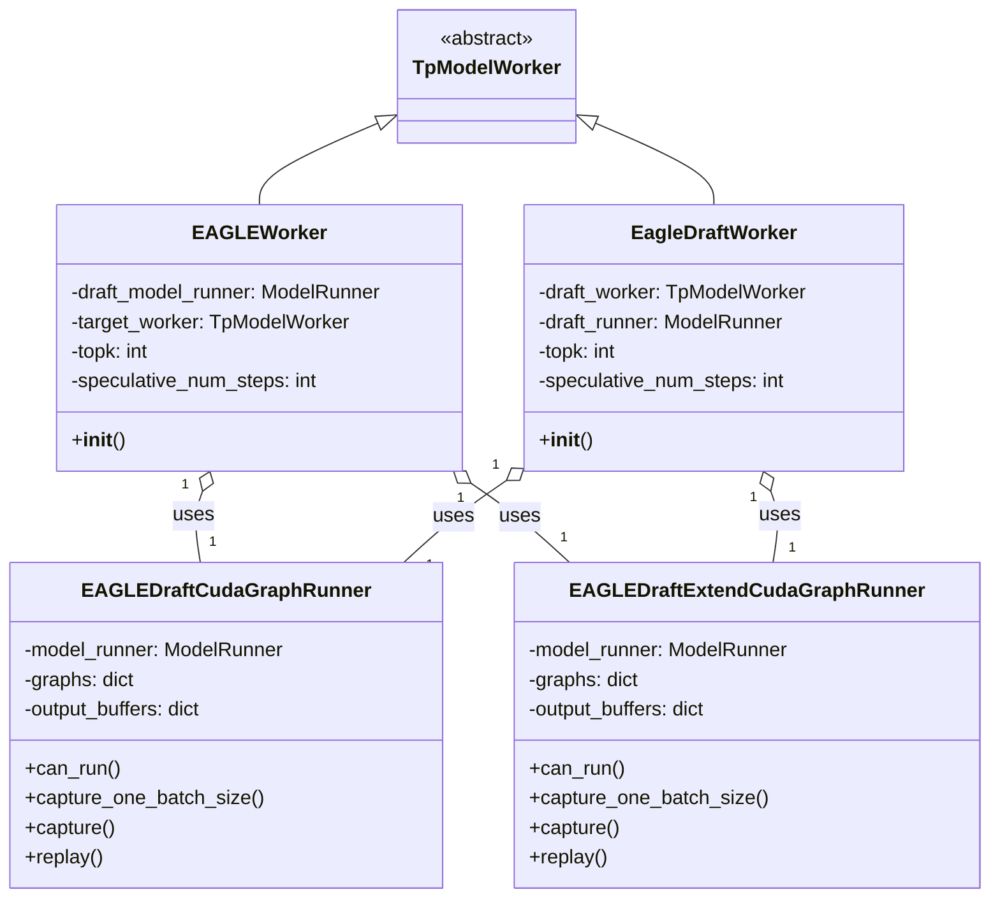
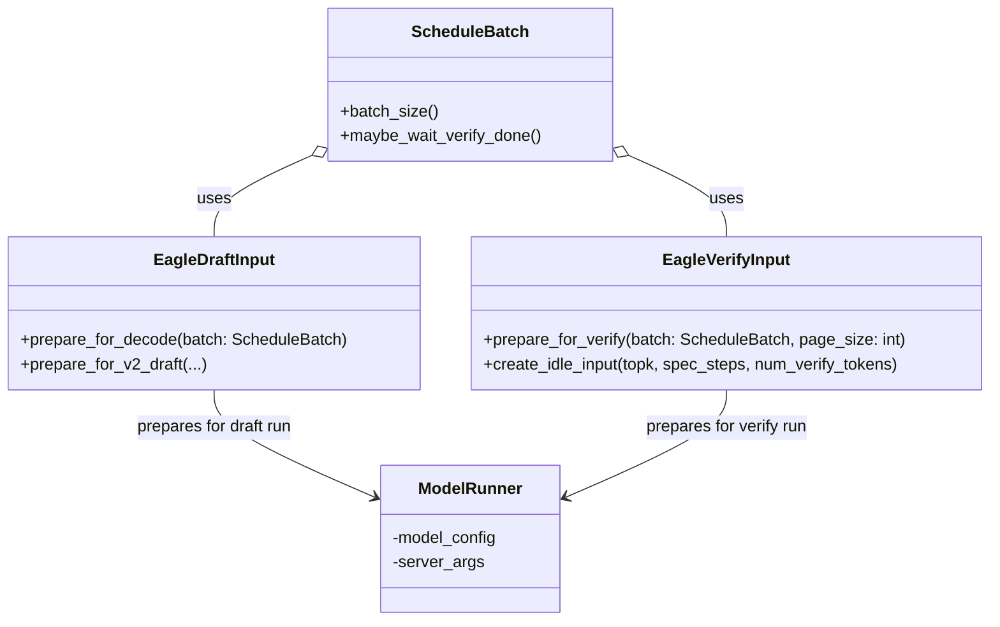

<!-- source: DeepWiki mcp.deepwiki.com · repo microsoft/llm-42 · page 5.4 Speculative Decoding · fetched 2026-10-26 -->

# Speculative Decoding

<details>
<summary>Relevant source files</summary>

The following files were used as context for generating this wiki page:

- [python/sglang/srt/layers/utils/common.py](python/sglang/srt/layers/utils/common.py)
- [python/sglang/srt/layers/utils/logprob.py](python/sglang/srt/layers/utils/logprob.py)
- [python/sglang/srt/managers/schedule_policy.py](python/sglang/srt/managers/schedule_policy.py)
- [python/sglang/srt/mem_cache/base_prefix_cache.py](python/sglang/srt/mem_cache/base_prefix_cache.py)
- [python/sglang/srt/mem_cache/chunk_cache.py](python/sglang/srt/mem_cache/chunk_cache.py)
- [python/sglang/srt/mem_cache/common.py](python/sglang/srt/mem_cache/common.py)
- [python/sglang/srt/mem_cache/mamba_radix_cache.py](python/sglang/srt/mem_cache/mamba_radix_cache.py)
- [python/sglang/srt/mem_cache/radix_cache.py](python/sglang/srt/mem_cache/radix_cache.py)
- [python/sglang/srt/mem_cache/radix_cache_cpp.py](python/sglang/srt/mem_cache/radix_cache_cpp.py)
- [python/sglang/srt/mem_cache/storage/lmcache/lmc_radix_cache.py](python/sglang/srt/mem_cache/storage/lmcache/lmc_radix_cache.py)
- [python/sglang/srt/mem_cache/swa_radix_cache.py](python/sglang/srt/mem_cache/swa_radix_cache.py)
- [python/sglang/srt/speculative/eagle_draft_cuda_graph_runner.py](python/sglang/srt/speculative/eagle_draft_cuda_graph_runner.py)
- [python/sglang/srt/speculative/eagle_draft_extend_cuda_graph_runner.py](python/sglang/srt/speculative/eagle_draft_extend_cuda_graph_runner.py)
- [python/sglang/srt/speculative/eagle_info.py](python/sglang/srt/speculative/eagle_info.py)
- [python/sglang/srt/speculative/eagle_info_v2.py](python/sglang/srt/speculative/eagle_info_v2.py)
- [python/sglang/srt/speculative/eagle_utils.py](python/sglang/srt/speculative/eagle_utils.py)
- [python/sglang/srt/speculative/eagle_worker.py](python/sglang/srt/speculative/eagle_worker.py)
- [python/sglang/srt/speculative/eagle_worker_v2.py](python/sglang/srt/speculative/eagle_worker_v2.py)
- [python/sglang/srt/speculative/ngram_info.py](python/sglang/srt/speculative/ngram_info.py)
- [python/sglang/srt/speculative/ngram_worker.py](python/sglang/srt/speculative/ngram_worker.py)
- [python/sglang/srt/speculative/spec_utils.py](python/sglang/srt/speculative/spec_utils.py)
- [python/sglang/srt/utils/auth.py](python/sglang/srt/utils/auth.py)
- [python/sglang/test/kits/abort_timeout_kit.py](python/sglang/test/kits/abort_timeout_kit.py)
- [python/sglang/test/server_fixtures/eagle_fixture.py](python/sglang/test/server_fixtures/eagle_fixture.py)
- [python/sglang/test/test_http_server_auth.py](python/sglang/test/test_http_server_auth.py)
- [test/registered/attention/test_fa3.py](test/registered/attention/test_fa3.py)
- [test/registered/attention/test_hybrid_attn_backend.py](test/registered/attention/test_hybrid_attn_backend.py)
- [test/registered/mla/test_flashmla.py](test/registered/mla/test_flashmla.py)
- [test/registered/mla/test_mla.py](test/registered/mla/test_mla.py)
- [test/registered/mla/test_mla_deepseek_v3.py](test/registered/mla/test_mla_deepseek_v3.py)
- [test/registered/mla/test_mla_flashinfer.py](test/registered/mla/test_mla_flashinfer.py)
- [test/registered/mla/test_mla_int8_deepseek_v3.py](test/registered/mla/test_mla_int8_deepseek_v3.py)
- [test/registered/radix_cache/test_mamba_unittest.py](test/registered/radix_cache/test_mamba_unittest.py)
- [test/registered/radix_cache/test_radix_cache_unit.py](test/registered/radix_cache/test_radix_cache_unit.py)
- [test/registered/radix_cache/test_swa_unittest.py](test/registered/radix_cache/test_swa_unittest.py)
- [test/registered/scheduler/test_abort.py](test/registered/scheduler/test_abort.py)
- [test/registered/spec/eagle/test_eagle3_basic.py](test/registered/spec/eagle/test_eagle3_basic.py)
- [test/registered/spec/eagle/test_eagle_constrained_decoding.py](test/registered/spec/eagle/test_eagle_constrained_decoding.py)
- [test/registered/spec/eagle/test_eagle_infer_a.py](test/registered/spec/eagle/test_eagle_infer_a.py)
- [test/registered/spec/eagle/test_eagle_infer_b.py](test/registered/spec/eagle/test_eagle_infer_b.py)
- [test/registered/spec/eagle/test_eagle_infer_beta.py](test/registered/spec/eagle/test_eagle_infer_beta.py)
- [test/registered/spec/eagle/test_eagle_infer_beta_dp_attention_large.py](test/registered/spec/eagle/test_eagle_infer_beta_dp_attention_large.py)
- [test/registered/spec/test_ngram_speculative_decoding.py](test/registered/spec/test_ngram_speculative_decoding.py)
- [test/registered/spec/utils/test_build_eagle_tree.py](test/registered/spec/utils/test_build_eagle_tree.py)

</details>


This page details the speculative decoding subsystem in the LLM-42 codebase, covering the implementation of EAGLE and EAGLE-v2 speculative decoding workers, draft model CUDA graph runners, ngram speculation, and multi-layer EAGLE. It explains the draft-verify generation pipeline including tree-based sampling and how these components integrate with the main scheduler. The explanations include the key data flow, important classes/functions, and architectural diagrams to relate natural language space concepts with concrete code entities.

---

## 1. Overview

Speculative decoding is a technique that accelerates large language model (LLM) generation by generating multiple draft tokens in parallel using a smaller or faster draft model, then verifying correctness against the larger target model. This draft-verify approach enables generation speedups while maintaining output quality and determinism. The LLM-42 codebase implements this approach with multiple algorithms notably EAGLE (Efficient Approximate Generation with LAnguage model Evaluation) and its improved version EAGLE-v2.

Key components of speculative decoding in LLM-42 include:

- **Speculative Workers**: `EAGLEWorker` and `EagleDraftWorker` classes implement the speculative draft and verification workers that run on GPUs.
- **Draft Model CUDA Graph Runners**: CUDA graph-based runners (`EAGLEDraftCudaGraphRunner` and `EAGLEDraftExtendCudaGraphRunner`) capture and replay GPU kernels for draft token generation, improving runtime efficiency.
- **Ngram Speculation**: The system supports ngram-based speculative token generation to further improve draft token estimates.
- **Multi-layer EAGLE**: Supports multi-step draft extension, extending multiple tokens at once, with efficient cache management.
- **Tree-based Sampling**: Utilizes tree construction kernels and masks for organizing speculative tokens and verification.
- Integration with the main **Scheduler** to manage batching and token-level verification.

This enables LLM-42 to systematically accelerate token generation in deterministic inference scenarios while maintaining correctness through verification.

---

## 2. Speculative Decoding Pipeline

The core idea of the speculative decoding pipeline is to interleave two stages:

1. **Draft Stage**: Use a smaller draft model to generate multiple candidate tokens in parallel (called draft tokens).
2. **Verify Stage**: Use the larger target model to verify these draft tokens one-by-one or in a batch.

Tokens that pass verification are output as final, while mismatches trigger rollback mechanisms as defined by the Decode-Verify-Rollback protocol.

### Draft-Verify Data Flow

- The draft model predicts a *tree* of candidate tokens with probabilities for multiple speculative steps.
- The system uses a *tree mask* mechanism to represent causal attention patterns in the draft step candidates.
- Verification proceeds using tokens sampled from the draft tree. Verified tokens determine the confirmed output.
- Verification failures cause rollback in the main scheduler and update the prefix cache.
  
```
mermaid
flowchart TD
    NL_Rendering["Natural Language Text"]
    DraftModel["EAGLE Draft Model (EAGLEWorker)"]
    DraftCudaGraphs["Draft CUDA Graph Runners (EAGLEDraftCudaGraphRunner)"]
    SpeculativeTokens["Draft Tokens (Multiple Steps & Top-K)"]
    TreeSampling["Tree-based Sampling & Masking"]
    VerifyModel["Target Model Verification"]
    Scheduler["Main Scheduler (ScheduleBatch, Req)"]
    KVCachePool["KV Cache & Prefix Cache (RadixCache etc.)"]

    NL_Rendering -->|Token IDs| DraftModel
    DraftModel --> DraftCudaGraphs
    DraftCudaGraphs --> SpeculativeTokens
    SpeculativeTokens --> TreeSampling
    TreeSampling --> VerifyModel
    VerifyModel --> Scheduler
    Scheduler --> KVCachePool
    KVCachePool --> DraftModel
```

**Diagram Explanation**: Starting from natural language inputs, the draft model generates speculative tokens via CUDA graph accelerated runners. The speculative tokens are organized into a tree using specialized kernels and masks. The larger target model then verifies the draft tokens. The main scheduler manages batches and requests, coordinating the KV cache and feeds back to the draft model for following generation steps.

Sources:  
- `python/sglang/srt/speculative/eagle_worker.py:78-192`  
- `python/sglang/srt/speculative/eagle_draft_cuda_graph_runner.py:37-179`  
- `python/sglang/srt/speculative/eagle_info.py:54-158`  
- `python/sglang/srt/speculative/eagle_utils.py:19-159`  
- `python/sglang/srt/managers/schedule_policy.py:93-156`

---

## 3. EAGLE and EAGLE-v2 Speculative Workers

### 3.1 EAGLEWorker (EAGLE v1)

Implements the draft worker leveraging shared memory pools and optional TorchScript / CUDA graph capture. Key lifecycle:

- Initialized with server args, device ranks, and pointers to a target worker (the main model).
- Shares memory pools (`req_to_token_pool`, `token_to_kv_pool_allocator`) with the target for efficient KV cache usage.
- Loads hot token maps for optimized speculation (if applicable).
- Uses specialized contexts and backends for DP-attention and MoE models.
- Sets up embedding and LM head sharing or copying depending on the speculative algorithm variant.
- Initializes CUDA graphs via `EAGLEDraftCudaGraphRunner` and optionally `EAGLEDraftExtendCudaGraphRunner` for multi-step extension.
- Enables NAN detection and outputs debugging as required.

Important properties:

- `topk` and `speculative_num_steps`: control the number of draft tokens and speculative length.
- `draft_model_runner` and `target_worker`: separate runners for draft and target models.
- `speculative_algorithm`: variety of algorithms like EAGLE2, EAGLE3 with different internal mechanisms.

```python
class EAGLEWorker(TpModelWorker):
    def __init__(self, server_args, gpu_id, tp_rank, ..., target_worker):
        ...
        self.topk = server_args.speculative_eagle_topk
        self.speculative_num_steps = server_args.speculative_num_steps
        # share memory pools with target_worker
        self.req_to_token_pool, self.token_to_kv_pool_allocator = target_worker.get_memory_pool()
        ...
        # init draft_model_runner, embeddings, heads, cuda graphs, etc.
        self.draft_model_runner.server_args.disable_cuda_graph = backup_disable_cuda_graph
        ...
```

Sources:  
- `python/sglang/srt/speculative/eagle_worker.py:78-192`  

### 3.2 EagleDraftWorker (EAGLE v2)

A refined version derived from a base draft worker class with enhanced management of cache locations, token maps, LM head initialization, and CUDA graphs.

Highlights:

- Shares allocator pools from the target worker for memory efficiency.
- Uses explicit draft TP context for DP attention models.
- Supports a detailed token map for hot tokens and draft extensions.
- Initializes multiple CUDA graphs and extended attention backends.
- Implements methods to prepare the draft batch for decoding (`prepare_for_decode`) and to handle token cache location assignment via Triton kernels.
- Supports planning streams if enabled in env.

Relevant initialization excerpt:

```python
class EagleDraftWorker(BaseDraftWorker):
    def __init__(self, server_args, gpu_id, tp_rank, ..., target_worker):
        ...
        self.req_to_token_pool, self.token_to_kv_pool_allocator = target_worker.get_memory_pool()
        ...
        self.draft_worker = TpModelWorker(..., is_draft_worker=True, req_to_token_pool=self.req_to_token_pool, token_to_kv_pool_allocator=self.token_to_kv_pool_allocator)
        self.draft_runner = self.draft_worker.model_runner
        ...
        self.init_attention_backend()
        self.init_cuda_graphs()
        ...
```

Sources:  
- `python/sglang/srt/speculative/eagle_worker_v2.py:81-177`

---

## 4. Draft Model CUDA Graph Runners

CUDA Graph Runners capture the GPU execution graph of a model's forward pass to replay it efficiently with low overhead during speculative decode.

Two main classes:

### 4.1 `EAGLEDraftCudaGraphRunner`

- Captures and manages CUDA graphs for the draft model decoding with multi-step speculative tokens.
- Supports multiple batch sizes preparation and replay.
- Manages inputs such as input_ids, sequence lengths, out-cache-locations, positions, hidden states buffers.
- Uses model_runner’s attention backend for initialization.
- Supports toggling torch.compile optimizations.
- Handles TP and DP parallelism synchronization demands.

Key methods:

- `can_run()`: Checks if the batch size fits the captured graphs.
- `capture_one_batch_size()`: Captures CUDA graph for a specific batch size.
- `capture()`: Captures graphs for multiple batch sizes.
- `replay()`: Replays CUDA graph for the given batch.

Sources:  
- `python/sglang/srt/speculative/eagle_draft_cuda_graph_runner.py:37-179`

### 4.2 `EAGLEDraftExtendCudaGraphRunner`

- Builds on the basic draft CUDA runner for multi-step draft extension.
- Supports different forward modes (`DRAFT_EXTEND` vs `DRAFT_EXTEND_V2`).
- Additional buffers for `accept_length` and hidden states covering auxiliary info.
- Manages initialized sequence lengths and batch sizes.
- Similar capture and replay methods decorated by relevant batch sizes.

Sources:  
- `python/sglang/srt/speculative/eagle_draft_extend_cuda_graph_runner.py:39-152`

---

## 5. Ngram Speculation

The ngram speculative decoding worker is another speculative approach implemented in LLM-42 that speculates future tokens by modeling ngram-based probabilities for tokens using n-gram models.

- Allows integration of ngram based token sequence estimates.
- Helps draft tokens align better with the expected output sequences, improving draft quality.
- Implemented with its own worker and info classes (not detailed here, but included in codebase).

Sources:  
- `python/sglang/srt/speculative/ngram_worker.py` (not fully expanded here)

---

## 6. Multi-layer EAGLE and Tree-Based Sampling

EAGLE supports generating multiple draft tokens in one go (multi-step extension). This is facilitated through:

- **Draft token tree construction** using kernels such as `build_tree_kernel_efficient`.
- Token relationships captured in parent arrays and indexed forms representing token expansion trees.
- Specialized tree masking modes (`TreeMaskMode` enum) to control attention patterns during draft token generation.
- Verification uses these tree structures to traverse and accept/reject tokens using target model outputs.
- The tree kernel and verification functions are accelerated by CUDA or NPU specific kernel implementations for efficiency.
- Bitmask representations and token bitmasks (`generate_token_bitmask`) support conditional generation in the tree.

Example flow:

```python
def build_tree_kernel_efficient(
    verified_id: torch.Tensor,
    parent_list: List[torch.Tensor],
    top_scores_index: torch.Tensor,
    draft_tokens: torch.Tensor,
    seq_lens: torch.Tensor,
    ...
):
    # Constructs tree masks in CUDA/NPU kernel for draft verification attention patterns
    ...
```

Verification proceeds with a greedy function (`verify_tree_greedy_func`) that accepts or rejects draft tokens based on target model outputs using the tree kernel outputs for directing token traversal.

Sources:  
- `python/sglang/srt/speculative/eagle_utils.py:19-159`  
- `python/sglang/srt/speculative/eagle_info.py:54-158`  
- `python/sglang/srt/speculative/eagle_info_v2.py:53-200`

---

## 7. Integration with the Main Scheduler

The main scheduler (`ScheduleBatch`, `Req` classes) orchestrates batch formation, token dispatch, and speculative decoding coordination.

- Speculative workers leverage shared memory pools from the main scheduler to align draft and target model KV caches.
- `assign_req_to_token_pool_func` assigns token cache locations from the scheduler’s memory pool to draft extensions.
- Scheduler policies integrate cache-aware scheduling to prioritize requests benefiting from prefix cache hits.
- Verified draft tokens update the main batch state, and rollback if necessary, maintaining determinism.
- Monitoring and eviction of KV caches use radix trees (`RadixCache`) to efficiently track prefixes and shared states of requests.

Sources:  
- `python/sglang/srt/managers/schedule_policy.py:93-156`  
- `python/sglang/srt/mem_cache/radix_cache.py`  
- `python/sglang/srt/speculative/eagle_info.py:104-158`  
- `python/sglang/srt/speculative/eagle_info_v2.py:80-199`

---

## 8. Code Entity Diagram: Speculative Workers and CUDA Graph Runners



**Description**: Both `EAGLEWorker` and `EagleDraftWorker` inherit from `TpModelWorker`. They instantiate and use respective CUDA graph runners to accelerate speculative draft token generation on GPU.

Sources:  
- `python/sglang/srt/speculative/eagle_worker.py:78-192`  
- `python/sglang/srt/speculative/eagle_worker_v2.py:81-177`  
- `python/sglang/srt/speculative/eagle_draft_cuda_graph_runner.py:37-179`  
- `python/sglang/srt/speculative/eagle_draft_extend_cuda_graph_runner.py:39-152`  

---

## 9. Code Entity Diagram: Draft and Verify Inputs in Speculative Pipeline



**Description**: `EagleDraftInput` and `EagleVerifyInput` hold input data structures for draft and verification phases. They prepare `ScheduleBatch` data aligned to the model runner's requirements, managing cache locations, sequence lengths, and masks.

Sources:  
- `python/sglang/srt/speculative/eagle_info.py:54-158`  
- `python/sglang/srt/speculative/eagle_info_v2.py:80-199`  
- `python/sglang/srt/managers/schedule_policy.py:93-156`

---

## 10. Summary

The speculative decoding subsystem in LLM-42 realizes an advanced draft-verify scheme with the following technical highlights:

- **Speculative Workers** (`EAGLEWorker`, `EagleDraftWorker`) instantiate draft model runners sharing allocation pools with the target worker to maintain cache coherence.
- **CUDA Graph Runners** efficiently capture and replay GPU graph computation for draft generation, supporting single and multi-step extensions.
- **Draft-Verify Pipeline** relies on specialized inputs (`EagleDraftInput`, `EagleVerifyInput`) that prepare batches with correct token positions, cache locations, and tree-based sampling masks.
- **Tree-Based Sampling and Masking** kernels build the attention patterns needed for multi-step speculative drafts, implemented with GPU custom operators.
- **Ngram Speculation** extends the draft model with ngram-based token exploration for better draft quality.
- **Integration with Scheduler and Prefix Cache** supports deterministic inference with cache-aware request prioritization and eviction.

These components cooperate to reduce the LLM generation latency while preserving deterministic output correctness by leveraging approximate draft predictions corrected by verification.

---

Sources Summary:  
- `python/sglang/srt/speculative/eagle_worker.py:78-192`  
- `python/sglang/srt/speculative/eagle_worker_v2.py:81-177`  
- `python/sglang/srt/speculative/eagle_draft_cuda_graph_runner.py:37-179`  
- `python/sglang/srt/speculative/eagle_draft_extend_cuda_graph_runner.py:39-152`  
- `python/sglang/srt/speculative/eagle_info.py:54-158`  
- `python/sglang/srt/speculative/eagle_info_v2.py:53-200`  
- `python/sglang/srt/speculative/eagle_utils.py:19-159`  
- `python/sglang/srt/managers/schedule_policy.py:93-156`  
- `python/sglang/srt/mem_cache/radix_cache.py`  

---

*End of Speculative Decoding documentation.*

---

