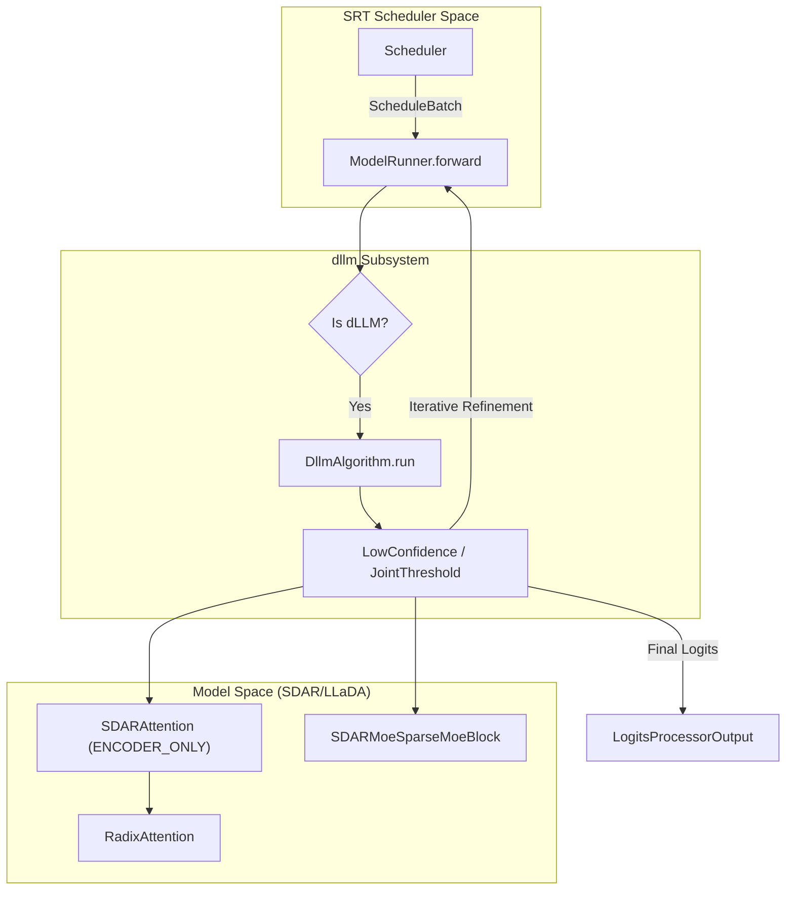

<!-- source: DeepWiki mcp.deepwiki.com · repo microsoft/llm-42 · page 5.5 Diffusion Language Models (dLLMs) · fetched 2026-10-26 -->

# Diffusion Language Models (dLLMs)

Relevant source files

The following files were used as context for generating this wiki page:

- [docs/basic_usage/diffusion.md](docs/basic_usage/diffusion.md)
- [docs/supported_models/extending/index.rst](docs/supported_models/extending/index.rst)
- [docs/supported_models/index.rst](docs/supported_models/index.rst)
- [docs/supported_models/specialized/reward_models.md](docs/supported_models/specialized/reward_models.md)
- [docs/supported_models/text_generation/diffusion_language_models.md](docs/supported_models/text_generation/diffusion_language_models.md)
- [python/sglang/srt/dllm/algorithm/joint_threshold.py](python/sglang/srt/dllm/algorithm/joint_threshold.py)
- [python/sglang/srt/dllm/algorithm/low_confidence.py](python/sglang/srt/dllm/algorithm/low_confidence.py)
- [python/sglang/srt/dllm/config.py](python/sglang/srt/dllm/config.py)
- [python/sglang/srt/models/sdar.py](python/sglang/srt/models/sdar.py)
- [python/sglang/srt/models/sdar_moe.py](python/sglang/srt/models/sdar_moe.py)

Diffusion Language Models (dLLMs) provide a non-autoregressive alternative to standard text generation by employing parallel decoding strategies. Unlike standard Causal LLMs that predict tokens one-by-one, dLLMs often operate on blocks of tokens simultaneously, using masking and iterative refinement. SGLang supports these models through a specialized `dllm` subsystem.

## Overview and Configuration

The `dllm` subsystem is managed via the `DllmConfig` class, which handles algorithm selection and model-specific parameters like `block_size` and `mask_id`.

### DllmConfig
The `DllmConfig` is initialized by extracting metadata from the model's architecture. Supported architectures include `LLaDA2MoeModelLM`, `SDARForCausalLM`, and `SDARMoeForCausalLM` [python/sglang/srt/dllm/config.py:34-38](). 

Key parameters:
*   **`block_size`**: The number of tokens processed in a single diffusion step (e.g., 32 for LLaDA2, 4 for SDAR) [python/sglang/srt/dllm/config.py:35-37]().
*   **`mask_id`**: The specific token ID used to represent masked positions in the diffusion process [python/sglang/srt/dllm/config.py:19]().
*   **`algorithm`**: The decoding strategy (e.g., `LowConfidence`, `JointThreshold`) [python/sglang/srt/dllm/config.py:16]().

Sources: [python/sglang/srt/dllm/config.py:7-75](), [docs/supported_models/text_generation/diffusion_language_models.md:22-52]()

## Supported Algorithms

SGLang implements dLLM logic by overriding the standard generation loop with specialized algorithm classes that inherit from `DllmAlgorithm`.

### 1. LowConfidence
This algorithm iteratively replaces mask tokens based on the model's prediction confidence.
*   **Logic**: It identifies positions with `mask_id`, runs a forward pass, and calculates the softmax probability of the argmax token [python/sglang/srt/dllm/algorithm/low_confidence.py:72-80]().
*   **Thresholding**: Tokens with confidence higher than the `threshold` (default 0.95) are accepted and unmasked [python/sglang/srt/dllm/algorithm/low_confidence.py:21-84]().
*   **Fallback**: If no tokens meet the threshold, it accepts at least one token with the highest confidence to ensure progress [python/sglang/srt/dllm/algorithm/low_confidence.py:86-88]().

### 2. JointThreshold
A more advanced strategy that supports both Mask-to-Token (M2T) and Token-to-Token (T2T) refinement.
*   **M2T Phase**: Similar to LowConfidence, it fills masks based on a `threshold` [python/sglang/srt/dllm/algorithm/joint_threshold.py:98-106]().
*   **T2T Phase**: Allows the model to "edit" already generated tokens if the prediction confidence is high and the new token differs from the current one, controlled by `edit_threshold` [python/sglang/srt/dllm/algorithm/joint_threshold.py:113-117]().
*   **Repetition Penalty**: Supports a 2-gram repetition penalty using `penalty_lambda` to improve output quality [python/sglang/srt/dllm/algorithm/joint_threshold.py:79-83]().

Sources: [python/sglang/srt/dllm/algorithm/low_confidence.py:14-101](), [python/sglang/srt/dllm/algorithm/joint_threshold.py:12-136]()

## Model Architecture Integration

dLLMs in SGLang (like SDAR) utilize standard components but modify the attention mechanism to support non-causal processing.

### SDAR Attention Mechanism
The `SDARAttention` class uses `RadixAttention` with `AttentionType.ENCODER_ONLY` [python/sglang/srt/models/sdar.py:165-173](). This allows the model to attend to all tokens in a block simultaneously rather than being restricted by a causal mask.

### SDAR MoE
For Mixture-of-Experts variants, the `SDARMoeSparseMoeBlock` integrates with SGLang's MoE infrastructure, supporting `TopK` routing and various backends like `deepep` or `fuseep` [python/sglang/srt/models/sdar_moe.py:71-130]().

### Data Flow: Request to dLLM Execution

The following diagram illustrates how a request is routed through the `ModelRunner` into the `dllm` subsystem.

**dLLM Execution Flow**

Sources: [python/sglang/srt/dllm/algorithm/low_confidence.py:56-57](), [python/sglang/srt/models/sdar.py:165-173](), [python/sglang/srt/models/sdar_moe.py:130-148]()

## Integration with SRT Scheduler

The `dllm` subsystem integrates with the SRT scheduler by wrapping the model forward pass. Because diffusion models require multiple iterations for a single "step" of tokens, the `DllmAlgorithm.run` method contains an internal loop that calls `model_runner.forward` multiple times [python/sglang/srt/dllm/algorithm/low_confidence.py:51-56]().

### Request Lifecycle in dLLM
1.  **Input Identification**: The algorithm identifies `mask_id` locations in `forward_batch.input_ids` [python/sglang/srt/dllm/algorithm/low_confidence.py:32]().
2.  **Iterative Decoding**: The algorithm performs up to `block_size` iterations [python/sglang/srt/dllm/algorithm/low_confidence.py:51]().
3.  **KV Cache Persistence**: After the diffusion iterations finish, a final forward pass is often performed to ensure the KV cache is correctly updated for the accepted tokens [python/sglang/srt/dllm/algorithm/joint_threshold.py:127-129]().

**dLLM Component Mapping**
| System Concept | Code Entity | Role |
| :--- | :--- | :--- |
| **Configuration** | `DllmConfig` | Parses `--dllm-algorithm` and YAML configs [python/sglang/srt/dllm/config.py:7](). |
| **Execution** | `DllmAlgorithm` | Base class for iterative decoding logic [python/sglang/srt/dllm/algorithm/base.py](). |
| **Refinement** | `LowConfidence` | Implements threshold-based mask filling [python/sglang/srt/dllm/algorithm/low_confidence.py:14](). |
| **Editing** | `JointThreshold` | Implements M2T and T2T (Token-to-Token) logic [python/sglang/srt/dllm/algorithm/joint_threshold.py:12](). |
| **Attention** | `RadixAttention` | Configured as `ENCODER_ONLY` for parallel processing [python/sglang/srt/models/sdar.py:165](). |

Sources: [python/sglang/srt/dllm/config.py:7-75](), [python/sglang/srt/dllm/algorithm/low_confidence.py:14-101](), [python/sglang/srt/models/sdar.py:165-173]()

---

