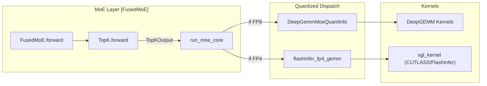

<!-- source: DeepWiki mcp.deepwiki.com · repo microsoft/llm-42 · page 6 Quantization · fetched 2026-10-26 -->

# Quantization

Relevant source files

The following files were used as context for generating this wiki page:

- [python/sglang/jit_kernel/benchmark/bench_gptq_marlin_repack.py](python/sglang/jit_kernel/benchmark/bench_gptq_marlin_repack.py)
- [python/sglang/jit_kernel/csrc/gemm/marlin/gptq_marlin_repack.cuh](python/sglang/jit_kernel/csrc/gemm/marlin/gptq_marlin_repack.cuh)
- [python/sglang/jit_kernel/gptq_marlin_repack.py](python/sglang/jit_kernel/gptq_marlin_repack.py)
- [python/sglang/jit_kernel/tests/test_gptq_marlin_repack.py](python/sglang/jit_kernel/tests/test_gptq_marlin_repack.py)
- [python/sglang/srt/configs/model_config.py](python/sglang/srt/configs/model_config.py)
- [python/sglang/srt/layers/linear.py](python/sglang/srt/layers/linear.py)
- [python/sglang/srt/layers/moe/ep_moe/layer.py](python/sglang/srt/layers/moe/ep_moe/layer.py)
- [python/sglang/srt/layers/moe/fused_moe_triton/fused_moe.py](python/sglang/srt/layers/moe/fused_moe_triton/fused_moe.py)
- [python/sglang/srt/layers/moe/fused_moe_triton/layer.py](python/sglang/srt/layers/moe/fused_moe_triton/layer.py)
- [python/sglang/srt/layers/moe/moe_runner/deep_gemm.py](python/sglang/srt/layers/moe/moe_runner/deep_gemm.py)
- [python/sglang/srt/layers/moe/token_dispatcher/__init__.py](python/sglang/srt/layers/moe/token_dispatcher/__init__.py)
- [python/sglang/srt/layers/moe/token_dispatcher/base.py](python/sglang/srt/layers/moe/token_dispatcher/base.py)
- [python/sglang/srt/layers/moe/token_dispatcher/deepep.py](python/sglang/srt/layers/moe/token_dispatcher/deepep.py)
- [python/sglang/srt/layers/moe/token_dispatcher/standard.py](python/sglang/srt/layers/moe/token_dispatcher/standard.py)
- [python/sglang/srt/layers/moe/topk.py](python/sglang/srt/layers/moe/topk.py)
- [python/sglang/srt/layers/moe/utils.py](python/sglang/srt/layers/moe/utils.py)
- [python/sglang/srt/layers/quantization/__init__.py](python/sglang/srt/layers/quantization/__init__.py)
- [python/sglang/srt/layers/quantization/awq.py](python/sglang/srt/layers/quantization/awq.py)
- [python/sglang/srt/layers/quantization/fp8.py](python/sglang/srt/layers/quantization/fp8.py)
- [python/sglang/srt/layers/quantization/fp8_kernel.py](python/sglang/srt/layers/quantization/fp8_kernel.py)
- [python/sglang/srt/layers/quantization/fp8_utils.py](python/sglang/srt/layers/quantization/fp8_utils.py)
- [python/sglang/srt/layers/quantization/fpgemm_fp8.py](python/sglang/srt/layers/quantization/fpgemm_fp8.py)
- [python/sglang/srt/layers/quantization/gptq.py](python/sglang/srt/layers/quantization/gptq.py)
- [python/sglang/srt/layers/quantization/marlin_utils.py](python/sglang/srt/layers/quantization/marlin_utils.py)
- [python/sglang/srt/layers/quantization/marlin_utils_fp8.py](python/sglang/srt/layers/quantization/marlin_utils_fp8.py)
- [python/sglang/srt/layers/quantization/modelopt_quant.py](python/sglang/srt/layers/quantization/modelopt_quant.py)
- [python/sglang/srt/layers/quantization/utils.py](python/sglang/srt/layers/quantization/utils.py)
- [python/sglang/srt/layers/vocab_parallel_embedding.py](python/sglang/srt/layers/vocab_parallel_embedding.py)
- [python/sglang/srt/models/deepseek_nextn.py](python/sglang/srt/models/deepseek_nextn.py)
- [python/sglang/srt/models/deepseek_v2.py](python/sglang/srt/models/deepseek_v2.py)
- [python/sglang/test/test_block_fp8.py](python/sglang/test/test_block_fp8.py)
- [sgl-kernel/python/sgl_kernel/fused_moe.py](sgl-kernel/python/sgl_kernel/fused_moe.py)
- [sgl-kernel/python/sgl_kernel/scalar_type.py](sgl-kernel/python/sgl_kernel/scalar_type.py)
- [sgl-kernel/tests/test_marlin_repack.py](sgl-kernel/tests/test_marlin_repack.py)

SGLang provides a flexible and high-performance quantization framework designed to reduce the memory footprint and increase the inference throughput of Large Language Models (LLMs). The system supports a wide array of quantization formats ranging from standard INT8 and FP8 to specialized sub-byte formats like FP4 and MXFP4, with optimized kernels for diverse hardware backends including NVIDIA, AMD, and Ascend.

### Framework Architecture

The quantization subsystem is built around a pluggable configuration and method registry. The `ModelConfig` class identifies the quantization method from the model's metadata or server arguments [python/sglang/srt/configs/model_config.py:96-114](). This configuration is then used by individual layers to instantiate specific `QuantizeMethodBase` implementations [python/sglang/srt/layers/linear.py:170-176]().

#### Quantization Logic Flow
The following diagram illustrates how a model's quantization configuration flows from initialization to kernel execution.

**Diagram: Quantization Configuration to Kernel Dispatch**

```mermaid
graph TD
    subgraph "Initialization"
        A["ModelConfig"] -- "quantization string" --> B["get_quantization_config"]
        B -- "returns" --> C["QuantizationConfig (e.g., Fp8Config)"]
    end

    subgraph "Layer Construction"
        D["LinearBase / FusedMoE"] -- "calls" --> E["QuantizationConfig.get_quant_method"]
        E -- "returns" --> F["QuantizeMethodBase (e.g., Fp8LinearMethod)"]
    end

    subgraph "Execution"
        G["LinearBase.forward"] -- "calls" --> H["QuantizeMethodBase.apply"]
        H -- "dispatches" --> I["Custom Kernels (Triton/CUDA/DeepGEMM)"]
    end

    style A stroke-dasharray: 5 5
    style I stroke-width:4px
```

Sources: [python/sglang/srt/layers/quantization/__init__.py:91-98](), [python/sglang/srt/layers/linear.py:152-177](), [python/sglang/srt/configs/model_config.py:107-114]()

### Supported Quantization Methods

SGLang maintains a registry of supported methods in `BASE_QUANTIZATION_METHODS` [python/sglang/srt/layers/quantization/__init__.py:53-78](). These are categorized into three primary groups:

| Category | Formats | Key Classes |
| :--- | :--- | :--- |
| **Activation & Weight** | FP8 (E4M3FN), INT8 (W8A8), MXFP8 | `Fp8Config`, `W8A8Int8Config`, `BlockInt8Config` |
| **Weight-Only** | AWQ, GPTQ, Marlin, GGUF, BitsAndBytes | `AWQConfig`, `GPTQConfig`, `GPTQMarlinConfig` |
| **Specialized/Next-Gen** | NVFP4, MXFP4 (Blackwell), Quark | `ModelOptFp4Config`, `Mxfp4Config`, `QuarkConfig` |

### Mixture-of-Experts (MoE) Quantization

Quantization is deeply integrated into the MoE subsystem via the `FusedMoE` layer [python/sglang/srt/layers/moe/fused_moe_triton/layer.py:156-188](). For high-performance MoE inference (e.g., DeepSeek-V3), SGLang supports specialized kernels such as **DeepGEMM** and **DeepEP** which handle FP8 and block-wise quantization with low-latency dispatch [python/sglang/srt/layers/moe/ep_moe/layer.py:114-136]().

**Diagram: MoE Quantization Integration**

Sources: [python/sglang/srt/layers/moe/fused_moe_triton/layer.py:156-188](), [python/sglang/srt/layers/moe/ep_moe/layer.py:182-197](), [python/sglang/srt/layers/quantization/modelopt_quant.py:134-142]()

---

### 6.1 FP8, INT8, and Block-wise Quantization
This section covers high-precision quantization schemes that typically involve both weight and activation scaling.
* **FP8 Support**: Includes support for standard `E4M3FN` and `E4M3FNUZ` (ROCm) dtypes [python/sglang/srt/layers/quantization/fp8_kernel.py:97-102]().
* **Block-wise Scaling**: Supports per-block quantization (e.g., 1x32 blocks) often used in MXFP8 and compressed tensors [python/sglang/srt/layers/quantization/fp8.py:130-148]().
* **Kernels**: Utilizes Triton-based scaled matmuls and DeepGEMM for Hopper-class GPUs [python/sglang/srt/layers/quantization/fp8_utils.py:182-198]().

For details, see [FP8, INT8, and Block-wise Quantization](#6.1).

### 6.2 FP4, GPTQ, AWQ, and Other Formats
This section covers weight-only quantization and next-generation sub-byte formats.
* **FP4 (NVFP4/MXFP4)**: Optimized for NVIDIA Blackwell (SM100) and newer architectures using `ModelOpt` and `FlashInfer` backends [python/sglang/srt/layers/quantization/modelopt_quant.py:158-187]().
* **Weight-Only**: Integration with `AWQ` and `GPTQ` via Marlin kernels for high-speed dequantization during the decode phase [python/sglang/srt/layers/linear.py:54-74]().
* **Packing**: Logic for packing sub-byte weights (e.g., 2 FP4 values per byte) to satisfy alignment constraints [python/sglang/srt/layers/quantization/modelopt_quant.py:167-187]().

For details, see [FP4, GPTQ, AWQ, and Other Formats](#6.2).

---

