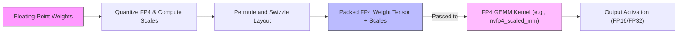
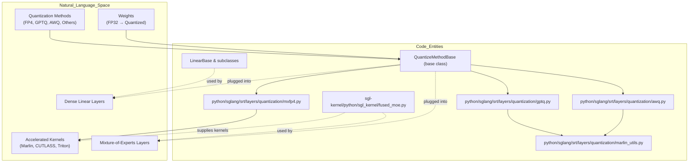
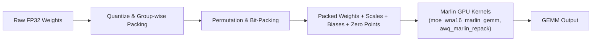

<!-- source: DeepWiki mcp.deepwiki.com · repo microsoft/llm-42 · page 6.2 FP4, GPTQ, AWQ, and Other Formats · fetched 2026-10-26 -->

# FP4, GPTQ, AWQ, and Other Formats

Relevant source files

The following files were used as context for generating this wiki page:

- [python/sglang/jit_kernel/benchmark/bench_gptq_marlin_repack.py](python/sglang/jit_kernel/benchmark/bench_gptq_marlin_repack.py)
- [python/sglang/jit_kernel/csrc/gemm/marlin/gptq_marlin_repack.cuh](python/sglang/jit_kernel/csrc/gemm/marlin/gptq_marlin_repack.cuh)
- [python/sglang/jit_kernel/gptq_marlin_repack.py](python/sglang/jit_kernel/gptq_marlin_repack.py)
- [python/sglang/jit_kernel/tests/test_gptq_marlin_repack.py](python/sglang/jit_kernel/tests/test_gptq_marlin_repack.py)
- [python/sglang/srt/function_call/hermes_detector.py](python/sglang/srt/function_call/hermes_detector.py)
- [python/sglang/srt/layers/moe/fused_moe_triton/triton_kernels_moe.py](python/sglang/srt/layers/moe/fused_moe_triton/triton_kernels_moe.py)
- [python/sglang/srt/layers/quantization/awq.py](python/sglang/srt/layers/quantization/awq.py)
- [python/sglang/srt/layers/quantization/fpgemm_fp8.py](python/sglang/srt/layers/quantization/fpgemm_fp8.py)
- [python/sglang/srt/layers/quantization/gptq.py](python/sglang/srt/layers/quantization/gptq.py)
- [python/sglang/srt/layers/quantization/marlin_utils.py](python/sglang/srt/layers/quantization/marlin_utils.py)
- [python/sglang/srt/layers/quantization/marlin_utils_fp8.py](python/sglang/srt/layers/quantization/marlin_utils_fp8.py)
- [python/sglang/srt/layers/quantization/mxfp4.py](python/sglang/srt/layers/quantization/mxfp4.py)
- [python/sglang/srt/layers/quantization/unquant.py](python/sglang/srt/layers/quantization/unquant.py)
- [python/sglang/srt/layers/quantization/utils.py](python/sglang/srt/layers/quantization/utils.py)
- [python/sglang/srt/managers/scheduler_profiler_mixin.py](python/sglang/srt/managers/scheduler_profiler_mixin.py)
- [python/sglang/srt/model_loader/utils.py](python/sglang/srt/model_loader/utils.py)
- [python/sglang/srt/models/bailing_moe.py](python/sglang/srt/models/bailing_moe.py)
- [python/sglang/srt/models/gpt_oss.py](python/sglang/srt/models/gpt_oss.py)
- [python/sglang/srt/models/llada2.py](python/sglang/srt/models/llada2.py)
- [python/sglang/srt/models/longcat_flash.py](python/sglang/srt/models/longcat_flash.py)
- [python/sglang/srt/models/longcat_flash_nextn.py](python/sglang/srt/models/longcat_flash_nextn.py)
- [python/sglang/srt/models/step3_vl.py](python/sglang/srt/models/step3_vl.py)
- [python/sglang/srt/models/step3_vl_10b.py](python/sglang/srt/models/step3_vl_10b.py)
- [python/sglang/srt/multimodal/processors/step3_vl.py](python/sglang/srt/multimodal/processors/step3_vl.py)
- [python/sglang/srt/multiplex/multiplexing_mixin.py](python/sglang/srt/multiplex/multiplexing_mixin.py)
- [python/sglang/srt/multiplex/pdmux_context.py](python/sglang/srt/multiplex/pdmux_context.py)
- [python/sglang/srt/utils/profile_utils.py](python/sglang/srt/utils/profile_utils.py)
- [sgl-kernel/benchmark/bench_dsv3_fused_a_gemm.py](sgl-kernel/benchmark/bench_dsv3_fused_a_gemm.py)
- [sgl-kernel/benchmark/bench_fp8_gemm.py](sgl-kernel/benchmark/bench_fp8_gemm.py)
- [sgl-kernel/csrc/gemm/dsv3_fused_a_gemm.cu](sgl-kernel/csrc/gemm/dsv3_fused_a_gemm.cu)
- [sgl-kernel/csrc/gemm/fp8_blockwise_gemm_kernel.cu](sgl-kernel/csrc/gemm/fp8_blockwise_gemm_kernel.cu)
- [sgl-kernel/csrc/gemm/fp8_gemm_kernel.cu](sgl-kernel/csrc/gemm/fp8_gemm_kernel.cu)
- [sgl-kernel/csrc/gemm/int8_gemm_kernel.cu](sgl-kernel/csrc/gemm/int8_gemm_kernel.cu)
- [sgl-kernel/csrc/gemm/math.hpp](sgl-kernel/csrc/gemm/math.hpp)
- [sgl-kernel/csrc/gemm/nvfp4_expert_quant.cu](sgl-kernel/csrc/gemm/nvfp4_expert_quant.cu)
- [sgl-kernel/csrc/gemm/nvfp4_quant.cuh](sgl-kernel/csrc/gemm/nvfp4_quant.cuh)
- [sgl-kernel/csrc/gemm/nvfp4_quant_entry.cu](sgl-kernel/csrc/gemm/nvfp4_quant_entry.cu)
- [sgl-kernel/csrc/gemm/nvfp4_quant_kernels.cu](sgl-kernel/csrc/gemm/nvfp4_quant_kernels.cu)
- [sgl-kernel/csrc/gemm/nvfp4_scaled_mm_entry.cu](sgl-kernel/csrc/gemm/nvfp4_scaled_mm_entry.cu)
- [sgl-kernel/csrc/gemm/nvfp4_scaled_mm_kernels.cu](sgl-kernel/csrc/gemm/nvfp4_scaled_mm_kernels.cu)
- [sgl-kernel/csrc/moe/nvfp4_blockwise_moe.cu](sgl-kernel/csrc/moe/nvfp4_blockwise_moe.cu)
- [sgl-kernel/python/sgl_kernel/fused_moe.py](sgl-kernel/python/sgl_kernel/fused_moe.py)
- [sgl-kernel/python/sgl_kernel/scalar_type.py](sgl-kernel/python/sgl_kernel/scalar_type.py)
- [sgl-kernel/tests/test_dsv3_fused_a_gemm.py](sgl-kernel/tests/test_dsv3_fused_a_gemm.py)
- [sgl-kernel/tests/test_fp4_gemm.py](sgl-kernel/tests/test_fp4_gemm.py)
- [sgl-kernel/tests/test_fp4_quantize.py](sgl-kernel/tests/test_fp4_quantize.py)
- [sgl-kernel/tests/test_fp8_gemm.py](sgl-kernel/tests/test_fp8_gemm.py)
- [sgl-kernel/tests/test_marlin_repack.py](sgl-kernel/tests/test_marlin_repack.py)

This page explains the advanced weight-only quantization schemes supported by LLM-42, including NVFP4/MXFP4 (Blackwell), GPTQ/Marlin, and AWQ, as well as other formats like torchao. It details the key implementation patterns such as the `QuantizeMethodBase` interface, weight packing, and the integration of accelerated kernels like Marlin for GPTQ and AWQ methods. These formats provide high compression rates with efficient execution for large language models (LLMs) within the SGLang runtime.

---

## 1. Purpose and Scope

Quantization reduces model size and inference latency by compressing the large floating-point weight tensors into lower-bit representations with minimal accuracy loss. LLM-42 supports various advanced quantization schemes with specialized GPU kernels and dispatch logic:

- **FP4 formats:** NVFP4 (NVIDIA Blackwell architecture) and MXFP4 (AMD) use floating-point 4-bit weights for highly efficient GEMMs.
- **GPTQ and Marlin:** Post-training quantization schemes using group-wise learned quantization parameters with support for fused kernels (Marlin).
- **AWQ:** Automatic Weight Quantization, a method similar to GPTQ, optimized with Marlin kernel support.
- **Torchao and others:** Additional emerging or backend-specific quantization approaches.
  
The system implements these using a unified abstract interface modeling quantization methods, enabling flexible integration into layers such as linear or MoE expert blocks.

---

## 2. Quantization Method Abstraction: `QuantizeMethodBase`

All quantization methods implement or inherit from the `QuantizeMethodBase` class defined in the `srt.layers.quantization.base_config` module. This base interface enforces consistent initialization, weight creation, transformation, and applying quantized GEMM layers.

Key aspects:

- **Weight creation:** Per-method logic to create compressed and scaled weight parameters, biases, scales, zero points, and possible permutation indices for layout transformations.
- **Weight packing:** Methods prepare weights in optimized layouts for specific backend kernels (e.g., packed 4-bit formats for FP4, custom packing for Marlin).
- **Compute dispatch:** Each method overrides `apply` to invoke method-specific quantized GEMM compute kernels.
- **MoE support:** Specialized fused MoE linear layers implement quantization-aware fused computations with efficient dispatch.

This pattern centralizes quantization format differences while preserving a consistent API for the model code to invoke.

Sources: `python/sglang/srt/layers/quantization/base_config.py:25-190`(), `python/sglang/srt/layers/quantization/unquant.py:65-185`(), `python/sglang/srt/layers/quantization/awq.py:88-178`(), `python/sglang/srt/layers/quantization/gptq.py:115-190`()

---

## 3. FP4: NVFP4 (Blackwell) and MXFP4 Formats

### 3.1 Overview

FP4 formats use 4-bit floating-point representations for weights, leveraging modern GPU support:

- **NVFP4:** NVIDIA's NVFP4 format for Blackwell GPUs, integrating tightly with cutlass kernels.
- **MXFP4:** AMD’s MXFP4 format is licensed Apache-2.0 and originally adapted from the vLLM project.

These formats encode weights as 4-bit mantissa + exponent layouts, with associated scale tensors for dequantization during inference.

### 3.2 Implementation Highlights

- Quantization and dequantization are handled by native operators from AMD's `amd-quark` package or NVIDIA-specific CUDA kernels.
- Tensor layouts are carefully permuted and swizzled to maximize throughput on the underlying architecture.
- The `_swizzle_mxfp4` function transforms the quantized weight and scale tensors into efficient layouts supported by the OAI MXFP4 kernel.
- The `dequant_mxfp4` function is registered as a custom PyTorch op that supports automatic differentiation and fallback to a fake implementation for testing.
- Triton kernels and FlashInfer are conditionally integrated for runtime acceleration.
- The system caches permute indices for the weight layout transformations to optimize repeated operations on the same shapes/devices.

### 3.3 Key Functions and Classes

- `_get_flashinfer_mxfp4_device_permute_indices(x, epilogue_tile_m, num_elts_per_sf)`: Returns cached permute indices for MXFP4 layout transform.
- `dequant_mxfp4(x, scale, float_dtype)`: Custom op for FP4 dequantization.
- `quant_dequant_mxfp4(x, scale_calculation_mode='even')`: Quantizes then immediately dequantizes with FP4.
- `_swizzle_mxfp4(quant_tensor, scale, num_warps)`: Applies internal layout transformations for MXFP4 optimized GEMM.

### 3.4 Data Flow

A floating-point weight tensor is quantized into 4-bit FP4 tensors with corresponding scale factors. These quantized weights are swizzled and permuted to the kernel-friendly layout. At inference, the FP4 weights are dequantized on-the-fly during GEMM calls to float16/float32 for matrix multiplication.

Sources: `python/sglang/srt/layers/quantization/mxfp4.py:1-190`()

---

## 4. GPTQ and Marlin Quantization

### 4.1 Overview

GPTQ (Group-wise Post-Training Quantization) is a popular 2/3/4-bit quantization method that quantizes weights group-wise with learned scales and zero points, delivering efficient model compression with minimal accuracy loss.

**Marlin** is an optimized kernel and weight repacking format supporting GPTQ quantized models, enabling fused sparse/unstructured matrix operations in MoE and dense layers.

### 4.2 Key Classes and Config

- **GPTQConfig (class):** Defines bit width, group size, activation types, dynamic layer configuration, and checkpoint format.
- **MarlinLinearLayerConfig (dataclass):** Holds physical and logical weight shapes, quant types, zero point flags, and group info.

### 4.3 Weight Packing and Repacking

- Weights are stored with associated scales, zero points, and permutation indices for efficient gather/scatter in kernels.
- The `gptq_marlin_repack` kernel repacks weights into Marlin format for fused MoE or dense operations.
- The `gptq_marlin_moe_repack` function repacks an entire batch of expert weights.
- Scale and zero point permutations ensure layout consistency across tensor parallel ranks.

### 4.4 Kernel Integration

- When quantized with GPTQConfig, the runtime calls `apply_gptq_marlin_linear` to dispatch fused Marlin quantized GEMM for linear layers.
- In MoE fused layers, GPTQMarlinConfig orchestrates the per-expert quantized weights with permutations, scale replications, and workspace allocation.
- Conditional support for CUDA (via `sgl_kernel.gptq_gemm`) and NPU backends.

### 4.5 Data Flow Diagram

```mermaid
flowchart LR
    A["Floating-Point Weights"] --> B["Group-wise Quantization (GPTQ)"]
    B --> C["Generate Scales, Zero Points, Permutations"]
    C --> D["Repack Weights to Marlin Format"]
    D --> E["Marlin-Format Packed Weights"]
    E -->|Used by| F["Fused GPTQ Marlin GEMM Kernel"]
    F --> G["Output Activation (FP16)"]

    style A fill:#f9f,stroke:#333,stroke-width:1px
    style D fill:#bbf,stroke:#333,stroke-width:1px
    style F fill:#fbf,stroke:#333,stroke-width:1px
```

### 4.6 Code Highlights

- `check_marlin_format`: Checks if loaded quant config is Marlin compatible.
- `gptq_marlin_moe_repack`: Repack function using CUDA kernels for batched expert weights.
- Class `GPTQConfig` specifying group sizes, bits, and other parameters.
- Functions for scale permutation and zero-point handling (`marlin_permute_scales`, `marlin_zero_points`).
- Overloaded linear apply: `apply_gptq_marlin_linear` that invokes the marlin GEMM kernels.

Sources: `python/sglang/srt/layers/quantization/gptq.py:1-200`(), `sgl-kernel/python/sgl_kernel/fused_moe.py:1-64`(), `python/sglang/srt/layers/quantization/marlin_utils.py:1-270`()

---

## 5. AWQ: Automatic Weight Quantization

### 5.1 Overview

AWQ is another 4-bit quantization method similar to GPTQ but with some architectural differences. It supports zero points and group-wise quantization with optimized fused kernels for both dense linear layers and MoE fused layers.

AWQ integrates tightly with the Marlin format and kernels when running on compatible hardware.

### 5.2 AWQ Config and Implementation

- The `AWQConfig` class inherits `QuantizationConfig` and defines configuration parameters including weight bits, group size, zero point usage, and layers to exclude from quantization.
- The `AWQMarlinConfig` extends for Marlin format specifics.
- During layer construction, the quantization method returns AWQLinear or AWQMoE methods depending on the target layer.
- On CUDA, the fused Marlin kernels `awq_marlin_repack` and `awq_marlin_moe_repack` handle repacking.
- On HIP, specialized triton-implemented `awq_dequantize_triton` kernel is used.
- For NPU platforms, dedicated hardware-aware AWQ methods `AWQLinearAscendMethod` and `AWQMoEAscendMethod` are implemented.

### 5.3 Weight Packing and Kernel Flow

- AWQ weights are packed akin to GPTQ, with zero points optionally enabled.
- The `awq_to_marlin_zero_points` function converts AWQ zero points to the Marlin zero-point format.
- Fused linear and MoE forward passes apply quant-dequant operations with zero points and scales.
- Layer skipping facilities allow selective layer quantization.

### 5.4 Data Flow Diagram

```mermaid
flowchart LR
    A["FP32 Weights"] --> B["AWQ Group-wise Quantization"]
    B --> C["Generate Scales and Zero Points"]
    C --> D["Repack to Marlin AWQ Format"]
    D --> E["Packed AWQ Weights + Zero Points"]
    E -->|Passed to| F["AWQ Marlin Fused GEMM Kernels"]
    F --> G["Layer Output (FP16/FP32)"]

    style A fill:#f9f,stroke:#333,stroke-width:1px
    style D fill:#bbf,stroke:#333,stroke-width:1px
    style F fill:#fbf,stroke:#333,stroke-width:1px
```

Sources: `python/sglang/srt/layers/quantization/awq.py:1-180`(), `sgl-kernel/python/sgl_kernel/fused_moe.py:1-64`(), `python/sglang/srt/layers/quantization/marlin_utils.py:280-350`()

---

## 6. Other Quantization Formats and Utilities

### 6.1 Torchao and General Utilities

The codebase integrates various utilities for quantization across formats:

- `replace_parameter`: Safely replaces model parameters with quantized or packed tensors, ensuring compatibility with TorchScript and `torch.compile`.
- `per_tensor_dequantize`: Helper for scalar scale-based dequantization.
- `is_layer_skipped`: Logic to skip quantization for certain layers or fused shards (e.g., fused gates) based on layer names.
- `all_close_1d`: Checks numerical closeness for 1D tensors, useful in testing quantization fidelity.
- `requantize_with_max_scale`: Requantizes weight blocks based on maximum scales for consistent inference.
- Environment-driven toggles to enable CPU-specific AMX instructions, HIP acceleration, and NVIDIA GPU architectures.

These are used internally by quantization methods to adapt weights and automate conversions.

### 6.2 Marlin Utilities

In addition to kernel interfacing, utilities to support Marlin's complex weight format and kernel dispatch include:

- Workspace preallocation logic.
- Scales and zero points permutation functions for tensor parallelism.
- Verification of shape compatibility and kernel support on runtime target architecture.
  
These utilities are critical for seamless integration of GPTQ/AWQ quantized weights with fused MoE kernels.

Sources: `python/sglang/srt/layers/quantization/utils.py:1-200`(), `python/sglang/srt/layers/quantization/marlin_utils.py:1-350`()

---

## 7. Integration with MoE and Linear Layers

Quantized weights are extensively used in both dense linear and Mixture-of-Experts (MoE) layers in the model architectures:

- Fused MoE layers implement `FusedMoEMethodBase` subclasses for each quantization method, handling per-expert packed weights.
- Quantization-aware linear layers are implemented as subclasses of `LinearMethodBase` or `UnquantizedLinearMethod` for fallback.
- MoE fused kernels, like `moe_wna16_marlin_gemm`, receive parameters such as quantized weights, biases, scales, zero points, permutation indices, and workspace buffers, alongside expert token sorting and grouping metadata.
- The dispatching logic seamlessly adapts for tensor parallelism, expert parallelism, and device specifics.

### Diagram: Natural Language Concepts to Code Entities

Sources: The entire cluster including `mxfp4.py`, `gptq.py`, `awq.py`, `marlin_utils.py`, `fused_moe.py`()

---

## 8. Weight Packing and Kernel Calls

### 8.1 Weight Packing

To optimize GPU memory layout and kernel performance, weights are reordered and packed.

- GPTQ/AWQ schemes pack weight bits densely into 32-bit blocks, aligned with gemm kernel requirements.
- Permutation indices reorder quantization groups to align with kernel tiling.
- Biases, scales, and optional zero points are stored as grouped tensors.
- For MoE, batched repacking is done per expert to support fused API calls requiring contiguous expert weight views.

### 8.2 Marlin Kernel Integration

- Custom CUDA kernels from the sgl-kernel project provide fused GEMMs for quantized matrix multiply.
- E.g., `moe_wna16_marlin_gemm` accepts quantized weight tensors plus scale/zero point parameters and executes optimized blockwise GEMM with fused postprocessing.
- The marlin kernel supports tensor parallelism, expert selection top-k weighting, zero point float or integer arithmetic, and atomic accumulation options.

### Diagram: Weight Packing to Kernel Application

Sources: `sgl-kernel/python/sgl_kernel/fused_moe.py:1-64`(), `python/sglang/srt/layers/quantization/gptq.py:85-110`(), `python/sglang/srt/layers/quantization/awq.py:62-120`()

---

## 9. Summary

The LLM-42 codebase supports advanced weight-only quantization formats including:

| Format           | Purpose                                        | Key Implementation Files/Classes                      | Notes                                    |
|------------------|------------------------------------------------|------------------------------------------------------|------------------------------------------|
| NVFP4/MXFP4      | 4-bit floating point quantization for GPUs     | `mxfp4.py`, FlashInfer, Triton kernels               | Originates from AMD Blackwell & NVIDIA  |
| GPTQ + Marlin    | 2/3/4-bit group-wise post-training quantization | `gptq.py`, `marlin_utils.py`, `fused_moe.py` kernels | Uses Marlin repack format and fused GEMM |
| AWQ              | 4-bit quantization with zero points             | `awq.py`, `marlin_utils.py`, fused kernels            | Supports CUDA/HIP/NPU backends           |
| Unquantized Base | Baseline no-quantization fallback               | `unquant.py`                                          | Supports linear and MoE layers           |

These schemes fit into a consistent pattern of quantization methods implementing the `QuantizeMethodBase` interface, handling weight packing, scale/zero point management, and kernel dispatch.

This design enables flexible model loading, dynamic quant or dequant dispatch and efficient inference across multiple hardware platforms.

---

# Appendix: Key Files Reference

| File Path                                  | Description                                   |
|--------------------------------------------|-----------------------------------------------|
| `python/sglang/srt/layers/quantization/mxfp4.py` | FP4 quantization (NVFP4/MXFP4) implementations and tensor layout transforms |
| `python/sglang/srt/layers/quantization/gptq.py`  | GPTQ quantization configuration, repacking, kernel dispatch |
| `python/sglang/srt/layers/quantization/awq.py`   | AWQ quantization with Marlin format and kernels |
| `python/sglang/srt/layers/quantization/marlin_utils.py` | Marlin utility functions for scale perf, zero points, shape checks |
| `sgl-kernel/python/sgl_kernel/fused_moe.py`       | CUDA kernel wrappers for fused MoE operations with GPTQ/AWQ/Marlin |
| `python/sglang/srt/layers/quantization/unquant.py` | Unquantized linear and MoE methods fallback |

---

# References

- `python/sglang/srt/layers/quantization/mxfp4.py:1-190`  
- `python/sglang/srt/layers/quantization/gptq.py:1-190`  
- `python/sglang/srt/layers/quantization/awq.py:1-180`  
- `python/sglang/srt/layers/quantization/marlin_utils.py:1-350`  
- `sgl-kernel/python/sgl_kernel/fused_moe.py:1-64`  
- `python/sglang/srt/layers/quantization/base_config.py:25-190`  
- `python/sglang/srt/layers/quantization/utils.py:1-200`  
- `python/sglang/srt/layers/quantization/unquant.py:65-185`

---

