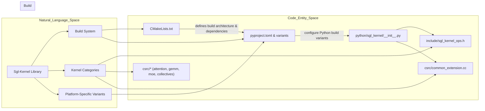

<!-- source: DeepWiki mcp.deepwiki.com · repo microsoft/llm-42 · page 7 sgl-kernel: Custom CUDA/C++ Kernels · fetched 2026-10-26 -->

# 7. sgl-kernel: Custom CUDA/C++ Kernels

Relevant source files

The following files were used as context for generating this wiki page:

- [docker/Dockerfile](docker/Dockerfile)
- [docker/xeon.Dockerfile](docker/xeon.Dockerfile)
- [docker/xpu.Dockerfile](docker/xpu.Dockerfile)
- [docs/platforms/cpu_server.md](docs/platforms/cpu_server.md)
- [docs/platforms/xpu.md](docs/platforms/xpu.md)
- [python/sglang/srt/layers/quantization/int8_kernel.py](python/sglang/srt/layers/quantization/int8_kernel.py)
- [sgl-kernel/CMakeLists.txt](sgl-kernel/CMakeLists.txt)
- [sgl-kernel/Makefile](sgl-kernel/Makefile)
- [sgl-kernel/benchmark/bench_per_token_group_quant_8bit.py](sgl-kernel/benchmark/bench_per_token_group_quant_8bit.py)
- [sgl-kernel/csrc/common_extension.cc](sgl-kernel/csrc/common_extension.cc)
- [sgl-kernel/csrc/gemm/per_token_group_quant_8bit.cu](sgl-kernel/csrc/gemm/per_token_group_quant_8bit.cu)
- [sgl-kernel/csrc/moe/moe_fused_gate.cu](sgl-kernel/csrc/moe/moe_fused_gate.cu)
- [sgl-kernel/include/sgl_kernel_ops.h](sgl-kernel/include/sgl_kernel_ops.h)
- [sgl-kernel/pyproject.toml](sgl-kernel/pyproject.toml)
- [sgl-kernel/pyproject_cpu.toml](sgl-kernel/pyproject_cpu.toml)
- [sgl-kernel/pyproject_rocm.toml](sgl-kernel/pyproject_rocm.toml)
- [sgl-kernel/python/sgl_kernel/__init__.py](sgl-kernel/python/sgl_kernel/__init__.py)
- [sgl-kernel/python/sgl_kernel/elementwise.py](sgl-kernel/python/sgl_kernel/elementwise.py)
- [sgl-kernel/python/sgl_kernel/gemm.py](sgl-kernel/python/sgl_kernel/gemm.py)
- [sgl-kernel/python/sgl_kernel/moe.py](sgl-kernel/python/sgl_kernel/moe.py)
- [sgl-kernel/python/sgl_kernel/test_utils.py](sgl-kernel/python/sgl_kernel/test_utils.py)
- [sgl-kernel/python/sgl_kernel/version.py](sgl-kernel/python/sgl_kernel/version.py)
- [sgl-kernel/tests/test_moe_fused_gate.py](sgl-kernel/tests/test_moe_fused_gate.py)
- [sgl-kernel/tests/test_per_token_group_quant_8bit.py](sgl-kernel/tests/test_per_token_group_quant_8bit.py)

The `sgl-kernel` sub-project provides a comprehensive suite of highly optimized custom CUDA and C++ kernels to support core operations within the LLM-42 inference stack. These kernels enable advanced numerical techniques and efficient handling of complex GPU workloads for large language models, facilitating deterministic inference with high throughput and low latency. The codebase targets current NVIDIA GPU architectures and extends to support multiple platforms and specialized numerical formats like FP8 and INT8.

This section serves as a high-level overview of the `sgl-kernel` project’s scope and organization. For detailed discussions of individual components such as the build system, kernel implementations, and platform-specific adaptations, please consult the respective child pages.

---

## Overview of `sgl-kernel`

The `sgl-kernel` library encapsulates:
- Core CUDA and C++ kernel implementations underlying essential transformer operations.
- Support for multiple numerical precisions and quantization schemes (FP8, INT8, FP4).
- Optimized routines for matrix multiplications, attention mechanisms, mixture-of-experts (MoE) fusion, and collective operations.
- A Python binding layer exposing these kernels as callable operations via `torch.ops.sgl_kernel`.
- Platform detection and multi-architecture support to tailor compilation.

This sub-project is vital to LLM-42's deterministic and efficient decoding pipeline by providing the specialized compute primitives that accelerate key inference computations without sacrificing reproducibility or precision.

---

## Build System and Architecture

The `sgl-kernel` package employs a modern CMake-based build system which integrates with `scikit-build-core` for seamless Python packaging. The build system auto-detects the target GPU architecture (Ampere, Hopper, Blackwell) using runtime queries (`nvidia-smi`) and compiles targeted binaries to leverage architecture-specific features like tensor cores and specialized FP8 support.

It supports building multiple platform variants via separate `pyproject.toml` configurations, allowing deployment on CUDA-enabled NVIDIA GPUs, AMD ROCm platforms, CPUs, and Ascend NPUs. The Python wrapper implements dynamic dispatching to load the correct architecture-specific kernel binaries at runtime.

This modular build strategy ensures that only relevant CUDA kernels are compiled and packaged, optimizing build times and runtime performance.

More details on the build workflows, GPU family detection heuristics, and multi-platform packaging can be found in the child page:

- [Kernel Build System and Architecture](#7.1)

---

## Kernel Implementation Categories

`sgl-kernel` hosts a rich set of kernels organized into several main categories:

### Attention Kernels
- Implementations of FlashAttention variants (FA3, FA4).
- Multi-Head Latent Attention (MLA) kernels implemented via CUTLASS integration, enabling efficient fused decoding operations with split KV caches.
- Rotary embeddings and RMS normalization kernels tuned for batch invariance.

### GEMM and Quantized Matrix Multiplication
- GEMM kernels optimized for various numeric types: FP8 (E4M3FN, MXFP8), INT8 (W8A8), FP4 (Blackwell).
- Block-wise scaling and grouped quantization support for fine-grained precision control.
- GPTQ and AWQ compatible kernels for weight-only quantization.

### Mixture-of-Experts (MoE) Kernels
- Fused gating kernels supporting hierarchical top-k expert selection.
- Efficient grouped and block-wise scaled GEMMs for expert computation.
- Integration with MoE routing tensors and output summation.

### Collective Communication and Synchronization Kernels
- Custom all-reduce implementations via MSCCLPP for distributed memory models.
- IPC handle registration and meta-buffer management for GPU communicators.

All these kernels are exposed through a unified C++ interface in `include/sgl_kernel_ops.h` which binds kernel entrypoints to Torch custom operators in the `torch.ops.sgl_kernel` namespace. This structure enables straightforward use from PyTorch runtime with Python bindings, abstracting away low-level details.

For an in-depth look at kernel implementations and their interfaces, refer to our detailed presentation in:

- [Kernel Implementations: Attention, GEMM, MoE, and Collective Ops](#7.2)

---

## Platform-Specific Variants and Extensions

While the core `sgl-kernel` focuses strongly on NVIDIA CUDA, it is designed to be extensible and multi-platform.

Child projects and build variants include:
- ROCm backend for AMD GPUs implementing equivalent kernels with HIP translations.
- CPU kernels compiled into `sglang-kernel-cpu` to enable CPU-only inference execution.
- Experimental support for Huawei Ascend NPUs.
- Variants integrating platform-specific optimizations, including thread binding and architectural feature toggles.

This multi-platform strategy guarantees broad hardware support and helps LLM-42 achieve portable performance across different deployment targets.

More information about platform-specific kernel builds, supported architectures, and dispatching can be found at:

- [Kernel Build System and Architecture](#7.1)
- Platform-specific documentation elsewhere in the wiki (e.g. AMD ROCm, Intel XPU, Ascend NPU)

---

## Relationship Between `sgl-kernel` Components and Code Entities

Below is a high-level diagram linking natural language sub-project concepts to corresponding code entities to help navigate the codebase effectively.

---

## Summary

The `sgl-kernel` sub-project is foundational to delivering the high-performance, deterministic inference capabilities of the LLM-42 system. It provides:

- A rich selection of custom CUDA/C++ kernels for attention, quantized GEMM, MoE fusion, and collectives.
- A versatile, architecture-aware build system with multi-platform Python packaging.
- Python bindings through Torch’s extension API exposing kernels under a unified namespace.

To explore the build details and platform support, visit the child page:

- [Kernel Build System and Architecture](#7.1)

To study the vast array of kernel implementations and their interfaces, see:

- [Kernel Implementations: Attention, GEMM, MoE, and Collective Ops](#7.2)

---

Sources:  
- `sgl-kernel/CMakeLists.txt:1-210`  
- `sgl-kernel/include/sgl_kernel_ops.h:1-33000` (summary of interface)  
- `sgl-kernel/python/sgl_kernel/__init__.py:1-154`  
- `sgl-kernel/python/sgl_kernel/moe.py:1-260`  
- `sgl-kernel/python/sgl_kernel/elementwise.py:1-145`  
- `sgl-kernel/csrc/common_extension.cc:1-150`  
- `sgl-kernel/Makefile:1-90`  
- `sgl-kernel/pyproject.toml:1-43`  
- `sgl-kernel/pyproject_rocm.toml:1-33`  
- `sgl-kernel/pyproject_cpu.toml:1-37`

---

