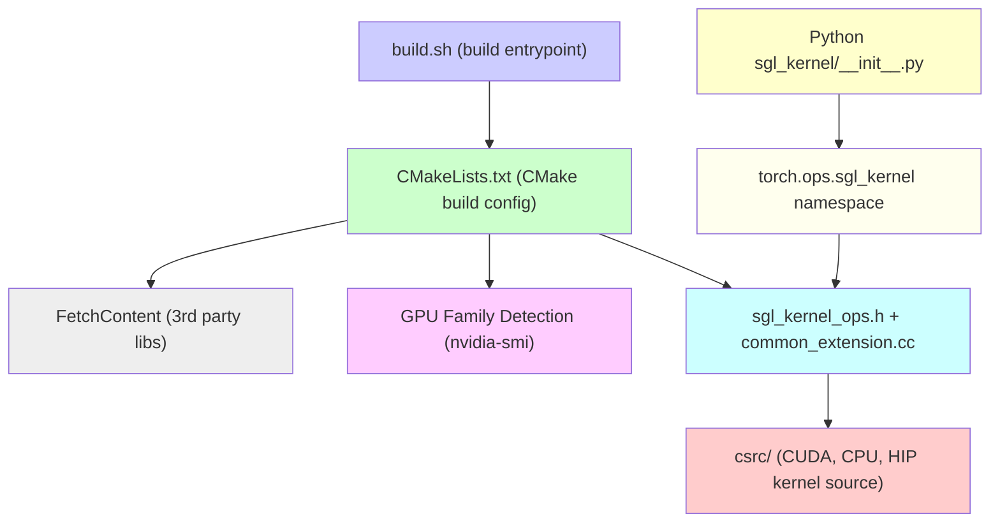

<!-- source: DeepWiki mcp.deepwiki.com · repo microsoft/llm-42 · page 7.1 Kernel Build System and Architecture · fetched 2026-10-26 -->

# Kernel Build System and Architecture

<details>
<summary>Relevant source files</summary>

The following files were used as context for generating this wiki page:

- [.github/workflows/release-docker-amd-nightly.yml](.github/workflows/release-docker-amd-nightly.yml)
- [.github/workflows/release-docker-amd-rocm720-nightly.yml](.github/workflows/release-docker-amd-rocm720-nightly.yml)
- [.github/workflows/release-docker-amd.yml](.github/workflows/release-docker-amd.yml)
- [.github/workflows/release-docker-dev.yml](.github/workflows/release-docker-dev.yml)
- [.github/workflows/release-docker.yml](.github/workflows/release-docker.yml)
- [.github/workflows/release-pypi.yml](.github/workflows/release-pypi.yml)
- [.github/workflows/release-whl-kernel.yml](.github/workflows/release-whl-kernel.yml)
- [benchmark/kernels/elementwise/benchmark_concat_mla.py](benchmark/kernels/elementwise/benchmark_concat_mla.py)
- [python/sglang/srt/compilation/npu_piecewise_backend.py](python/sglang/srt/compilation/npu_piecewise_backend.py)
- [python/sglang/srt/compilation/weak_ref_tensor.py](python/sglang/srt/compilation/weak_ref_tensor.py)
- [python/sglang/srt/configs/update_config.py](python/sglang/srt/configs/update_config.py)
- [python/sglang/srt/layers/attention/intel_amx_backend.py](python/sglang/srt/layers/attention/intel_amx_backend.py)
- [python/sglang/srt/layers/quantization/int8_kernel.py](python/sglang/srt/layers/quantization/int8_kernel.py)
- [sgl-kernel/CMakeLists.txt](sgl-kernel/CMakeLists.txt)
- [sgl-kernel/Dockerfile](sgl-kernel/Dockerfile)
- [sgl-kernel/benchmark/bench_moe_align_block_size.py](sgl-kernel/benchmark/bench_moe_align_block_size.py)
- [sgl-kernel/benchmark/bench_per_token_group_quant_8bit.py](sgl-kernel/benchmark/bench_per_token_group_quant_8bit.py)
- [sgl-kernel/build.sh](sgl-kernel/build.sh)
- [sgl-kernel/csrc/common_extension.cc](sgl-kernel/csrc/common_extension.cc)
- [sgl-kernel/csrc/common_extension_rocm.cc](sgl-kernel/csrc/common_extension_rocm.cc)
- [sgl-kernel/csrc/cpu/common.h](sgl-kernel/csrc/cpu/common.h)
- [sgl-kernel/csrc/cpu/gemm.cpp](sgl-kernel/csrc/cpu/gemm.cpp)
- [sgl-kernel/csrc/cpu/gemm.h](sgl-kernel/csrc/cpu/gemm.h)
- [sgl-kernel/csrc/cpu/gemm_fp8.cpp](sgl-kernel/csrc/cpu/gemm_fp8.cpp)
- [sgl-kernel/csrc/cpu/gemm_int8.cpp](sgl-kernel/csrc/cpu/gemm_int8.cpp)
- [sgl-kernel/csrc/cpu/moe.cpp](sgl-kernel/csrc/cpu/moe.cpp)
- [sgl-kernel/csrc/cpu/moe_fp8.cpp](sgl-kernel/csrc/cpu/moe_fp8.cpp)
- [sgl-kernel/csrc/cpu/moe_int8.cpp](sgl-kernel/csrc/cpu/moe_int8.cpp)
- [sgl-kernel/csrc/cpu/norm.cpp](sgl-kernel/csrc/cpu/norm.cpp)
- [sgl-kernel/csrc/cpu/qkv_proj.cpp](sgl-kernel/csrc/cpu/qkv_proj.cpp)
- [sgl-kernel/csrc/cpu/rope.cpp](sgl-kernel/csrc/cpu/rope.cpp)
- [sgl-kernel/csrc/cpu/topk.cpp](sgl-kernel/csrc/cpu/topk.cpp)
- [sgl-kernel/csrc/cpu/torch_extension_cpu.cpp](sgl-kernel/csrc/cpu/torch_extension_cpu.cpp)
- [sgl-kernel/csrc/cpu/vec.h](sgl-kernel/csrc/cpu/vec.h)
- [sgl-kernel/csrc/elementwise/concat_mla.cu](sgl-kernel/csrc/elementwise/concat_mla.cu)
- [sgl-kernel/csrc/elementwise/topk.cu](sgl-kernel/csrc/elementwise/topk.cu)
- [sgl-kernel/csrc/elementwise/utils.cuh](sgl-kernel/csrc/elementwise/utils.cuh)
- [sgl-kernel/csrc/gemm/per_token_group_quant_8bit.cu](sgl-kernel/csrc/gemm/per_token_group_quant_8bit.cu)
- [sgl-kernel/csrc/moe/moe_align_kernel.cu](sgl-kernel/csrc/moe/moe_align_kernel.cu)
- [sgl-kernel/csrc/moe/moe_fused_gate.cu](sgl-kernel/csrc/moe/moe_fused_gate.cu)
- [sgl-kernel/include/sgl_kernel_ops.h](sgl-kernel/include/sgl_kernel_ops.h)
- [sgl-kernel/include/utils.h](sgl-kernel/include/utils.h)
- [sgl-kernel/python/sgl_kernel/__init__.py](sgl-kernel/python/sgl_kernel/__init__.py)
- [sgl-kernel/python/sgl_kernel/elementwise.py](sgl-kernel/python/sgl_kernel/elementwise.py)
- [sgl-kernel/python/sgl_kernel/gemm.py](sgl-kernel/python/sgl_kernel/gemm.py)
- [sgl-kernel/python/sgl_kernel/moe.py](sgl-kernel/python/sgl_kernel/moe.py)
- [sgl-kernel/python/sgl_kernel/test_utils.py](sgl-kernel/python/sgl_kernel/test_utils.py)
- [sgl-kernel/python/sgl_kernel/top_k.py](sgl-kernel/python/sgl_kernel/top_k.py)
- [sgl-kernel/setup_rocm.py](sgl-kernel/setup_rocm.py)
- [sgl-kernel/tests/test_moe_align.py](sgl-kernel/tests/test_moe_align.py)
- [sgl-kernel/tests/test_moe_fused_gate.py](sgl-kernel/tests/test_moe_fused_gate.py)
- [sgl-kernel/tests/test_per_token_group_quant_8bit.py](sgl-kernel/tests/test_per_token_group_quant_8bit.py)
- [sgl-kernel/tests/test_topk.py](sgl-kernel/tests/test_topk.py)
- [test/srt/cpu/test_activation.py](test/srt/cpu/test_activation.py)
- [test/srt/cpu/test_gemm.py](test/srt/cpu/test_gemm.py)
- [test/srt/cpu/test_mla.py](test/srt/cpu/test_mla.py)
- [test/srt/cpu/test_moe.py](test/srt/cpu/test_moe.py)
- [test/srt/cpu/test_norm.py](test/srt/cpu/test_norm.py)
- [test/srt/cpu/test_qkv_proj_with_rope.py](test/srt/cpu/test_qkv_proj_with_rope.py)
- [test/srt/cpu/test_rope.py](test/srt/cpu/test_rope.py)
- [test/srt/cpu/test_shared_expert.py](test/srt/cpu/test_shared_expert.py)
- [test/srt/cpu/test_topk.py](test/srt/cpu/test_topk.py)
- [test/srt/cpu/utils.py](test/srt/cpu/utils.py)

</details>


This page documents the **sgl-kernel** sub-project's build system and kernel architecture. It covers the CMake-based build setup with scikit-build-core integration, GPU family detection for targeted compilation, multi-platform support via different `pyproject.toml` variants, and the Python wrapper dispatch mechanism that exposes custom CUDA/C++ kernels to PyTorch. This is a critical foundation enabling high-performance custom operations and fused kernels in LLM-42's SGLang runtime.

---

## 1. Purpose and Scope

The **sgl-kernel** component provides hand-optimized CUDA, HIP, and CPU kernels for attention, MoE, quantization, GEMM, collective operations, and other GPU-accelerated primitives essential to deterministic LLM inference. Its build system supports multiple GPU architectures (NVIDIA Ampere/Hopper/Blackwell, AMD gfx94x/gfx95x), multiple platforms (CUDA, ROCm, CPU, and Huawei MUSA), and integrates tightly with PyTorch at the operator registration level. The system detects target GPU families to compile only the relevant architectures, minimizing build time and binary size.

---

## 2. CMake-Based Build System

### 2.1. CMakeLists.txt Overview

The root `CMakeLists.txt` initializes the project `sgl-kernel` requiring CMake 3.26+ and supporting C++17 and CUDA languages [sgl-kernel/CMakeLists.txt:1-100]().

Key features:

- **Python integration:** Uses `find_package(Python COMPONENTS Interpreter Development.Module)` for Python and C++ extension building (line 17).
- **CUDA toolkit detection:** Finds CUDA and enables separable compilation (lines 24-26).
- **Torch:** Uses `find_package(Torch REQUIRED)` to link against PyTorch libraries (line 42).
- **GPU family detection:** Runs `nvidia-smi` to query the compute capability of the first GPU installed to auto-select the GPU architecture family: `ampere (8.x)`, `hopper (9.x)`, or `blackwell (10,12.x)`. If detection fails or no GPU found, it sets `SGL_KERNEL_GPU_FAMILY` to `all` to build all archs (lines 48-71).
- **Third-party dependencies fetched with FetchContent:** Includes CUTLASS, DeepGEMM, fmt, Triton, flashinfer, flash-attention, mscclpp (lines 76-137).
- **Compiler flags and CUDA parameters:** Includes optimizations, macro defines for BF16, FP8, FP4, and other features (lines 150-200+).
- **Build parallelism controls:** `SGL_KERNEL_COMPILE_THREADS` configures NVCC compile threads (lines 184-195).
- **Conditional feature flags:** Enable or disable FP8, FP4, FA3, and specific GPU architectures (lines 196-215).
- **CUDA architectures selection** based on `SGL_KERNEL_GPU_FAMILY` with options to build only for the installed GPU's architecture, or all for unknown GPUs.
- **Includes `include` and `csrc` folders** for kernel source code and headers (lines 151-154).

The build produces shared libraries with no prefix for use as Python extensions with PyTorch.

---

### 2.2. GPU Family Build Selection

The GPU detection logic (lines 48-71) parses the compute capability major version from `nvidia-smi`. It maps:

| Compute Capability Major | GPU Family   |
|-------------------------|--------------|
| 10 or 12                | blackwell    |
| 9                       | hopper       |
| 8                       | ampere       |
| else                    | all (build all archs) |

This allows the build system to compile only the CUDA kernels relevant for the detected GPU family, reducing build times and binary size.

---

### 2.3. Integration with Python and PyTorch

- The build system uses **scikit-build-core** (invoked in the build script `build.sh`) which enables building Python wheel extensions by invoking CMake.
- It produces compiled CUDA extensions that PyTorch loads at runtime.
- The build supports multi-platform variants, with different `pyproject.toml` files for:
  - CUDA (NVIDIA GPUs)
  - ROCm (AMD GPUs)
  - CPU-only kernels
  - MUSA (Huawei Ascend NPU) via the separate `setup_rocm.py` targeting ROCm RH based on CUDAExtension abstraction but using HIP/ROCm compilation flags
- Many third-party kernel repos are vendored via Git FetchContent for tight version control and reproducibility.

---

### 2.4. Build Script and CI Integration

- `build.sh` is a scripted entrypoint for building wheels given Python and CUDA versions and target architecture [sgl-kernel/build.sh:1-145]().
- It uses Docker buildx to create multi-arch images and leverage persistent ccache.
- The build parallelism is tuned dynamically based on host architecture (`aarch64` vs. x86_64) and environmental variables like `BUILD_JOBS` and `NVCC_THREADS`.
- GitHub workflows (`release-whl-kernel.yml`) automate wheel build and publishing on CI for multiple CUDA and Python version matrixes, including aarch64 cross-compilations.
- Separate workflows exist for ROCm builds on AMD nodes and Docker image production for the runtime and framework.

---

## 3. Kernel Source Architecture

The kernel implementation source is organized primarily in the `csrc` directory with subfolders for categories:

- `allreduce/`, `attention/`, `elementwise/`, `gemm/`, `moe/`, `speculative/`, `kvcacheio/`, etc.
- Separate CPU kernels live under `csrc/cpu/` built with `torch_extension_cpu.cpp`.
- ROCm HIP kernels under `csrc` for AMD support.

These kernels implement performance-critical fused GPU operations and are exposed as PyTorch custom ops.

---

## 4. Exposed Operators and Python Wrapper Dispatch

### 4.1. Kernel API Header and Registration

- `include/sgl_kernel_ops.h` declares the C++/CUDA kernel entrypoints exposed to PyTorch [sgl-kernel/include/sgl_kernel_ops.h:1-200+]().

- It defines functions for:
  - Allreduce
  - Attention (`cutlass_mla_decode`, `merge_state`, etc.)
  - Elementwise activation and normalization (`rmsnorm`, `fused_add_rmsnorm`, `gelu_and_mul`, etc.)
  - MoE fused gates and top-k softmax
  - GEMM operations with FP8/INT8/FP4 quantization
  - Sampling kernels (top-k variants)
  - Specialized kernels for kernel fusion and quantization
- The header uses `torch.library` to register these kernels.

### 4.2. PyTorch Extension Fragment

- `csrc/common_extension.cc` implements the PyTorch library fragment registration.
- It uses `TORCH_LIBRARY_FRAGMENT(sgl_kernel, m)` and `m.def(...)` followed by `m.impl(..., torch::kCUDA, &function)` calls to bind each C++ kernel with a PyTorch dispatch schema [sgl-kernel/csrc/common_extension.cc:15-160+]().

### 4.3. Python Wrapper Namespace `sgl_kernel`

- The Python package `sgl_kernel` imports these kernels with dynamic dispatch based on the detected GPU architecture at runtime.
- The loader function `_load_architecture_specific_ops` detects the current GPU family (Ampere/Hopper/Blackwell) and loads the appropriate shared library variant with corresponding kernels (e.g., CUDA or ROCm binary) [sgl-kernel/python/sgl_kernel/__init__.py:1-100]().

- It exposes Python APIs that wrap these low-level ops, providing a high-level interface for the rest of the LLM-42 codebase to invoke custom fused kernels transparently.
- This structure permits multi-platform declarative dispatch for supported platforms (CUDA/ROCm/CPU/MUSA).

---

## 5. Multi-Platform Support and `pyproject.toml` Variants

The **sgl-kernel** project supports building wheels for multiple platform variants:

| Platform            | Build Method                   | Notes                            |
|---------------------|--------------------------------|---------------------------------|
| NVIDIA CUDA         | CMake + `nvcc` via scikit-build-core | Most common; supports Ampere/Hopper/Blackwell via GPU family detection |
| AMD ROCm            | `setup_rocm.py` with `CUDAExtension` using HIP flags | Targets AMD gfx942/gfx950 GPUs (MI300/MI350) [sgl-kernel/setup_rocm.py]() |
| CPU-only            | Compiles subset of kernels as CPU extensions | Uses `csrc/cpu` sources with torch CPU backend [`torch_extension_cpu.cpp`] |
| Huawei MUSA (Ascend)| Not detailed here, but supports NPU via similar extensions | Part of extended platform support (Ascend) |

The `pyproject.toml` and setup tooling selects the right variant to build based on environment or CI inputs (Python version, CUDA/ROCm version, GPU arch), making deployment straightforward.

---

## 6. Data Flow and Python Dispatch Mechanism

Below is the architecture flow bridging the natural language kernel description to code entities showing how the build system, GPU detection, and Python loaders tie in:

```mermaid
graph TD
  NL[/"Natural Language Kernel Description"/]
  BuildSys[CMake-based Build System]
  GPUDetect[GPU Family Detection]
  PyWrapper[Python Wrapper Dispatch]
  PyTorchExt[PyTorch Custom Extension]
  Kernels[Kernels (CUDA/HIP/CPU source)]
  ThirdParty[Third-Party Repos (CUTLASS, Triton, etc.)]
  
  NL --> BuildSys
  BuildSys --> GPUDetect
  GPUDetect --> BuildSys
  BuildSys --> PyTorchExt
  PyTorchExt --> Kernels
  Kernels --> ThirdParty
  PyWrapper --> PyTorchExt
  PyWrapper --> BuildSys
  
  style NL fill:#f9f,stroke:none
  style BuildSys fill:#eef,stroke:none
  style GPUDetect fill:#efe,stroke:none
  style PyWrapper fill:#ffe,stroke:none
  style PyTorchExt fill:#eef,stroke:none
  style Kernels fill:#fef,stroke:none
  style ThirdParty fill:#efe,stroke:none
```

- The human input ("natural language kernel description") maps to kernel design needs.
- The **CMake-based build system** coordinates kernel source compilation, including fetching third-party dependencies and deciding which GPU architectures to target.
- The **GPU family detection** at build time informs `SGL_KERNEL_GPU_FAMILY` to compile appropriate CUDA arch flags.
- Compiled kernel libraries are wrapped as PyTorch custom extensions.
- The Python wrapper loads these extensions dynamically based on runtime detected GPU, dispatching kernels appropriately.

---

## 7. Component Interaction Diagram: Code Entities and System Names



- `build.sh` scripts the build and calls CMake to produce compiled extensions.
- `CMakeLists.txt` orchestrates dependency fetching and kernel compilation.
- GPU detection logic in `CMakeLists.txt` (via `nvidia-smi`) decides architectures.
- Kernel source under `csrc/` is compiled and linked into PyTorch operator libraries declared in `sgl_kernel_ops.h` and registered in `common_extension.cc`.
- The Python layer in `sgl_kernel/__init__.py` dynamically loads the appropriate operator library and exposes its APIs under the `torch.ops.sgl_kernel` namespace.

---

## 8. Summary

- The **sgl-kernel** build system is a robust CMake-based infrastructure with GPU family detection that compiles optimized kernels only for the detected GPU architecture family using macro and arch flags.
- It integrates `scikit-build-core` enabling Python wheel builds callable from standard Python tools.
- The system supports multiple platforms: CUDA (NVIDIA GPUs), ROCm (AMD GPUs), CPU-only kernels, and the Huawei MUSA NPU.
- Kernels are exposed to Python via PyTorch custom ops registration (`torch.library` fragment) combined with a Python wrapper that dispatches operators transparently.
- The build includes multiple third-party CUDA libraries (CUTLASS, Triton, flashinfer) fetched via `FetchContent` to support high-performance fused kernels.
- GitHub Actions workflows automate building and publishing wheels for multiple Python, CUDA versions, and architectures.

---

Sources:  
- `[sgl-kernel/CMakeLists.txt:1-200]()`, `[sgl-kernel/csrc/common_extension.cc:15-170]()`, `[sgl-kernel/include/sgl_kernel_ops.h:1-200]()`, `[sgl-kernel/python/sgl_kernel/__init__.py:1-100]()`, `[sgl-kernel/build.sh:1-145]()`, `[sgl-kernel/setup_rocm.py:1-129]()`, `.github/workflows/release-whl-kernel.yml`, `.github/workflows/release-docker-dev.yml`

---

