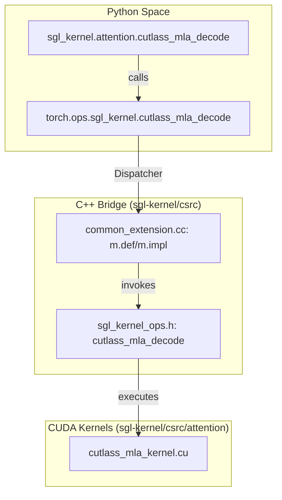
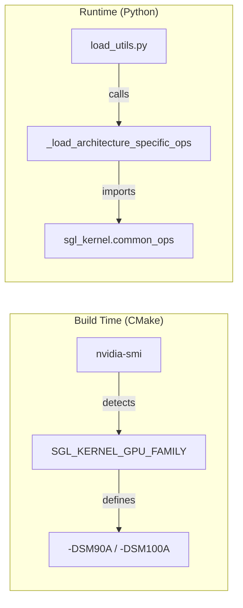

<!-- source: DeepWiki mcp.deepwiki.com · repo microsoft/llm-42 · page 7.2 Kernel Implementations: Attention, GEMM, MoE, and Collective Ops · fetched 2026-10-26 -->

# Kernel Implementations: Attention, GEMM, MoE, and Collective Ops

Relevant source files

The following files were used as context for generating this wiki page:

- [benchmark/hicache/perf.py](benchmark/hicache/perf.py)
- [python/sglang/jit_kernel/.clang-format](python/sglang/jit_kernel/.clang-format)
- [python/sglang/jit_kernel/csrc/hicache.cuh](python/sglang/jit_kernel/csrc/hicache.cuh)
- [python/sglang/jit_kernel/hicache.py](python/sglang/jit_kernel/hicache.py)
- [python/sglang/jit_kernel/include/sgl_kernel/tensor.h](python/sglang/jit_kernel/include/sgl_kernel/tensor.h)
- [python/sglang/jit_kernel/include/sgl_kernel/utils.cuh](python/sglang/jit_kernel/include/sgl_kernel/utils.cuh)
- [python/sglang/jit_kernel/include/sgl_kernel/utils.h](python/sglang/jit_kernel/include/sgl_kernel/utils.h)
- [python/sglang/jit_kernel/include/sgl_kernel/warp.cuh](python/sglang/jit_kernel/include/sgl_kernel/warp.cuh)
- [python/sglang/jit_kernel/utils.py](python/sglang/jit_kernel/utils.py)
- [python/sglang/srt/layers/quantization/int8_kernel.py](python/sglang/srt/layers/quantization/int8_kernel.py)
- [sgl-kernel/CMakeLists.txt](sgl-kernel/CMakeLists.txt)
- [sgl-kernel/README.md](sgl-kernel/README.md)
- [sgl-kernel/analyze_whl_kernel_sizes.py](sgl-kernel/analyze_whl_kernel_sizes.py)
- [sgl-kernel/benchmark/bench_cutlass_mla.py](sgl-kernel/benchmark/bench_cutlass_mla.py)
- [sgl-kernel/benchmark/bench_dsv3_fused_a_gemm.py](sgl-kernel/benchmark/bench_dsv3_fused_a_gemm.py)
- [sgl-kernel/benchmark/bench_fp8_gemm.py](sgl-kernel/benchmark/bench_fp8_gemm.py)
- [sgl-kernel/benchmark/bench_per_token_group_quant_8bit.py](sgl-kernel/benchmark/bench_per_token_group_quant_8bit.py)
- [sgl-kernel/cmake/utils.cmake](sgl-kernel/cmake/utils.cmake)
- [sgl-kernel/csrc/attention/cutlass_mla_kernel.cu](sgl-kernel/csrc/attention/cutlass_mla_kernel.cu)
- [sgl-kernel/csrc/attention/cutlass_sm100_mla/device/sm100_mla.hpp](sgl-kernel/csrc/attention/cutlass_sm100_mla/device/sm100_mla.hpp)
- [sgl-kernel/csrc/attention/cutlass_sm100_mla/kernel/sm100_fmha_mla_reduction.hpp](sgl-kernel/csrc/attention/cutlass_sm100_mla/kernel/sm100_fmha_mla_reduction.hpp)
- [sgl-kernel/csrc/attention/cutlass_sm100_mla/kernel/sm100_fmha_mla_tma_warpspecialized.hpp](sgl-kernel/csrc/attention/cutlass_sm100_mla/kernel/sm100_fmha_mla_tma_warpspecialized.hpp)
- [sgl-kernel/csrc/attention/cutlass_sm100_mla/kernel/sm100_mla_tile_scheduler.hpp](sgl-kernel/csrc/attention/cutlass_sm100_mla/kernel/sm100_mla_tile_scheduler.hpp)
- [sgl-kernel/csrc/common_extension.cc](sgl-kernel/csrc/common_extension.cc)
- [sgl-kernel/csrc/flash_extension.cc](sgl-kernel/csrc/flash_extension.cc)
- [sgl-kernel/csrc/gemm/dsv3_fused_a_gemm.cu](sgl-kernel/csrc/gemm/dsv3_fused_a_gemm.cu)
- [sgl-kernel/csrc/gemm/fp8_blockwise_gemm_kernel.cu](sgl-kernel/csrc/gemm/fp8_blockwise_gemm_kernel.cu)
- [sgl-kernel/csrc/gemm/fp8_gemm_kernel.cu](sgl-kernel/csrc/gemm/fp8_gemm_kernel.cu)
- [sgl-kernel/csrc/gemm/int8_gemm_kernel.cu](sgl-kernel/csrc/gemm/int8_gemm_kernel.cu)
- [sgl-kernel/csrc/gemm/math.hpp](sgl-kernel/csrc/gemm/math.hpp)
- [sgl-kernel/csrc/gemm/nvfp4_expert_quant.cu](sgl-kernel/csrc/gemm/nvfp4_expert_quant.cu)
- [sgl-kernel/csrc/gemm/nvfp4_quant.cuh](sgl-kernel/csrc/gemm/nvfp4_quant.cuh)
- [sgl-kernel/csrc/gemm/nvfp4_quant_entry.cu](sgl-kernel/csrc/gemm/nvfp4_quant_entry.cu)
- [sgl-kernel/csrc/gemm/nvfp4_quant_kernels.cu](sgl-kernel/csrc/gemm/nvfp4_quant_kernels.cu)
- [sgl-kernel/csrc/gemm/nvfp4_scaled_mm_entry.cu](sgl-kernel/csrc/gemm/nvfp4_scaled_mm_entry.cu)
- [sgl-kernel/csrc/gemm/nvfp4_scaled_mm_kernels.cu](sgl-kernel/csrc/gemm/nvfp4_scaled_mm_kernels.cu)
- [sgl-kernel/csrc/gemm/per_token_group_quant_8bit.cu](sgl-kernel/csrc/gemm/per_token_group_quant_8bit.cu)
- [sgl-kernel/csrc/grammar/apply_token_bitmask_inplace_cuda.cu](sgl-kernel/csrc/grammar/apply_token_bitmask_inplace_cuda.cu)
- [sgl-kernel/csrc/moe/moe_fused_gate.cu](sgl-kernel/csrc/moe/moe_fused_gate.cu)
- [sgl-kernel/csrc/moe/nvfp4_blockwise_moe.cu](sgl-kernel/csrc/moe/nvfp4_blockwise_moe.cu)
- [sgl-kernel/include/sgl_flash_kernel_ops.h](sgl-kernel/include/sgl_flash_kernel_ops.h)
- [sgl-kernel/include/sgl_kernel_ops.h](sgl-kernel/include/sgl_kernel_ops.h)
- [sgl-kernel/include/sgl_kernel_torch_shim.h](sgl-kernel/include/sgl_kernel_torch_shim.h)
- [sgl-kernel/python/sgl_kernel/__init__.py](sgl-kernel/python/sgl_kernel/__init__.py)
- [sgl-kernel/python/sgl_kernel/_fa4_interface.py](sgl-kernel/python/sgl_kernel/_fa4_interface.py)
- [sgl-kernel/python/sgl_kernel/attention.py](sgl-kernel/python/sgl_kernel/attention.py)
- [sgl-kernel/python/sgl_kernel/elementwise.py](sgl-kernel/python/sgl_kernel/elementwise.py)
- [sgl-kernel/python/sgl_kernel/flash_attn.py](sgl-kernel/python/sgl_kernel/flash_attn.py)
- [sgl-kernel/python/sgl_kernel/gemm.py](sgl-kernel/python/sgl_kernel/gemm.py)
- [sgl-kernel/python/sgl_kernel/moe.py](sgl-kernel/python/sgl_kernel/moe.py)
- [sgl-kernel/python/sgl_kernel/test_utils.py](sgl-kernel/python/sgl_kernel/test_utils.py)
- [sgl-kernel/tests/test_cutlass_mla.py](sgl-kernel/tests/test_cutlass_mla.py)
- [sgl-kernel/tests/test_dsv3_fused_a_gemm.py](sgl-kernel/tests/test_dsv3_fused_a_gemm.py)
- [sgl-kernel/tests/test_flash_attention.py](sgl-kernel/tests/test_flash_attention.py)
- [sgl-kernel/tests/test_flash_attention_4.py](sgl-kernel/tests/test_flash_attention_4.py)
- [sgl-kernel/tests/test_fp4_gemm.py](sgl-kernel/tests/test_fp4_gemm.py)
- [sgl-kernel/tests/test_fp4_quantize.py](sgl-kernel/tests/test_fp4_quantize.py)
- [sgl-kernel/tests/test_fp8_gemm.py](sgl-kernel/tests/test_fp8_gemm.py)
- [sgl-kernel/tests/test_moe_fused_gate.py](sgl-kernel/tests/test_moe_fused_gate.py)
- [sgl-kernel/tests/test_per_token_group_quant_8bit.py](sgl-kernel/tests/test_per_token_group_quant_8bit.py)

This page details the high-performance CUDA and C++ kernels implemented in the `sgl-kernel` sub-project. These kernels provide the computational backbone for SGLang, covering optimized attention mechanisms (MLA, FlashAttention), quantized GEMM operations (FP8/INT8/FP4), Mixture-of-Experts (MoE) routing, and distributed collective operations via MSCCLPP.

## Kernel Interface and Torch Integration

The `sgl-kernel` library exposes its operations through a unified C++ header and registers them into the `torch.ops.sgl_kernel` namespace for seamless integration with PyTorch and `torch.compile`.

### System Mapping: Python to C++ Dispatch
The following diagram illustrates how a Python call traverses the library layers to reach the CUDA implementation.

**Kernel Dispatch Flow**

**Sources:** [sgl-kernel/python/sgl_kernel/__init__.py:1-154](), [sgl-kernel/include/sgl_kernel_ops.h:106-124](), [sgl-kernel/csrc/common_extension.cc:57-61]()

## Attention Kernels

### CUTLASS MLA Decode
SGLang implements a high-performance Multi-Head Latent Attention (MLA) decode kernel using CUTLASS, specifically optimized for the DeepSeek-V3 architecture. It supports both contiguous and paged KV caches.

*   **Key Function**: `cutlass_mla_decode` [sgl-kernel/include/sgl_kernel_ops.h:110-119]()
*   **Implementation**: Uses `Sm100FmhaMlaKernelTmaWarpspecialized` for Hopper/Blackwell architectures, utilizing TMA (Tensor Memory Accelerator) for efficient data movement [sgl-kernel/csrc/attention/cutlass_mla_kernel.cu:84-92]().
*   **Workspace**: Requires a workspace buffer calculated via `cutlass_mla_get_workspace_size` [sgl-kernel/csrc/attention/cutlass_mla_kernel.cu:44-46]().

### FlashAttention (FA3/FA4)
The library integrates advanced versions of FlashAttention for high-throughput decoding and prefilling.
*   **FA3 Support**: Targeted at SM80 (A100) and SM90 (H100) architectures [sgl-kernel/python/sgl_kernel/flash_attn.py:19-32]().
*   **Varlen Support**: `flash_attn_varlen_func_v4` provides the interface for variable-length sequence processing in FA4 [sgl-kernel/python/sgl_kernel/flash_attn.py:13-16]().

**Sources:** [sgl-kernel/python/sgl_kernel/flash_attn.py:39-74](), [sgl-kernel/csrc/attention/cutlass_mla_kernel.cu:64-93]()

## GEMM and Quantization Kernels

SGLang provides a suite of GEMM kernels supporting various bit-widths and scaling strategies to enable aggressive quantization.

| Kernel Type | Function Name | Description |
| :--- | :--- | :--- |
| **FP8 Scaled** | `fp8_scaled_mm` | Standard FP8 matrix multiplication with per-tensor scales. |
| **FP8 Blockwise** | `fp8_blockwise_scaled_mm` | Matrix multiplication using block-wise scaling factors for higher precision. |
| **INT8 Scaled** | `int8_scaled_mm` | Scaled INT8 GEMM for W8A8 quantization. |
| **FP4 Scaled** | `cutlass_scaled_fp4_mm` | Experimental FP4 GEMM support for Blackwell (SM100). |
| **Group Quant** | `sgl_per_token_group_quant_8bit` | Per-token group quantization (INT8/FP8) with optional Silu fusion. |

### Per-Token Group Quantization
This kernel transforms activations into quantized formats on-the-fly. The `v2` implementation supports fusing the `SiLU` activation and multiplication operations directly into the quantization kernel to save memory bandwidth [sgl-kernel/python/sgl_kernel/gemm.py:107-143]().

**Sources:** [sgl-kernel/python/sgl_kernel/gemm.py:21-50](), [sgl-kernel/csrc/gemm/fp8_blockwise_gemm_kernel.cu:47-125](), [sgl-kernel/csrc/common_extension.cc:129-159]()

## Mixture-of-Experts (MoE) Kernels

MoE performance is dominated by routing and dispatch. SGLang provides fused kernels to minimize overhead.

### Fused Gating and Top-K
The `moe_fused_gate` kernel performs gating logic, top-k selection, and renormalization in a single CUDA kernel.
*   **Hierarchical Routing**: Supports 2-layer hierarchical selection (expert groups) as seen in DeepSeek models [sgl-kernel/python/sgl_kernel/moe.py:105-137]().
*   **Shared Experts**: Can handle fused shared experts by replacing the last top-k indices with shared expert IDs [sgl-kernel/tests/test_moe_fused_gate.py:54-74]().

### MoE Data Preparation
The `prepare_moe_input` kernel computes `expert_offsets` and `input_permutation` vectors required for dispatched GEMMs [sgl-kernel/python/sgl_kernel/moe.py:217-241]().

**Sources:** [sgl-kernel/csrc/moe/moe_fused_gate.cu](), [sgl-kernel/python/sgl_kernel/moe.py:28-54]()

## Collective Operations

Distributed inference relies on low-latency communication. SGLang implements custom all-reduce kernels and integrates Microsoft's MSCCLPP.

### MSCCLPP All-Reduce
The MSCCLPP backend provides a highly optimized all-reduce for NVLink and IB environments.
*   **Context Initialization**: `mscclpp_init_context` sets up the communicator with rank-to-node and rank-to-IB mapping [sgl-kernel/include/sgl_kernel_ops.h:89-99]().
*   **Execution**: `mscclpp_allreduce` performs the reduction using a scratch buffer and proxy-based communication [sgl-kernel/csrc/common_extension.cc:41-48]().

### Custom All-Reduce (AR)
A fallback custom all-reduce implementation is provided for environments where MSCCLPP is not utilized. It supports IPC (Inter-Process Communication) handle exchange for zero-copy data access across GPUs [sgl-kernel/include/sgl_kernel_ops.h:78-87]().

**Sources:** [sgl-kernel/include/sgl_kernel_ops.h:47-101](), [sgl-kernel/csrc/common_extension.cc:21-49]()

## Architecture-Specific Dispatch

The library uses a "shim" and architecture-detection mechanism to load the correct kernel binary at runtime.

**Build and Load Logic**

**Sources:** [sgl-kernel/CMakeLists.txt:45-72](), [sgl-kernel/python/sgl_kernel/__init__.py:1-10]()

---

