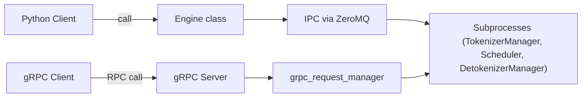
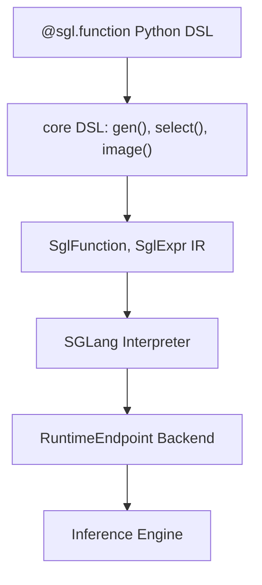
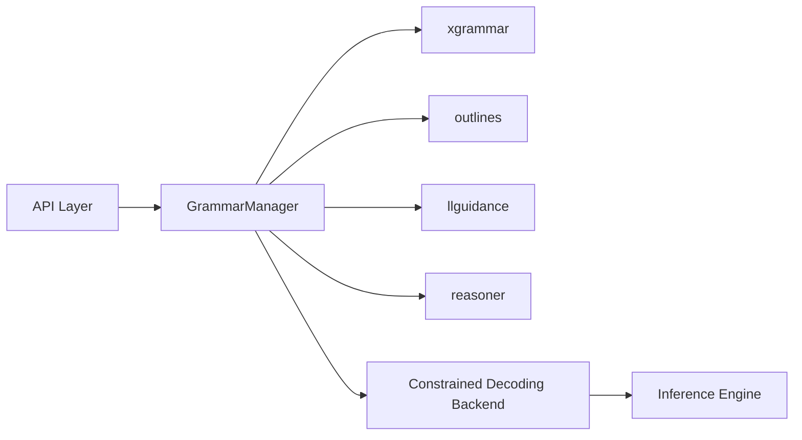
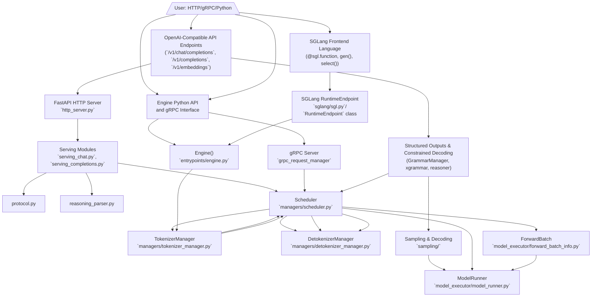

<!-- source: DeepWiki mcp.deepwiki.com · repo microsoft/llm-42 · page 8 API Layer and Entrypoints · fetched 2026-10-26 -->

# API Layer and Entrypoints

<details>
<summary>Relevant source files</summary>

The following files were used as context for generating this wiki page:

- [README.md](README.md)
- [benchmark/deepseek_v3/README.md](benchmark/deepseek_v3/README.md)
- [docker/rocm.Dockerfile](docker/rocm.Dockerfile)
- [docs/get_started/install.md](docs/get_started/install.md)
- [docs/platforms/amd_gpu.md](docs/platforms/amd_gpu.md)
- [docs/platforms/ascend_npu.md](docs/platforms/ascend_npu.md)
- [python/pyproject.toml](python/pyproject.toml)
- [python/pyproject_cpu.toml](python/pyproject_cpu.toml)
- [python/pyproject_other.toml](python/pyproject_other.toml)
- [python/pyproject_xpu.toml](python/pyproject_xpu.toml)
- [python/sglang/__init__.py](python/sglang/__init__.py)
- [python/sglang/srt/entrypoints/engine.py](python/sglang/srt/entrypoints/engine.py)
- [python/sglang/srt/entrypoints/http_server.py](python/sglang/srt/entrypoints/http_server.py)
- [python/sglang/srt/layers/logits_processor.py](python/sglang/srt/layers/logits_processor.py)
- [python/sglang/srt/layers/sampler.py](python/sglang/srt/layers/sampler.py)
- [python/sglang/srt/managers/detokenizer_manager.py](python/sglang/srt/managers/detokenizer_manager.py)
- [python/sglang/srt/managers/io_struct.py](python/sglang/srt/managers/io_struct.py)
- [python/sglang/srt/managers/multi_tokenizer_mixin.py](python/sglang/srt/managers/multi_tokenizer_mixin.py)
- [python/sglang/srt/managers/schedule_batch.py](python/sglang/srt/managers/schedule_batch.py)
- [python/sglang/srt/managers/scheduler.py](python/sglang/srt/managers/scheduler.py)
- [python/sglang/srt/managers/scheduler_metrics_mixin.py](python/sglang/srt/managers/scheduler_metrics_mixin.py)
- [python/sglang/srt/managers/scheduler_output_processor_mixin.py](python/sglang/srt/managers/scheduler_output_processor_mixin.py)
- [python/sglang/srt/managers/scheduler_update_weights_mixin.py](python/sglang/srt/managers/scheduler_update_weights_mixin.py)
- [python/sglang/srt/managers/tokenizer_communicator_mixin.py](python/sglang/srt/managers/tokenizer_communicator_mixin.py)
- [python/sglang/srt/managers/tokenizer_manager.py](python/sglang/srt/managers/tokenizer_manager.py)
- [python/sglang/srt/managers/tp_worker.py](python/sglang/srt/managers/tp_worker.py)
- [python/sglang/srt/metrics/collector.py](python/sglang/srt/metrics/collector.py)
- [python/sglang/srt/model_executor/cuda_graph_runner.py](python/sglang/srt/model_executor/cuda_graph_runner.py)
- [python/sglang/srt/model_executor/forward_batch_info.py](python/sglang/srt/model_executor/forward_batch_info.py)
- [python/sglang/srt/model_executor/model_runner.py](python/sglang/srt/model_executor/model_runner.py)
- [python/sglang/srt/sampling/sampling_batch_info.py](python/sglang/srt/sampling/sampling_batch_info.py)
- [python/sglang/srt/sampling/sampling_params.py](python/sglang/srt/sampling/sampling_params.py)
- [python/sglang/srt/server_args.py](python/sglang/srt/server_args.py)
- [python/sglang/version.py](python/sglang/version.py)

</details>


This section provides a high-level overview of the external-facing interfaces of the LLM-42 system, which enables deterministic large language model inference. The API layer acts as the main access point for interaction with the inference engine, supporting various protocols and programming interfaces for diverse deployment and integration scenarios.

The main entrypoints and APIs covered include:

- **HTTP Server with OpenAI-Compatible API Endpoints**
- **Engine Python API and gRPC Interface**
- **SGLang Frontend Language**
- **Structured Outputs and Constrained Decoding APIs**

Each of these interfaces serves different usage patterns, from serving standardized RESTful requests to embedding LLM functionalities within Python programs or enabling grammar-constrained generation workflows. This page explains how these parts fit together and links to child pages with detailed technical documentation.

---

## Overview of API Layer Architecture

The API layer fronts the underlying deterministic inference engine and its scheduler infrastructure. Requests arriving via various protocols are directed through a series of processing stages, starting with tokenization, scheduling and batching of model inference, and finally detokenization and result return.

The system is architected for modularity and efficiency:

- The **HTTP Server** handles REST API calls compatible with OpenAI's specification, supporting chat completions, completions, and embedding queries.
- The **Engine Python API** provides client and programmatic access, allowing local or embedded use of the inference engine.
- A **gRPC server** interface supports remote procedure call access for integration in distributed environments.
- The **SGLang frontend language** is a high-level Python DSL to compose complex LLM-based programs with structure and control flow.
- **Structured output and constrained decoding** backends enable grammar-aware generation, essential for applications requiring formal output formats or tool integration.

The API layer components communicate internally through IPC using ZeroMQ sockets, and subprocesses implement tokenizer management, scheduling, and detokenization independently for scalability and isolation.

---

## HTTP Server and OpenAI-Compatible API

At the forefront of external access, the HTTP server implements endpoints that follow the OpenAI API contract with extensions for deterministic inference and advanced reasoning features.

- The FastAPI-based server supports endpoints such as:
  - `/v1/chat/completions`
  - `/v1/completions`
  - `/v1/embeddings`

- Internally, these are implemented in modules like `serving_chat.py` and `serving_completions.py`.

- The API supports advanced features including:
  - Chain-of-thought model parsing with a **reasoning parser** to interpret multi-step reasoning outputs.
  - Custom request serving semantics integrating the deterministic verify-rollback runtime.

This interface serves as the standard way for downstream clients or platforms expecting OpenAI compatibility to invoke LLM services deterministically.

For detailed protocol specifications, endpoint implementations, and request lifecycle, see the child page: [HTTP Server and OpenAI-Compatible API](#8.1).

```mermaid
  %% Diagram: HTTP Server and OpenAI API Components
  graph LR
    subgraph HTTP_Server["HTTP Server (FastAPI)"]
      direction TB
      Client[Client Request (OpenAI API)]
      Endpoints["/v1/chat/completions, /v1/completions, /v1/embeddings"]
      ServingChat["serving_chat.py"]
      ServingCompletions["serving_completions.py"]
      Protocol["protocol.py"]
      ReasoningParser["reasoning_parser.py"]
    end
    Client --> Endpoints --> ServingChat
    Client --> Endpoints --> ServingCompletions
    ServingChat --> Protocol
    ServingCompletions --> Protocol
    ServingChat --> ReasoningParser
```

Sources:  
- `python/sglang/srt/entrypoints/http_server.py`  
- `python/sglang/srt/managers/scheduler.py` (for reasoning parser usage)  
- `python/sglang/srt/server_args.py` (general server arg selections)  

---

## Engine Python API and gRPC Interface

The core inference engine is exposed as a Python class `Engine` that enables programmatic use of the full deterministic inference pipeline. This API allows:

- Generating text via `generate()` and `async_generate()` methods
- Obtaining embeddings with `encode()`
- Scoring with `score()`
- Dynamic model weight updates including loading and unloading LoRA adapters at runtime (`load_lora_adapter()`, etc.)

The engine internally launches subprocesses that implement the tokenizer manager, scheduler, and detokenizer manager. IPC between these components happens over ZeroMQ ports, abstracted away from clients.

Additionally, a gRPC server is provided as an alternative remote invocation method. The server manages requests with the `grpc_request_manager` and offers high-throughput, low-latency remote access suitable for distributed deployments.

The Engine API is designed for flexibility and embedding LLM inference within Python applications or microservices, while gRPC provides scalable RPC endpoints.

For detailed method signatures, lifecycle management, and gRPC server internals, see the child page: [Engine Python API and gRPC Interface](#8.2).



Sources:  
- `python/sglang/srt/entrypoints/engine.py`  
- `python/sglang/srt/managers/scheduler.py`  
- `python/sglang/srt/managers/tokenizer_manager.py`  

---

## SGLang Frontend Language

SGLang is a high-level Python domain-specific language (DSL) built on top of the inference engine to facilitate composing complex LLM-driven programs. It introduces:

- An expressive decorator `@sgl.function` to define LLM program functions.
- Core DSL functions such as `gen()` for generation, `select()` for conditional branching, and `image()` for multimodal input handling.
- Intermediate representations (`SglFunction` and `SglExpr`) for managing generated code expressions.
- An interpreter for evaluating SGLang functions.
- A backend `RuntimeEndpoint` to run compiled SGLang programs against the runtime engine.

SGLang serves as a powerful abstraction to build structured LLM pipelines integrating text generation, constrained decoding, multimodal inputs, and custom control flows.

See the dedicated child page: [SGLang Frontend Language](#8.3) for comprehensive details on language design, compiler architecture, and runtime integration.



Sources:  
- `python/sglang/srt/entrypoints/engine.py` (SGLang integration hints)  
- Documentation references on SGLang compiler (from project and related modules)  

---

## Structured Outputs and Constrained Decoding

Structured generation is crucial for applications requiring output format guarantees or integration with external tooling. LLM-42 supports grammar-based constrained decoding via several backends:

- **xgrammar**: Implements grammar constraints leveraging context-free grammars.
- **outlines**: High-level structural constraints for outline generation.
- **llguidance**: Guidance-based constraints for shaping generation.
- **reasoner**: Focused on chain-of-thought and reasoning output constraints.

The system provides a `GrammarManager` that applies JSON schemas, regex rules, and EBNF grammar constraints to decoding. It also enables function call parsing to interpret LLM tool-use APIs, facilitating semantic-aware generation flows.

This module interfaces with the API layer to implement features like function call parsing in chat completions and strongly-typed output decoding.

For developer details on grammar specification, decoder integration, and function call handling, consult the child page: [Structured Outputs and Constrained Decoding](#8.4).



Sources:  
- `python/sglang/srt/server_args.py` (grammar backend choices, function call parser import)  
- Various constraint backend modules referenced in server arg imports and runtime  

---

## Relationship Between External Interfaces and Components

The following diagram illustrates how requests originate in "Natural Language Space" (API calls from users) and transition through API layer components into low-level engine code entities managing inference and output processing.



This diagram clarifies how user-facing protocols translate into code components, where each major external-facing interface ultimately leverages the scheduler and model runner to perform deterministic inference with verification. The SGLang language binds high-level generation logic to the runtime engine.

Sources:  
- `python/sglang/srt/entrypoints/engine.py`  
- `python/sglang/srt/entrypoints/http_server.py`  
- `python/sglang/srt/managers/scheduler.py`  
- `python/sglang/srt/managers/tokenizer_manager.py`  
- `python/sglang/srt/model_executor/model_runner.py`  
- `python/sglang/srt/server_args.py`  

---

## Summary

The API layer and entrypoints provide a rich spectrum of interfaces for LLM-42:

- The **HTTP/OpenAI-compatible server** delivers standardized REST API access with extensions supporting deterministic inference and chain-of-thought models.
- The **Engine Python API and gRPC interface** offer programmatic and remote access to the full inference engine subprocess framework.
- The **SGLang frontend DSL** enables complex and structured LLM program composition in Python.
- **Structured output and constrained decoding** components allow grammar-aware generation and tool-use parsing functionalities.

Each of these interfaces builds upon the core scheduler, tokenizer, and model runner components, connecting user intents expressed in natural language with efficient, deterministic code execution.

For detailed implementation and programming model details, consult the respective child pages:

- [HTTP Server and OpenAI-Compatible API](#8.1)  
- [Engine Python API and gRPC Interface](#8.2)  
- [SGLang Frontend Language](#8.3)  
- [Structured Outputs and Constrained Decoding](#8.4)  

---

# Navigation Links for Section 8

- [HTTP Server and OpenAI-Compatible API](#8.1)  
- [Engine Python API and gRPC Interface](#8.2)  
- [SGLang Frontend Language](#8.3)  
- [Structured Outputs and Constrained Decoding](#8.4)  

---

*End of Section 8: API Layer and Entrypoints*

---

