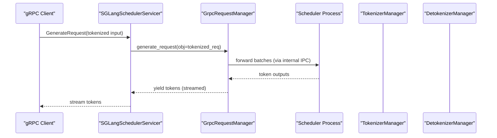
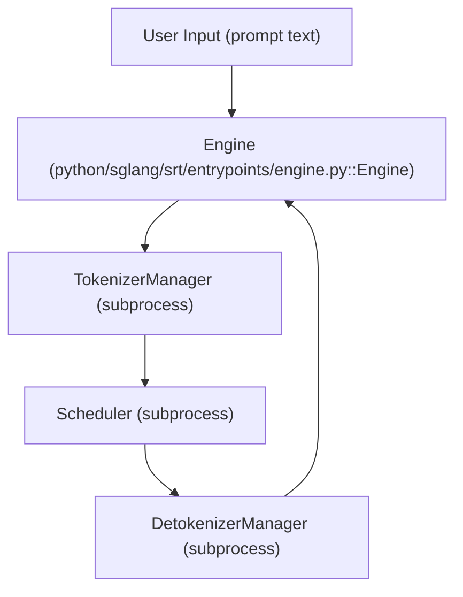
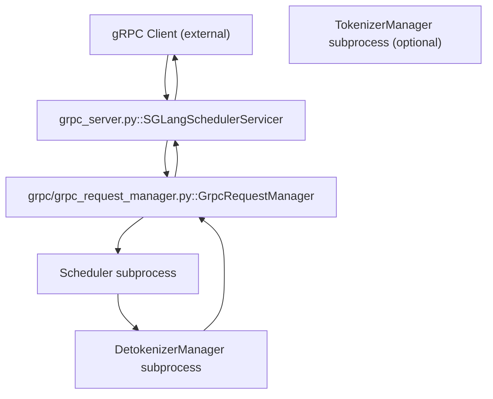

<!-- source: DeepWiki mcp.deepwiki.com · repo microsoft/llm-42 · page 8.2 Engine Python API and gRPC Interface · fetched 2026-10-26 -->

# Engine Python API and gRPC Interface

<details>
<summary>Relevant source files</summary>

The following files were used as context for generating this wiki page:

- [.github/workflows/open-pr-copy-from-oss.yml](.github/workflows/open-pr-copy-from-oss.yml)
- [.github/workflows/open-pr-copy-to-oss.yml](.github/workflows/open-pr-copy-to-oss.yml)
- [README.md](README.md)
- [benchmark/deepseek_v3/README.md](benchmark/deepseek_v3/README.md)
- [docker/rocm.Dockerfile](docker/rocm.Dockerfile)
- [docs/get_started/install.md](docs/get_started/install.md)
- [docs/platforms/amd_gpu.md](docs/platforms/amd_gpu.md)
- [docs/platforms/ascend_npu.md](docs/platforms/ascend_npu.md)
- [python/pyproject.toml](python/pyproject.toml)
- [python/pyproject_cpu.toml](python/pyproject_cpu.toml)
- [python/pyproject_other.toml](python/pyproject_other.toml)
- [python/pyproject_xpu.toml](python/pyproject_xpu.toml)
- [python/sglang/__init__.py](python/sglang/__init__.py)
- [python/sglang/srt/entrypoints/engine.py](python/sglang/srt/entrypoints/engine.py)
- [python/sglang/srt/entrypoints/grpc_server.py](python/sglang/srt/entrypoints/grpc_server.py)
- [python/sglang/srt/grpc/grpc_request_manager.py](python/sglang/srt/grpc/grpc_request_manager.py)
- [python/sglang/version.py](python/sglang/version.py)
- [scripts/code_sync/check_commits.py](scripts/code_sync/check_commits.py)
- [scripts/code_sync/copy_from_oss.py](scripts/code_sync/copy_from_oss.py)
- [scripts/code_sync/copy_to_oss.py](scripts/code_sync/copy_to_oss.py)
- [scripts/code_sync/install_github_cli.sh](scripts/code_sync/install_github_cli.sh)
- [scripts/code_sync/utils.py](scripts/code_sync/utils.py)

</details>


This section (8.2) delves into the **Engine Python API** for programmatic and local inference on LLMs, and the **standalone gRPC server interface** used for remote inference requests. It explains the implementation, data flow, and key classes/methods that comprise these interfaces in LLM-42’s hosting system built atop SGLang. This page is a leaf node and provides focused technical detail on:

- The `Engine` class: local programmatic API for inference including token generation, asynchronous generation, encoding, scoring, and dynamic model updates (such as LoRA adapter loading).
- The gRPC server entrypoint: standalone service that interacts with the `GrpcRequestManager` to serve remote gRPC clients.
- Data flows and inter-process communication (IPC) channels involved in engine invocation and request handling.

---

## 1. Overview of the Engine Python API

The **Engine** class acts as the main programmatic entrypoint to the LLM inference runtime. It orchestrates subprocesses for tokenization, scheduling, and detokenization, managing a scalable pipeline that leverages multiprocessing and ZeroMQ (ZMQ) IPC for communication.

The engine is designed to enable both synchronous and asynchronous generation APIs with optional deterministic inference via LLM-42’s decode-verify-rollback mechanism. Beyond generation APIs, it supports encoding input prompts, scoring token log-likelihoods, and dynamic weight update mechanisms including loading/unloading LoRA adapters and weight updates from tensors or disk.

The workflow separates concerns into subprocesses:
- **TokenizerManager**: tokenizes input requests, preprocesses them, and sends them to the scheduler.
- **Scheduler**: manages batching, GPU execution, and verification.
- **DetokenizerManager**: detokenizes output tokens and sends responses back.

The main `Engine` object runs in the main Python process and interfaces with these subprocesses through IPC, primarily ZMQ socket communication on distinct ports.

### 1.1. Engine Initialization and Subprocesses

Upon construction, the `Engine` class accepts server configuration arguments matching `ServerArgs` (documented elsewhere) which define model paths, device configs, scheduling parameters, etc.

Initialization involves:
- Parsing or constructing the `ServerArgs`.
- Launching subprocesses for the TokenizerManager, Scheduler, and DetokenizerManager.
- Setting up ZMQ sockets for RPC communication if required.
- Optionally enabling tracing and telemetry.

```python
engine = Engine(
    model_path="path/to/model",
    tp=8,  # tensor parallelism config
    trust_remote_code=True,
    log_level="info",
)
```

The subprocesses are launched with roles clearly separated for scalability and reliability. The scheduler forwards token batches to the GPU and manages output redistributions, while the detokenizer manages output decoding. IPC channels use abstracted socket initialization utilities.

### 1.2. Core Public Methods

The key synchronous and asynchronous methods provided by the `Engine` API are:

| Method | Description |
|--------|-------------|
| `generate()` | Synchronously generate tokens given a prompt. Blocks until generation completes or times out. |
| `async_generate()` | Asynchronously generate tokens, returning an async iterator over streaming tokens. |
| `encode()` | Tokenize an input prompt and return token IDs without generating tokens. |
| `score()` | Compute token log-likelihood scores for a given input. |
| `update_weights_from_tensor()` | Dynamically update model weights from in-memory tensors (e.g. new adapter tensors). |
| `load_lora_adapter()` | Load a Low-Rank Adaptation (LoRA) adapter for fine-tuning or specialization. |

The asynchronous generation method uses `async def` and yields tokens roughly in real-time to enable streaming applications. Other methods operate over tightly coupled request/response IPC channels internally.

### 1.3. Engine Internal Data Flow

When a generation request is made:

1. The engine converts the user request into a `GenerateReqInput` dataclass message with all decoding options and prompt data.
2. This request is sent to the `TokenizerManager` subprocess, which tokenizes and forwards tokens.
3. The `Scheduler` subprocess performs batching, executes forward passes on the GPU, applies LLM-42 verification if enabled, and returns output token IDs.
4. Output tokens are sent to the `DetokenizerManager` which detokenizes to strings or embeddings.
5. The result propagates back to the main engine instance over IPC, and finally to the user.

This modular design allows scaling across multiple GPUs and distributed setups, with internal redispatch handled by the scheduler.

### 1.4. Subprocess Launching and IPC

Subprocess launching and orchestration lives in private helpers but crucially involves:

- Spawning TokenizerManager, Scheduler, and DetokenizerManager as separate python processes.
- Assigning unique IPC ZMQ ports for each subprocess for communication.
- Parsing scheduler info and sharing port assignments with the main engine.
- Setting up a ZMQ DEALER socket on the main engine for RPC calls if node rank is zero.

---

## 2. The `Engine` Class Implementation Details

The `Engine` class is implemented in `python/sglang/srt/entrypoints/engine.py` [python/sglang/srt/entrypoints/engine.py:118-630]().

It inherits from `EngineBase` and adds process launching, synchronous and asynchronous request APIs, and RPC integration.

### 2.1 Constructor and Setup

- Accepts kwargs that are parsed into `ServerArgs`.
- Calls `atexit.register(self.shutdown)` to ensure subprocess cleanup on exit.
- Launches the three subprocesses (TokenizerManager, Scheduler, DetokenizerManager) via `_launch_subprocesses`.
- Initializes ZMQ sockets for RPC if applicable.
- Supports optional tracing integration.

```python
class Engine(EngineBase):
    def __init__(self, **kwargs):
        # parse args
        # launch subprocesses
        # initialize zmq sockets
        # enable tracing optionally
```

### 2.2 Generation Methods

**Synchronous Generation:**

`generate()` accepts prompt input text (or token ids), converts to internal request, sends via TokenizerManager and waits for response.

**Asynchronous Generation:**

`async_generate()` is an async generator, yielding partial tokens as they are generated. It manages internally a listener coroutine awaiting tokens, suitable for streamed client APIs.

### 2.3 Encoding and Scoring

The encode method calls the TokenizerManager IPC directly to tokenize the input text and returns the token IDs.

The score method sends requests similarly to compute token log-likelihoods.

### 2.4 Weight Updates and LoRA Adapters

There are API methods to update model weights dynamically from:

- In-memory tensors (`update_weights_from_tensor`)
- Files on disk (`update_weights_from_disk` - not detailed here)
- Loading or unloading LoRA adapters using pre-built or tensor-loaded definitions (`load_lora_adapter`, `unload_lora_adapter`).

This enables runtime model specialization without restart.

---

## 3. gRPC Server Entrypoint and Request Management

LLM-42 provides a **standalone gRPC server** implemented in `python/sglang/srt/entrypoints/grpc_server.py`, decoupled from the HTTP server frontend [python/sglang/srt/entrypoints/grpc_server.py:1-439]().

### 3.1 Overview

This gRPC server wraps the runtime with:

- A `GrpcRequestManager` instance to orchestrate inference requests.
- Implementation of the `SGLangSchedulerServicer` protobuf interface.
- Health check and reflection services.
- Aggregated load metrics and other scheduler introspection features.

### 3.2 GrpcRequestManager

`GrpcRequestManager` implements the logic for handling multiple concurrent gRPC inference requests. It accepts tokenized generation and embedding requests from clients and returns streaming responses asynchronously.

It separates tokenization from generation; tokens are expected already tokenized in the request objects (`TokenizedGenerateReqInput`). This supports richer control and more direct GPU runtimes.

### 3.3 Data Flow Diagram for gRPC



This highlights the gRPC front receiving tokenized inputs, managing requests via `GrpcRequestManager` which interfaces to the scheduler and sends streaming token responses back to the client.

### 3.4 Load and Health Services

- The gRPC server implements health checking using `SGLangHealthServicer`.
- Provides scheduler load metrics via protobuf messages with rich metrics such as token usage, throughput, and utilization.

---

## 4. Natural Language to Code Entity Mapping Diagrams

### 4.1 Local Inference API Components



- The user interacts with the local `Engine` instance.
- Requests are tokenized in `TokenizerManager`.
- Batched execution and verification happen in `Scheduler`.
- Detokenization of outputs is done in `DetokenizerManager`.
- Results return back to the `Engine`.

### 4.2 gRPC Serving API Components



- The client sends requests directly to the gRPC server.
- The server implements the protobuf interface and delegates request handling to `GrpcRequestManager`.
- The `GrpcRequestManager` manages direct interaction with the scheduler and optionally tokenizer/detokenizer for internal flows.
- Streaming responses are delivered back to the client.

---

## 5. Summary of Key Classes and Files Referenced

| Name | Role | Location |
|-------|------|----------|
| `Engine` | Main programmatic local runtime class | python/sglang/srt/entrypoints/engine.py:118-630 |
| `TokenizerManager` | Tokenizes prompts, subprocess managed | python/sglang/srt/managers/tokenizer_manager.py (not detailed here) |
| `Scheduler` | Batch scheduler, decode-verify-rollback inference executor | subprocess started by engine |
| `DetokenizerManager` | Converts output tokens to strings | subprocess started by engine |
| `GrpcRequestManager` | Manages gRPC request lifecycle and GPU execution | python/sglang/srt/grpc/grpc_request_manager.py |
| `SGLangSchedulerServicer` | gRPC protobuf interface implementation | python/sglang/srt/entrypoints/grpc_server.py |
| `ServerArgs` | Configuration for engine and server | python/sglang/srt/server_args.py (imported for args parsing) |
| `GenerateReqInput` | Structured token generation request data | python/sglang/srt/managers/io_struct.py |

---

## 6. Important Notes on Implementation

- The engine uses `asyncio` and `uvloop` for efficient async APIs.
- Subprocesses are isolated to allow distributed and multi-GPU deployment.
- Communication uses ZMQ sockets named by port args to avoid address collisons.
- The `Engine` class allows overriding subprocess launch functions for custom deployments.
- The gRPC server is purpose-built for production without HTTP overhead, with tracing and health checking baked-in.
- Deterministic inference using LLM-42’s decode-verify-rollback is fully integrated and controlled in the scheduler subprocess.

---

# Summary

The LLM-42 **Engine Python API** offers a comprehensive, modular interface to run deterministic and high-performance LLM inference locally with synchronous and asynchronous methods, plus programmatic support for advanced features like LoRA adapters and in-memory updates.

Separately, the **standalone gRPC interface** serves as a pure remote inference API, using `GrpcRequestManager` for efficient request orchestration and streaming.

Together, these interfaces build a flexible, scalable foundation for deterministic and batch-invariant LLM serving on GPU clusters, abstracting complexity in multi-process coordination, batching, and token management.

---

# References

- `python/sglang/srt/entrypoints/engine.py:118-630`  
- `python/sglang/srt/entrypoints/grpc_server.py:1-439`  
- `python/sglang/srt/grpc/grpc_request_manager.py`  
- `python/sglang/srt/managers/io_struct.py`  
- `python/sglang/srt/server_args.py`  
- `README.md` (Overview and architecture context)  

Sources: `python/sglang/srt/entrypoints/engine.py`, `python/sglang/srt/entrypoints/grpc_server.py`, `python/sglang/srt/grpc/grpc_request_manager.py`, `README.md`

---

