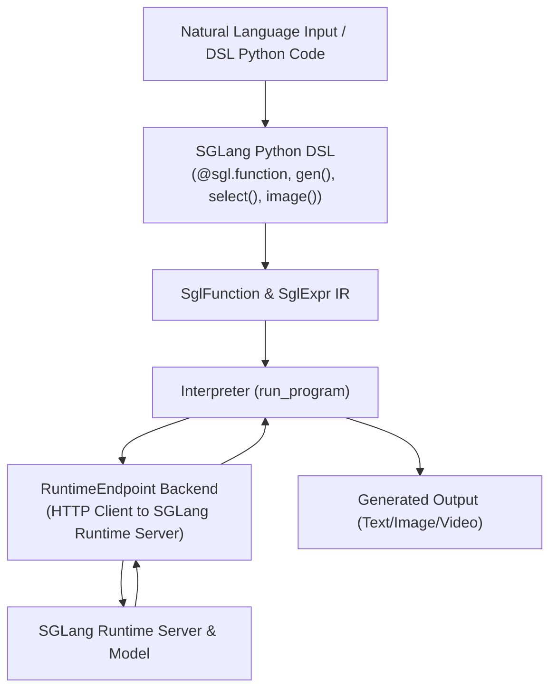
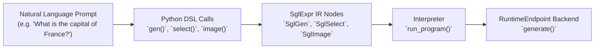
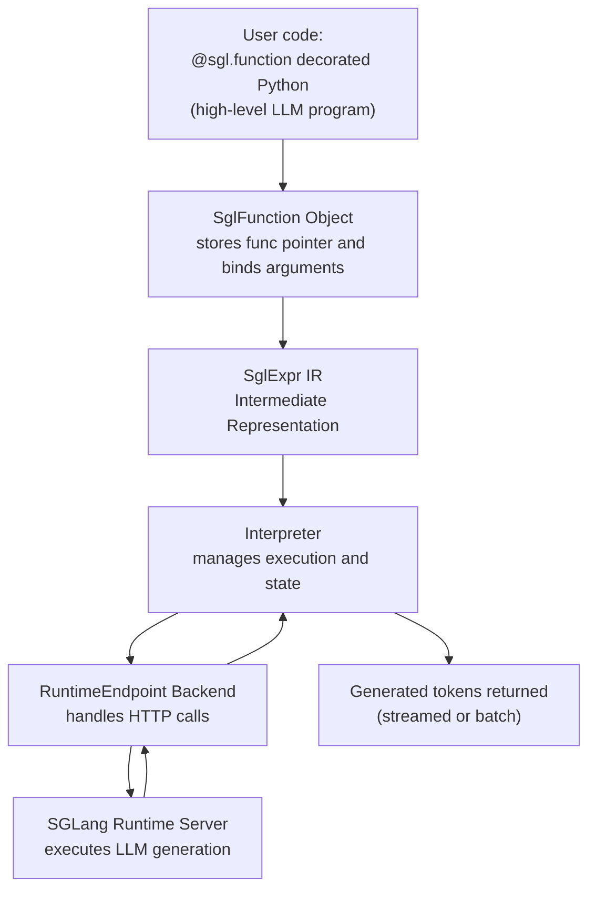

<!-- source: DeepWiki mcp.deepwiki.com · repo microsoft/llm-42 · page 8.3 SGLang Frontend Language · fetched 2026-10-26 -->

# 8.3 SGLang Frontend Language

<details>
<summary>Relevant source files</summary>

The following files were used as context for generating this wiki page:

- [benchmark/hicache/data_processing.py](benchmark/hicache/data_processing.py)
- [docs/advanced_features/lora.ipynb](docs/advanced_features/lora.ipynb)
- [docs/advanced_features/separate_reasoning.ipynb](docs/advanced_features/separate_reasoning.ipynb)
- [docs/advanced_features/structured_outputs.ipynb](docs/advanced_features/structured_outputs.ipynb)
- [docs/advanced_features/structured_outputs_for_reasoning_models.ipynb](docs/advanced_features/structured_outputs_for_reasoning_models.ipynb)
- [docs/advanced_features/tool_parser.ipynb](docs/advanced_features/tool_parser.ipynb)
- [docs/basic_usage/native_api.ipynb](docs/basic_usage/native_api.ipynb)
- [docs/basic_usage/openai_api_completions.ipynb](docs/basic_usage/openai_api_completions.ipynb)
- [docs/basic_usage/openai_api_embeddings.ipynb](docs/basic_usage/openai_api_embeddings.ipynb)
- [docs/basic_usage/openai_api_vision.ipynb](docs/basic_usage/openai_api_vision.ipynb)
- [docs/basic_usage/send_request.ipynb](docs/basic_usage/send_request.ipynb)
- [docs/references/frontend/frontend_tutorial.ipynb](docs/references/frontend/frontend_tutorial.ipynb)
- [docs/references/multi_node_deployment/rbg_pd/deepseekv32_pd.md](docs/references/multi_node_deployment/rbg_pd/deepseekv32_pd.md)
- [python/sglang/lang/api.py](python/sglang/lang/api.py)
- [python/sglang/lang/backend/runtime_endpoint.py](python/sglang/lang/backend/runtime_endpoint.py)
- [python/sglang/lang/chat_template.py](python/sglang/lang/chat_template.py)
- [python/sglang/lang/interpreter.py](python/sglang/lang/interpreter.py)
- [python/sglang/lang/ir.py](python/sglang/lang/ir.py)
- [python/sglang/test/test_programs.py](python/sglang/test/test_programs.py)

</details>


This page gives a technical and detailed overview of the **SGLang frontend language**—the high-level Python DSL layer for composing complex LLM inference programs in the LLM-42 project. It covers the fundamental constructs, intermediate representation (IR), and execution components of the SGLang DSL, including the `@sgl.function` decorator, core expression primitives like `gen()` and `select()`, the internal IR model (`SglFunction`, `SglExpr`), the interpreter runtime, and the key backend integration with the `RuntimeEndpoint`.

---

## Overview and Purpose

SGLang is a domain-specific language embedded in Python designed to express LLM generation workflows declaratively and compositionally. At its core, SGLang provides Python syntax wrappers to transparently build an **abstract syntax tree (AST)**—called the intermediate representation (IR)—which represents the desired LLM generation and interaction pattern.

The SGLang frontend language enables:

- Writing reusable LLM programs as pure Python functions decorated with `@sgl.function`.
- Expressing token generation (`gen()`), token selection (`select()`), and image generation (`image()`) as composable primitives.
- Supporting variable scoping, role switching (user/assistant/system), batching, and output structuring.
- Interpreting the IR into backend calls that execute the generation through configured LLM engines or remote runtime endpoints.
- Streaming outputs asynchronously during generation for responsive interfaces.

This structured abstraction empowers complex LLM behaviors—such as multi-turn chat, selective generation, multimodal interaction, and constrained decoding—while retaining determinism and efficient runtime execution.

---

## Core Concepts

### 1. The `@sgl.function` Decorator and `SglFunction` Class

- `@sgl.function` is a decorator that converts a Python generator-like function into a **SglFunction** object.
- `SglFunction` wraps the user-defined function, capturing its signature, bound arguments, and execution metadata.
- When invoked (e.g., `myfunc.run(...)`), it builds the IR by recording the procedural steps and generation expressions.
- `SglFunction` supports methods like:
  - `.run(...)`: Runs the program and returns a result dictionary with generated outputs.
  - `.run_batch(...)`: Runs multiple invocations in batch.
  - `.bind(...)`: Returns a new `SglFunction` instance with fixed bound parameters.

The first argument of the user function must be `s` as the SGL language context object (an instance of `SglExpr` or similar).

*Implementation Note:* The class is defined near line 140 in [`python/sglang/lang/ir.py:141-272`](), capturing function argument specs and runtime execution support.

---

### 2. Expression Primitives: `gen()`, `select()`, `image()`

These are the fundamental DSL primitives accessible from the SGLang namespace:

- `gen(name=None, ...)`:
  - Represents a token-level generation step.
  - Emits a token sequence produced by the LLM.
  - Supports parameters like `stop`, `temperature`, `top_p`, `regex`, `dtype` for constrained sampling.
- `select(name, choices)`:
  - Represents a categorical selection from a fixed set of string choices (used for classification-like decisions).
  - Internally mapped to a `ChoicesDecision` construct.
- `image(...)`:
  - Represents image generation requests integrated into the generation pipeline.
  - Supports image encoding and embedding through the backend.

Expressions created via these primitives are instances of `SglExpr` subclasses, such as `SglGen`, `SglSelect`, and `SglImage`.

*Implementation Note:* These are defined and linked mainly in [`python/sglang/lang/ir.py`](), and used in the interpreter [`python/sglang/lang/interpreter.py`](). The `gen()` and `select()` methods append expression nodes to the program IR.

---

### 3. Intermediate Representation (IR)

SGLang compiles user code into an AST-like IR composed of `SglExpr` nodes with rich context:

- `SglExpr` is the base class for all expressions.
- Specialized subclasses include:
  - `SglGen` — token generation,
  - `SglSelect` — discrete selection,
  - `SglImage` / `SglVideo` — multimodal content,
  - `SglVariable` and var scope begin/end nodes for local variable management,
  - `SglConcateAndAppend` for efficient text concatenation,
  - `SglCommitLazy` for lazy commits,
  - Role switch nodes (`SglRoleBegin`, `SglRoleEnd`) for dialog roles,
  - `SglSeparateReasoning` for reasoning content separation.

The IR encapsulates the entire generation logic declaratively and is interpreted by the runtime executor.

Data flow: User code → Python DSL functions → constructs IR nodes → executed by interpreter → delegated to backend runtime → LLM output sequences.

*Implementation Reference:* The IR classes and sampling params are declared in [`python/sglang/lang/ir.py:1-160`](), covering `SglSamplingParams`, `SglExpr` subclasses.

---

### 4. Interpreter and Execution (`run_program`)

The interpreter component executes SGLang IR programs by:

- Creating a `StreamExecutor` that manages the program state, output stream, and backend interface.
- Running the wrapped user function with the `SglFunction.func` entrypoint, passing the execution state.
- The execution state tracks current variable bindings, accumulated text, streaming/non-streaming control, and generation parameters.
- The interpreter handles threading for asynchronous streaming (`sync` and `stream` flags).
- For batch mode, `run_program_batch` manages concurrent runs with thread pools, progressive feedback via progress bars.

The execution is flexible to either run synchronously or asynchronously, streaming token-by-token output if `stream=True`.

*Implementation Reference:* Detailed program execution flow, threading, and concurrency are implemented in [`python/sglang/lang/interpreter.py:42-240`](). The function `run_program` is the main entrypoint.

---

### 5. RuntimeEndpoint Backend

The `RuntimeEndpoint` class is a key backend integrating SGLang with remote model serving endpoints, acting as a client:

- Wraps HTTP endpoints such as `/generate`, `/get_model_info`, `/flush_cache`, `/start_profile`, `/stop_profile`.
- Maps SGLang sampling parameters (`SglSamplingParams`) to HTTP request JSON body compatible with SGLang Runtime Server (SRT).
- Supports handling of special dtype conversions (int, float, str, bool) to regular expressions recognized by the backend.
- Supports lazy commit and image fill commands by sending generation requests embedding images.
- Supports streaming response parsing.
- Automatically fetches model info and selects chat template for formatting.

`RuntimeEndpoint` extends `BaseBackend` and can be assigned as the backend in `run_program`.

*Implementation Reference:* Backend client protocol is defined near [`python/sglang/lang/backend/runtime_endpoint.py:25-260`](), which implements the request/response logic.

---

## Data Flow Summary



*This diagram shows the end-to-end flow from Python DSL source code down to generated outputs mediated by IR, interpreter, and runtime backend.*

Sources:  
- [`python/sglang/lang/ir.py:141-272`]()  
- [`python/sglang/lang/interpreter.py:40-240`]()  
- [`python/sglang/lang/backend/runtime_endpoint.py:25-260`]()  

---

## Core Classes and Functions

| Symbol                | Description                                                                                  | Location                          |
|-----------------------|----------------------------------------------------------------------------------------------|---------------------------------|
| `@sgl.function`       | Decorator to define SGLang programs as Python functions creating `SglFunction` instances    | [`python/sglang/lang/ir.py:141-159`]() |
| `SglFunction`         | Represents a compiled user function with IR and invocation support                          | [`python/sglang/lang/ir.py:141-272`]() |
| `gen()`               | Token generation expression primitive that inserts LLM-generated tokens                      | [`python/sglang/lang/ir.py:~180-220`](), [`python/sglang/lang/interpreter.py`] |
| `select()`            | Selects from a fixed set of choices (string classification)                                 | [`python/sglang/lang/ir.py`](), inferred from `SglSelect` IR node       |
| `image()`             | Generates or references images in the LLM program execution                                 | [`python/sglang/lang/ir.py`](), [`python/sglang/lang/interpreter.py`]  |
| `SglExpr` and subclasses | IR node types representing various expressions and control constructs                      | [`python/sglang/lang/ir.py:17-130`]()  |
| `run_program(...)`    | Executes a single SglFunction program with given backend and parameters, supports streaming  | [`python/sglang/lang/interpreter.py:42-90`]()      |
| `run_program_batch(...)`| Batch execution helper for parallel/concurrent program runs                               | [`python/sglang/lang/interpreter.py:93-240`]()      |
| `RuntimeEndpoint`     | Backend client class communicating with remote runtime serving endpoints                     | [`python/sglang/lang/backend/runtime_endpoint.py:26-260`]() |

---

## Typical Usage Example

```python
import sglang as sgl

@sgl.function
def few_shot_qa(s, question):
    s += "The following are questions with answers.\n\n"
    s += "Q: What is the capital of France?\nA: Paris\n"
    s += "Q: What is the capital of Germany?\nA: Berlin\n"
    s += "Q: " + question + "\n"
    s += "A:" + sgl.gen("answer", stop="\n", temperature=0)

result = few_shot_qa.run(question="What is the capital of the United States?")
print(result["answer"])
```

Above, `few_shot_qa` is decorated with `@sgl.function`. The body appends text and calls `gen()` for token generation. The `.run()` method executes the program with default backend, returning outputs by keys (`"answer"`). This clean declarative code is parsed into IR nodes and executed via the interpreter and configured backend.

Sources:  
- [`python/sglang/test/test_programs.py:16-40`]()  
- [`python/sglang/lang/ir.py:141-272`]()

---

## SGLang Expression and Role Context Management

SGLang supports special role contexts encapsulated by IR nodes like `SglRoleBegin` and `SglRoleEnd` for multi-role dialogues (system, user, assistant). Role context switches influence prompt formatting based on the selected chat template. This facilitates multi-turn chat and structured conversations inside the DSL.

Similarly, variable scoping is supported via `SglVarScopeBegin`/`SglVarScopeEnd`, allowing localized variables set in the emitted IR to modularize generation outputs.

---

## Interpreter Execution Details

- Execution is triggered via `run_program` which assembles a `StreamExecutor` carrying the execution state and provides streaming facilities.
- The function `run_internal` invokes the wrapped user function (`SglFunction.func`) passing the state object `s` which tracks partial text and active variables.
- The interpreter manages threading for streaming/non-streaming modes.
- Batch execution (`run_program_batch`) intelligently allocates threads and displays progress bars.
- Lazy commits and concatenations optimize text building and reduce network overhead.
- The interpreter captures exceptions and supports debug verbosity that prints executed text.

The interpreter decouples program logic from the backend runtime execution.

---

## RuntimeEndpoint Backend Details

The `RuntimeEndpoint` backend is critical for connecting SGLang programs to external model servers:

- On instantiation, it queries `/get_model_info` to obtain model metadata and establishes a chat template.
- Implements generation requests by POSTing to `/generate`, encoding the prompt text and sampling parameters.
- Sends images/videos via base64 encoding embedded in the JSON payload.
- Process sampling parameters such as `dtype` into regex constraints for improved output control.
- Supports streaming generation by setting the `stream` flag in the request.
- Provides management APIs such as `/flush_cache`, `/start_profile`, `/stop_profile`.
- It abstracts network communication and protocol details from the interpreter and DSL user.

This design enables running SGLang programs locally or distributed across servers with minimal code changes.

---

## Bridge Diagrams: Natural Language to Code Entities

### Diagram 1: From Natural Language Prompt to `SglExpr` IR Nodes



- User writes Python DSL that builds generation tokens (`gen`) and decisions (`select`).
- These Python calls translate to IR nodes capturing the operation's semantics.
- The interpreter consumes these nodes to drive execution.
- The backend converts IR to API calls interacting with LLM servers.

---

### Diagram 2: From `@sgl.function` to Backend Generation Workflow



- The user defines a Python program wrapped by `@sgl.function`.
- When run, it builds the IR `SglExpr` graph.
- The interpreter invokes the program logic and interacts with the runtime backend.
- The `RuntimeEndpoint` submits generation requests to the runtime service and receives tokens.
- Tokens are streamed or collected, returning to the user.

---

## Summary

SGLang frontend language provides a clean, extensible Python-native DSL for defining complex LLM generation workflows. Its core components include:

- `@sgl.function` decorator and `SglFunction` as program abstractions.
- Expression primitives (`gen()`, `select()`, `image()`) that build IR.
- Rich IR representation (`SglExpr` and subclasses) modeling generation logic.
- An interpreter executing IR programs, handling state, threading, and streaming.
- The `RuntimeEndpoint` backend, enabling connection to remote SGLang Runtime Server instances for actual LLM inference.

This layered design separates concerns cleanly and supports powerful language model driven applications ranging from few-shot prompting to multimodal interactions, with full runtime control and extensibility.

---

# References

- `python/sglang/lang/ir.py:141-272`
- `python/sglang/lang/interpreter.py:42-240`
- `python/sglang/lang/backend/runtime_endpoint.py:26-260`
- `python/sglang/test/test_programs.py:16-42`
- `python/sglang/lang/ir.py`
- `python/sglang/lang/interpreter.py`
- `python/sglang/lang/backend/runtime_endpoint.py`

---

*End of Section 8.3: SGLang Frontend Language*

---

