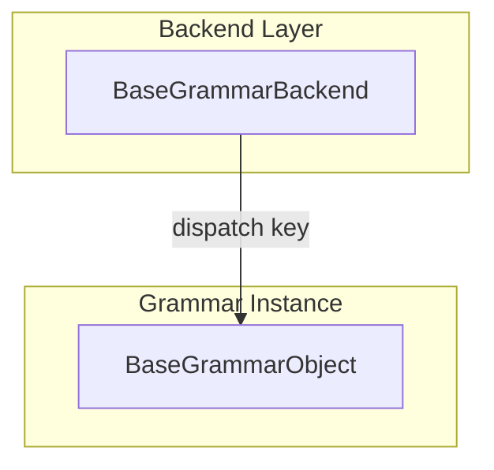
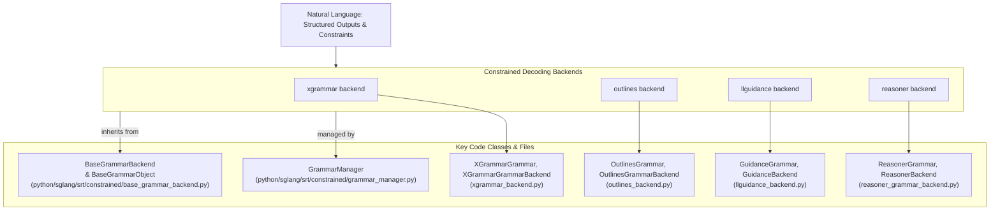
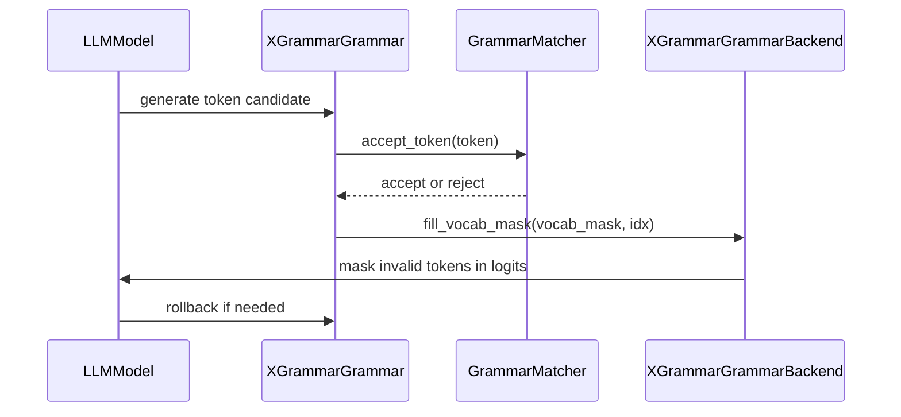
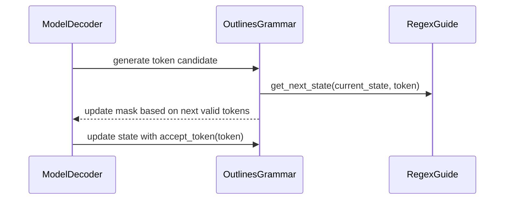
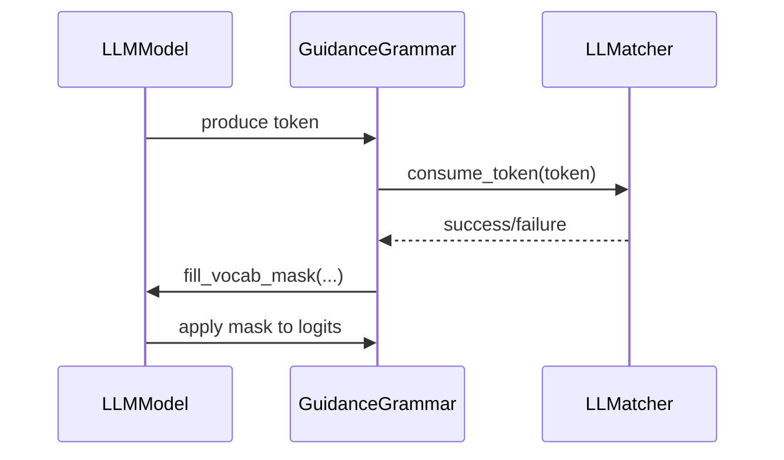
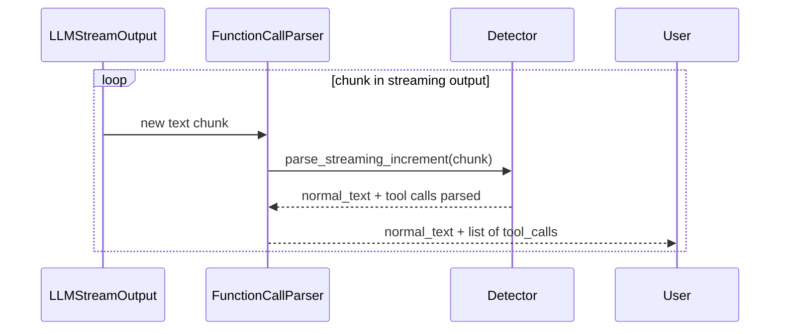
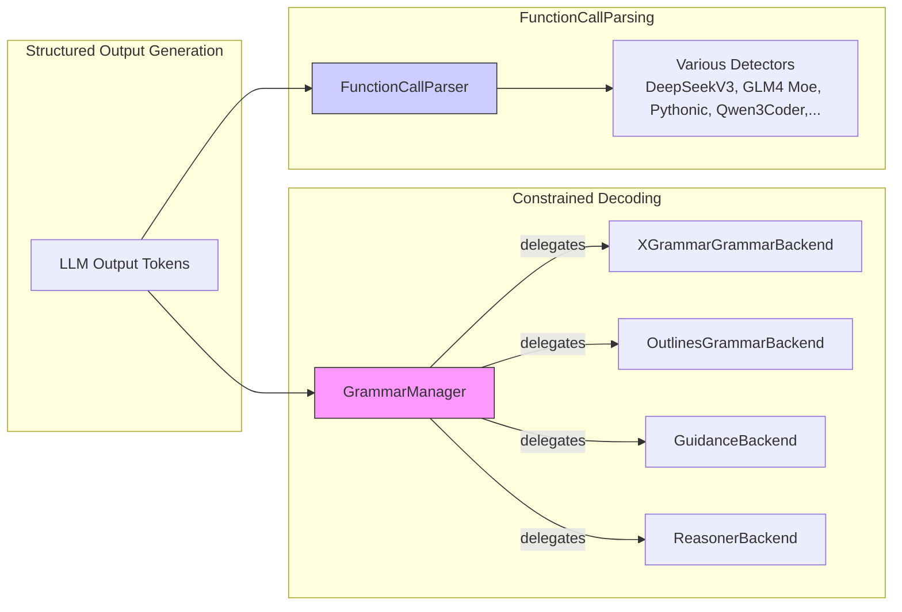

<!-- source: DeepWiki mcp.deepwiki.com · repo microsoft/llm-42 · page 8.4 Structured Outputs and Constrained Decoding · fetched 2026-10-26 -->

# 8.4 Structured Outputs and Constrained Decoding

Relevant source files

The following files were used as context for generating this wiki page:

- [python/sglang/srt/configs/kimi_k25.py](python/sglang/srt/configs/kimi_k25.py)
- [python/sglang/srt/constrained/base_grammar_backend.py](python/sglang/srt/constrained/base_grammar_backend.py)
- [python/sglang/srt/constrained/grammar_manager.py](python/sglang/srt/constrained/grammar_manager.py)
- [python/sglang/srt/constrained/llguidance_backend.py](python/sglang/srt/constrained/llguidance_backend.py)
- [python/sglang/srt/constrained/outlines_backend.py](python/sglang/srt/constrained/outlines_backend.py)
- [python/sglang/srt/constrained/reasoner_grammar_backend.py](python/sglang/srt/constrained/reasoner_grammar_backend.py)
- [python/sglang/srt/constrained/xgrammar_backend.py](python/sglang/srt/constrained/xgrammar_backend.py)
- [python/sglang/srt/entrypoints/openai/encoding_dsv32.py](python/sglang/srt/entrypoints/openai/encoding_dsv32.py)
- [python/sglang/srt/entrypoints/openai/serving_rerank.py](python/sglang/srt/entrypoints/openai/serving_rerank.py)
- [python/sglang/srt/entrypoints/openai/serving_score.py](python/sglang/srt/entrypoints/openai/serving_score.py)
- [python/sglang/srt/function_call/base_format_detector.py](python/sglang/srt/function_call/base_format_detector.py)
- [python/sglang/srt/function_call/deepseekv32_detector.py](python/sglang/srt/function_call/deepseekv32_detector.py)
- [python/sglang/srt/function_call/deepseekv3_detector.py](python/sglang/srt/function_call/deepseekv3_detector.py)
- [python/sglang/srt/function_call/function_call_parser.py](python/sglang/srt/function_call/function_call_parser.py)
- [python/sglang/srt/function_call/gigachat3_detector.py](python/sglang/srt/function_call/gigachat3_detector.py)
- [python/sglang/srt/function_call/glm47_moe_detector.py](python/sglang/srt/function_call/glm47_moe_detector.py)
- [python/sglang/srt/function_call/glm4_moe_detector.py](python/sglang/srt/function_call/glm4_moe_detector.py)
- [python/sglang/srt/function_call/gpt_oss_detector.py](python/sglang/srt/function_call/gpt_oss_detector.py)
- [python/sglang/srt/function_call/kimik2_detector.py](python/sglang/srt/function_call/kimik2_detector.py)
- [python/sglang/srt/function_call/llama32_detector.py](python/sglang/srt/function_call/llama32_detector.py)
- [python/sglang/srt/function_call/mistral_detector.py](python/sglang/srt/function_call/mistral_detector.py)
- [python/sglang/srt/function_call/pythonic_detector.py](python/sglang/srt/function_call/pythonic_detector.py)
- [python/sglang/srt/function_call/qwen25_detector.py](python/sglang/srt/function_call/qwen25_detector.py)
- [python/sglang/srt/function_call/qwen3_coder_detector.py](python/sglang/srt/function_call/qwen3_coder_detector.py)
- [python/sglang/srt/function_call/utils.py](python/sglang/srt/function_call/utils.py)
- [python/sglang/srt/models/kimi_k25.py](python/sglang/srt/models/kimi_k25.py)
- [python/sglang/srt/multimodal/processors/kimi_k25.py](python/sglang/srt/multimodal/processors/kimi_k25.py)
- [python/sglang/test/kits/ebnf_constrained_kit.py](python/sglang/test/kits/ebnf_constrained_kit.py)
- [python/sglang/test/kits/json_constrained_kit.py](python/sglang/test/kits/json_constrained_kit.py)
- [python/sglang/test/kits/regex_constrained_kit.py](python/sglang/test/kits/regex_constrained_kit.py)
- [test/registered/constrained_decoding/test_constrained_decoding.py](test/registered/constrained_decoding/test_constrained_decoding.py)
- [test/registered/distributed/test_dp_attention.py](test/registered/distributed/test_dp_attention.py)
- [test/registered/distributed/test_dp_attention_large.py](test/registered/distributed/test_dp_attention_large.py)
- [test/registered/function_call/test_function_call_parser.py](test/registered/function_call/test_function_call_parser.py)
- [test/registered/function_call/test_glm47_moe_detector.py](test/registered/function_call/test_glm47_moe_detector.py)

This section documents the grammar-based constrained decoding subsystem in LLM-42, detailing the backends implemented for grammar-guided deterministic decoding: **xgrammar**, **outlines**, **llguidance**, and **reasoner** backends. It also covers the core abstractions including the `GrammarManager` for grammar dispatch, supported constraint formats such as JSON schema, regex, and EBNF, and explains function call parsing mechanisms designed for tool-use models. The goal is to enable precise control over the token generation process using declarative grammar constraints.

---

## 8.4.1 Purpose and Scope

Structured output generation and constrained decoding are crucial for controlled LLM generation with guaranteed format adherence. This subsystem implements grammar-based backends enabling token-level constraints to enforce output formats corresponding to:

- JSON schemas
- Regular expressions
- EBNF (Extended Backus-Naur Form) grammars
- Structural tags and patterns

The constraints guide the generation process by masking out invalid tokens dynamically, ensuring only grammatically valid sequences are produced. Additionally, the system supports parsing LLM outputs formatted as function calls for invoking external tools, enabling deterministic recognition and extraction of tool call parameters.

---

## 8.4.2 Core Abstractions: BaseGrammarBackend and GrammarManager

At the core lies the abstract base class `BaseGrammarBackend`, which defines the contract for constrained decoding backends.

### `BaseGrammarBackend` and `BaseGrammarObject`

- **`BaseGrammarBackend`**: Manages the life cycle of grammar objects, caching, dispatching grammars based on input format types and strings, and asynchronous compilation via a thread pool.
- **`BaseGrammarObject`**: Represents an instance of a grammar state machine for a decoding session, providing methods for:
  - Accepting tokens (`accept_token`)
  - Rollback support (token-level backtracking)
  - Allocating and filling token bitmasks to mask out invalid vocabulary tokens
  - Applying masks to logits in a device-optimized manner (CUDA, CPU, NPU)
  - Supporting jump-ahead/retokenize optimizations

Dispatch of specific grammar objects is based on `key_type` identifiers such as `"json"`, `"regex"`, `"ebnf"`, or `"structural_tag"`. The backend caches grammar objects keyed by `(key_type, key_string)` tuples for reuse.

### `GrammarManager`

This manager is responsible for selecting and instantiating an appropriate `BaseGrammarBackend` implementation based on the inference configuration (e.g., server args and tokenizer). It provides a unified interface to interact with various grammar backends.

- Uses a registration pattern allowing plug-and-play replacement/enhancement of grammar backends.
- Instantiated via `create_grammar_backend` which accepts tokenizer and vocabulary size.

---

**Sources:**  
`python/sglang/srt/constrained/base_grammar_backend.py:25-214`  
`python/sglang/srt/constrained/grammar_manager.py:1-117`

---

## 8.4.3 Grammar-Based Backends Overview

LLM-42 includes multiple grammar backends, each with their own supported grammar formalisms and mechanisms for enforcing constraints:

| Backend Name      | Supported Grammar Types           | Main Code Entity                 | Description                                                |
|-------------------|---------------------------------|---------------------------------|------------------------------------------------------------|
| **xgrammar**      | JSON schema, EBNF, Regex         | `XGrammarGrammar`, `XGrammarGrammarBackend`   | Uses the `xgrammar` library to compile and match grammars, tightly integrated with tokenizers including custom token bitmask operations. Implements rollback, jump-ahead optimizations. |
| **outlines**       | Regex, JSON Schema (via regex)   | `OutlinesGrammar`, `OutlinesGrammarBackend`   | Uses `outlines` library to compile regex-based guides from JSON schema or EBNF. Efficient regex FSM-based decoder constraints. Supports jump-forward token sequences. |
| **llguidance**     | JSON schema, Regex, EBNF          | `GuidanceGrammar`, `GuidanceBackend`            | Uses `llguidance` library to parse and match grammars from JSON schema and other formats, applies token bitmask constraints on supported devices. Minimal jump optimizations. |
| **reasoner**       | Custom reasoning constraints      | `ReasonerGrammar`, `ReasonerBackend`             | Backend designed for reasoning-based constraints, enabled optionally during decoding workflows (details not elaborated here). |

These backends share a common interface for allocating vocab masks, accept tokens into the grammar state machines, rollback, and apply pruning masks to logits dynamically during decoding. Each backend can leverage its preferred underlying grammar compilation and matching engine.

---

### Diagram: From Natural Language Space to Code Entity Space

---

**Sources:**  
- `python/sglang/srt/constrained/xgrammar_backend.py:13-167`  
- `python/sglang/srt/constrained/outlines_backend.py:13-112`  
- `python/sglang/srt/constrained/llguidance_backend.py:14-179`  
- `python/sglang/srt/constrained/base_grammar_backend.py:1-214`  
- `python/sglang/srt/constrained/grammar_manager.py:1-117`  

---

## 8.4.4 XGrammarBackend: JSON Schema and EBNF with `xgrammar` Library

The `XGrammarGrammarBackend` integrates tightly with the third-party `xgrammar` library:

- Compiles JSON schema or EBNF grammars into `CompiledGrammar` instances.
- Uses `GrammarMatcher` to maintain the parsing state and validate token acceptance.
- Supports efficient token masking with device-specific implementations:
  - CUDA kernels for NVIDIA GPUs (`apply_token_bitmask_inplace_cuda`)
  - Triton kernels for other GPUs (`apply_token_bitmask_inplace_triton`)
- Implements rollback logic to unwind invalid tokens on decoding errors.
- Supports jump-forward and retokenize optimization:

  - `try_jump_forward()` attempts to find token sequences for fast-forwarding the decoding cursor.
  - `jump_and_retokenize()` aligns grammar state with new token sequences after jumps.

- Caches compiled grammars for reuse.

Typical use includes:

- Allocating a vocab mask tensor with `allocate_vocab_mask`.
- Filling next token bitmask per token position with `fill_vocab_mask`.
- Applying the mask at decode time to prune out invalid tokens.

---

**Sources:**  
- `python/sglang/srt/constrained/xgrammar_backend.py:13-167`

---

## 8.4.5 OutlinesBackend: Regex-Based FSM Guides

The `OutlinesGrammarBackend` leverages the `outlines` library, which provides a regex-guided Finite State Machine (FSM) for decoding:

- Converts JSON schema or EBNF constraints into regex patterns via `build_regex_from_schema`.
- Uses `RegexGuide` from outlines to compile regex FSM.
- FSM guides token transitions with a `state` property.
- Token acceptance moves through FSM states (via `accept_token` method).
- Supports jump-forward via byte sequence lookup in a jump-forward map.
- Vocabulary masks built by setting allowed tokens from the FSM's next possible transitions.
- Efficient masked fill on logits (logits set to `-inf` where invalid).

The backend handles tokenizer adaptation and whitespace pattern configuration.

---

**Sources:**  
- `python/sglang/srt/constrained/outlines_backend.py:13-112`

---

## 8.4.6 LLGuidanceBackend: Grammar Matching with `llguidance`

The `GuidanceBackend` integrates `llguidance`:

- Uses `LLMatcher` initialized from JSON schema or regex/EBNF serialized grammar.
- Applies constraints by consuming tokens through `LLMatcher.consume_token`.
- Uses `allocate_token_bitmask`, `fill_next_token_bitmask`, and `apply_token_bitmask_inplace` for device-accelerated filtering.
- Supports structural tag formats for grammar construction.
- Less focus on jump optimizations; mainly relies on `llguidance` efficient token matching.

---

**Sources:**  
- `python/sglang/srt/constrained/llguidance_backend.py:14-179`

---

## 8.4.7 Function Call Parsing for Tool-Use Models

Modern LLM deployments often require parsing outputs as calls to external functions/tools with structured arguments. LLM-42 implements a modular **function call parser** leveraging multiple detector strategies.

### `FunctionCallParser` Class

- Drivers parsing for various tool call output formats.
- Supports streaming incremental parsing and one-time complete parsing.
- Delegates detection and parse logic to specific detector classes selected by a mapping (`ToolCallParserEnum`).
- Supports tool call formats like:
  - `deepseekv3` (JSON-based, special unicode tokens)
  - `glm4_moe` (XML-like, streaming convertible to JSON)
  - `pythonic` (Pythonic syntax with function calls in square brackets)
  - `qwen3_coder` (XML tags with tool call/parameter blocks)
  - `mistral`, `gigachat3`, etc.
- Each detector implements methods for streaming incremental parsing and full text parsing.
- Handles tool validation against a list of known tools.
- Supports structural tag generation to guide model prompting for tool-use.

### Data Flow for Streaming Parsing

### Key Parsing Detectors Examples

- **`DeepSeekV3Detector`**  
  Handles special Unicode-delimited JSON blocks representing function calls.
- **`Glm4MoeDetector`**  
  Converts XML-like `<tool_call><arg_key>...</arg_key><arg_value>...</arg_value></tool_call>` blocks to JSON.
- **`PythonicDetector`**  
  Parses Python-like syntax tool calls, e.g. `[get_weather(location='NY')]`.
- **`Qwen3CoderDetector`**  
  Parses XML-style tokens `<tool_call>`, `<function>`, `<parameter>` for complex nested calls.

All detectors inherit from `BaseFormatDetector` defining the base streaming vs non-stream parsing interfaces.

---

**Sources:**  
- `python/sglang/srt/function_call/function_call_parser.py:1-180`  
- `python/sglang/srt/function_call/base_format_detector.py:1-240`  
- `python/sglang/srt/function_call/deepseekv3_detector.py:1-116`  
- `python/sglang/srt/function_call/glm4_moe_detector.py:1-180`  
- `python/sglang/srt/function_call/pythonic_detector.py:1-185`  
- `python/sglang/srt/function_call/qwen3_coder_detector.py:1-109`

---

## 8.4.8 Data Flow Summary Diagram

---

## 8.4.9 Summary

The structured output and constrained decoding subsystem in LLM-42 provides a comprehensive framework for:

- Declarative and composable token-level constraints via multiple grammar backends.
- Efficient, device-accelerated vocab masking ensuring deterministic, valid LLM output.
- Support for JSON schema, EBNF, regex, and structural tags as constraint formats.
- Sophisticated function call parsing for rich tool-use model outputs with streaming support.
- Modular, extensible design allowing new grammar backends and detectors.

This subsystem is essential for deploying controlled conversational agents and tool-augmented LLM workflows within the LLM-42 deterministic inference engine.

---

# Appendix: Key Classes and Files

| Concept                | Main Classes / Functions                   | File Path                                  |
|------------------------|-------------------------------------------|--------------------------------------------|
| Grammar Backend Base    | `BaseGrammarBackend`, `BaseGrammarObject`| `python/sglang/srt/constrained/base_grammar_backend.py` |
| XGrammar Backend       | `XGrammarGrammar`, `XGrammarGrammarBackend`| `python/sglang/srt/constrained/xgrammar_backend.py`       |
| Outlines Backend       | `OutlinesGrammar`, `OutlinesGrammarBackend`| `python/sglang/srt/constrained/outlines_backend.py`        |
| LLGuidance Backend     | `GuidanceGrammar`, `GuidanceBackend`       | `python/sglang/srt/constrained/llguidance_backend.py`      |
| Grammar Manager        | `GrammarManager`, `create_grammar_backend`| `python/sglang/srt/constrained/grammar_manager.py`         |
| Function Call Parser   | `FunctionCallParser`                        | `python/sglang/srt/function_call/function_call_parser.py`  |
| Detectors Base         | `BaseFormatDetector`                        | `python/sglang/srt/function_call/base_format_detector.py`  |
| DeepSeekV3 Detector    | `DeepSeekV3Detector`                        | `python/sglang/srt/function_call/deepseekv3_detector.py`   |
| GLM4 Moe Detector      | `Glm4MoeDetector`                          | `python/sglang/srt/function_call/glm4_moe_detector.py`     |
| Pythonic Detector      | `PythonicDetector`                         | `python/sglang/srt/function_call/pythonic_detector.py`     |
| Qwen3 Coder Detector   | `Qwen3CoderDetector`                       | `python/sglang/srt/function_call/qwen3_coder_detector.py`  |

---

This completes section 8.4 "Structured Outputs and Constrained Decoding" covering grammar backends and function call parsing implementations in the LLM-42 codebase.

---

