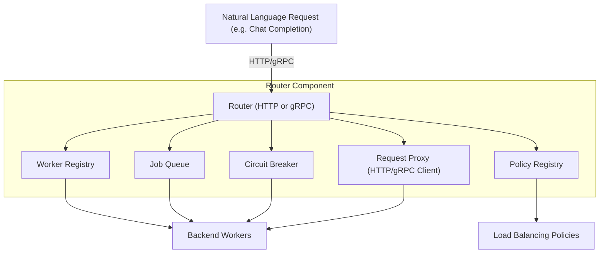
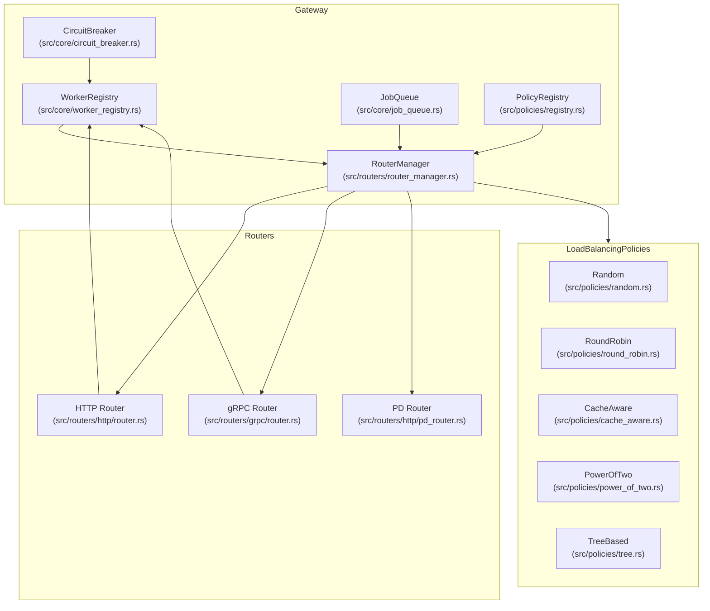

<!-- source: DeepWiki mcp.deepwiki.com · repo microsoft/llm-42 · page 9.1 Gateway Architecture and Routing Policies · fetched 2026-10-26 -->

# Gateway Architecture and Routing Policies

<details>
<summary>Relevant source files</summary>

The following files were used as context for generating this wiki page:

- [sgl-model-gateway/Cargo.toml](sgl-model-gateway/Cargo.toml)
- [sgl-model-gateway/benches/router_registry_bench.rs](sgl-model-gateway/benches/router_registry_bench.rs)
- [sgl-model-gateway/benches/tree_benchmark.rs](sgl-model-gateway/benches/tree_benchmark.rs)
- [sgl-model-gateway/bindings/python/src/lib.rs](sgl-model-gateway/bindings/python/src/lib.rs)
- [sgl-model-gateway/build.rs](sgl-model-gateway/build.rs)
- [sgl-model-gateway/src/app_context.rs](sgl-model-gateway/src/app_context.rs)
- [sgl-model-gateway/src/config/mod.rs](sgl-model-gateway/src/config/mod.rs)
- [sgl-model-gateway/src/config/types.rs](sgl-model-gateway/src/config/types.rs)
- [sgl-model-gateway/src/config/validation.rs](sgl-model-gateway/src/config/validation.rs)
- [sgl-model-gateway/src/core/circuit_breaker.rs](sgl-model-gateway/src/core/circuit_breaker.rs)
- [sgl-model-gateway/src/core/job_queue.rs](sgl-model-gateway/src/core/job_queue.rs)
- [sgl-model-gateway/src/core/metrics_aggregator.rs](sgl-model-gateway/src/core/metrics_aggregator.rs)
- [sgl-model-gateway/src/core/mod.rs](sgl-model-gateway/src/core/mod.rs)
- [sgl-model-gateway/src/core/steps/mod.rs](sgl-model-gateway/src/core/steps/mod.rs)
- [sgl-model-gateway/src/core/steps/tokenizer_registration.rs](sgl-model-gateway/src/core/steps/tokenizer_registration.rs)
- [sgl-model-gateway/src/core/steps/worker/external/create_workers.rs](sgl-model-gateway/src/core/steps/worker/external/create_workers.rs)
- [sgl-model-gateway/src/core/steps/worker/external/discover_models.rs](sgl-model-gateway/src/core/steps/worker/external/discover_models.rs)
- [sgl-model-gateway/src/core/steps/worker/external/mod.rs](sgl-model-gateway/src/core/steps/worker/external/mod.rs)
- [sgl-model-gateway/src/core/steps/worker/local/create_worker.rs](sgl-model-gateway/src/core/steps/worker/local/create_worker.rs)
- [sgl-model-gateway/src/core/steps/worker/local/detect_connection.rs](sgl-model-gateway/src/core/steps/worker/local/detect_connection.rs)
- [sgl-model-gateway/src/core/steps/worker/local/discover_dp.rs](sgl-model-gateway/src/core/steps/worker/local/discover_dp.rs)
- [sgl-model-gateway/src/core/steps/worker/local/discover_metadata.rs](sgl-model-gateway/src/core/steps/worker/local/discover_metadata.rs)
- [sgl-model-gateway/src/core/steps/worker/local/mod.rs](sgl-model-gateway/src/core/steps/worker/local/mod.rs)
- [sgl-model-gateway/src/core/steps/worker/local/update_worker_properties.rs](sgl-model-gateway/src/core/steps/worker/local/update_worker_properties.rs)
- [sgl-model-gateway/src/core/steps/worker/mod.rs](sgl-model-gateway/src/core/steps/worker/mod.rs)
- [sgl-model-gateway/src/core/steps/worker/shared/activate.rs](sgl-model-gateway/src/core/steps/worker/shared/activate.rs)
- [sgl-model-gateway/src/core/worker.rs](sgl-model-gateway/src/core/worker.rs)
- [sgl-model-gateway/src/core/worker_builder.rs](sgl-model-gateway/src/core/worker_builder.rs)
- [sgl-model-gateway/src/core/worker_registry.rs](sgl-model-gateway/src/core/worker_registry.rs)
- [sgl-model-gateway/src/lib.rs](sgl-model-gateway/src/lib.rs)
- [sgl-model-gateway/src/main.rs](sgl-model-gateway/src/main.rs)
- [sgl-model-gateway/src/middleware.rs](sgl-model-gateway/src/middleware.rs)
- [sgl-model-gateway/src/observability/metrics.rs](sgl-model-gateway/src/observability/metrics.rs)
- [sgl-model-gateway/src/policies/bucket.rs](sgl-model-gateway/src/policies/bucket.rs)
- [sgl-model-gateway/src/policies/cache_aware.rs](sgl-model-gateway/src/policies/cache_aware.rs)
- [sgl-model-gateway/src/policies/factory.rs](sgl-model-gateway/src/policies/factory.rs)
- [sgl-model-gateway/src/policies/manual.rs](sgl-model-gateway/src/policies/manual.rs)
- [sgl-model-gateway/src/policies/mod.rs](sgl-model-gateway/src/policies/mod.rs)
- [sgl-model-gateway/src/policies/power_of_two.rs](sgl-model-gateway/src/policies/power_of_two.rs)
- [sgl-model-gateway/src/policies/random.rs](sgl-model-gateway/src/policies/random.rs)
- [sgl-model-gateway/src/policies/registry.rs](sgl-model-gateway/src/policies/registry.rs)
- [sgl-model-gateway/src/policies/round_robin.rs](sgl-model-gateway/src/policies/round_robin.rs)
- [sgl-model-gateway/src/policies/tree.rs](sgl-model-gateway/src/policies/tree.rs)
- [sgl-model-gateway/src/routers/factory.rs](sgl-model-gateway/src/routers/factory.rs)
- [sgl-model-gateway/src/routers/grpc/client.rs](sgl-model-gateway/src/routers/grpc/client.rs)
- [sgl-model-gateway/src/routers/grpc/common/stages/dispatch_metadata.rs](sgl-model-gateway/src/routers/grpc/common/stages/dispatch_metadata.rs)
- [sgl-model-gateway/src/routers/grpc/common/stages/request_execution.rs](sgl-model-gateway/src/routers/grpc/common/stages/request_execution.rs)
- [sgl-model-gateway/src/routers/grpc/common/stages/worker_selection.rs](sgl-model-gateway/src/routers/grpc/common/stages/worker_selection.rs)
- [sgl-model-gateway/src/routers/grpc/context.rs](sgl-model-gateway/src/routers/grpc/context.rs)
- [sgl-model-gateway/src/routers/grpc/harmony/stages/preparation.rs](sgl-model-gateway/src/routers/grpc/harmony/stages/preparation.rs)
- [sgl-model-gateway/src/routers/grpc/harmony/stages/request_building.rs](sgl-model-gateway/src/routers/grpc/harmony/stages/request_building.rs)
- [sgl-model-gateway/src/routers/grpc/harmony/stages/response_processing.rs](sgl-model-gateway/src/routers/grpc/harmony/stages/response_processing.rs)
- [sgl-model-gateway/src/routers/grpc/pd_router.rs](sgl-model-gateway/src/routers/grpc/pd_router.rs)
- [sgl-model-gateway/src/routers/grpc/pipeline.rs](sgl-model-gateway/src/routers/grpc/pipeline.rs)
- [sgl-model-gateway/src/routers/grpc/regular/stages/chat/preparation.rs](sgl-model-gateway/src/routers/grpc/regular/stages/chat/preparation.rs)
- [sgl-model-gateway/src/routers/grpc/regular/stages/chat/response_processing.rs](sgl-model-gateway/src/routers/grpc/regular/stages/chat/response_processing.rs)
- [sgl-model-gateway/src/routers/grpc/regular/stages/classify/mod.rs](sgl-model-gateway/src/routers/grpc/regular/stages/classify/mod.rs)
- [sgl-model-gateway/src/routers/grpc/regular/stages/classify/response_processing.rs](sgl-model-gateway/src/routers/grpc/regular/stages/classify/response_processing.rs)
- [sgl-model-gateway/src/routers/grpc/regular/stages/embedding/preparation.rs](sgl-model-gateway/src/routers/grpc/regular/stages/embedding/preparation.rs)
- [sgl-model-gateway/src/routers/grpc/regular/stages/embedding/request_building.rs](sgl-model-gateway/src/routers/grpc/regular/stages/embedding/request_building.rs)
- [sgl-model-gateway/src/routers/grpc/regular/stages/generate/preparation.rs](sgl-model-gateway/src/routers/grpc/regular/stages/generate/preparation.rs)
- [sgl-model-gateway/src/routers/grpc/regular/stages/generate/response_processing.rs](sgl-model-gateway/src/routers/grpc/regular/stages/generate/response_processing.rs)
- [sgl-model-gateway/src/routers/grpc/regular/stages/mod.rs](sgl-model-gateway/src/routers/grpc/regular/stages/mod.rs)
- [sgl-model-gateway/src/routers/grpc/regular/stages/preparation.rs](sgl-model-gateway/src/routers/grpc/regular/stages/preparation.rs)
- [sgl-model-gateway/src/routers/grpc/regular/stages/request_building.rs](sgl-model-gateway/src/routers/grpc/regular/stages/request_building.rs)
- [sgl-model-gateway/src/routers/grpc/regular/stages/response_processing.rs](sgl-model-gateway/src/routers/grpc/regular/stages/response_processing.rs)
- [sgl-model-gateway/src/routers/grpc/router.rs](sgl-model-gateway/src/routers/grpc/router.rs)
- [sgl-model-gateway/src/routers/http/pd_router.rs](sgl-model-gateway/src/routers/http/pd_router.rs)
- [sgl-model-gateway/src/routers/http/router.rs](sgl-model-gateway/src/routers/http/router.rs)
- [sgl-model-gateway/src/routers/router_manager.rs](sgl-model-gateway/src/routers/router_manager.rs)
- [sgl-model-gateway/src/routers/tokenize/handlers.rs](sgl-model-gateway/src/routers/tokenize/handlers.rs)
- [sgl-model-gateway/src/server.rs](sgl-model-gateway/src/server.rs)
- [sgl-model-gateway/src/service_discovery.rs](sgl-model-gateway/src/service_discovery.rs)
- [sgl-model-gateway/tests/load_guard_raii_test.rs](sgl-model-gateway/tests/load_guard_raii_test.rs)

</details>


This page provides an in-depth technical overview of the gateway architecture and routing policies implemented in the **sgl-model-gateway** Rust service. This gateway is responsible for managing a dynamic worker registry, managing a job queue, applying circuit breakers, and performing load balancing among backend inference workers. The routing policies supported include random selection, round-robin, cache-aware routing, power-of-two choices, and tree-based routing. The gateway also manages the router lifecycle for both HTTP and gRPC requests.

---

## 1. Overview

The `sgl-model-gateway` is a critical component for large-scale deployments of LLM inference services. It orchestrates request routing to multiple backend workers, balancing load while respecting worker health, connection modes (HTTP/gRPC), and routing keys.

Main lifecycle components:

- **Worker Registry**: Maps workers to models, manages worker metadata, health status, and maintains consistent hash rings for fast routing.
- **Job Queue**: Coordinates concurrent request execution respecting concurrency limits.
- **Circuit Breakers**: Tracks worker health on request failure/success to temporarily disable unhealthy workers.
- **Routing Policies**: Abstract algorithms selecting workers for routing:
  - Random
  - Round-robin
  - Cache-aware (tree-based prefix caching)
  - Power-of-two choices (select from two random workers)
  - Manual assignment
  - Prefix Hash (hash routing key prefix)
- **Router Manager**: Centralizes router state management and supports both HTTP and gRPC routers.

The gateway supports selecting workers by model IDs and also supports features such as data parallelism-aware scheduling and IGW (Inference Gateway) mode, which enables multi-model routing.

---

## 2. Worker Registry

### Role

The worker registry maintains a centralized registry of backend workers, indexed by model id and with fast lookups via immutable snapshots to minimize locking overhead in highly concurrent scenarios.

### Key Features

- **Model-based indexing:** Provides O(1) lookups of workers by normalized model ID.
- **Consistent Hash Rings:** Pre-computes hash rings for each model for efficient and stable key-to-worker mapping.
- **Worker metadata:** Tracks worker health, load, API keys, connection modes, and circuit breaker states.
- **Worker Routing Key Load:** Maintains active routing keys count per worker to aid cache-aware policies.

### Key Structures

- `WorkerRegistry`:
  - `workers`: Registry of all workers keyed by unique ID.
  - `model_index`: Map from model IDs to immutable slices (`Arc<[Arc<dyn Worker>]>`) for zero-lock concurrent lookups.
  - `hash_rings`: Concurrent map of model IDs to `HashRing` instances for consistent hashing.
  - `type_workers` and `connection_workers`: Indexes workers by type and connection mode.

- `HashRing`:
  - Implements consistent hashing with multiple virtual nodes per worker (150 by default) to evenly distribute keys.
  - Supports O(log n) lookup to find the appropriate healthy worker for a given routing key.

- `WorkerRoutingKeyLoad`:
  - Counts number of active routing keys per worker for load tracking and cache-aware balancing.

### Data flow for worker selection

1. The router queries the WorkerRegistry for workers of a particular model.
2. The registry returns a zero-lock immutable slice of workers.
3. The appropriate routing policy is called to select a worker from the candidate list.
4. Circuit breaker and health checks ensure only available workers are chosen.

Sources: `src/core/worker_registry.rs:1-250`(), `src/core/worker.rs:1-220`()

---

## 3. Job Queue and Circuit Breakers

The gateway handles high concurrency by maintaining a job queue with configurable concurrency limits, ensuring worker stability and graceful backpressure.

- Jobs correspond to client inference requests that need dispatch.
- Circuit breakers track worker health by monitoring success/failure of requests.
  - If a worker crosses failure thresholds, its circuit breaker opens, preventing further requests until recovery.
- Workers expose methods for health checks and load tracking.
- The job queue coordinates concurrent request limits on a per-worker basis.

Sources: `src/core/job_queue.rs`(), `src/core/worker.rs:100-180`()

---

## 4. Routing Policies

Routing policies encapsulate the algorithms used to select the target backend worker for an inference request.

### Abstract Policy Interface

- Each policy implements `LoadBalancingPolicy` with async method:

  ```rust
  async fn select_worker(
      &self,
      workers: &[Arc<dyn Worker>],
      info: &SelectWorkerInfo<'_>,
  ) -> Option<usize>;
  ```

`SelectWorkerInfo` contains contextual information like request text, tokens, headers, and optionally a consistent hash ring.

### Implemented Policies

#### 4.1 Random

Selects a random worker from the available pool.

- Simple baseline policy.
  
Sources: `src/policies/random.rs` (not in snippet but implied from policy registry)

#### 4.2 Round Robin

Cycles through workers sequentially to balance load evenly.

- Maintains counters per model for deterministic order.

Sources: `src/policies/round_robin.rs` (implementation implied)

#### 4.3 Cache-Aware (Approximate Tree-Based)

One of the most sophisticated policies combines cache affinity and load balancing.

- Maintains an approximate radix tree per model of previously routed request prefixes to workers.
- On a routing decision:
  - Finds the worker with the highest prefix match for the request text.
  - If match rate exceeds a threshold (e.g., 30%), routes to that worker for cache locality.
  - If below threshold, routes to the worker with the least loaded prefix tree.
- Dynamically switches to shortest queue load balancing when system load is imbalanced.
- Background task evicts least recently used leaves to keep data structure size manageable.
- Supports mesh synchronization of tree state across cluster nodes for consistency.

This reduces cache misses by routing similar requests to the same backend.

Key parameters:

- `cache_threshold` - minimum prefix match ratio to apply cache affinity.
- `balance_abs_threshold` and `balance_rel_threshold` - thresholds for switching to load balancing.
- `eviction_interval_secs` - interval for background eviction.
- `max_tree_size` - max allowed nodes in the prefix tree.

The primary data structure is `Tree` with prefix matching capability and eviction support.

```mermaid
flowchart LR
  subgraph CacheAwarePolicy
    direction TB
    Trees[DashMap<ModelId, Arc<Tree>>]
    MeshSync[OptionalMeshSyncManager]
    EvictionTask["PeriodicTask: Eviction"]
  end
  subgraph WorkerRegistry
    Workers
  end
  Trees -->|Insert workers| Workers
  EvictionTask -->|Runs periodically| Trees
  MeshSync -- sync -- Trees
```

Sources: `src/policies/cache_aware.rs:1-280`(), `src/policies/tree.rs:1-820`()

#### 4.4 Power-of-Two Choices

Selects two workers at random and chooses the less loaded one.

- Balances load probabilistically with minimal state.

Sources: `src/policies/power_of_two.rs` (implied, not in snippet)

#### 4.5 Tree-Based Routing

Uses prefix trees to route requests with common prefixes to the same workers, improving cache reuse.

- Similar in concept to cache-aware but focuses on prefix tree matching.

Sources: `src/policies/tree.rs:1-820`()

#### 4.6 Manual Assignment

Assigns workers explicitly based on configuration or routing key assignment.

- Supports manual mappings and load balancing modes.

Sources: `src/policies/manual.rs` (implied)

---

## 5. Router Manager and Router Implementations

### Router Manager

- Manages lifecycle of HTTP and gRPC routers.
- Coordinates worker registry and routing policies.
- Supports policy injection and concurrency management.

Locations: `src/routers/router_manager.rs` (not fully shown, implied)

### HTTP Router

The HTTP router routes RESTful inference requests to backend workers according to configured policies.

- Implements trait `RouterTrait` with methods for each inference endpoint.
- Uses `WorkerRegistry` to get available workers by model.
- Applies routing policies to select an appropriate worker.
- Supports request retries, header forwarding, and streaming response proxying.
- Supports IGW mode with explicit model ID routing and DP-aware scheduling.
- Selects workers filtered by `WorkerType::Regular` and `ConnectionMode::Http`.
- Uses `reqwest` HTTP client for proxying requests and responses.

```rust
pub struct Router {
    worker_registry: Arc<WorkerRegistry>,
    policy_registry: Arc<PolicyRegistry>,
    client: Client,
    dp_aware: bool,
    enable_igw: bool,
    retry_config: RetryConfig,
}
```

Worker selection:

- Filters workers by availability (healthy and circuit breaker)
- Gets configured policy for model
- Gets consistent hash ring for model
- Calls `policy.select_worker()` to get worker index
- Returns selected `Arc<dyn Worker>`

Sources: `src/routers/http/router.rs:1-290`()

### gRPC Router (Brief Overview)

- Similar structure as HTTP router but optimized for streaming and gRPC-specific protocols.
- Implements fine-grained pipeline stages for worker selection, request execution, and response processing.
- Supports load balancing policies analogous to the HTTP router.
- Integrated with `RouterManager`.

Sources: `src/routers/grpc/router.rs` (implied, not shown fully)

---

## 6. Data Flow Diagram: Natural Language Request to Router to Workers



- The incoming request arrives at the router (HTTP or gRPC).
- The router queries the worker registry for candidate backend workers by model.
- It uses a configured load balancing policy (random, round robin, cache-aware, etc.) to select a backend.
- The job queue ensures concurrency limits and queuing.
- Circuit breakers enforce health-based filtering.
- The request is proxied asynchronously to the selected backend worker.

Sources: `src/routers/http/router.rs`, `src/core/worker_registry.rs`, `src/policies/cache_aware.rs`, `src/core/job_queue.rs`()

---

## 7. Load Balancing Policy Selection and Integration

The router instantiates policies via a policy registry:

- Each policy exposes a `select_worker()` async function.
- The router uses the policy associated with the model or falls back to default policy.
- For HTTP routers, policies typically base selection on request text and headers.
- For gRPC, tokens (token streams) may be used for prefix-aware policies.
- Cache-aware policy is the default and recommended for best latency and cache performance.

The consistent hash rings generated by `WorkerRegistry` are passed to policies to support consistent routing.

Example: Selecting a worker for model with text

```rust
let policy = self.policy_registry.get_policy_or_default(model_id);
let hash_ring = self.worker_registry.get_hash_ring(model_id.unwrap_or(UNKNOWN_MODEL_ID));
let idx = policy.select_worker(&available_workers, &SelectWorkerInfo {
    request_text: Some(text),
    tokens: None, // for HTTP
    headers: Some(headers),
    hash_ring,
}).await?;
```

---

## 8. Circuit Breaker Usage

- Every worker encapsulates a `CircuitBreaker`.
- Circuit breaker state determines `is_available()` for routing eligibility.
- Outcomes of requests update the circuit breaker status.
- Circuit breaker supports closed, open, and half-open states with automatic health recovery.

---

## 9. HTTP and gRPC Router Implementations

### HTTP Router

- Uses `axum` framework for serving HTTP endpoints.
- Supports OpenAI-compatible and internal LLM request formats.
- Proxies requests to backend using `reqwest::Client`.
- For failed requests or circuit-open workers, retries are managed based on a configurable retry policy.
- Streaming responses use custom reverse proxy body types that cleanly track concurrency.

### gRPC Router

- Implemented using `tonic`.
- Supports pipelined stages including prefill/decode routing in disaggregated mode.
- Implements fine-grained worker selection and retry logic.
- Integrates with the same policies and worker registry as HTTP router.

Sources: `src/routers/http/router.rs`, `src/routers/grpc/router.rs` (partial)

---

## 10. Gateway Component Associations to Code Entities



---

## 11. Summary

The gateway architecture in `sgl-model-gateway` is designed for high-performance, scalable routing of inference requests. It builds on:

- Efficient, lock-free worker registry with consistent hashing.
- Sophisticated load balancing policies including cache-aware routing with prefix trees.
- Worker health management via circuit breakers.
- Modular router manager supporting both HTTP and gRPC protocols.
- Integration with observability and retry mechanisms.

This design enables seamless, low-latency routing to hundreds of backend workers, supporting large-scale LLM deployments with deterministic load balancing and cache locality awareness.

---

## References

- Worker registry and hash ring: `src/core/worker_registry.rs:1-250`(), `src/core/worker.rs:1-220`()
- Cache-aware routing policy and tree structures: `src/policies/cache_aware.rs:1-280`(), `src/policies/tree.rs:1-820`()
- HTTP router implementation: `src/routers/http/router.rs:1-290`()
- PD router implementation: `src/routers/http/pd_router.rs:1-180`()
- Gateway main CLI and config: `src/main.rs:20-220`()
- Middleware and concurrency controls: `src/middleware.rs:1-320`()
- Metrics and observability: `src/observability/metrics.rs:1-130`()

This concludes the technical exposition of gateway architecture and routing policies for the LLM-42 model gateway.

---

