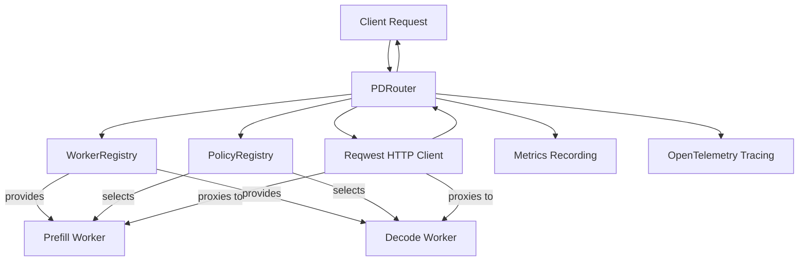
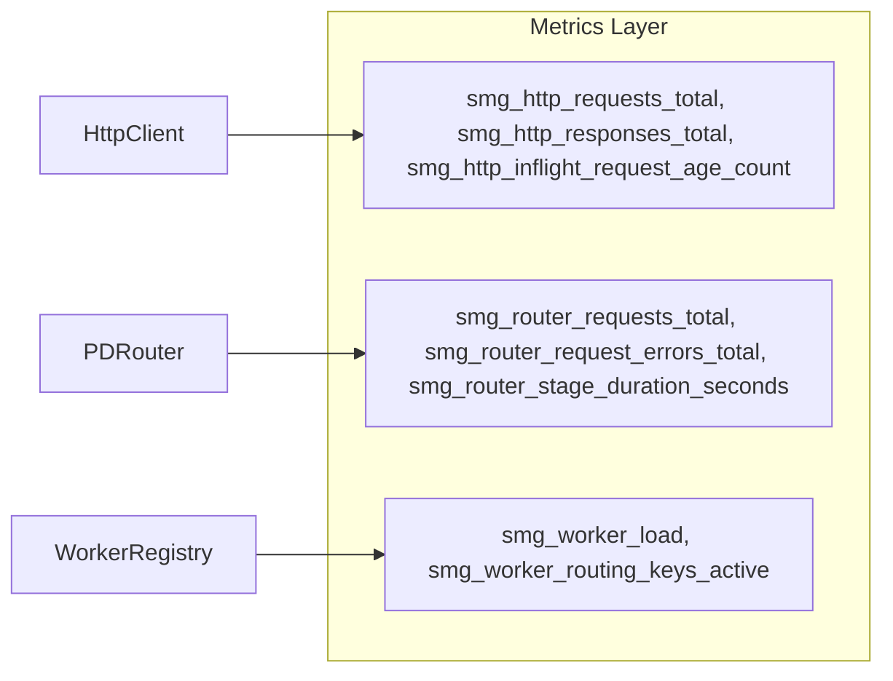
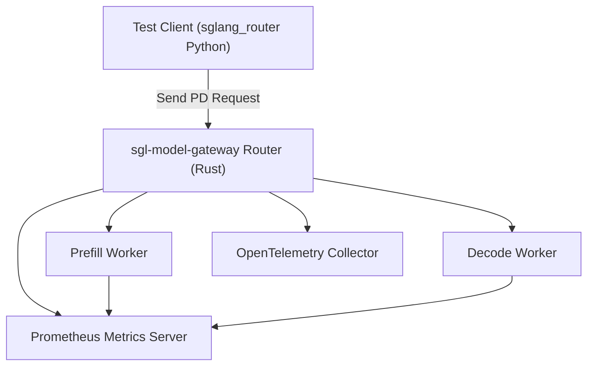

<!-- source: DeepWiki mcp.deepwiki.com · repo microsoft/llm-42 · page 9.2 Gateway PD Disaggregation and Observability · fetched 2026-10-26 -->

# Gateway PD Disaggregation and Observability

<details>
<summary>Relevant source files</summary>

The following files were used as context for generating this wiki page:

- [.github/workflows/pr-benchmark-rust.yml](.github/workflows/pr-benchmark-rust.yml)
- [.github/workflows/pr-test-rust.yml](.github/workflows/pr-test-rust.yml)
- [docs/advanced_features/sgl_model_gateway.md](docs/advanced_features/sgl_model_gateway.md)
- [sgl-model-gateway/Cargo.toml](sgl-model-gateway/Cargo.toml)
- [sgl-model-gateway/README.md](sgl-model-gateway/README.md)
- [sgl-model-gateway/bindings/python/src/lib.rs](sgl-model-gateway/bindings/python/src/lib.rs)
- [sgl-model-gateway/bindings/python/src/sglang_router/router.py](sgl-model-gateway/bindings/python/src/sglang_router/router.py)
- [sgl-model-gateway/bindings/python/src/sglang_router/router_args.py](sgl-model-gateway/bindings/python/src/sglang_router/router_args.py)
- [sgl-model-gateway/build.rs](sgl-model-gateway/build.rs)
- [sgl-model-gateway/e2e_test/benchmarks/conftest.py](sgl-model-gateway/e2e_test/benchmarks/conftest.py)
- [sgl-model-gateway/e2e_test/chat_completions/test_enable_thinking.py](sgl-model-gateway/e2e_test/chat_completions/test_enable_thinking.py)
- [sgl-model-gateway/e2e_test/chat_completions/test_openai_server.py](sgl-model-gateway/e2e_test/chat_completions/test_openai_server.py)
- [sgl-model-gateway/e2e_test/conftest.py](sgl-model-gateway/e2e_test/conftest.py)
- [sgl-model-gateway/e2e_test/embeddings/test_correctness.py](sgl-model-gateway/e2e_test/embeddings/test_correctness.py)
- [sgl-model-gateway/e2e_test/fixtures/__init__.py](sgl-model-gateway/e2e_test/fixtures/__init__.py)
- [sgl-model-gateway/e2e_test/fixtures/hooks.py](sgl-model-gateway/e2e_test/fixtures/hooks.py)
- [sgl-model-gateway/e2e_test/fixtures/markers.py](sgl-model-gateway/e2e_test/fixtures/markers.py)
- [sgl-model-gateway/e2e_test/fixtures/pool.py](sgl-model-gateway/e2e_test/fixtures/pool.py)
- [sgl-model-gateway/e2e_test/fixtures/ports.py](sgl-model-gateway/e2e_test/fixtures/ports.py)
- [sgl-model-gateway/e2e_test/fixtures/setup_backend.py](sgl-model-gateway/e2e_test/fixtures/setup_backend.py)
- [sgl-model-gateway/e2e_test/infra/__init__.py](sgl-model-gateway/e2e_test/infra/__init__.py)
- [sgl-model-gateway/e2e_test/infra/constants.py](sgl-model-gateway/e2e_test/infra/constants.py)
- [sgl-model-gateway/e2e_test/infra/gateway.py](sgl-model-gateway/e2e_test/infra/gateway.py)
- [sgl-model-gateway/e2e_test/infra/gpu_allocator.py](sgl-model-gateway/e2e_test/infra/gpu_allocator.py)
- [sgl-model-gateway/e2e_test/infra/model_pool.py](sgl-model-gateway/e2e_test/infra/model_pool.py)
- [sgl-model-gateway/e2e_test/infra/model_specs.py](sgl-model-gateway/e2e_test/infra/model_specs.py)
- [sgl-model-gateway/e2e_test/infra/run_eval.py](sgl-model-gateway/e2e_test/infra/run_eval.py)
- [sgl-model-gateway/e2e_test/infra/simple_eval_common.py](sgl-model-gateway/e2e_test/infra/simple_eval_common.py)
- [sgl-model-gateway/e2e_test/infra/simple_eval_mmlu.py](sgl-model-gateway/e2e_test/infra/simple_eval_mmlu.py)
- [sgl-model-gateway/e2e_test/pyproject.toml](sgl-model-gateway/e2e_test/pyproject.toml)
- [sgl-model-gateway/e2e_test/router/test_mmlu.py](sgl-model-gateway/e2e_test/router/test_mmlu.py)
- [sgl-model-gateway/e2e_test/router/test_pd_mmlu.py](sgl-model-gateway/e2e_test/router/test_pd_mmlu.py)
- [sgl-model-gateway/e2e_test/router/test_worker_api.py](sgl-model-gateway/e2e_test/router/test_worker_api.py)
- [sgl-model-gateway/src/config/builder.rs](sgl-model-gateway/src/config/builder.rs)
- [sgl-model-gateway/src/config/types.rs](sgl-model-gateway/src/config/types.rs)
- [sgl-model-gateway/src/config/validation.rs](sgl-model-gateway/src/config/validation.rs)
- [sgl-model-gateway/src/core/circuit_breaker.rs](sgl-model-gateway/src/core/circuit_breaker.rs)
- [sgl-model-gateway/src/core/worker.rs](sgl-model-gateway/src/core/worker.rs)
- [sgl-model-gateway/src/core/worker_builder.rs](sgl-model-gateway/src/core/worker_builder.rs)
- [sgl-model-gateway/src/core/worker_registry.rs](sgl-model-gateway/src/core/worker_registry.rs)
- [sgl-model-gateway/src/lib.rs](sgl-model-gateway/src/lib.rs)
- [sgl-model-gateway/src/main.rs](sgl-model-gateway/src/main.rs)
- [sgl-model-gateway/src/middleware.rs](sgl-model-gateway/src/middleware.rs)
- [sgl-model-gateway/src/observability/metrics.rs](sgl-model-gateway/src/observability/metrics.rs)
- [sgl-model-gateway/src/policies/bucket.rs](sgl-model-gateway/src/policies/bucket.rs)
- [sgl-model-gateway/src/policies/cache_aware.rs](sgl-model-gateway/src/policies/cache_aware.rs)
- [sgl-model-gateway/src/policies/factory.rs](sgl-model-gateway/src/policies/factory.rs)
- [sgl-model-gateway/src/policies/manual.rs](sgl-model-gateway/src/policies/manual.rs)
- [sgl-model-gateway/src/policies/mod.rs](sgl-model-gateway/src/policies/mod.rs)
- [sgl-model-gateway/src/policies/power_of_two.rs](sgl-model-gateway/src/policies/power_of_two.rs)
- [sgl-model-gateway/src/policies/random.rs](sgl-model-gateway/src/policies/random.rs)
- [sgl-model-gateway/src/policies/registry.rs](sgl-model-gateway/src/policies/registry.rs)
- [sgl-model-gateway/src/policies/round_robin.rs](sgl-model-gateway/src/policies/round_robin.rs)
- [sgl-model-gateway/src/routers/grpc/client.rs](sgl-model-gateway/src/routers/grpc/client.rs)
- [sgl-model-gateway/src/routers/grpc/common/stages/worker_selection.rs](sgl-model-gateway/src/routers/grpc/common/stages/worker_selection.rs)
- [sgl-model-gateway/src/routers/http/pd_router.rs](sgl-model-gateway/src/routers/http/pd_router.rs)
- [sgl-model-gateway/src/routers/http/router.rs](sgl-model-gateway/src/routers/http/router.rs)
- [sgl-model-gateway/tests/common/mock_worker.rs](sgl-model-gateway/tests/common/mock_worker.rs)
- [sgl-model-gateway/tests/common/test_config.rs](sgl-model-gateway/tests/common/test_config.rs)
- [sgl-model-gateway/tests/routing/manual_routing_test.rs](sgl-model-gateway/tests/routing/manual_routing_test.rs)

</details>


This section (9.2) covers the architecture and implementation details of Prefill-Decode (PD) request routing within the gateway. It delves into the Rust module responsible for PD routing (`pd_router.rs`), the Python bindings exposed as `sglang_router`, the Prometheus metrics and OpenTelemetry tracing infrastructure used for observability, and the end-to-end (e2e) test infrastructure supporting the PD routing system.

---

## Purpose and Scope

The gateway component of LLM-42 is designed for scalable distributed serving of LLM inference workloads. PD Disaggregation refers to the architectural split in the gateway where prefill and decode phases of inference are routed to distinct workers specialized for these phases to improve throughput and resource utilization.

This page explores:

- How the PD routing is implemented in Rust (`pd_router.rs`).
- The usage of Python bindings for integration and testing (`sglang_router`).
- Metrics collection with Prometheus and tracing instrumentation via OpenTelemetry.
- The end-to-end test infrastructure that validates PD routing correctness and performance.


---

## 1. PD Routing in the Gateway (`pd_router.rs`)

The PD router is a specialized router responsible for routing inference requests to separate *Prefill* and *Decode* workers following the PD disaggregation model. It is defined in the Rust source `sgl-model-gateway/src/routers/http/pd_router.rs`.

### Key Components and Data Flow

- **PDRouter struct**: Core type encapsulating references to:
  - `worker_registry`: Registry of workers, notably able to select prefill and decode workers.
  - `policy_registry`: Load balancing policies to select workers.
  - `client`: HTTP client for proxying requests.
  - `retry_config`: Retry policy config.
  - `api_key` and flags controlling routing behaviour.

- **Request Handling**:
  - The router inspects incoming requests, determining the routing of prefill and decode requests.
  - Prefill requests are routed to **prefill workers**, decode requests to **decode workers**.
  - It supports multiplexing on REST API endpoints, routing to appropriate worker types and aggregating responses as needed.

- **Proxying Logic**:
  - Proxy requests are forwarded using the `reqwest` HTTP client.
  - The router handles HTTP headers transformation, error mapping, and response streaming.
  - Includes retry mechanisms honoring request retry policies and circuit breaker states.

- **Worker Selection**:
  - Uses the `worker_registry` to fetch filtered workers by type (prefill or decode).
  - Selection is made respecting policies from `policy_registry`.
  - Routing keys and consistent hashing may be used to select workers to maintain affinity and cache locality.

- **Metrics and Observability**:
  - Integrated with metrics (via `Metrics`) which records request counts, errors, latencies per model, worker type, etc.
  - Tracing spans are injected with OpenTelemetry context for distributed tracing.

### Important Types and Functions:

- `PDRouter` (struct) — main router instance.
- `PDRouter::new()` — asynchronously creates a router instance with context.
- `PDRouter::proxy_to_worker()` — Proxy an HTTP request to a specific worker URL.
- `PDRouter::proxy_to_first_prefill_worker()` — Specialized helper to proxy directly to the first prefill worker.
- `PDRequestContext` (struct) — Tracks context about each request including route, batch size, streaming mode, model id, and headers.

### Summary of Data Flow

```
Client Request => PDRouter
   ├─> validate API key (middleware)
   ├─> parse request to identify routing (prefill or decode)
   ├─> select worker(s) from WorkerRegistry using PolicyRegistry
   ├─> proxy request HTTP to the selected worker(s)
   ├─> stream and aggregate responses (if needed)
   ├─> record metrics and tracing spans
   └─> return response to client
```



---

## 2. Python Bindings: `sglang_router`

To enable integration and testing from Python environments, the gateway exposes Python bindings implemented under `sgl-model-gateway/bindings/python`.

- The bindings expose the Rust routing functionality as a Python package called `sglang_router`.
- The primary Python class is a `Router` (wrapping Rust router instances).
- The bindings support launching a router instance programmatically, and allow sending requests through the router for functional testing and benchmarking scenarios.
- They are built and tested as part of the CI pipeline, ensuring Rust and Python integration correctness.

### Role in Observability and Testing

- The Python bindings are used in the e2e test infrastructure to simulate client behavior issuing PD requests.
- This ensures that the routing logic for prefill and decode paths can be verified externally with realistic workloads.
- They allow interoperation with Python-based test frameworks like `pytest`.

---

## 3. Metrics Collection with Prometheus

The gateway uses **Prometheus** for metrics collection, exposing a rich set of counters, histograms, and gauges at various levels of the routing stack.

### Metrics Overview (`metrics.rs`)

- Metrics are defined and registered statically in `sgl-model-gateway/src/observability/metrics.rs`.
- Key metric categories:
  - **HTTP Layer:** Requests count, response count, inflight request age, active connections, rate limits.
  - **Router Layer:** Routed requests, routing errors, stage durations, upstream responses.
  - **Worker Level:** Worker selection counts, load, request outcomes.
  - **Prefill/Decode Specific:** Metrics stratified by worker type (prefill/decode), models, streaming flags.
- Metrics strings such as model IDs, URLs are interned globally to avoid allocations in hot paths.
- The Prometheus exporter runs an HTTP server exposing `/metrics` to scrape the data.

### Metric Labeling

- Metrics have rich labels which include router types, backend types, connection modes, model IDs, endpoint names, error types, etc.
- Boolean labels like streaming are represented as static strings "true"/"false" to reduce string allocation overhead.

### Example Metrics

| Metric Name                     | Description                                   |
| ------------------------------- | --------------------------------------------- |
| `smg_http_requests_total`        | Total HTTP requests by method and path       |
| `smg_router_requests_total`      | Total routed requests by model and worker     |
| `smg_router_request_errors_total`| Count of routing errors by error type          |
| `smg_worker_load`                | Concurrent load per worker                      |
| `smg_worker_routing_keys_active`| Active routing keys count per worker           |

This detailed metrics instrumentation enables fine-grained monitoring of PD routing behavior.



---

## 4. OpenTelemetry Tracing Integration

Tracing of requests in the gateway is implemented with OpenTelemetry, providing distributed request context propagation and latency visibility.

- Tracing spans are created for each routing request.
- The `otel_trace` module supports injection of trace contexts into HTTP headers (`inject_trace_context_http`).
- This enables correlation of requests through dependent services (e.g., workers for prefill/decode phases).
- Spans capture lifecycle stages such as worker selection, request proxying, and response handling.
- Tracing integration is critical for debugging and performance monitoring in complex PD disaggregated serving.

---

## 5. End-to-End (e2e) Test Infrastructure

The gateway has comprehensive e2e tests that validate the PD disaggregation design both functionally and performance-wise.

### Model Pool and Worker Lifecycle

- The `model_pool.py` in `e2e_test/infra` manages model instances (workers) launched with different roles and connection modes:
  - Prefill workers
  - Decode workers
  - Regular workers
- It tracks their identities, health, ports, and usage references for safe concurrent test execution.

### E2E Test Features

- Tests run real model servers launched in subprocesses.
- They route requests through the gateway using the `sglang_router` Python bindings to test PD routing.
- Health checks and graceful shutdown of workers are controlled.
- Tests cover typical usage patterns including chat completions with PD routing, verifying correctness and observability metrics.



The cycle of test client requests, gateway routing, worker handling, and observability validation ensures robust PD disaggregation implementation.

---

## Summary

The Gateway's PD Disaggregation system in LLM-42:

- Implements PD routing in `pd_router.rs`, separating prefill and decode phases to dedicated workers.
- Provides Python bindings (`sglang_router`) for programmatic access and integration testing.
- Integrates finely detailed Prometheus metrics instrumentation for operational observability.
- Leverages OpenTelemetry distributed tracing for comprehensive request lifecycle tracing.
- Is validated by rigorous end-to-end tests managing worker lifecycles and real model serving.

This design supports scalable, performant, and observable large-scale inference serving in the gateway.

---

# Appendices

### Key Files and Locations

| Functionality                 | File Path                                    | Lines (approx) |
|------------------------------|----------------------------------------------|----------------|
| PD Router Implementation     | `sgl-model-gateway/src/routers/http/pd_router.rs` | 1–57700       |
| Metrics Infrastructure       | `sgl-model-gateway/src/observability/metrics.rs`    | 1–48500       |
| Gateway Python Bindings      | `sgl-model-gateway/bindings/python/src/lib.rs`      | (bindings code, partial) |
| E2E Model Pool Management    | `sgl-model-gateway/e2e_test/infra/model_pool.py`    | 1–205         |

---

### Glossary

| Term           | Meaning                                                                     |
|----------------|-----------------------------------------------------------------------------|
| PD Routing     | Routing strategy that disaggregates inference into Prefill and Decode phases|
| Prefill Worker | Worker dedicated to the token prefill phase of LLM inference                |
| Decode Worker  | Worker dedicated to the decoding/generation phase of LLM inference          |
| Metrics        | Telemetry data collected for monitoring system health and performance       |
| OpenTelemetry  | Observability framework for collecting distributed tracing data             |
| sglang_router  | Python bindings exposing gateway router functionality                        |

---

## Sources

- `sgl-model-gateway/src/routers/http/pd_router.rs:1-57700`()
- `sgl-model-gateway/src/observability/metrics.rs:1-48500`()
- `sgl-model-gateway/bindings/python/src/lib.rs`()
- `sgl-model-gateway/e2e_test/infra/model_pool.py:1-205`()

---

