# Page: Overview

# Overview

<details>
<summary>Relevant source files</summary>

The following files were used as context for generating this wiki page:

- [README.md](README.md)
- [benchmark/deepseek_v3/README.md](benchmark/deepseek_v3/README.md)
- [docker/rocm.Dockerfile](docker/rocm.Dockerfile)
- [docs/get_started/install.md](docs/get_started/install.md)
- [docs/platforms/amd_gpu.md](docs/platforms/amd_gpu.md)
- [docs/platforms/ascend_npu.md](docs/platforms/ascend_npu.md)
- [python/pyproject.toml](python/pyproject.toml)
- [python/pyproject_cpu.toml](python/pyproject_cpu.toml)
- [python/pyproject_other.toml](python/pyproject_other.toml)
- [python/pyproject_xpu.toml](python/pyproject_xpu.toml)
- [python/sglang/__init__.py](python/sglang/__init__.py)
- [python/sglang/srt/entrypoints/engine.py](python/sglang/srt/entrypoints/engine.py)
- [python/sglang/srt/entrypoints/http_server.py](python/sglang/srt/entrypoints/http_server.py)
- [python/sglang/srt/layers/logits_processor.py](python/sglang/srt/layers/logits_processor.py)
- [python/sglang/srt/layers/sampler.py](python/sglang/srt/layers/sampler.py)
- [python/sglang/srt/llm42/__init__.py](python/sglang/srt/llm42/__init__.py)
- [python/sglang/srt/llm42/llm42_info.py](python/sglang/srt/llm42/llm42_info.py)
- [python/sglang/srt/llm42/llm42_worker.py](python/sglang/srt/llm42/llm42_worker.py)
- [python/sglang/srt/managers/detokenizer_manager.py](python/sglang/srt/managers/detokenizer_manager.py)
- [python/sglang/srt/managers/io_struct.py](python/sglang/srt/managers/io_struct.py)
- [python/sglang/srt/managers/multi_tokenizer_mixin.py](python/sglang/srt/managers/multi_tokenizer_mixin.py)
- [python/sglang/srt/managers/schedule_batch.py](python/sglang/srt/managers/schedule_batch.py)
- [python/sglang/srt/managers/scheduler.py](python/sglang/srt/managers/scheduler.py)
- [python/sglang/srt/managers/scheduler_metrics_mixin.py](python/sglang/srt/managers/scheduler_metrics_mixin.py)
- [python/sglang/srt/managers/scheduler_output_processor_mixin.py](python/sglang/srt/managers/scheduler_output_processor_mixin.py)
- [python/sglang/srt/managers/scheduler_runtime_checker_mixin.py](python/sglang/srt/managers/scheduler_runtime_checker_mixin.py)
- [python/sglang/srt/managers/scheduler_update_weights_mixin.py](python/sglang/srt/managers/scheduler_update_weights_mixin.py)
- [python/sglang/srt/managers/tokenizer_communicator_mixin.py](python/sglang/srt/managers/tokenizer_communicator_mixin.py)
- [python/sglang/srt/managers/tokenizer_manager.py](python/sglang/srt/managers/tokenizer_manager.py)
- [python/sglang/srt/managers/tp_worker.py](python/sglang/srt/managers/tp_worker.py)
- [python/sglang/srt/metrics/collector.py](python/sglang/srt/metrics/collector.py)
- [python/sglang/srt/model_executor/cuda_graph_runner.py](python/sglang/srt/model_executor/cuda_graph_runner.py)
- [python/sglang/srt/model_executor/forward_batch_info.py](python/sglang/srt/model_executor/forward_batch_info.py)
- [python/sglang/srt/model_executor/model_runner.py](python/sglang/srt/model_executor/model_runner.py)
- [python/sglang/srt/sampling/sampling_batch_info.py](python/sglang/srt/sampling/sampling_batch_info.py)
- [python/sglang/srt/sampling/sampling_params.py](python/sglang/srt/sampling/sampling_params.py)
- [python/sglang/srt/server_args.py](python/sglang/srt/server_args.py)
- [python/sglang/version.py](python/sglang/version.py)

</details>


LLM-42 is a high-performance inference engine built on the SGLang architecture, specifically designed to provide **deterministic LLM inference** without the performance penalties of traditional serial execution or the complexity of rewriting specialized GPU kernels [README.md:28-29](). It achieves this through a novel **Decode-Verify-Rollback (DVR)** protocol [README.md:32-37]().

While standard LLM serving is non-deterministic due to dynamic batching and variable GPU reduction orders, LLM-42 allows users to mark specific requests as deterministic via `is_deterministic=True` [README.md:38](). These requests undergo a verification loop while non-deterministic requests continue to run at full speed [README.md:38-39]().

### Core Architecture: Decode-Verify-Rollback (DVR)

The LLM-42 system extends the SGLang Runtime (SRT) by introducing a speculation-based verification mechanism. Instead of forcing all kernels to be deterministic (which often degrades performance), LLM-42 uses fast, non-deterministic kernels for generation and verifies the output in chunks.

1.  **Decode**: Tokens are generated rapidly using standard dynamic batching and optimized kernels [README.md:34]().
2.  **Verify**: The engine replays a window of tokens (defined by `--llm42-window-size`) using a fixed-shape schedule that ensures bit-wise identical results [README.md:35](), [python/sglang/srt/server_args.py:69]().
3.  **Rollback**: If a mismatch is detected between the decoded tokens and the verified tokens, the engine discards the inconsistent tail and resumes generation from the last known-good state [README.md:36]().

### System Components and Data Flow

The architecture is composed of several multi-process managers that coordinate tokenization, scheduling, and hardware execution.

#### Request Lifecycle Diagram
This diagram maps the high-level request flow to the specific classes and processes responsible for execution.

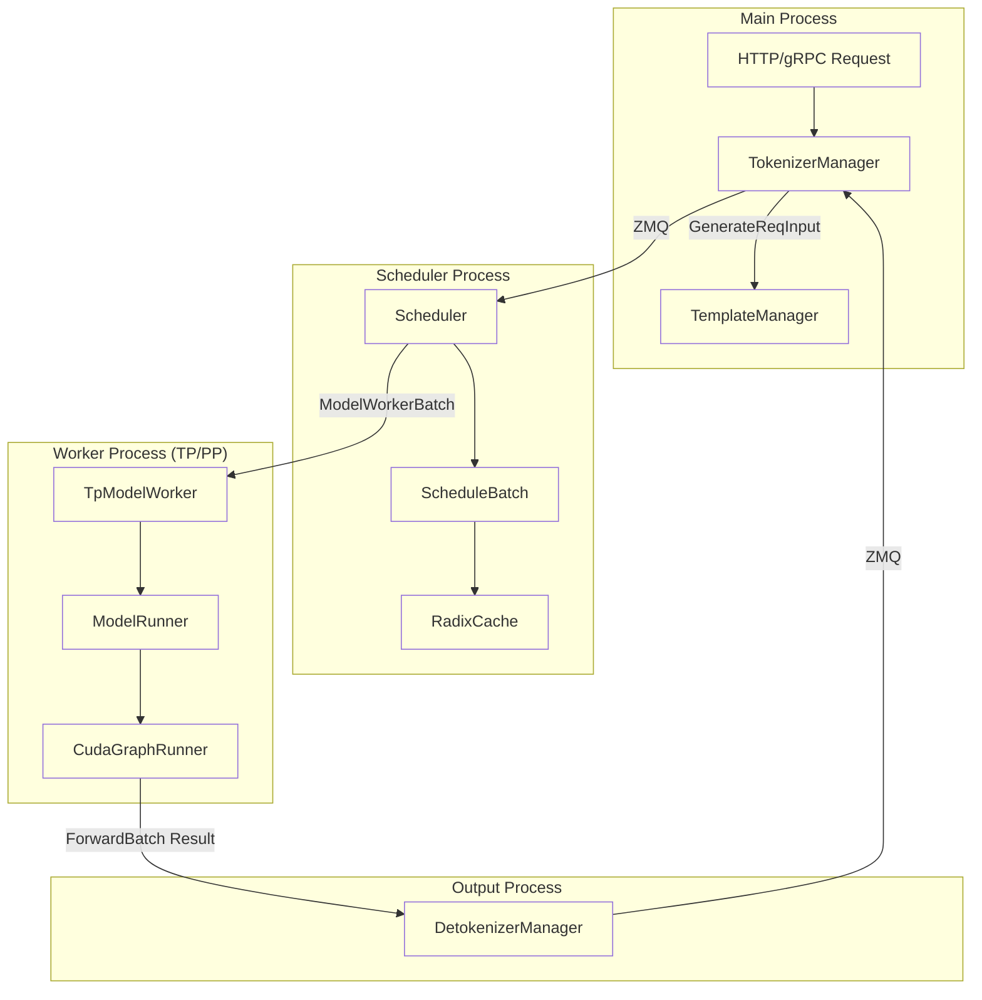
**Sources:** [python/sglang/srt/entrypoints/engine.py:122-130](), [python/sglang/srt/managers/schedule_batch.py:27-35](), [python/sglang/srt/managers/tokenizer_manager.py:14-15]()

### Key Subsystems

| Subsystem | Key Entities | Purpose |
| :--- | :--- | :--- |
| **DVR Engine** | `LLM42Worker`, `LLM42Info` | Manages the verification windows and rollback state for deterministic requests. |
| **Inference Runtime** | `Scheduler`, `ModelRunner` | Orchestrates batching, KV cache management, and model forward passes. |
| **Batch Invariance** | `batch_invariant_ops` | Provides wrappers for GPU operations (like matmul) that remain consistent regardless of batch size. |
| **Memory Management** | `RadixCache`, `ReqToTokenPool` | Manages GPU memory and KV cache prefix sharing to optimize throughput. |
| **Communication** | `parallel_state.py`, `ZMQ` | Handles Tensor Parallelism (TP) and inter-process communication. |

**Sources:** [python/sglang/srt/managers/scheduler.py:149-155](), [python/sglang/srt/model_executor/model_runner.py:116-119](), [python/sglang/srt/batch_invariant_ops.py:189-189]()

### Hardware and Platform Support

LLM-42 is designed for high-end NVIDIA hardware but maintains compatibility with a wide range of accelerators via the underlying SGLang architecture.

*   **Primary Platform**: NVIDIA H100 (80GB HBM3) [README.md:76]().
*   **Extended Support**: AMD (ROCm/aiter), Intel (Xeon/AMX/XPU), and Huawei Ascend (NPU) [python/sglang/srt/server_args.py:122-144]().
*   **Kernel Integration**: Utilizes `sgl-kernel` for custom CUDA/Triton operations [pyproject.toml:63]().

### Navigation

This wiki is structured to provide both high-level conceptual overviews and deep technical references.

*   **[Getting Started](#1.1)**: Instructions for Docker setup, building the `sgl-kernel`, and launching your first deterministic server.
*   **[SOSP Artifact Evaluation](#1.2)**: Specific guide for researchers looking to reproduce the performance and determinism benchmarks from the SOSP 2026 paper.
*   **Deterministic Inference Engine (Section 2)**: Detailed breakdown of the DVR protocol and the `batch_invariant_ops` implementation.
*   **SRT Core Architecture (Section 3)**: Deep dive into the scheduling, memory management, and distributed execution layers.

**Sources:** [README.md:42-62](), [README.md:80-100]()

---

# Page: Getting Started

# Getting Started

<details>
<summary>Relevant source files</summary>

The following files were used as context for generating this wiki page:

- [README.md](README.md)
- [benchmark/deepseek_v3/README.md](benchmark/deepseek_v3/README.md)
- [docker/Dockerfile](docker/Dockerfile)
- [docker/rocm.Dockerfile](docker/rocm.Dockerfile)
- [docker/xeon.Dockerfile](docker/xeon.Dockerfile)
- [docker/xpu.Dockerfile](docker/xpu.Dockerfile)
- [docs/get_started/install.md](docs/get_started/install.md)
- [docs/platforms/amd_gpu.md](docs/platforms/amd_gpu.md)
- [docs/platforms/ascend_npu.md](docs/platforms/ascend_npu.md)
- [docs/platforms/cpu_server.md](docs/platforms/cpu_server.md)
- [docs/platforms/xpu.md](docs/platforms/xpu.md)
- [docs/references/environment_variables.md](docs/references/environment_variables.md)
- [python/pyproject.toml](python/pyproject.toml)
- [python/pyproject_cpu.toml](python/pyproject_cpu.toml)
- [python/pyproject_other.toml](python/pyproject_other.toml)
- [python/pyproject_xpu.toml](python/pyproject_xpu.toml)
- [python/sglang/__init__.py](python/sglang/__init__.py)
- [python/sglang/check_env.py](python/sglang/check_env.py)
- [python/sglang/srt/batch_invariant_ops/__init__.py](python/sglang/srt/batch_invariant_ops/__init__.py)
- [python/sglang/srt/batch_invariant_ops/batch_invariant_ops.py](python/sglang/srt/batch_invariant_ops/batch_invariant_ops.py)
- [python/sglang/srt/entrypoints/engine.py](python/sglang/srt/entrypoints/engine.py)
- [python/sglang/srt/environ.py](python/sglang/srt/environ.py)
- [python/sglang/srt/layers/activation.py](python/sglang/srt/layers/activation.py)
- [python/sglang/srt/layers/communicator.py](python/sglang/srt/layers/communicator.py)
- [python/sglang/srt/layers/flashinfer_comm_fusion.py](python/sglang/srt/layers/flashinfer_comm_fusion.py)
- [python/sglang/srt/layers/layernorm.py](python/sglang/srt/layers/layernorm.py)
- [python/sglang/srt/layers/rotary_embedding.py](python/sglang/srt/layers/rotary_embedding.py)
- [python/sglang/srt/utils/common.py](python/sglang/srt/utils/common.py)
- [python/sglang/version.py](python/sglang/version.py)
- [sgl-kernel/Makefile](sgl-kernel/Makefile)
- [sgl-kernel/pyproject.toml](sgl-kernel/pyproject.toml)
- [sgl-kernel/pyproject_cpu.toml](sgl-kernel/pyproject_cpu.toml)
- [sgl-kernel/pyproject_rocm.toml](sgl-kernel/pyproject_rocm.toml)
- [sgl-kernel/python/sgl_kernel/version.py](sgl-kernel/python/sgl_kernel/version.py)

</details>


This page provides the technical requirements and procedures for installing, configuring, and launching the LLM-42 (SGLang-based) deterministic inference engine. LLM-42 extends the SGLang Runtime (SRT) with a **Decode-Verify-Rollback (DVR)** protocol to ensure bit-wise identical outputs across different batching conditions [README.md:28-36]().

## System Requirements

LLM-42 is designed for high-performance LLM serving across multiple hardware architectures.

### Hardware
*   **NVIDIA:** Support for Ampere, Hopper, and Blackwell architectures. Typical benchmarking configuration uses 4× NVIDIA H100 PCIe (80 GB HBM3) [README.md:74-76]().
*   **AMD:** Supported via ROCm and `aiter` kernels [python/sglang/srt/layers/rotary_embedding.py:33-49]().
*   **Intel:** Support for Xeon CPUs (AMX) and Intel Arc GPUs (XPU) [python/sglang/srt/utils/common.py:148-187]().
*   **Huawei Ascend:** Supported via `torch_npu` and specialized backends [python/sglang/srt/utils/common.py:153-162]().

### Software
*   **Python:** 3.10 or higher [python/pyproject.toml:10]().
*   **PyTorch:** Version 2.9.1 (pinned for compatibility) [python/pyproject.toml:68]().
*   **CUDA:** 12.1 through 13.0 (12.9 recommended) [docker/Dockerfile:1-199]().

**Sources:** [README.md:74-76](), [python/pyproject.toml:10-83](), [python/sglang/srt/utils/common.py:133-187]().

---

## Installation

The build system utilizes `setuptools` with `scikit-build-core` for C++/CUDA extensions in the `sgl-kernel` package [sgl-kernel/pyproject.toml:1-7]().

### Docker (Recommended)
The project provides a multi-stage `Dockerfile` that handles system dependencies, `GDRCopy`, and `DeepEP` optimizations [docker/Dockerfile:134-145]().

```bash
# Create and attach to the development container
./run_container.sh create && ./run_container.sh attach

# Build the sgl-kernel and install sglang in editable mode
./build_all.sh
```

### Manual Installation
For manual setup, the `sgl-kernel` must be built before the main `sglang` package.

1.  **Build Kernels:**
    ```bash
    cd sgl-kernel
    pip install .
    ```
2.  **Install SGLang:**
    ```bash
    cd ../python
    pip install -e .
    ```

**Sources:** [README.md:42-53](), [sgl-kernel/pyproject.toml:1-11](), [python/pyproject.toml:1-100]().

---

## Launching the Server

The server is managed by the `Engine` class, which orchestrates three primary processes: `TokenizerManager`, `Scheduler`, and `DetokenizerManager` [python/sglang/srt/entrypoints/engine.py:118-130]().

### Basic Execution
To enable the LLM-42 deterministic protocol, the `--enable-llm42` flag must be set.

```bash
python3 -m sglang.launch_server \
    --model-path meta-llama/Llama-3.1-8B-Instruct \
    --enable-llm42 3 \
    --llm42-window-size 64 \
    --llm42-verify-batch-size 8
```

### Configuration Parameters
| Argument | Type | Default | Description |
| :--- | :--- | :--- | :--- |
| `--enable-llm42` | int | `0` | Set to `3` to activate the DVR protocol [README.md:68](). |
| `--llm42-window-size` | int | `64` | Number of tokens generated in speculative "Decode" phase before verification [README.md:69](). |
| `--llm42-verify-batch-size` | int | `8` | Group size for the "Verify" phase to improve throughput [README.md:70](). |
| `--enable-deterministic-inference` | int | `0` | Global flag for batch-invariant kernel operations [README.md:72](). |

**Sources:** [README.md:57-72](), [python/sglang/srt/entrypoints/engine.py:118-137]().

---

## Implementation Architecture

The following diagrams illustrate the initialization flow and how the Python-level `Engine` interface maps to the underlying process-level components.

### Component Initialization Flow
This diagram bridges the `Engine` initialization in `engine.py` to the multi-process execution model.

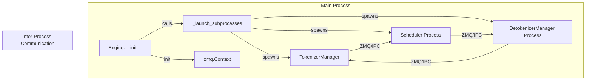
**Sources:** [python/sglang/srt/entrypoints/engine.py:118-181]().

### Data Flow: Request to Verification
This diagram maps the natural language request lifecycle to the code entities responsible for the LLM-42 DVR protocol.

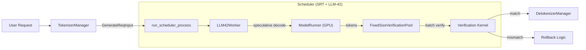
**Sources:** [python/sglang/srt/entrypoints/engine.py:48-68](), [README.md:32-38](), [python/sglang/srt/entrypoints/engine.py:118-130]().

---

## Environment Configuration

LLM-42 uses a structured environment variable system defined in `Envs` to control runtime behavior [python/sglang/srt/environ.py:159-160]().

### Key Environment Variables
*   `SGLANG_USE_CPU_ENGINE`: Set to `1` to bypass GPU requirements and run on host CPU [python/sglang/srt/utils/common.py:187]().
*   `SGLANG_ROPE_CACHE_ALIGN`: Controls memory alignment for Rotary Embedding caches to reduce reallocations [python/sglang/srt/layers/rotary_embedding.py:200]().
*   `SGLANG_USE_AITER`: Enables AMD-optimized kernels for ROCm environments [python/sglang/srt/layers/rotary_embedding.py:33]().
*   `SGLANG_CUDA_COREDUMP`: Enables collection of CUDA coredumps for debugging kernel crashes [python/sglang/srt/environ.py:179]().

**Sources:** [python/sglang/srt/environ.py:159-220](), [python/sglang/srt/utils/common.py:185-187](), [python/sglang/srt/layers/rotary_embedding.py:191-200]().

---

# Page: SOSP Artifact Evaluation

# SOSP Artifact Evaluation

<details>
<summary>Relevant source files</summary>

The following files were used as context for generating this wiki page:

- [.github/workflows/pr-test.yml](.github/workflows/pr-test.yml)
- [python/sglang/README.md](python/sglang/README.md)
- [python/sglang/bench_offline_throughput.py](python/sglang/bench_offline_throughput.py)
- [python/sglang/bench_one_batch.py](python/sglang/bench_one_batch.py)
- [python/sglang/bench_one_batch_server.py](python/sglang/bench_one_batch_server.py)
- [python/sglang/bench_serving.py](python/sglang/bench_serving.py)
- [python/sglang/profiler.py](python/sglang/profiler.py)
- [python/sglang/srt/layers/torchao_utils.py](python/sglang/srt/layers/torchao_utils.py)
- [python/sglang/srt/llm42/__init__.py](python/sglang/srt/llm42/__init__.py)
- [python/sglang/srt/llm42/llm42_info.py](python/sglang/srt/llm42/llm42_info.py)
- [python/sglang/srt/llm42/llm42_worker.py](python/sglang/srt/llm42/llm42_worker.py)
- [python/sglang/srt/managers/scheduler_runtime_checker_mixin.py](python/sglang/srt/managers/scheduler_runtime_checker_mixin.py)
- [python/sglang/test/test_deterministic.py](python/sglang/test/test_deterministic.py)
- [python/sglang/test/test_deterministic_utils.py](python/sglang/test/test_deterministic_utils.py)
- [python/sglang/test/test_utils.py](python/sglang/test/test_utils.py)
- [test/srt/run_suite.py](test/srt/run_suite.py)

</details>


This page provides a comprehensive guide for reproducing the experimental figures (Figures 4–13) from the SOSP 2026 LLM-42 paper. It details the benchmark scripts, hardware requirements, and how to interpret the results. The LLM-42 project introduces a novel Decode-Verify-Rollback (DVR) protocol for deterministic LLM inference, ensuring bit-wise identical outputs regardless of batch composition.

## 1. Overview of LLM-42 Determinism

The LLM-42 system implements a Decode-Verify-Rollback (DVR) protocol to guarantee deterministic LLM inference. This means that for a given input and model, the output will always be the same, irrespective of other concurrent requests in the batch. This is achieved through a combination of batch-invariant operations and a verification mechanism.

The core components enabling this determinism are:
*   **Batch-Invariant Operations**: These are low-level GPU kernel operations (e.g., matrix multiplications) that are designed to produce identical results regardless of the batch size or the order of requests within a batch. This is crucial for the "Decode" phase.
*   **Decode-Verify-Rollback (DVR) Protocol**: This protocol operates at the scheduler level. After a "Decode" phase generates candidate tokens, a "Verify" phase re-computes these tokens in a controlled, fixed-size batch. If the re-computed tokens do not match the original ones, a "Rollback" mechanism discards the non-deterministic tokens and re-attempts generation.

The `LLM42Info` class [python/sglang/srt/llm42/llm42_info.py:36-46]() is central to managing the metadata and logic for a single verification pass. It tracks original outputs, padding masks, and handles KV-cache allocations for padding. The `LLM42Worker` [python/sglang/srt/llm42/llm42_worker.py:15-18]() wraps the `TpModelWorker` to intercept decode batches, identify requests needing verification, construct verification batches, compare outputs, and apply rollback.

### 1.1. Fixed-Size Verification Pool

A key aspect of the DVR protocol, particularly for "grouped verification" (§4.3 of the paper), is the use of fixed-size verification batches. To ensure every verification pass processes exactly `fixed_size` requests of `window_size` tokens each, the `FixedSizeVerificationPool` [python/sglang/srt/llm42/llm42_worker.py:37-45]() is utilized. This pool pre-allocates dummy resources (input IDs, KV-cache slots, request pool indices, and sampling tensors) to pad batches when fewer real requests are available.

**Fixed-Size Verification Pool Initialization**
```python
class FixedSizeVerificationPool:
    DUMMY_TOKEN_ID = 32
    def __init__(
        self,
        fixed_size: int,
        window_size: int,
        req_to_token_pool,
        token_to_kv_pool_allocator,
        device: str = "cuda",
    ):
        self.fixed_size = fixed_size
        self.window_size = window_size
        self.device = device
        self.req_to_token_pool = req_to_token_pool
        
        # Pre-allocate dummy input_ids (N * window_size tokens)
        total_dummy_tokens = fixed_size * window_size
        self.dummy_input_ids = torch.full(
            (total_dummy_tokens,), 
            self.DUMMY_TOKEN_ID, 
            dtype=torch.int64, 
            device=device
        )
        
        # Pre-allocate KV cache slots for dummy requests
        slots_needed = fixed_size * window_size
        # ... (page size alignment and allocation)
        
        # Allocate actual row indices in req_to_token_pool for dummy requests
        # ... (allocation and assignment)
        
        # Pre-allocate dummy sampling tensors
        self.dummy_temps = torch.zeros((total_dummy_tokens, 1), dtype=torch.float32, device=device)
        self.dummy_top_ps = torch.ones(total_dummy_tokens, dtype=torch.float32, device=device)
        self.dummy_top_ks = torch.full((total_dummy_tokens,), -1, dtype=torch.int32, device=device)
        self.dummy_min_ps = torch.zeros(total_dummy_tokens, dtype=torch.float32, device=device)
        self.dummy_seeds = torch.zeros(total_dummy_tokens, dtype=torch.int32, device=device)
        self.dummy_det_indices = torch.ones((total_dummy_tokens, 1), dtype=torch.int64, device=device)
        
        # Pre-allocate dummy prefix_lens and output_lens
        self.dummy_prefix_lens = torch.zeros(fixed_size, dtype=torch.int64, device=device)
        self.dummy_output_lens = torch.full((fixed_size,), window_size, dtype=torch.int64, device=device)
        
        # Pre-allocate KV cache slots for padding tokens of real requests.
        # ... (allocation)
```
Sources: [python/sglang/srt/llm42/llm42_worker.py:48-150]()

**LLM-42 Verification Flow**
```mermaid
graph TD
    A[Scheduler] --> B{Decode Batch Ready?};
    B -- Yes --> C{Is LLM-42 Enabled?};
    C -- Yes --> D[LLM42Worker.intercept_decode_batch];
    D --> E{Identify Requests for Verification};
    E --> F[Construct TARGET_LLM42_VERIFY Batch];
    F --> G[Pad with FixedSizeVerificationPool Dummies];
    G --> H[ModelRunner.forward (TARGET_LLM42_VERIFY)];
    H --> I[LLM42Worker.verify_and_compare];
    I -- Mismatch --> J[Rollback Non-Deterministic Tokens];
    I -- Match --> K[Advance llm42_verified_tokens];
    K --> L[Return GenerationBatchResult];
    J --> L;
    C -- No --> M[ModelRunner.forward (Normal Decode)];
    M --> L;
    L --> A;
```
Title: LLM-42 Verification Flow
Sources: [python/sglang/srt/llm42/llm42_worker.py:15-18](), [python/sglang/srt/llm42/llm42_info.py:36-46](), [python/sglang/srt/llm42/llm42_worker.py:37-45]()

## 2. Reproducing Experimental Figures

The experimental figures (Figures 4–13) in the SOSP 2026 paper are generated using the benchmarking scripts available in the codebase. These scripts simulate various workloads and measure performance metrics relevant to LLM-42's deterministic inference.

### 2.1. Hardware Requirements

The LLM-42 artifact evaluation requires specific hardware configurations to reproduce the results accurately. The primary target hardware for the SOSP paper was NVIDIA GPUs, specifically those supporting FP8 and other advanced features.

*   **NVIDIA GPUs**: The benchmarks are primarily designed for NVIDIA GPUs. Specific models like H100, A100, or newer architectures are recommended for optimal performance and to leverage features like FP8 quantization and efficient attention mechanisms.
*   **Memory**: Sufficient GPU memory is crucial, especially for larger models and batch sizes. The `FixedSizeVerificationPool` [python/sglang/srt/llm42/llm42_worker.py:37-45]() allocates KV cache slots for dummy requests, which can consume significant memory if `llm42_verify_batch_size` is large.
    *   `FixedSizeVerificationPool` allocation failure: "Failed to allocate {slots_needed} KV cache slots for fixed-size verification pool. Consider reducing llm42_verify_batch_size or increasing KV cache size." [python/sglang/srt/llm42/llm42_worker.py:91-96]()
    *   `FixedSizeVerificationPool` allocation failure for `req_to_token_pool`: "Failed to allocate {fixed_size} req_to_token_pool slots for dummy requests. Consider reducing llm42_verify_batch_size or increasing pool size." [python/sglang/srt/llm42/llm42_worker.py:104-107]()
*   **CPU/RAM**: While GPU-centric, the host system still requires adequate CPU and RAM for managing the SGLang runtime, data loading, and pre/post-processing.

### 2.2. Benchmark Scripts

The following scripts are used for benchmarking and can be found in the `python/sglang/` directory:

*   `bench_serving.py`: Benchmarks online serving with dynamic requests. This script is used to measure metrics like Time-To-First-Token (TTFT), Inter-Token Latency (ITL), and Throughput-Per-Dollar (TPD) under various load conditions. It supports different backends (e.g., `sglang`, `vllm`, `tgi`, `trt-llm`) and datasets (`sharegpt`, `random`, `generated-shared-prefix`, `arxiv`).
    *   Usage example: `python3 -m sglang.bench_serving --backend sglang --num-prompt 10` [python/sglang/bench_serving.py:8-8]()
    *   Random dataset example: `python3 -m sglang.bench_serving --backend sglang --dataset-name random --num-prompts 3000 --random-input 1024 --random-output 1024 --random-range-ratio 0.5` [python/sglang/bench_serving.py:10-10]()
*   `bench_one_batch.py`: Benchmarks the latency of running a single static batch without a server. This script is useful for low-level performance analysis and correctness testing. It accepts server arguments (similar to `launch_server.py`) and benchmark arguments (e.g., batch size, input lengths).
    *   Usage example (latency test with dummy weights): `python -m sglang.bench_one_batch --model-path meta-llama/Meta-Llama-3-8B-Instruct --load-format dummy` [python/sglang/bench_one_batch.py:9-9]()
    *   Usage example (correctness test): `python -m sglang.bench_one_batch --model-path TinyLlama/TinyLlama-1.1B-Chat-v0.4 --correct` [python/sglang/bench_one_batch.py:20-20]()
*   `bench_one_batch_server.py`: Benchmarks the latency of running a single batch with a server. This script launches a server and uses the HTTP interface, providing a more realistic scenario for server-side performance.
    *   Usage example: `python3 -m sglang.bench_one_batch_server --model meta-llama/Meta-Llama-3.1-8B --batch-size 1 16 64 --input-len 1024 --output-len 8` [python/sglang/bench_one_batch_server.py:7-7]()
*   `bench_offline_throughput.py`: Benchmarks the throughput in offline mode. This script is useful for evaluating the maximum processing capacity of the system without the overhead of online serving.
    *   Usage example (ShareGPT dataset): `python -m sglang.bench_offline_throughput --model-path meta-llama/Meta-Llama-3.1-8B-Instruct --num-prompts 10` [python/sglang/bench_offline_throughput.py:7-7]()
*   `test_deterministic.py`: Specifically designed to test the determinism of the system. It batches the same prompt in random batch sizes and verifies consistency across different trials. It supports "single", "prefix", and "radix_cache" modes.
    *   Usage example (single mode): `python3 -m sglang.test.test_deterministic --n-trials 50 --test-mode single` [python/sglang/test/test_deterministic.py:6-6]()
    *   Usage example (radix cache consistency mode): `python3 -m sglang.test.test_deterministic --test-mode radix_cache` [python/sglang/test/test_deterministic.py:11-11]()

These scripts often accept common arguments for model path, batch size, input/output lengths, and profiling options. The `--deterministic-ratio` and `--deterministic-seed` arguments in `bench_offline_throughput.py` [python/sglang/bench_offline_throughput.py:171-180]() are particularly relevant for LLM-42 evaluation, allowing control over the proportion of requests marked as deterministic.

### 2.3. Running Benchmarks

To reproduce the figures, you will typically follow these steps:

1.  **Environment Setup**: Ensure SGLang is installed and configured correctly, including any necessary CUDA/ROCm drivers and dependencies. Refer to "1.1. Getting Started" for detailed instructions.
2.  **Model Download**: Download the required models (e.g., Llama-3.1-8B-Instruct, Mixtral-8x7B-Instruct-v0.1) to your local system. The `test_utils.py` [python/sglang/test/test_utils.py:50-147]() file lists various default models used for testing, including FP8 and AWQ quantized versions.
3.  **Launch Server (if applicable)**: For `bench_serving.py` and `bench_one_batch_server.py`, you need to launch the SGLang server first. This can be done using `python -m sglang.launch_server ...` with appropriate arguments, including `--enable-llm42` and `--llm42-window-size` to enable the DVR protocol.
4.  **Execute Benchmark Script**: Run the chosen benchmark script with the parameters matching the experimental setup described in the paper. Pay close attention to arguments like `--batch-size`, `--input-len`, `--output-len`, `--num-prompts`, and especially LLM-42 specific flags.
5.  **Collect Results**: The scripts will output performance metrics to the console or to a specified results file (e.g., `--result-filename`).

**Example Workflow for Determinism Testing (`test_deterministic.py`)**

This script is crucial for verifying the core claim of LLM-42: deterministic output regardless of batching.

```bash
# Step 1: Launch the SGLang server with LLM-42 enabled
# Replace with your actual model path and desired LLM-42 parameters
python -m sglang.launch_server \
    --model-path meta-llama/Llama-3.1-8B-Instruct \
    --port 30000 \
    --enable-llm42 \
    --llm42-window-size 8 \
    --llm42-verify-batch-size 16 \
    --enable-batch-invariant-mode &

# Wait for the server to start (adjust sleep time as needed)
sleep 30

# Step 2: Run the deterministic test in "single" mode
# This tests if the same prompt produces identical output across different trials
python3 -m sglang.test.test_deterministic \
    --host localhost --port 30000 \
    --n-trials 50 --test-mode single \
    --max-new-tokens 100 \
    --sampling-seed 42

# Step 3: Run the deterministic test in "prefix" mode
# This tests determinism with shared prefixes, simulating common LLM workloads
python3 -m sglang.test.test_deterministic \
    --host localhost --port 30000 \
    --n-start 1 --n-trials 50 --test-mode prefix \
    --max-new-tokens 100 \
    --sampling-seed 42

# Step 4: Run the deterministic test in "radix_cache" mode
# This tests if caching behavior affects determinism
python3 -m sglang.test.test_deterministic \
    --host localhost --port 30000 \
    --test-mode radix_cache \
    --max-new-tokens 100 \
    --sampling-seed 42

# Step 5: Kill the server process
kill $(jobs -p)
```
Sources: [python/sglang/test/test_deterministic.py:6-11]()

### 2.4. Interpreting Results

The output of the benchmark scripts will provide various metrics. For LLM-42, key metrics to observe include:

*   **Determinism Check**: For `test_deterministic.py`, the primary output is whether the generated texts are consistent across trials. Any inconsistency indicates a failure in determinism.
*   **Latency**:
    *   **TTFT (Time-To-First-Token)**: The time taken to generate the first token.
    *   **ITL (Inter-Token Latency)**: The time taken between subsequent tokens.
    *   These are reported by `bench_serving.py` [python/sglang/bench_serving.py:101-102]() and `bench_one_batch_server.py`.
*   **Throughput**: Tokens per second (TPS) or requests per second (RPS). `bench_offline_throughput.py` focuses on this.
*   **Resource Utilization**: CPU and GPU memory usage, often reported by profiling tools if enabled.

When reproducing the figures, compare your results against the reported values in the SOSP paper. Minor variations might occur due to differences in hardware, software versions, or background processes. However, the overall trends and relative performance should align.

**Profiling**

Several benchmark scripts support profiling using `torch.profiler`.
*   `bench_one_batch.py` [python/sglang/bench_one_batch.py:177-182]() and `bench_one_batch_server.py` [python/sglang/bench_one_batch_server.py:10-11]() have `--profile` and `--profile-record-shapes` arguments.
*   The `start_profile` and `stop_profile` functions [python/sglang/bench_one_batch.py:103-164]() abstract the profiling logic, supporting both `torch.profiler` and `CUDA_PROFILER` (for `nsys`).
*   To enable `torch.profiler`, the server must be launched with `SGLANG_TORCH_PROFILER_DIR` set [python/sglang/bench_offline_throughput.py:189-191]().

**Example of Profiling Output Interpretation**

When profiling is enabled, `torch.profiler` generates trace files that can be viewed in Chrome's `chrome://tracing` tool. These traces provide detailed timelines of CPU and GPU operations, helping to identify bottlenecks and verify the execution flow of the DVR protocol.

```mermaid
graph TD
    A[Benchmark Script] --> B{--profile flag?};
    B -- Yes --> C[start_profile];
    C --> D{profile_activities include CUDA_PROFILER?};
    D -- Yes --> E[torch.cuda.cudart().cudaProfilerStart()];
    D -- No --> F[torch.profiler.profile().start()];
    F --> G[Run Benchmark Logic];
    E --> G;
    G --> H[stop_profile];
    H --> I{profile_activities include CUDA_PROFILER?};
    I -- Yes --> J[torch.cuda.cudart().cudaProfilerStop()];
    I -- No --> K[profiler.stop()];
    K --> L{save_trace?};
    J --> L;
    L -- Yes --> M[Save Chrome Trace];
    M --> N[End];
    L -- No --> N;
```
Title: Profiling Workflow
Sources: [python/sglang/bench_one_batch.py:103-164]()

The `SchedulerRuntimeCheckerMixin` [python/sglang/srt/managers/scheduler_runtime_checker_mixin.py:21-164]() provides internal checks for memory leaks and token usage, which can be useful for debugging and verifying the correct operation of the KV cache and memory management, especially in the context of the `FixedSizeVerificationPool` and its reserved KV slots [python/sglang/srt/managers/scheduler_runtime_checker_mixin.py:153-154]().

Sources:
*   [python/sglang/bench_offline_throughput.py:171-180]()
*   [python/sglang/bench_offline_throughput.py:189-191]()
*   [python/sglang/bench_one_batch.py:103-164]()
*   [python/sglang/bench_one_batch.py:177-182]()
*   [python/sglang/bench_one_batch.py:9-20]()
*   [python/sglang/bench_one_batch_server.py:10-11]()
*   [python/sglang/bench_one_batch_server.py:7-7]()
*   [python/sglang/bench_serving.py:10-10]()
*   [python/sglang/bench_serving.py:101-102]()
*   [python/sglang/bench_serving.py:8-8]()
*   [python/sglang/srt/llm42/llm42_worker.py:104-107]()
*   [python/sglang/srt/llm42/llm42_worker.py:91-96]()
*   [python/sglang/srt/managers/scheduler_runtime_checker_mixin.py:153-154]()
*   [python/sglang/srt/managers/scheduler_runtime_checker_mixin.py:21-164]()
*   [python/sglang/test/test_deterministic.py:11-11]()
*   [python/sglang/test/test_deterministic.py:6-11]()
*   [python/sglang/test/test_utils.py:50-147]()

---

# Page: LLM-42: Deterministic Inference Engine

# LLM-42: Deterministic Inference Engine

<details>
<summary>Relevant source files</summary>

The following files were used as context for generating this wiki page:

- [docs/references/environment_variables.md](docs/references/environment_variables.md)
- [python/sglang/srt/batch_invariant_ops/__init__.py](python/sglang/srt/batch_invariant_ops/__init__.py)
- [python/sglang/srt/batch_invariant_ops/batch_invariant_ops.py](python/sglang/srt/batch_invariant_ops/batch_invariant_ops.py)
- [python/sglang/srt/environ.py](python/sglang/srt/environ.py)
- [python/sglang/srt/layers/activation.py](python/sglang/srt/layers/activation.py)
- [python/sglang/srt/layers/communicator.py](python/sglang/srt/layers/communicator.py)
- [python/sglang/srt/layers/flashinfer_comm_fusion.py](python/sglang/srt/layers/flashinfer_comm_fusion.py)
- [python/sglang/srt/layers/layernorm.py](python/sglang/srt/layers/layernorm.py)
- [python/sglang/srt/layers/rotary_embedding.py](python/sglang/srt/layers/rotary_embedding.py)
- [python/sglang/srt/llm42/__init__.py](python/sglang/srt/llm42/__init__.py)
- [python/sglang/srt/llm42/llm42_info.py](python/sglang/srt/llm42/llm42_info.py)
- [python/sglang/srt/llm42/llm42_worker.py](python/sglang/srt/llm42/llm42_worker.py)
- [python/sglang/srt/managers/scheduler_runtime_checker_mixin.py](python/sglang/srt/managers/scheduler_runtime_checker_mixin.py)
- [python/sglang/srt/utils/common.py](python/sglang/srt/utils/common.py)

</details>


The LLM-42 engine provides a high-performance, deterministic inference subsystem for SGLang. Standard LLM serving often suffers from non-determinism due to floating-point summation order variations in multi-tenant GPU batches. LLM-42 addresses this using the **Decode-Verify-Rollback (DVR)** protocol and **Batch-Invariant Operations**.

## Overview

LLM-42 ensures bit-wise identical outputs for the same request regardless of other requests in the batch. It achieves this by combining two layers of protection:
1.  **Batch-Invariant Kernels**: Low-level GPU operations (MatMul, RMSNorm) that produce identical results regardless of batch composition.
2.  **DVR Protocol**: A windowed verification mechanism that periodically checks the integrity of generated tokens against a "ground-truth" deterministic pass and rolls back the state if a mismatch is detected.

### System Architecture: LLM-42 Integration

The following diagram shows how LLM-42 components wrap the standard `TpModelWorker` and interact with the SGLang scheduler.

**LLM-42 Component Interaction**
```mermaid
graph TD
    subgraph "Scheduler Process"
        [Scheduler] --> [LLM42Worker]
    end

    subgraph "LLM42Worker (Wrapper)"
        [LLM42Worker] -- "Intercepts" --> [ForwardMode.DECODE]
        [LLM42Worker] -- "Creates" --> [LLM42Info]
        [LLM42Info] -- "Uses" --> [FixedSizeVerificationPool]
    end

    subgraph "Model Execution"
        [LLM42Worker] -- "Executes" --> [TpModelWorker]
        [TpModelWorker] -- "Calls" --> [BatchInvariantOps]
    end

    [LLM42Info] -- "Rollback" --> [Req.output_ids]
```
Sources: [python/sglang/srt/llm42/llm42_worker.py:12-17](), [python/sglang/srt/llm42/llm42_info.py:36-44]()

## Core Subsystems

### DVR Protocol: Decode, Verify, Rollback
The DVR protocol is the primary algorithm for maintaining long-term determinism. It allows the engine to run at high speed using potentially non-deterministic optimizations during the "Decode" phase, while using a "Verify" phase to ensure correctness.
*   **Windowed Generation**: Tokens are generated in windows of a configurable size.
*   **Grouped Verification**: Multiple requests are batched into a `TARGET_LLM42_VERIFY` forward pass.
*   **Fixed-Size Padding**: To ensure the verification pass itself is deterministic, the `FixedSizeVerificationPool` pads batches to a constant shape using dummy resources.

For details, see [DVR Protocol: Decode, Verify, Rollback](#2.1).

Sources: [python/sglang/srt/llm42/llm42_worker.py:38-46](), [python/sglang/srt/llm42/llm42_info.py:102-121]()

### Batch-Invariant Operations
LLM-42 provides specialized CUDA and Triton kernels that eliminate numerical divergence. 
*   **Deterministic MatMul**: Implements persistent Triton kernels and DeepGEMM wrappers that avoid non-deterministic atomic operations.
*   **RMSNorm**: A `rms_norm_batch_invariant` implementation ensures that normalization results do not shift when requests are added or removed from a batch.
*   **Monkey-Patching**: The `enable_batch_invariant_mode` context manager allows the system to dynamically toggle these kernels during specific forward passes.

For details, see [Batch-Invariant Operations](#2.2).

Sources: [python/sglang/srt/batch_invariant_ops/batch_invariant_ops.py:37-42](), [python/sglang/srt/layers/layernorm.py:139-154]()

### Configuration and Runtime Integration
LLM-42 is integrated into the SGLang server via command-line arguments and environment variables.
*   **Activation**: Controlled via `--enable-llm42`.
*   **Tuning**: Parameters like `--llm42-window-size` and `--llm42-verify-batch-size` allow balancing between performance and verification frequency.
*   **Environment**: Variables like `SGLANG_ENABLE_LLM42` and `SGLANG_BATCH_INVARIANT_OPS_ENABLE_MM_DEEPGEMM` provide fine-grained control over kernel selection.

For details, see [Determinism Configuration and Flags](#2.3).

Sources: [python/sglang/srt/environ.py:223-228](), [docs/references/environment_variables.md:73-80]()

## Code Entity Map

The following table and diagram map the high-level LLM-42 concepts to specific classes and files in the codebase.

| Concept | Code Entity | File Path |
| :--- | :--- | :--- |
| **Verification Worker** | `LLM42Worker` | [python/sglang/srt/llm42/llm42_worker.py:12]() |
| **Batch Padding** | `FixedSizeVerificationPool` | [python/sglang/srt/llm42/llm42_worker.py:38]() |
| **Metadata Tracking** | `LLM42Info` | [python/sglang/srt/llm42/llm42_info.py:36]() |
| **Deterministic Ops** | `batch_invariant_ops` | [python/sglang/srt/batch_invariant_ops/batch_invariant_ops.py:1]() |
| **Invariant Norm** | `RMSNorm` | [python/sglang/srt/layers/layernorm.py:91]() |

**Logic Flow to Code Mapping**
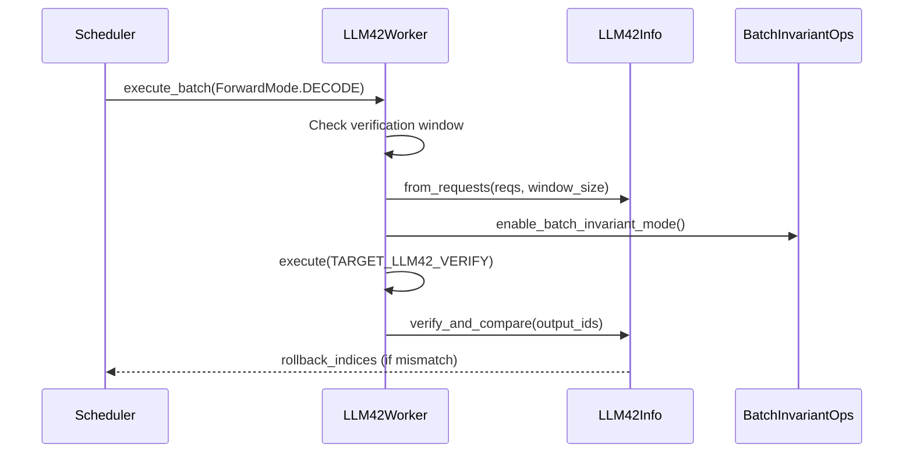
Sources: [python/sglang/srt/llm42/llm42_worker.py:12-15](), [python/sglang/srt/llm42/llm42_info.py:102-110](), [python/sglang/srt/batch_invariant_ops/batch_invariant_ops.py:41]()

---

# Page: DVR Protocol: Decode, Verify, Rollback

# DVR Protocol: Decode, Verify, Rollback

<details>
<summary>Relevant source files</summary>

The following files were used as context for generating this wiki page:

- [python/sglang/srt/entrypoints/http_server.py](python/sglang/srt/entrypoints/http_server.py)
- [python/sglang/srt/layers/logits_processor.py](python/sglang/srt/layers/logits_processor.py)
- [python/sglang/srt/layers/sampler.py](python/sglang/srt/layers/sampler.py)
- [python/sglang/srt/llm42/__init__.py](python/sglang/srt/llm42/__init__.py)
- [python/sglang/srt/llm42/llm42_info.py](python/sglang/srt/llm42/llm42_info.py)
- [python/sglang/srt/llm42/llm42_worker.py](python/sglang/srt/llm42/llm42_worker.py)
- [python/sglang/srt/managers/detokenizer_manager.py](python/sglang/srt/managers/detokenizer_manager.py)
- [python/sglang/srt/managers/io_struct.py](python/sglang/srt/managers/io_struct.py)
- [python/sglang/srt/managers/multi_tokenizer_mixin.py](python/sglang/srt/managers/multi_tokenizer_mixin.py)
- [python/sglang/srt/managers/schedule_batch.py](python/sglang/srt/managers/schedule_batch.py)
- [python/sglang/srt/managers/scheduler.py](python/sglang/srt/managers/scheduler.py)
- [python/sglang/srt/managers/scheduler_metrics_mixin.py](python/sglang/srt/managers/scheduler_metrics_mixin.py)
- [python/sglang/srt/managers/scheduler_output_processor_mixin.py](python/sglang/srt/managers/scheduler_output_processor_mixin.py)
- [python/sglang/srt/managers/scheduler_runtime_checker_mixin.py](python/sglang/srt/managers/scheduler_runtime_checker_mixin.py)
- [python/sglang/srt/managers/scheduler_update_weights_mixin.py](python/sglang/srt/managers/scheduler_update_weights_mixin.py)
- [python/sglang/srt/managers/tokenizer_communicator_mixin.py](python/sglang/srt/managers/tokenizer_communicator_mixin.py)
- [python/sglang/srt/managers/tokenizer_manager.py](python/sglang/srt/managers/tokenizer_manager.py)
- [python/sglang/srt/managers/tp_worker.py](python/sglang/srt/managers/tp_worker.py)
- [python/sglang/srt/metrics/collector.py](python/sglang/srt/metrics/collector.py)
- [python/sglang/srt/model_executor/cuda_graph_runner.py](python/sglang/srt/model_executor/cuda_graph_runner.py)
- [python/sglang/srt/model_executor/forward_batch_info.py](python/sglang/srt/model_executor/forward_batch_info.py)
- [python/sglang/srt/model_executor/model_runner.py](python/sglang/srt/model_executor/model_runner.py)
- [python/sglang/srt/sampling/sampling_batch_info.py](python/sglang/srt/sampling/sampling_batch_info.py)
- [python/sglang/srt/sampling/sampling_params.py](python/sglang/srt/sampling/sampling_params.py)
- [python/sglang/srt/server_args.py](python/sglang/srt/server_args.py)

</details>


The **DVR (Decode, Verify, Rollback)** protocol is the core algorithmic framework of LLM-42, designed to ensure bit-wise deterministic LLM inference while maintaining the performance benefits of batching and hardware-specific optimizations. It operates by allowing high-throughput speculative decoding in a "potentially non-deterministic" mode, followed by periodic exact verification using batch-invariant operations.

## Overview of the DVR Algorithm

The DVR protocol addresses the challenge where parallel reductions in GPU kernels (like those in FlashAttention or MoE) can produce non-deterministic results due to the non-associativity of floating-point addition when batch compositions change.

The protocol follows a cyclical three-stage pipeline:
1.  **Decode**: The engine generates tokens rapidly in a standard, high-performance "decode" mode.
2.  **Verify**: Periodically, a "window" of generated tokens is re-processed using deterministic, batch-invariant kernels.
3.  **Rollback**: If the verification output deviates from the previously generated tokens, the system rolls back the KV cache and sequence state to the last known-good token and resumes generation.

### The Verification Window
Generation is partitioned into windows of size `llm42_window_size` [python/sglang/srt/server_args.py:275-275](). Verification is not performed for every single token but in grouped batches to amortize the overhead of deterministic kernels.

## System Architecture: Code Entity Space

The implementation of the DVR protocol is primarily contained within the `sglang.srt.llm42` module and integrated into the `Scheduler` and `ModelRunner`.

### Code Entity Mapping
The following diagram maps the logical components of the DVR protocol to their specific class implementations in the codebase.

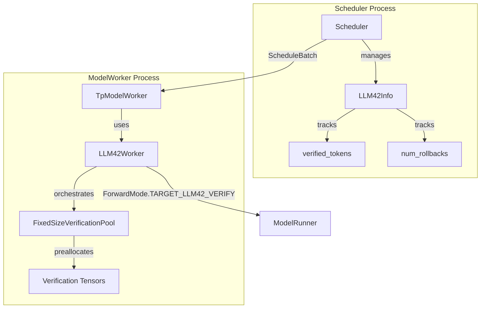
**Sources:** [python/sglang/srt/managers/scheduler.py:1-150](), [python/sglang/srt/llm42/llm42_info.py:1-50](), [python/sglang/srt/llm42/llm42_worker.py:1-100]()

## Implementation Details

### 1. LLM42Info: Sequence-level State
Every request (`Req`) in LLM-42 is associated with an `LLM42Info` object. This class maintains the determinism metadata for that specific sequence.

*   **`verified_tokens`**: The number of tokens in the sequence that have been bit-wise verified against the reference deterministic implementation [python/sglang/srt/managers/scheduler_output_processor_mixin.py:179-181]().
*   **`num_rollbacks`**: A counter for how many times this specific request has failed verification and triggered a rollback [python/sglang/srt/managers/io_struct.py:127-130]().

### 2. LLM42Worker and FixedSizeVerificationPool
The `LLM42Worker` resides within the `TpModelWorker`. It manages the `FixedSizeVerificationPool`, which pre-allocates the memory required for verification batches to avoid runtime allocation overhead.

When the `Scheduler` decides to verify a batch, it sets the `ForwardMode` to `TARGET_LLM42_VERIFY` [python/sglang/srt/model_executor/forward_batch_info.py:87-89]().

### 3. Token-level Comparison and Rollback
The verification happens in the `ModelRunner` during the forward pass. The system compares the logits or sampled tokens from the deterministic "Verify" pass against the original tokens generated during the "Decode" pass.

If a mismatch is detected:
1.  **Identify Divergence**: The system finds the first index $i$ where $Token_{verify}[i] \neq Token_{decode}[i]$.
2.  **KV Cache Truncation**: The `Scheduler` invokes `release_kv_cache` to truncate the KV cache back to the index $i-1$ [python/sglang/srt/managers/scheduler_output_processor_mixin.py:99-100]().
3.  **Request Retraction**: The request is moved back to the prefill or decode queue to be re-processed from the divergence point.

## DVR Data Flow

The following diagram illustrates the lifecycle of a request under the DVR protocol, specifically how it transitions between different `ForwardMode` states.

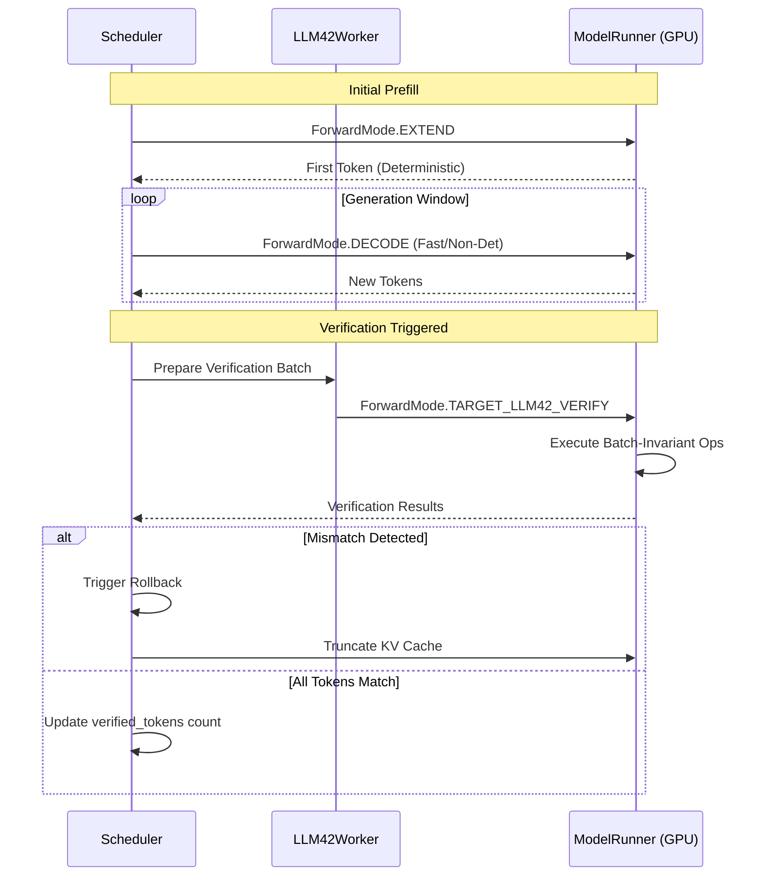
**Sources:** [python/sglang/srt/model_executor/forward_batch_info.py:74-118](), [python/sglang/srt/managers/scheduler_output_processor_mixin.py:173-184](), [python/sglang/srt/managers/schedule_batch.py:66-72]()

## Key Classes and Functions

| Entity | Location | Role |
| :--- | :--- | :--- |
| `ForwardMode.TARGET_LLM42_VERIFY` | [python/sglang/srt/model_executor/forward_batch_info.py:89]() | Enum flag that triggers deterministic, fixed-shape reduction kernels in the model forward pass. |
| `LLM42Info` | `python/sglang/srt/llm42/llm42_info.py` | Stores sequence-specific metadata like `llm42_verified_tokens` and rollback statistics. |
| `LLM42Worker` | `python/sglang/srt/llm42/llm42_worker.py` | Manages the verification pool and provides utilities for the worker-side DVR logic. |
| `FixedSizeVerificationPool` | `python/sglang/srt/llm42/llm42_worker.py` | Pre-allocates GPU memory for verification to ensure predictable performance during the "Verify" phase. |
| `process_batch_result_prefill` | [python/sglang/srt/managers/scheduler_output_processor_mixin.py:124-184]() | Handles the transition of the first token from prefill to verified status. |

**Sources:** [python/sglang/srt/model_executor/forward_batch_info.py:87-115](), [python/sglang/srt/managers/scheduler_output_processor_mixin.py:173-184](), [python/sglang/srt/llm42/llm42_worker.py:1-50]()

---

# Page: Batch-Invariant Operations

# Batch-Invariant Operations

<details>
<summary>Relevant source files</summary>

The following files were used as context for generating this wiki page:

- [docs/references/environment_variables.md](docs/references/environment_variables.md)
- [python/sglang/srt/batch_invariant_ops/__init__.py](python/sglang/srt/batch_invariant_ops/__init__.py)
- [python/sglang/srt/batch_invariant_ops/batch_invariant_ops.py](python/sglang/srt/batch_invariant_ops/batch_invariant_ops.py)
- [python/sglang/srt/environ.py](python/sglang/srt/environ.py)
- [python/sglang/srt/layers/activation.py](python/sglang/srt/layers/activation.py)
- [python/sglang/srt/layers/attention/double_sparsity_backend.py](python/sglang/srt/layers/attention/double_sparsity_backend.py)
- [python/sglang/srt/layers/attention/flashattention_backend.py](python/sglang/srt/layers/attention/flashattention_backend.py)
- [python/sglang/srt/layers/attention/flashinfer_backend.py](python/sglang/srt/layers/attention/flashinfer_backend.py)
- [python/sglang/srt/layers/attention/flashinfer_mla_backend.py](python/sglang/srt/layers/attention/flashinfer_mla_backend.py)
- [python/sglang/srt/layers/attention/triton_backend.py](python/sglang/srt/layers/attention/triton_backend.py)
- [python/sglang/srt/layers/attention/triton_ops/decode_attention.py](python/sglang/srt/layers/attention/triton_ops/decode_attention.py)
- [python/sglang/srt/layers/attention/triton_ops/double_sparsity_attention.py](python/sglang/srt/layers/attention/triton_ops/double_sparsity_attention.py)
- [python/sglang/srt/layers/attention/triton_ops/extend_attention.py](python/sglang/srt/layers/attention/triton_ops/extend_attention.py)
- [python/sglang/srt/layers/attention/triton_ops/prefill_attention.py](python/sglang/srt/layers/attention/triton_ops/prefill_attention.py)
- [python/sglang/srt/layers/communicator.py](python/sglang/srt/layers/communicator.py)
- [python/sglang/srt/layers/flashinfer_comm_fusion.py](python/sglang/srt/layers/flashinfer_comm_fusion.py)
- [python/sglang/srt/layers/layernorm.py](python/sglang/srt/layers/layernorm.py)
- [python/sglang/srt/layers/rotary_embedding.py](python/sglang/srt/layers/rotary_embedding.py)
- [python/sglang/srt/utils/common.py](python/sglang/srt/utils/common.py)
- [python/sglang/test/test_deterministic.py](python/sglang/test/test_deterministic.py)
- [python/sglang/test/test_deterministic_utils.py](python/sglang/test/test_deterministic_utils.py)

</details>


The **Batch-Invariant Operations** module is a critical component of the LLM-42 Deterministic Inference Engine. In standard LLM serving, GPU kernels (especially MatMul and Attention) often use non-deterministic algorithms like atomic additions or dynamic tiling strategies that depend on the specific composition of a batch. This leads to bit-wise differences in outputs when the same request is processed in different batch contexts.

SGLang ensures bit-wise identical GPU outputs regardless of batch composition through the `batch_invariant_ops` module, deterministic Triton/DeepGEMM kernels, and a global monkey-patching mechanism.

## Core Mechanism: Batch-Invariant Mode

SGLang provides a global state to toggle batch-invariant execution. When enabled, standard `torch.nn.Linear` and `torch.nn.functional.linear` operations are monkey-patched to use deterministic alternatives.

### Key Functions
*   `enable_batch_invariant_mode()`: Enables the global flag and applies monkey-patches to `torch.nn.Linear` and `torch.nn.functional.linear` [python/sglang/srt/batch_invariant_ops/batch_invariant_ops.py:304-332]().
*   `disable_batch_invariant_mode()`: Restores original torch functions and disables the flag [python/sglang/srt/batch_invariant_ops/batch_invariant_ops.py:335-345]().
*   `is_batch_invariant_mode_enabled()`: Returns the current status of the global flag [python/sglang/srt/batch_invariant_ops/batch_invariant_ops.py:300-301]().

### Implementation Data Flow
The following diagram illustrates how a standard linear layer call is redirected when batch-invariant mode is active.

**Diagram: Linear Layer Redirection**
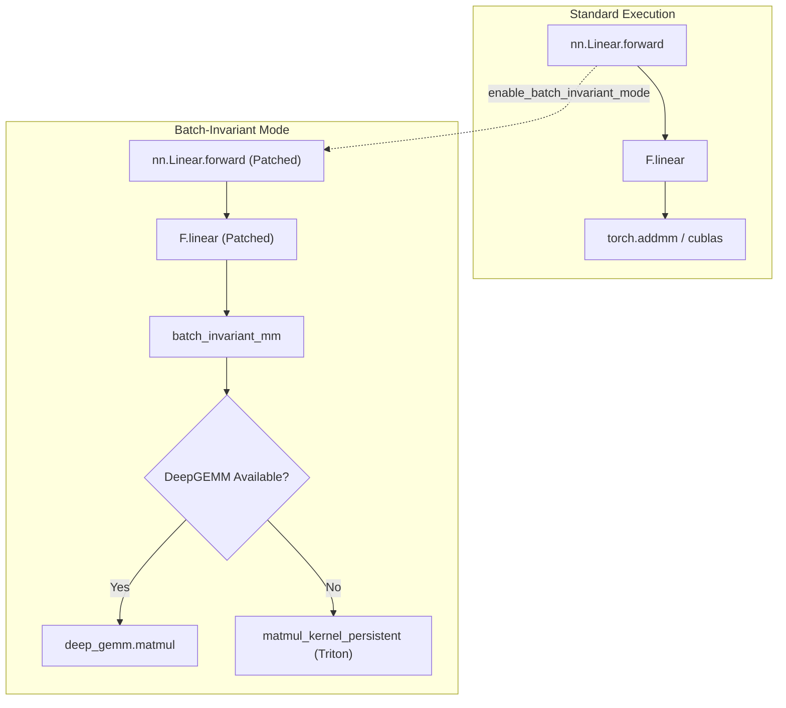
Sources: [python/sglang/srt/batch_invariant_ops/batch_invariant_ops.py:270-332]()

## Deterministic Matrix Multiplication

To achieve determinism, SGLang avoids standard cuBLAS/cuDNN calls which may use non-deterministic algorithms. Instead, it utilizes persistent kernels where the accumulation order is fixed.

### Triton Persistent Kernel
The `matmul_kernel_persistent` is a Triton-based implementation that ensures determinism by:
1.  Using a fixed tiling strategy (`BLOCK_SIZE_M`, `BLOCK_SIZE_N`, `BLOCK_SIZE_K`) [python/sglang/srt/batch_invariant_ops/batch_invariant_ops.py:89-91]().
2.  Iterating through tiles in a deterministic order using `tl.range` over `NUM_SMS` [python/sglang/srt/batch_invariant_ops/batch_invariant_ops.py:108-109]().
3.  Accumulating partial results in a single thread block without relying on cross-block atomic operations [python/sglang/srt/batch_invariant_ops/batch_invariant_ops.py:125-144]().

### DeepGEMM Integration
For NVIDIA Hopper (SM90) and Blackwell (SM100) GPUs, SGLang prefers **DeepGEMM** if `SGLANG_BATCH_INVARIANT_OPS_ENABLE_MM_DEEPGEMM` is set to `1` [python/sglang/srt/batch_invariant_ops/batch_invariant_ops.py:23-25](). DeepGEMM provides high-performance deterministic kernels specifically optimized for these architectures.

Sources: [python/sglang/srt/batch_invariant_ops/batch_invariant_ops.py:75-166](), [python/sglang/srt/batch_invariant_ops/batch_invariant_ops.py:228-255]()

## Batch-Invariant Attention Backends

The Attention backends also incorporate logic to handle determinism when LLM-42 is enabled.

### Triton Attention Backend
The `TritonAttnBackend` detects the determinism requirement via `model_runner.server_args.enable_deterministic_inference` or `enable_llm42` [python/sglang/srt/layers/attention/triton_backend.py:120-123]().
*   **Fixed Split Tile Size**: It enforces a `split_tile_size` (default 256) to ensure the KV cache is partitioned identically regardless of batch size [python/sglang/srt/layers/attention/triton_backend.py:128-130]().
*   **Static KV Splits**: While dynamic splitting is usually preferred for performance, LLM-42 mode uses deterministic logic to compute `num_kv_splits` [python/sglang/srt/layers/attention/triton_backend.py:131-132]().

### FlashInfer Backend
Debug flags allow bypassing attention during development to isolate non-determinism in other layers:
*   `SGLANG_SKIP_DECODE_ATTN`
*   `SGLANG_SKIP_EXTEND_ATTN`
*   `SGLANG_SKIP_VERIFY_ATTN`
[python/sglang/srt/layers/attention/flashinfer_backend.py:43-45]()

Sources: [python/sglang/srt/layers/attention/triton_backend.py:118-157](), [python/sglang/srt/layers/attention/flashinfer_backend.py:41-55]()

## Layer-Specific Invariance

Beyond MatMul, other normalization and activation layers are adjusted for LLM-42.

### RMSNorm
The `RMSNorm` layer checks `is_batch_invariant_mode_enabled()` during the forward pass. If enabled, it switches from the optimized `fused_add_rmsnorm` (which might have floating-point variations) to `rms_norm_batch_invariant` [python/sglang/srt/layers/layernorm.py:139-141]().

### Activation Functions
Standard activation functions like `SiluAndMul` and `GeluAndMul` are generally batch-invariant by nature as they are element-wise. However, SGLang provides `forward_native` implementations as fallbacks to ensure consistency with reference models when `rl_on_policy_target` is set [python/sglang/srt/layers/activation.py:66-71]().

**Diagram: Code Entity Mapping for Determinism**
This diagram maps the high-level determinism concepts to the specific classes and modules in the codebase.

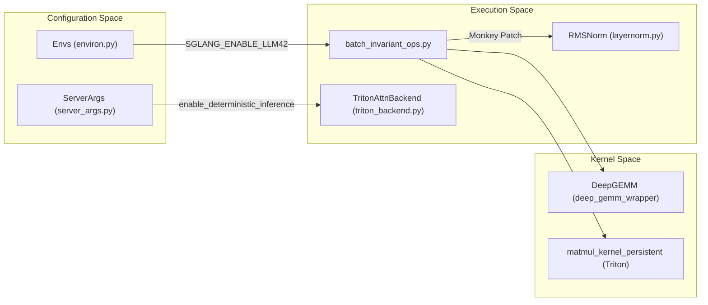
Sources: [python/sglang/srt/environ.py:159-220](), [python/sglang/srt/layers/layernorm.py:91-124](), [python/sglang/srt/batch_invariant_ops/batch_invariant_ops.py:37-42]()

## Environment Variables

| Variable | Description | Default |
| :--- | :--- | :--- |
| `SGLANG_BATCH_INVARIANT_OPS_ENABLE_MM_DEEPGEMM` | Use DeepGEMM for MatMul in invariant mode. | `1` |
| `SGLANG_TRITON_DECODE_SPLIT_TILE_SIZE` | Tile size for deterministic Triton attention. | `256` |
| `SGLANG_USE_TRITON_RMSNORM` | Force Triton-based invariant RMSNorm. | `""` |
| `SGLANG_BATCH_INVARIANT_OPS_ENABLE_MM_COMPARISON_TEST` | Enable cross-check between kernels. | `0` |

Sources: [python/sglang/srt/batch_invariant_ops/batch_invariant_ops.py:23-32](), [python/sglang/srt/layers/attention/triton_backend.py:128-130](), [python/sglang/srt/layers/layernorm.py:123-125]()

---

# Page: Determinism Configuration and Flags

# Determinism Configuration and Flags

<details>
<summary>Relevant source files</summary>

The following files were used as context for generating this wiki page:

- [docs/advanced_features/server_arguments.md](docs/advanced_features/server_arguments.md)
- [docs/basic_usage/deepseek_v32.md](docs/basic_usage/deepseek_v32.md)
- [docs/references/environment_variables.md](docs/references/environment_variables.md)
- [python/sglang/srt/batch_invariant_ops/__init__.py](python/sglang/srt/batch_invariant_ops/__init__.py)
- [python/sglang/srt/batch_invariant_ops/batch_invariant_ops.py](python/sglang/srt/batch_invariant_ops/batch_invariant_ops.py)
- [python/sglang/srt/disaggregation/mooncake/utils.py](python/sglang/srt/disaggregation/mooncake/utils.py)
- [python/sglang/srt/entrypoints/http_server.py](python/sglang/srt/entrypoints/http_server.py)
- [python/sglang/srt/environ.py](python/sglang/srt/environ.py)
- [python/sglang/srt/layers/activation.py](python/sglang/srt/layers/activation.py)
- [python/sglang/srt/layers/attention/cutlass_mla_backend.py](python/sglang/srt/layers/attention/cutlass_mla_backend.py)
- [python/sglang/srt/layers/attention/flashmla_backend.py](python/sglang/srt/layers/attention/flashmla_backend.py)
- [python/sglang/srt/layers/attention/nsa/dequant_k_cache.py](python/sglang/srt/layers/attention/nsa/dequant_k_cache.py)
- [python/sglang/srt/layers/attention/nsa/index_buf_accessor.py](python/sglang/srt/layers/attention/nsa/index_buf_accessor.py)
- [python/sglang/srt/layers/attention/nsa/nsa_indexer.py](python/sglang/srt/layers/attention/nsa/nsa_indexer.py)
- [python/sglang/srt/layers/attention/nsa/quant_k_cache.py](python/sglang/srt/layers/attention/nsa/quant_k_cache.py)
- [python/sglang/srt/layers/attention/nsa/tilelang_kernel.py](python/sglang/srt/layers/attention/nsa/tilelang_kernel.py)
- [python/sglang/srt/layers/attention/nsa/utils.py](python/sglang/srt/layers/attention/nsa/utils.py)
- [python/sglang/srt/layers/attention/nsa_backend.py](python/sglang/srt/layers/attention/nsa_backend.py)
- [python/sglang/srt/layers/attention/trtllm_mla_backend.py](python/sglang/srt/layers/attention/trtllm_mla_backend.py)
- [python/sglang/srt/layers/attention/utils.py](python/sglang/srt/layers/attention/utils.py)
- [python/sglang/srt/layers/communicator.py](python/sglang/srt/layers/communicator.py)
- [python/sglang/srt/layers/communicator_nsa_cp.py](python/sglang/srt/layers/communicator_nsa_cp.py)
- [python/sglang/srt/layers/flashinfer_comm_fusion.py](python/sglang/srt/layers/flashinfer_comm_fusion.py)
- [python/sglang/srt/layers/layernorm.py](python/sglang/srt/layers/layernorm.py)
- [python/sglang/srt/layers/logits_processor.py](python/sglang/srt/layers/logits_processor.py)
- [python/sglang/srt/layers/rotary_embedding.py](python/sglang/srt/layers/rotary_embedding.py)
- [python/sglang/srt/layers/sampler.py](python/sglang/srt/layers/sampler.py)
- [python/sglang/srt/managers/data_parallel_controller.py](python/sglang/srt/managers/data_parallel_controller.py)
- [python/sglang/srt/managers/detokenizer_manager.py](python/sglang/srt/managers/detokenizer_manager.py)
- [python/sglang/srt/managers/io_struct.py](python/sglang/srt/managers/io_struct.py)
- [python/sglang/srt/managers/multi_tokenizer_mixin.py](python/sglang/srt/managers/multi_tokenizer_mixin.py)
- [python/sglang/srt/managers/schedule_batch.py](python/sglang/srt/managers/schedule_batch.py)
- [python/sglang/srt/managers/scheduler.py](python/sglang/srt/managers/scheduler.py)
- [python/sglang/srt/managers/scheduler_metrics_mixin.py](python/sglang/srt/managers/scheduler_metrics_mixin.py)
- [python/sglang/srt/managers/scheduler_output_processor_mixin.py](python/sglang/srt/managers/scheduler_output_processor_mixin.py)
- [python/sglang/srt/managers/scheduler_update_weights_mixin.py](python/sglang/srt/managers/scheduler_update_weights_mixin.py)
- [python/sglang/srt/managers/tokenizer_communicator_mixin.py](python/sglang/srt/managers/tokenizer_communicator_mixin.py)
- [python/sglang/srt/managers/tokenizer_manager.py](python/sglang/srt/managers/tokenizer_manager.py)
- [python/sglang/srt/managers/tp_worker.py](python/sglang/srt/managers/tp_worker.py)
- [python/sglang/srt/mem_cache/utils.py](python/sglang/srt/mem_cache/utils.py)
- [python/sglang/srt/metrics/collector.py](python/sglang/srt/metrics/collector.py)
- [python/sglang/srt/model_executor/cuda_graph_runner.py](python/sglang/srt/model_executor/cuda_graph_runner.py)
- [python/sglang/srt/model_executor/forward_batch_info.py](python/sglang/srt/model_executor/forward_batch_info.py)
- [python/sglang/srt/model_executor/model_runner.py](python/sglang/srt/model_executor/model_runner.py)
- [python/sglang/srt/sampling/sampling_batch_info.py](python/sglang/srt/sampling/sampling_batch_info.py)
- [python/sglang/srt/sampling/sampling_params.py](python/sglang/srt/sampling/sampling_params.py)
- [python/sglang/srt/server_args.py](python/sglang/srt/server_args.py)
- [python/sglang/srt/utils/common.py](python/sglang/srt/utils/common.py)
- [python/sglang/test/attention/test_trtllm_mla_backend.py](python/sglang/test/attention/test_trtllm_mla_backend.py)
- [test/manual/layers/attention/nsa/test_index_buf_accessor.py](test/manual/layers/attention/nsa/test_index_buf_accessor.py)
- [test/registered/hicache/test_nsa_pool_host_unit.py](test/registered/hicache/test_nsa_pool_host_unit.py)
- [test/registered/kernels/test_nsa_indexer.py](test/registered/kernels/test_nsa_indexer.py)

</details>


This page provides a technical reference for the configuration arguments and environment variables used to enable and tune deterministic inference in LLM-42. Determinism in LLM-42 is achieved through the **Decode-Verify-Rollback (DVR)** protocol, which ensures bit-wise identical outputs regardless of batching conditions.

## Overview of Determinism Flags

Determinism configuration is primarily handled through `ServerArgs` and the `envs` system. The core mechanism involves forcing the runtime into a "Batch-Invariant" mode where all GPU operations (especially reductions and matrix multiplications) produce identical results regardless of how requests are grouped in a batch.

### Core Server Arguments

The following arguments are defined in `python/sglang/srt/server_args.py` and control the high-level behavior of the LLM-42 deterministic engine:

| Argument | Type | Description |
| :--- | :--- | :--- |
| `--enable-llm42` | `bool` | Enables the LLM-42 deterministic inference engine. [python/sglang/srt/server_args.py:275-300]() |
| `--llm42-window-size` | `int` | The number of tokens generated in the optimistic decode phase before a verification check is triggered. [python/sglang/srt/server_args.py:310-315]() |
| `--llm42-verify-batch-size` | `int` | The batch size used during the verification phase. Larger batches improve throughput but may increase latency. [python/sglang/srt/server_args.py:320-325]() |
| `--attention-backend` | `str` | Must be set to a deterministic backend (e.g., `flashinfer`, `fa3`, or `triton`) when LLM-42 is enabled. [python/sglang/srt/server_args.py:154-157]() |

### Environment Variables

The `envs` class in `python/sglang/srt/environ.py` manages low-level toggles:

*   `SGLANG_ENABLE_DETERMINISTIC_INFERENCE`: A global toggle that forces the runtime to use deterministic kernels and batch-invariant paths. [python/sglang/srt/environ.py:225-230]()
*   `SGLANG_REPRODUCIBLE_BATCHING`: Internal flag used to ensure the scheduler maintains request ordering necessary for bit-wise reproducibility. [python/sglang/srt/environ.py:235-240]()

**Sources:** [python/sglang/srt/server_args.py:154-325](), [python/sglang/srt/environ.py:225-240]()

---

## Data Flow: From Flag to Execution

When `--enable-llm42` is set, the `ModelRunner` initializes the batch-invariant execution environment. This involves monkey-patching standard operations and configuring the `ForwardMode` to handle specialized verification passes.

### Logic Flow for Determinism Initialization

The diagram below shows how configuration flags propagate from the `ServerArgs` to the low-level kernel execution.

"Determinism Initialization Flow"
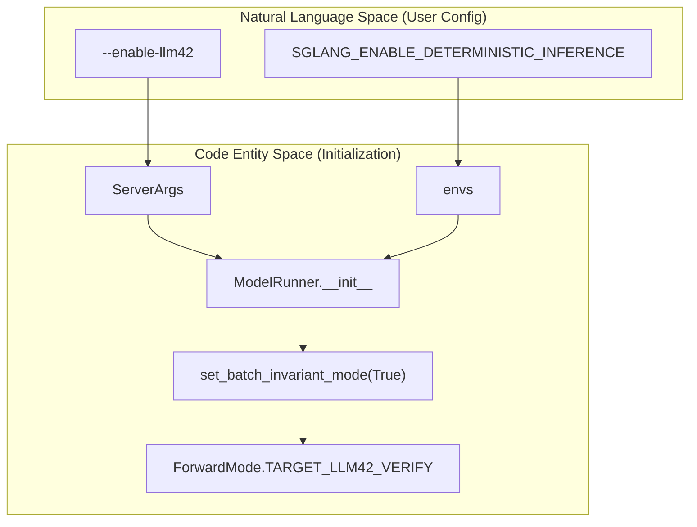
**Sources:** [python/sglang/srt/model_executor/model_runner.py:189-190](), [python/sglang/srt/model_executor/forward_batch_info.py:89-115]()

---

## LLM-42 Specific Forward Modes

The determinism engine introduces specialized execution modes for the `ModelRunner`. These modes are defined in the `ForwardMode` enum.

### ForwardMode Definitions
In `python/sglang/srt/model_executor/forward_batch_info.py`, specific modes are reserved for LLM-42:

1.  **`TARGET_LLM42_VERIFY`**: Used during the LLM-42 verification phase. It replays a window of tokens using fixed-shape reductions to verify consistency with the initial decode-phase output. [python/sglang/srt/model_executor/forward_batch_info.py:87-89]()
2.  **`is_target_llm42_verify()`**: A helper method in `ForwardMode` to check if the current batch requires deterministic verification logic. [python/sglang/srt/model_executor/forward_batch_info.py:146-148]()

### Verification Logic in ModelRunner
When `ForwardMode.TARGET_LLM42_VERIFY` is active, the `ModelRunner` bypasses standard non-deterministic optimizations (like certain CUDA graph captures that might involve variable-sized padding) and uses `batch_invariant_ops`.

**Sources:** [python/sglang/srt/model_executor/forward_batch_info.py:74-148](), [python/sglang/srt/model_executor/model_runner.py:122-135]()

---

## Batch-Invariant Configuration

Batch-invariance is the technical foundation of LLM-42. It ensures that $f(A \cup B) = f(A) \cup f(B)$ for any requests $A$ and $B$.

### Global State Management
The state is managed via `python/sglang/srt/batch_invariant_ops/batch_invariant_ops.py`:
*   `set_batch_invariant_mode(enabled: bool)`: Sets the global process-level flag. [python/sglang/srt/model_executor/model_runner.py:189]()
*   `is_batch_invariant_mode_enabled()`: Checked by linear layers and attention backends to decide whether to use deterministic Triton kernels or standard CuBLAS/FlashAttention paths. [python/sglang/srt/model_executor/model_runner.py:189]()

### Relationship between Entities

"Batch-Invariant Operation Mapping"
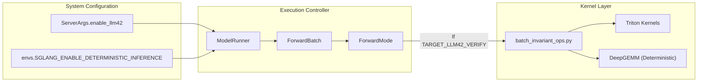
**Sources:** [python/sglang/srt/model_executor/model_runner.py:189-190](), [python/sglang/srt/batch_invariant_ops/batch_invariant_ops.py:1-20]()

---

## Summary Table: Configuration Reference

| Flag | Default | Code Location | Impact |
| :--- | :--- | :--- | :--- |
| `--enable-llm42` | `False` | `server_args.py` | Toggles the DVR protocol. |
| `--llm42-window-size` | `8` | `server_args.py` | Defines the frequency of bit-wise verification. |
| `SGLANG_ENABLE_DETERMINISTIC_INFERENCE` | `False` | `environ.py` | Forces deterministic math kernels globally. |
| `TARGET_LLM42_VERIFY` | N/A | `forward_batch_info.py` | Forward mode for replaying tokens deterministically. |

**Sources:** [python/sglang/srt/server_args.py:275-325](), [python/sglang/srt/environ.py:160-250](), [python/sglang/srt/model_executor/forward_batch_info.py:74-100]()

---

# Page: SGLang Runtime (SRT) Core Architecture

# SGLang Runtime (SRT) Core Architecture

<details>
<summary>Relevant source files</summary>

The following files were used as context for generating this wiki page:

- [README.md](README.md)
- [benchmark/deepseek_v3/README.md](benchmark/deepseek_v3/README.md)
- [docker/rocm.Dockerfile](docker/rocm.Dockerfile)
- [docs/get_started/install.md](docs/get_started/install.md)
- [docs/platforms/amd_gpu.md](docs/platforms/amd_gpu.md)
- [docs/platforms/ascend_npu.md](docs/platforms/ascend_npu.md)
- [python/pyproject.toml](python/pyproject.toml)
- [python/pyproject_cpu.toml](python/pyproject_cpu.toml)
- [python/pyproject_other.toml](python/pyproject_other.toml)
- [python/pyproject_xpu.toml](python/pyproject_xpu.toml)
- [python/sglang/__init__.py](python/sglang/__init__.py)
- [python/sglang/srt/entrypoints/engine.py](python/sglang/srt/entrypoints/engine.py)
- [python/sglang/srt/entrypoints/http_server.py](python/sglang/srt/entrypoints/http_server.py)
- [python/sglang/srt/layers/logits_processor.py](python/sglang/srt/layers/logits_processor.py)
- [python/sglang/srt/layers/sampler.py](python/sglang/srt/layers/sampler.py)
- [python/sglang/srt/managers/detokenizer_manager.py](python/sglang/srt/managers/detokenizer_manager.py)
- [python/sglang/srt/managers/io_struct.py](python/sglang/srt/managers/io_struct.py)
- [python/sglang/srt/managers/multi_tokenizer_mixin.py](python/sglang/srt/managers/multi_tokenizer_mixin.py)
- [python/sglang/srt/managers/schedule_batch.py](python/sglang/srt/managers/schedule_batch.py)
- [python/sglang/srt/managers/scheduler.py](python/sglang/srt/managers/scheduler.py)
- [python/sglang/srt/managers/scheduler_metrics_mixin.py](python/sglang/srt/managers/scheduler_metrics_mixin.py)
- [python/sglang/srt/managers/scheduler_output_processor_mixin.py](python/sglang/srt/managers/scheduler_output_processor_mixin.py)
- [python/sglang/srt/managers/scheduler_update_weights_mixin.py](python/sglang/srt/managers/scheduler_update_weights_mixin.py)
- [python/sglang/srt/managers/tokenizer_communicator_mixin.py](python/sglang/srt/managers/tokenizer_communicator_mixin.py)
- [python/sglang/srt/managers/tokenizer_manager.py](python/sglang/srt/managers/tokenizer_manager.py)
- [python/sglang/srt/managers/tp_worker.py](python/sglang/srt/managers/tp_worker.py)
- [python/sglang/srt/metrics/collector.py](python/sglang/srt/metrics/collector.py)
- [python/sglang/srt/model_executor/cuda_graph_runner.py](python/sglang/srt/model_executor/cuda_graph_runner.py)
- [python/sglang/srt/model_executor/forward_batch_info.py](python/sglang/srt/model_executor/forward_batch_info.py)
- [python/sglang/srt/model_executor/model_runner.py](python/sglang/srt/model_executor/model_runner.py)
- [python/sglang/srt/sampling/sampling_batch_info.py](python/sglang/srt/sampling/sampling_batch_info.py)
- [python/sglang/srt/sampling/sampling_params.py](python/sglang/srt/sampling/sampling_params.py)
- [python/sglang/srt/server_args.py](python/sglang/srt/server_args.py)
- [python/sglang/version.py](python/sglang/version.py)

</details>


The SGLang Runtime (SRT) is a high-performance inference engine designed for large language models (LLMs) and vision-language models (VLMs). It utilizes a multi-process architecture to parallelize tokenization, scheduling, model execution, and detokenization, ensuring maximum throughput and low latency.

## Multi-Process Engine Overview

The `Engine` class serves as the main entry point for the SGLang runtime [python/sglang/srt/entrypoints/engine.py:118-130](). It orchestrates three primary components that run in separate processes to avoid Python's Global Interpreter Lock (GIL) bottlenecks:

1.  **TokenizerManager**: Runs in the main process. It handles HTTP/gRPC requests, manages multimodal data, and converts text into token IDs [python/sglang/srt/managers/tokenizer_manager.py:14-14]().
2.  **Scheduler**: Runs as a subprocess. It manages the request queue, allocates KV cache memory, and determines batch composition for the GPU [python/sglang/srt/managers/scheduler.py:14-14]().
3.  **DetokenizerManager**: Runs as a subprocess. It converts output token IDs from the model back into text and streams them to the client [python/sglang/srt/managers/detokenizer_manager.py:1-20]().

The processes communicate via ZeroMQ (ZMQ) using IPC or TCP sockets [python/sglang/srt/entrypoints/engine.py:129-130]().

### System Architecture Diagram

The following diagram illustrates the flow of a request through the SRT core components and the associated code entities.

**SRT Process and Data Flow**
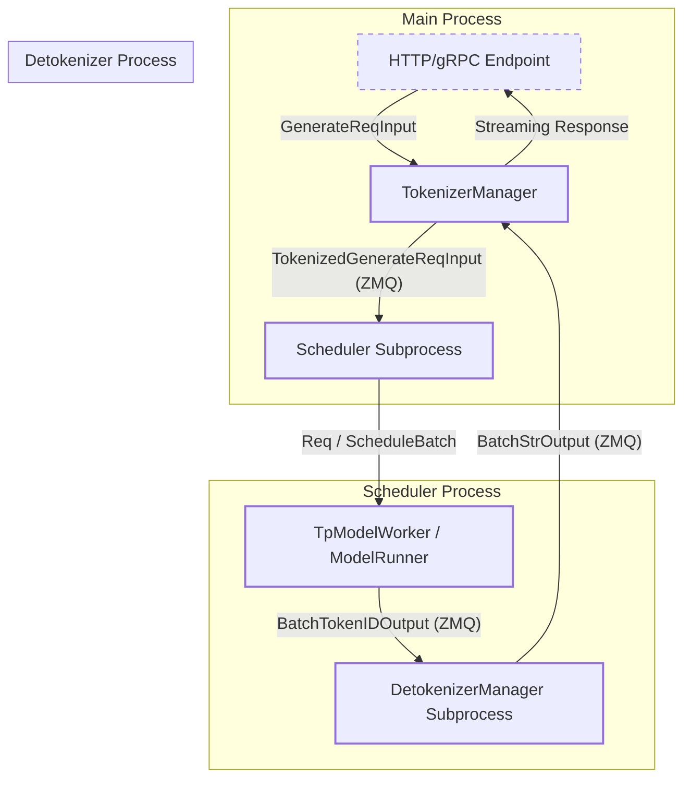
Sources: [python/sglang/srt/entrypoints/engine.py:118-130](), [python/sglang/srt/managers/tokenizer_manager.py:14-14](), [python/sglang/srt/managers/scheduler.py:14-14](), [python/sglang/srt/managers/io_struct.py:14-17]()

## Core Components

### TokenizerManager
The `TokenizerManager` is responsible for the front-end lifecycle of a request. It manages the `AsyncDynamicbatchTokenizer` to handle high-concurrency tokenization [python/sglang/srt/managers/tokenizer_manager.py:46-46]() and utilizes an `AsyncMMDataProcessor` for multimodal inputs like images and videos [python/sglang/srt/managers/tokenizer_manager.py:47-47]().

### Scheduler
The `Scheduler` is the brain of SRT. it maintains the `RadixCache` for prefix matching and manages GPU memory pools [python/sglang/srt/managers/scheduler.py:178-180](). It transforms high-level `ScheduleBatch` objects into `ModelWorkerBatch` structures for the GPU workers [python/sglang/srt/managers/schedule_batch.py:27-38]().
For details, see [Request Lifecycle and Scheduling](#3.1).

### ModelRunner
The `ModelRunner` executes the actual model forward pass on the GPU. It wraps the model architecture and provides optimized execution paths via `CudaGraphRunner` for the decode phase [python/sglang/srt/model_executor/model_runner.py:118-121](). It also manages the KV cache via `ModelRunnerKVCacheMixin` [python/sglang/srt/model_executor/model_runner.py:130-132]().
For details, see [Model Execution and CUDA Graph Runner](#3.2).

### DetokenizerManager
The `DetokenizerManager` receives `BatchTokenIDOutput` from the scheduler process. It performs incremental detokenization to minimize latency for streaming responses before sending `BatchStrOutput` back to the `TokenizerManager` [python/sglang/srt/managers/io_struct.py:52-55]().

## Code Entity Mapping

The following diagram maps the logical runtime stages to the specific classes and data structures used in the codebase.

**Natural Language to Code Entity Mapping**
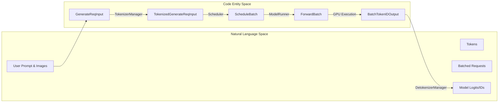
Sources: [python/sglang/srt/managers/io_struct.py:177-183](), [python/sglang/srt/managers/schedule_batch.py:143-150](), [python/sglang/srt/model_executor/forward_batch_info.py:122-127]()

## Subsystem Navigation

SRT's complexity is divided into several specialized subsystems covered in the following child pages:

*   **[Request Lifecycle and Scheduling](#3.1)**: Details on the `Scheduler`, request stages (`EXTEND`, `DECODE`), and the `RadixCache` system.
*   **[Model Execution and CUDA Graph Runner](#3.2)**: Details on `ModelRunner`, `TpModelWorker`, and how CUDA graphs are captured and replayed for decode performance.
*   **[KV Cache and Memory Management](#3.3)**: Details on `ReqToTokenPool`, `MHATokenToKVPool`, and hierarchical caching (`HiCache`).
*   **[Distributed Parallelism](#3.4)**: How SRT handles Tensor Parallelism (TP) and Pipeline Parallelism (PP) across multiple GPUs and nodes.
*   **[Prefill-Decode Disaggregation](#3.5)**: The architecture for separating prefill and decode phases onto different instances for improved efficiency.

Sources: [python/sglang/srt/managers/scheduler.py:143-155](), [python/sglang/srt/model_executor/model_runner.py:14-14](), [python/sglang/srt/model_executor/cuda_graph_runner.py:14-14](), [python/sglang/srt/managers/schedule_batch.py:64-74]()

---

# Page: Request Lifecycle and Scheduling

# Request Lifecycle and Scheduling

<details>
<summary>Relevant source files</summary>

The following files were used as context for generating this wiki page:

- [python/sglang/srt/entrypoints/http_server.py](python/sglang/srt/entrypoints/http_server.py)
- [python/sglang/srt/layers/logits_processor.py](python/sglang/srt/layers/logits_processor.py)
- [python/sglang/srt/layers/radix_attention.py](python/sglang/srt/layers/radix_attention.py)
- [python/sglang/srt/layers/sampler.py](python/sglang/srt/layers/sampler.py)
- [python/sglang/srt/managers/detokenizer_manager.py](python/sglang/srt/managers/detokenizer_manager.py)
- [python/sglang/srt/managers/io_struct.py](python/sglang/srt/managers/io_struct.py)
- [python/sglang/srt/managers/multi_tokenizer_mixin.py](python/sglang/srt/managers/multi_tokenizer_mixin.py)
- [python/sglang/srt/managers/schedule_batch.py](python/sglang/srt/managers/schedule_batch.py)
- [python/sglang/srt/managers/schedule_policy.py](python/sglang/srt/managers/schedule_policy.py)
- [python/sglang/srt/managers/scheduler.py](python/sglang/srt/managers/scheduler.py)
- [python/sglang/srt/managers/scheduler_metrics_mixin.py](python/sglang/srt/managers/scheduler_metrics_mixin.py)
- [python/sglang/srt/managers/scheduler_output_processor_mixin.py](python/sglang/srt/managers/scheduler_output_processor_mixin.py)
- [python/sglang/srt/managers/scheduler_update_weights_mixin.py](python/sglang/srt/managers/scheduler_update_weights_mixin.py)
- [python/sglang/srt/managers/tokenizer_communicator_mixin.py](python/sglang/srt/managers/tokenizer_communicator_mixin.py)
- [python/sglang/srt/managers/tokenizer_manager.py](python/sglang/srt/managers/tokenizer_manager.py)
- [python/sglang/srt/managers/tp_worker.py](python/sglang/srt/managers/tp_worker.py)
- [python/sglang/srt/mem_cache/base_prefix_cache.py](python/sglang/srt/mem_cache/base_prefix_cache.py)
- [python/sglang/srt/mem_cache/chunk_cache.py](python/sglang/srt/mem_cache/chunk_cache.py)
- [python/sglang/srt/mem_cache/common.py](python/sglang/srt/mem_cache/common.py)
- [python/sglang/srt/mem_cache/mamba_radix_cache.py](python/sglang/srt/mem_cache/mamba_radix_cache.py)
- [python/sglang/srt/mem_cache/radix_cache.py](python/sglang/srt/mem_cache/radix_cache.py)
- [python/sglang/srt/mem_cache/radix_cache_cpp.py](python/sglang/srt/mem_cache/radix_cache_cpp.py)
- [python/sglang/srt/mem_cache/storage/lmcache/lmc_radix_cache.py](python/sglang/srt/mem_cache/storage/lmcache/lmc_radix_cache.py)
- [python/sglang/srt/mem_cache/swa_radix_cache.py](python/sglang/srt/mem_cache/swa_radix_cache.py)
- [python/sglang/srt/metrics/collector.py](python/sglang/srt/metrics/collector.py)
- [python/sglang/srt/model_executor/cuda_graph_runner.py](python/sglang/srt/model_executor/cuda_graph_runner.py)
- [python/sglang/srt/model_executor/forward_batch_info.py](python/sglang/srt/model_executor/forward_batch_info.py)
- [python/sglang/srt/model_executor/model_runner.py](python/sglang/srt/model_executor/model_runner.py)
- [python/sglang/srt/sampling/sampling_batch_info.py](python/sglang/srt/sampling/sampling_batch_info.py)
- [python/sglang/srt/sampling/sampling_params.py](python/sglang/srt/sampling/sampling_params.py)
- [python/sglang/srt/server_args.py](python/sglang/srt/server_args.py)
- [python/sglang/srt/speculative/eagle_info.py](python/sglang/srt/speculative/eagle_info.py)
- [python/sglang/srt/speculative/eagle_info_v2.py](python/sglang/srt/speculative/eagle_info_v2.py)
- [python/sglang/srt/speculative/eagle_worker_v2.py](python/sglang/srt/speculative/eagle_worker_v2.py)
- [test/registered/radix_cache/test_mamba_unittest.py](test/registered/radix_cache/test_mamba_unittest.py)
- [test/registered/radix_cache/test_radix_cache_unit.py](test/registered/radix_cache/test_radix_cache_unit.py)
- [test/registered/radix_cache/test_swa_unittest.py](test/registered/radix_cache/test_swa_unittest.py)

</details>


This page describes the end-to-end journey of a request within the SGLang Runtime (SRT). It covers the transition from high-level HTTP inputs to scheduled batches, prefix-aware cache matching, and final output processing.

## 1. Request Ingestion and Tokenization

Requests enter the system via the `TokenizerManager`, which handles the conversion of raw text or multimodal data into a format suitable for the scheduler.

- **HTTP Entrypoint**: The FastAPI server in `http_server.py` receives `GenerateReqInput` objects [python/sglang/srt/entrypoints/http_server.py:104]().
- **Tokenization**: The `TokenizerManager` uses `AsyncDynamicbatchTokenizer` to process strings into `input_ids` [python/sglang/srt/managers/tokenizer_manager.py:46]().
- **Multimodal Processing**: If images or videos are present, `AsyncMMDataProcessor` handles feature extraction or placeholder insertion [python/sglang/srt/managers/tokenizer_manager.py:47]().
- **State Management**: Each request is tracked via a `ReqState` object, which stores timing metrics and incremental output buffers [python/sglang/srt/managers/tokenizer_manager.py:129-179]().

### Data Flow: Entry to Scheduler
The following diagram illustrates the transformation of a request from an external API call into the internal `Req` object used by the scheduler.

**Diagram: Request Ingestion Pipeline**
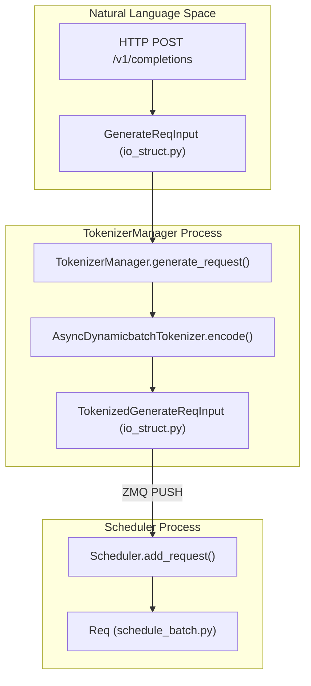
**Sources:** [python/sglang/srt/entrypoints/http_server.py:104](), [python/sglang/srt/managers/tokenizer_manager.py:129-179](), [python/sglang/srt/managers/scheduler.py:147-150]().

---

## 2. Scheduling and Batching

The `Scheduler` is the central coordinator of the SRT. It maintains queues of pending requests and organizes them into batches for the GPU workers.

### 2.1 Scheduling Policies
The scheduler uses a `SchedulePolicy` (defaulting to FCFS) to determine the order of execution.
- **FCFS**: First-Come-First-Served logic [python/sglang/srt/managers/schedule_policy.py:151]().
- **Chunked Prefill**: Large requests can be split into chunks to avoid starving decode requests [python/sglang/srt/model_executor/forward_batch_info.py:80-81]().

### 2.2 RadixCache Prefix Matching
Before a request is scheduled for a full prefill, the `Scheduler` queries the `RadixCache` to find existing KV cache prefixes.
- **Prefix Matching**: The `match_prefix` function in `RadixCache` traverses a radix tree to find the longest common prefix of `input_ids` [python/sglang/srt/mem_cache/radix_cache.py:180]().
- **Cache Hits**: If a prefix is found, the scheduler only needs to compute the "extend" portion of the sequence, significantly reducing TTFT (Time To First Token).

### 2.3 The Batching Lifecycle
Requests progress through three primary data structures as they move toward the GPU:
1.  **`ScheduleBatch`**: High-level metadata managed by the CPU scheduler [python/sglang/srt/managers/schedule_batch.py:149]().
2.  **`ModelWorkerBatch`**: A subset of data sent to the `TpModelWorker` [python/sglang/srt/managers/schedule_batch.py:145]().
3.  **`ForwardBatch`**: Low-level GPU tensors used by the `ModelRunner` [python/sglang/srt/model_executor/forward_batch_info.py:124]().

**Diagram: Batch Transformation and Execution**
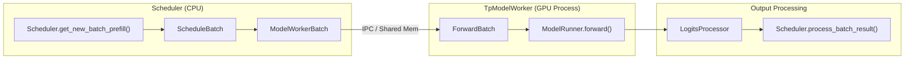
**Sources:** [python/sglang/srt/managers/schedule_batch.py:25-38](), [python/sglang/srt/model_executor/forward_batch_info.py:17-28](), [python/sglang/srt/managers/scheduler.py:143-150]().

---

## 3. Forward Pass Modes

The scheduler categorizes the forward pass into different `ForwardMode` types to optimize GPU kernel selection:

| Mode | Description | Code Entity |
| :--- | :--- | :--- |
| `EXTEND` | Standard prefill for new tokens. | `ForwardMode.EXTEND` [python/sglang/srt/model_executor/forward_batch_info.py:77]() |
| `DECODE` | Generating one token for existing sequences. | `ForwardMode.DECODE` [python/sglang/srt/model_executor/forward_batch_info.py:79]() |
| `MIXED` | Simultaneous prefill and decode (Chunked Prefill). | `ForwardMode.MIXED` [python/sglang/srt/model_executor/forward_batch_info.py:81]() |
| `TARGET_VERIFY` | Speculative decoding verification pass. | `ForwardMode.TARGET_VERIFY` [python/sglang/srt/model_executor/forward_batch_info.py:86]() |
| `TARGET_LLM42_VERIFY` | LLM-42 DVR deterministic verification. | `ForwardMode.TARGET_LLM42_VERIFY` [python/sglang/srt/model_executor/forward_batch_info.py:89]() |

**Sources:** [python/sglang/srt/model_executor/forward_batch_info.py:74-104]()

---

## 4. Output Processing and Detokenization

Once the `ModelRunner` completes a forward pass, the results flow back through the `Scheduler` to the user.

1.  **Result Collection**: The `Scheduler` receives `GenerationBatchResult` containing `next_token_ids` and `logits` [python/sglang/srt/managers/scheduler.py:177]().
2.  **Output Processing**: `SchedulerOutputProcessorMixin` handles the logic for updating request states and checking finish reasons (e.g., EOS token, max length) [python/sglang/srt/managers/scheduler_output_processor_mixin.py:41]().
3.  **Detokenization**: Token IDs are sent to the `DetokenizerManager`. It performs incremental decoding using a `DecodeStatus` tracker to handle multi-byte UTF-8 characters correctly [python/sglang/srt/managers/detokenizer_manager.py:63-72]().
4.  **Streaming**: The `TokenizerManager` receives the detokenized strings and pushes them to the client via HTTP streaming [python/sglang/srt/managers/tokenizer_manager.py:151-153]().

### LLM-42 DVR Integration
During the output phase, if `enable_llm42` is active, the first token from prefill is marked as verified [python/sglang/srt/managers/scheduler_output_processor_mixin.py:179-181](). Subsequent decode tokens are verified in windows via the `TARGET_LLM42_VERIFY` mode to ensure batch-invariant determinism.

**Sources:** [python/sglang/srt/managers/detokenizer_manager.py:74-90](), [python/sglang/srt/managers/scheduler_output_processor_mixin.py:124-185](), [python/sglang/srt/managers/tokenizer_manager.py:129-179]().

---

# Page: Model Execution and CUDA Graph Runner

# Model Execution and CUDA Graph Runner

<details>
<summary>Relevant source files</summary>

The following files were used as context for generating this wiki page:

- [python/sglang/multimodal_gen/runtime/layers/usp.py](python/sglang/multimodal_gen/runtime/layers/usp.py)
- [python/sglang/srt/compilation/backend.py](python/sglang/srt/compilation/backend.py)
- [python/sglang/srt/compilation/compilation_config.py](python/sglang/srt/compilation/compilation_config.py)
- [python/sglang/srt/compilation/compile.py](python/sglang/srt/compilation/compile.py)
- [python/sglang/srt/compilation/compiler_interface.py](python/sglang/srt/compilation/compiler_interface.py)
- [python/sglang/srt/compilation/cuda_piecewise_backend.py](python/sglang/srt/compilation/cuda_piecewise_backend.py)
- [python/sglang/srt/compilation/piecewise_context_manager.py](python/sglang/srt/compilation/piecewise_context_manager.py)
- [python/sglang/srt/entrypoints/http_server.py](python/sglang/srt/entrypoints/http_server.py)
- [python/sglang/srt/layers/attention/fla/utils.py](python/sglang/srt/layers/attention/fla/utils.py)
- [python/sglang/srt/layers/elementwise.py](python/sglang/srt/layers/elementwise.py)
- [python/sglang/srt/layers/logits_processor.py](python/sglang/srt/layers/logits_processor.py)
- [python/sglang/srt/layers/moe/router.py](python/sglang/srt/layers/moe/router.py)
- [python/sglang/srt/layers/sampler.py](python/sglang/srt/layers/sampler.py)
- [python/sglang/srt/managers/detokenizer_manager.py](python/sglang/srt/managers/detokenizer_manager.py)
- [python/sglang/srt/managers/io_struct.py](python/sglang/srt/managers/io_struct.py)
- [python/sglang/srt/managers/multi_tokenizer_mixin.py](python/sglang/srt/managers/multi_tokenizer_mixin.py)
- [python/sglang/srt/managers/schedule_batch.py](python/sglang/srt/managers/schedule_batch.py)
- [python/sglang/srt/managers/scheduler.py](python/sglang/srt/managers/scheduler.py)
- [python/sglang/srt/managers/scheduler_metrics_mixin.py](python/sglang/srt/managers/scheduler_metrics_mixin.py)
- [python/sglang/srt/managers/scheduler_output_processor_mixin.py](python/sglang/srt/managers/scheduler_output_processor_mixin.py)
- [python/sglang/srt/managers/scheduler_update_weights_mixin.py](python/sglang/srt/managers/scheduler_update_weights_mixin.py)
- [python/sglang/srt/managers/tokenizer_communicator_mixin.py](python/sglang/srt/managers/tokenizer_communicator_mixin.py)
- [python/sglang/srt/managers/tokenizer_manager.py](python/sglang/srt/managers/tokenizer_manager.py)
- [python/sglang/srt/managers/tp_worker.py](python/sglang/srt/managers/tp_worker.py)
- [python/sglang/srt/metrics/collector.py](python/sglang/srt/metrics/collector.py)
- [python/sglang/srt/model_executor/cuda_graph_runner.py](python/sglang/srt/model_executor/cuda_graph_runner.py)
- [python/sglang/srt/model_executor/forward_batch_info.py](python/sglang/srt/model_executor/forward_batch_info.py)
- [python/sglang/srt/model_executor/model_runner.py](python/sglang/srt/model_executor/model_runner.py)
- [python/sglang/srt/model_executor/piecewise_cuda_graph_runner.py](python/sglang/srt/model_executor/piecewise_cuda_graph_runner.py)
- [python/sglang/srt/sampling/sampling_batch_info.py](python/sglang/srt/sampling/sampling_batch_info.py)
- [python/sglang/srt/sampling/sampling_params.py](python/sglang/srt/sampling/sampling_params.py)
- [python/sglang/srt/server_args.py](python/sglang/srt/server_args.py)
- [python/sglang/srt/tokenizer/tiktoken_tokenizer.py](python/sglang/srt/tokenizer/tiktoken_tokenizer.py)
- [python/sglang/srt/utils/patch_torch.py](python/sglang/srt/utils/patch_torch.py)
- [test/registered/cuda_graph/test_piecewise_cuda_graph_2_gpu.py](test/registered/cuda_graph/test_piecewise_cuda_graph_2_gpu.py)
- [test/registered/cuda_graph/test_piecewise_cuda_graph_large_1_gpu.py](test/registered/cuda_graph/test_piecewise_cuda_graph_large_1_gpu.py)
- [test/registered/cuda_graph/test_piecewise_cuda_graph_small_1_gpu.py](test/registered/cuda_graph/test_piecewise_cuda_graph_small_1_gpu.py)

</details>


The Model Execution subsystem is responsible for performing forward passes of the transformer models on the GPU. It bridges the high-level scheduling logic with low-level GPU operations, utilizing optimizations such as **CUDA Graphs** and `torch.compile` to minimize CPU overhead and kernel launch latency during the decode phase.

## ModelRunner and Forward Execution

The `ModelRunner` class is the central entity for executing model forward passes. It manages the model's weights, device buffers, and the execution of different forward modes (Prefill/Extend, Decode, and Verify).

### Forward Modes
The execution logic varies significantly based on the `ForwardMode` defined in the batch metadata:
*   **EXTEND (Prefill):** Processes new input tokens and populates the KV cache. This is typically compute-bound.
*   **DECODE:** Generates one token at a time for a batch of requests. This is typically memory-bound and sensitive to CPU overhead.
*   **TARGET_VERIFY:** Used in speculative decoding to verify multiple draft tokens in a single target model pass.
*   **TARGET_LLM42_VERIFY:** Used in the LLM-42 DVR protocol to replay a window of tokens under deterministic fixed-shape reductions [python/sglang/srt/model_executor/forward_batch_info.py:87-89]().

### Data Flow: Scheduler to GPU
The transition from request management to GPU execution involves a series of data structure transformations:
1.  `ScheduleBatch`: Managed by the `Scheduler`, contains high-level CPU-side data [python/sglang/srt/managers/schedule_batch.py:29-30]().
2.  `ModelWorkerBatch`: A subset of the schedule batch containing only data needed for the GPU forward pass [python/sglang/srt/managers/schedule_batch.py:31-33]().
3.  `ForwardBatch`: Managed by `ModelRunner`, containing low-level GPU tensors and attention metadata [python/sglang/srt/model_executor/forward_batch_info.py:26-27]().

### Diagram: Execution Data Flow
"Natural Language Space" to "Code Entity Space" mapping for model execution.

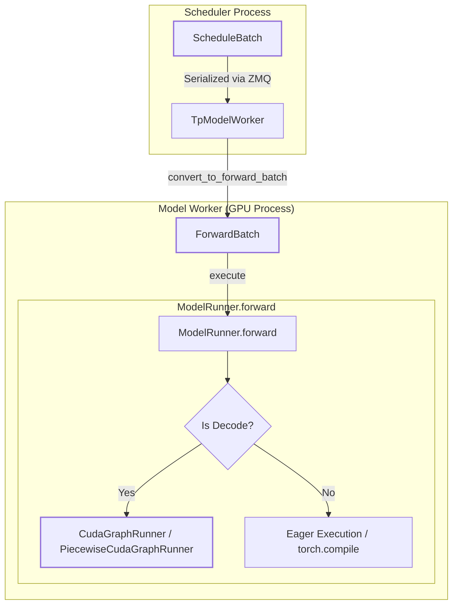
Sources: [python/sglang/srt/managers/schedule_batch.py:25-38](), [python/sglang/srt/model_executor/model_runner.py:1-14]()

---

## CudaGraphRunner

To mitigate the overhead of launching hundreds of small kernels during the decode phase, SGLang uses `CudaGraphRunner`. It captures the sequence of GPU operations for a fixed batch size into a single graph that can be replayed with minimal CPU intervention [python/sglang/srt/model_executor/cuda_graph_runner.py:14-15]().

### Capture Strategy
SGLang captures graphs for a predefined set of batch sizes (e.g., powers of 2 or common sizes defined in `cuda_graph_bs`) [python/sglang/srt/model_executor/cuda_graph_runner.py:192-200](). During inference, the runner pads the current batch to the nearest captured size.

### Key Components
*   **GraphInputBuffers:** Manages the static GPU buffers (input IDs, position IDs, KV cache pointers) that are updated before each graph replay [python/sglang/srt/model_executor/input_buffers.py:1-20]().
*   **Capture Mode:** A context manager `model_capture_mode` is used to signal layers that they are being recorded, allowing them to use static shapes or pre-allocated buffers [python/sglang/srt/model_executor/cuda_graph_runner.py:102-109]().

Sources: [python/sglang/srt/model_executor/cuda_graph_runner.py:118-135](), [python/sglang/srt/model_executor/input_buffers.py:1-20]()

---

## Piecewise CUDA Graphs

For very large models or scenarios where a single CUDA graph would exceed memory limits (due to the static allocation of intermediate tensors), SGLang implements `PiecewiseCudaGraphRunner`.

Instead of capturing the entire model as one graph, it breaks the model into "pieces" (e.g., groups of transformer layers). This allows for:
1.  **Memory Savings:** Intermediate activations can be managed more flexibly between pieces.
2.  **Partial Compilation:** Specific segments can be optimized with `torch.compile` while others remain in eager mode.
3.  **Better Scalability:** Easier to manage on multi-GPU setups where collective operations (All-Reduce) might be interspersed with compute [python/sglang/srt/model_executor/piecewise_cuda_graph_runner.py:1-30]().

Sources: [python/sglang/srt/model_executor/piecewise_cuda_graph_runner.py:1-30](), [python/sglang/srt/model_executor/model_runner.py:133-135]()

---

## torch.compile Integration

SGLang integrates with `torch.compile` to optimize the model's computation graph. This is particularly useful for fusing element-wise operations and optimizing kernel selection.

*   **Patching:** The `patch_model` context manager is used to wrap the model's forward function with `torch.compile` [python/sglang/srt/model_executor/cuda_graph_runner.py:142-165]().
*   **Configuration:** Custom settings such as `max-autotune-no-cudagraphs` are used to ensure compatibility with SGLang's manual CUDA graph management [python/sglang/srt/model_executor/cuda_graph_runner.py:161-163]().
*   **Multi-Platform Support:** SGLang handles platform-specific compilation flags, such as enabling dynamic shapes on AMD ROCm (`_is_hip`) [python/sglang/srt/model_executor/cuda_graph_runner.py:164-165]().

Sources: [python/sglang/srt/model_executor/cuda_graph_runner.py:142-189](), [python/sglang/srt/utils/patch_torch.py:1-50]()

---

## TpModelWorker

The `TpModelWorker` acts as a wrapper around `ModelRunner` in a distributed environment. In a Tensor Parallel (TP) setup, each GPU runs one `TpModelWorker` process.

### Responsibilities
1.  **Distributed Initialization:** Sets up NCCL/MSCCLPP communicators and process groups via `initialize_model_parallel` [python/sglang/srt/model_executor/model_runner.py:61-64]().
2.  **Batch Dispatch:** Receives `ModelWorkerBatch` from the scheduler and invokes `ModelRunner.forward` [python/sglang/srt/managers/tp_worker.py:61-63]().
3.  **Weight Management:** Handles dynamic weight updates (e.g., for LoRA or online weight loading) across all TP ranks [python/sglang/srt/managers/tp_worker.py:93-100]().

### Diagram: Distributed Execution Architecture
Association of system components with code entities for distributed execution.

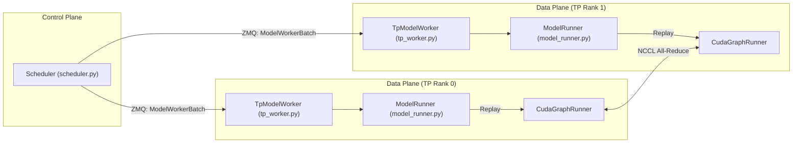
Sources: [python/sglang/srt/managers/tp_worker.py:14-45](), [python/sglang/srt/model_executor/model_runner.py:56-65](), [python/sglang/srt/distributed/parallel_state.py:1-50]()

### Execution Summary Table

| Feature | Component | Purpose |
| :--- | :--- | :--- |
| **Decode Optimization** | `CudaGraphRunner` | Eliminates kernel launch overhead for small batch generation [python/sglang/srt/model_executor/cuda_graph_runner.py:1-15](). |
| **Memory Management** | `GraphInputBuffers` | Provides static memory addresses for CUDA Graph replay [python/sglang/srt/model_executor/input_buffers.py:1-20](). |
| **Large Model Support** | `PiecewiseCudaGraphRunner` | Splits model into smaller graphs to fit in memory [python/sglang/srt/model_executor/piecewise_cuda_graph_runner.py:1-30](). |
| **Kernel Fusion** | `torch.compile` | Optimizes transformer layers and fuses element-wise ops [python/sglang/srt/model_executor/cuda_graph_runner.py:142-165](). |
| **Parallelism** | `TpModelWorker` | Orchestrates execution across multiple GPUs (Tensor Parallel) [python/sglang/srt/managers/tp_worker.py:14-45](). |

Sources: [python/sglang/srt/model_executor/model_runner.py:1-150](), [python/sglang/srt/model_executor/cuda_graph_runner.py:1-200](), [python/sglang/srt/managers/tp_worker.py:1-100]()

---

# Page: KV Cache and Memory Management

# KV Cache and Memory Management

<details>
<summary>Relevant source files</summary>

The following files were used as context for generating this wiki page:

- [docs/advanced_features/hicache.rst](docs/advanced_features/hicache.rst)
- [docs/advanced_features/hicache_best_practices.md](docs/advanced_features/hicache_best_practices.md)
- [docs/advanced_features/hicache_design.md](docs/advanced_features/hicache_design.md)
- [docs/advanced_features/hicache_storage_runtime_attach_detach.md](docs/advanced_features/hicache_storage_runtime_attach_detach.md)
- [python/sglang/srt/distributed/device_communicators/mooncake_transfer_engine.py](python/sglang/srt/distributed/device_communicators/mooncake_transfer_engine.py)
- [python/sglang/srt/managers/cache_controller.py](python/sglang/srt/managers/cache_controller.py)
- [python/sglang/srt/managers/schedule_policy.py](python/sglang/srt/managers/schedule_policy.py)
- [python/sglang/srt/mem_cache/allocator.py](python/sglang/srt/mem_cache/allocator.py)
- [python/sglang/srt/mem_cache/base_prefix_cache.py](python/sglang/srt/mem_cache/base_prefix_cache.py)
- [python/sglang/srt/mem_cache/chunk_cache.py](python/sglang/srt/mem_cache/chunk_cache.py)
- [python/sglang/srt/mem_cache/common.py](python/sglang/srt/mem_cache/common.py)
- [python/sglang/srt/mem_cache/hicache_storage.py](python/sglang/srt/mem_cache/hicache_storage.py)
- [python/sglang/srt/mem_cache/hiradix_cache.py](python/sglang/srt/mem_cache/hiradix_cache.py)
- [python/sglang/srt/mem_cache/mamba_radix_cache.py](python/sglang/srt/mem_cache/mamba_radix_cache.py)
- [python/sglang/srt/mem_cache/memory_pool.py](python/sglang/srt/mem_cache/memory_pool.py)
- [python/sglang/srt/mem_cache/memory_pool_host.py](python/sglang/srt/mem_cache/memory_pool_host.py)
- [python/sglang/srt/mem_cache/radix_cache.py](python/sglang/srt/mem_cache/radix_cache.py)
- [python/sglang/srt/mem_cache/radix_cache_cpp.py](python/sglang/srt/mem_cache/radix_cache_cpp.py)
- [python/sglang/srt/mem_cache/storage/__init__.py](python/sglang/srt/mem_cache/storage/__init__.py)
- [python/sglang/srt/mem_cache/storage/backend_factory.py](python/sglang/srt/mem_cache/storage/backend_factory.py)
- [python/sglang/srt/mem_cache/storage/hf3fs/hf3fs_client.py](python/sglang/srt/mem_cache/storage/hf3fs/hf3fs_client.py)
- [python/sglang/srt/mem_cache/storage/hf3fs/hf3fs_usrbio_client.py](python/sglang/srt/mem_cache/storage/hf3fs/hf3fs_usrbio_client.py)
- [python/sglang/srt/mem_cache/storage/hf3fs/storage_hf3fs.py](python/sglang/srt/mem_cache/storage/hf3fs/storage_hf3fs.py)
- [python/sglang/srt/mem_cache/storage/lmcache/lmc_radix_cache.py](python/sglang/srt/mem_cache/storage/lmcache/lmc_radix_cache.py)
- [python/sglang/srt/mem_cache/storage/mooncake_store/README.md](python/sglang/srt/mem_cache/storage/mooncake_store/README.md)
- [python/sglang/srt/mem_cache/storage/mooncake_store/mooncake_store.py](python/sglang/srt/mem_cache/storage/mooncake_store/mooncake_store.py)
- [python/sglang/srt/mem_cache/storage/mooncake_store/test_mooncake_store.py](python/sglang/srt/mem_cache/storage/mooncake_store/test_mooncake_store.py)
- [python/sglang/srt/mem_cache/storage/nixl/README.md](python/sglang/srt/mem_cache/storage/nixl/README.md)
- [python/sglang/srt/mem_cache/storage/nixl/hicache_nixl.py](python/sglang/srt/mem_cache/storage/nixl/hicache_nixl.py)
- [python/sglang/srt/mem_cache/storage/nixl/nixl.config.toml.sample](python/sglang/srt/mem_cache/storage/nixl/nixl.config.toml.sample)
- [python/sglang/srt/mem_cache/storage/nixl/nixl_utils.py](python/sglang/srt/mem_cache/storage/nixl/nixl_utils.py)
- [python/sglang/srt/mem_cache/storage/nixl/test_hicache_nixl_storage.py](python/sglang/srt/mem_cache/storage/nixl/test_hicache_nixl_storage.py)
- [python/sglang/srt/mem_cache/swa_radix_cache.py](python/sglang/srt/mem_cache/swa_radix_cache.py)
- [python/sglang/srt/model_executor/model_runner_kv_cache_mixin.py](python/sglang/srt/model_executor/model_runner_kv_cache_mixin.py)
- [python/sglang/srt/speculative/eagle_info.py](python/sglang/srt/speculative/eagle_info.py)
- [python/sglang/srt/speculative/eagle_info_v2.py](python/sglang/srt/speculative/eagle_info_v2.py)
- [python/sglang/srt/speculative/eagle_worker_v2.py](python/sglang/srt/speculative/eagle_worker_v2.py)
- [test/registered/hicache/test_hicache_storage_runtime_attach_detach.py](test/registered/hicache/test_hicache_storage_runtime_attach_detach.py)
- [test/registered/radix_cache/test_mamba_unittest.py](test/registered/radix_cache/test_mamba_unittest.py)
- [test/registered/radix_cache/test_radix_cache_unit.py](test/registered/radix_cache/test_radix_cache_unit.py)
- [test/registered/radix_cache/test_swa_unittest.py](test/registered/radix_cache/test_swa_unittest.py)

</details>


This page details the memory management subsystem of the SGLang Runtime (SRT), focusing on GPU memory pools, prefix caching mechanisms (RadixCache), and the hierarchical caching system (HiCache).

## Overview and Purpose

The memory management system is designed to maximize throughput and minimize latency by efficiently reusing KV cache across requests and managing data movement between GPU (L1), Host RAM (L2), and Remote Storage (L3). The architecture uses a page-aligned allocation strategy to support complex scheduling like chunked prefill and prefix matching.

## GPU Memory Pools

SGLang manages GPU memory through specialized pools that separate request metadata from physical KV data.

### Request-to-Token Mapping
The `ReqToTokenPool` maps a unique request ID to its specific token locations in the physical KV cache [python/sglang/srt/mem_cache/memory_pool.py:126-135](). It uses a 2D tensor of shape `(size, max_context_len)` to store indices [python/sglang/srt/mem_cache/memory_pool.py:144-146]().

### Token-to-KV Allocators
The `BaseTokenToKVPoolAllocator` manages indices within the physical KV cache [python/sglang/srt/mem_cache/allocator.py:35-45]().
*   **TokenToKVPoolAllocator**: Manages standard unpaged allocations [python/sglang/srt/mem_cache/allocator.py:117-128]().
*   **PagedTokenToKVPoolAllocator**: Handles page-aligned allocations, allowing for more flexible memory reuse [python/sglang/srt/model_executor/model_runner_kv_cache_mixin.py:11-14]().

### Physical KV Pools
Different attention backends utilize specialized physical pools:
*   **MHATokenToKVPool**: Standard Multi-Head Attention pool [python/sglang/srt/mem_cache/memory_pool.py:317-320]().
*   **MLATokenToKVPool**: Specialized for Multi-Head Latent Attention (MLA), storing compressed latent vectors [python/sglang/srt/mem_cache/memory_pool.py:531-540]().
*   **NSATokenToKVPool**: Supports Native Sparse Attention with indexer KV cache overhead [python/sglang/srt/model_executor/model_runner_kv_cache_mixin.py:70-80]().

### Memory Pool Data Flow
The following diagram illustrates how requests are mapped to physical GPU memory.

**GPU Memory Mapping Architecture**
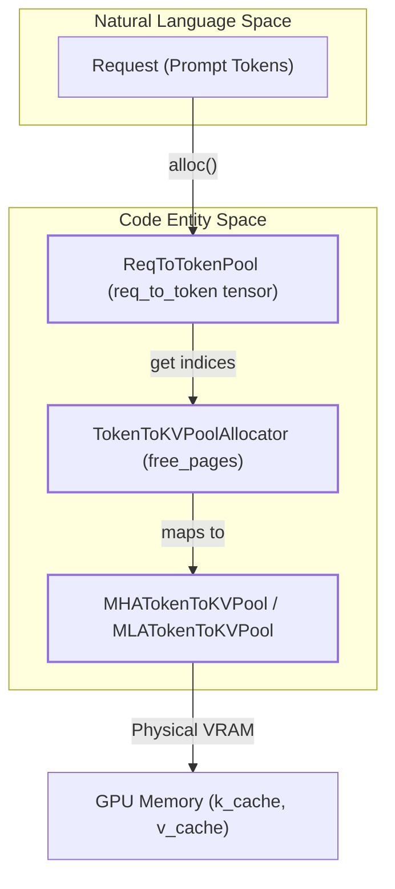
Sources: [python/sglang/srt/mem_cache/memory_pool.py:126-146](), [python/sglang/srt/mem_cache/allocator.py:117-128](), [python/sglang/srt/model_executor/model_runner_kv_cache_mixin.py:15-25]()

## RadixCache and Variants

The `RadixCache` is the core of SGLang's prefix caching system. It manages KV cache as a radix tree where nodes represent sequences of tokens [python/sglang/srt/mem_cache/radix_cache.py:22-30]().

### Core Implementation
*   **TreeNode**: Represents a prefix. It tracks `lock_ref` to prevent eviction during active inference and `last_access_time` for LRU eviction [python/sglang/srt/mem_cache/radix_cache.py:97-122]().
*   **Eviction Strategies**: Supports LRU, LFU, FIFO, FILO, and MRU via `EvictionStrategy` classes [python/sglang/srt/mem_cache/radix_cache.py:52-60]().

### Variants
| Variant | Class Name | Purpose |
| :--- | :--- | :--- |
| **Sliding Window** | `SWARadixCache` | Manages hybrid full and sliding window attention (SWA) caches [python/sglang/srt/mem_cache/swa_radix_cache.py:19-26](). |
| **Mamba** | `MambaRadixCache` | Specialized for Mamba-based models with linear state params [python/sglang/srt/mem_cache/mamba_radix_cache.py:1-5](). |
| **Chunk** | `ChunkCache` | Used when prefix matching is disabled; manages cache per request lifecycle [python/sglang/srt/mem_cache/chunk_cache.py:29-40](). |

Sources: [python/sglang/srt/mem_cache/radix_cache.py:97-122](), [python/sglang/srt/mem_cache/swa_radix_cache.py:58-94](), [python/sglang/srt/mem_cache/chunk_cache.py:29-49]()

## HiCache: Hierarchical Caching System

HiCache (Hierarchical Cache) extends the RadixCache to support multiple tiers of memory: GPU (L1), Host RAM (L2), and Remote Storage (L3).

### Tiered Architecture
1.  **L1 (GPU)**: Managed by `MHATokenToKVPool` or `MLATokenToKVPool`.
2.  **L2 (Host)**: Managed by `HostKVCache`. This pool is significantly larger than GPU memory and uses `cudaHostRegister` for fast pinned memory transfers [python/sglang/srt/mem_cache/memory_pool_host.py:136-155]().
3.  **L3 (Storage)**: Managed by `HiCacheStorage` backends like Mooncake or HF3FS [python/sglang/srt/mem_cache/hicache_storage.py:65-70]().

### Key Components
*   **HiRadixCache**: The top-level cache class that coordinates between `RadixCache` logic and hierarchical transfers [python/sglang/srt/mem_cache/hiradix_cache.py:51-60]().
*   **HiCacheController**: Manages asynchronous data movement (prefetching and write-through) between tiers [python/sglang/srt/mem_cache/hiradix_cache.py:121-135]().
*   **Storage Backends**:
    *   **Mooncake**: Distributed KV cache transfer engine [python/sglang/srt/mem_cache/storage/mooncake_store/mooncake_store.py:28-40]().
    *   **HF3FS**: High-performance filesystem backend [python/sglang/srt/mem_cache/storage/hf3fs/storage_hf3fs.py:1-5]().
    *   **NIXL**: Shared memory / local storage backend [python/sglang/srt/mem_cache/storage/nixl/hicache_nixl.py:1-5]().

**HiCache Data Flow and Code Entities**
```mermaid
graph LR
    subgraph "L1: GPU Memory"
        D_POOL["MHATokenToKVPool"]
    end

    subgraph "L2: Host RAM"
        H_POOL["MHATokenToKVPoolHost"]
        CONTROLLER["HiCacheController"]
    end

    subgraph "L3: Remote/Disk"
        BACKEND["MooncakeStore / HiCacheFile"]
    end

    D_POOL <-->|"backup_from_device_all_layer"| H_POOL
    H_POOL <-->|"load_to_device_per_layer"| D_POOL
    H_POOL <-->|"batch_set_v1 / batch_get_v1"| BACKEND
    
    CONTROLLER -->|"manages"| H_POOL
    CONTROLLER -->|"triggers"| BACKEND
```
Sources: [python/sglang/srt/mem_cache/hiradix_cache.py:121-135](), [python/sglang/srt/mem_cache/memory_pool_host.py:205-220](), [python/sglang/srt/mem_cache/hicache_storage.py:76-98]()

## Implementation Details

### Prefix Matching and Hashing
Prefixes are identified using SHA256 hashes of token sequences [python/sglang/srt/mem_cache/hicache_storage.py:16-31](). The `compute_node_hash_values` function generates these hashes per page, enabling position-aware identification across the hierarchy [python/sglang/srt/mem_cache/radix_cache.py:201-215]().

### Scheduling Integration
The `SchedulePolicy` determines how requests interact with the cache:
*   **LPM (Longest Prefix Match)**: Prioritizes requests that hit the most cached tokens [python/sglang/srt/managers/schedule_policy.py:80-82]().
*   **CacheAwarePolicy**: Uses the `tree_cache` to calculate request priority [python/sglang/srt/managers/schedule_policy.py:97-105]().

### Memory Profiling
`ModelRunnerKVCacheMixin` provides `profile_max_num_token` to calculate the maximum possible KV cache size based on available GPU memory and model architecture (MLA vs MHA) [python/sglang/srt/model_executor/model_runner_kv_cache_mixin.py:116-141]().

Sources: [python/sglang/srt/mem_cache/hicache_storage.py:16-31](), [python/sglang/srt/managers/schedule_policy.py:93-116](), [python/sglang/srt/model_executor/model_runner_kv_cache_mixin.py:116-141]()

---

# Page: Distributed Parallelism

# Distributed Parallelism

<details>
<summary>Relevant source files</summary>

The following files were used as context for generating this wiki page:

- [docs/references/environment_variables.md](docs/references/environment_variables.md)
- [python/sglang/srt/batch_invariant_ops/__init__.py](python/sglang/srt/batch_invariant_ops/__init__.py)
- [python/sglang/srt/batch_invariant_ops/batch_invariant_ops.py](python/sglang/srt/batch_invariant_ops/batch_invariant_ops.py)
- [python/sglang/srt/disaggregation/ascend/conn.py](python/sglang/srt/disaggregation/ascend/conn.py)
- [python/sglang/srt/disaggregation/ascend/transfer_engine.py](python/sglang/srt/disaggregation/ascend/transfer_engine.py)
- [python/sglang/srt/disaggregation/base/__init__.py](python/sglang/srt/disaggregation/base/__init__.py)
- [python/sglang/srt/disaggregation/base/conn.py](python/sglang/srt/disaggregation/base/conn.py)
- [python/sglang/srt/disaggregation/common/__init__.py](python/sglang/srt/disaggregation/common/__init__.py)
- [python/sglang/srt/disaggregation/common/conn.py](python/sglang/srt/disaggregation/common/conn.py)
- [python/sglang/srt/disaggregation/decode.py](python/sglang/srt/disaggregation/decode.py)
- [python/sglang/srt/disaggregation/fake/__init__.py](python/sglang/srt/disaggregation/fake/__init__.py)
- [python/sglang/srt/disaggregation/fake/conn.py](python/sglang/srt/disaggregation/fake/conn.py)
- [python/sglang/srt/disaggregation/mooncake/__init__.py](python/sglang/srt/disaggregation/mooncake/__init__.py)
- [python/sglang/srt/disaggregation/mooncake/conn.py](python/sglang/srt/disaggregation/mooncake/conn.py)
- [python/sglang/srt/disaggregation/nixl/__init__.py](python/sglang/srt/disaggregation/nixl/__init__.py)
- [python/sglang/srt/disaggregation/nixl/conn.py](python/sglang/srt/disaggregation/nixl/conn.py)
- [python/sglang/srt/disaggregation/prefill.py](python/sglang/srt/disaggregation/prefill.py)
- [python/sglang/srt/disaggregation/utils.py](python/sglang/srt/disaggregation/utils.py)
- [python/sglang/srt/distributed/communication_op.py](python/sglang/srt/distributed/communication_op.py)
- [python/sglang/srt/distributed/device_communicators/cuda_wrapper.py](python/sglang/srt/distributed/device_communicators/cuda_wrapper.py)
- [python/sglang/srt/distributed/device_communicators/custom_all_reduce.py](python/sglang/srt/distributed/device_communicators/custom_all_reduce.py)
- [python/sglang/srt/distributed/device_communicators/custom_all_reduce_utils.py](python/sglang/srt/distributed/device_communicators/custom_all_reduce_utils.py)
- [python/sglang/srt/distributed/device_communicators/hpu_communicator.py](python/sglang/srt/distributed/device_communicators/hpu_communicator.py)
- [python/sglang/srt/distributed/device_communicators/pynccl.py](python/sglang/srt/distributed/device_communicators/pynccl.py)
- [python/sglang/srt/distributed/device_communicators/pynccl_wrapper.py](python/sglang/srt/distributed/device_communicators/pynccl_wrapper.py)
- [python/sglang/srt/distributed/device_communicators/shm_broadcast.py](python/sglang/srt/distributed/device_communicators/shm_broadcast.py)
- [python/sglang/srt/distributed/device_communicators/xpu_communicator.py](python/sglang/srt/distributed/device_communicators/xpu_communicator.py)
- [python/sglang/srt/distributed/parallel_state.py](python/sglang/srt/distributed/parallel_state.py)
- [python/sglang/srt/environ.py](python/sglang/srt/environ.py)
- [python/sglang/srt/layers/activation.py](python/sglang/srt/layers/activation.py)
- [python/sglang/srt/layers/communicator.py](python/sglang/srt/layers/communicator.py)
- [python/sglang/srt/layers/dp_attention.py](python/sglang/srt/layers/dp_attention.py)
- [python/sglang/srt/layers/flashinfer_comm_fusion.py](python/sglang/srt/layers/flashinfer_comm_fusion.py)
- [python/sglang/srt/layers/layernorm.py](python/sglang/srt/layers/layernorm.py)
- [python/sglang/srt/layers/rotary_embedding.py](python/sglang/srt/layers/rotary_embedding.py)
- [python/sglang/srt/managers/scheduler_dp_attn_mixin.py](python/sglang/srt/managers/scheduler_dp_attn_mixin.py)
- [python/sglang/srt/managers/scheduler_pp_mixin.py](python/sglang/srt/managers/scheduler_pp_mixin.py)
- [python/sglang/srt/utils/common.py](python/sglang/srt/utils/common.py)

</details>


SGLang (SRT) provides a comprehensive suite of distributed parallelism strategies to scale LLM inference across multiple GPUs and nodes. It supports **Tensor Parallelism (TP)**, **Pipeline Parallelism (PP)**, **Data Parallelism (DP)**, **Expert Parallelism (EP)**, and a specialized **DP-Attention** (DeepSpeed-style Data Parallel Attention) for long-context scenarios.

## Model Parallel State Management

The core of SGLang's distributed infrastructure is managed by `parallel_state.py`, which initializes and maintains process groups for various parallelism modes.

### GroupCoordinator
The `GroupCoordinator` class wraps PyTorch `ProcessGroup` and routes communication to specialized backends like NCCL, custom all-reduce kernels, or MSCCLPP based on tensor size and hardware capability [python/sglang/srt/distributed/parallel_state.py:175-203]().

### Communicator Backends
SGLang implements several optimized communicators:
*   **Custom All-Reduce**: High-performance kernels for small-to-medium message sizes that bypass standard NCCL overhead [python/sglang/srt/distributed/parallel_state.py:203]().
*   **PyNccl**: A Python wrapper around NCCL for better control and integration with CUDA graphs [python/sglang/srt/distributed/parallel_state.py:201]().
*   **MSCCLPP**: Used for multi-node GPU communication optimizations [python/sglang/srt/distributed/parallel_state.py:202]().

### Entity Mapping: Parallel State to Code
The following diagram illustrates how distributed concepts map to specific classes and functions within the `parallel_state.py` module.

**Parallel State Architecture**
```mermaid
graph TD
    subgraph "Parallel State Management"
        PS["parallel_state.py"] --> GC["GroupCoordinator"]
        GC --> PG["torch.distributed.ProcessGroup"]
        GC --> CAR["CustomAllreduce"]
        GC --> PNC["PyNccl"]
    end

    subgraph "Communication Operations"
        IAR["inplace_all_reduce"] --> GC
        OAR["outplace_all_reduce"] --> GC
        AG["reg_all_gather_into_tensor"] --> GC
        RS["reg_reduce_scatter_tensor"] --> GC
    end

    style PS stroke-dasharray: 5 5
```
Sources: [python/sglang/srt/distributed/parallel_state.py:109-203]()

## Parallelism Strategies

### Tensor Parallelism (TP)
TP splits weights and activations across GPUs within a node. SGLang uses `tensor_model_parallel_all_reduce` to synchronize partial results after linear layers [python/sglang/srt/layers/communicator.py:23-28]().

### Data Parallelism & DP-Attention
DP-Attention is a specialized mode where the attention computation is parallelized across GPUs while maintaining the model weights.
*   **Scatter Modes**: SGLang defines `ScatterMode` (SCATTERED, TP_ATTN_FULL, FULL) to manage how data is distributed across the DP ranks [python/sglang/srt/layers/communicator.py:104-123]().
*   **Buffers**: Uses `get_global_dp_buffer` and `get_local_dp_buffer` to manage memory for all-gather and reduce-scatter operations during attention [python/sglang/srt/layers/communicator.py:47-48]().

### Expert Parallelism (EP)
Used in MoE models (e.g., DeepSeek), EP distributes experts across different ranks. It utilizes `get_moe_a2a_backend` for All-to-All communication [python/sglang/srt/layers/communicator.py:52-53]().

### Pipeline Parallelism (PP)
PP splits model layers across different GPUs or nodes. SGLang coordinates PP ranks through `scheduler_pp_mixin.py` and manages KV cache transfer during handoffs [python/sglang/srt/disaggregation/prefill.py:106-107]().

Sources: [python/sglang/srt/layers/communicator.py:104-168](), [python/sglang/srt/disaggregation/prefill.py:86-128]()

## LayerCommunicator Infrastructure

The `LayerCommunicator` provides a high-level abstraction for layers to perform collective operations without being coupled to specific distributed backends.

### Collective Operations
The infrastructure supports:
1.  **All-Reduce Fusion**: Fusing All-Reduce with other operations (like LayerNorm) to reduce kernel launch overhead, controlled by `apply_flashinfer_allreduce_fusion` [python/sglang/srt/layers/communicator.py:91-101]().
2.  **Input Scattering**: `AttnTpContext` allows for `attn_tp_input_scattered`, where inputs are only gathered when strictly necessary for the attention computation [python/sglang/srt/layers/communicator.py:169-196]().

**Layer Communication Data Flow**
```mermaid
sequenceDiagram
    participant L as Model Layer
    participant LC as LayerCommunicator
    participant GC as GroupCoordinator
    participant K as CUDA Kernel (NCCL/Custom)

    L->>LC: forward(hidden_states)
    LC->>LC: check fusion eligibility (apply_flashinfer_allreduce_fusion)
    alt Is Eligible
        LC->>K: fused_op_with_allreduce
    else Standard Path
        LC->>GC: all_reduce(tensor)
        GC->>K: ncclAllReduce / custom_all_reduce
    end
    K-->>L: synchronized_tensor
```
Sources: [python/sglang/srt/layers/communicator.py:91-101](), [python/sglang/srt/distributed/parallel_state.py:132-174]()

## Prefill-Decode Disaggregation Transfer

SGLang supports disaggregating Prefill and Decode phases onto different instances. This requires high-performance KV cache transfer backends.

| Backend | Implementation Class | Purpose |
| :--- | :--- | :--- |
| **Mooncake** | `MooncakeKVManager` | RDMA-based transfer using Mooncake engine [python/sglang/srt/disaggregation/mooncake/conn.py:167-180]() |
| **NIXL** | `NixlKVManager` | Transfer using the NIXL agent and plugins [python/sglang/srt/disaggregation/nixl/conn.py:155-186]() |
| **Gloo** | `GlooGroup` | Standard PyTorch CPU-based coordination [python/sglang/srt/disaggregation/prefill.py:98-101]() |

### KV Transfer Lifecycle
1.  **Bootstrap**: Handshake between prefill and decode ranks via `PrefillBootstrapQueue` [python/sglang/srt/disaggregation/prefill.py:86-109]().
2.  **Pre-allocation**: Decode rank allocates memory in `DecodePreallocQueue` [python/sglang/srt/disaggregation/decode.py:205-213]().
3.  **Transfer**: Data is moved via RDMA (Mooncake/NIXL).
4.  **Commit**: Request moves to the running batch on the decode server [python/sglang/srt/disaggregation/decode.py:17-19]().

Sources: [python/sglang/srt/disaggregation/mooncake/conn.py:167-204](), [python/sglang/srt/disaggregation/nixl/conn.py:155-186](), [python/sglang/srt/disaggregation/decode.py:1-19]()

## Configuration and Environment Variables

Distributed behavior is tuned via several environment variables:

| Variable | Description |
| :--- | :--- |
| `SGLANG_CUSTOM_ALLREDUCE_ALGO` | Force algorithm: `oneshot`, `twoshot`, `1stage`, or `2stage` [docs/references/environment_variables.md:47]() |
| `SGLANG_SYMM_MEM_PREALLOC_GB_SIZE` | Preallocated GPU buffer size for NCCL symmetric memory pool [docs/references/environment_variables.md:46]() |
| `SGLANG_DISAGGREGATION_THREAD_POOL_SIZE` | Number of threads for KV sender in disaggregation [python/sglang/srt/disaggregation/mooncake/conn.py:187-191]() |
| `SGLANG_ENABLE_TP_MEMORY_INBALANCE_CHECK` | Check for memory imbalance across TP ranks [python/sglang/srt/environ.py:215]() |

Sources: [docs/references/environment_variables.md:46-47](), [python/sglang/srt/environ.py:208-215](), [python/sglang/srt/disaggregation/mooncake/conn.py:187-199]()

---

# Page: Prefill-Decode Disaggregation

# Prefill-Decode Disaggregation

<details>
<summary>Relevant source files</summary>

The following files were used as context for generating this wiki page:

- [docs/advanced_features/hicache.rst](docs/advanced_features/hicache.rst)
- [docs/advanced_features/hicache_best_practices.md](docs/advanced_features/hicache_best_practices.md)
- [docs/advanced_features/hicache_design.md](docs/advanced_features/hicache_design.md)
- [docs/advanced_features/hicache_storage_runtime_attach_detach.md](docs/advanced_features/hicache_storage_runtime_attach_detach.md)
- [python/sglang/srt/disaggregation/ascend/conn.py](python/sglang/srt/disaggregation/ascend/conn.py)
- [python/sglang/srt/disaggregation/ascend/transfer_engine.py](python/sglang/srt/disaggregation/ascend/transfer_engine.py)
- [python/sglang/srt/disaggregation/base/__init__.py](python/sglang/srt/disaggregation/base/__init__.py)
- [python/sglang/srt/disaggregation/base/conn.py](python/sglang/srt/disaggregation/base/conn.py)
- [python/sglang/srt/disaggregation/common/__init__.py](python/sglang/srt/disaggregation/common/__init__.py)
- [python/sglang/srt/disaggregation/common/conn.py](python/sglang/srt/disaggregation/common/conn.py)
- [python/sglang/srt/disaggregation/decode.py](python/sglang/srt/disaggregation/decode.py)
- [python/sglang/srt/disaggregation/fake/__init__.py](python/sglang/srt/disaggregation/fake/__init__.py)
- [python/sglang/srt/disaggregation/fake/conn.py](python/sglang/srt/disaggregation/fake/conn.py)
- [python/sglang/srt/disaggregation/mooncake/__init__.py](python/sglang/srt/disaggregation/mooncake/__init__.py)
- [python/sglang/srt/disaggregation/mooncake/conn.py](python/sglang/srt/disaggregation/mooncake/conn.py)
- [python/sglang/srt/disaggregation/nixl/__init__.py](python/sglang/srt/disaggregation/nixl/__init__.py)
- [python/sglang/srt/disaggregation/nixl/conn.py](python/sglang/srt/disaggregation/nixl/conn.py)
- [python/sglang/srt/disaggregation/prefill.py](python/sglang/srt/disaggregation/prefill.py)
- [python/sglang/srt/disaggregation/utils.py](python/sglang/srt/disaggregation/utils.py)
- [python/sglang/srt/distributed/device_communicators/mooncake_transfer_engine.py](python/sglang/srt/distributed/device_communicators/mooncake_transfer_engine.py)
- [python/sglang/srt/managers/cache_controller.py](python/sglang/srt/managers/cache_controller.py)
- [python/sglang/srt/managers/scheduler_dp_attn_mixin.py](python/sglang/srt/managers/scheduler_dp_attn_mixin.py)
- [python/sglang/srt/managers/scheduler_pp_mixin.py](python/sglang/srt/managers/scheduler_pp_mixin.py)
- [python/sglang/srt/mem_cache/hicache_storage.py](python/sglang/srt/mem_cache/hicache_storage.py)
- [python/sglang/srt/mem_cache/hiradix_cache.py](python/sglang/srt/mem_cache/hiradix_cache.py)
- [python/sglang/srt/mem_cache/memory_pool.py](python/sglang/srt/mem_cache/memory_pool.py)
- [python/sglang/srt/mem_cache/memory_pool_host.py](python/sglang/srt/mem_cache/memory_pool_host.py)
- [python/sglang/srt/mem_cache/storage/__init__.py](python/sglang/srt/mem_cache/storage/__init__.py)
- [python/sglang/srt/mem_cache/storage/backend_factory.py](python/sglang/srt/mem_cache/storage/backend_factory.py)
- [python/sglang/srt/mem_cache/storage/hf3fs/hf3fs_client.py](python/sglang/srt/mem_cache/storage/hf3fs/hf3fs_client.py)
- [python/sglang/srt/mem_cache/storage/hf3fs/hf3fs_usrbio_client.py](python/sglang/srt/mem_cache/storage/hf3fs/hf3fs_usrbio_client.py)
- [python/sglang/srt/mem_cache/storage/hf3fs/storage_hf3fs.py](python/sglang/srt/mem_cache/storage/hf3fs/storage_hf3fs.py)
- [python/sglang/srt/mem_cache/storage/mooncake_store/README.md](python/sglang/srt/mem_cache/storage/mooncake_store/README.md)
- [python/sglang/srt/mem_cache/storage/mooncake_store/mooncake_store.py](python/sglang/srt/mem_cache/storage/mooncake_store/mooncake_store.py)
- [python/sglang/srt/mem_cache/storage/mooncake_store/test_mooncake_store.py](python/sglang/srt/mem_cache/storage/mooncake_store/test_mooncake_store.py)
- [python/sglang/srt/mem_cache/storage/nixl/README.md](python/sglang/srt/mem_cache/storage/nixl/README.md)
- [python/sglang/srt/mem_cache/storage/nixl/hicache_nixl.py](python/sglang/srt/mem_cache/storage/nixl/hicache_nixl.py)
- [python/sglang/srt/mem_cache/storage/nixl/nixl.config.toml.sample](python/sglang/srt/mem_cache/storage/nixl/nixl.config.toml.sample)
- [python/sglang/srt/mem_cache/storage/nixl/nixl_utils.py](python/sglang/srt/mem_cache/storage/nixl/nixl_utils.py)
- [python/sglang/srt/mem_cache/storage/nixl/test_hicache_nixl_storage.py](python/sglang/srt/mem_cache/storage/nixl/test_hicache_nixl_storage.py)
- [test/registered/hicache/test_hicache_storage_runtime_attach_detach.py](test/registered/hicache/test_hicache_storage_runtime_attach_detach.py)

</details>


Prefill-Decode (PD) disaggregation is an architectural pattern in LLM-42 that separates the compute-intensive prefill phase from the memory-bandwidth-intensive decode phase across different server instances. This separation allows for independent scaling of prefill and decode resources, optimizing throughput and reducing Time-to-First-Token (TTFT) by preventing long prefill jobs from blocking decode iterations.

Sources: `[python/sglang/srt/disaggregation/prefill.py:1-18]()`, `[python/sglang/srt/disaggregation/decode.py:1-19]()`.

## Architecture Overview

The disaggregation framework relies on a specialized handshake protocol and high-speed Key-Value (KV) transfer backends. The system coordinates between "Prefill" instances (which compute KV caches for new requests) and "Decode" instances (which consume these caches to generate tokens).

### High-Level Data Flow
1.  **Handshake**: The Prefill server initiates a bootstrap handshake with a Decode server to pre-allocate memory.
2.  **Prefill Execution**: The Prefill server runs the forward pass to generate KV caches and the first output token's metadata.
3.  **KV Transfer**: KV caches and metadata are transferred via a high-speed backend (Mooncake, NIXL, or Ascend).
4.  **Decode Execution**: The Decode server receives the KV cache and begins autoregressive generation.

### Disaggregation Code Entity Map
The following diagram maps the logical disaggregation components to their specific class implementations in the codebase.

**Disaggregation Component Mapping**
```mermaid
graph TD
    subgraph "Prefill Instance"
        A["PrefillBootstrapQueue"] -->|Manages| B["CommonKVSender"]
        B -->|Uses| C["KVArgs"]
        A -->|Coordinates| D["SchedulerPPMixin"]
    end

    subgraph "Decode Instance"
        E["DecodePreallocQueue"] -->|Manages| F["CommonKVReceiver"]
        F -->|Uses| G["DecodeReqToTokenPool"]
        E -->|Feeds| H["WaitingQueue"]
    end

    B -.->|KV Transfer| F
    C -.->|Metadata| G
```
Sources: `[python/sglang/srt/disaggregation/prefill.py:86-109]()`, `[python/sglang/srt/disaggregation/decode.py:205-220]()`, `[python/sglang/srt/disaggregation/common/conn.py:20-25]()`.

---

## Prefill Side Implementation

### PrefillBootstrapQueue
The `PrefillBootstrapQueue` is responsible for requests currently in the "bootstrapping" phase—meaning they are performing handshakes and pre-allocating memory on the target decode instance.

-   **Initialization**: It initializes a `BaseKVManager` based on the configured `TransferBackend` (e.g., Mooncake, NIXL) `[python/sglang/srt/disaggregation/prefill.py:128-138]()`.
-   **Metadata Management**: It utilizes `MetadataBuffers` to store the first output token's IDs, logprobs, and hidden states for transfer to the decode node `[python/sglang/srt/disaggregation/utils.py:84-141]()`.
-   **Bootstrap Protocol**: It manages the `KVSender` which handles the ZMQ-based or RDMA-based handshake with the decode server.

### Pipeline Parallelism (PP) Coordination
In disaggregated mode, the `SchedulerPPMixin` provides a specialized event loop `event_loop_pp_disagg_prefill`. This loop ensures that all PP ranks reach a consensus on which requests have finished bootstrapping before proceeding to execution.

-   **Consensus**: Uses `poll_and_all_reduce` across the `gloo_group` to ensure all ranks are ready for a specific request `[python/sglang/srt/disaggregation/utils.py:40-53]()`.
-   **Transfer Initiation**: Once prefill is complete, the KV cache is pushed to the decode instance via the backend's sender implementation `[python/sglang/srt/managers/scheduler_pp_mixin.py:147-165]()`.

Sources: `[python/sglang/srt/disaggregation/prefill.py:86-138]()`, `[python/sglang/srt/managers/scheduler_pp_mixin.py:147-165]()`.

---

## Decode Side Implementation

### DecodePreallocQueue
The `DecodePreallocQueue` handles requests that have initiated a handshake from a prefill server but have not yet finished KV transfer.

-   **Memory Pre-allocation**: It calls `DecodeReqToTokenPool.alloc()` to reserve KV slots before the transfer begins `[python/sglang/srt/disaggregation/decode.py:119-138]()`.
-   **Transfer Monitoring**: It polls the `KVReceiver` to check if the data transfer from the prefill server is complete `[python/sglang/srt/disaggregation/decode.py:9-12]()`.

### DecodeReqToTokenPool
A specialized memory pool `DecodeReqToTokenPool` is used on decode instances. Unlike the standard `ReqToTokenPool`, it accounts for `pre_alloc_size`. This allows the server to track memory that is currently being filled by incoming transfers, preventing over-subscription of the GPU KV cache.

Sources: `[python/sglang/srt/disaggregation/decode.py:76-112]()`, `[python/sglang/srt/disaggregation/decode.py:205-225]()`.

---

## KV Transfer Backends

LLM-42 supports multiple backends for moving KV cache data between instances.

| Backend | Implementation Class | Characteristics |
| :--- | :--- | :--- |
| **Mooncake** | `MooncakeKVManager` | Uses RDMA via the Mooncake Transfer Engine. Supports zero-copy transfers and custom memory pools `[python/sglang/srt/disaggregation/mooncake/conn.py:167-180]()`. |
| **NIXL** | `NixlKVManager` | Utilizes the NIXL agent for high-performance interconnects `[python/sglang/srt/disaggregation/nixl/conn.py:155-178]()`. |
| **Ascend** | `AscendKVManager` | Optimized for Huawei Ascend NPUs using MemFabric-Hybrid `[python/sglang/srt/disaggregation/ascend/conn.py:1-20]()`. |

### Transfer Lifecycle (Mooncake Example)
The following diagram illustrates the interaction between the `MooncakeKVManager` and the hardware-level transfer engine.

**Mooncake Transfer Logic**
```mermaid
sequenceDiagram
    participant P as Prefill Scheduler
    participant S as MooncakeKVSender
    participant M as Mooncake Engine (RDMA)
    participant R as MooncakeKVReceiver
    participant D as Decode Scheduler

    P->>S: send_kv(req, indices)
    S->>M: register_buffer(kv_ptr)
    M-->>R: RDMA WRITE (KV Data)
    R->>D: notify_transfer_complete(req)
    D->>D: move_to_running_batch()
```
Sources: `[python/sglang/srt/disaggregation/mooncake/conn.py:178-205]()`, `[python/sglang/srt/disaggregation/decode.py:1-19]()`.

---

## Data Structures and Metadata

### MetadataBuffers
When a prefill is completed, it's not just the KV cache that is sent. The first token generated by the prefill must also be sent to the decode node to continue generation. `MetadataBuffers` manages these tensors:
- `output_ids`: The first generated token ID `[python/sglang/srt/disaggregation/utils.py:112]()`.
- `output_hidden_states`: Required for certain speculative decoding or reward model scenarios `[python/sglang/srt/disaggregation/utils.py:135-137]()`.
- `bootstrap_room`: A unique ID used to validate that the metadata received matches the request handshake `[python/sglang/srt/disaggregation/utils.py:139-141]()`.

### KVArgs
`KVArgs` is the primary configuration object passed between ranks and instances to describe the memory layout of the transfer. It includes:
- `kv_data_ptrs`: Memory addresses for the KV cache layers `[python/sglang/srt/disaggregation/prefill.py:146-149]()`.
- `page_size`: The block size of the paged attention mechanism `[python/sglang/srt/disaggregation/prefill.py:165]()`.
- `state_type`: Supports "swa" (Sliding Window), "mamba" (Hybrid), or "nsa" (Native Sparse Attention) `[python/sglang/srt/disaggregation/prefill.py:181-192]()`.

Sources: `[python/sglang/srt/disaggregation/utils.py:84-141]()`, `[python/sglang/srt/disaggregation/prefill.py:138-192]()`.

---

# Page: Attention Backends

# Attention Backends

<details>
<summary>Relevant source files</summary>

The following files were used as context for generating this wiki page:

- [docs/advanced_features/server_arguments.md](docs/advanced_features/server_arguments.md)
- [docs/basic_usage/deepseek_v32.md](docs/basic_usage/deepseek_v32.md)
- [python/sglang/srt/disaggregation/mooncake/utils.py](python/sglang/srt/disaggregation/mooncake/utils.py)
- [python/sglang/srt/layers/attention/cutlass_mla_backend.py](python/sglang/srt/layers/attention/cutlass_mla_backend.py)
- [python/sglang/srt/layers/attention/double_sparsity_backend.py](python/sglang/srt/layers/attention/double_sparsity_backend.py)
- [python/sglang/srt/layers/attention/flashattention_backend.py](python/sglang/srt/layers/attention/flashattention_backend.py)
- [python/sglang/srt/layers/attention/flashinfer_backend.py](python/sglang/srt/layers/attention/flashinfer_backend.py)
- [python/sglang/srt/layers/attention/flashinfer_mla_backend.py](python/sglang/srt/layers/attention/flashinfer_mla_backend.py)
- [python/sglang/srt/layers/attention/flashmla_backend.py](python/sglang/srt/layers/attention/flashmla_backend.py)
- [python/sglang/srt/layers/attention/nsa/dequant_k_cache.py](python/sglang/srt/layers/attention/nsa/dequant_k_cache.py)
- [python/sglang/srt/layers/attention/nsa/index_buf_accessor.py](python/sglang/srt/layers/attention/nsa/index_buf_accessor.py)
- [python/sglang/srt/layers/attention/nsa/nsa_indexer.py](python/sglang/srt/layers/attention/nsa/nsa_indexer.py)
- [python/sglang/srt/layers/attention/nsa/quant_k_cache.py](python/sglang/srt/layers/attention/nsa/quant_k_cache.py)
- [python/sglang/srt/layers/attention/nsa/tilelang_kernel.py](python/sglang/srt/layers/attention/nsa/tilelang_kernel.py)
- [python/sglang/srt/layers/attention/nsa/utils.py](python/sglang/srt/layers/attention/nsa/utils.py)
- [python/sglang/srt/layers/attention/nsa_backend.py](python/sglang/srt/layers/attention/nsa_backend.py)
- [python/sglang/srt/layers/attention/triton_backend.py](python/sglang/srt/layers/attention/triton_backend.py)
- [python/sglang/srt/layers/attention/triton_ops/decode_attention.py](python/sglang/srt/layers/attention/triton_ops/decode_attention.py)
- [python/sglang/srt/layers/attention/triton_ops/double_sparsity_attention.py](python/sglang/srt/layers/attention/triton_ops/double_sparsity_attention.py)
- [python/sglang/srt/layers/attention/triton_ops/extend_attention.py](python/sglang/srt/layers/attention/triton_ops/extend_attention.py)
- [python/sglang/srt/layers/attention/triton_ops/prefill_attention.py](python/sglang/srt/layers/attention/triton_ops/prefill_attention.py)
- [python/sglang/srt/layers/attention/trtllm_mla_backend.py](python/sglang/srt/layers/attention/trtllm_mla_backend.py)
- [python/sglang/srt/layers/attention/utils.py](python/sglang/srt/layers/attention/utils.py)
- [python/sglang/srt/layers/communicator_nsa_cp.py](python/sglang/srt/layers/communicator_nsa_cp.py)
- [python/sglang/srt/managers/data_parallel_controller.py](python/sglang/srt/managers/data_parallel_controller.py)
- [python/sglang/srt/mem_cache/utils.py](python/sglang/srt/mem_cache/utils.py)
- [python/sglang/test/attention/test_trtllm_mla_backend.py](python/sglang/test/attention/test_trtllm_mla_backend.py)
- [test/manual/layers/attention/nsa/test_index_buf_accessor.py](test/manual/layers/attention/nsa/test_index_buf_accessor.py)
- [test/registered/hicache/test_nsa_pool_host_unit.py](test/registered/hicache/test_nsa_pool_host_unit.py)
- [test/registered/kernels/test_nsa_indexer.py](test/registered/kernels/test_nsa_indexer.py)

</details>


The SGLang Runtime (SRT) employs a pluggable attention backend system designed to provide high-performance attention kernels across various hardware platforms (NVIDIA, AMD, Intel, Ascend) and model architectures (Standard MHA, MLA, NSA). The system abstracts the complexity of KV cache management, metadata preparation, and kernel dispatching through the `AttentionBackend` base class [python/sglang/srt/layers/attention/base_attn_backend.py:12-12]().

## System Overview

The attention system is structured to handle three primary execution modes: **Extend** (prefill with cached prefix), **Decode** (single-token generation), and **Verify** (speculative decoding verification) [python/sglang/srt/layers/attention/flashinfer_backend.py:7-8](). Each backend implements specialized logic for managing `ForwardBatch` metadata, such as cumulative sequence lengths (`cu_seqlens`) and paged KV cache indices.

### Backend Selection and Dispatch
Backends are initialized within the `ModelRunner` and dispatched based on model configuration and server arguments. For example, standard models default to `FlashInferAttnBackend` or `TritonAttnBackend`, while DeepSeek-V3 models utilize specialized MLA or NSA backends [docs/basic_usage/deepseek_v32.md:63-69]().

### Data Flow: From Scheduler to Kernel
The following diagram illustrates how high-level request metadata is transformed into kernel-specific structures.

**Attention Metadata Transformation Pipeline**
```mermaid
graph TD
    subgraph "Natural Language Space"
        Req["Request (Prompt/Tokens)"]
    end

    subgraph "Code Entity Space (SRT Core)"
        FB["ForwardBatch (forward_batch_info.py)"]
        MR["ModelRunner (model_runner.py)"]
        RA["RadixAttention (radix_attention.py)"]
    end

    subgraph "Attention Backends"
        FIB["FlashInferAttnBackend"]
        TB["TritonAttnBackend"]
        FAB["FlashAttentionBackend"]
    end

    Req --> FB
    FB --> MR
    MR --> RA
    RA -->|Dispatch| FIB
    RA -->|Dispatch| TB
    RA -->|Dispatch| FAB
```
Sources: [python/sglang/srt/model_executor/forward_batch_info.py:26-26](), [python/sglang/srt/layers/radix_attention.py:24-24](), [python/sglang/srt/layers/attention/flashinfer_backend.py:127-127]()

---

## Standard Attention Backends

The standard backends support Multi-Head Attention (MHA) and Grouped-Query Attention (GQA). They are optimized for different hardware and use cases:

*   **FlashInferBackend**: The primary high-performance backend for NVIDIA GPUs. It utilizes `BatchDecodeWithPagedKVCacheWrapper` and `BatchPrefillWithPagedKVCacheWrapper` from the FlashInfer library to handle paged KV caches efficiently [python/sglang/srt/layers/attention/flashinfer_backend.py:62-67]().
*   **FlashAttentionBackend**: Supports FlashAttention-2, FA3 (Hopper), and FA4 (Blackwell) kernels. It manages complex metadata like `cu_seqlens_q` and `cu_seqlens_k` for variable-length sequences [python/sglang/srt/layers/attention/flashattention_backend.py:24-36]().
*   **TritonBackend**: A highly customizable backend written in Triton. It is used for platforms where specialized libraries might not be available or when custom attention logic (like specific logit capping) is required [python/sglang/srt/layers/attention/triton_backend.py:55-56]().

For details on implementation and metadata lifecycle, see [Standard Attention Backends (FlashInfer, FlashAttention, Triton)](#4.1).

---

## MLA and Specialized Backends

Modern architectures like DeepSeek-V3 introduce complex attention patterns that require specialized backends:

*   **Multi-Head Latent Attention (MLA)**: Optimized for DeepSeek-V2/V3. Backends like `FlashInferMLAAttnBackend` and `TRTLLMMLABackend` handle latent vector compression and absorption of weights into the attention kernels [python/sglang/srt/layers/attention/flashinfer_mla_backend.py:35-37](), [python/sglang/srt/layers/attention/trtllm_mla_backend.py:17-20]().
*   **Native Sparse Attention (NSA)**: Supports the fine-grained sparse attention mechanism used in DeepSeek-V3.2. It involves a "lightning indexer" to identify top-k blocks for attention [python/sglang/srt/layers/attention/nsa/nsa_indexer.py:137-137](), [docs/basic_usage/deepseek_v32.md:3-4]().

**Specialized Architecture Mapping**
```mermaid
graph LR
    subgraph "Model Architectures"
        DS_V3["DeepSeek-V3 (MLA)"]
        DS_V32["DeepSeek-V3.2 (NSA)"]
        Llama["Llama/Qwen (MHA/GQA)"]
    end

    subgraph "Backends"
        MLAB["FlashInferMLAAttnBackend"]
        NSAB["NSABackend"]
        FIB["FlashInferAttnBackend"]
    end

    DS_V3 --> MLAB
    DS_V32 --> NSAB
    Llama --> FIB
```
Sources: [python/sglang/srt/layers/attention/flashinfer_mla_backend.py:1-10](), [python/sglang/srt/layers/attention/nsa_backend.py:11-11](), [docs/basic_usage/deepseek_v32.md:63-69]()

For details on sparse kernels and latent attention optimizations, see [MLA and Specialized Attention Backends](#4.2).

---

## Key Features

### Paged KV Cache Management
All backends interface with the `ReqToTokenPool` and `TokenToKVPool` to manage memory. The backends translate logical request indices into physical memory offsets using `page_table` structures [python/sglang/srt/layers/attention/flashattention_backend.py:59-62]().

### Deterministic Inference
Backends support a deterministic mode (enabled via `--enable-deterministic-inference`) which ensures bit-wise identical outputs regardless of batching. In the `TritonAttnBackend`, this is achieved by using fixed split tile sizes for KV decomposition [python/sglang/srt/layers/attention/triton_backend.py:120-132]().

### Hardware Portability
The backend system abstracts hardware-specific implementations:
*   **NVIDIA**: FlashInfer, FlashAttention, TRT-LLM kernels.
*   **AMD**: `aiter` kernels and Triton HIP backends [python/sglang/srt/layers/attention/nsa_backend.py:54-61]().
*   **Intel/Ascend**: Specialized backends (e.g., `tilelang`) for NPU/HPU support [docs/basic_usage/deepseek_v32.md:66-67]().

Sources: [python/sglang/srt/layers/attention/triton_backend.py:120-132](), [python/sglang/srt/layers/attention/nsa_backend.py:54-61](), [docs/basic_usage/deepseek_v32.md:63-69]()

---

# Page: Standard Attention Backends (FlashInfer, FlashAttention, Triton)

# Standard Attention Backends (FlashInfer, FlashAttention, Triton)

<details>
<summary>Relevant source files</summary>

The following files were used as context for generating this wiki page:

- [python/sglang/srt/layers/attention/double_sparsity_backend.py](python/sglang/srt/layers/attention/double_sparsity_backend.py)
- [python/sglang/srt/layers/attention/flashattention_backend.py](python/sglang/srt/layers/attention/flashattention_backend.py)
- [python/sglang/srt/layers/attention/flashinfer_backend.py](python/sglang/srt/layers/attention/flashinfer_backend.py)
- [python/sglang/srt/layers/attention/flashinfer_mla_backend.py](python/sglang/srt/layers/attention/flashinfer_mla_backend.py)
- [python/sglang/srt/layers/attention/triton_backend.py](python/sglang/srt/layers/attention/triton_backend.py)
- [python/sglang/srt/layers/attention/triton_ops/decode_attention.py](python/sglang/srt/layers/attention/triton_ops/decode_attention.py)
- [python/sglang/srt/layers/attention/triton_ops/double_sparsity_attention.py](python/sglang/srt/layers/attention/triton_ops/double_sparsity_attention.py)
- [python/sglang/srt/layers/attention/triton_ops/extend_attention.py](python/sglang/srt/layers/attention/triton_ops/extend_attention.py)
- [python/sglang/srt/layers/attention/triton_ops/prefill_attention.py](python/sglang/srt/layers/attention/triton_ops/prefill_attention.py)
- [sgl-kernel/README.md](sgl-kernel/README.md)
- [sgl-kernel/analyze_whl_kernel_sizes.py](sgl-kernel/analyze_whl_kernel_sizes.py)
- [sgl-kernel/cmake/utils.cmake](sgl-kernel/cmake/utils.cmake)
- [sgl-kernel/csrc/flash_extension.cc](sgl-kernel/csrc/flash_extension.cc)
- [sgl-kernel/include/sgl_flash_kernel_ops.h](sgl-kernel/include/sgl_flash_kernel_ops.h)
- [sgl-kernel/include/sgl_kernel_torch_shim.h](sgl-kernel/include/sgl_kernel_torch_shim.h)
- [sgl-kernel/python/sgl_kernel/_fa4_interface.py](sgl-kernel/python/sgl_kernel/_fa4_interface.py)
- [sgl-kernel/python/sgl_kernel/flash_attn.py](sgl-kernel/python/sgl_kernel/flash_attn.py)
- [sgl-kernel/tests/test_flash_attention.py](sgl-kernel/tests/test_flash_attention.py)
- [sgl-kernel/tests/test_flash_attention_4.py](sgl-kernel/tests/test_flash_attention_4.py)

</details>


This page provides a technical deep dive into the standard attention backends supported by the SGLang Runtime (SRT). These backends implement the core attention mechanism for both prefill (extend) and decode phases, supporting advanced features like paged KV cache, sliding windows, and deterministic execution.

## Overview

SGLang utilizes a pluggable attention backend system where different implementations can be selected based on hardware capabilities and performance requirements [python/sglang/srt/layers/attention/flashinfer_backend.py:4-8](). The primary backends include:

*   **FlashInfer**: Optimized for high throughput and diverse attention patterns (Sliding Window, MLA, Cascade).
*   **FlashAttention (FA3/FA4)**: High-performance kernels for Hopper and Blackwell architectures.
*   **Triton**: A flexible backend used for customization and ensuring bit-wise determinism.

### Backend Metadata Lifecycle
Each backend manages its own metadata to track sequence lengths, cumulative offsets (`indptr`), and memory mapping for paged KV caches. This metadata is typically initialized once per forward pass and reused across layers [python/sglang/srt/layers/attention/flashattention_backend.py:39-45]().

Sources: [python/sglang/srt/layers/attention/flashinfer_backend.py:3-16](), [python/sglang/srt/layers/attention/flashattention_backend.py:39-82]()

---

## FlashInfer Backend

`FlashInferAttnBackend` is the primary high-performance backend. it supports multiple operators including `extend` (prefill with cached prefix) and `decode` [python/sglang/srt/layers/attention/flashinfer_backend.py:7-8]().

### Key Components
*   **Wrappers**: Uses `BatchDecodeWithPagedKVCacheWrapper` and `BatchPrefillWithPagedKVCacheWrapper` from the FlashInfer library [python/sglang/srt/layers/attention/flashinfer_backend.py:62-67]().
*   **Multi-Item Scoring**: Supports specific attention patterns for sequences with multiple items separated by delimiters using `MultiItemScoringParams` [python/sglang/srt/layers/attention/flashinfer_backend.py:77-103]().
*   **Sliding Window**: Dispatches to specialized wrappers when `sliding_window_size` is configured [python/sglang/srt/layers/attention/flashinfer_backend.py:169-171]().

### Data Flow: Decode Phase
1.  **Metadata Prep**: `DecodeMetadata` is created containing the wrappers [python/sglang/srt/layers/attention/flashinfer_backend.py:107-108]().
2.  **Indices Creation**: Triton-based kernels generate KV indices for paged access [python/sglang/srt/layers/attention/flashinfer_backend.py:22]().
3.  **Forward Call**: The backend invokes the wrapper's `forward` method, which utilizes a global workspace buffer to minimize allocation overhead [python/sglang/srt/layers/attention/flashinfer_backend.py:119-120]().

Sources: [python/sglang/srt/layers/attention/flashinfer_backend.py:61-180]()

---

## FlashAttention Backend (FA3/FA4)

The `FlashAttentionBackend` integrates the latest FlashAttention kernels (v3 and v4) for NVIDIA architectures. It is specifically optimized for SM80 (Ampere) and SM90 (Hopper) [sgl-kernel/python/sgl_kernel/flash_attn.py:20-32]().

### Implementation Detail
*   **FA3 Support**: Enabled for CUDA 12.3+ on SM80/SM90 devices [sgl-kernel/python/sgl_kernel/flash_attn.py:29-32]().
*   **FA4 Integration**: Utilizes the `Cute-DSL` version of FlashAttention for Hopper and Blackwell architectures [sgl-kernel/python/sgl_kernel/_fa4_interface.py:1-5]().
*   **Local Attention**: Implements local/sliding window attention by breaking sequences into "virtual" batches [python/sglang/srt/layers/attention/flashattention_backend.py:142-166]().

### FlashAttention Entity Mapping
The following diagram illustrates how the Python interface interacts with the underlying `sgl-kernel` C++ extensions.

**Diagram: FlashAttention Interface to Kernel Mapping**
```mermaid
graph TD
    subgraph "Python Space"
        FA_Backend["FlashAttentionBackend"]
        FA_Wrap["flash_attn_with_kvcache"]
        FA4_Int["_fa4_interface.py"]
    end

    subgraph "sgl-kernel (C++/CUDA)"
        MHA_FWD["mha_fwd (C++)"]
        FA3_Kern["FlashAttention3 Kernels"]
        FA4_Kern["FlashAttention4 (Cute-DSL)"]
    end

    FA_Backend --> FA_Wrap
    FA_Wrap --> FA4_Int
    FA_Wrap -- "torch.ops.sgl_kernel" --> MHA_FWD
    MHA_FWD --> FA3_Kern
    FA4_Int --> FA4_Kern
```
Sources: [python/sglang/srt/layers/attention/flashattention_backend.py:24-37](), [sgl-kernel/python/sgl_kernel/flash_attn.py:39-74](), [sgl-kernel/include/sgl_flash_kernel_ops.h:45-85]()

---

## Triton Backend and Determinism

`TritonAttnBackend` provides a highly customizable attention implementation. A critical role of this backend in LLM-42 is supporting **Batch-Invariant Operations** for deterministic inference [python/sglang/srt/layers/attention/triton_backend.py:118-123]().

### Deterministic Mechanism
When `enable_deterministic` is set (via `--enable-llm42` or `--enable-deterministic-inference`), the backend:
1.  **Fixed Tile Size**: Uses a fixed `split_tile_size` (default 256) instead of dynamic splitting [python/sglang/srt/layers/attention/triton_backend.py:127-130]().
2.  **Static KV Splits**: Disables dynamic split heuristics to ensure the attention reduction tree remains identical regardless of batch composition [python/sglang/srt/layers/attention/triton_backend.py:132]().
3.  **Capped Splits**: Limits the maximum number of KV splits to prevent excessive buffer allocation while maintaining correctness [python/sglang/srt/layers/attention/triton_backend.py:146-155]().

### Unified KV Indices
For prefill (extend) operations, Triton uses `build_unified_kv_indices` to merge prefix indices and new token indices into a single contiguous buffer, which is required for CUDA graph compatibility [python/sglang/srt/layers/attention/triton_ops/extend_attention.py:171-216]().

**Diagram: Triton Attention Data Flow**
```mermaid
sequenceDiagram
    participant MR as ModelRunner
    participant TB as TritonAttnBackend
    participant UKI as build_unified_kv_indices
    participant TK as _fwd_kernel (Triton)

    MR->>TB: forward_extend(q, k, v)
    TB->>UKI: build_unified_kv_indices(prefix_ptr, extend_ptr)
    Note over UKI: Uses CUB cumsum for indptr
    UKI-->>TB: unified_kv_indices, unified_kv_indptr
    TB->>TK: Launch Triton Kernel
    Note over TK: Parallel copy via _copy_unified_indices_kernel
    TK-->>MR: Attention Output (O)
```
Sources: [python/sglang/srt/layers/attention/triton_backend.py:55-158](), [python/sglang/srt/layers/attention/triton_ops/extend_attention.py:171-216](), [python/sglang/srt/layers/attention/triton_ops/decode_attention.py:45-180]()

---

## Specialized Backends

### Double Sparsity Backend
The `DoubleSparseAttnBackend` implements a two-stage sparse attention mechanism:
1.  **Approximate Scoring**: Computes a rough attention score to identify "heavy" tokens [python/sglang/srt/layers/attention/double_sparsity_backend.py:76-81]().
2.  **Sparse Selection**: Only the top-K (`heavy_token_num`) tokens are involved in the full attention computation [python/sglang/srt/layers/attention/double_sparsity_backend.py:32-37]().

### Multi-Head Latent Attention (MLA)
FlashInfer-based MLA (`FlashInferMlaAttnBackend`) optimizes DeepSeek-style architectures by utilizing `BatchMLAPagedAttentionWrapper`. It supports ragged prefill and paged decoding to handle latent vector projections efficiently [python/sglang/srt/layers/attention/flashinfer_mla_backend.py:4-10]().

Sources: [python/sglang/srt/layers/attention/double_sparsity_backend.py:16-51](), [python/sglang/srt/layers/attention/flashinfer_mla_backend.py:70-151]()

---

# Page: MLA and Specialized Attention Backends

# MLA and Specialized Attention Backends

<details>
<summary>Relevant source files</summary>

The following files were used as context for generating this wiki page:

- [benchmark/kernels/all_reduce/benchmark_aiter.py](benchmark/kernels/all_reduce/benchmark_aiter.py)
- [benchmark/kernels/all_reduce/benchmark_mscclpp.py](benchmark/kernels/all_reduce/benchmark_mscclpp.py)
- [docs/advanced_features/server_arguments.md](docs/advanced_features/server_arguments.md)
- [docs/basic_usage/deepseek_v32.md](docs/basic_usage/deepseek_v32.md)
- [python/sglang/srt/configs/__init__.py](python/sglang/srt/configs/__init__.py)
- [python/sglang/srt/disaggregation/mooncake/utils.py](python/sglang/srt/disaggregation/mooncake/utils.py)
- [python/sglang/srt/distributed/device_communicators/pymscclpp.py](python/sglang/srt/distributed/device_communicators/pymscclpp.py)
- [python/sglang/srt/distributed/device_communicators/quick_all_reduce.py](python/sglang/srt/distributed/device_communicators/quick_all_reduce.py)
- [python/sglang/srt/layers/attention/aiter_backend.py](python/sglang/srt/layers/attention/aiter_backend.py)
- [python/sglang/srt/layers/attention/attention_registry.py](python/sglang/srt/layers/attention/attention_registry.py)
- [python/sglang/srt/layers/attention/cutlass_mla_backend.py](python/sglang/srt/layers/attention/cutlass_mla_backend.py)
- [python/sglang/srt/layers/attention/fla/layernorm_gated.py](python/sglang/srt/layers/attention/fla/layernorm_gated.py)
- [python/sglang/srt/layers/attention/flashmla_backend.py](python/sglang/srt/layers/attention/flashmla_backend.py)
- [python/sglang/srt/layers/attention/hybrid_linear_attn_backend.py](python/sglang/srt/layers/attention/hybrid_linear_attn_backend.py)
- [python/sglang/srt/layers/attention/mamba/mamba.py](python/sglang/srt/layers/attention/mamba/mamba.py)
- [python/sglang/srt/layers/attention/mamba/ops/mamba_ssm.py](python/sglang/srt/layers/attention/mamba/ops/mamba_ssm.py)
- [python/sglang/srt/layers/attention/nsa/dequant_k_cache.py](python/sglang/srt/layers/attention/nsa/dequant_k_cache.py)
- [python/sglang/srt/layers/attention/nsa/index_buf_accessor.py](python/sglang/srt/layers/attention/nsa/index_buf_accessor.py)
- [python/sglang/srt/layers/attention/nsa/nsa_indexer.py](python/sglang/srt/layers/attention/nsa/nsa_indexer.py)
- [python/sglang/srt/layers/attention/nsa/quant_k_cache.py](python/sglang/srt/layers/attention/nsa/quant_k_cache.py)
- [python/sglang/srt/layers/attention/nsa/tilelang_kernel.py](python/sglang/srt/layers/attention/nsa/tilelang_kernel.py)
- [python/sglang/srt/layers/attention/nsa/utils.py](python/sglang/srt/layers/attention/nsa/utils.py)
- [python/sglang/srt/layers/attention/nsa_backend.py](python/sglang/srt/layers/attention/nsa_backend.py)
- [python/sglang/srt/layers/attention/trtllm_mla_backend.py](python/sglang/srt/layers/attention/trtllm_mla_backend.py)
- [python/sglang/srt/layers/attention/utils.py](python/sglang/srt/layers/attention/utils.py)
- [python/sglang/srt/layers/communicator_nsa_cp.py](python/sglang/srt/layers/communicator_nsa_cp.py)
- [python/sglang/srt/layers/radix_linear_attention.py](python/sglang/srt/layers/radix_linear_attention.py)
- [python/sglang/srt/managers/data_parallel_controller.py](python/sglang/srt/managers/data_parallel_controller.py)
- [python/sglang/srt/mem_cache/utils.py](python/sglang/srt/mem_cache/utils.py)
- [python/sglang/srt/models/kimi_linear.py](python/sglang/srt/models/kimi_linear.py)
- [python/sglang/srt/models/qwen3_next.py](python/sglang/srt/models/qwen3_next.py)
- [python/sglang/srt/models/qwen3_next_mtp.py](python/sglang/srt/models/qwen3_next_mtp.py)
- [python/sglang/srt/utils/hf_transformers_utils.py](python/sglang/srt/utils/hf_transformers_utils.py)
- [python/sglang/test/attention/test_trtllm_mla_backend.py](python/sglang/test/attention/test_trtllm_mla_backend.py)
- [sgl-kernel/benchmark/bench_cutlass_mla.py](sgl-kernel/benchmark/bench_cutlass_mla.py)
- [sgl-kernel/csrc/attention/cutlass_mla_kernel.cu](sgl-kernel/csrc/attention/cutlass_mla_kernel.cu)
- [sgl-kernel/csrc/attention/cutlass_sm100_mla/device/sm100_mla.hpp](sgl-kernel/csrc/attention/cutlass_sm100_mla/device/sm100_mla.hpp)
- [sgl-kernel/csrc/attention/cutlass_sm100_mla/kernel/sm100_fmha_mla_reduction.hpp](sgl-kernel/csrc/attention/cutlass_sm100_mla/kernel/sm100_fmha_mla_reduction.hpp)
- [sgl-kernel/csrc/attention/cutlass_sm100_mla/kernel/sm100_fmha_mla_tma_warpspecialized.hpp](sgl-kernel/csrc/attention/cutlass_sm100_mla/kernel/sm100_fmha_mla_tma_warpspecialized.hpp)
- [sgl-kernel/csrc/attention/cutlass_sm100_mla/kernel/sm100_mla_tile_scheduler.hpp](sgl-kernel/csrc/attention/cutlass_sm100_mla/kernel/sm100_mla_tile_scheduler.hpp)
- [sgl-kernel/csrc/grammar/apply_token_bitmask_inplace_cuda.cu](sgl-kernel/csrc/grammar/apply_token_bitmask_inplace_cuda.cu)
- [sgl-kernel/python/sgl_kernel/attention.py](sgl-kernel/python/sgl_kernel/attention.py)
- [sgl-kernel/tests/test_cutlass_mla.py](sgl-kernel/tests/test_cutlass_mla.py)
- [test/manual/layers/attention/nsa/test_index_buf_accessor.py](test/manual/layers/attention/nsa/test_index_buf_accessor.py)
- [test/manual/test_quick_allreduce.py](test/manual/test_quick_allreduce.py)
- [test/registered/attention/test_kda_kernels.py](test/registered/attention/test_kda_kernels.py)
- [test/registered/hicache/test_nsa_pool_host_unit.py](test/registered/hicache/test_nsa_pool_host_unit.py)
- [test/registered/kernels/test_nsa_indexer.py](test/registered/kernels/test_nsa_indexer.py)
- [test/registered/models/test_kimi_linear_models_pcg.py](test/registered/models/test_kimi_linear_models_pcg.py)
- [test/registered/models/test_qwen3_next_models_pcg.py](test/registered/models/test_qwen3_next_models_pcg.py)

</details>


Multi-Head Latent Attention (MLA) and Native Sparse Attention (NSA) are advanced attention mechanisms designed to reduce KV cache memory footprints and improve inference efficiency in long-context scenarios. SGLang provides a pluggable backend system to support these architectures across various hardware platforms (NVIDIA, AMD) and kernel libraries (FlashMLA, Triton, CUTLASS, TRT-LLM).

## Multi-Head Latent Attention (MLA) Backends

MLA, introduced by DeepSeek-V2, compresses the KV cache by projecting keys and values into a low-rank latent space. SGLang supports multiple high-performance backends for MLA.

### Backend Implementations

| Backend Class | Description | Hardware |
| :--- | :--- | :--- |
| `FlashInferMLAAttnBackend` | Uses FlashInfer kernels for MLA decoding. | NVIDIA (Hopper+) |
| `FlashMLABackend` | Integrates the `flash_mla` library for high-throughput MLA. | NVIDIA (Hopper/Blackwell) |
| `CutlassMLABackend` | Uses custom CUTLASS-based kernels for MLA operations. | NVIDIA (Blackwell SM100) |
| `TRTLLMMLABackend` | Leverages TRT-LLM MLA kernels via FlashInfer interfaces. | NVIDIA (Blackwell) |

### MLA Data Flow and Optimization
The MLA implementation involves projecting the latent vector into `nope` (non-rope) and `rope` (rotary positional embedding) components. The `mla_quantize_and_rope_for_fp8` utility handles the transformation and quantization for FP8 execution [python/sglang/srt/layers/attention/trtllm_mla_backend.py:25-26]().

For speculative decoding, the `FlashInferMLAMultiStepDraftBackend` supports multi-step verification of draft tokens [python/sglang/srt/layers/attention/trtllm_mla_backend.py:19-20]().

**Sources:**
- [python/sglang/srt/layers/attention/trtllm_mla_backend.py:1-40]()
- [python/sglang/srt/layers/attention/flashinfer_mla_backend.py:17-20]()
- [python/sglang/srt/layers/attention/utils.py:21-26]()

## Native Sparse Attention (NSA)

Native Sparse Attention (NSA) utilizes a "lightning indexer" to identify important blocks in long sequences, enabling fine-grained sparsity [docs/basic_usage/deepseek_v32.md:3-4]().

### NSA Architecture and Indexing
The `Indexer` class is the core component that performs Top-K selection on sequence logits to determine sparse attention patterns [python/sglang/srt/layers/attention/nsa/nsa_indexer.py:137-165]().

**Key Components:**
- **Indexer Metadata**: `BaseIndexerMetadata` provides interfaces for sequence lengths and page tables [python/sglang/srt/layers/attention/nsa/nsa_indexer.py:56-75]().
- **Top-K Transform**: Supports `PAGED` (indices to page table) and `RAGGED` (indices to non-paged KV) methods [python/sglang/srt/layers/attention/nsa_backend.py:153-157]().
- **KV Cache Management**: Includes `quantize_k_cache` and `dequantize_k_cache_paged` for efficient memory usage [python/sglang/srt/layers/attention/nsa_backend.py:12-23]().

### NSA System Diagram
The following diagram illustrates the relationship between the high-level `NSABackend` and the underlying indexing and memory structures.

**NSA Entity Relationship**
```mermaid
graph TD
    subgraph "Natural Language Space"
        A["Sparse Query"]
        B["Long Context"]
    end

    subgraph "Code Entity Space"
        C["NSABackend"]
        D["Indexer"]
        E["NSAMetadata"]
        F["NSATokenToKVPool"]
        G["TopkTransformMethod"]
    end

    A --> C
    B --> F
    C --> D
    C --> E
    D --> G
    E --> F
```
**Sources:**
- [python/sglang/srt/layers/attention/nsa_backend.py:83-157]()
- [python/sglang/srt/layers/attention/nsa/nsa_indexer.py:137-200]()
- [docs/basic_usage/deepseek_v32.md:1-10]()

## Hybrid Linear Attention (Mamba and FLA)

SGLang supports hybrid models like Qwen3-Next and Kimi-Linear that combine standard attention with linear attention (e.g., Gated Delta Net) or Mamba-based state-space models [python/sglang/srt/models/qwen3_next.py:202-210]().

### Backend Capabilities
The `HybridLinearAttnBackend` manages state for both convolutional and SSM layers [python/sglang/srt/layers/attention/hybrid_linear_attn_backend.py:11-30]().

*   **Mamba Integration**: Uses `causal_conv1d_update` and `mamba_ssm` kernels to maintain recurrent states [python/sglang/srt/layers/attention/hybrid_linear_attn_backend.py:25-30]().
*   **FLA (Flash Linear Attention)**: Integrates `fused_recurrent_gated_delta_rule_update` and `chunk_gated_delta_rule` for efficient linear attention computation [python/sglang/srt/layers/attention/hybrid_linear_attn_backend.py:12-18]().
*   **State Tracking**: The `track_mamba_state_if_needed_kernel` (Triton) efficiently copies `conv_states` and `ssm_states` across batches [python/sglang/srt/layers/attention/hybrid_linear_attn_backend.py:104-126]().

**Sources:**
- [python/sglang/srt/layers/attention/hybrid_linear_attn_backend.py:1-100]()
- [python/sglang/srt/models/qwen3_next.py:1-50]()
- [python/sglang/srt/models/kimi_linear.py:166-177]()

## AMD Platform: Aiter Backend

For AMD ROCm hardware, SGLang provides the `AiterAttnBackend`, which leverages the `aiter` kernel library [python/sglang/srt/layers/attention/aiter_backend.py:99-105]().

### Aiter Features
- **MLA Support**: Implements `mla_decode_fwd` and `mla_prefill_fwd` for AMD GPUs [python/sglang/srt/layers/attention/aiter_backend.py:41-45]().
- **FP8 Execution**: Supports FP8 prefill attention on `gfx95` (MI300/MI350) architectures [python/sglang/srt/layers/attention/aiter_backend.py:58-60]().
- **Persistence**: Features an MLA persist design for FP8 KV cache via `SGLANG_AITER_MLA_PERSIST` [python/sglang/srt/layers/attention/aiter_backend.py:55-56]().

**Aiter Backend Data Flow**
```mermaid
graph LR
    subgraph "ModelRunner"
        MR["ModelRunner"]
        Pool["MLATokenToKVPool"]
    end

    subgraph "AiterAttnBackend"
        Meta["ForwardMetadata"]
        Updater["AiterMlaIndicesUpdaterPrefill"]
    end

    subgraph "Aiter Kernels"
        K1["mla_decode_fwd"]
        K2["mla_prefill_fwd"]
        K3["paged_attention_ragged"]
    end

    MR --> Updater
    Updater --> Meta
    Meta --> K1
    Meta --> K2
    Pool --> K3
```
**Sources:**
- [python/sglang/srt/layers/attention/aiter_backend.py:29-70]()
- [python/sglang/srt/layers/attention/aiter_backend.py:191-205]()

## Specialized Kernel Registry

Attention backends are selected dynamically based on the model configuration and server arguments.

| Argument | Options | Impact |
| :--- | :--- | :--- |
| `--nsa-prefill-backend` | `flashmla_sparse`, `flashmla_kv`, `fa3`, `tilelang`, `trtllm` | Sets the kernel for sparse prefill [docs/basic_usage/deepseek_v32.md:63-69](). |
| `--nsa-decode-backend` | `tilelang`, `aiter`, `trtllm` | Sets the kernel for sparse decoding [docs/basic_usage/deepseek_v32.md:63-69](). |
| `SGLANG_ROCM_FUSED_DECODE_MLA` | `True`, `False` | Enables fused kernels on AMD [docs/advanced_features/server_arguments.md:1-10](). |

**Sources:**
- [docs/basic_usage/deepseek_v32.md:60-75]()
- [python/sglang/srt/layers/attention/nsa_backend.py:70-80]()

---

# Page: Model Support

# Model Support

<details>
<summary>Relevant source files</summary>

The following files were used as context for generating this wiki page:

- [python/sglang/srt/configs/model_config.py](python/sglang/srt/configs/model_config.py)
- [python/sglang/srt/layers/linear.py](python/sglang/srt/layers/linear.py)
- [python/sglang/srt/layers/moe/ep_moe/layer.py](python/sglang/srt/layers/moe/ep_moe/layer.py)
- [python/sglang/srt/layers/moe/fused_moe_triton/fused_moe.py](python/sglang/srt/layers/moe/fused_moe_triton/fused_moe.py)
- [python/sglang/srt/layers/moe/fused_moe_triton/layer.py](python/sglang/srt/layers/moe/fused_moe_triton/layer.py)
- [python/sglang/srt/layers/moe/moe_runner/deep_gemm.py](python/sglang/srt/layers/moe/moe_runner/deep_gemm.py)
- [python/sglang/srt/layers/moe/token_dispatcher/__init__.py](python/sglang/srt/layers/moe/token_dispatcher/__init__.py)
- [python/sglang/srt/layers/moe/token_dispatcher/base.py](python/sglang/srt/layers/moe/token_dispatcher/base.py)
- [python/sglang/srt/layers/moe/token_dispatcher/deepep.py](python/sglang/srt/layers/moe/token_dispatcher/deepep.py)
- [python/sglang/srt/layers/moe/token_dispatcher/standard.py](python/sglang/srt/layers/moe/token_dispatcher/standard.py)
- [python/sglang/srt/layers/moe/topk.py](python/sglang/srt/layers/moe/topk.py)
- [python/sglang/srt/layers/moe/utils.py](python/sglang/srt/layers/moe/utils.py)
- [python/sglang/srt/layers/quantization/__init__.py](python/sglang/srt/layers/quantization/__init__.py)
- [python/sglang/srt/layers/quantization/fp8.py](python/sglang/srt/layers/quantization/fp8.py)
- [python/sglang/srt/layers/quantization/fp8_kernel.py](python/sglang/srt/layers/quantization/fp8_kernel.py)
- [python/sglang/srt/layers/quantization/fp8_utils.py](python/sglang/srt/layers/quantization/fp8_utils.py)
- [python/sglang/srt/layers/quantization/modelopt_quant.py](python/sglang/srt/layers/quantization/modelopt_quant.py)
- [python/sglang/srt/layers/vocab_parallel_embedding.py](python/sglang/srt/layers/vocab_parallel_embedding.py)
- [python/sglang/srt/models/chatglm.py](python/sglang/srt/models/chatglm.py)
- [python/sglang/srt/models/commandr.py](python/sglang/srt/models/commandr.py)
- [python/sglang/srt/models/dbrx.py](python/sglang/srt/models/dbrx.py)
- [python/sglang/srt/models/deepseek.py](python/sglang/srt/models/deepseek.py)
- [python/sglang/srt/models/deepseek_nextn.py](python/sglang/srt/models/deepseek_nextn.py)
- [python/sglang/srt/models/deepseek_v2.py](python/sglang/srt/models/deepseek_v2.py)
- [python/sglang/srt/models/gemma.py](python/sglang/srt/models/gemma.py)
- [python/sglang/srt/models/grok.py](python/sglang/srt/models/grok.py)
- [python/sglang/srt/models/llama.py](python/sglang/srt/models/llama.py)
- [python/sglang/srt/models/llava.py](python/sglang/srt/models/llava.py)
- [python/sglang/srt/models/llavavid.py](python/sglang/srt/models/llavavid.py)
- [python/sglang/srt/models/minicpm.py](python/sglang/srt/models/minicpm.py)
- [python/sglang/srt/models/mixtral.py](python/sglang/srt/models/mixtral.py)
- [python/sglang/srt/models/mixtral_quant.py](python/sglang/srt/models/mixtral_quant.py)
- [python/sglang/srt/models/qwen.py](python/sglang/srt/models/qwen.py)
- [python/sglang/srt/models/qwen2.py](python/sglang/srt/models/qwen2.py)
- [python/sglang/srt/models/qwen2_moe.py](python/sglang/srt/models/qwen2_moe.py)
- [python/sglang/srt/models/qwen3.py](python/sglang/srt/models/qwen3.py)
- [python/sglang/srt/models/qwen3_moe.py](python/sglang/srt/models/qwen3_moe.py)
- [python/sglang/srt/models/stablelm.py](python/sglang/srt/models/stablelm.py)
- [python/sglang/test/test_block_fp8.py](python/sglang/test/test_block_fp8.py)

</details>


SGLang provides a flexible and high-performance framework for executing a wide variety of model architectures. The system is designed to handle diverse structural patterns, ranging from standard dense transformers to complex Mixture-of-Experts (MoE) and multi-modal Vision-Language Models (VLMs).

The core of the model support system lies in the `ModelConfig` class, which parses HuggingFace configurations and derives necessary metadata for the SGLang Runtime (SRT) [python/sglang/srt/configs/model_config.py:85-106](). Models are implemented as `torch.nn.Module` subclasses that utilize SGLang's optimized layers, such as `RadixAttention` [python/sglang/srt/layers/radix_attention.py]() and various parallel linear layers [python/sglang/srt/layers/linear.py]().

## Architecture Categories

The codebase categorizes models based on their architectural features and data modalities.

### Dense Language Models
Standard transformer architectures where every parameter is used for every token. This includes the Llama family, Qwen (dense variants), Mistral, and Gemma. These models typically use `RadixAttention` for KV cache management and `MergedColumnParallelLinear` / `RowParallelLinear` for MLP blocks [python/sglang/srt/models/qwen2.py:72-85]().
For details, see [Dense Language Models](#5.1).

### Mixture-of-Experts (MoE) Models
Architectures that use sparse routing to activate only a subset of "experts" for each token, such as DeepSeek-V2/V3, Mixtral, and Qwen2-MoE. SGLang provides specialized MoE kernels (Triton, DeepGEMM, CUTLASS) and dispatchers (DeepEP) to optimize the high communication overhead inherent in MoE inference [python/sglang/srt/layers/moe/fused_moe_triton/layer.py:95-146]().
For details, see [Mixture-of-Experts (MoE) Models](#5.2).

### Vision-Language Models (VLMs)
Multimodal models that process both visual (image/video) and textual inputs. These models integrate vision encoders (like CLIP or SigLIP) with LLM backbones. SGLang supports architectures like Qwen2-VL, LLaVA, and InternVL, utilizing a specialized `mm_utils` pipeline for multimodal processing [python/sglang/srt/configs/model_config.py:168-183]().
For details, see [Vision-Language Models (VLMs)](#5.3).

### Speculative Decoding
A performance optimization technique where a smaller "draft" model predicts tokens that are then verified in parallel by a larger "target" model. SGLang supports advanced speculative algorithms like EAGLE and EAGLE-v2, which use tree-based sampling and specialized workers to accelerate generation [python/sglang/srt/configs/model_config.py:98-102]().
For details, see [Speculative Decoding](#5.4).

### Diffusion Language Models (dLLMs)
Support for discrete diffusion-based language models such as LLaDA. These models operate differently from standard autoregressive transformers by iteratively refining a sequence of masked tokens [python/sglang/srt/configs/model_config.py:171-173]().
For details, see [Diffusion Language Models (dLLMs)](#5.5).

## Model Registry and Dispatch

The system uses a registry-based approach to map model types to their implementations. The `ModelConfig` identifies the architecture from the `hf_config` and selects the appropriate `ModelImpl` [python/sglang/srt/configs/model_config.py:47-51]().

### Model to Code Entity Mapping
The following diagram illustrates how high-level model categories map to specific code entities and implementation files within the SRT.

**Model Architecture Dispatch**
```mermaid
graph TD
    subgraph "Natural Language Space"
        Llama["Llama 3 / Mistral"]
        DSV3["DeepSeek V3"]
        QVLM["Qwen2-VL"]
    end

    subgraph "Code Entity Space"
        MC["ModelConfig"]
        LlamaImpl["LlamaForCausalLM"]
        DSV3Impl["DeepseekV3ForCausalLM"]
        QVLMImpl["Qwen2VLV"]
        
        RA["RadixAttention"]
        FM["FusedMoE"]
        EP["DeepEPDispatcher"]
    end

    Llama --> MC
    DSV3 --> MC
    QVLM --> MC

    MC -- "architectures[0]" --> LlamaImpl
    MC -- "is_deepseek_nsa" --> DSV3Impl
    MC -- "is_multimodal" --> QVLMImpl

    LlamaImpl --> RA
    DSV3Impl --> FM
    DSV3Impl --> EP
    QVLMImpl --> RA
```
Sources: [python/sglang/srt/configs/model_config.py:54-67](), [python/sglang/srt/models/deepseek_v2.py:123-147](), [python/sglang/srt/models/qwen2.py:169-177]()

## Layer Composition

Models are built using standardized layers that handle parallelism and quantization automatically.

| Layer Type | Code Entity | Purpose |
| :--- | :--- | :--- |
| **Attention** | `RadixAttention` | Paged KV cache attention with prefix caching support. |
| **Linear** | `ColumnParallelLinear` | Tensor-parallel weight splitting for MLP/Attention. |
| **MoE** | `FusedMoE` | Fused expert execution with integrated routing. |
| **Embedding** | `VocabParallelEmbedding` | Parallelized token embedding lookup. |
| **Normalization** | `RMSNorm` | Root Mean Square Layer Normalization. |

Sources: [python/sglang/srt/layers/radix_attention.py](), [python/sglang/srt/layers/linear.py:34-37](), [python/sglang/srt/layers/moe/fused_moe_triton/layer.py:156-175](), [python/sglang/srt/layers/vocab_parallel_embedding.py]()

### Expert Execution Flow
For MoE models, the execution flow bridges the gap between the router and the expert kernels.

**MoE Execution Bridge**
```mermaid
graph TD
    subgraph "Natural Language Space"
        Router["Token Router"]
        Experts["Sparse Experts"]
    end

    subgraph "Code Entity Space"
        TK["TopK"]
        TD["BaseDispatcher"]
        STD["StandardDispatcher"]
        DEP["MaybeTboDeepEPDispatcher"]
        FE["fused_experts"]
    end

    Router --> TK
    TK -- "StandardTopKOutput" --> TD
    TD -- "is_deepep" --> DEP
    TD -- "is_none" --> STD
    DEP --> FE
    STD --> FE
    FE -- "Triton/DeepGEMM" --> Experts
```
Sources: [python/sglang/srt/layers/moe/topk.py:202-210](), [python/sglang/srt/layers/moe/fused_moe_triton/layer.py:95-146](), [python/sglang/srt/layers/moe/fused_moe_triton/fused_moe.py:202-222]()

---

# Page: Dense Language Models

# Dense Language Models

<details>
<summary>Relevant source files</summary>

The following files were used as context for generating this wiki page:

- [.github/actions/upload-cuda-coredumps/action.yml](.github/actions/upload-cuda-coredumps/action.yml)
- [.github/workflows/nightly-test-nvidia.yml](.github/workflows/nightly-test-nvidia.yml)
- [docs/advanced_features/rfork.md](docs/advanced_features/rfork.md)
- [python/sglang/jit_kernel/benchmark/bench_fused_add_rmsnorm.py](python/sglang/jit_kernel/benchmark/bench_fused_add_rmsnorm.py)
- [python/sglang/jit_kernel/benchmark/bench_qknorm_across_heads.py](python/sglang/jit_kernel/benchmark/bench_qknorm_across_heads.py)
- [python/sglang/jit_kernel/csrc/elementwise/fused_add_rmsnorm.cuh](python/sglang/jit_kernel/csrc/elementwise/fused_add_rmsnorm.cuh)
- [python/sglang/jit_kernel/csrc/elementwise/qknorm_across_heads.cuh](python/sglang/jit_kernel/csrc/elementwise/qknorm_across_heads.cuh)
- [python/sglang/jit_kernel/include/sgl_kernel/source_location.h](python/sglang/jit_kernel/include/sgl_kernel/source_location.h)
- [python/sglang/jit_kernel/include/sgl_kernel/vec.cuh](python/sglang/jit_kernel/include/sgl_kernel/vec.cuh)
- [python/sglang/jit_kernel/norm.py](python/sglang/jit_kernel/norm.py)
- [python/sglang/jit_kernel/tests/test_fused_add_rmsnorm.py](python/sglang/jit_kernel/tests/test_fused_add_rmsnorm.py)
- [python/sglang/jit_kernel/tests/test_qknorm_across_heads.py](python/sglang/jit_kernel/tests/test_qknorm_across_heads.py)
- [python/sglang/srt/configs/load_config.py](python/sglang/srt/configs/load_config.py)
- [python/sglang/srt/debug_utils/cuda_coredump.py](python/sglang/srt/debug_utils/cuda_coredump.py)
- [python/sglang/srt/layers/quantization/blockwise_int8.py](python/sglang/srt/layers/quantization/blockwise_int8.py)
- [python/sglang/srt/layers/quantization/moe_wna16.py](python/sglang/srt/layers/quantization/moe_wna16.py)
- [python/sglang/srt/layers/quantization/w8a8_fp8.py](python/sglang/srt/layers/quantization/w8a8_fp8.py)
- [python/sglang/srt/layers/quantization/w8a8_int8.py](python/sglang/srt/layers/quantization/w8a8_int8.py)
- [python/sglang/srt/model_loader/loader.py](python/sglang/srt/model_loader/loader.py)
- [python/sglang/srt/model_loader/remote_instance_weight_loader_utils.py](python/sglang/srt/model_loader/remote_instance_weight_loader_utils.py)
- [python/sglang/srt/model_loader/weight_utils.py](python/sglang/srt/model_loader/weight_utils.py)
- [python/sglang/srt/models/baichuan.py](python/sglang/srt/models/baichuan.py)
- [python/sglang/srt/models/chatglm.py](python/sglang/srt/models/chatglm.py)
- [python/sglang/srt/models/commandr.py](python/sglang/srt/models/commandr.py)
- [python/sglang/srt/models/dbrx.py](python/sglang/srt/models/dbrx.py)
- [python/sglang/srt/models/deepseek.py](python/sglang/srt/models/deepseek.py)
- [python/sglang/srt/models/gemma.py](python/sglang/srt/models/gemma.py)
- [python/sglang/srt/models/gemma2.py](python/sglang/srt/models/gemma2.py)
- [python/sglang/srt/models/gpt2.py](python/sglang/srt/models/gpt2.py)
- [python/sglang/srt/models/grok.py](python/sglang/srt/models/grok.py)
- [python/sglang/srt/models/llama.py](python/sglang/srt/models/llama.py)
- [python/sglang/srt/models/llava.py](python/sglang/srt/models/llava.py)
- [python/sglang/srt/models/llavavid.py](python/sglang/srt/models/llavavid.py)
- [python/sglang/srt/models/minicpm.py](python/sglang/srt/models/minicpm.py)
- [python/sglang/srt/models/minicpm3.py](python/sglang/srt/models/minicpm3.py)
- [python/sglang/srt/models/mixtral.py](python/sglang/srt/models/mixtral.py)
- [python/sglang/srt/models/mixtral_quant.py](python/sglang/srt/models/mixtral_quant.py)
- [python/sglang/srt/models/olmo.py](python/sglang/srt/models/olmo.py)
- [python/sglang/srt/models/olmo2.py](python/sglang/srt/models/olmo2.py)
- [python/sglang/srt/models/olmoe.py](python/sglang/srt/models/olmoe.py)
- [python/sglang/srt/models/qwen.py](python/sglang/srt/models/qwen.py)
- [python/sglang/srt/models/qwen2.py](python/sglang/srt/models/qwen2.py)
- [python/sglang/srt/models/qwen2_moe.py](python/sglang/srt/models/qwen2_moe.py)
- [python/sglang/srt/models/qwen3.py](python/sglang/srt/models/qwen3.py)
- [python/sglang/srt/models/qwen3_moe.py](python/sglang/srt/models/qwen3_moe.py)
- [python/sglang/srt/models/stablelm.py](python/sglang/srt/models/stablelm.py)
- [python/sglang/srt/models/utils.py](python/sglang/srt/models/utils.py)
- [python/sglang/srt/models/xverse.py](python/sglang/srt/models/xverse.py)
- [python/sglang/srt/models/xverse_moe.py](python/sglang/srt/models/xverse_moe.py)
- [python/sglang/test/ci/ci_utils.py](python/sglang/test/ci/ci_utils.py)
- [python/sglang/test/ci/run_with_retry.py](python/sglang/test/ci/run_with_retry.py)
- [scripts/ci/utils/publish_traces.py](scripts/ci/utils/publish_traces.py)
- [test/registered/debug_utils/test_cuda_coredump_smoke.py](test/registered/debug_utils/test_cuda_coredump_smoke.py)

</details>


This section (5.1) details the implementation and integration of supported *dense* transformer language models in the LLM-42 codebase. It covers the key transformer architectures, the model registry, weight loading patterns, and guidelines on how to add new dense models. Dense models supported include Llama, Qwen2/3, Gemma, Mistral, GPT-2, Baichuan, and others.

---

## Purpose and Scope

LLM-42 provides inference-only implementations of various dense language models, compatible with HuggingFace model weights and configurations. These models are used with the deterministic decode-verify-rollback inference scheme implemented in the system.

This wiki page explains:

- Supported model architectures and their core modules
- The model registry maintaining model mapping for dynamic loading
- Patterns for loading pretrained weights efficiently and correctly
- How to extend the framework by adding new transformer architectures

---

## Supported Dense Transformer Architectures

The following transformer architectures for dense language models have dedicated implementations in the codebase:

| Model Name          | Key Implementation File(s)                      | Remarks                                         |
|---------------------|-------------------------------------------------|------------------------------------------------|
| **Llama**           | `python/sglang/srt/models/llama.py`              | Compatible with HuggingFace LLaMA config/weights. Implements RMSNorm, fused MLP, rotary embeddings, radix attention.       |
| **Qwen2**           | `python/sglang/srt/models/qwen2.py`               | Qwen2 model adapted from Llama2 structure, with specific MLP and attention layers using rotary embeddings and radix attention. |
| **Qwen3**           | `python/sglang/srt/models/qwen3.py`               | Builds on Qwen2, extends with RMSNorm q/k norms and updated rotary embeddings.              |
| **Gemma**           | `python/sglang/srt/models/gemma.py`                | Dense transformer with specific attention and MLP layers (file not fully shown but referenced).           |
| **Mistral**         | `python/sglang/srt/models/mistral.py` (not shown completely) | Similar to Llama in some design aspects, with token-level adaptions.       |
| **GPT-2**           | `python/sglang/srt/models/gpt2.py` (not shown, but known)    | Sharded paralleled transformer with GPT-2 style attention mechanisms.        |
| **Baichuan**         | `python/sglang/srt/models/baichuan.py` (not shown, but part of model registry)  | Implements Baichuan-specific transformer layers and adaptations.               |

These models typically implement:

- A stack of transformer decoder layers with multi-headed attention and fused feed-forward network (FFN/MLP) layers
- Rotary positional embeddings (RoPE/Yarn style) applied during attention projection
- Tensor parallelism-friendly linear layers (`QKVParallelLinear`, `RowParallelLinear`, `MergedColumnParallelLinear`)
- Attention optimized with radix-based dedicated kernels (`RadixAttention`)
- Optional activation and weight quantization support

### Model Class Patterns

Most models follow a similar class layering:

- **MLP Module**: Implements fused gate-up and down projections with activation (usually SiLU or GELU), e.g. `LlamaMLP`, `Qwen2MLP`, `Qwen2MoeMLP`.
- **Attention Module**: Multi-headed QKV projections with rotary embeddings and radix attention kernel, e.g. `LlamaAttention`, `Qwen2Attention`.
- **Decoder Layer**: Combines attention, layer norm, MLP, usually split across multiple classes/files.
- **Model Class**: Stacks of decoder layers, embedding layers, output layers, with parallelism-aware sharding.

---

## Model Registry and Dynamic Model Loading

The system uses a centralized **model registry** that maps model family names and configuration classes to implementation classes and weight loaders. This allows:

- Dynamic lookup and instantiation of model classes based on model configuration or user request.
- Unified weight loading pipeline abstracting the file format differences and distributed sharding.
- Easy extensibility for new models by registering them in the registry.

The primary entrypoint for loading dense models is in:

- `python/sglang/srt/model_loader/loader.py`  
  This module manages parsing model configs, downloading weights, loading safetensors or PyTorch weights, and supports device-placement context managers.

The registry references:

- `default_weight_loader` from `weight_utils.py` for generic HuggingFace-compatible loading.
- Model architecture classes from the model implementation files (e.g., `llama.py`, `qwen2.py`).

---

## Weight Loading Patterns and Utilities

- **Weight format support:** PyTorch `.pt`, `safetensors`, HF Hub downloads, GGUF (experimental).
- **Weight iterator functions:** Provide multi-threaded, buffered reading of weights per tensor.
- **Device context:** Parameters can be temporarily moved to GPU or CPU during loading for efficiency (`device_loading_context`).
- **Shared pointer detection:** To avoid duplicated weights in converted safetensor files.
- **Quantization configs:** Loaded along with weights to enable quantized inference on supported hardware.

The key weight loading utilities are in `weight_utils.py`. Some notable functions and classes:

- `default_weight_loader`: loads weights based on the format and configuration.
- `get_quant_config`: derives quantization configs from model or HF configs.
- Locking and concurrency-safe file downloads.
- Conversion helpers between weight formats.

---

## Adding a New Dense Model

To add a new dense transformer model architecture:

1. **Implement the model code:**
   - Create new files or modules in `python/sglang/srt/models/` for your model.
   - Follow existing patterns for attention, MLP, layer norm, and model stacking.
   - Use existing primitives like `QKVParallelLinear` and `RadixAttention` to benefit from tensor parallelism and optimized kernels.
   - Define a model class that inherits from `nn.Module` and implement the forward logic.
   - Provide a weight loader that correctly loads your model's weights and maps state dict keys.

2. **Register your model:**
   - Add an entry for your model in the **model registry** (likely in the loader or config files).
   - Specify your model config class, model class, and weight loader method.
   - This integration enables the system to detect and load your model dynamically.

3. **Test model loading and inference:**
   - Validate that model weights load correctly and inference runs across available parallelism setups.
   - Use existing test infrastructure to ensure compliance and determinism guarantees.

---

## Data Flow Diagram: From Natural Language Model Name to Code Entities

```mermaid
flowchart TD
    subgraph "Natural Language Space"
        ModelName("Model Name (e.g. \"llama\", \"qwen2\")")
    end

    subgraph "Code Entity Space"
        ModelRegistry["Model Registry\n(python/sglang/srt/model_loader/loader.py)"]
        WeightLoader["Weight Loader\n(weight_utils.py → default_weight_loader)"]
        ModelClass["Model Class Implementation\n(e.g., llama.py: LlamaForCausalLM)"]
    end

    ModelName -->|Look-up| ModelRegistry
    ModelRegistry -->|Instantiates| ModelClass
    ModelRegistry -->|Loads weights via| WeightLoader
    WeightLoader --> ModelClass
```

*Explanation*: The user or system specifies the model name like "llama" or "qwen2". The Model Registry (in `loader.py`) maps this name to the corresponding model implementation class and weight loader. The weight loader fetches the weight files and loads them into the model class instance.

Sources:  
`python/sglang/srt/model_loader/loader.py:1-187`  
`python/sglang/srt/model_loader/weight_utils.py:1-230`  
`python/sglang/srt/models/llama.py:15-350`  
`python/sglang/srt/models/qwen2.py:1-190`  
`python/sglang/srt/models/qwen3.py:1-230`

---

## Architecture Diagram: Dense Model Components and Their Interactions

```mermaid
classDiagram
    class ModelClass {
      +forward(input_ids, positions, ForwardBatch): Tensor
      +__init__(config, quant_config, prefix)
    }

    class DecoderLayer {
      +forward(hidden_states, positions, ForwardBatch): Tensor
    }

    class Attention {
      +forward(positions, hidden_states, ForwardBatch): Tensor
    }

    class MLP {
      +forward(x): Tensor
    }

    class RotaryEmbedding {
      +apply(positions, q, k): (Tensor, Tensor)
    }

    class RadixAttention {
      +attend(q, k, v, ForwardBatch): Tensor
    }

    ModelClass "1" --> "*" DecoderLayer : has
    DecoderLayer "1" --> "1" Attention : has
    DecoderLayer "1" --> "1" MLP : has
    Attention "1" --> "1" RotaryEmbedding : uses
    Attention "1" --> "1" RadixAttention : uses
```

*Explanation*: The model class composes multiple decoder layers. Each decoder layer includes an attention module implementing rotary embeddings and radix attention, and an MLP feed-forward module. This modular design is consistent across dense models (e.g., Llama, Qwen2/3). Quantization, tensor parallelism, and distributed communication are additionally integrated within these modules.

Sources:  
`python/sglang/srt/models/llama.py:65-350`  
`python/sglang/srt/models/qwen2.py:62-190`  
`python/sglang/srt/models/qwen3.py:40-230`

---

## Detailed Class and Implementation Highlights

### Llama Model (`llama.py`)

- **LlamaMLP**: Implements the fused gate and up projection (`MergedColumnParallelLinear`), activation (SiLU), and down projection (`RowParallelLinear`). Supports quantization config and tensor parallel ranks. Throws if unsupported activation. [llama.py:65-117]()

- **LlamaAttention**: Multi-headed QKV projections with rotary embeddings applied. Uses `RadixAttention` kernel. Supports tensor parallelism in splitting heads and KV heads. Handles Neox-style rotary embedding if specified. [llama.py:119-250]()

- **LlamaForCausalLM** wraps embeddings, multiple decoder layers, final layer norm, and vocab head, fully integrated with forward batch info and pipeline-parallel interfaces. [llama.py:251-350]()

---

### Qwen2 Model (`qwen2.py`)

- **Qwen2MLP**: Similar to LlamaMLP, fused gate up and down projections with SiLU activation. May switch dtype for RL policy targets. [qwen2.py:62-101]()

- **Qwen2Attention**: Attention module with QKV linear projections using `QKVParallelLinear` and rotary embeddings with RadixAttention. Accommodates replicated or partitioned KV heads depending on parallel size. [qwen2.py:102-191]()

- **Qwen2DecoderLayer**: Combines attention, MLP, and normalization with prefix for tensor parallel behavior and optional alt CUDA streams. [qwen2.py:192-333]()

- **Qwen2ForCausalLM** stacks decoder layers and integrates with cache and vocab output. [qwen2.py:334-372]()

---

### Qwen3 Model (`qwen3.py`)

- Derives from Qwen2 but adds RMSNorm for q and k projections and new rotary embedding styles (`MRotaryEmbedding`).

- Updates QKV normalization and introduces updated model parallel and attention parallel ranks.

- Uses RowParallelLinear for output projection and supports NPU-specific routines. [qwen3.py:40-230]()

---

### Weight Loading Utilities (`model_loader/weight_utils.py`)

- Handles lock-based concurrent downloads using `filelock`.

- Supports conversion between `.pt` and `.safetensors` formats ensuring tensor equality.

- Provides prefix key rewriting helpers for model weight keys.

- Implements quantization config reading from HF configs or GGUF types.

- Supports multi-threaded buffered iteration over weights and filtering for inference-only scopes. [weight_utils.py:1-236]()

---

## How to Add a New Dense Transformer Architecture

1. **Implement Model Layer Classes**:  
   Use existing base classes `MergedColumnParallelLinear`, `RowParallelLinear`, `QKVParallelLinear`, and `RadixAttention` as primitives to build MLPs, attentions, and decoder layers.

2. **Apply Rotary Embeddings**:  
   Use `get_rope()` to obtain rotary embeddings compatible with your model's positional strategies.

3. **Integrate Parallelism**:  
   Respect tensor model parallel ranks and sizes via `get_tensor_model_parallel_rank()` and the distributed framework.

4. **Define the Main Model Class**:  
   Stack decoder layers, implement input embeddings and output heads with parallelism sharding.

5. **Weight Loading**:  
   Register model config and loader; adapt key renaming and weight format loading in `weight_utils.py` and `loader.py`.

6. **Register the Model**:  
   Add your new model and config class to the global registry, enabling the system to choose it dynamically.

7. **Testing and Validation**:  
   Add tests verifying model weight loading, inference correctness, and determinism adherence.

---

## Summary

The dense language models subsystem in LLM-42 is a modular, extensible, inference-only framework designed to support a wide range of transformer model families with:

- Efficient weight loading and caching mechanisms
- Support for tensor parallelism and pipeline parallelism
- Optimized rotary embeddings and radix attention kernels
- Comprehensive quantization support (see subsystems in other sections)
- A unified model registry system to dynamically instantiate models

This design facilitates the integration of new transformer models and ensures deterministic, high-performance inference in multi-GPU and multi-node environments.

---

# References to Key Files and Lines

- Model Loader and Registry: `python/sglang/srt/model_loader/loader.py:1-187`  
- Weight Utilities and Loading: `python/sglang/srt/model_loader/weight_utils.py:1-236`  
- Llama model implementation: `python/sglang/srt/models/llama.py:15-350`  
- Qwen2 model implementation: `python/sglang/srt/models/qwen2.py:62-190`  
- Qwen3 model implementation: `python/sglang/srt/models/qwen3.py:40-230`  
- Mixtral and Gemma models also exist with similar patterns (not fully shown).

Sources:  
`python/sglang/srt/model_loader/loader.py`  
`python/sglang/srt/model_loader/weight_utils.py`  
`python/sglang/srt/models/llama.py`  
`python/sglang/srt/models/qwen2.py`  
`python/sglang/srt/models/qwen3.py`

---

# Page: Mixture-of-Experts (MoE) Models

# 5.2 Mixture-of-Experts (MoE) Models

<details>
<summary>Relevant source files</summary>

The following files were used as context for generating this wiki page:

- [benchmark/kernels/fused_moe_triton/README.md](benchmark/kernels/fused_moe_triton/README.md)
- [benchmark/kernels/fused_moe_triton/benchmark_sglang_fused_moe_triton.py](benchmark/kernels/fused_moe_triton/benchmark_sglang_fused_moe_triton.py)
- [benchmark/kernels/fused_moe_triton/benchmark_torch_compile_fused_moe.py](benchmark/kernels/fused_moe_triton/benchmark_torch_compile_fused_moe.py)
- [benchmark/kernels/fused_moe_triton/benchmark_vllm_vs_sglang_fused_moe_triton.py](benchmark/kernels/fused_moe_triton/benchmark_vllm_vs_sglang_fused_moe_triton.py)
- [benchmark/kernels/fused_moe_triton/tuning_client.py](benchmark/kernels/fused_moe_triton/tuning_client.py)
- [benchmark/kernels/fused_moe_triton/tuning_fused_moe_triton.py](benchmark/kernels/fused_moe_triton/tuning_fused_moe_triton.py)
- [benchmark/kernels/fused_moe_triton/tuning_fused_moe_triton_sep.py](benchmark/kernels/fused_moe_triton/tuning_fused_moe_triton_sep.py)
- [benchmark/kernels/fused_moe_triton/tuning_text.json](benchmark/kernels/fused_moe_triton/tuning_text.json)
- [python/sglang/srt/configs/model_config.py](python/sglang/srt/configs/model_config.py)
- [python/sglang/srt/eplb/eplb_manager.py](python/sglang/srt/eplb/eplb_manager.py)
- [python/sglang/srt/eplb/expert_distribution.py](python/sglang/srt/eplb/expert_distribution.py)
- [python/sglang/srt/eplb/expert_location.py](python/sglang/srt/eplb/expert_location.py)
- [python/sglang/srt/eplb/expert_location_dispatch.py](python/sglang/srt/eplb/expert_location_dispatch.py)
- [python/sglang/srt/eplb/expert_location_updater.py](python/sglang/srt/eplb/expert_location_updater.py)
- [python/sglang/srt/layers/linear.py](python/sglang/srt/layers/linear.py)
- [python/sglang/srt/layers/moe/cutlass_moe.py](python/sglang/srt/layers/moe/cutlass_moe.py)
- [python/sglang/srt/layers/moe/cutlass_w4a8_moe.py](python/sglang/srt/layers/moe/cutlass_w4a8_moe.py)
- [python/sglang/srt/layers/moe/ep_moe/kernels.py](python/sglang/srt/layers/moe/ep_moe/kernels.py)
- [python/sglang/srt/layers/moe/ep_moe/layer.py](python/sglang/srt/layers/moe/ep_moe/layer.py)
- [python/sglang/srt/layers/moe/fused_moe_triton/configs/README.md](python/sglang/srt/layers/moe/fused_moe_triton/configs/README.md)
- [python/sglang/srt/layers/moe/fused_moe_triton/configs/triton_3_2_0/E=257,N=128,device_name=NVIDIA_H20,dtype=fp8_w8a8,block_shape=[128, 128].json](python/sglang/srt/layers/moe/fused_moe_triton/configs/triton_3_2_0/E=257,N=128,device_name=NVIDIA_H20,dtype=fp8_w8a8,block_shape=[128, 128].json)
- [python/sglang/srt/layers/moe/fused_moe_triton/configs/triton_3_2_0/E=257,N=256,device_name=NVIDIA_H20,dtype=fp8_w8a8,block_shape=[128, 128].json](python/sglang/srt/layers/moe/fused_moe_triton/configs/triton_3_2_0/E=257,N=256,device_name=NVIDIA_H20,dtype=fp8_w8a8,block_shape=[128, 128].json)
- [python/sglang/srt/layers/moe/fused_moe_triton/configs/triton_3_5_1/E=257,N=256,device_name=NVIDIA_H200,dtype=fp8_w8a8,block_shape=[128, 128].json](python/sglang/srt/layers/moe/fused_moe_triton/configs/triton_3_5_1/E=257,N=256,device_name=NVIDIA_H200,dtype=fp8_w8a8,block_shape=[128, 128].json)
- [python/sglang/srt/layers/moe/fused_moe_triton/configs/triton_3_5_1/E=257,N=256,device_name=NVIDIA_H200,dtype=fp8_w8a8,block_shape=[128, 128]_down.json](python/sglang/srt/layers/moe/fused_moe_triton/configs/triton_3_5_1/E=257,N=256,device_name=NVIDIA_H200,dtype=fp8_w8a8,block_shape=[128, 128]_down.json)
- [python/sglang/srt/layers/moe/fused_moe_triton/configs/triton_3_5_1/E=80,N=640,device_name=NVIDIA_H200,dtype=fp8_w8a8,block_shape=[128, 128].json](python/sglang/srt/layers/moe/fused_moe_triton/configs/triton_3_5_1/E=80,N=640,device_name=NVIDIA_H200,dtype=fp8_w8a8,block_shape=[128, 128].json)
- [python/sglang/srt/layers/moe/fused_moe_triton/configs/triton_3_5_1/E=80,N=640,device_name=NVIDIA_H200,dtype=fp8_w8a8,block_shape=[128, 128]_down.json](python/sglang/srt/layers/moe/fused_moe_triton/configs/triton_3_5_1/E=80,N=640,device_name=NVIDIA_H200,dtype=fp8_w8a8,block_shape=[128, 128]_down.json)
- [python/sglang/srt/layers/moe/fused_moe_triton/fused_moe.py](python/sglang/srt/layers/moe/fused_moe_triton/fused_moe.py)
- [python/sglang/srt/layers/moe/fused_moe_triton/fused_moe_triton_kernels.py](python/sglang/srt/layers/moe/fused_moe_triton/fused_moe_triton_kernels.py)
- [python/sglang/srt/layers/moe/fused_moe_triton/layer.py](python/sglang/srt/layers/moe/fused_moe_triton/layer.py)
- [python/sglang/srt/layers/moe/moe_runner/deep_gemm.py](python/sglang/srt/layers/moe/moe_runner/deep_gemm.py)
- [python/sglang/srt/layers/moe/token_dispatcher/__init__.py](python/sglang/srt/layers/moe/token_dispatcher/__init__.py)
- [python/sglang/srt/layers/moe/token_dispatcher/base.py](python/sglang/srt/layers/moe/token_dispatcher/base.py)
- [python/sglang/srt/layers/moe/token_dispatcher/deepep.py](python/sglang/srt/layers/moe/token_dispatcher/deepep.py)
- [python/sglang/srt/layers/moe/token_dispatcher/standard.py](python/sglang/srt/layers/moe/token_dispatcher/standard.py)
- [python/sglang/srt/layers/moe/topk.py](python/sglang/srt/layers/moe/topk.py)
- [python/sglang/srt/layers/moe/utils.py](python/sglang/srt/layers/moe/utils.py)
- [python/sglang/srt/layers/quantization/__init__.py](python/sglang/srt/layers/quantization/__init__.py)
- [python/sglang/srt/layers/quantization/fp8.py](python/sglang/srt/layers/quantization/fp8.py)
- [python/sglang/srt/layers/quantization/fp8_kernel.py](python/sglang/srt/layers/quantization/fp8_kernel.py)
- [python/sglang/srt/layers/quantization/fp8_utils.py](python/sglang/srt/layers/quantization/fp8_utils.py)
- [python/sglang/srt/layers/quantization/modelopt_quant.py](python/sglang/srt/layers/quantization/modelopt_quant.py)
- [python/sglang/srt/layers/quantization/w4afp8.py](python/sglang/srt/layers/quantization/w4afp8.py)
- [python/sglang/srt/layers/vocab_parallel_embedding.py](python/sglang/srt/layers/vocab_parallel_embedding.py)
- [python/sglang/srt/models/deepseek_nextn.py](python/sglang/srt/models/deepseek_nextn.py)
- [python/sglang/srt/models/deepseek_v2.py](python/sglang/srt/models/deepseek_v2.py)
- [python/sglang/test/test_block_fp8.py](python/sglang/test/test_block_fp8.py)
- [python/sglang/test/test_cutlass_moe.py](python/sglang/test/test_cutlass_moe.py)
- [python/sglang/test/test_cutlass_w4a8_moe.py](python/sglang/test/test_cutlass_w4a8_moe.py)
- [sgl-kernel/benchmark/bench_fp8_blockwise_group_gemm.py](sgl-kernel/benchmark/bench_fp8_blockwise_group_gemm.py)
- [sgl-kernel/csrc/cutlass_extensions/common.hpp](sgl-kernel/csrc/cutlass_extensions/common.hpp)
- [sgl-kernel/csrc/cutlass_extensions/gemm/cutlass_gemm_caller.cuh](sgl-kernel/csrc/cutlass_extensions/gemm/cutlass_gemm_caller.cuh)
- [sgl-kernel/csrc/cutlass_extensions/gemm/dispatch_policy.hpp](sgl-kernel/csrc/cutlass_extensions/gemm/dispatch_policy.hpp)
- [sgl-kernel/csrc/cutlass_extensions/gemm/fp8_blockwise_gemm_sm90_dispatch.cuh](sgl-kernel/csrc/cutlass_extensions/gemm/fp8_blockwise_gemm_sm90_dispatch.cuh)
- [sgl-kernel/csrc/moe/cutlass_moe/w4a8/w4a8_get_group_starts.cuh](sgl-kernel/csrc/moe/cutlass_moe/w4a8/w4a8_get_group_starts.cuh)
- [sgl-kernel/csrc/moe/cutlass_moe/w4a8/w4a8_grouped_mm_c3x.cu](sgl-kernel/csrc/moe/cutlass_moe/w4a8/w4a8_grouped_mm_c3x.cu)
- [sgl-kernel/csrc/moe/cutlass_moe/w4a8/w4a8_grouped_mm_c3x.cuh](sgl-kernel/csrc/moe/cutlass_moe/w4a8/w4a8_grouped_mm_c3x.cuh)
- [sgl-kernel/csrc/moe/cutlass_moe/w4a8/w4a8_moe_data.cu](sgl-kernel/csrc/moe/cutlass_moe/w4a8/w4a8_moe_data.cu)
- [sgl-kernel/csrc/moe/fp8_blockwise_moe_kernel.cu](sgl-kernel/csrc/moe/fp8_blockwise_moe_kernel.cu)
- [sgl-kernel/rename_wheels.sh](sgl-kernel/rename_wheels.sh)
- [sgl-kernel/tests/test_cutlass_w4a8_moe_mm.py](sgl-kernel/tests/test_cutlass_w4a8_moe_mm.py)
- [sgl-kernel/tests/test_fp8_blockwise_moe.py](sgl-kernel/tests/test_fp8_blockwise_moe.py)

</details>


This page details the implementation, data flow, key components, and technical considerations of Mixture-of-Experts (MoE) models in the LLM-42 codebase. It focuses on MoE implementations including DeepSeek-V2/V3, Qwen2-MoE, Mixtral, and extends to MoE gating, TopK expert selection, token dispatching strategies (Standard and DeepEP), fused MoE kernels (Triton, DeepGEMM, CUTLASS), and Expert Parallel Load Balancing (EPLB).

---

## 1. Introduction and Supported Architectures

MoE models in LLM-42 enable routing tokens dynamically to different "expert" subnetworks, increasing model capacity efficiently. This supports state-of-the-art architectures:

- DeepSeek-V2 and DeepSeek-V3
- Qwen2-MoE
- Mixtral
- Additional MoE architectures with MoE layers in transformer blocks

These models require specialized handling for sparse routing, expert selection, and expert computation, underpinned by various dispatchers, TopK selectors, and fused kernels for maximum throughput.

---

## 2. MoE Gating and TopK Selection

### 2.1 Gating and TopK Output

The gating mechanism determines which experts handle each token. The main component computing this is TopK, which identifies the top ranked experts per token by their gate logits.

- **`TopK` class** encapsulates the selection logic including:

  - Configurable `top_k` (number of experts per token)
  - Grouped top-k variants for expert grouping
  - Output formats (`STANDARD`, `TRITON_KERNEL`, `BYPASSED`)
  - Scoring functions such as softmax or sigmoid
  - Routing bias and scaling for routed expert weights

- **TopK outputs**:

  - **StandardTopKOutput**: Contains `topk_weights`, `topk_ids`, and `router_logits` tensors.
  - **TritonKernelTopKOutput**: Uses specialized `RoutingData`, gather and scatter indices for kernel routing.
  - **BypassedTopKOutput**: Holds hidden states and routing info without explicit TopK, used for specialized dispatch.

The TopK selections form the basis of which expert(s) a token is sent to.

### 2.2 Implementation Highlights

- TopK is implemented with fine platform support for CUDA, HIP, CPU, and XPU backends.
- For CUDA, Triton fused kernels and FlashInfer fused topk kernels are optionally leveraged.
- Supports advanced routing methods including AITER backend's biased_grouped_topk.
- The modular `TopKConfig` enables parameter tuning and routing function overrides.

This functionality is primarily implemented in `python/sglang/srt/layers/moe/topk.py` lines 5–37470.

---

## 3. Token Dispatching: Standard and DeepEP

Token dispatching moves tokens to experts after TopK gating.

### 3.1 StandardDispatcher

The classic method:

- Groups tokens by expert assigned.
- Dispatches them in batches for expert forward.
- Then recombines expert outputs back.

This dispatcher is implemented as `StandardDispatcher` class in `token_dispatcher/standard.py`. It uses conventional routing and recombination without overlap optimizations.

### 3.2 DeepEP Dispatcher (MaybeTboDeepEPDispatcher)

Deep Expert Parallelism (DeepEP) dispatcher extends dispatching with overlapping computation:

- Overlaps dispatch, compute, and communications.
- Supports asynchronous token routing for improved latency.
- Relies on batch overlap scheduling and fused kernels for dispatch and combine.

The class `MaybeTboDeepEPDispatcher` implements this strategy and adapts to hardware backend capabilities. Found in `token_dispatcher/deepep.py`.

### 3.3 Other Dispatchers

- `FlashinferDispatcher`: Uses FlashInfer fused dispatch and combine.
- `NpuFuseEPDispatcher` and `MoriEPDispatcher`: Specialized for Ascend and Mori platforms.

Dispatcher selection is auto-determined by `create_moe_dispatcher` in `fused_moe_triton/layer.py` lines 90–146 based on A2A backend type.

---

## 4. Fused MoE Kernels

MoE expert computation involves applying expert-level feed-forward networks efficiently.

### 4.1 FusedMoE Kernel Overview

- Combines gate up-projection and expert down projection weights.
- Supports multiple quantization schemes: FP8, FP4, INT8, INT4.
- Applies token-wise gating weights and activation functions (e.g., SiLU).

### 4.2 Implementations

- **Triton fused kernels**:

  - Implemented in `layers/moe/fused_moe_triton/layer.py`—central `FusedMoE` class.
  - Uses low-level Triton kernels in `fused_moe_triton_kernels.py`.
  - Optimized for NVIDIA GPUs.

- **DeepGEMM fused MoE**:

  - For platforms supporting DeepGEMM (e.g., some AMD).
  - Integrated into `moe_runner/deep_gemm.py`.

- **CUTLASS fused MoE**:

  - Uses CUTLASS-based kernels for FP8/INT8 operations.
  - See `layers/moe/cutlass_moe.py` for CUTLASS-specific fused kernels and parameter setup.

### 4.3 Forward Path

Fused MoE performs:

- Dispatch of tokens and routing weights.
- Expert computation via fused kernels.
- Reduction and combination of expert outputs.

The key entry points:

- `fused_experts` function in `layers/moe/fused_moe_triton/fused_moe.py`
- `FusedMoE.forward` performs fused expert computations and gating.

---

## 5. DeepSeek-V2/V3 and Model Integration

DeepSeek-V2 and V3 are inference-only MoE transformer models with specialized MoE implementations.

### 5.1 Model Class

- Defined in `models/deepseek_v2.py` (lines 10–34661 approx).
- Mixes the MoE fused kernel layers with transformer blocks.
- Handles routing, expert parallelism, and batching internally.
- Supports multiple dispatch and routing modes.

### 5.2 MoE Layer Integration

- Uses `FusedMoE` or `DeepEPMoE` depending on expert parallel mode.
- Integrates TopK gating and dispatching.
- Modular to adapt to hardware backends and MoE runtimes.

---

## 6. Expert Parallel Load Balancing (EPLB)

EPLB is a runtime system to:

- Dynamically track and rebalance expert workloads across distributed devices.
- Minimize expert overload imbalances.
- Improve throughput and utilization.

### 6.1 Components

- `expert_location_dispatch.py`: Contains `ExpertLocationDispatchInfo` which maintains expert-to-device mappings.
- `expert_distribution.py`: Records global expert usage statistics.
- Integration hooks in `deepseek_v2.py` and `fused_moe_triton/layer.py` apply EPLB info to routing and load balancing.

---

## 7. Data Flow Summary

```mermaid
flowchart TD
    NL["Natural Language Tokens"] --> Tokenizer["Tokenizer & Token Embedding"]
    Tokenizer --> Encoder["Transformer Encoder Layers"]
    Encoder --> Gate["MoE Gating Layer"]
    Gate -->|TopK Tokens per Expert| TopK["TopK Selection (TopK class)"]
    TopK --> Dispatch["Token Dispatching (Standard / DeepEP Dispatchers)"]
    Dispatch --> Experts["Experts (FusedMoE kernels)"]
    Experts --> Combine["Combine Expert Outputs"]
    Combine --> Decoder["Subsequent Transformer Layers"]
    Decoder --> OutputTokens["Output: Next Tokens"]

    subgraph MoE_Kernels
      Experts
      Combine
    end
```

Sources: `layers/moe/topk.py`, `layers/moe/fused_moe_triton/layer.py`, `models/deepseek_v2.py`

---

## 8. Natural Language to Code Entity Mapping: Model Architecture and Dispatcher

```mermaid
flowchart LR
    subgraph Model
      DS2[DeepSeekV2 Model\n`deepseek_v2.py`]
      Qwen[Qwen2-MoE Model\n`deepseek_v2.py` + custom]
      Mixtral[Mixtral Model\n`deepseek_v2.py` + custom]
    end

    subgraph Expert_Parallel
      EP_MOE[DeepEPMoE class\n`layers/moe/ep_moe/layer.py`]
      FusedMoE[FusedMoE class\n`layers/moe/fused_moe_triton/layer.py`]
      Dispatcher[MoE Dispatcher\n`layers/moe/fused_moe_triton/layer.py`: create_moe_dispatcher()]
    end

    DS2 --> EP_MOE
    DS2 --> FusedMoE
    Qwen --> FusedMoE
    Mixtral --> FusedMoE
    Dispatcher --> EP_MOE
    Dispatcher --> FusedMoE

    style DS2 fill:#f0f0f0,stroke:#333,stroke-width:1px
    style Qwen fill:#f0f0f0,stroke:#333,stroke-width:1px
    style Mixtral fill:#f0f0f0,stroke:#333,stroke-width:1px
    style EP_MOE fill:#e8e8e8,stroke:#555,stroke-width:1px
    style FusedMoE fill:#e8e8e8,stroke:#555,stroke-width:1px
    style Dispatcher fill:#d8d8d8,stroke:#777,stroke-width:1px
```

Sources: `models/deepseek_v2.py`, `layers/moe/fused_moe_triton/layer.py`, `layers/moe/ep_moe/layer.py`

---

## 9. Code Entity to Low-Level Kernel Mapping: Dispatch and Fused Kernel Calls

```mermaid
flowchart TD
    K_topk[TopK Selection\n`layers/moe/topk.py`]
    D_std[StandardDispatcher\n`layers/moe/token_dispatcher/standard.py`]
    D_deepep[MaybeTboDeepEPDispatcher\n`layers/moe/token_dispatcher/deepep.py`]
    F_moe[FusedMoE Layer\n`layers/moe/fused_moe_triton/layer.py`]
    F_kernel_triton[Triton Kernels\n`layers/moe/fused_moe_triton/fused_moe_triton_kernels.py`]
    F_kernel_cutlass[Cutlass Kernels\n`layers/moe/cutlass_moe.py`]
    F_kernel_deepgemm[DeepGEMM Kernels\n`layers/moe/moe_runner/deep_gemm.py`]

    K_topk --> D_std
    K_topk --> D_deepep
    D_std --> F_moe
    D_deepep --> F_moe
    F_moe --> F_kernel_triton
    F_moe --> F_kernel_cutlass
    F_moe --> F_kernel_deepgemm

    style K_topk fill:#d0d0d0,stroke:#666,stroke-width:1px
    style D_std fill:#f0f0f0,stroke:#333,stroke-width:1px
    style D_deepep fill:#f0f0f0,stroke:#333,stroke-width:1px
    style F_moe fill:#e8e8e8,stroke:#444,stroke-width:1px
    style F_kernel_triton fill:#c0c0c0,stroke:#555,stroke-width:1px
    style F_kernel_cutlass fill:#c0c0c0,stroke:#555,stroke-width:1px
    style F_kernel_deepgemm fill:#c0c0c0,stroke:#555,stroke-width:1px
```

Sources: `layers/moe/topk.py`, `layers/moe/fused_moe_triton/layer.py`, `layers/moe/fused_moe_triton/fused_moe_triton_kernels.py`, `layers/moe/cutlass_moe.py`, `layers/moe/moe_runner/deep_gemm.py`

---

## 10. Summary of Core Classes and Functions

| Component                          | Role                                                            | Key File & Lines                            |
|----------------------------------|-----------------------------------------------------------------|---------------------------------------------|
| `TopK`                           | Expert gating and top-k expert selection                        | `layers/moe/topk.py:200-37470`              |
| `StandardDispatcher`             | Standard token dispatch and combine                             | `layers/moe/token_dispatcher/standard.py`   |
| `MaybeTboDeepEPDispatcher`       | Token dispatch overlapping compute and communications (DeepEP) | `layers/moe/token_dispatcher/deepep.py`     |
| `FusedMoE`                      | Fused expert layer (gating + expert FFN)                       | `layers/moe/fused_moe_triton/layer.py:156-53700` |
| `fused_experts`                  | Custom operator invoking fused expert kernels                  | `layers/moe/fused_moe_triton/fused_moe.py:80-23000` |
| `DeepEPMoE`                     | Expert Parallel implementation for DeepEP                      | `layers/moe/ep_moe/layer.py:60-20900`       |
| `ExpertLocationDispatchInfo`     | Stores and manages EPLB expert location metadata               | `eplb/expert_location_dispatch.py`          |
| `get_global_expert_distribution_recorder` | Records global expert usage for EPLB                       | `eplb/expert_distribution.py`                |
| `create_moe_dispatcher()`        | Factory to choose dispatcher by A2A backend                    | `layers/moe/fused_moe_triton/layer.py:90-147`|

---

## 11. Additional Details

### 11.1 MoE Support for Quantization

- MoE fused kernels support FP8, FP4, INT8, INT4 quantization with mixed precision.
- Integration with quantization configs like `Fp8Config`, `ModelOptFp8Config`, and methods in `layers/quantization/fp8.py` and `modelopt_quant.py`.
- Dispatch and fused kernels dynamically select quantization paths.

### 11.2 Acceleration Backends

- CUDA: Triton fused kernels, CUTLASS kernels, FlashInfer.
- HIP: Native fused kernels with AITER support.
- NPU: Specialized fused kernels and dispatchers like `NpuFuseEPDispatcher`.
- CPU with AMX acceleration: Partial support.

---

# End of 5.2 Mixture-of-Experts (MoE) Models

---

### Sources:

- `python/sglang/srt/models/deepseek_v2.py` [1-34661]()
- `python/sglang/srt/layers/moe/fused_moe_triton/layer.py` [20-53700]()
- `python/sglang/srt/layers/moe/topk.py` [1-37477]()
- `python/sglang/srt/layers/moe/token_dispatcher/standard.py` [few lines; dispatcher classes referenced]()
- `python/sglang/srt/layers/moe/token_dispatcher/deepep.py` [few lines; dispatcher classes referenced]()
- `python/sglang/srt/layers/moe/fused_moe_triton/fused_moe.py` [60-23000]()
- `python/sglang/srt/layers/moe/ep_moe/layer.py` [60-20900]()
- `python/sglang/srt/eplb/expert_location_dispatch.py` [all]()
- `python/sglang/srt/eplb/expert_distribution.py` [all]()
- `python/sglang/srt/layers/moe/cutlass_moe.py` [for CUTLASS kernels]()
- `python/sglang/srt/layers/moe/moe_runner/deep_gemm.py` [for DeepGEMM kernels]()
- `python/sglang/srt/layers/quantization/fp8.py` [recommended for quantization background]()
- `python/sglang/srt/layers/quantization/modelopt_quant.py` [recommended for quantization background]()

---

# Page: Vision-Language Models (VLMs)

# Vision-Language Models (VLMs)

<details>
<summary>Relevant source files</summary>

The following files were used as context for generating this wiki page:

- [python/sglang/srt/configs/internvl.py](python/sglang/srt/configs/internvl.py)
- [python/sglang/srt/configs/olmo3.py](python/sglang/srt/configs/olmo3.py)
- [python/sglang/srt/layers/attention/vision.py](python/sglang/srt/layers/attention/vision.py)
- [python/sglang/srt/layers/attention/vision_utils.py](python/sglang/srt/layers/attention/vision_utils.py)
- [python/sglang/srt/managers/mm_utils.py](python/sglang/srt/managers/mm_utils.py)
- [python/sglang/srt/models/clip.py](python/sglang/srt/models/clip.py)
- [python/sglang/srt/models/gemma3_causal.py](python/sglang/srt/models/gemma3_causal.py)
- [python/sglang/srt/models/gemma3_mm.py](python/sglang/srt/models/gemma3_mm.py)
- [python/sglang/srt/models/glm4.py](python/sglang/srt/models/glm4.py)
- [python/sglang/srt/models/glm4_moe.py](python/sglang/srt/models/glm4_moe.py)
- [python/sglang/srt/models/glm4_moe_nextn.py](python/sglang/srt/models/glm4_moe_nextn.py)
- [python/sglang/srt/models/glm4v.py](python/sglang/srt/models/glm4v.py)
- [python/sglang/srt/models/glm4v_moe.py](python/sglang/srt/models/glm4v_moe.py)
- [python/sglang/srt/models/glm_ocr.py](python/sglang/srt/models/glm_ocr.py)
- [python/sglang/srt/models/glm_ocr_nextn.py](python/sglang/srt/models/glm_ocr_nextn.py)
- [python/sglang/srt/models/interns1.py](python/sglang/srt/models/interns1.py)
- [python/sglang/srt/models/internvl.py](python/sglang/srt/models/internvl.py)
- [python/sglang/srt/models/kimi_vl.py](python/sglang/srt/models/kimi_vl.py)
- [python/sglang/srt/models/llama4.py](python/sglang/srt/models/llama4.py)
- [python/sglang/srt/models/ministral3.py](python/sglang/srt/models/ministral3.py)
- [python/sglang/srt/models/mllama.py](python/sglang/srt/models/mllama.py)
- [python/sglang/srt/models/mllama4.py](python/sglang/srt/models/mllama4.py)
- [python/sglang/srt/models/pixtral.py](python/sglang/srt/models/pixtral.py)
- [python/sglang/srt/models/qwen2_5_vl.py](python/sglang/srt/models/qwen2_5_vl.py)
- [python/sglang/srt/models/qwen2_vl.py](python/sglang/srt/models/qwen2_vl.py)
- [python/sglang/srt/models/qwen3_vl.py](python/sglang/srt/models/qwen3_vl.py)
- [python/sglang/srt/models/qwen3_vl_moe.py](python/sglang/srt/models/qwen3_vl_moe.py)
- [python/sglang/srt/models/siglip.py](python/sglang/srt/models/siglip.py)
- [python/sglang/srt/multimodal/internvl_vit_cuda_graph_runner.py](python/sglang/srt/multimodal/internvl_vit_cuda_graph_runner.py)
- [python/sglang/srt/multimodal/processors/base_processor.py](python/sglang/srt/multimodal/processors/base_processor.py)
- [python/sglang/srt/multimodal/processors/deepseek_vl_v2.py](python/sglang/srt/multimodal/processors/deepseek_vl_v2.py)
- [python/sglang/srt/multimodal/processors/gemma3.py](python/sglang/srt/multimodal/processors/gemma3.py)
- [python/sglang/srt/multimodal/processors/gemma3n.py](python/sglang/srt/multimodal/processors/gemma3n.py)
- [python/sglang/srt/multimodal/processors/glm4v.py](python/sglang/srt/multimodal/processors/glm4v.py)
- [python/sglang/srt/multimodal/processors/internvl.py](python/sglang/srt/multimodal/processors/internvl.py)
- [python/sglang/srt/multimodal/processors/janus_pro.py](python/sglang/srt/multimodal/processors/janus_pro.py)
- [python/sglang/srt/multimodal/processors/kimi_vl.py](python/sglang/srt/multimodal/processors/kimi_vl.py)
- [python/sglang/srt/multimodal/processors/llava.py](python/sglang/srt/multimodal/processors/llava.py)
- [python/sglang/srt/multimodal/processors/minicpm.py](python/sglang/srt/multimodal/processors/minicpm.py)
- [python/sglang/srt/multimodal/processors/mllama4.py](python/sglang/srt/multimodal/processors/mllama4.py)
- [python/sglang/srt/multimodal/processors/phi4mm.py](python/sglang/srt/multimodal/processors/phi4mm.py)
- [python/sglang/srt/multimodal/processors/pixtral.py](python/sglang/srt/multimodal/processors/pixtral.py)
- [python/sglang/srt/multimodal/processors/qwen_vl.py](python/sglang/srt/multimodal/processors/qwen_vl.py)
- [python/sglang/srt/utils/cuda_ipc_transport_utils.py](python/sglang/srt/utils/cuda_ipc_transport_utils.py)

</details>


This section 5.3 covers the architecture, implementation, and data flow of multimodal Large Language Models (LLMs) with vision-language capabilities supported by the LLM-42 codebase. It details the core VLM models such as Qwen2.5-VL, Qwen3-VL, LLaVA, InternVL, MiniCPM-V, Gemma3-MM, GLM4V, Llama4, and others. The page explains how image and video inputs are processed, encoded, and integrated with text tokens, covering multimodal processors, vision encoders, multimodal MLP and attention blocks, and the multimodal utils pipeline (`mm_utils`). 

The explanation makes extensive use of code entities to help developers locate the relevant classes and functions for each conceptual component, supported by mermaid diagrams bridging natural language concepts with specific code classes and modules.

---

## Purpose and Scope

Vision-Language Models (VLMs) extend text LLMs by incorporating non-text input modalities (images, videos, audio) to perform multimodal understanding and generation. The LLM-42 project offers deterministic inference engines for several state-of-the-art (SoTA) multimodal transformer models, designed to run on various GPUs, supporting distributed parallelism and quantization.

This page digs into the detailed implementations of VLMs in the repository, focusing on:

- Core multimodal transformer architectures that fuse vision and language data
- Vision encoder building blocks: patch embedding, vision transformer blocks, and specialized MLPs and attention components for images and videos
- Multimodal data processing, including how image/video tokens are managed and integrated into text sequences
- The `mm_utils` pipeline for multimodal data padding, embedding, and GPU tensor transport to efficiently handle batch processing
- Support for efficient vision attention mechanisms and rotary positional embeddings in vision models
- Key classes and methods in model files that implement VLMs such as Qwen2.5-VL, Qwen3-VL, InternVL, GLM4V, and Llama4

Although other related modalities like audio are mentioned, the main emphasis is on vision-language fusion models and their GPU-optimized implementations.

---

## 1. Supported Vision-Language Models in LLM-42

The codebase includes full implementations and inference wrappers for multiple VLMs, including:

| Model Name           | Code Module                                        | Description / Comments                    |
|----------------------|---------------------------------------------------|------------------------------------------|
| **Qwen2.5-VL**       | `python/sglang/srt/models/qwen2_5_vl.py`          | Based on Qwen2.5 multimodal architecture adapted from HuggingFace transformers. Uses MergedColumnParallelLinear and VisionAttention layers. |
| **Qwen3-VL**          | `python/sglang/srt/models/qwen3_vl.py`             | Next-gen Qwen3 multimodal model with 3D patch embeddings, vision MLP/attention blocks, and rotary embedding. |
| **LLaVA**             | (Processor under `llava.py` and model not fully shown) | Large Language and Vision Assistant model supporting image-text inputs. |
| **InternVL**           | `python/sglang/srt/models/internvl.py`              | Intern Vision-Language model featuring VisionAttention, InternVisionEmbeddings, and InternMLP layers. |
| **MiniCPM-V**          | (Processor in `minicpm.py`)                         | Lightweight CPM multimodal model focused on vision-language tasks. |
| **Gemma3-MM**          | `python/sglang/srt/models/gemma3_mm.py`             | Multimodal Gemma3 model emphasizing vision-token integration. |
| **GLM4V**              | `python/sglang/srt/models/glm4v.py`                 | GLM vision-extended model with VisionAttention and VisionMLP blocks. |
| **Llama4**             | `python/sglang/srt/models/llama4.py`                 | Vision-extended LLaMA model incorporating vision transformers and MoE experts. |

Each model contains specialized versions of vision-related modules (patch embedding, attention, MLPs) that interface with the common transformer backbone supporting deterministic GPU execution.

### Diagram: Supported VLMs to Code Modules

```mermaid
graph LR
    Qwen2_5_VL["Qwen2.5-VL"] --> |"qwen2_5_vl.py"| Qwen2_5_Entity[Qwen2_5_VL model classes]
    Qwen3_VL["Qwen3-VL"] --> |"qwen3_vl.py"| Qwen3_Entity[Qwen3_VL model classes]
    LLaVA --> |"llava.py & related"| LLaVA_Entity[LLaVA Processor and Model]
    InternVL --> |"internvl.py"| InternVL_Entity[InternVL model classes]
    MiniCPM_V --> |"minicpm.py"| MiniCPM_Entity[MiniCPM Multimodal Processor]
    Gemma3_MM --> |"gemma3_mm.py"| Gemma3_Entity[Gemma3-MM model classes]
    GLM4V --> |"glm4v.py"| GLM4V_Entity[GLM4V model classes]
    Llama4 --> |"llama4.py"| Llama4_Entity[Llama4 model classes]
```

Sources: `python/sglang/srt/models/qwen2_5_vl.py:24-188`(), `python/sglang/srt/models/qwen3_vl.py:15-200`(), `python/sglang/srt/models/internvl.py:1-187`(), `python/sglang/srt/models/glm4v.py:18-189`(), `python/sglang/srt/models/llama4.py:17-190`(), `python/sglang/srt/multimodal/processors/llava.py`(), `python/sglang/srt/multimodal/processors/minicpm.py`(), `python/sglang/srt/models/gemma3_mm.py`()

---

## 2. Vision Modality Processing and Data Flow

Vision-Language models require input preprocessing and handling pipelines that convert raw images/videos into token embeddings consumable by the transformer.

### 2.1. Multimodal Processors

The package `sglang.srt.multimodal.processors` implements modality-specific preprocessing, loading, and batching logic. Processors provide:

- Input parsing and loading utilities for images (`PIL`), videos (`decord`), and audios as arrays
- Resizing, normalization, temporal frame selection, and patching
- Extraction of special tokens corresponding to vision inputs (e.g., `<image>`, `<video>`)
- Conversion of raw data into feature tensors or embedded tokens

`BaseMultimodalProcessor` is the abstract base class defining this interface and common utilities for derived processors specialized by model (e.g., Qwen, InternVL, GLM4V) [python/sglang/srt/multimodal/processors/base_processor.py:174-3344]().

The `qwen_vl.py` processor shows Qwen-specific implementations including video frame sampling, smart resizing, and processing into 3D patch embeddings [python/sglang/srt/multimodal/processors/qwen_vl.py:1-220](). Similar files implement InternVL, GLM4V processors.

### 2.2. Multimodal Input Representation

Once loaded and preprocessed, multimodal inputs are represented internally as batched tensors with corresponding metadata:

- `MultimodalInputs`: Container for modality-labeled data items, such as images/videos, with their properties (shape, special token IDs)
- `MultimodalDataItem`: Individual modality data with optional spatial/temporal metadata

Special tokens like `<image>` and related token IDs are managed via `MultimodalSpecialTokens` and used to embed multimodal sequences compatible with text tokens [python/sglang/srt/managers/schedule_batch.py]().

### 2.3. Multimodal Embedding and Padding Utilities

The module `sglang.srt.managers.mm_utils` handles multimodal token padding patterns, embedding routines, and tensor transport optimizations:

- `MultiModalityDataPaddingPatternMultimodalTokens` defines token-level padding across modalities for batch consistency
- `general_mm_embed_routine` aligns vision features with text tokens in batch forward passes
- GPU buffer preallocation and management of tensor transport via IPC (`TransportProxyTensor`) support efficient inter-process sharing of large vision feature tensors [python/sglang/srt/managers/mm_utils.py:1-910]()

---

## 3. Vision Encoders and Fusion Layers

Vision inputs are converted into embedding tokens via vision patch embedding layers, followed by specialized transformer blocks with vision-specific attention mechanisms.

### 3.1. Vision Patch Embedding

Vision patch embedding layers reshape raw image/video data into tokens via convolutional or linear projections:

- `Qwen2VisionPatchEmbed`, `Qwen3VLVisionPatchEmbed`: 3D Conv layers for spatiotemporal patches [qwen2_vl.py:178-201](), [qwen3_vl.py:120-150]()
- `InternVisionEmbeddings`: 2D patch embedding with class token and positional embeddings [internvl.py:96-167]()
- `Glm4vVisionPatchEmbed`, `Llama4MultiModalProjector`: similar specialized patch embedding layers accommodating config parameters and quantization [glm4v.py:191-260](), [mllama4.py:11-145]()

### 3.2. Vision Attention Blocks

Vision transformer blocks augment text transformers with vision-attention using:

- `VisionAttention`: Multi-head attention customized for vision tokens, supporting QKV parallelism, flatten batch mode, num_dummy_heads for padding, rotary embeddings, and quantization [layers/attention/vision.py:119-700]().
- Model-specific vision transformer blocks compose vision attention and MLP layers with normalization, residual connections, e.g.:

  - `Qwen2VisionBlock` and `Qwen3_VisionBlock` implement separate MLPs and VisionAttention with RMSNorm or LayerNorm [qwen2_vl.py:122-180](), [qwen3_vl.py:150-190]()
  - `Glm4vVisionBlock` employs RMSNorm and VisionAttention with Silu activation MLP [glm4v.py:119-188]()
  - `InternVisionEmbeddings` and `InternAttention` combined in `InternVisionEmbeddings` and `InternAttention` classes [internvl.py:51-100]()

### 3.3. Vision MLPs and Fusion

Specialized MLPs for vision patches use parallel linear layers and act functions like Silu:

- `Qwen2_5_VLMLP` and `Qwen3_VisionMLP` use merged column and row parallel linear layers for efficient tensor parallelism [qwen2_5_vl.py:86-137](), [qwen3_vl.py:70-118]()
- `Glm4vVisionMLP` implements a gate+up fusion MLP with Silu and parallel linear layers [glm4v.py:77-117]()
- `Llama4VisionMLP` and associated pixel shuffle MLP for spatial rearrangement [mllama4.py:47-142]()

### Diagram: Vision Encoder Layer Data Flow and Classes in Qwen3-VL

```mermaid
graph TD
    Input["3D Patch input tensor (B, C, T_p, H_p, W_p)"] --> PatchEmbed["Qwen3VLVisionPatchEmbed (Conv3d projection)"]
    PatchEmbed --> VisionBlock["Qwen3_VisionBlock"]
    VisionBlock --> Norm1["LayerNorm norm1"]
    VisionBlock --> VisionAttn["VisionAttention Layer"]
    VisionAttn --> Norm2["LayerNorm norm2"]
    Norm2 --> VisionMLP["Qwen3_VisionMLP (ColumnParallelLinear + RowParallelLinear with activation)"]
    VisionMLP --> Output["Encoded Vision Tokens (seq_len, batch, dim)"]
```

Sources: `python/sglang/srt/models/qwen3_vl.py:120-200`, `python/sglang/srt/layers/attention/vision.py:120-230`, `python/sglang/srt/models/qwen3_vl.py:78-118`()

---

## 4. Multimodal Model Inference Path and Forward Pass

### 4.1. Model Entry Point & ForwardBatch Interface

Multimodal models subclass HuggingFace-style `ForConditionalGeneration` classes supporting inference with vision-text inputs. For example, `Qwen2_5_VLForConditionalGeneration` inherits from `Qwen2ForCausalLM` and extends with vision embedding functionality [python/sglang/srt/models/qwen2_5_vl.py:278-420]().

The computation follows:

- Input multimodal tokens are embedded via vision encoders (patch embedding + vision transformer blocks)
- Vision tokens are concatenated/merged with text tokens to form full sequences
- Positional embeddings or rotary embeddings are applied on both modalities
- Standard transformer blocks process the combined token sequence
- The output logits are computed for language modeling or generation tasks

All forward passes hinge on `ForwardBatch` objects carrying tensor batches, modality info, and device context. The model methods use utility functions like `general_mm_embed_routine` to handle vision-text fusion in batch embedding [managers/mm_utils.py:40-200]().

### 4.2. GPU Acceleration and CUDA Graphs

Vision transformers employ CUDA Graph runners for optimizing repeated kernel launches when performing patch embedding or vision attention:

- `ViTCudaGraphRunner` accelerates ViT-type patch embedding and attention for Qwen3 and Qwen2.5 VL [python/sglang/srt/multimodal/vit_cuda_graph_runner.py]()
- `InternViTCudaGraphRunner` customizes CUDA Graph acceleration for InternVL vision blocks [python/sglang/srt/multimodal/internvl_vit_cuda_graph_runner.py]()

### Diagram: Multimodal Forward Pass Dataflow with Key Code Entities

```mermaid
graph LR
    RawInput["Raw vision + text inputs"] --> Preprocessor["MultimodalProcessor (e.g. QwenVLProcessor)"]
    Preprocessor --> BatchInputs["MultimodalInputs (vision tokens + text tokens)"]
    BatchInputs --> VisionEmbed["VisionPatchEmbed (e.g. Qwen3VLVisionPatchEmbed)"]
    VisionEmbed --> VisionTransformer["Vision Blocks (VisionAttention + VisionMLP)"]
    TextTokens["Text Tokens Embedding"] --> TransformerBlocks["Text Transformer Blocks"]
    VisionTransformer --> FusionStage["Combine Vision & Text Embeddings"]
    FusionStage --> TransformerBlocks
    TransformerBlocks --> LMHead["ParallelLMHead --> logits"]
    LMHead --> OutputLogits["Generation output"]
```

Sources: `python/sglang/srt/models/qwen3_vl.py:15-200`, `python/sglang/srt/models/qwen2_5_vl.py:24-188`, `python/sglang/srt/managers/mm_utils.py:40-200`, `python/sglang/srt/multimodal/vit_cuda_graph_runner.py`()

---

## 5. Multimodal Utilities and Token Management (`mm_utils`)

The multimodal utilities module `sglang.srt.managers.mm_utils` offers critical infrastructure for vision-language modeling:

- **Token Padding and Alignment:** Defines padding patterns for vision token sequences to align with text tokens in batches ensuring consistent tensor shapes
- **Embedding Routine:** `general_mm_embed_routine` integrates raw vision features with multimodal text tokens embedding during forward pass
- **Transport Proxy Tensors:** Enables efficient IPC (Inter-Process Communication) sharing of GPU tensors to optimize throughput and minimize memory copying overhead
- **Buffer Preallocation:** Preallocates large feature buffers on GPU to reduce fragmentation and optimize memory management in multimodal workflows

Example APIs expose runtime flags and functions to initialize buffers, reset offsets, and attempt tensor copying to preallocated buffers [managers/mm_utils.py:30-320]().

---

## 6. Summary and Developer Notes

- VLMs in LLM-42 are modular transformer models integrating vision patch embedding and vision transformer blocks with standard LLM text backbones.
- VisionAttention is a re-usable attention layer designed for vision patches with support for flattened batches and rotary embeddings.
- Vision MLPs use merged column and row parallel linear layers for efficient tensor parallelism.
- Multimodal processors handle input loading/preprocessing for images and videos, converting them into feature tensors structured around special tokens.
- The `mm_utils` pipeline synchronizes vision tokens with text tokens in batch inputs and manages efficient GPU memory transports.
- CUDA graph and multi-stream execution mechanisms accelerate repeated vision patch embedding and attention kernels.
- Distributed parallelism (tensor, pipeline, data-parallel) and quantization are supported transparently in vision-language models.
- The layered abstractions ease adding new VLM architectures: define vision embeddings, embedding fusion routine, and the multimodal forward function.

---

This concludes the technical details for Section 5.3 Vision-Language Models (VLMs) in LLM-42.

---

# Appendix: Key Classes and Files Reference Table

| Concept                      | Key Code Symbols                        | Source File (Lines)                      |
|-----------------------------|---------------------------------------|-----------------------------------------|
| Qwen2.5-VL model             | `Qwen2_5_VLForConditionalGeneration`, `Qwen2_5_VisionBlock` | `models/qwen2_5_vl.py:24-188`           |
| Qwen3-VL model               | `Qwen3VLForConditionalGeneration`, `Qwen3_VisionBlock`         | `models/qwen3_vl.py:15-200`              |
| VisionAttention layer        | `VisionAttention`                      | `layers/attention/vision.py:118-700`    |
| Multimodal processors        | `BaseMultimodalProcessor`, `QwenVLProcessor`                   | `multimodal/processors/base_processor.py:174-3300`<br>`multimodal/processors/qwen_vl.py` |
| Multimodal utils             | `general_mm_embed_routine`, `TransportProxyTensor`             | `managers/mm_utils.py:40-300`            |
| InternVL model               | `InternVisionEmbeddings`, `InternAttention`                    | `models/internvl.py:50-180`               |
| GLM4V model                 | `Glm4vVisionBlock`, `Glm4vVisionMLP`                           | `models/glm4v.py:118-190`                 |
| Llama4 vision modules        | `Llama4VisionEncoderLayer`, `Llama4VisionMLP`                  | `models/mllama4.py:50-180`                |
| CUDA Graph Runners           | `ViTCudaGraphRunner`, `InternViTCudaGraphRunner`               | `multimodal/vit_cuda_graph_runner.py`<br>`multimodal/internvl_vit_cuda_graph_runner.py` |

---

Sources: All files cited above.

---

# Page: Speculative Decoding

# Speculative Decoding

<details>
<summary>Relevant source files</summary>

The following files were used as context for generating this wiki page:

- [python/sglang/srt/layers/utils/common.py](python/sglang/srt/layers/utils/common.py)
- [python/sglang/srt/layers/utils/logprob.py](python/sglang/srt/layers/utils/logprob.py)
- [python/sglang/srt/managers/schedule_policy.py](python/sglang/srt/managers/schedule_policy.py)
- [python/sglang/srt/mem_cache/base_prefix_cache.py](python/sglang/srt/mem_cache/base_prefix_cache.py)
- [python/sglang/srt/mem_cache/chunk_cache.py](python/sglang/srt/mem_cache/chunk_cache.py)
- [python/sglang/srt/mem_cache/common.py](python/sglang/srt/mem_cache/common.py)
- [python/sglang/srt/mem_cache/mamba_radix_cache.py](python/sglang/srt/mem_cache/mamba_radix_cache.py)
- [python/sglang/srt/mem_cache/radix_cache.py](python/sglang/srt/mem_cache/radix_cache.py)
- [python/sglang/srt/mem_cache/radix_cache_cpp.py](python/sglang/srt/mem_cache/radix_cache_cpp.py)
- [python/sglang/srt/mem_cache/storage/lmcache/lmc_radix_cache.py](python/sglang/srt/mem_cache/storage/lmcache/lmc_radix_cache.py)
- [python/sglang/srt/mem_cache/swa_radix_cache.py](python/sglang/srt/mem_cache/swa_radix_cache.py)
- [python/sglang/srt/speculative/eagle_draft_cuda_graph_runner.py](python/sglang/srt/speculative/eagle_draft_cuda_graph_runner.py)
- [python/sglang/srt/speculative/eagle_draft_extend_cuda_graph_runner.py](python/sglang/srt/speculative/eagle_draft_extend_cuda_graph_runner.py)
- [python/sglang/srt/speculative/eagle_info.py](python/sglang/srt/speculative/eagle_info.py)
- [python/sglang/srt/speculative/eagle_info_v2.py](python/sglang/srt/speculative/eagle_info_v2.py)
- [python/sglang/srt/speculative/eagle_utils.py](python/sglang/srt/speculative/eagle_utils.py)
- [python/sglang/srt/speculative/eagle_worker.py](python/sglang/srt/speculative/eagle_worker.py)
- [python/sglang/srt/speculative/eagle_worker_v2.py](python/sglang/srt/speculative/eagle_worker_v2.py)
- [python/sglang/srt/speculative/ngram_info.py](python/sglang/srt/speculative/ngram_info.py)
- [python/sglang/srt/speculative/ngram_worker.py](python/sglang/srt/speculative/ngram_worker.py)
- [python/sglang/srt/speculative/spec_utils.py](python/sglang/srt/speculative/spec_utils.py)
- [python/sglang/srt/utils/auth.py](python/sglang/srt/utils/auth.py)
- [python/sglang/test/kits/abort_timeout_kit.py](python/sglang/test/kits/abort_timeout_kit.py)
- [python/sglang/test/server_fixtures/eagle_fixture.py](python/sglang/test/server_fixtures/eagle_fixture.py)
- [python/sglang/test/test_http_server_auth.py](python/sglang/test/test_http_server_auth.py)
- [test/registered/attention/test_fa3.py](test/registered/attention/test_fa3.py)
- [test/registered/attention/test_hybrid_attn_backend.py](test/registered/attention/test_hybrid_attn_backend.py)
- [test/registered/mla/test_flashmla.py](test/registered/mla/test_flashmla.py)
- [test/registered/mla/test_mla.py](test/registered/mla/test_mla.py)
- [test/registered/mla/test_mla_deepseek_v3.py](test/registered/mla/test_mla_deepseek_v3.py)
- [test/registered/mla/test_mla_flashinfer.py](test/registered/mla/test_mla_flashinfer.py)
- [test/registered/mla/test_mla_int8_deepseek_v3.py](test/registered/mla/test_mla_int8_deepseek_v3.py)
- [test/registered/radix_cache/test_mamba_unittest.py](test/registered/radix_cache/test_mamba_unittest.py)
- [test/registered/radix_cache/test_radix_cache_unit.py](test/registered/radix_cache/test_radix_cache_unit.py)
- [test/registered/radix_cache/test_swa_unittest.py](test/registered/radix_cache/test_swa_unittest.py)
- [test/registered/scheduler/test_abort.py](test/registered/scheduler/test_abort.py)
- [test/registered/spec/eagle/test_eagle3_basic.py](test/registered/spec/eagle/test_eagle3_basic.py)
- [test/registered/spec/eagle/test_eagle_constrained_decoding.py](test/registered/spec/eagle/test_eagle_constrained_decoding.py)
- [test/registered/spec/eagle/test_eagle_infer_a.py](test/registered/spec/eagle/test_eagle_infer_a.py)
- [test/registered/spec/eagle/test_eagle_infer_b.py](test/registered/spec/eagle/test_eagle_infer_b.py)
- [test/registered/spec/eagle/test_eagle_infer_beta.py](test/registered/spec/eagle/test_eagle_infer_beta.py)
- [test/registered/spec/eagle/test_eagle_infer_beta_dp_attention_large.py](test/registered/spec/eagle/test_eagle_infer_beta_dp_attention_large.py)
- [test/registered/spec/test_ngram_speculative_decoding.py](test/registered/spec/test_ngram_speculative_decoding.py)
- [test/registered/spec/utils/test_build_eagle_tree.py](test/registered/spec/utils/test_build_eagle_tree.py)

</details>


This page details the speculative decoding subsystem in the LLM-42 codebase, covering the implementation of EAGLE and EAGLE-v2 speculative decoding workers, draft model CUDA graph runners, ngram speculation, and multi-layer EAGLE. It explains the draft-verify generation pipeline including tree-based sampling and how these components integrate with the main scheduler. The explanations include the key data flow, important classes/functions, and architectural diagrams to relate natural language space concepts with concrete code entities.

---

## 1. Overview

Speculative decoding is a technique that accelerates large language model (LLM) generation by generating multiple draft tokens in parallel using a smaller or faster draft model, then verifying correctness against the larger target model. This draft-verify approach enables generation speedups while maintaining output quality and determinism. The LLM-42 codebase implements this approach with multiple algorithms notably EAGLE (Efficient Approximate Generation with LAnguage model Evaluation) and its improved version EAGLE-v2.

Key components of speculative decoding in LLM-42 include:

- **Speculative Workers**: `EAGLEWorker` and `EagleDraftWorker` classes implement the speculative draft and verification workers that run on GPUs.
- **Draft Model CUDA Graph Runners**: CUDA graph-based runners (`EAGLEDraftCudaGraphRunner` and `EAGLEDraftExtendCudaGraphRunner`) capture and replay GPU kernels for draft token generation, improving runtime efficiency.
- **Ngram Speculation**: The system supports ngram-based speculative token generation to further improve draft token estimates.
- **Multi-layer EAGLE**: Supports multi-step draft extension, extending multiple tokens at once, with efficient cache management.
- **Tree-based Sampling**: Utilizes tree construction kernels and masks for organizing speculative tokens and verification.
- Integration with the main **Scheduler** to manage batching and token-level verification.

This enables LLM-42 to systematically accelerate token generation in deterministic inference scenarios while maintaining correctness through verification.

---

## 2. Speculative Decoding Pipeline

The core idea of the speculative decoding pipeline is to interleave two stages:

1. **Draft Stage**: Use a smaller draft model to generate multiple candidate tokens in parallel (called draft tokens).
2. **Verify Stage**: Use the larger target model to verify these draft tokens one-by-one or in a batch.

Tokens that pass verification are output as final, while mismatches trigger rollback mechanisms as defined by the Decode-Verify-Rollback protocol.

### Draft-Verify Data Flow

- The draft model predicts a *tree* of candidate tokens with probabilities for multiple speculative steps.
- The system uses a *tree mask* mechanism to represent causal attention patterns in the draft step candidates.
- Verification proceeds using tokens sampled from the draft tree. Verified tokens determine the confirmed output.
- Verification failures cause rollback in the main scheduler and update the prefix cache.
  
```
mermaid
flowchart TD
    NL_Rendering["Natural Language Text"]
    DraftModel["EAGLE Draft Model (EAGLEWorker)"]
    DraftCudaGraphs["Draft CUDA Graph Runners (EAGLEDraftCudaGraphRunner)"]
    SpeculativeTokens["Draft Tokens (Multiple Steps & Top-K)"]
    TreeSampling["Tree-based Sampling & Masking"]
    VerifyModel["Target Model Verification"]
    Scheduler["Main Scheduler (ScheduleBatch, Req)"]
    KVCachePool["KV Cache & Prefix Cache (RadixCache etc.)"]

    NL_Rendering -->|Token IDs| DraftModel
    DraftModel --> DraftCudaGraphs
    DraftCudaGraphs --> SpeculativeTokens
    SpeculativeTokens --> TreeSampling
    TreeSampling --> VerifyModel
    VerifyModel --> Scheduler
    Scheduler --> KVCachePool
    KVCachePool --> DraftModel
```

**Diagram Explanation**: Starting from natural language inputs, the draft model generates speculative tokens via CUDA graph accelerated runners. The speculative tokens are organized into a tree using specialized kernels and masks. The larger target model then verifies the draft tokens. The main scheduler manages batches and requests, coordinating the KV cache and feeds back to the draft model for following generation steps.

Sources:  
- `python/sglang/srt/speculative/eagle_worker.py:78-192`  
- `python/sglang/srt/speculative/eagle_draft_cuda_graph_runner.py:37-179`  
- `python/sglang/srt/speculative/eagle_info.py:54-158`  
- `python/sglang/srt/speculative/eagle_utils.py:19-159`  
- `python/sglang/srt/managers/schedule_policy.py:93-156`

---

## 3. EAGLE and EAGLE-v2 Speculative Workers

### 3.1 EAGLEWorker (EAGLE v1)

Implements the draft worker leveraging shared memory pools and optional TorchScript / CUDA graph capture. Key lifecycle:

- Initialized with server args, device ranks, and pointers to a target worker (the main model).
- Shares memory pools (`req_to_token_pool`, `token_to_kv_pool_allocator`) with the target for efficient KV cache usage.
- Loads hot token maps for optimized speculation (if applicable).
- Uses specialized contexts and backends for DP-attention and MoE models.
- Sets up embedding and LM head sharing or copying depending on the speculative algorithm variant.
- Initializes CUDA graphs via `EAGLEDraftCudaGraphRunner` and optionally `EAGLEDraftExtendCudaGraphRunner` for multi-step extension.
- Enables NAN detection and outputs debugging as required.

Important properties:

- `topk` and `speculative_num_steps`: control the number of draft tokens and speculative length.
- `draft_model_runner` and `target_worker`: separate runners for draft and target models.
- `speculative_algorithm`: variety of algorithms like EAGLE2, EAGLE3 with different internal mechanisms.

```python
class EAGLEWorker(TpModelWorker):
    def __init__(self, server_args, gpu_id, tp_rank, ..., target_worker):
        ...
        self.topk = server_args.speculative_eagle_topk
        self.speculative_num_steps = server_args.speculative_num_steps
        # share memory pools with target_worker
        self.req_to_token_pool, self.token_to_kv_pool_allocator = target_worker.get_memory_pool()
        ...
        # init draft_model_runner, embeddings, heads, cuda graphs, etc.
        self.draft_model_runner.server_args.disable_cuda_graph = backup_disable_cuda_graph
        ...
```

Sources:  
- `python/sglang/srt/speculative/eagle_worker.py:78-192`  

### 3.2 EagleDraftWorker (EAGLE v2)

A refined version derived from a base draft worker class with enhanced management of cache locations, token maps, LM head initialization, and CUDA graphs.

Highlights:

- Shares allocator pools from the target worker for memory efficiency.
- Uses explicit draft TP context for DP attention models.
- Supports a detailed token map for hot tokens and draft extensions.
- Initializes multiple CUDA graphs and extended attention backends.
- Implements methods to prepare the draft batch for decoding (`prepare_for_decode`) and to handle token cache location assignment via Triton kernels.
- Supports planning streams if enabled in env.

Relevant initialization excerpt:

```python
class EagleDraftWorker(BaseDraftWorker):
    def __init__(self, server_args, gpu_id, tp_rank, ..., target_worker):
        ...
        self.req_to_token_pool, self.token_to_kv_pool_allocator = target_worker.get_memory_pool()
        ...
        self.draft_worker = TpModelWorker(..., is_draft_worker=True, req_to_token_pool=self.req_to_token_pool, token_to_kv_pool_allocator=self.token_to_kv_pool_allocator)
        self.draft_runner = self.draft_worker.model_runner
        ...
        self.init_attention_backend()
        self.init_cuda_graphs()
        ...
```

Sources:  
- `python/sglang/srt/speculative/eagle_worker_v2.py:81-177`

---

## 4. Draft Model CUDA Graph Runners

CUDA Graph Runners capture the GPU execution graph of a model's forward pass to replay it efficiently with low overhead during speculative decode.

Two main classes:

### 4.1 `EAGLEDraftCudaGraphRunner`

- Captures and manages CUDA graphs for the draft model decoding with multi-step speculative tokens.
- Supports multiple batch sizes preparation and replay.
- Manages inputs such as input_ids, sequence lengths, out-cache-locations, positions, hidden states buffers.
- Uses model_runner’s attention backend for initialization.
- Supports toggling torch.compile optimizations.
- Handles TP and DP parallelism synchronization demands.

Key methods:

- `can_run()`: Checks if the batch size fits the captured graphs.
- `capture_one_batch_size()`: Captures CUDA graph for a specific batch size.
- `capture()`: Captures graphs for multiple batch sizes.
- `replay()`: Replays CUDA graph for the given batch.

Sources:  
- `python/sglang/srt/speculative/eagle_draft_cuda_graph_runner.py:37-179`

### 4.2 `EAGLEDraftExtendCudaGraphRunner`

- Builds on the basic draft CUDA runner for multi-step draft extension.
- Supports different forward modes (`DRAFT_EXTEND` vs `DRAFT_EXTEND_V2`).
- Additional buffers for `accept_length` and hidden states covering auxiliary info.
- Manages initialized sequence lengths and batch sizes.
- Similar capture and replay methods decorated by relevant batch sizes.

Sources:  
- `python/sglang/srt/speculative/eagle_draft_extend_cuda_graph_runner.py:39-152`

---

## 5. Ngram Speculation

The ngram speculative decoding worker is another speculative approach implemented in LLM-42 that speculates future tokens by modeling ngram-based probabilities for tokens using n-gram models.

- Allows integration of ngram based token sequence estimates.
- Helps draft tokens align better with the expected output sequences, improving draft quality.
- Implemented with its own worker and info classes (not detailed here, but included in codebase).

Sources:  
- `python/sglang/srt/speculative/ngram_worker.py` (not fully expanded here)

---

## 6. Multi-layer EAGLE and Tree-Based Sampling

EAGLE supports generating multiple draft tokens in one go (multi-step extension). This is facilitated through:

- **Draft token tree construction** using kernels such as `build_tree_kernel_efficient`.
- Token relationships captured in parent arrays and indexed forms representing token expansion trees.
- Specialized tree masking modes (`TreeMaskMode` enum) to control attention patterns during draft token generation.
- Verification uses these tree structures to traverse and accept/reject tokens using target model outputs.
- The tree kernel and verification functions are accelerated by CUDA or NPU specific kernel implementations for efficiency.
- Bitmask representations and token bitmasks (`generate_token_bitmask`) support conditional generation in the tree.

Example flow:

```python
def build_tree_kernel_efficient(
    verified_id: torch.Tensor,
    parent_list: List[torch.Tensor],
    top_scores_index: torch.Tensor,
    draft_tokens: torch.Tensor,
    seq_lens: torch.Tensor,
    ...
):
    # Constructs tree masks in CUDA/NPU kernel for draft verification attention patterns
    ...
```

Verification proceeds with a greedy function (`verify_tree_greedy_func`) that accepts or rejects draft tokens based on target model outputs using the tree kernel outputs for directing token traversal.

Sources:  
- `python/sglang/srt/speculative/eagle_utils.py:19-159`  
- `python/sglang/srt/speculative/eagle_info.py:54-158`  
- `python/sglang/srt/speculative/eagle_info_v2.py:53-200`

---

## 7. Integration with the Main Scheduler

The main scheduler (`ScheduleBatch`, `Req` classes) orchestrates batch formation, token dispatch, and speculative decoding coordination.

- Speculative workers leverage shared memory pools from the main scheduler to align draft and target model KV caches.
- `assign_req_to_token_pool_func` assigns token cache locations from the scheduler’s memory pool to draft extensions.
- Scheduler policies integrate cache-aware scheduling to prioritize requests benefiting from prefix cache hits.
- Verified draft tokens update the main batch state, and rollback if necessary, maintaining determinism.
- Monitoring and eviction of KV caches use radix trees (`RadixCache`) to efficiently track prefixes and shared states of requests.

Sources:  
- `python/sglang/srt/managers/schedule_policy.py:93-156`  
- `python/sglang/srt/mem_cache/radix_cache.py`  
- `python/sglang/srt/speculative/eagle_info.py:104-158`  
- `python/sglang/srt/speculative/eagle_info_v2.py:80-199`

---

## 8. Code Entity Diagram: Speculative Workers and CUDA Graph Runners

```mermaid
classDiagram
    class TpModelWorker {
        <<abstract>>
    }
    class EAGLEWorker {
        +__init__()
        -draft_model_runner: ModelRunner
        -target_worker: TpModelWorker
        -topk: int
        -speculative_num_steps: int
    }
    class EagleDraftWorker {
        +__init__()
        -draft_worker: TpModelWorker
        -draft_runner: ModelRunner
        -topk: int
        -speculative_num_steps: int
    }
    class EAGLEDraftCudaGraphRunner {
        +can_run()
        +capture_one_batch_size()
        +capture()
        +replay()
        -model_runner: ModelRunner
        -graphs: dict
        -output_buffers: dict
    }
    class EAGLEDraftExtendCudaGraphRunner {
        +can_run()
        +capture_one_batch_size()
        +capture()
        +replay()
        -model_runner: ModelRunner
        -graphs: dict
        -output_buffers: dict
    }

    TpModelWorker <|-- EAGLEWorker
    TpModelWorker <|-- EagleDraftWorker
    EAGLEWorker "1" o-- "1" EAGLEDraftCudaGraphRunner : uses
    EAGLEWorker "1" o-- "1" EAGLEDraftExtendCudaGraphRunner : uses
    EagleDraftWorker "1" o-- "1" EAGLEDraftCudaGraphRunner : uses
    EagleDraftWorker "1" o-- "1" EAGLEDraftExtendCudaGraphRunner : uses
```

**Description**: Both `EAGLEWorker` and `EagleDraftWorker` inherit from `TpModelWorker`. They instantiate and use respective CUDA graph runners to accelerate speculative draft token generation on GPU.

Sources:  
- `python/sglang/srt/speculative/eagle_worker.py:78-192`  
- `python/sglang/srt/speculative/eagle_worker_v2.py:81-177`  
- `python/sglang/srt/speculative/eagle_draft_cuda_graph_runner.py:37-179`  
- `python/sglang/srt/speculative/eagle_draft_extend_cuda_graph_runner.py:39-152`  

---

## 9. Code Entity Diagram: Draft and Verify Inputs in Speculative Pipeline

```mermaid
classDiagram
    class EagleDraftInput {
        +prepare_for_decode(batch: ScheduleBatch)
        +prepare_for_v2_draft(...)
    }
    class EagleVerifyInput {
        +prepare_for_verify(batch: ScheduleBatch, page_size: int)
        +create_idle_input(topk, spec_steps, num_verify_tokens)
    }
    class ScheduleBatch {
        +batch_size()
        +maybe_wait_verify_done()
    }
    class ModelRunner {
        -model_config
        -server_args
    }

    ScheduleBatch o-- EagleDraftInput : uses
    ScheduleBatch o-- EagleVerifyInput : uses
    EagleDraftInput --> ModelRunner : prepares for draft run
    EagleVerifyInput --> ModelRunner : prepares for verify run
```

**Description**: `EagleDraftInput` and `EagleVerifyInput` hold input data structures for draft and verification phases. They prepare `ScheduleBatch` data aligned to the model runner's requirements, managing cache locations, sequence lengths, and masks.

Sources:  
- `python/sglang/srt/speculative/eagle_info.py:54-158`  
- `python/sglang/srt/speculative/eagle_info_v2.py:80-199`  
- `python/sglang/srt/managers/schedule_policy.py:93-156`

---

## 10. Summary

The speculative decoding subsystem in LLM-42 realizes an advanced draft-verify scheme with the following technical highlights:

- **Speculative Workers** (`EAGLEWorker`, `EagleDraftWorker`) instantiate draft model runners sharing allocation pools with the target worker to maintain cache coherence.
- **CUDA Graph Runners** efficiently capture and replay GPU graph computation for draft generation, supporting single and multi-step extensions.
- **Draft-Verify Pipeline** relies on specialized inputs (`EagleDraftInput`, `EagleVerifyInput`) that prepare batches with correct token positions, cache locations, and tree-based sampling masks.
- **Tree-Based Sampling and Masking** kernels build the attention patterns needed for multi-step speculative drafts, implemented with GPU custom operators.
- **Ngram Speculation** extends the draft model with ngram-based token exploration for better draft quality.
- **Integration with Scheduler and Prefix Cache** supports deterministic inference with cache-aware request prioritization and eviction.

These components cooperate to reduce the LLM generation latency while preserving deterministic output correctness by leveraging approximate draft predictions corrected by verification.

---

Sources Summary:  
- `python/sglang/srt/speculative/eagle_worker.py:78-192`  
- `python/sglang/srt/speculative/eagle_worker_v2.py:81-177`  
- `python/sglang/srt/speculative/eagle_draft_cuda_graph_runner.py:37-179`  
- `python/sglang/srt/speculative/eagle_draft_extend_cuda_graph_runner.py:39-152`  
- `python/sglang/srt/speculative/eagle_info.py:54-158`  
- `python/sglang/srt/speculative/eagle_info_v2.py:53-200`  
- `python/sglang/srt/speculative/eagle_utils.py:19-159`  
- `python/sglang/srt/managers/schedule_policy.py:93-156`  
- `python/sglang/srt/mem_cache/radix_cache.py`  

---

*End of Speculative Decoding documentation.*

---

# Page: Diffusion Language Models (dLLMs)

# Diffusion Language Models (dLLMs)

<details>
<summary>Relevant source files</summary>

The following files were used as context for generating this wiki page:

- [docs/basic_usage/diffusion.md](docs/basic_usage/diffusion.md)
- [docs/supported_models/extending/index.rst](docs/supported_models/extending/index.rst)
- [docs/supported_models/index.rst](docs/supported_models/index.rst)
- [docs/supported_models/specialized/reward_models.md](docs/supported_models/specialized/reward_models.md)
- [docs/supported_models/text_generation/diffusion_language_models.md](docs/supported_models/text_generation/diffusion_language_models.md)
- [python/sglang/srt/dllm/algorithm/joint_threshold.py](python/sglang/srt/dllm/algorithm/joint_threshold.py)
- [python/sglang/srt/dllm/algorithm/low_confidence.py](python/sglang/srt/dllm/algorithm/low_confidence.py)
- [python/sglang/srt/dllm/config.py](python/sglang/srt/dllm/config.py)
- [python/sglang/srt/models/sdar.py](python/sglang/srt/models/sdar.py)
- [python/sglang/srt/models/sdar_moe.py](python/sglang/srt/models/sdar_moe.py)

</details>


Diffusion Language Models (dLLMs) provide a non-autoregressive alternative to standard text generation by employing parallel decoding strategies. Unlike standard Causal LLMs that predict tokens one-by-one, dLLMs often operate on blocks of tokens simultaneously, using masking and iterative refinement. SGLang supports these models through a specialized `dllm` subsystem.

## Overview and Configuration

The `dllm` subsystem is managed via the `DllmConfig` class, which handles algorithm selection and model-specific parameters like `block_size` and `mask_id`.

### DllmConfig
The `DllmConfig` is initialized by extracting metadata from the model's architecture. Supported architectures include `LLaDA2MoeModelLM`, `SDARForCausalLM`, and `SDARMoeForCausalLM` [python/sglang/srt/dllm/config.py:34-38](). 

Key parameters:
*   **`block_size`**: The number of tokens processed in a single diffusion step (e.g., 32 for LLaDA2, 4 for SDAR) [python/sglang/srt/dllm/config.py:35-37]().
*   **`mask_id`**: The specific token ID used to represent masked positions in the diffusion process [python/sglang/srt/dllm/config.py:19]().
*   **`algorithm`**: The decoding strategy (e.g., `LowConfidence`, `JointThreshold`) [python/sglang/srt/dllm/config.py:16]().

Sources: [python/sglang/srt/dllm/config.py:7-75](), [docs/supported_models/text_generation/diffusion_language_models.md:22-52]()

## Supported Algorithms

SGLang implements dLLM logic by overriding the standard generation loop with specialized algorithm classes that inherit from `DllmAlgorithm`.

### 1. LowConfidence
This algorithm iteratively replaces mask tokens based on the model's prediction confidence.
*   **Logic**: It identifies positions with `mask_id`, runs a forward pass, and calculates the softmax probability of the argmax token [python/sglang/srt/dllm/algorithm/low_confidence.py:72-80]().
*   **Thresholding**: Tokens with confidence higher than the `threshold` (default 0.95) are accepted and unmasked [python/sglang/srt/dllm/algorithm/low_confidence.py:21-84]().
*   **Fallback**: If no tokens meet the threshold, it accepts at least one token with the highest confidence to ensure progress [python/sglang/srt/dllm/algorithm/low_confidence.py:86-88]().

### 2. JointThreshold
A more advanced strategy that supports both Mask-to-Token (M2T) and Token-to-Token (T2T) refinement.
*   **M2T Phase**: Similar to LowConfidence, it fills masks based on a `threshold` [python/sglang/srt/dllm/algorithm/joint_threshold.py:98-106]().
*   **T2T Phase**: Allows the model to "edit" already generated tokens if the prediction confidence is high and the new token differs from the current one, controlled by `edit_threshold` [python/sglang/srt/dllm/algorithm/joint_threshold.py:113-117]().
*   **Repetition Penalty**: Supports a 2-gram repetition penalty using `penalty_lambda` to improve output quality [python/sglang/srt/dllm/algorithm/joint_threshold.py:79-83]().

Sources: [python/sglang/srt/dllm/algorithm/low_confidence.py:14-101](), [python/sglang/srt/dllm/algorithm/joint_threshold.py:12-136]()

## Model Architecture Integration

dLLMs in SGLang (like SDAR) utilize standard components but modify the attention mechanism to support non-causal processing.

### SDAR Attention Mechanism
The `SDARAttention` class uses `RadixAttention` with `AttentionType.ENCODER_ONLY` [python/sglang/srt/models/sdar.py:165-173](). This allows the model to attend to all tokens in a block simultaneously rather than being restricted by a causal mask.

### SDAR MoE
For Mixture-of-Experts variants, the `SDARMoeSparseMoeBlock` integrates with SGLang's MoE infrastructure, supporting `TopK` routing and various backends like `deepep` or `fuseep` [python/sglang/srt/models/sdar_moe.py:71-130]().

### Data Flow: Request to dLLM Execution

The following diagram illustrates how a request is routed through the `ModelRunner` into the `dllm` subsystem.

**dLLM Execution Flow**
```mermaid
graph TD
    subgraph "SRT Scheduler Space"
        A["Scheduler"] -->|"ScheduleBatch"| B["ModelRunner.forward"]
    end

    subgraph "dllm Subsystem"
        B --> C{"Is dLLM?"}
        C -->|"Yes"| D["DllmAlgorithm.run"]
        D --> E["LowConfidence / JointThreshold"]
    end

    subgraph "Model Space (SDAR/LLaDA)"
        E --> F["SDARAttention (ENCODER_ONLY)"]
        F --> G["RadixAttention"]
        E --> H["SDARMoeSparseMoeBlock"]
    end

    E -->|"Iterative Refinement"| B
    E -->|"Final Logits"| I["LogitsProcessorOutput"]
```
Sources: [python/sglang/srt/dllm/algorithm/low_confidence.py:56-57](), [python/sglang/srt/models/sdar.py:165-173](), [python/sglang/srt/models/sdar_moe.py:130-148]()

## Integration with SRT Scheduler

The `dllm` subsystem integrates with the SRT scheduler by wrapping the model forward pass. Because diffusion models require multiple iterations for a single "step" of tokens, the `DllmAlgorithm.run` method contains an internal loop that calls `model_runner.forward` multiple times [python/sglang/srt/dllm/algorithm/low_confidence.py:51-56]().

### Request Lifecycle in dLLM
1.  **Input Identification**: The algorithm identifies `mask_id` locations in `forward_batch.input_ids` [python/sglang/srt/dllm/algorithm/low_confidence.py:32]().
2.  **Iterative Decoding**: The algorithm performs up to `block_size` iterations [python/sglang/srt/dllm/algorithm/low_confidence.py:51]().
3.  **KV Cache Persistence**: After the diffusion iterations finish, a final forward pass is often performed to ensure the KV cache is correctly updated for the accepted tokens [python/sglang/srt/dllm/algorithm/joint_threshold.py:127-129]().

**dLLM Component Mapping**
| System Concept | Code Entity | Role |
| :--- | :--- | :--- |
| **Configuration** | `DllmConfig` | Parses `--dllm-algorithm` and YAML configs [python/sglang/srt/dllm/config.py:7](). |
| **Execution** | `DllmAlgorithm` | Base class for iterative decoding logic [python/sglang/srt/dllm/algorithm/base.py](). |
| **Refinement** | `LowConfidence` | Implements threshold-based mask filling [python/sglang/srt/dllm/algorithm/low_confidence.py:14](). |
| **Editing** | `JointThreshold` | Implements M2T and T2T (Token-to-Token) logic [python/sglang/srt/dllm/algorithm/joint_threshold.py:12](). |
| **Attention** | `RadixAttention` | Configured as `ENCODER_ONLY` for parallel processing [python/sglang/srt/models/sdar.py:165](). |

Sources: [python/sglang/srt/dllm/config.py:7-75](), [python/sglang/srt/dllm/algorithm/low_confidence.py:14-101](), [python/sglang/srt/models/sdar.py:165-173]()

---

# Page: Quantization

# Quantization

<details>
<summary>Relevant source files</summary>

The following files were used as context for generating this wiki page:

- [python/sglang/jit_kernel/benchmark/bench_gptq_marlin_repack.py](python/sglang/jit_kernel/benchmark/bench_gptq_marlin_repack.py)
- [python/sglang/jit_kernel/csrc/gemm/marlin/gptq_marlin_repack.cuh](python/sglang/jit_kernel/csrc/gemm/marlin/gptq_marlin_repack.cuh)
- [python/sglang/jit_kernel/gptq_marlin_repack.py](python/sglang/jit_kernel/gptq_marlin_repack.py)
- [python/sglang/jit_kernel/tests/test_gptq_marlin_repack.py](python/sglang/jit_kernel/tests/test_gptq_marlin_repack.py)
- [python/sglang/srt/configs/model_config.py](python/sglang/srt/configs/model_config.py)
- [python/sglang/srt/layers/linear.py](python/sglang/srt/layers/linear.py)
- [python/sglang/srt/layers/moe/ep_moe/layer.py](python/sglang/srt/layers/moe/ep_moe/layer.py)
- [python/sglang/srt/layers/moe/fused_moe_triton/fused_moe.py](python/sglang/srt/layers/moe/fused_moe_triton/fused_moe.py)
- [python/sglang/srt/layers/moe/fused_moe_triton/layer.py](python/sglang/srt/layers/moe/fused_moe_triton/layer.py)
- [python/sglang/srt/layers/moe/moe_runner/deep_gemm.py](python/sglang/srt/layers/moe/moe_runner/deep_gemm.py)
- [python/sglang/srt/layers/moe/token_dispatcher/__init__.py](python/sglang/srt/layers/moe/token_dispatcher/__init__.py)
- [python/sglang/srt/layers/moe/token_dispatcher/base.py](python/sglang/srt/layers/moe/token_dispatcher/base.py)
- [python/sglang/srt/layers/moe/token_dispatcher/deepep.py](python/sglang/srt/layers/moe/token_dispatcher/deepep.py)
- [python/sglang/srt/layers/moe/token_dispatcher/standard.py](python/sglang/srt/layers/moe/token_dispatcher/standard.py)
- [python/sglang/srt/layers/moe/topk.py](python/sglang/srt/layers/moe/topk.py)
- [python/sglang/srt/layers/moe/utils.py](python/sglang/srt/layers/moe/utils.py)
- [python/sglang/srt/layers/quantization/__init__.py](python/sglang/srt/layers/quantization/__init__.py)
- [python/sglang/srt/layers/quantization/awq.py](python/sglang/srt/layers/quantization/awq.py)
- [python/sglang/srt/layers/quantization/fp8.py](python/sglang/srt/layers/quantization/fp8.py)
- [python/sglang/srt/layers/quantization/fp8_kernel.py](python/sglang/srt/layers/quantization/fp8_kernel.py)
- [python/sglang/srt/layers/quantization/fp8_utils.py](python/sglang/srt/layers/quantization/fp8_utils.py)
- [python/sglang/srt/layers/quantization/fpgemm_fp8.py](python/sglang/srt/layers/quantization/fpgemm_fp8.py)
- [python/sglang/srt/layers/quantization/gptq.py](python/sglang/srt/layers/quantization/gptq.py)
- [python/sglang/srt/layers/quantization/marlin_utils.py](python/sglang/srt/layers/quantization/marlin_utils.py)
- [python/sglang/srt/layers/quantization/marlin_utils_fp8.py](python/sglang/srt/layers/quantization/marlin_utils_fp8.py)
- [python/sglang/srt/layers/quantization/modelopt_quant.py](python/sglang/srt/layers/quantization/modelopt_quant.py)
- [python/sglang/srt/layers/quantization/utils.py](python/sglang/srt/layers/quantization/utils.py)
- [python/sglang/srt/layers/vocab_parallel_embedding.py](python/sglang/srt/layers/vocab_parallel_embedding.py)
- [python/sglang/srt/models/deepseek_nextn.py](python/sglang/srt/models/deepseek_nextn.py)
- [python/sglang/srt/models/deepseek_v2.py](python/sglang/srt/models/deepseek_v2.py)
- [python/sglang/test/test_block_fp8.py](python/sglang/test/test_block_fp8.py)
- [sgl-kernel/python/sgl_kernel/fused_moe.py](sgl-kernel/python/sgl_kernel/fused_moe.py)
- [sgl-kernel/python/sgl_kernel/scalar_type.py](sgl-kernel/python/sgl_kernel/scalar_type.py)
- [sgl-kernel/tests/test_marlin_repack.py](sgl-kernel/tests/test_marlin_repack.py)

</details>


SGLang provides a flexible and high-performance quantization framework designed to reduce the memory footprint and increase the inference throughput of Large Language Models (LLMs). The system supports a wide array of quantization formats ranging from standard INT8 and FP8 to specialized sub-byte formats like FP4 and MXFP4, with optimized kernels for diverse hardware backends including NVIDIA, AMD, and Ascend.

### Framework Architecture

The quantization subsystem is built around a pluggable configuration and method registry. The `ModelConfig` class identifies the quantization method from the model's metadata or server arguments [python/sglang/srt/configs/model_config.py:96-114](). This configuration is then used by individual layers to instantiate specific `QuantizeMethodBase` implementations [python/sglang/srt/layers/linear.py:170-176]().

#### Quantization Logic Flow
The following diagram illustrates how a model's quantization configuration flows from initialization to kernel execution.

**Diagram: Quantization Configuration to Kernel Dispatch**
```mermaid
graph TD
    subgraph "Initialization"
        A["ModelConfig"] -- "quantization string" --> B["get_quantization_config"]
        B -- "returns" --> C["QuantizationConfig (e.g., Fp8Config)"]
    end

    subgraph "Layer Construction"
        D["LinearBase / FusedMoE"] -- "calls" --> E["QuantizationConfig.get_quant_method"]
        E -- "returns" --> F["QuantizeMethodBase (e.g., Fp8LinearMethod)"]
    end

    subgraph "Execution"
        G["LinearBase.forward"] -- "calls" --> H["QuantizeMethodBase.apply"]
        H -- "dispatches" --> I["Custom Kernels (Triton/CUDA/DeepGEMM)"]
    end

    style A stroke-dasharray: 5 5
    style I stroke-width:4px
```
Sources: [python/sglang/srt/layers/quantization/__init__.py:91-98](), [python/sglang/srt/layers/linear.py:152-177](), [python/sglang/srt/configs/model_config.py:107-114]()

### Supported Quantization Methods

SGLang maintains a registry of supported methods in `BASE_QUANTIZATION_METHODS` [python/sglang/srt/layers/quantization/__init__.py:53-78](). These are categorized into three primary groups:

| Category | Formats | Key Classes |
| :--- | :--- | :--- |
| **Activation & Weight** | FP8 (E4M3FN), INT8 (W8A8), MXFP8 | `Fp8Config`, `W8A8Int8Config`, `BlockInt8Config` |
| **Weight-Only** | AWQ, GPTQ, Marlin, GGUF, BitsAndBytes | `AWQConfig`, `GPTQConfig`, `GPTQMarlinConfig` |
| **Specialized/Next-Gen** | NVFP4, MXFP4 (Blackwell), Quark | `ModelOptFp4Config`, `Mxfp4Config`, `QuarkConfig` |

### Mixture-of-Experts (MoE) Quantization

Quantization is deeply integrated into the MoE subsystem via the `FusedMoE` layer [python/sglang/srt/layers/moe/fused_moe_triton/layer.py:156-188](). For high-performance MoE inference (e.g., DeepSeek-V3), SGLang supports specialized kernels such as **DeepGEMM** and **DeepEP** which handle FP8 and block-wise quantization with low-latency dispatch [python/sglang/srt/layers/moe/ep_moe/layer.py:114-136]().

**Diagram: MoE Quantization Integration**
```mermaid
graph LR
    subgraph "MoE Layer [FusedMoE]"
        FMOE["FusedMoE.forward"] --> TOPK["TopK.forward"]
        TOPK -- "TopKOutput" --> CORE["run_moe_core"]
    end

    subgraph "Quantized Dispatch"
        CORE -- "if FP8" --> DG["DeepGemmMoeQuantInfo"]
        CORE -- "if FP4" --> FI["flashinfer_fp4_gemm"]
    end

    subgraph "Kernels"
        DG --> DGK["DeepGEMM Kernels"]
        FI --> SGLK["sgl_kernel (CUTLASS/FlashInfer)"]
    end
```
Sources: [python/sglang/srt/layers/moe/fused_moe_triton/layer.py:156-188](), [python/sglang/srt/layers/moe/ep_moe/layer.py:182-197](), [python/sglang/srt/layers/quantization/modelopt_quant.py:134-142]()

---

### 6.1 FP8, INT8, and Block-wise Quantization
This section covers high-precision quantization schemes that typically involve both weight and activation scaling.
* **FP8 Support**: Includes support for standard `E4M3FN` and `E4M3FNUZ` (ROCm) dtypes [python/sglang/srt/layers/quantization/fp8_kernel.py:97-102]().
* **Block-wise Scaling**: Supports per-block quantization (e.g., 1x32 blocks) often used in MXFP8 and compressed tensors [python/sglang/srt/layers/quantization/fp8.py:130-148]().
* **Kernels**: Utilizes Triton-based scaled matmuls and DeepGEMM for Hopper-class GPUs [python/sglang/srt/layers/quantization/fp8_utils.py:182-198]().

For details, see [FP8, INT8, and Block-wise Quantization](#6.1).

### 6.2 FP4, GPTQ, AWQ, and Other Formats
This section covers weight-only quantization and next-generation sub-byte formats.
* **FP4 (NVFP4/MXFP4)**: Optimized for NVIDIA Blackwell (SM100) and newer architectures using `ModelOpt` and `FlashInfer` backends [python/sglang/srt/layers/quantization/modelopt_quant.py:158-187]().
* **Weight-Only**: Integration with `AWQ` and `GPTQ` via Marlin kernels for high-speed dequantization during the decode phase [python/sglang/srt/layers/linear.py:54-74]().
* **Packing**: Logic for packing sub-byte weights (e.g., 2 FP4 values per byte) to satisfy alignment constraints [python/sglang/srt/layers/quantization/modelopt_quant.py:167-187]().

For details, see [FP4, GPTQ, AWQ, and Other Formats](#6.2).

---

# Page: FP8, INT8, and Block-wise Quantization

# 6.1 FP8, INT8, and Block-wise Quantization

<details>
<summary>Relevant source files</summary>

The following files were used as context for generating this wiki page:

- [.github/actions/upload-cuda-coredumps/action.yml](.github/actions/upload-cuda-coredumps/action.yml)
- [.github/workflows/nightly-test-nvidia.yml](.github/workflows/nightly-test-nvidia.yml)
- [docs/advanced_features/rfork.md](docs/advanced_features/rfork.md)
- [python/sglang/srt/configs/load_config.py](python/sglang/srt/configs/load_config.py)
- [python/sglang/srt/configs/model_config.py](python/sglang/srt/configs/model_config.py)
- [python/sglang/srt/debug_utils/cuda_coredump.py](python/sglang/srt/debug_utils/cuda_coredump.py)
- [python/sglang/srt/layers/linear.py](python/sglang/srt/layers/linear.py)
- [python/sglang/srt/layers/moe/ep_moe/layer.py](python/sglang/srt/layers/moe/ep_moe/layer.py)
- [python/sglang/srt/layers/moe/fused_moe_triton/fused_moe.py](python/sglang/srt/layers/moe/fused_moe_triton/fused_moe.py)
- [python/sglang/srt/layers/moe/fused_moe_triton/layer.py](python/sglang/srt/layers/moe/fused_moe_triton/layer.py)
- [python/sglang/srt/layers/moe/kt_ep_wrapper.py](python/sglang/srt/layers/moe/kt_ep_wrapper.py)
- [python/sglang/srt/layers/moe/moe_runner/deep_gemm.py](python/sglang/srt/layers/moe/moe_runner/deep_gemm.py)
- [python/sglang/srt/layers/moe/token_dispatcher/__init__.py](python/sglang/srt/layers/moe/token_dispatcher/__init__.py)
- [python/sglang/srt/layers/moe/token_dispatcher/base.py](python/sglang/srt/layers/moe/token_dispatcher/base.py)
- [python/sglang/srt/layers/moe/token_dispatcher/deepep.py](python/sglang/srt/layers/moe/token_dispatcher/deepep.py)
- [python/sglang/srt/layers/moe/token_dispatcher/standard.py](python/sglang/srt/layers/moe/token_dispatcher/standard.py)
- [python/sglang/srt/layers/moe/topk.py](python/sglang/srt/layers/moe/topk.py)
- [python/sglang/srt/layers/moe/utils.py](python/sglang/srt/layers/moe/utils.py)
- [python/sglang/srt/layers/quantization/__init__.py](python/sglang/srt/layers/quantization/__init__.py)
- [python/sglang/srt/layers/quantization/base_scheme.py](python/sglang/srt/layers/quantization/base_scheme.py)
- [python/sglang/srt/layers/quantization/blockwise_int8.py](python/sglang/srt/layers/quantization/blockwise_int8.py)
- [python/sglang/srt/layers/quantization/compressed_tensors/compressed_tensors.py](python/sglang/srt/layers/quantization/compressed_tensors/compressed_tensors.py)
- [python/sglang/srt/layers/quantization/compressed_tensors/schemes/__init__.py](python/sglang/srt/layers/quantization/compressed_tensors/schemes/__init__.py)
- [python/sglang/srt/layers/quantization/compressed_tensors/schemes/compressed_tensors_scheme.py](python/sglang/srt/layers/quantization/compressed_tensors/schemes/compressed_tensors_scheme.py)
- [python/sglang/srt/layers/quantization/compressed_tensors/schemes/compressed_tensors_w4a4_mxint4_moe.py](python/sglang/srt/layers/quantization/compressed_tensors/schemes/compressed_tensors_w4a4_mxint4_moe.py)
- [python/sglang/srt/layers/quantization/compressed_tensors/schemes/compressed_tensors_w4a4_nvfp4.py](python/sglang/srt/layers/quantization/compressed_tensors/schemes/compressed_tensors_w4a4_nvfp4.py)
- [python/sglang/srt/layers/quantization/compressed_tensors/schemes/compressed_tensors_w4a4_nvfp4_moe.py](python/sglang/srt/layers/quantization/compressed_tensors/schemes/compressed_tensors_w4a4_nvfp4_moe.py)
- [python/sglang/srt/layers/quantization/compressed_tensors/schemes/compressed_tensors_w8a16_fp8.py](python/sglang/srt/layers/quantization/compressed_tensors/schemes/compressed_tensors_w8a16_fp8.py)
- [python/sglang/srt/layers/quantization/compressed_tensors/schemes/compressed_tensors_w8a8_fp8.py](python/sglang/srt/layers/quantization/compressed_tensors/schemes/compressed_tensors_w8a8_fp8.py)
- [python/sglang/srt/layers/quantization/compressed_tensors/schemes/compressed_tensors_w8a8_int8.py](python/sglang/srt/layers/quantization/compressed_tensors/schemes/compressed_tensors_w8a8_int8.py)
- [python/sglang/srt/layers/quantization/compressed_tensors/schemes/compressed_tensors_wNa16.py](python/sglang/srt/layers/quantization/compressed_tensors/schemes/compressed_tensors_wNa16.py)
- [python/sglang/srt/layers/quantization/fp8.py](python/sglang/srt/layers/quantization/fp8.py)
- [python/sglang/srt/layers/quantization/fp8_kernel.py](python/sglang/srt/layers/quantization/fp8_kernel.py)
- [python/sglang/srt/layers/quantization/fp8_utils.py](python/sglang/srt/layers/quantization/fp8_utils.py)
- [python/sglang/srt/layers/quantization/modelopt_quant.py](python/sglang/srt/layers/quantization/modelopt_quant.py)
- [python/sglang/srt/layers/quantization/moe_wna16.py](python/sglang/srt/layers/quantization/moe_wna16.py)
- [python/sglang/srt/layers/quantization/w8a8_fp8.py](python/sglang/srt/layers/quantization/w8a8_fp8.py)
- [python/sglang/srt/layers/quantization/w8a8_int8.py](python/sglang/srt/layers/quantization/w8a8_int8.py)
- [python/sglang/srt/layers/vocab_parallel_embedding.py](python/sglang/srt/layers/vocab_parallel_embedding.py)
- [python/sglang/srt/model_loader/loader.py](python/sglang/srt/model_loader/loader.py)
- [python/sglang/srt/model_loader/remote_instance_weight_loader_utils.py](python/sglang/srt/model_loader/remote_instance_weight_loader_utils.py)
- [python/sglang/srt/model_loader/weight_utils.py](python/sglang/srt/model_loader/weight_utils.py)
- [python/sglang/srt/models/deepseek_nextn.py](python/sglang/srt/models/deepseek_nextn.py)
- [python/sglang/srt/models/deepseek_v2.py](python/sglang/srt/models/deepseek_v2.py)
- [python/sglang/test/ci/ci_utils.py](python/sglang/test/ci/ci_utils.py)
- [python/sglang/test/ci/run_with_retry.py](python/sglang/test/ci/run_with_retry.py)
- [python/sglang/test/test_block_fp8.py](python/sglang/test/test_block_fp8.py)
- [scripts/ci/utils/publish_traces.py](scripts/ci/utils/publish_traces.py)
- [sgl-kernel/benchmark/bench_awq_dequant.py](sgl-kernel/benchmark/bench_awq_dequant.py)
- [sgl-kernel/benchmark/bench_per_tensor_quant_fp8.py](sgl-kernel/benchmark/bench_per_tensor_quant_fp8.py)
- [sgl-kernel/benchmark/bench_per_token_quant_fp8.py](sgl-kernel/benchmark/bench_per_token_quant_fp8.py)
- [sgl-kernel/csrc/allreduce/mscclpp_allreduce.cuh](sgl-kernel/csrc/allreduce/mscclpp_allreduce.cuh)
- [sgl-kernel/csrc/elementwise/activation.cu](sgl-kernel/csrc/elementwise/activation.cu)
- [sgl-kernel/csrc/gemm/awq_kernel.cu](sgl-kernel/csrc/gemm/awq_kernel.cu)
- [sgl-kernel/csrc/gemm/per_tensor_quant_fp8.cu](sgl-kernel/csrc/gemm/per_tensor_quant_fp8.cu)
- [sgl-kernel/csrc/gemm/per_token_quant_fp8.cu](sgl-kernel/csrc/gemm/per_token_quant_fp8.cu)
- [sgl-kernel/include/hip/hip_act_and_mul.cuh](sgl-kernel/include/hip/hip_act_and_mul.cuh)
- [sgl-kernel/include/hip/hip_math_def.h](sgl-kernel/include/hip/hip_math_def.h)
- [sgl-kernel/include/hip/hip_vec_dtypes.h](sgl-kernel/include/hip/hip_vec_dtypes.h)
- [sgl-kernel/include/hip/impl/hip_vec_bf16_impl.h](sgl-kernel/include/hip/impl/hip_vec_bf16_impl.h)
- [sgl-kernel/include/hip/impl/hip_vec_fp32_impl.h](sgl-kernel/include/hip/impl/hip_vec_fp32_impl.h)
- [sgl-kernel/tests/test_awq_dequant.py](sgl-kernel/tests/test_awq_dequant.py)
- [sgl-kernel/tests/test_int8_gemm.py](sgl-kernel/tests/test_int8_gemm.py)
- [sgl-kernel/tests/test_per_tensor_quant_fp8.py](sgl-kernel/tests/test_per_tensor_quant_fp8.py)
- [sgl-kernel/tests/test_per_token_quant_fp8.py](sgl-kernel/tests/test_per_token_quant_fp8.py)
- [sgl-kernel/tests/utils.py](sgl-kernel/tests/utils.py)
- [test/registered/debug_utils/test_cuda_coredump_smoke.py](test/registered/debug_utils/test_cuda_coredump_smoke.py)

</details>


This section provides a detailed technical overview of the FP8 (E4M3FN, MXFP8), INT8 (W8A8), and block-wise quantization methods used in the LLM-42 codebase. It covers the core classes and methods supporting these quantization schemes, including the `Fp8LinearMethod`, `W8A8Int8Method`, block-wise scaling techniques, and the `compressed_tensors` format for efficient weight storage and inference.

---

## Purpose and Scope

Quantization is essential for optimizing large language model inference by reducing memory consumption and computational cost while maintaining accuracy. LLM-42 supports multiple quantization schemes such as FP8 (8-bit floating point), INT8 (8-bit integer), and block-wise quantization with per-block scaling and grouping. These are implemented via specialized quantization methods integrating tightly with the fused mixture-of-experts (MoE) layers and linear layers in the transformer model execution range.

This page explains:

- The main quantization configuration classes and their parameters.
- The implementation and dispatch mechanism for FP8 and INT8 linear methods.
- How block-wise quantization and scaling are integrated and applied.
- The compressed tensor formats storing block-wise quantized weights efficiently.
- The interaction between quantization methods and fused MoE expert layers.

---

## 1. Overview of Quantization Methods

### FP8 Quantization

- FP8 here refers primarily to 8-bit floating-point formats such as E4M3FN and MXFP8.
- FP8 quantization is configured and handled via the `Fp8Config` class, which supports options like activation schemes ("static" or "dynamic") and block sizes for weight quantization.
- Support for MXFP8 format is optionally enabled and enforces a block size of `[1, 32]` on weights.
- The `Fp8LinearMethod` class encapsulates FP8 quantization for linear layers, applying appropriate scaling and conversion before GEMM operations.
- Low-level Triton and fused CUDA kernels (`fp8_kernel.py` and `fp8_utils.py`) are used for efficient quantize/dequantize and block-wise FP8 matrix multiplications.

### INT8 Quantization (W8A8)

- INT8-based quantization here uses 8-bit integer weights and activations.
- The `W8A8Int8Method` class realizes W8A8 (Weight 8-bit, Activation 8-bit) quantization for linear operations.
- Methods for INT8 quantization include support for block-wise scaling to improve accuracy.
- Optimized GEMM kernels for INT8 quantized operations are employed, including fallback and dispatch logic to different hardware backends.
- Integration with MoE fused experts supports INT8 block quantized experts for efficient inference.

### Block-wise Quantization and Scaling

- Block-wise quantization subdivides weight tensors into fixed-size blocks (e.g., `[1, 32]`), with scaling factors computed and applied per block.
- This scheme allows for higher precision and reduces quantization errors by adapting scale per localized blocks instead of global tensor scale.
- Quantization configurations indicate block sizes and whether block-wise quantization is enabled.
- The `BlockQuantScaleParameter` class keeps track of scaling parameters per block.
- Block-wise methods are combined with FP8/INT8 base quantization methods to provide flexible precision-performance trade-offs.

### Compressed Tensors Format

- To optimize storage and loading of quantized weights, LLM-42 supports a compressed tensor format that stores quantized blocks and their scaling factors compactly.
- The `compressed_tensors` namespace and associated schemes implement various formats such as `CompressedTensorsMxInt4MoE` and `CompressedTensorsW8A8Int8`.
- These compressed tensors directly map onto quantized fused MoE weights for fast runtime utilization.
- The formats encode metadata, block sizes, scales, zero points, and quantized data in a unified structure compatible with efficient CUDA kernels.

---

## 2. Key Classes and Functions

### 2.1 `Fp8Config`

- Defined in `srt/layers/quantization/fp8.py` lines 111-191.
- Holds configuration for FP8 quantization; main parameters include:
  - `is_checkpoint_fp8_serialized`: Whether the checkpoint uses fp8 serialized weights.
  - `activation_scheme`: "static" or "dynamic" FP8 activation quantization.
  - `ignored_layers`: layers excluded from quantization.
  - `weight_block_size`: block size for block-wise quantization.
  - `use_mxfp8`: whether MXFP8 format is used (restricts block size to `[1, 32]`).
- Factory method `from_config` creates an `Fp8Config` instance from a dictionary.
- Provides `get_quant_method` to instantiate the correct quantize method for a given layer.

### 2.2 `Fp8LinearMethod`

- Responsible for applying FP8 quantization in linear operations.
- Integrates with fused kernels and GEMM backend dispatching depending on hardware support.
- Supports block-wise quantization using scaling blocks.
- Works with helper functions for scaling normalization (e.g., `normalize_e4m3fn_to_e4m3fnuz`) and dynamic quantization during forward.

### 2.3 `W8A8Int8Method`

- Implements INT8 W8A8 quantization for linear layers.
- Supports block-wise with similar scale management as FP8.
- Uses specialized CUDA kernels or fallback functions depending on backend availability.
- Supports zero-point corrections and per-channel/per-block quantization.

### 2.4 Block-wise Quantization Support

- The `BlockQuantScaleParameter` helps store and access per-block quantization scales.
- Quantization methods apply scaling inside `apply_fp8_linear` or block-wise INT8 functions.
- Dispatching selects optimized kernels for block-wise GEMM; example dispatch function is `dispatch_w8a8_block_fp8_linear()`.

### 2.5 Compressed Tensors

- Schemes like `CompressedTensorsMxInt4MoE` and `CompressedTensorsW8A8Int8` provide serialization and deserialization of compressed quantized weights.
- These schemes include logic for packing quantized blocks with scales and are tightly coupled with MoE fused weights layout.
- Facilitate fast runtime loading and memory-efficient storage.

---

## 3. Data Flow and Integration

The quantization flow can be described as follows:

1. **Model Loading & Quantization Configuration:**
   - At model loading (see `model_loader/loader.py`), quantization config is loaded from checkpoint or overridden config.
   - The `Fp8Config`, `W8A8Int8Config`, or equivalent configurations are instantiated.

2. **Weight Initialization:**
   - Weights are converted/packed into quantized formats according to config using quantization methods.
   - Block-wise scaling factors and zero points are computed and associated.

3. **Quantized Linear Layer Execution:**
   - At runtime, the quantized linear method is invoked (`Fp8LinearMethod` or `W8A8Int8Method`).
   - Input activations are optionally quantized.
   - Quantized GEMM kernels are called with weights, input, and scale parameters.
   - The fused kernels (`fused_experts` in MoE layers) incorporate quantized weights and scaling for end-to-end efficient computation.

4. **Block-wise Scaling:**
   - When block-wise quantization is enabled:
     - The input matrix is partitioned into blocks.
     - Each block uses its own scale factor for quantizing activations or weights.
     - The quantized matrix multiplication uses these scales for correct accumulation and output restoration to FP32/FP16.

5. **Compressed Tensors:**
   - During model weight loading or sharing, quantized data may be stored/loaded in compressed tensor format.
   - This format ensures compatibility with quantized runtime without decompression overhead.

---

## 4. Mermaid Diagrams

### 4.1 Natural Language to Key Code Entities: Quantization Methods and Classes

```mermaid
graph LR
  NL1["FP8 Quantization"] -->|Configured via| Fp8Config["Fp8Config (srt/layers/quantization/fp8.py:111-191)"]
  NL2["INT8 Quantization (W8A8)"] -->|Implemented in| W8A8Int8Method["W8A8Int8Method (srt/layers/quantization/w8a8_int8.py)"]
  NL3["Block-wise Quantization"] -->|Uses| BlockQuantScaleParameter["BlockQuantScaleParameter (srt/layers/parameter.py)"]
  NL4["Compressed Tensors Format"] -->|Implemented in| CompressedTensors["compressed_tensors schemes (srt/layers/quantization/compressed_tensors/)"]

  Fp8LinearMethod["Fp8LinearMethod"] -.->|Uses| Fp8Config
  Fp8LinearMethod -.->|Uses| fp8_utils.py
  Fp8LinearMethod -.->|Invokes| SpecializedFP8Kernels["FP8 kernels (fp8_kernel.py, fp8_utils.py)"]

  W8A8Int8Method -.->|Invokes| INT8Kernels["INT8 kernels (w8a8_int8.py)"]

  BlockQuantScaleParameter -->|Used by| Fp8LinearMethod
  BlockQuantScaleParameter -->|Used by| W8A8Int8Method

  CompressedTensors -->|Format for| QuantizedWeightsUsage["FusedMoE weights, other quantized weights"]

  classDef code fill:#f9f9f9,stroke:#333,stroke-width:1px;
  class Fp8Config,Fp8LinearMethod,W8A8Int8Method,BlockQuantScaleParameter,CompressedTensors,SpecializedFP8Kernels,INT8Kernels code;
```

### 4.2 Dataflow: Quantization in Model Loading and Inference Execution

```mermaid
graph TD
  subgraph Model Loading
    A[Load Model Config & Weights] --> B[Determine Quantization Config]
    B --> C[Convert & Pack Weights using QuantizeMethodBase]
    C --> D[Store CompressedTensors (optional)]
  end
  subgraph Inference Execution
    E[Input Activation] -->|Optionally quantize| F[Quantized Activation (FP8/INT8)]
    F --> G[Quantized GEMM Kernel Call (Fp8LinearMethod / W8A8Int8Method)]
    D -->|Load quantized weight blocks| G
    G --> H[Dequantize/Accumulate with Block Scales]
    H --> I[Output Activation (FP16 or FP32)]
  end

  style A fill:#f9f9f9,stroke:#333
  style E fill:#f9f9f9,stroke:#333
  style G fill:#f9f9f9,stroke:#333
  style D fill:#f0f0f0,stroke:#666,stroke-dasharray: 3 3
```

---

## 5. Detailed Explanation of Components

### 5.1 `Fp8Config` and FP8 Quantization Setup

- The `Fp8Config` class encapsulates the parameters controlling FP8 quantization.
- The key capability is supporting dynamic activation quantization schemes and block-wise weight quantization.
- The block size parameter controls the granularity at which scales are computed; typical is `[1, 32]` for MXFP8.
- The configuration also reads from checkpoint metadata to handle serialized FP8 weights correctly.
- The `get_quant_method` provides the correct `QuantizeMethodBase` implementation—such as `Fp8LinearMethod`—when constructing model layers.

### 5.2 `Fp8LinearMethod`

- Implements quantization-aware linear layers using FP8.
- Applies per-block or per-tensor scaling to weights and inputs.
- Uses highly optimized CUDA (CUTLASS/FlashInfer) or Triton kernels for FP8 GEMM.
- Supports switching backends dynamically based on hardware support.
- Supports mixed precision executions, accepting FP8 weights but producing FP16/FP32 outputs.

### 5.3 `W8A8Int8Method`

- Analogous to FP8 method but for 8-bit integer weights and activations.
- Supports block-wise scaling, zero-point correction, and mixed precision outputs.
- Uses dispatch logic like `dispatch_w8a8_block_fp8_linear()` to call appropriate low-level kernels.
- Enables INT8 inference on platforms lacking full FP8 support or trading accuracy for speed.

### 5.4 Block-wise Quantization and Scaling

- Helps reduce quantization error by dividing weight matrices into blocks.
- Each block gets its scaling factor calculated during quantization.
- Scale factors are stored in specialized scale parameters (`BlockQuantScaleParameter`).
- The fused computation kernels apply these scales dynamically during GEMM.
- This approach yields a finer-grained precision balance suitable for large MoE expert weight matrices.

### 5.5 Compressed Tensors (`compressed_tensors` format)

- Efficient storage format which packs quantized data blocks along with scale metadata.
- Supports different bitwidth schemes (e.g., MXInt4, Int8, FP8).
- Enables fast, zero-copy loading and direct kernel access for quantized weights.
- Integral for MoE layers where multiple expert weights are large and need efficient management.

---

## 6. Example Usage in MoE Fused Experts

- Fused MoE layers (`FusedMoE` in `fused_moe_triton/layer.py`) leverage these quantization methods.
- When a block-wise FP8 config is active, weights are stored in compressed tensor format compatible with fused expert kernels.
- Forward passes call into `fused_experts` kernels which utilize quantized weights and scales to produce efficient inference results.
- Methods support configuring whether to perform operations in-place, use per-channel quantization, and apply routed scaling factors for expert selection weighting.

---

## 7. Summary Table of Quantization Classes and Files

| Class/Concept              | Description                              | File & Lines                         |
|---------------------------|----------------------------------------|------------------------------------|
| `Fp8Config`               | Configuration for FP8 quantization     | `srt/layers/quantization/fp8.py:111-191`   |
| `Fp8LinearMethod`         | Linear method applying FP8 quantization| `srt/layers/quantization/fp8.py:*` (implied) |
| `W8A8Int8Method`          | INT8 quantization for linear layers    | `srt/layers/quantization/w8a8_int8.py:*`       |
| `BlockQuantScaleParameter`| Stores block-wise scale parameters     | `srt/layers/parameter.py` (referenced) |
| `compressed_tensors`      | Compressed weight formats               | `srt/layers/quantization/compressed_tensors/*.py` |
| Block-wise scaling kernels| Optimized GEMM with block scaling       | `srt/layers/quantization/fp8_kernel.py`<br>`srt/layers/quantization/fp8_utils.py` |

---

# References

- FP8 quantization config and methods: `python/sglang/srt/layers/quantization/fp8.py:111-191`  
- FP8 kernel utilities and dispatch: `python/sglang/srt/layers/quantization/fp8_kernel.py` and `python/sglang/srt/layers/quantization/fp8_utils.py`  
- INT8 quantization method (`W8A8Int8Method`): `python/sglang/srt/layers/quantization/w8a8_int8.py`  
- Fused MoE layer integration: `python/sglang/srt/layers/moe/fused_moe_triton/layer.py`  
- Compressed tensor schemes: `python/sglang/srt/layers/quantization/compressed_tensors/*.py`  
- Quantization integration and dispatch methods: `python/sglang/srt/layers/quantization/fp8.py`, `python/sglang/srt/layers/quantization/fp8_utils.py`  

Sources:  
`python/sglang/srt/layers/quantization/fp8.py`,  
`python/sglang/srt/layers/quantization/fp8_utils.py`,  
`python/sglang/srt/layers/quantization/fp8_kernel.py`,  
`python/sglang/srt/layers/quantization/w8a8_int8.py`,  
`python/sglang/srt/layers/moe/fused_moe_triton/layer.py`,  
`python/sglang/srt/layers/quantization/compressed_tensors/compressed_tensors_w8a8_int8.py`

---

# Page: FP4, GPTQ, AWQ, and Other Formats

# FP4, GPTQ, AWQ, and Other Formats

<details>
<summary>Relevant source files</summary>

The following files were used as context for generating this wiki page:

- [python/sglang/jit_kernel/benchmark/bench_gptq_marlin_repack.py](python/sglang/jit_kernel/benchmark/bench_gptq_marlin_repack.py)
- [python/sglang/jit_kernel/csrc/gemm/marlin/gptq_marlin_repack.cuh](python/sglang/jit_kernel/csrc/gemm/marlin/gptq_marlin_repack.cuh)
- [python/sglang/jit_kernel/gptq_marlin_repack.py](python/sglang/jit_kernel/gptq_marlin_repack.py)
- [python/sglang/jit_kernel/tests/test_gptq_marlin_repack.py](python/sglang/jit_kernel/tests/test_gptq_marlin_repack.py)
- [python/sglang/srt/function_call/hermes_detector.py](python/sglang/srt/function_call/hermes_detector.py)
- [python/sglang/srt/layers/moe/fused_moe_triton/triton_kernels_moe.py](python/sglang/srt/layers/moe/fused_moe_triton/triton_kernels_moe.py)
- [python/sglang/srt/layers/quantization/awq.py](python/sglang/srt/layers/quantization/awq.py)
- [python/sglang/srt/layers/quantization/fpgemm_fp8.py](python/sglang/srt/layers/quantization/fpgemm_fp8.py)
- [python/sglang/srt/layers/quantization/gptq.py](python/sglang/srt/layers/quantization/gptq.py)
- [python/sglang/srt/layers/quantization/marlin_utils.py](python/sglang/srt/layers/quantization/marlin_utils.py)
- [python/sglang/srt/layers/quantization/marlin_utils_fp8.py](python/sglang/srt/layers/quantization/marlin_utils_fp8.py)
- [python/sglang/srt/layers/quantization/mxfp4.py](python/sglang/srt/layers/quantization/mxfp4.py)
- [python/sglang/srt/layers/quantization/unquant.py](python/sglang/srt/layers/quantization/unquant.py)
- [python/sglang/srt/layers/quantization/utils.py](python/sglang/srt/layers/quantization/utils.py)
- [python/sglang/srt/managers/scheduler_profiler_mixin.py](python/sglang/srt/managers/scheduler_profiler_mixin.py)
- [python/sglang/srt/model_loader/utils.py](python/sglang/srt/model_loader/utils.py)
- [python/sglang/srt/models/bailing_moe.py](python/sglang/srt/models/bailing_moe.py)
- [python/sglang/srt/models/gpt_oss.py](python/sglang/srt/models/gpt_oss.py)
- [python/sglang/srt/models/llada2.py](python/sglang/srt/models/llada2.py)
- [python/sglang/srt/models/longcat_flash.py](python/sglang/srt/models/longcat_flash.py)
- [python/sglang/srt/models/longcat_flash_nextn.py](python/sglang/srt/models/longcat_flash_nextn.py)
- [python/sglang/srt/models/step3_vl.py](python/sglang/srt/models/step3_vl.py)
- [python/sglang/srt/models/step3_vl_10b.py](python/sglang/srt/models/step3_vl_10b.py)
- [python/sglang/srt/multimodal/processors/step3_vl.py](python/sglang/srt/multimodal/processors/step3_vl.py)
- [python/sglang/srt/multiplex/multiplexing_mixin.py](python/sglang/srt/multiplex/multiplexing_mixin.py)
- [python/sglang/srt/multiplex/pdmux_context.py](python/sglang/srt/multiplex/pdmux_context.py)
- [python/sglang/srt/utils/profile_utils.py](python/sglang/srt/utils/profile_utils.py)
- [sgl-kernel/benchmark/bench_dsv3_fused_a_gemm.py](sgl-kernel/benchmark/bench_dsv3_fused_a_gemm.py)
- [sgl-kernel/benchmark/bench_fp8_gemm.py](sgl-kernel/benchmark/bench_fp8_gemm.py)
- [sgl-kernel/csrc/gemm/dsv3_fused_a_gemm.cu](sgl-kernel/csrc/gemm/dsv3_fused_a_gemm.cu)
- [sgl-kernel/csrc/gemm/fp8_blockwise_gemm_kernel.cu](sgl-kernel/csrc/gemm/fp8_blockwise_gemm_kernel.cu)
- [sgl-kernel/csrc/gemm/fp8_gemm_kernel.cu](sgl-kernel/csrc/gemm/fp8_gemm_kernel.cu)
- [sgl-kernel/csrc/gemm/int8_gemm_kernel.cu](sgl-kernel/csrc/gemm/int8_gemm_kernel.cu)
- [sgl-kernel/csrc/gemm/math.hpp](sgl-kernel/csrc/gemm/math.hpp)
- [sgl-kernel/csrc/gemm/nvfp4_expert_quant.cu](sgl-kernel/csrc/gemm/nvfp4_expert_quant.cu)
- [sgl-kernel/csrc/gemm/nvfp4_quant.cuh](sgl-kernel/csrc/gemm/nvfp4_quant.cuh)
- [sgl-kernel/csrc/gemm/nvfp4_quant_entry.cu](sgl-kernel/csrc/gemm/nvfp4_quant_entry.cu)
- [sgl-kernel/csrc/gemm/nvfp4_quant_kernels.cu](sgl-kernel/csrc/gemm/nvfp4_quant_kernels.cu)
- [sgl-kernel/csrc/gemm/nvfp4_scaled_mm_entry.cu](sgl-kernel/csrc/gemm/nvfp4_scaled_mm_entry.cu)
- [sgl-kernel/csrc/gemm/nvfp4_scaled_mm_kernels.cu](sgl-kernel/csrc/gemm/nvfp4_scaled_mm_kernels.cu)
- [sgl-kernel/csrc/moe/nvfp4_blockwise_moe.cu](sgl-kernel/csrc/moe/nvfp4_blockwise_moe.cu)
- [sgl-kernel/python/sgl_kernel/fused_moe.py](sgl-kernel/python/sgl_kernel/fused_moe.py)
- [sgl-kernel/python/sgl_kernel/scalar_type.py](sgl-kernel/python/sgl_kernel/scalar_type.py)
- [sgl-kernel/tests/test_dsv3_fused_a_gemm.py](sgl-kernel/tests/test_dsv3_fused_a_gemm.py)
- [sgl-kernel/tests/test_fp4_gemm.py](sgl-kernel/tests/test_fp4_gemm.py)
- [sgl-kernel/tests/test_fp4_quantize.py](sgl-kernel/tests/test_fp4_quantize.py)
- [sgl-kernel/tests/test_fp8_gemm.py](sgl-kernel/tests/test_fp8_gemm.py)
- [sgl-kernel/tests/test_marlin_repack.py](sgl-kernel/tests/test_marlin_repack.py)

</details>


This page explains the advanced weight-only quantization schemes supported by LLM-42, including NVFP4/MXFP4 (Blackwell), GPTQ/Marlin, and AWQ, as well as other formats like torchao. It details the key implementation patterns such as the `QuantizeMethodBase` interface, weight packing, and the integration of accelerated kernels like Marlin for GPTQ and AWQ methods. These formats provide high compression rates with efficient execution for large language models (LLMs) within the SGLang runtime.

---

## 1. Purpose and Scope

Quantization reduces model size and inference latency by compressing the large floating-point weight tensors into lower-bit representations with minimal accuracy loss. LLM-42 supports various advanced quantization schemes with specialized GPU kernels and dispatch logic:

- **FP4 formats:** NVFP4 (NVIDIA Blackwell architecture) and MXFP4 (AMD) use floating-point 4-bit weights for highly efficient GEMMs.
- **GPTQ and Marlin:** Post-training quantization schemes using group-wise learned quantization parameters with support for fused kernels (Marlin).
- **AWQ:** Automatic Weight Quantization, a method similar to GPTQ, optimized with Marlin kernel support.
- **Torchao and others:** Additional emerging or backend-specific quantization approaches.
  
The system implements these using a unified abstract interface modeling quantization methods, enabling flexible integration into layers such as linear or MoE expert blocks.

---

## 2. Quantization Method Abstraction: `QuantizeMethodBase`

All quantization methods implement or inherit from the `QuantizeMethodBase` class defined in the `srt.layers.quantization.base_config` module. This base interface enforces consistent initialization, weight creation, transformation, and applying quantized GEMM layers.

Key aspects:

- **Weight creation:** Per-method logic to create compressed and scaled weight parameters, biases, scales, zero points, and possible permutation indices for layout transformations.
- **Weight packing:** Methods prepare weights in optimized layouts for specific backend kernels (e.g., packed 4-bit formats for FP4, custom packing for Marlin).
- **Compute dispatch:** Each method overrides `apply` to invoke method-specific quantized GEMM compute kernels.
- **MoE support:** Specialized fused MoE linear layers implement quantization-aware fused computations with efficient dispatch.

This pattern centralizes quantization format differences while preserving a consistent API for the model code to invoke.

Sources: `python/sglang/srt/layers/quantization/base_config.py:25-190`(), `python/sglang/srt/layers/quantization/unquant.py:65-185`(), `python/sglang/srt/layers/quantization/awq.py:88-178`(), `python/sglang/srt/layers/quantization/gptq.py:115-190`()

---

## 3. FP4: NVFP4 (Blackwell) and MXFP4 Formats

### 3.1 Overview

FP4 formats use 4-bit floating-point representations for weights, leveraging modern GPU support:

- **NVFP4:** NVIDIA's NVFP4 format for Blackwell GPUs, integrating tightly with cutlass kernels.
- **MXFP4:** AMD’s MXFP4 format is licensed Apache-2.0 and originally adapted from the vLLM project.

These formats encode weights as 4-bit mantissa + exponent layouts, with associated scale tensors for dequantization during inference.

### 3.2 Implementation Highlights

- Quantization and dequantization are handled by native operators from AMD's `amd-quark` package or NVIDIA-specific CUDA kernels.
- Tensor layouts are carefully permuted and swizzled to maximize throughput on the underlying architecture.
- The `_swizzle_mxfp4` function transforms the quantized weight and scale tensors into efficient layouts supported by the OAI MXFP4 kernel.
- The `dequant_mxfp4` function is registered as a custom PyTorch op that supports automatic differentiation and fallback to a fake implementation for testing.
- Triton kernels and FlashInfer are conditionally integrated for runtime acceleration.
- The system caches permute indices for the weight layout transformations to optimize repeated operations on the same shapes/devices.

### 3.3 Key Functions and Classes

- `_get_flashinfer_mxfp4_device_permute_indices(x, epilogue_tile_m, num_elts_per_sf)`: Returns cached permute indices for MXFP4 layout transform.
- `dequant_mxfp4(x, scale, float_dtype)`: Custom op for FP4 dequantization.
- `quant_dequant_mxfp4(x, scale_calculation_mode='even')`: Quantizes then immediately dequantizes with FP4.
- `_swizzle_mxfp4(quant_tensor, scale, num_warps)`: Applies internal layout transformations for MXFP4 optimized GEMM.

### 3.4 Data Flow

A floating-point weight tensor is quantized into 4-bit FP4 tensors with corresponding scale factors. These quantized weights are swizzled and permuted to the kernel-friendly layout. At inference, the FP4 weights are dequantized on-the-fly during GEMM calls to float16/float32 for matrix multiplication.

```mermaid
flowchart LR
    A["Floating-Point Weights"] --> B["Quantize FP4 & Compute Scales"]
    B --> C["Permute and Swizzle Layout"]
    C --> D["Packed FP4 Weight Tensor + Scales"]
    D -->|Passed to| E["FP4 GEMM Kernel (e.g., nvfp4_scaled_mm)"]
    E --> F["Output Activation (FP16/FP32)"]

    style A fill:#f9f,stroke:#333,stroke-width:1px
    style D fill:#bbf,stroke:#333,stroke-width:1px
    style E fill:#fbf,stroke:#333,stroke-width:1px
```

Sources: `python/sglang/srt/layers/quantization/mxfp4.py:1-190`()

---

## 4. GPTQ and Marlin Quantization

### 4.1 Overview

GPTQ (Group-wise Post-Training Quantization) is a popular 2/3/4-bit quantization method that quantizes weights group-wise with learned scales and zero points, delivering efficient model compression with minimal accuracy loss.

**Marlin** is an optimized kernel and weight repacking format supporting GPTQ quantized models, enabling fused sparse/unstructured matrix operations in MoE and dense layers.

### 4.2 Key Classes and Config

- **GPTQConfig (class):** Defines bit width, group size, activation types, dynamic layer configuration, and checkpoint format.
- **MarlinLinearLayerConfig (dataclass):** Holds physical and logical weight shapes, quant types, zero point flags, and group info.

### 4.3 Weight Packing and Repacking

- Weights are stored with associated scales, zero points, and permutation indices for efficient gather/scatter in kernels.
- The `gptq_marlin_repack` kernel repacks weights into Marlin format for fused MoE or dense operations.
- The `gptq_marlin_moe_repack` function repacks an entire batch of expert weights.
- Scale and zero point permutations ensure layout consistency across tensor parallel ranks.

### 4.4 Kernel Integration

- When quantized with GPTQConfig, the runtime calls `apply_gptq_marlin_linear` to dispatch fused Marlin quantized GEMM for linear layers.
- In MoE fused layers, GPTQMarlinConfig orchestrates the per-expert quantized weights with permutations, scale replications, and workspace allocation.
- Conditional support for CUDA (via `sgl_kernel.gptq_gemm`) and NPU backends.

### 4.5 Data Flow Diagram

```mermaid
flowchart LR
    A["Floating-Point Weights"] --> B["Group-wise Quantization (GPTQ)"]
    B --> C["Generate Scales, Zero Points, Permutations"]
    C --> D["Repack Weights to Marlin Format"]
    D --> E["Marlin-Format Packed Weights"]
    E -->|Used by| F["Fused GPTQ Marlin GEMM Kernel"]
    F --> G["Output Activation (FP16)"]

    style A fill:#f9f,stroke:#333,stroke-width:1px
    style D fill:#bbf,stroke:#333,stroke-width:1px
    style F fill:#fbf,stroke:#333,stroke-width:1px
```

### 4.6 Code Highlights

- `check_marlin_format`: Checks if loaded quant config is Marlin compatible.
- `gptq_marlin_moe_repack`: Repack function using CUDA kernels for batched expert weights.
- Class `GPTQConfig` specifying group sizes, bits, and other parameters.
- Functions for scale permutation and zero-point handling (`marlin_permute_scales`, `marlin_zero_points`).
- Overloaded linear apply: `apply_gptq_marlin_linear` that invokes the marlin GEMM kernels.

Sources: `python/sglang/srt/layers/quantization/gptq.py:1-200`(), `sgl-kernel/python/sgl_kernel/fused_moe.py:1-64`(), `python/sglang/srt/layers/quantization/marlin_utils.py:1-270`()

---

## 5. AWQ: Automatic Weight Quantization

### 5.1 Overview

AWQ is another 4-bit quantization method similar to GPTQ but with some architectural differences. It supports zero points and group-wise quantization with optimized fused kernels for both dense linear layers and MoE fused layers.

AWQ integrates tightly with the Marlin format and kernels when running on compatible hardware.

### 5.2 AWQ Config and Implementation

- The `AWQConfig` class inherits `QuantizationConfig` and defines configuration parameters including weight bits, group size, zero point usage, and layers to exclude from quantization.
- The `AWQMarlinConfig` extends for Marlin format specifics.
- During layer construction, the quantization method returns AWQLinear or AWQMoE methods depending on the target layer.
- On CUDA, the fused Marlin kernels `awq_marlin_repack` and `awq_marlin_moe_repack` handle repacking.
- On HIP, specialized triton-implemented `awq_dequantize_triton` kernel is used.
- For NPU platforms, dedicated hardware-aware AWQ methods `AWQLinearAscendMethod` and `AWQMoEAscendMethod` are implemented.

### 5.3 Weight Packing and Kernel Flow

- AWQ weights are packed akin to GPTQ, with zero points optionally enabled.
- The `awq_to_marlin_zero_points` function converts AWQ zero points to the Marlin zero-point format.
- Fused linear and MoE forward passes apply quant-dequant operations with zero points and scales.
- Layer skipping facilities allow selective layer quantization.

### 5.4 Data Flow Diagram

```mermaid
flowchart LR
    A["FP32 Weights"] --> B["AWQ Group-wise Quantization"]
    B --> C["Generate Scales and Zero Points"]
    C --> D["Repack to Marlin AWQ Format"]
    D --> E["Packed AWQ Weights + Zero Points"]
    E -->|Passed to| F["AWQ Marlin Fused GEMM Kernels"]
    F --> G["Layer Output (FP16/FP32)"]

    style A fill:#f9f,stroke:#333,stroke-width:1px
    style D fill:#bbf,stroke:#333,stroke-width:1px
    style F fill:#fbf,stroke:#333,stroke-width:1px
```

Sources: `python/sglang/srt/layers/quantization/awq.py:1-180`(), `sgl-kernel/python/sgl_kernel/fused_moe.py:1-64`(), `python/sglang/srt/layers/quantization/marlin_utils.py:280-350`()

---

## 6. Other Quantization Formats and Utilities

### 6.1 Torchao and General Utilities

The codebase integrates various utilities for quantization across formats:

- `replace_parameter`: Safely replaces model parameters with quantized or packed tensors, ensuring compatibility with TorchScript and `torch.compile`.
- `per_tensor_dequantize`: Helper for scalar scale-based dequantization.
- `is_layer_skipped`: Logic to skip quantization for certain layers or fused shards (e.g., fused gates) based on layer names.
- `all_close_1d`: Checks numerical closeness for 1D tensors, useful in testing quantization fidelity.
- `requantize_with_max_scale`: Requantizes weight blocks based on maximum scales for consistent inference.
- Environment-driven toggles to enable CPU-specific AMX instructions, HIP acceleration, and NVIDIA GPU architectures.

These are used internally by quantization methods to adapt weights and automate conversions.

### 6.2 Marlin Utilities

In addition to kernel interfacing, utilities to support Marlin's complex weight format and kernel dispatch include:

- Workspace preallocation logic.
- Scales and zero points permutation functions for tensor parallelism.
- Verification of shape compatibility and kernel support on runtime target architecture.
  
These utilities are critical for seamless integration of GPTQ/AWQ quantized weights with fused MoE kernels.

Sources: `python/sglang/srt/layers/quantization/utils.py:1-200`(), `python/sglang/srt/layers/quantization/marlin_utils.py:1-350`()

---

## 7. Integration with MoE and Linear Layers

Quantized weights are extensively used in both dense linear and Mixture-of-Experts (MoE) layers in the model architectures:

- Fused MoE layers implement `FusedMoEMethodBase` subclasses for each quantization method, handling per-expert packed weights.
- Quantization-aware linear layers are implemented as subclasses of `LinearMethodBase` or `UnquantizedLinearMethod` for fallback.
- MoE fused kernels, like `moe_wna16_marlin_gemm`, receive parameters such as quantized weights, biases, scales, zero points, permutation indices, and workspace buffers, alongside expert token sorting and grouping metadata.
- The dispatching logic seamlessly adapts for tensor parallelism, expert parallelism, and device specifics.

### Diagram: Natural Language Concepts to Code Entities

```mermaid
flowchart TD
    subgraph Natural_Language_Space
        Q_Methods["Quantization Methods<br>(FP4, GPTQ, AWQ, Others)"]
        Weights["Weights<br>(FP32 → Quantized)"]
        Kernels["Accelerated Kernels<br>(Marlin, CUTLASS, Triton)"]
        MoE["Mixture-of-Experts Layers"]
        Linear["Dense Linear Layers"]
    end

    subgraph Code_Entities
        QBase["QuantizeMethodBase (base class)"]
        FP4Python["python/sglang/srt/layers/quantization/mxfp4.py"]
        GPTQPython["python/sglang/srt/layers/quantization/gptq.py"]
        AWQPython["python/sglang/srt/layers/quantization/awq.py"]
        MarlinUtils["python/sglang/srt/layers/quantization/marlin_utils.py"]
        MoeFused["sgl-kernel/python/sgl_kernel/fused_moe.py"]
        LinearBase["LinearBase & subclasses"]
    end

    Q_Methods --> QBase
    QBase --> FP4Python
    QBase --> GPTQPython
    QBase --> AWQPython

    FP4Python --> Kernels
    GPTQPython --> MarlinUtils
    AWQPython --> MarlinUtils

    MoeFused -. supplies kernels .-> Kernels
    MoeFused -. used by .-> MoE
    LinearBase -. used by .-> Linear

    QBase -. plugged into .-> MoE
    QBase -. plugged into .-> Linear
    Weights --> QBase
```

Sources: The entire cluster including `mxfp4.py`, `gptq.py`, `awq.py`, `marlin_utils.py`, `fused_moe.py`()

---

## 8. Weight Packing and Kernel Calls

### 8.1 Weight Packing

To optimize GPU memory layout and kernel performance, weights are reordered and packed.

- GPTQ/AWQ schemes pack weight bits densely into 32-bit blocks, aligned with gemm kernel requirements.
- Permutation indices reorder quantization groups to align with kernel tiling.
- Biases, scales, and optional zero points are stored as grouped tensors.
- For MoE, batched repacking is done per expert to support fused API calls requiring contiguous expert weight views.

### 8.2 Marlin Kernel Integration

- Custom CUDA kernels from the sgl-kernel project provide fused GEMMs for quantized matrix multiply.
- E.g., `moe_wna16_marlin_gemm` accepts quantized weight tensors plus scale/zero point parameters and executes optimized blockwise GEMM with fused postprocessing.
- The marlin kernel supports tensor parallelism, expert selection top-k weighting, zero point float or integer arithmetic, and atomic accumulation options.

### Diagram: Weight Packing to Kernel Application

```mermaid
flowchart LR
    W["Raw FP32 Weights"] --> Q["Quantize & Group-wise Packing"]
    Q --> P["Permutation & Bit-Packing"]
    P --> B["Packed Weights + Scales + Biases + Zero Points"]
    B --> M["Marlin GPU Kernels<br>(moe_wna16_marlin_gemm, awq_marlin_repack)"]
    M --> O["GEMM Output"]
```

Sources: `sgl-kernel/python/sgl_kernel/fused_moe.py:1-64`(), `python/sglang/srt/layers/quantization/gptq.py:85-110`(), `python/sglang/srt/layers/quantization/awq.py:62-120`()

---

## 9. Summary

The LLM-42 codebase supports advanced weight-only quantization formats including:

| Format           | Purpose                                        | Key Implementation Files/Classes                      | Notes                                    |
|------------------|------------------------------------------------|------------------------------------------------------|------------------------------------------|
| NVFP4/MXFP4      | 4-bit floating point quantization for GPUs     | `mxfp4.py`, FlashInfer, Triton kernels               | Originates from AMD Blackwell & NVIDIA  |
| GPTQ + Marlin    | 2/3/4-bit group-wise post-training quantization | `gptq.py`, `marlin_utils.py`, `fused_moe.py` kernels | Uses Marlin repack format and fused GEMM |
| AWQ              | 4-bit quantization with zero points             | `awq.py`, `marlin_utils.py`, fused kernels            | Supports CUDA/HIP/NPU backends           |
| Unquantized Base | Baseline no-quantization fallback               | `unquant.py`                                          | Supports linear and MoE layers           |

These schemes fit into a consistent pattern of quantization methods implementing the `QuantizeMethodBase` interface, handling weight packing, scale/zero point management, and kernel dispatch.

This design enables flexible model loading, dynamic quant or dequant dispatch and efficient inference across multiple hardware platforms.

---

# Appendix: Key Files Reference

| File Path                                  | Description                                   |
|--------------------------------------------|-----------------------------------------------|
| `python/sglang/srt/layers/quantization/mxfp4.py` | FP4 quantization (NVFP4/MXFP4) implementations and tensor layout transforms |
| `python/sglang/srt/layers/quantization/gptq.py`  | GPTQ quantization configuration, repacking, kernel dispatch |
| `python/sglang/srt/layers/quantization/awq.py`   | AWQ quantization with Marlin format and kernels |
| `python/sglang/srt/layers/quantization/marlin_utils.py` | Marlin utility functions for scale perf, zero points, shape checks |
| `sgl-kernel/python/sgl_kernel/fused_moe.py`       | CUDA kernel wrappers for fused MoE operations with GPTQ/AWQ/Marlin |
| `python/sglang/srt/layers/quantization/unquant.py` | Unquantized linear and MoE methods fallback |

---

# References

- `python/sglang/srt/layers/quantization/mxfp4.py:1-190`  
- `python/sglang/srt/layers/quantization/gptq.py:1-190`  
- `python/sglang/srt/layers/quantization/awq.py:1-180`  
- `python/sglang/srt/layers/quantization/marlin_utils.py:1-350`  
- `sgl-kernel/python/sgl_kernel/fused_moe.py:1-64`  
- `python/sglang/srt/layers/quantization/base_config.py:25-190`  
- `python/sglang/srt/layers/quantization/utils.py:1-200`  
- `python/sglang/srt/layers/quantization/unquant.py:65-185`

---

# Page: sgl-kernel: Custom CUDA/C++ Kernels

# 7. sgl-kernel: Custom CUDA/C++ Kernels

<details>
<summary>Relevant source files</summary>

The following files were used as context for generating this wiki page:

- [docker/Dockerfile](docker/Dockerfile)
- [docker/xeon.Dockerfile](docker/xeon.Dockerfile)
- [docker/xpu.Dockerfile](docker/xpu.Dockerfile)
- [docs/platforms/cpu_server.md](docs/platforms/cpu_server.md)
- [docs/platforms/xpu.md](docs/platforms/xpu.md)
- [python/sglang/srt/layers/quantization/int8_kernel.py](python/sglang/srt/layers/quantization/int8_kernel.py)
- [sgl-kernel/CMakeLists.txt](sgl-kernel/CMakeLists.txt)
- [sgl-kernel/Makefile](sgl-kernel/Makefile)
- [sgl-kernel/benchmark/bench_per_token_group_quant_8bit.py](sgl-kernel/benchmark/bench_per_token_group_quant_8bit.py)
- [sgl-kernel/csrc/common_extension.cc](sgl-kernel/csrc/common_extension.cc)
- [sgl-kernel/csrc/gemm/per_token_group_quant_8bit.cu](sgl-kernel/csrc/gemm/per_token_group_quant_8bit.cu)
- [sgl-kernel/csrc/moe/moe_fused_gate.cu](sgl-kernel/csrc/moe/moe_fused_gate.cu)
- [sgl-kernel/include/sgl_kernel_ops.h](sgl-kernel/include/sgl_kernel_ops.h)
- [sgl-kernel/pyproject.toml](sgl-kernel/pyproject.toml)
- [sgl-kernel/pyproject_cpu.toml](sgl-kernel/pyproject_cpu.toml)
- [sgl-kernel/pyproject_rocm.toml](sgl-kernel/pyproject_rocm.toml)
- [sgl-kernel/python/sgl_kernel/__init__.py](sgl-kernel/python/sgl_kernel/__init__.py)
- [sgl-kernel/python/sgl_kernel/elementwise.py](sgl-kernel/python/sgl_kernel/elementwise.py)
- [sgl-kernel/python/sgl_kernel/gemm.py](sgl-kernel/python/sgl_kernel/gemm.py)
- [sgl-kernel/python/sgl_kernel/moe.py](sgl-kernel/python/sgl_kernel/moe.py)
- [sgl-kernel/python/sgl_kernel/test_utils.py](sgl-kernel/python/sgl_kernel/test_utils.py)
- [sgl-kernel/python/sgl_kernel/version.py](sgl-kernel/python/sgl_kernel/version.py)
- [sgl-kernel/tests/test_moe_fused_gate.py](sgl-kernel/tests/test_moe_fused_gate.py)
- [sgl-kernel/tests/test_per_token_group_quant_8bit.py](sgl-kernel/tests/test_per_token_group_quant_8bit.py)

</details>


The `sgl-kernel` sub-project provides a comprehensive suite of highly optimized custom CUDA and C++ kernels to support core operations within the LLM-42 inference stack. These kernels enable advanced numerical techniques and efficient handling of complex GPU workloads for large language models, facilitating deterministic inference with high throughput and low latency. The codebase targets current NVIDIA GPU architectures and extends to support multiple platforms and specialized numerical formats like FP8 and INT8.

This section serves as a high-level overview of the `sgl-kernel` project’s scope and organization. For detailed discussions of individual components such as the build system, kernel implementations, and platform-specific adaptations, please consult the respective child pages.

---

## Overview of `sgl-kernel`

The `sgl-kernel` library encapsulates:
- Core CUDA and C++ kernel implementations underlying essential transformer operations.
- Support for multiple numerical precisions and quantization schemes (FP8, INT8, FP4).
- Optimized routines for matrix multiplications, attention mechanisms, mixture-of-experts (MoE) fusion, and collective operations.
- A Python binding layer exposing these kernels as callable operations via `torch.ops.sgl_kernel`.
- Platform detection and multi-architecture support to tailor compilation.

This sub-project is vital to LLM-42's deterministic and efficient decoding pipeline by providing the specialized compute primitives that accelerate key inference computations without sacrificing reproducibility or precision.

---

## Build System and Architecture

The `sgl-kernel` package employs a modern CMake-based build system which integrates with `scikit-build-core` for seamless Python packaging. The build system auto-detects the target GPU architecture (Ampere, Hopper, Blackwell) using runtime queries (`nvidia-smi`) and compiles targeted binaries to leverage architecture-specific features like tensor cores and specialized FP8 support.

It supports building multiple platform variants via separate `pyproject.toml` configurations, allowing deployment on CUDA-enabled NVIDIA GPUs, AMD ROCm platforms, CPUs, and Ascend NPUs. The Python wrapper implements dynamic dispatching to load the correct architecture-specific kernel binaries at runtime.

This modular build strategy ensures that only relevant CUDA kernels are compiled and packaged, optimizing build times and runtime performance.

More details on the build workflows, GPU family detection heuristics, and multi-platform packaging can be found in the child page:

- [Kernel Build System and Architecture](#7.1)

---

## Kernel Implementation Categories

`sgl-kernel` hosts a rich set of kernels organized into several main categories:

### Attention Kernels
- Implementations of FlashAttention variants (FA3, FA4).
- Multi-Head Latent Attention (MLA) kernels implemented via CUTLASS integration, enabling efficient fused decoding operations with split KV caches.
- Rotary embeddings and RMS normalization kernels tuned for batch invariance.

### GEMM and Quantized Matrix Multiplication
- GEMM kernels optimized for various numeric types: FP8 (E4M3FN, MXFP8), INT8 (W8A8), FP4 (Blackwell).
- Block-wise scaling and grouped quantization support for fine-grained precision control.
- GPTQ and AWQ compatible kernels for weight-only quantization.

### Mixture-of-Experts (MoE) Kernels
- Fused gating kernels supporting hierarchical top-k expert selection.
- Efficient grouped and block-wise scaled GEMMs for expert computation.
- Integration with MoE routing tensors and output summation.

### Collective Communication and Synchronization Kernels
- Custom all-reduce implementations via MSCCLPP for distributed memory models.
- IPC handle registration and meta-buffer management for GPU communicators.

All these kernels are exposed through a unified C++ interface in `include/sgl_kernel_ops.h` which binds kernel entrypoints to Torch custom operators in the `torch.ops.sgl_kernel` namespace. This structure enables straightforward use from PyTorch runtime with Python bindings, abstracting away low-level details.

For an in-depth look at kernel implementations and their interfaces, refer to our detailed presentation in:

- [Kernel Implementations: Attention, GEMM, MoE, and Collective Ops](#7.2)

---

## Platform-Specific Variants and Extensions

While the core `sgl-kernel` focuses strongly on NVIDIA CUDA, it is designed to be extensible and multi-platform.

Child projects and build variants include:
- ROCm backend for AMD GPUs implementing equivalent kernels with HIP translations.
- CPU kernels compiled into `sglang-kernel-cpu` to enable CPU-only inference execution.
- Experimental support for Huawei Ascend NPUs.
- Variants integrating platform-specific optimizations, including thread binding and architectural feature toggles.

This multi-platform strategy guarantees broad hardware support and helps LLM-42 achieve portable performance across different deployment targets.

More information about platform-specific kernel builds, supported architectures, and dispatching can be found at:

- [Kernel Build System and Architecture](#7.1)
- Platform-specific documentation elsewhere in the wiki (e.g. AMD ROCm, Intel XPU, Ascend NPU)

---

## Relationship Between `sgl-kernel` Components and Code Entities

Below is a high-level diagram linking natural language sub-project concepts to corresponding code entities to help navigate the codebase effectively.

```mermaid
graph LR
  subgraph Natural_Language_Space
    SGLKernel["Sgl-Kernel Library"]
    BuildSys["Build System"]
    KernelCats["Kernel Categories"]
    PlatformVars["Platform-Specific Variants"]
  end

  subgraph Code_Entity_Space
    CMakeLists["CMakeLists.txt"]
    PyProjects["pyproject.toml & variants"]
    SglKernelOps["include/sgl_kernel_ops.h"]
    PyBindings["python/sgl_kernel/__init__.py"]
    KernelsSrc["csrc/* (attention, gemm, moe, collectives)"]
    CommonExt["csrc/common_extension.cc"]
  end

  subgraph Build
    CMakeLists -->|defines build architecture & dependencies| PyProjects
    PyProjects -->|configure Python build variants| PyBindings
  end
  SGLKernel --> BuildSys
  SGLKernel --> KernelCats
  SGLKernel --> PlatformVars

  BuildSys --> CMakeLists
  BuildSys --> PyProjects
  KernelCats --> SglKernelOps
  KernelCats --> KernelsSrc
  KernelCats --> CommonExt
  PlatformVars --> PyProjects

  PyBindings --> SglKernelOps
  PyBindings --> CommonExt
```

---

## Summary

The `sgl-kernel` sub-project is foundational to delivering the high-performance, deterministic inference capabilities of the LLM-42 system. It provides:

- A rich selection of custom CUDA/C++ kernels for attention, quantized GEMM, MoE fusion, and collectives.
- A versatile, architecture-aware build system with multi-platform Python packaging.
- Python bindings through Torch’s extension API exposing kernels under a unified namespace.

To explore the build details and platform support, visit the child page:

- [Kernel Build System and Architecture](#7.1)

To study the vast array of kernel implementations and their interfaces, see:

- [Kernel Implementations: Attention, GEMM, MoE, and Collective Ops](#7.2)

---

Sources:  
- `sgl-kernel/CMakeLists.txt:1-210`  
- `sgl-kernel/include/sgl_kernel_ops.h:1-33000` (summary of interface)  
- `sgl-kernel/python/sgl_kernel/__init__.py:1-154`  
- `sgl-kernel/python/sgl_kernel/moe.py:1-260`  
- `sgl-kernel/python/sgl_kernel/elementwise.py:1-145`  
- `sgl-kernel/csrc/common_extension.cc:1-150`  
- `sgl-kernel/Makefile:1-90`  
- `sgl-kernel/pyproject.toml:1-43`  
- `sgl-kernel/pyproject_rocm.toml:1-33`  
- `sgl-kernel/pyproject_cpu.toml:1-37`

---

# Page: Kernel Build System and Architecture

# Kernel Build System and Architecture

<details>
<summary>Relevant source files</summary>

The following files were used as context for generating this wiki page:

- [.github/workflows/release-docker-amd-nightly.yml](.github/workflows/release-docker-amd-nightly.yml)
- [.github/workflows/release-docker-amd-rocm720-nightly.yml](.github/workflows/release-docker-amd-rocm720-nightly.yml)
- [.github/workflows/release-docker-amd.yml](.github/workflows/release-docker-amd.yml)
- [.github/workflows/release-docker-dev.yml](.github/workflows/release-docker-dev.yml)
- [.github/workflows/release-docker.yml](.github/workflows/release-docker.yml)
- [.github/workflows/release-pypi.yml](.github/workflows/release-pypi.yml)
- [.github/workflows/release-whl-kernel.yml](.github/workflows/release-whl-kernel.yml)
- [benchmark/kernels/elementwise/benchmark_concat_mla.py](benchmark/kernels/elementwise/benchmark_concat_mla.py)
- [python/sglang/srt/compilation/npu_piecewise_backend.py](python/sglang/srt/compilation/npu_piecewise_backend.py)
- [python/sglang/srt/compilation/weak_ref_tensor.py](python/sglang/srt/compilation/weak_ref_tensor.py)
- [python/sglang/srt/configs/update_config.py](python/sglang/srt/configs/update_config.py)
- [python/sglang/srt/layers/attention/intel_amx_backend.py](python/sglang/srt/layers/attention/intel_amx_backend.py)
- [python/sglang/srt/layers/quantization/int8_kernel.py](python/sglang/srt/layers/quantization/int8_kernel.py)
- [sgl-kernel/CMakeLists.txt](sgl-kernel/CMakeLists.txt)
- [sgl-kernel/Dockerfile](sgl-kernel/Dockerfile)
- [sgl-kernel/benchmark/bench_moe_align_block_size.py](sgl-kernel/benchmark/bench_moe_align_block_size.py)
- [sgl-kernel/benchmark/bench_per_token_group_quant_8bit.py](sgl-kernel/benchmark/bench_per_token_group_quant_8bit.py)
- [sgl-kernel/build.sh](sgl-kernel/build.sh)
- [sgl-kernel/csrc/common_extension.cc](sgl-kernel/csrc/common_extension.cc)
- [sgl-kernel/csrc/common_extension_rocm.cc](sgl-kernel/csrc/common_extension_rocm.cc)
- [sgl-kernel/csrc/cpu/common.h](sgl-kernel/csrc/cpu/common.h)
- [sgl-kernel/csrc/cpu/gemm.cpp](sgl-kernel/csrc/cpu/gemm.cpp)
- [sgl-kernel/csrc/cpu/gemm.h](sgl-kernel/csrc/cpu/gemm.h)
- [sgl-kernel/csrc/cpu/gemm_fp8.cpp](sgl-kernel/csrc/cpu/gemm_fp8.cpp)
- [sgl-kernel/csrc/cpu/gemm_int8.cpp](sgl-kernel/csrc/cpu/gemm_int8.cpp)
- [sgl-kernel/csrc/cpu/moe.cpp](sgl-kernel/csrc/cpu/moe.cpp)
- [sgl-kernel/csrc/cpu/moe_fp8.cpp](sgl-kernel/csrc/cpu/moe_fp8.cpp)
- [sgl-kernel/csrc/cpu/moe_int8.cpp](sgl-kernel/csrc/cpu/moe_int8.cpp)
- [sgl-kernel/csrc/cpu/norm.cpp](sgl-kernel/csrc/cpu/norm.cpp)
- [sgl-kernel/csrc/cpu/qkv_proj.cpp](sgl-kernel/csrc/cpu/qkv_proj.cpp)
- [sgl-kernel/csrc/cpu/rope.cpp](sgl-kernel/csrc/cpu/rope.cpp)
- [sgl-kernel/csrc/cpu/topk.cpp](sgl-kernel/csrc/cpu/topk.cpp)
- [sgl-kernel/csrc/cpu/torch_extension_cpu.cpp](sgl-kernel/csrc/cpu/torch_extension_cpu.cpp)
- [sgl-kernel/csrc/cpu/vec.h](sgl-kernel/csrc/cpu/vec.h)
- [sgl-kernel/csrc/elementwise/concat_mla.cu](sgl-kernel/csrc/elementwise/concat_mla.cu)
- [sgl-kernel/csrc/elementwise/topk.cu](sgl-kernel/csrc/elementwise/topk.cu)
- [sgl-kernel/csrc/elementwise/utils.cuh](sgl-kernel/csrc/elementwise/utils.cuh)
- [sgl-kernel/csrc/gemm/per_token_group_quant_8bit.cu](sgl-kernel/csrc/gemm/per_token_group_quant_8bit.cu)
- [sgl-kernel/csrc/moe/moe_align_kernel.cu](sgl-kernel/csrc/moe/moe_align_kernel.cu)
- [sgl-kernel/csrc/moe/moe_fused_gate.cu](sgl-kernel/csrc/moe/moe_fused_gate.cu)
- [sgl-kernel/include/sgl_kernel_ops.h](sgl-kernel/include/sgl_kernel_ops.h)
- [sgl-kernel/include/utils.h](sgl-kernel/include/utils.h)
- [sgl-kernel/python/sgl_kernel/__init__.py](sgl-kernel/python/sgl_kernel/__init__.py)
- [sgl-kernel/python/sgl_kernel/elementwise.py](sgl-kernel/python/sgl_kernel/elementwise.py)
- [sgl-kernel/python/sgl_kernel/gemm.py](sgl-kernel/python/sgl_kernel/gemm.py)
- [sgl-kernel/python/sgl_kernel/moe.py](sgl-kernel/python/sgl_kernel/moe.py)
- [sgl-kernel/python/sgl_kernel/test_utils.py](sgl-kernel/python/sgl_kernel/test_utils.py)
- [sgl-kernel/python/sgl_kernel/top_k.py](sgl-kernel/python/sgl_kernel/top_k.py)
- [sgl-kernel/setup_rocm.py](sgl-kernel/setup_rocm.py)
- [sgl-kernel/tests/test_moe_align.py](sgl-kernel/tests/test_moe_align.py)
- [sgl-kernel/tests/test_moe_fused_gate.py](sgl-kernel/tests/test_moe_fused_gate.py)
- [sgl-kernel/tests/test_per_token_group_quant_8bit.py](sgl-kernel/tests/test_per_token_group_quant_8bit.py)
- [sgl-kernel/tests/test_topk.py](sgl-kernel/tests/test_topk.py)
- [test/srt/cpu/test_activation.py](test/srt/cpu/test_activation.py)
- [test/srt/cpu/test_gemm.py](test/srt/cpu/test_gemm.py)
- [test/srt/cpu/test_mla.py](test/srt/cpu/test_mla.py)
- [test/srt/cpu/test_moe.py](test/srt/cpu/test_moe.py)
- [test/srt/cpu/test_norm.py](test/srt/cpu/test_norm.py)
- [test/srt/cpu/test_qkv_proj_with_rope.py](test/srt/cpu/test_qkv_proj_with_rope.py)
- [test/srt/cpu/test_rope.py](test/srt/cpu/test_rope.py)
- [test/srt/cpu/test_shared_expert.py](test/srt/cpu/test_shared_expert.py)
- [test/srt/cpu/test_topk.py](test/srt/cpu/test_topk.py)
- [test/srt/cpu/utils.py](test/srt/cpu/utils.py)

</details>


This page documents the **sgl-kernel** sub-project's build system and kernel architecture. It covers the CMake-based build setup with scikit-build-core integration, GPU family detection for targeted compilation, multi-platform support via different `pyproject.toml` variants, and the Python wrapper dispatch mechanism that exposes custom CUDA/C++ kernels to PyTorch. This is a critical foundation enabling high-performance custom operations and fused kernels in LLM-42's SGLang runtime.

---

## 1. Purpose and Scope

The **sgl-kernel** component provides hand-optimized CUDA, HIP, and CPU kernels for attention, MoE, quantization, GEMM, collective operations, and other GPU-accelerated primitives essential to deterministic LLM inference. Its build system supports multiple GPU architectures (NVIDIA Ampere/Hopper/Blackwell, AMD gfx94x/gfx95x), multiple platforms (CUDA, ROCm, CPU, and Huawei MUSA), and integrates tightly with PyTorch at the operator registration level. The system detects target GPU families to compile only the relevant architectures, minimizing build time and binary size.

---

## 2. CMake-Based Build System

### 2.1. CMakeLists.txt Overview

The root `CMakeLists.txt` initializes the project `sgl-kernel` requiring CMake 3.26+ and supporting C++17 and CUDA languages [sgl-kernel/CMakeLists.txt:1-100]().

Key features:

- **Python integration:** Uses `find_package(Python COMPONENTS Interpreter Development.Module)` for Python and C++ extension building (line 17).
- **CUDA toolkit detection:** Finds CUDA and enables separable compilation (lines 24-26).
- **Torch:** Uses `find_package(Torch REQUIRED)` to link against PyTorch libraries (line 42).
- **GPU family detection:** Runs `nvidia-smi` to query the compute capability of the first GPU installed to auto-select the GPU architecture family: `ampere (8.x)`, `hopper (9.x)`, or `blackwell (10,12.x)`. If detection fails or no GPU found, it sets `SGL_KERNEL_GPU_FAMILY` to `all` to build all archs (lines 48-71).
- **Third-party dependencies fetched with FetchContent:** Includes CUTLASS, DeepGEMM, fmt, Triton, flashinfer, flash-attention, mscclpp (lines 76-137).
- **Compiler flags and CUDA parameters:** Includes optimizations, macro defines for BF16, FP8, FP4, and other features (lines 150-200+).
- **Build parallelism controls:** `SGL_KERNEL_COMPILE_THREADS` configures NVCC compile threads (lines 184-195).
- **Conditional feature flags:** Enable or disable FP8, FP4, FA3, and specific GPU architectures (lines 196-215).
- **CUDA architectures selection** based on `SGL_KERNEL_GPU_FAMILY` with options to build only for the installed GPU's architecture, or all for unknown GPUs.
- **Includes `include` and `csrc` folders** for kernel source code and headers (lines 151-154).

The build produces shared libraries with no prefix for use as Python extensions with PyTorch.

---

### 2.2. GPU Family Build Selection

The GPU detection logic (lines 48-71) parses the compute capability major version from `nvidia-smi`. It maps:

| Compute Capability Major | GPU Family   |
|-------------------------|--------------|
| 10 or 12                | blackwell    |
| 9                       | hopper       |
| 8                       | ampere       |
| else                    | all (build all archs) |

This allows the build system to compile only the CUDA kernels relevant for the detected GPU family, reducing build times and binary size.

---

### 2.3. Integration with Python and PyTorch

- The build system uses **scikit-build-core** (invoked in the build script `build.sh`) which enables building Python wheel extensions by invoking CMake.
- It produces compiled CUDA extensions that PyTorch loads at runtime.
- The build supports multi-platform variants, with different `pyproject.toml` files for:
  - CUDA (NVIDIA GPUs)
  - ROCm (AMD GPUs)
  - CPU-only kernels
  - MUSA (Huawei Ascend NPU) via the separate `setup_rocm.py` targeting ROCm RH based on CUDAExtension abstraction but using HIP/ROCm compilation flags
- Many third-party kernel repos are vendored via Git FetchContent for tight version control and reproducibility.

---

### 2.4. Build Script and CI Integration

- `build.sh` is a scripted entrypoint for building wheels given Python and CUDA versions and target architecture [sgl-kernel/build.sh:1-145]().
- It uses Docker buildx to create multi-arch images and leverage persistent ccache.
- The build parallelism is tuned dynamically based on host architecture (`aarch64` vs. x86_64) and environmental variables like `BUILD_JOBS` and `NVCC_THREADS`.
- GitHub workflows (`release-whl-kernel.yml`) automate wheel build and publishing on CI for multiple CUDA and Python version matrixes, including aarch64 cross-compilations.
- Separate workflows exist for ROCm builds on AMD nodes and Docker image production for the runtime and framework.

---

## 3. Kernel Source Architecture

The kernel implementation source is organized primarily in the `csrc` directory with subfolders for categories:

- `allreduce/`, `attention/`, `elementwise/`, `gemm/`, `moe/`, `speculative/`, `kvcacheio/`, etc.
- Separate CPU kernels live under `csrc/cpu/` built with `torch_extension_cpu.cpp`.
- ROCm HIP kernels under `csrc` for AMD support.

These kernels implement performance-critical fused GPU operations and are exposed as PyTorch custom ops.

---

## 4. Exposed Operators and Python Wrapper Dispatch

### 4.1. Kernel API Header and Registration

- `include/sgl_kernel_ops.h` declares the C++/CUDA kernel entrypoints exposed to PyTorch [sgl-kernel/include/sgl_kernel_ops.h:1-200+]().

- It defines functions for:
  - Allreduce
  - Attention (`cutlass_mla_decode`, `merge_state`, etc.)
  - Elementwise activation and normalization (`rmsnorm`, `fused_add_rmsnorm`, `gelu_and_mul`, etc.)
  - MoE fused gates and top-k softmax
  - GEMM operations with FP8/INT8/FP4 quantization
  - Sampling kernels (top-k variants)
  - Specialized kernels for kernel fusion and quantization
- The header uses `torch.library` to register these kernels.

### 4.2. PyTorch Extension Fragment

- `csrc/common_extension.cc` implements the PyTorch library fragment registration.
- It uses `TORCH_LIBRARY_FRAGMENT(sgl_kernel, m)` and `m.def(...)` followed by `m.impl(..., torch::kCUDA, &function)` calls to bind each C++ kernel with a PyTorch dispatch schema [sgl-kernel/csrc/common_extension.cc:15-160+]().

### 4.3. Python Wrapper Namespace `sgl_kernel`

- The Python package `sgl_kernel` imports these kernels with dynamic dispatch based on the detected GPU architecture at runtime.
- The loader function `_load_architecture_specific_ops` detects the current GPU family (Ampere/Hopper/Blackwell) and loads the appropriate shared library variant with corresponding kernels (e.g., CUDA or ROCm binary) [sgl-kernel/python/sgl_kernel/__init__.py:1-100]().

- It exposes Python APIs that wrap these low-level ops, providing a high-level interface for the rest of the LLM-42 codebase to invoke custom fused kernels transparently.
- This structure permits multi-platform declarative dispatch for supported platforms (CUDA/ROCm/CPU/MUSA).

---

## 5. Multi-Platform Support and `pyproject.toml` Variants

The **sgl-kernel** project supports building wheels for multiple platform variants:

| Platform            | Build Method                   | Notes                            |
|---------------------|--------------------------------|---------------------------------|
| NVIDIA CUDA         | CMake + `nvcc` via scikit-build-core | Most common; supports Ampere/Hopper/Blackwell via GPU family detection |
| AMD ROCm            | `setup_rocm.py` with `CUDAExtension` using HIP flags | Targets AMD gfx942/gfx950 GPUs (MI300/MI350) [sgl-kernel/setup_rocm.py]() |
| CPU-only            | Compiles subset of kernels as CPU extensions | Uses `csrc/cpu` sources with torch CPU backend [`torch_extension_cpu.cpp`] |
| Huawei MUSA (Ascend)| Not detailed here, but supports NPU via similar extensions | Part of extended platform support (Ascend) |

The `pyproject.toml` and setup tooling selects the right variant to build based on environment or CI inputs (Python version, CUDA/ROCm version, GPU arch), making deployment straightforward.

---

## 6. Data Flow and Python Dispatch Mechanism

Below is the architecture flow bridging the natural language kernel description to code entities showing how the build system, GPU detection, and Python loaders tie in:

```mermaid
graph TD
  NL[/"Natural Language Kernel Description"/]
  BuildSys[CMake-based Build System]
  GPUDetect[GPU Family Detection]
  PyWrapper[Python Wrapper Dispatch]
  PyTorchExt[PyTorch Custom Extension]
  Kernels[Kernels (CUDA/HIP/CPU source)]
  ThirdParty[Third-Party Repos (CUTLASS, Triton, etc.)]
  
  NL --> BuildSys
  BuildSys --> GPUDetect
  GPUDetect --> BuildSys
  BuildSys --> PyTorchExt
  PyTorchExt --> Kernels
  Kernels --> ThirdParty
  PyWrapper --> PyTorchExt
  PyWrapper --> BuildSys
  
  style NL fill:#f9f,stroke:none
  style BuildSys fill:#eef,stroke:none
  style GPUDetect fill:#efe,stroke:none
  style PyWrapper fill:#ffe,stroke:none
  style PyTorchExt fill:#eef,stroke:none
  style Kernels fill:#fef,stroke:none
  style ThirdParty fill:#efe,stroke:none
```

- The human input ("natural language kernel description") maps to kernel design needs.
- The **CMake-based build system** coordinates kernel source compilation, including fetching third-party dependencies and deciding which GPU architectures to target.
- The **GPU family detection** at build time informs `SGL_KERNEL_GPU_FAMILY` to compile appropriate CUDA arch flags.
- Compiled kernel libraries are wrapped as PyTorch custom extensions.
- The Python wrapper loads these extensions dynamically based on runtime detected GPU, dispatching kernels appropriately.

---

## 7. Component Interaction Diagram: Code Entities and System Names

```mermaid
graph TD
  BuildScript["build.sh (build entrypoint)"]
  CMakeLists["CMakeLists.txt (CMake build config)"]
  FetchContent["FetchContent (3rd party libs)"]
  GPUDetect["GPU Family Detection (nvidia-smi)"]
  PyTorchLib["sgl_kernel_ops.h + common_extension.cc"]
  PyInit["Python sgl_kernel/__init__.py"]
  PyTorchAPI["torch.ops.sgl_kernel namespace"]
  KernelSrc["csrc/ (CUDA, CPU, HIP kernel source)"]
  
  BuildScript --> CMakeLists
  CMakeLists --> FetchContent
  CMakeLists --> GPUDetect
  CMakeLists --> PyTorchLib
  PyTorchLib --> KernelSrc
  PyInit --> PyTorchAPI
  PyTorchAPI --> PyTorchLib
  
  style BuildScript fill:#ccf
  style CMakeLists fill:#cfc
  style FetchContent fill:#eee
  style GPUDetect fill:#fcf
  style PyTorchLib fill:#cff
  style PyInit fill:#ffc
  style PyTorchAPI fill:#ffe
  style KernelSrc fill:#fcc
```

- `build.sh` scripts the build and calls CMake to produce compiled extensions.
- `CMakeLists.txt` orchestrates dependency fetching and kernel compilation.
- GPU detection logic in `CMakeLists.txt` (via `nvidia-smi`) decides architectures.
- Kernel source under `csrc/` is compiled and linked into PyTorch operator libraries declared in `sgl_kernel_ops.h` and registered in `common_extension.cc`.
- The Python layer in `sgl_kernel/__init__.py` dynamically loads the appropriate operator library and exposes its APIs under the `torch.ops.sgl_kernel` namespace.

---

## 8. Summary

- The **sgl-kernel** build system is a robust CMake-based infrastructure with GPU family detection that compiles optimized kernels only for the detected GPU architecture family using macro and arch flags.
- It integrates `scikit-build-core` enabling Python wheel builds callable from standard Python tools.
- The system supports multiple platforms: CUDA (NVIDIA GPUs), ROCm (AMD GPUs), CPU-only kernels, and the Huawei MUSA NPU.
- Kernels are exposed to Python via PyTorch custom ops registration (`torch.library` fragment) combined with a Python wrapper that dispatches operators transparently.
- The build includes multiple third-party CUDA libraries (CUTLASS, Triton, flashinfer) fetched via `FetchContent` to support high-performance fused kernels.
- GitHub Actions workflows automate building and publishing wheels for multiple Python, CUDA versions, and architectures.

---

Sources:  
- `[sgl-kernel/CMakeLists.txt:1-200]()`, `[sgl-kernel/csrc/common_extension.cc:15-170]()`, `[sgl-kernel/include/sgl_kernel_ops.h:1-200]()`, `[sgl-kernel/python/sgl_kernel/__init__.py:1-100]()`, `[sgl-kernel/build.sh:1-145]()`, `[sgl-kernel/setup_rocm.py:1-129]()`, `.github/workflows/release-whl-kernel.yml`, `.github/workflows/release-docker-dev.yml`

---

# Page: Kernel Implementations: Attention, GEMM, MoE, and Collective Ops

# Kernel Implementations: Attention, GEMM, MoE, and Collective Ops

<details>
<summary>Relevant source files</summary>

The following files were used as context for generating this wiki page:

- [benchmark/hicache/perf.py](benchmark/hicache/perf.py)
- [python/sglang/jit_kernel/.clang-format](python/sglang/jit_kernel/.clang-format)
- [python/sglang/jit_kernel/csrc/hicache.cuh](python/sglang/jit_kernel/csrc/hicache.cuh)
- [python/sglang/jit_kernel/hicache.py](python/sglang/jit_kernel/hicache.py)
- [python/sglang/jit_kernel/include/sgl_kernel/tensor.h](python/sglang/jit_kernel/include/sgl_kernel/tensor.h)
- [python/sglang/jit_kernel/include/sgl_kernel/utils.cuh](python/sglang/jit_kernel/include/sgl_kernel/utils.cuh)
- [python/sglang/jit_kernel/include/sgl_kernel/utils.h](python/sglang/jit_kernel/include/sgl_kernel/utils.h)
- [python/sglang/jit_kernel/include/sgl_kernel/warp.cuh](python/sglang/jit_kernel/include/sgl_kernel/warp.cuh)
- [python/sglang/jit_kernel/utils.py](python/sglang/jit_kernel/utils.py)
- [python/sglang/srt/layers/quantization/int8_kernel.py](python/sglang/srt/layers/quantization/int8_kernel.py)
- [sgl-kernel/CMakeLists.txt](sgl-kernel/CMakeLists.txt)
- [sgl-kernel/README.md](sgl-kernel/README.md)
- [sgl-kernel/analyze_whl_kernel_sizes.py](sgl-kernel/analyze_whl_kernel_sizes.py)
- [sgl-kernel/benchmark/bench_cutlass_mla.py](sgl-kernel/benchmark/bench_cutlass_mla.py)
- [sgl-kernel/benchmark/bench_dsv3_fused_a_gemm.py](sgl-kernel/benchmark/bench_dsv3_fused_a_gemm.py)
- [sgl-kernel/benchmark/bench_fp8_gemm.py](sgl-kernel/benchmark/bench_fp8_gemm.py)
- [sgl-kernel/benchmark/bench_per_token_group_quant_8bit.py](sgl-kernel/benchmark/bench_per_token_group_quant_8bit.py)
- [sgl-kernel/cmake/utils.cmake](sgl-kernel/cmake/utils.cmake)
- [sgl-kernel/csrc/attention/cutlass_mla_kernel.cu](sgl-kernel/csrc/attention/cutlass_mla_kernel.cu)
- [sgl-kernel/csrc/attention/cutlass_sm100_mla/device/sm100_mla.hpp](sgl-kernel/csrc/attention/cutlass_sm100_mla/device/sm100_mla.hpp)
- [sgl-kernel/csrc/attention/cutlass_sm100_mla/kernel/sm100_fmha_mla_reduction.hpp](sgl-kernel/csrc/attention/cutlass_sm100_mla/kernel/sm100_fmha_mla_reduction.hpp)
- [sgl-kernel/csrc/attention/cutlass_sm100_mla/kernel/sm100_fmha_mla_tma_warpspecialized.hpp](sgl-kernel/csrc/attention/cutlass_sm100_mla/kernel/sm100_fmha_mla_tma_warpspecialized.hpp)
- [sgl-kernel/csrc/attention/cutlass_sm100_mla/kernel/sm100_mla_tile_scheduler.hpp](sgl-kernel/csrc/attention/cutlass_sm100_mla/kernel/sm100_mla_tile_scheduler.hpp)
- [sgl-kernel/csrc/common_extension.cc](sgl-kernel/csrc/common_extension.cc)
- [sgl-kernel/csrc/flash_extension.cc](sgl-kernel/csrc/flash_extension.cc)
- [sgl-kernel/csrc/gemm/dsv3_fused_a_gemm.cu](sgl-kernel/csrc/gemm/dsv3_fused_a_gemm.cu)
- [sgl-kernel/csrc/gemm/fp8_blockwise_gemm_kernel.cu](sgl-kernel/csrc/gemm/fp8_blockwise_gemm_kernel.cu)
- [sgl-kernel/csrc/gemm/fp8_gemm_kernel.cu](sgl-kernel/csrc/gemm/fp8_gemm_kernel.cu)
- [sgl-kernel/csrc/gemm/int8_gemm_kernel.cu](sgl-kernel/csrc/gemm/int8_gemm_kernel.cu)
- [sgl-kernel/csrc/gemm/math.hpp](sgl-kernel/csrc/gemm/math.hpp)
- [sgl-kernel/csrc/gemm/nvfp4_expert_quant.cu](sgl-kernel/csrc/gemm/nvfp4_expert_quant.cu)
- [sgl-kernel/csrc/gemm/nvfp4_quant.cuh](sgl-kernel/csrc/gemm/nvfp4_quant.cuh)
- [sgl-kernel/csrc/gemm/nvfp4_quant_entry.cu](sgl-kernel/csrc/gemm/nvfp4_quant_entry.cu)
- [sgl-kernel/csrc/gemm/nvfp4_quant_kernels.cu](sgl-kernel/csrc/gemm/nvfp4_quant_kernels.cu)
- [sgl-kernel/csrc/gemm/nvfp4_scaled_mm_entry.cu](sgl-kernel/csrc/gemm/nvfp4_scaled_mm_entry.cu)
- [sgl-kernel/csrc/gemm/nvfp4_scaled_mm_kernels.cu](sgl-kernel/csrc/gemm/nvfp4_scaled_mm_kernels.cu)
- [sgl-kernel/csrc/gemm/per_token_group_quant_8bit.cu](sgl-kernel/csrc/gemm/per_token_group_quant_8bit.cu)
- [sgl-kernel/csrc/grammar/apply_token_bitmask_inplace_cuda.cu](sgl-kernel/csrc/grammar/apply_token_bitmask_inplace_cuda.cu)
- [sgl-kernel/csrc/moe/moe_fused_gate.cu](sgl-kernel/csrc/moe/moe_fused_gate.cu)
- [sgl-kernel/csrc/moe/nvfp4_blockwise_moe.cu](sgl-kernel/csrc/moe/nvfp4_blockwise_moe.cu)
- [sgl-kernel/include/sgl_flash_kernel_ops.h](sgl-kernel/include/sgl_flash_kernel_ops.h)
- [sgl-kernel/include/sgl_kernel_ops.h](sgl-kernel/include/sgl_kernel_ops.h)
- [sgl-kernel/include/sgl_kernel_torch_shim.h](sgl-kernel/include/sgl_kernel_torch_shim.h)
- [sgl-kernel/python/sgl_kernel/__init__.py](sgl-kernel/python/sgl_kernel/__init__.py)
- [sgl-kernel/python/sgl_kernel/_fa4_interface.py](sgl-kernel/python/sgl_kernel/_fa4_interface.py)
- [sgl-kernel/python/sgl_kernel/attention.py](sgl-kernel/python/sgl_kernel/attention.py)
- [sgl-kernel/python/sgl_kernel/elementwise.py](sgl-kernel/python/sgl_kernel/elementwise.py)
- [sgl-kernel/python/sgl_kernel/flash_attn.py](sgl-kernel/python/sgl_kernel/flash_attn.py)
- [sgl-kernel/python/sgl_kernel/gemm.py](sgl-kernel/python/sgl_kernel/gemm.py)
- [sgl-kernel/python/sgl_kernel/moe.py](sgl-kernel/python/sgl_kernel/moe.py)
- [sgl-kernel/python/sgl_kernel/test_utils.py](sgl-kernel/python/sgl_kernel/test_utils.py)
- [sgl-kernel/tests/test_cutlass_mla.py](sgl-kernel/tests/test_cutlass_mla.py)
- [sgl-kernel/tests/test_dsv3_fused_a_gemm.py](sgl-kernel/tests/test_dsv3_fused_a_gemm.py)
- [sgl-kernel/tests/test_flash_attention.py](sgl-kernel/tests/test_flash_attention.py)
- [sgl-kernel/tests/test_flash_attention_4.py](sgl-kernel/tests/test_flash_attention_4.py)
- [sgl-kernel/tests/test_fp4_gemm.py](sgl-kernel/tests/test_fp4_gemm.py)
- [sgl-kernel/tests/test_fp4_quantize.py](sgl-kernel/tests/test_fp4_quantize.py)
- [sgl-kernel/tests/test_fp8_gemm.py](sgl-kernel/tests/test_fp8_gemm.py)
- [sgl-kernel/tests/test_moe_fused_gate.py](sgl-kernel/tests/test_moe_fused_gate.py)
- [sgl-kernel/tests/test_per_token_group_quant_8bit.py](sgl-kernel/tests/test_per_token_group_quant_8bit.py)

</details>


This page details the high-performance CUDA and C++ kernels implemented in the `sgl-kernel` sub-project. These kernels provide the computational backbone for SGLang, covering optimized attention mechanisms (MLA, FlashAttention), quantized GEMM operations (FP8/INT8/FP4), Mixture-of-Experts (MoE) routing, and distributed collective operations via MSCCLPP.

## Kernel Interface and Torch Integration

The `sgl-kernel` library exposes its operations through a unified C++ header and registers them into the `torch.ops.sgl_kernel` namespace for seamless integration with PyTorch and `torch.compile`.

### System Mapping: Python to C++ Dispatch
The following diagram illustrates how a Python call traverses the library layers to reach the CUDA implementation.

**Kernel Dispatch Flow**
```mermaid
graph TD
    subgraph "Python Space"
        A["sgl_kernel.attention.cutlass_mla_decode"] -- "calls" --> B["torch.ops.sgl_kernel.cutlass_mla_decode"]
    end

    subgraph "C++ Bridge (sgl-kernel/csrc)"
        B -- "Dispatcher" --> C["common_extension.cc: m.def/m.impl"]
        C -- "invokes" --> D["sgl_kernel_ops.h: cutlass_mla_decode"]
    end

    subgraph "CUDA Kernels (sgl-kernel/csrc/attention)"
        D -- "executes" --> E["cutlass_mla_kernel.cu"]
    end
```
**Sources:** [sgl-kernel/python/sgl_kernel/__init__.py:1-154](), [sgl-kernel/include/sgl_kernel_ops.h:106-124](), [sgl-kernel/csrc/common_extension.cc:57-61]()

## Attention Kernels

### CUTLASS MLA Decode
SGLang implements a high-performance Multi-Head Latent Attention (MLA) decode kernel using CUTLASS, specifically optimized for the DeepSeek-V3 architecture. It supports both contiguous and paged KV caches.

*   **Key Function**: `cutlass_mla_decode` [sgl-kernel/include/sgl_kernel_ops.h:110-119]()
*   **Implementation**: Uses `Sm100FmhaMlaKernelTmaWarpspecialized` for Hopper/Blackwell architectures, utilizing TMA (Tensor Memory Accelerator) for efficient data movement [sgl-kernel/csrc/attention/cutlass_mla_kernel.cu:84-92]().
*   **Workspace**: Requires a workspace buffer calculated via `cutlass_mla_get_workspace_size` [sgl-kernel/csrc/attention/cutlass_mla_kernel.cu:44-46]().

### FlashAttention (FA3/FA4)
The library integrates advanced versions of FlashAttention for high-throughput decoding and prefilling.
*   **FA3 Support**: Targeted at SM80 (A100) and SM90 (H100) architectures [sgl-kernel/python/sgl_kernel/flash_attn.py:19-32]().
*   **Varlen Support**: `flash_attn_varlen_func_v4` provides the interface for variable-length sequence processing in FA4 [sgl-kernel/python/sgl_kernel/flash_attn.py:13-16]().

**Sources:** [sgl-kernel/python/sgl_kernel/flash_attn.py:39-74](), [sgl-kernel/csrc/attention/cutlass_mla_kernel.cu:64-93]()

## GEMM and Quantization Kernels

SGLang provides a suite of GEMM kernels supporting various bit-widths and scaling strategies to enable aggressive quantization.

| Kernel Type | Function Name | Description |
| :--- | :--- | :--- |
| **FP8 Scaled** | `fp8_scaled_mm` | Standard FP8 matrix multiplication with per-tensor scales. |
| **FP8 Blockwise** | `fp8_blockwise_scaled_mm` | Matrix multiplication using block-wise scaling factors for higher precision. |
| **INT8 Scaled** | `int8_scaled_mm` | Scaled INT8 GEMM for W8A8 quantization. |
| **FP4 Scaled** | `cutlass_scaled_fp4_mm` | Experimental FP4 GEMM support for Blackwell (SM100). |
| **Group Quant** | `sgl_per_token_group_quant_8bit` | Per-token group quantization (INT8/FP8) with optional Silu fusion. |

### Per-Token Group Quantization
This kernel transforms activations into quantized formats on-the-fly. The `v2` implementation supports fusing the `SiLU` activation and multiplication operations directly into the quantization kernel to save memory bandwidth [sgl-kernel/python/sgl_kernel/gemm.py:107-143]().

**Sources:** [sgl-kernel/python/sgl_kernel/gemm.py:21-50](), [sgl-kernel/csrc/gemm/fp8_blockwise_gemm_kernel.cu:47-125](), [sgl-kernel/csrc/common_extension.cc:129-159]()

## Mixture-of-Experts (MoE) Kernels

MoE performance is dominated by routing and dispatch. SGLang provides fused kernels to minimize overhead.

### Fused Gating and Top-K
The `moe_fused_gate` kernel performs gating logic, top-k selection, and renormalization in a single CUDA kernel.
*   **Hierarchical Routing**: Supports 2-layer hierarchical selection (expert groups) as seen in DeepSeek models [sgl-kernel/python/sgl_kernel/moe.py:105-137]().
*   **Shared Experts**: Can handle fused shared experts by replacing the last top-k indices with shared expert IDs [sgl-kernel/tests/test_moe_fused_gate.py:54-74]().

### MoE Data Preparation
The `prepare_moe_input` kernel computes `expert_offsets` and `input_permutation` vectors required for dispatched GEMMs [sgl-kernel/python/sgl_kernel/moe.py:217-241]().

**Sources:** [sgl-kernel/csrc/moe/moe_fused_gate.cu](), [sgl-kernel/python/sgl_kernel/moe.py:28-54]()

## Collective Operations

Distributed inference relies on low-latency communication. SGLang implements custom all-reduce kernels and integrates Microsoft's MSCCLPP.

### MSCCLPP All-Reduce
The MSCCLPP backend provides a highly optimized all-reduce for NVLink and IB environments.
*   **Context Initialization**: `mscclpp_init_context` sets up the communicator with rank-to-node and rank-to-IB mapping [sgl-kernel/include/sgl_kernel_ops.h:89-99]().
*   **Execution**: `mscclpp_allreduce` performs the reduction using a scratch buffer and proxy-based communication [sgl-kernel/csrc/common_extension.cc:41-48]().

### Custom All-Reduce (AR)
A fallback custom all-reduce implementation is provided for environments where MSCCLPP is not utilized. It supports IPC (Inter-Process Communication) handle exchange for zero-copy data access across GPUs [sgl-kernel/include/sgl_kernel_ops.h:78-87]().

**Sources:** [sgl-kernel/include/sgl_kernel_ops.h:47-101](), [sgl-kernel/csrc/common_extension.cc:21-49]()

## Architecture-Specific Dispatch

The library uses a "shim" and architecture-detection mechanism to load the correct kernel binary at runtime.

**Build and Load Logic**
```mermaid
graph LR
    subgraph "Build Time (CMake)"
        CA["nvidia-smi"] -- "detects" --> CB["SGL_KERNEL_GPU_FAMILY"]
        CB -- "defines" --> CC["-DSM90A / -DSM100A"]
    end

    subgraph "Runtime (Python)"
        RA["load_utils.py"] -- "calls" --> RB["_load_architecture_specific_ops"]
        RB -- "imports" --> RC["sgl_kernel.common_ops"]
    end
```
**Sources:** [sgl-kernel/CMakeLists.txt:45-72](), [sgl-kernel/python/sgl_kernel/__init__.py:1-10]()

---

# Page: API Layer and Entrypoints

# API Layer and Entrypoints

<details>
<summary>Relevant source files</summary>

The following files were used as context for generating this wiki page:

- [README.md](README.md)
- [benchmark/deepseek_v3/README.md](benchmark/deepseek_v3/README.md)
- [docker/rocm.Dockerfile](docker/rocm.Dockerfile)
- [docs/get_started/install.md](docs/get_started/install.md)
- [docs/platforms/amd_gpu.md](docs/platforms/amd_gpu.md)
- [docs/platforms/ascend_npu.md](docs/platforms/ascend_npu.md)
- [python/pyproject.toml](python/pyproject.toml)
- [python/pyproject_cpu.toml](python/pyproject_cpu.toml)
- [python/pyproject_other.toml](python/pyproject_other.toml)
- [python/pyproject_xpu.toml](python/pyproject_xpu.toml)
- [python/sglang/__init__.py](python/sglang/__init__.py)
- [python/sglang/srt/entrypoints/engine.py](python/sglang/srt/entrypoints/engine.py)
- [python/sglang/srt/entrypoints/http_server.py](python/sglang/srt/entrypoints/http_server.py)
- [python/sglang/srt/layers/logits_processor.py](python/sglang/srt/layers/logits_processor.py)
- [python/sglang/srt/layers/sampler.py](python/sglang/srt/layers/sampler.py)
- [python/sglang/srt/managers/detokenizer_manager.py](python/sglang/srt/managers/detokenizer_manager.py)
- [python/sglang/srt/managers/io_struct.py](python/sglang/srt/managers/io_struct.py)
- [python/sglang/srt/managers/multi_tokenizer_mixin.py](python/sglang/srt/managers/multi_tokenizer_mixin.py)
- [python/sglang/srt/managers/schedule_batch.py](python/sglang/srt/managers/schedule_batch.py)
- [python/sglang/srt/managers/scheduler.py](python/sglang/srt/managers/scheduler.py)
- [python/sglang/srt/managers/scheduler_metrics_mixin.py](python/sglang/srt/managers/scheduler_metrics_mixin.py)
- [python/sglang/srt/managers/scheduler_output_processor_mixin.py](python/sglang/srt/managers/scheduler_output_processor_mixin.py)
- [python/sglang/srt/managers/scheduler_update_weights_mixin.py](python/sglang/srt/managers/scheduler_update_weights_mixin.py)
- [python/sglang/srt/managers/tokenizer_communicator_mixin.py](python/sglang/srt/managers/tokenizer_communicator_mixin.py)
- [python/sglang/srt/managers/tokenizer_manager.py](python/sglang/srt/managers/tokenizer_manager.py)
- [python/sglang/srt/managers/tp_worker.py](python/sglang/srt/managers/tp_worker.py)
- [python/sglang/srt/metrics/collector.py](python/sglang/srt/metrics/collector.py)
- [python/sglang/srt/model_executor/cuda_graph_runner.py](python/sglang/srt/model_executor/cuda_graph_runner.py)
- [python/sglang/srt/model_executor/forward_batch_info.py](python/sglang/srt/model_executor/forward_batch_info.py)
- [python/sglang/srt/model_executor/model_runner.py](python/sglang/srt/model_executor/model_runner.py)
- [python/sglang/srt/sampling/sampling_batch_info.py](python/sglang/srt/sampling/sampling_batch_info.py)
- [python/sglang/srt/sampling/sampling_params.py](python/sglang/srt/sampling/sampling_params.py)
- [python/sglang/srt/server_args.py](python/sglang/srt/server_args.py)
- [python/sglang/version.py](python/sglang/version.py)

</details>


This section provides a high-level overview of the external-facing interfaces of the LLM-42 system, which enables deterministic large language model inference. The API layer acts as the main access point for interaction with the inference engine, supporting various protocols and programming interfaces for diverse deployment and integration scenarios.

The main entrypoints and APIs covered include:

- **HTTP Server with OpenAI-Compatible API Endpoints**
- **Engine Python API and gRPC Interface**
- **SGLang Frontend Language**
- **Structured Outputs and Constrained Decoding APIs**

Each of these interfaces serves different usage patterns, from serving standardized RESTful requests to embedding LLM functionalities within Python programs or enabling grammar-constrained generation workflows. This page explains how these parts fit together and links to child pages with detailed technical documentation.

---

## Overview of API Layer Architecture

The API layer fronts the underlying deterministic inference engine and its scheduler infrastructure. Requests arriving via various protocols are directed through a series of processing stages, starting with tokenization, scheduling and batching of model inference, and finally detokenization and result return.

The system is architected for modularity and efficiency:

- The **HTTP Server** handles REST API calls compatible with OpenAI's specification, supporting chat completions, completions, and embedding queries.
- The **Engine Python API** provides client and programmatic access, allowing local or embedded use of the inference engine.
- A **gRPC server** interface supports remote procedure call access for integration in distributed environments.
- The **SGLang frontend language** is a high-level Python DSL to compose complex LLM-based programs with structure and control flow.
- **Structured output and constrained decoding** backends enable grammar-aware generation, essential for applications requiring formal output formats or tool integration.

The API layer components communicate internally through IPC using ZeroMQ sockets, and subprocesses implement tokenizer management, scheduling, and detokenization independently for scalability and isolation.

---

## HTTP Server and OpenAI-Compatible API

At the forefront of external access, the HTTP server implements endpoints that follow the OpenAI API contract with extensions for deterministic inference and advanced reasoning features.

- The FastAPI-based server supports endpoints such as:
  - `/v1/chat/completions`
  - `/v1/completions`
  - `/v1/embeddings`

- Internally, these are implemented in modules like `serving_chat.py` and `serving_completions.py`.

- The API supports advanced features including:
  - Chain-of-thought model parsing with a **reasoning parser** to interpret multi-step reasoning outputs.
  - Custom request serving semantics integrating the deterministic verify-rollback runtime.

This interface serves as the standard way for downstream clients or platforms expecting OpenAI compatibility to invoke LLM services deterministically.

For detailed protocol specifications, endpoint implementations, and request lifecycle, see the child page: [HTTP Server and OpenAI-Compatible API](#8.1).

```mermaid
  %% Diagram: HTTP Server and OpenAI API Components
  graph LR
    subgraph HTTP_Server["HTTP Server (FastAPI)"]
      direction TB
      Client[Client Request (OpenAI API)]
      Endpoints["/v1/chat/completions, /v1/completions, /v1/embeddings"]
      ServingChat["serving_chat.py"]
      ServingCompletions["serving_completions.py"]
      Protocol["protocol.py"]
      ReasoningParser["reasoning_parser.py"]
    end
    Client --> Endpoints --> ServingChat
    Client --> Endpoints --> ServingCompletions
    ServingChat --> Protocol
    ServingCompletions --> Protocol
    ServingChat --> ReasoningParser
```

Sources:  
- `python/sglang/srt/entrypoints/http_server.py`  
- `python/sglang/srt/managers/scheduler.py` (for reasoning parser usage)  
- `python/sglang/srt/server_args.py` (general server arg selections)  

---

## Engine Python API and gRPC Interface

The core inference engine is exposed as a Python class `Engine` that enables programmatic use of the full deterministic inference pipeline. This API allows:

- Generating text via `generate()` and `async_generate()` methods
- Obtaining embeddings with `encode()`
- Scoring with `score()`
- Dynamic model weight updates including loading and unloading LoRA adapters at runtime (`load_lora_adapter()`, etc.)

The engine internally launches subprocesses that implement the tokenizer manager, scheduler, and detokenizer manager. IPC between these components happens over ZeroMQ ports, abstracted away from clients.

Additionally, a gRPC server is provided as an alternative remote invocation method. The server manages requests with the `grpc_request_manager` and offers high-throughput, low-latency remote access suitable for distributed deployments.

The Engine API is designed for flexibility and embedding LLM inference within Python applications or microservices, while gRPC provides scalable RPC endpoints.

For detailed method signatures, lifecycle management, and gRPC server internals, see the child page: [Engine Python API and gRPC Interface](#8.2).

```mermaid
  %% Diagram: Engine Python API and gRPC Server
  graph LR
    EngineClient["Python Client"]
    EngineClass["Engine class"]
    subprocesses["Subprocesses (TokenizerManager, Scheduler, DetokenizerManager)"]
    ZMQ["IPC via ZeroMQ"]
    GRPCClient["gRPC Client"]
    GRPCServer["gRPC Server"]
    GRPCManager["grpc_request_manager"]

    EngineClient --> |call| EngineClass --> ZMQ --> subprocesses
    GRPCClient --> |RPC call| GRPCServer --> GRPCManager --> subprocesses
```

Sources:  
- `python/sglang/srt/entrypoints/engine.py`  
- `python/sglang/srt/managers/scheduler.py`  
- `python/sglang/srt/managers/tokenizer_manager.py`  

---

## SGLang Frontend Language

SGLang is a high-level Python domain-specific language (DSL) built on top of the inference engine to facilitate composing complex LLM-driven programs. It introduces:

- An expressive decorator `@sgl.function` to define LLM program functions.
- Core DSL functions such as `gen()` for generation, `select()` for conditional branching, and `image()` for multimodal input handling.
- Intermediate representations (`SglFunction` and `SglExpr`) for managing generated code expressions.
- An interpreter for evaluating SGLang functions.
- A backend `RuntimeEndpoint` to run compiled SGLang programs against the runtime engine.

SGLang serves as a powerful abstraction to build structured LLM pipelines integrating text generation, constrained decoding, multimodal inputs, and custom control flows.

See the dedicated child page: [SGLang Frontend Language](#8.3) for comprehensive details on language design, compiler architecture, and runtime integration.

```mermaid
  %% Diagram: SGLang DSL Components
  graph TD
    UserCode["@sgl.function Python DSL"]
    CoreFuncs["core DSL: gen(), select(), image()"]
    IR["SglFunction, SglExpr IR"]
    Interpreter["SGLang Interpreter"]
    RuntimeEndpoint["RuntimeEndpoint Backend"]
    Engine["Inference Engine"]

    UserCode --> CoreFuncs --> IR --> Interpreter --> RuntimeEndpoint --> Engine
```

Sources:  
- `python/sglang/srt/entrypoints/engine.py` (SGLang integration hints)  
- Documentation references on SGLang compiler (from project and related modules)  

---

## Structured Outputs and Constrained Decoding

Structured generation is crucial for applications requiring output format guarantees or integration with external tooling. LLM-42 supports grammar-based constrained decoding via several backends:

- **xgrammar**: Implements grammar constraints leveraging context-free grammars.
- **outlines**: High-level structural constraints for outline generation.
- **llguidance**: Guidance-based constraints for shaping generation.
- **reasoner**: Focused on chain-of-thought and reasoning output constraints.

The system provides a `GrammarManager` that applies JSON schemas, regex rules, and EBNF grammar constraints to decoding. It also enables function call parsing to interpret LLM tool-use APIs, facilitating semantic-aware generation flows.

This module interfaces with the API layer to implement features like function call parsing in chat completions and strongly-typed output decoding.

For developer details on grammar specification, decoder integration, and function call handling, consult the child page: [Structured Outputs and Constrained Decoding](#8.4).

```mermaid
  %% Diagram: Grammar-Constrained Decoding Components
  graph LR
    API_Server["API Layer"]
    GrammarManager["GrammarManager"]
    xgrammar["xgrammar"]
    Outlines["outlines"]
    Llguidance["llguidance"]
    Reasoner["reasoner"]
    DecodingBackend["Constrained Decoding Backend"]
    Engine["Inference Engine"]

    API_Server --> GrammarManager --> DecodingBackend --> Engine
    GrammarManager --> xgrammar
    GrammarManager --> Outlines
    GrammarManager --> Llguidance
    GrammarManager --> Reasoner
```

Sources:  
- `python/sglang/srt/server_args.py` (grammar backend choices, function call parser import)  
- Various constraint backend modules referenced in server arg imports and runtime  

---

## Relationship Between External Interfaces and Components

The following diagram illustrates how requests originate in "Natural Language Space" (API calls from users) and transition through API layer components into low-level engine code entities managing inference and output processing.

```mermaid
%% Diagram: Natural Language Space to Code Entity Space Bridging for API Layer

graph TD
  %% Natural Language: External User Requests
  User[/"User: HTTP/gRPC/Python"\]
  OpenAIAPI["OpenAI-Compatible API Endpoints\n(`/v1/chat/completions`, `/v1/completions`, `/v1/embeddings`)"]
  EngineAPI["Engine Python API\nand gRPC Interface"]
  SGLangDSL["SGLang Frontend Language\n(@sgl.function, gen(), select())"]
  StructOut["Structured Outputs & Constrained Decoding\n(GrammarManager, xgrammar, reasoner)"]

  %% API Layer Modules
  HTTPServer["FastAPI HTTP Server\n`http_server.py`"]
  ServingModules["Serving Modules\n`serving_chat.py`, `serving_completions.py`"]
  ProtocolMod["`protocol.py`"]
  ReasoningParser["`reasoning_parser.py`"]
  EngineClass["Engine()\n`entrypoints/engine.py`"]
  GRPCServer["gRPC Server\n`grpc_request_manager`"]
  TokenizerMgr["TokenizerManager\n`managers/tokenizer_manager.py`"]
  Scheduler["Scheduler\n`managers/scheduler.py`"]
  DetokenizerMgr["DetokenizerManager\n`managers/detokenizer_manager.py`"]
  RuntimeEndpoint["SGLang RuntimeEndpoint\n`sglang/sgl.py`/\n`RuntimeEndpoint` class"]

  %% Engine Components
  ModelRunner["ModelRunner\n`model_executor/model_runner.py`"]
  ForwardBatchInfo["ForwardBatch\n`model_executor/forward_batch_info.py`"]
  Sampling["Sampling & Decoding\n`sampling/`"]
  
  %% Arrows for HTTP OpenAI API flow
  User --> OpenAIAPI --> HTTPServer --> ServingModules --> ProtocolMod
  ServingModules --> ReasoningParser
  ServingModules --> Scheduler
  Scheduler --> TokenizerMgr
  Scheduler --> DetokenizerMgr
  TokenizerMgr --> Scheduler
  Scheduler --> DetokenizerMgr

  %% Arrows for Engine API and gRPC flow
  User --> EngineAPI --> EngineClass --> TokenizerMgr --> Scheduler --> DetokenizerMgr
  User --> EngineAPI --> GRPCServer --> Scheduler

  %% SGLang frontend flow
  User --> SGLangDSL --> RuntimeEndpoint --> EngineClass

  %% Structured output controls
  OpenAIAPI --> StructOut --> Scheduler
  StructOut --> Sampling
  Sampling --> ModelRunner
  Scheduler --> ModelRunner
  
  Scheduler --> ForwardBatchInfo --> ModelRunner
```

This diagram clarifies how user-facing protocols translate into code components, where each major external-facing interface ultimately leverages the scheduler and model runner to perform deterministic inference with verification. The SGLang language binds high-level generation logic to the runtime engine.

Sources:  
- `python/sglang/srt/entrypoints/engine.py`  
- `python/sglang/srt/entrypoints/http_server.py`  
- `python/sglang/srt/managers/scheduler.py`  
- `python/sglang/srt/managers/tokenizer_manager.py`  
- `python/sglang/srt/model_executor/model_runner.py`  
- `python/sglang/srt/server_args.py`  

---

## Summary

The API layer and entrypoints provide a rich spectrum of interfaces for LLM-42:

- The **HTTP/OpenAI-compatible server** delivers standardized REST API access with extensions supporting deterministic inference and chain-of-thought models.
- The **Engine Python API and gRPC interface** offer programmatic and remote access to the full inference engine subprocess framework.
- The **SGLang frontend DSL** enables complex and structured LLM program composition in Python.
- **Structured output and constrained decoding** components allow grammar-aware generation and tool-use parsing functionalities.

Each of these interfaces builds upon the core scheduler, tokenizer, and model runner components, connecting user intents expressed in natural language with efficient, deterministic code execution.

For detailed implementation and programming model details, consult the respective child pages:

- [HTTP Server and OpenAI-Compatible API](#8.1)  
- [Engine Python API and gRPC Interface](#8.2)  
- [SGLang Frontend Language](#8.3)  
- [Structured Outputs and Constrained Decoding](#8.4)  

---

# Navigation Links for Section 8

- [HTTP Server and OpenAI-Compatible API](#8.1)  
- [Engine Python API and gRPC Interface](#8.2)  
- [SGLang Frontend Language](#8.3)  
- [Structured Outputs and Constrained Decoding](#8.4)  

---

*End of Section 8: API Layer and Entrypoints*

---

# Page: HTTP Server and OpenAI-Compatible API

# HTTP Server and OpenAI-Compatible API

<details>
<summary>Relevant source files</summary>

The following files were used as context for generating this wiki page:

- [python/sglang/srt/entrypoints/context.py](python/sglang/srt/entrypoints/context.py)
- [python/sglang/srt/entrypoints/harmony_utils.py](python/sglang/srt/entrypoints/harmony_utils.py)
- [python/sglang/srt/entrypoints/http_server.py](python/sglang/srt/entrypoints/http_server.py)
- [python/sglang/srt/entrypoints/openai/encoding_dsv32.py](python/sglang/srt/entrypoints/openai/encoding_dsv32.py)
- [python/sglang/srt/entrypoints/openai/protocol.py](python/sglang/srt/entrypoints/openai/protocol.py)
- [python/sglang/srt/entrypoints/openai/serving_base.py](python/sglang/srt/entrypoints/openai/serving_base.py)
- [python/sglang/srt/entrypoints/openai/serving_chat.py](python/sglang/srt/entrypoints/openai/serving_chat.py)
- [python/sglang/srt/entrypoints/openai/serving_completions.py](python/sglang/srt/entrypoints/openai/serving_completions.py)
- [python/sglang/srt/entrypoints/openai/serving_embedding.py](python/sglang/srt/entrypoints/openai/serving_embedding.py)
- [python/sglang/srt/entrypoints/openai/serving_responses.py](python/sglang/srt/entrypoints/openai/serving_responses.py)
- [python/sglang/srt/function_call/base_format_detector.py](python/sglang/srt/function_call/base_format_detector.py)
- [python/sglang/srt/function_call/deepseekv32_detector.py](python/sglang/srt/function_call/deepseekv32_detector.py)
- [python/sglang/srt/function_call/deepseekv3_detector.py](python/sglang/srt/function_call/deepseekv3_detector.py)
- [python/sglang/srt/function_call/function_call_parser.py](python/sglang/srt/function_call/function_call_parser.py)
- [python/sglang/srt/function_call/gigachat3_detector.py](python/sglang/srt/function_call/gigachat3_detector.py)
- [python/sglang/srt/function_call/glm47_moe_detector.py](python/sglang/srt/function_call/glm47_moe_detector.py)
- [python/sglang/srt/function_call/glm4_moe_detector.py](python/sglang/srt/function_call/glm4_moe_detector.py)
- [python/sglang/srt/function_call/gpt_oss_detector.py](python/sglang/srt/function_call/gpt_oss_detector.py)
- [python/sglang/srt/function_call/kimik2_detector.py](python/sglang/srt/function_call/kimik2_detector.py)
- [python/sglang/srt/function_call/llama32_detector.py](python/sglang/srt/function_call/llama32_detector.py)
- [python/sglang/srt/function_call/mistral_detector.py](python/sglang/srt/function_call/mistral_detector.py)
- [python/sglang/srt/function_call/pythonic_detector.py](python/sglang/srt/function_call/pythonic_detector.py)
- [python/sglang/srt/function_call/qwen25_detector.py](python/sglang/srt/function_call/qwen25_detector.py)
- [python/sglang/srt/function_call/qwen3_coder_detector.py](python/sglang/srt/function_call/qwen3_coder_detector.py)
- [python/sglang/srt/function_call/utils.py](python/sglang/srt/function_call/utils.py)
- [python/sglang/srt/layers/logits_processor.py](python/sglang/srt/layers/logits_processor.py)
- [python/sglang/srt/layers/sampler.py](python/sglang/srt/layers/sampler.py)
- [python/sglang/srt/managers/detokenizer_manager.py](python/sglang/srt/managers/detokenizer_manager.py)
- [python/sglang/srt/managers/io_struct.py](python/sglang/srt/managers/io_struct.py)
- [python/sglang/srt/managers/multi_tokenizer_mixin.py](python/sglang/srt/managers/multi_tokenizer_mixin.py)
- [python/sglang/srt/managers/schedule_batch.py](python/sglang/srt/managers/schedule_batch.py)
- [python/sglang/srt/managers/scheduler.py](python/sglang/srt/managers/scheduler.py)
- [python/sglang/srt/managers/scheduler_metrics_mixin.py](python/sglang/srt/managers/scheduler_metrics_mixin.py)
- [python/sglang/srt/managers/scheduler_output_processor_mixin.py](python/sglang/srt/managers/scheduler_output_processor_mixin.py)
- [python/sglang/srt/managers/scheduler_update_weights_mixin.py](python/sglang/srt/managers/scheduler_update_weights_mixin.py)
- [python/sglang/srt/managers/tokenizer_communicator_mixin.py](python/sglang/srt/managers/tokenizer_communicator_mixin.py)
- [python/sglang/srt/managers/tokenizer_manager.py](python/sglang/srt/managers/tokenizer_manager.py)
- [python/sglang/srt/managers/tp_worker.py](python/sglang/srt/managers/tp_worker.py)
- [python/sglang/srt/metrics/collector.py](python/sglang/srt/metrics/collector.py)
- [python/sglang/srt/model_executor/cuda_graph_runner.py](python/sglang/srt/model_executor/cuda_graph_runner.py)
- [python/sglang/srt/model_executor/forward_batch_info.py](python/sglang/srt/model_executor/forward_batch_info.py)
- [python/sglang/srt/model_executor/model_runner.py](python/sglang/srt/model_executor/model_runner.py)
- [python/sglang/srt/parser/reasoning_parser.py](python/sglang/srt/parser/reasoning_parser.py)
- [python/sglang/srt/sampling/sampling_batch_info.py](python/sglang/srt/sampling/sampling_batch_info.py)
- [python/sglang/srt/sampling/sampling_params.py](python/sglang/srt/sampling/sampling_params.py)
- [python/sglang/srt/server_args.py](python/sglang/srt/server_args.py)
- [test/registered/function_call/test_function_call_parser.py](test/registered/function_call/test_function_call_parser.py)
- [test/registered/function_call/test_glm47_moe_detector.py](test/registered/function_call/test_glm47_moe_detector.py)

</details>


This page details the HTTP server entrypoint for LLM-42, focusing on its FastAPI implementation and the provision of OpenAI-compatible API endpoints. It covers the core components involved in handling HTTP requests, processing them through the SGLang Runtime (SRT), and returning responses. Key files discussed include `http_server.py`, `serving_chat.py`, `serving_completions.py`, `serving_embedding.py`, `protocol.py`, and the `reasoning_parser.py` for chain-of-thought models.

## HTTP Server Entrypoint

The LLM-42 inference server is built using FastAPI, providing a robust and asynchronous HTTP interface. The main entrypoint is `python/sglang/srt/entrypoints/http_server.py` [python/sglang/srt/entrypoints/http_server.py:14-18](). This file initializes the FastAPI application, sets up middleware, and defines the various API routes.

The server can operate in a multi-tokenizer mode, where multiple tokenizer processes handle requests, improving throughput. In this mode, configuration is read from shared memory [python/sglang/srt/entrypoints/http_server.py:201-204]().

### Server Initialization and Lifecycle

The `run_server` function [python/sglang/srt/entrypoints/http_server.py:300-300]() is responsible for starting the Uvicorn server. Before starting the server, it performs several critical initialization steps:
1.  **Argument Parsing**: Parses command-line arguments using `ServerArgs` and `PortArgs` [python/sglang/srt/server_args.py:275-275]().
2.  **Subprocess Launch**: Launches the `TokenizerManager`, `Scheduler`, and `DetokenizerManager` as separate processes [python/sglang/srt/entrypoints/http_server.py:56-60](). These managers communicate via ZeroMQ sockets [python/sglang/srt/managers/tokenizer_manager.py:108-108](), [python/sglang/srt/managers/scheduler.py:200-200](), [python/sglang/srt/managers/detokenizer_manager.py:104-108]().
3.  **Health Checks**: Waits for the `TokenizerManager` to report a healthy status, indicating that the model is loaded and ready [python/sglang/srt/entrypoints/http_server.py:320-320]().
4.  **Warmup**: Executes warmup requests if configured, to pre-fill caches and optimize performance for initial requests [python/sglang/srt/entrypoints/http_server.py:91-91]().

The FastAPI application (`app`) is configured with CORS middleware [python/sglang/srt/entrypoints/http_server.py:51-51]() and Prometheus metrics [python/sglang/srt/entrypoints/http_server.py:146-147]().

```mermaid
graph TD
    A[http_server.py::run_server] --> B{Parse ServerArgs & PortArgs}
    B --> C[Launch TokenizerManager Process]
    B --> D[Launch Scheduler Process]
    B --> E[Launch DetokenizerManager Process]
    C --> C1[TokenizerManager::event_loop]
    D --> D1[Scheduler::event_loop]
    E --> E1[DetokenizerManager::event_loop]
    C1 -- ZMQ --> D1
    D1 -- ZMQ --> E1
    E1 -- ZMQ --> C1
    B --> F{Wait for TokenizerManager Health Check}
    F --> G{Execute Warmup Requests (Optional)}
    G --> H[Start Uvicorn HTTP Server]
    H -- FastAPI Routes --> I[OpenAI-Compatible API Endpoints]
    H -- FastAPI Routes --> J[Ollama API Endpoints]
    H -- FastAPI Routes --> K[Internal/Admin Endpoints]

    subgraph Subprocesses
        C1
        D1
        E1
    end
```
**Title: HTTP Server Initialization Flow**
Sources:
- [python/sglang/srt/entrypoints/http_server.py:14-18]()
- [python/sglang/srt/entrypoints/http_server.py:51-51]()
- [python/sglang/srt/entrypoints/http_server.py:56-60]()
- [python/sglang/srt/entrypoints/http_server.py:91-91]()
- [python/sglang/srt/entrypoints/http_server.py:146-147]()
- [python/sglang/srt/entrypoints/http_server.py:201-204]()
- [python/sglang/srt/entrypoints/http_server.py:300-300]()
- [python/sglang/srt/entrypoints/http_server.py:320-320]()
- [python/sglang/srt/managers/detokenizer_manager.py:104-108]()
- [python/sglang/srt/managers/scheduler.py:200-200]()
- [python/sglang/srt/managers/tokenizer_manager.py:108-108]()
- [python/sglang/srt/server_args.py:275-275]()

## OpenAI-Compatible API Endpoints

LLM-42 provides several OpenAI-compatible API endpoints, allowing seamless integration with tools and applications designed for the OpenAI API. These endpoints are defined in `python/sglang/srt/entrypoints/openai/protocol.py` [python/sglang/srt/entrypoints/openai/protocol.py:67-80]() for request/response schemas and implemented in dedicated `serving_*.py` files.

### `/v1/chat/completions`

This endpoint handles chat-based interactions.
-   **Implementation**: `OpenAIServingChat` in `python/sglang/srt/entrypoints/openai/serving_chat.py` [python/sglang/srt/entrypoints/openai/serving_chat.py:26-26]().
-   **Request Schema**: `ChatCompletionRequest` [python/sglang/srt/entrypoints/openai/protocol.py:67-67]().
-   **Functionality**: Processes chat messages, tokenizes them, sends them to the scheduler for generation, and streams back the generated responses. It supports features like streaming, tool calls, and reasoning parsing.
-   **Key Methods**:
    -   `create_chat_completion`: Main entry for handling chat completion requests [python/sglang/srt/entrypoints/openai/serving_chat.py:100-100]().
    -   `_generate_completion_stream`: Handles streaming responses [python/sglang/srt/entrypoints/openai/serving_chat.py:160-160]().
    -   `_generate_completion_non_stream`: Handles non-streaming responses [python/sglang/srt/entrypoints/openai/serving_chat.py:220-220]().

### `/v1/completions`

This endpoint handles traditional text completion requests.
-   **Implementation**: `OpenAIServingCompletion` in `python/sglang/srt/entrypoints/openai/serving_completions.py` [python/sglang/srt/entrypoints/openai/serving_completions.py:26-26]().
-   **Request Schema**: `CompletionRequest` [python/sglang/srt/entrypoints/openai/protocol.py:70-70]().
-   **Functionality**: Similar to chat completions but for raw text prompts. It also supports streaming and non-streaming modes.
-   **Key Methods**:
    -   `create_completion`: Main entry for handling completion requests [python/sglang/srt/entrypoints/openai/serving_completions.py:99-99]().
    -   `_generate_completion_stream`: Handles streaming responses [python/sglang/srt/entrypoints/openai/serving_completions.py:159-159]().
    -   `_generate_completion_non_stream`: Handles non-streaming responses [python/sglang/srt/entrypoints/openai/serving_completions.py:219-219]().

### `/v1/embeddings`

This endpoint provides text embedding generation.
-   **Implementation**: `OpenAIServingEmbedding` in `python/sglang/srt/entrypoints/openai/serving_embedding.py` [python/sglang/srt/entrypoints/openai/serving_embedding.py:26-26]().
-   **Request Schema**: `EmbeddingRequest` [python/sglang/srt/entrypoints/openai/protocol.py:73-73]().
-   **Functionality**: Takes text input and returns vector embeddings generated by the model.
-   **Key Methods**:
    -   `create_embedding`: Main entry for handling embedding requests [python/sglang/srt/entrypoints/openai/serving_embedding.py:50-50]().

### Other Endpoints

The `http_server.py` also defines other endpoints:
-   `/v1/models`: Returns a list of available models [python/sglang/srt/entrypoints/http_server.py:400-400]().
-   `/v1/tokenize`, `/v1/detokenize`: For tokenization and detokenization utilities [python/sglang/srt/entrypoints/http_server.py:415-415]().
-   `/v1/score`, `/v1/classify`, `/v1/rerank`, `/v1/responses`: Specialized endpoints for scoring, classification, reranking, and response generation [python/sglang/srt/entrypoints/http_server.py:83-86]().
-   `/v1/internal/`: Internal and administrative endpoints for tasks like updating weights, managing LoRA adapters, and debugging [python/sglang/srt/entrypoints/http_server.py:430-430]().

```mermaid
graph TD
    A[Client Request] --> B{FastAPI HTTP Server}
    B -- /v1/chat/completions --> C[OpenAIServingChat]
    B -- /v1/completions --> D[OpenAIServingCompletion]
    B -- /v1/embeddings --> E[OpenAIServingEmbedding]
    B -- /v1/models --> F[ModelList]
    B -- /v1/tokenize --> G[OpenAIServingTokenize]
    B -- /v1/detokenize --> H[OpenAIServingDetokenize]
    B -- /v1/score --> I[OpenAIServingScore]
    B -- /v1/classify --> J[OpenAIServingClassify]
    B -- /v1/rerank --> K[OpenAIServingRerank]
    B -- /v1/responses --> L[OpenAIServingResponses]
    B -- /v1/internal/* --> M[Admin/Internal Endpoints]

    C -- GenerateReqInput --> N[TokenizerManager]
    D -- GenerateReqInput --> N
    E -- EmbeddingReqInput --> N
    G -- TokenizeRequest --> N
    H -- DetokenizeRequest --> O[DetokenizerManager]

    N -- BatchTokenizedGenerateReqInput / BatchTokenizedEmbeddingReqInput --> P[Scheduler]
    P -- BatchTokenIDOutput / BatchEmbeddingOutput --> O
    O -- BatchStrOutput / BatchEmbeddingOutput --> N
    N -- ReqState --> Q[Client Response]

    subgraph OpenAI-Compatible API
        C
        D
        E
        F
        G
        H
        I
        J
        K
        L
    end

    subgraph SGLang Runtime (SRT)
        N[TokenizerManager]
        P[Scheduler]
        O[DetokenizerManager]
    end
```
**Title: OpenAI-Compatible API Request Flow**
Sources:
- [python/sglang/srt/entrypoints/http_server.py:400-400]()
- [python/sglang/srt/entrypoints/http_server.py:415-415]()
- [python/sglang/srt/entrypoints/http_server.py:430-430]()
- [python/sglang/srt/entrypoints/http_server.py:83-86]()
- [python/sglang/srt/entrypoints/openai/protocol.py:67-80]()
- [python/sglang/srt/entrypoints/openai/protocol.py:67-67]()
- [python/sglang/srt/entrypoints/openai/protocol.py:70-70]()
- [python/sglang/srt/entrypoints/openai/protocol.py:73-73]()
- [python/sglang/srt/entrypoints/openai/serving_chat.py:26-26]()
- [python/sglang/srt/entrypoints/openai/serving_chat.py:100-100]()
- [python/sglang/srt/entrypoints/openai/serving_chat.py:160-160]()
- [python/sglang/srt/entrypoints/openai/serving_chat.py:220-220]()
- [python/sglang/srt/entrypoints/openai/serving_completions.py:26-26]()
- [python/sglang/srt/entrypoints/openai/serving_completions.py:99-99]()
- [python/sglang/srt/entrypoints/openai/serving_completions.py:159-159]()
- [python/sglang/srt/entrypoints/openai/serving_completions.py:219-219]()
- [python/sglang/srt/entrypoints/openai/serving_embedding.py:26-26]()
- [python/sglang/srt/entrypoints/openai/serving_embedding.py:50-50]()

## Request and Response Protocol

The communication between the HTTP server and the SRT managers (Tokenizer, Scheduler, Detokenizer) is facilitated by a set of data structures defined in `python/sglang/srt/managers/io_struct.py` [python/sglang/srt/managers/io_struct.py:14-17]().

### Key Data Structures

-   `BaseReq`, `BaseBatchReq`: Base classes for single and batch requests, providing common fields like `rid` (request ID) [python/sglang/srt/managers/io_struct.py:43-66]().
-   `GenerateReqInput`: Represents an input request for text generation, including prompt text, input IDs, multimodal data, and sampling parameters [python/sglang/srt/managers/io_struct.py:177-177]().
-   `EmbeddingReqInput`: Represents an input request for embedding generation [python/sglang/srt/managers/io_struct.py:177-177]().
-   `BatchTokenizedGenerateReqInput`, `BatchTokenizedEmbeddingReqInput`: Batched versions of the above, used for communication between `TokenizerManager` and `Scheduler` after tokenization [python/sglang/srt/managers/io_struct.py:56-57]().
-   `BatchTokenIDOutput`, `BatchEmbeddingOutput`: Outputs from the `Scheduler` containing generated token IDs or embeddings [python/sglang/srt/managers/io_struct.py:30-31]().
-   `BatchStrOutput`: Final detokenized string output from the `DetokenizerManager` [python/sglang/srt/managers/io_struct.py:30-31]().
-   `ReqState`: Internal state maintained by the `TokenizerManager` for each request, tracking output, completion status, and timing metrics [python/sglang/srt/managers/tokenizer_manager.py:128-128]().
-   `SamplingParams`: Defines parameters for controlling the generation process (e.g., temperature, top_p, stop sequences) [python/sglang/srt/sampling/sampling_params.py:14-14]().

### Data Flow

1.  **HTTP Request Ingestion**: An incoming HTTP request (e.g., `/v1/chat/completions`) is received by the FastAPI server.
2.  **Request Parsing**: The request body is parsed into a `GenerateReqInput` or `EmbeddingReqInput` object [python/sglang/srt/entrypoints/openai/serving_chat.py:100-100]().
3.  **TokenizerManager**: The `TokenizerManager` receives the `GenerateReqInput` or `EmbeddingReqInput`. It tokenizes the input, potentially processes multimodal data, and creates a `BatchTokenizedGenerateReqInput` or `BatchTokenizedEmbeddingReqInput` [python/sglang/srt/managers/tokenizer_manager.py:30-31](). It also manages `ReqState` objects for each request.
4.  **Scheduler**: The `Scheduler` receives the tokenized batch. It schedules the requests, manages the KV cache, and performs the model's forward pass via the `ModelRunner` [python/sglang/srt/managers/scheduler.py:14-14](). The `Scheduler` then produces `BatchTokenIDOutput` (for generation) or `BatchEmbeddingOutput` (for embeddings) [python/sglang/srt/managers/scheduler_output_processor_mixin.py:17-17]().
5.  **DetokenizerManager**: For generation requests, the `DetokenizerManager` receives `BatchTokenIDOutput` from the `Scheduler`. It detokenizes the token IDs back into text and sends `BatchStrOutput` back to the `TokenizerManager` [python/sglang/srt/managers/detokenizer_manager.py:14-14]().
6.  **Response Assembly**: The `TokenizerManager` updates the `ReqState` with the detokenized text or embeddings and signals the HTTP server to send the response back to the client.

```mermaid
graph LR
    Client[Client] -- HTTP Request (e.g., /v1/chat/completions) --> HttpServer[http_server.py]

    subgraph API Serving Layer
        HttpServer -- GenerateReqInput / EmbeddingReqInput --> TokenizerManager[TokenizerManager]
    end

    subgraph SGLang Runtime (SRT)
        TokenizerManager -- BatchTokenizedGenerateReqInput / BatchTokenizedEmbeddingReqInput --> Scheduler[Scheduler]
        Scheduler -- BatchTokenIDOutput / BatchEmbeddingOutput --> DetokenizerManager[DetokenizerManager]
        DetokenizerManager -- BatchStrOutput / BatchEmbeddingOutput --> TokenizerManager
    end

    TokenizerManager -- ReqState Update --> HttpServer
    HttpServer -- HTTP Response (Streaming/Non-Streaming) --> Client
```
**Title: Request and Response Data Flow**
Sources:
- [python/sglang/srt/entrypoints/openai/serving_chat.py:100-100]()
- [python/sglang/srt/managers/detokenizer_manager.py:14-14]()
- [python/sglang/srt/managers/io_struct.py:14-17]()
- [python/sglang/srt/managers/io_struct.py:30-31]()
- [python/sglang/srt/managers/io_struct.py:43-66]()
- [python/sglang/srt/managers/io_struct.py:56-57]()
- [python/sglang/srt/managers/io_struct.py:177-177]()
- [python/sglang/srt/managers/scheduler.py:14-14]()
- [python/sglang/srt/managers/scheduler_output_processor_mixin.py:17-17]()
- [python/sglang/srt/managers/tokenizer_manager.py:30-31]()
- [python/sglang/srt/managers/tokenizer_manager.py:128-128]()
- [python/sglang/srt/sampling/sampling_params.py:14-14]()

## Reasoning Parser for Chain-of-Thought Models

The `ReasoningParser` [python/sglang/srt/parser/reasoning_parser.py:14-14]() is a crucial component for supporting chain-of-thought (CoT) models and structured output generation. It allows the model to generate intermediate reasoning steps or adhere to specific output formats.

### Functionality

The `ReasoningParser` is designed to:
-   **Parse Structured Output**: It can parse and extract specific information from the model's raw text output, often following a predefined structure or pattern.
-   **Support Chain-of-Thought**: For CoT models, it helps in identifying and separating the reasoning steps from the final answer, enabling more interpretable and verifiable outputs.
-   **Integrate with Function Calling**: It works in conjunction with `FunctionCallParser` [python/sglang/srt/function_call/function_call_parser.py:14-14]() to detect and parse function calls generated by the LLM. This is essential for tool-use capabilities.

### Integration

The `ReasoningParser` is initialized within the `Scheduler` [python/sglang/srt/managers/scheduler.py:183-183]() and used during the output processing phase. When a request specifies `return_reasoning=True` [python/sglang/srt/managers/io_struct.py:177-177](), the `Scheduler` will invoke the `ReasoningParser` to process the generated text.

The `SeparateReasoningReqInput` [python/sglang/srt/entrypoints/http_server.py:118-118]() is an internal request type used to trigger the reasoning parsing logic.

```mermaid
graph TD
    A[GenerateReqInput (return_reasoning=True)] --> B[TokenizerManager]
    B --> C[Scheduler]
    C -- Model Output (Raw Text) --> D[ReasoningParser]
    D -- Parsed Reasoning & Answer --> E[DetokenizerManager]
    E --> F[TokenizerManager]
    F --> G[Client Response (Structured)]

    subgraph Reasoning Parsing
        D
    end
```
**Title: Reasoning Parser Flow**
Sources:
- [python/sglang/srt/entrypoints/http_server.py:118-118]()
- [python/sglang/srt/function_call/function_call_parser.py:14-14]()
- [python/sglang/srt/managers/io_struct.py:177-177]()
- [python/sglang/srt/managers/scheduler.py:183-183]()
- [python/sglang/srt/parser/reasoning_parser.py:14-14]()

---

# Page: Engine Python API and gRPC Interface

# Engine Python API and gRPC Interface

<details>
<summary>Relevant source files</summary>

The following files were used as context for generating this wiki page:

- [.github/workflows/open-pr-copy-from-oss.yml](.github/workflows/open-pr-copy-from-oss.yml)
- [.github/workflows/open-pr-copy-to-oss.yml](.github/workflows/open-pr-copy-to-oss.yml)
- [README.md](README.md)
- [benchmark/deepseek_v3/README.md](benchmark/deepseek_v3/README.md)
- [docker/rocm.Dockerfile](docker/rocm.Dockerfile)
- [docs/get_started/install.md](docs/get_started/install.md)
- [docs/platforms/amd_gpu.md](docs/platforms/amd_gpu.md)
- [docs/platforms/ascend_npu.md](docs/platforms/ascend_npu.md)
- [python/pyproject.toml](python/pyproject.toml)
- [python/pyproject_cpu.toml](python/pyproject_cpu.toml)
- [python/pyproject_other.toml](python/pyproject_other.toml)
- [python/pyproject_xpu.toml](python/pyproject_xpu.toml)
- [python/sglang/__init__.py](python/sglang/__init__.py)
- [python/sglang/srt/entrypoints/engine.py](python/sglang/srt/entrypoints/engine.py)
- [python/sglang/srt/entrypoints/grpc_server.py](python/sglang/srt/entrypoints/grpc_server.py)
- [python/sglang/srt/grpc/grpc_request_manager.py](python/sglang/srt/grpc/grpc_request_manager.py)
- [python/sglang/version.py](python/sglang/version.py)
- [scripts/code_sync/check_commits.py](scripts/code_sync/check_commits.py)
- [scripts/code_sync/copy_from_oss.py](scripts/code_sync/copy_from_oss.py)
- [scripts/code_sync/copy_to_oss.py](scripts/code_sync/copy_to_oss.py)
- [scripts/code_sync/install_github_cli.sh](scripts/code_sync/install_github_cli.sh)
- [scripts/code_sync/utils.py](scripts/code_sync/utils.py)

</details>


This section (8.2) delves into the **Engine Python API** for programmatic and local inference on LLMs, and the **standalone gRPC server interface** used for remote inference requests. It explains the implementation, data flow, and key classes/methods that comprise these interfaces in LLM-42’s hosting system built atop SGLang. This page is a leaf node and provides focused technical detail on:

- The `Engine` class: local programmatic API for inference including token generation, asynchronous generation, encoding, scoring, and dynamic model updates (such as LoRA adapter loading).
- The gRPC server entrypoint: standalone service that interacts with the `GrpcRequestManager` to serve remote gRPC clients.
- Data flows and inter-process communication (IPC) channels involved in engine invocation and request handling.

---

## 1. Overview of the Engine Python API

The **Engine** class acts as the main programmatic entrypoint to the LLM inference runtime. It orchestrates subprocesses for tokenization, scheduling, and detokenization, managing a scalable pipeline that leverages multiprocessing and ZeroMQ (ZMQ) IPC for communication.

The engine is designed to enable both synchronous and asynchronous generation APIs with optional deterministic inference via LLM-42’s decode-verify-rollback mechanism. Beyond generation APIs, it supports encoding input prompts, scoring token log-likelihoods, and dynamic weight update mechanisms including loading/unloading LoRA adapters and weight updates from tensors or disk.

The workflow separates concerns into subprocesses:
- **TokenizerManager**: tokenizes input requests, preprocesses them, and sends them to the scheduler.
- **Scheduler**: manages batching, GPU execution, and verification.
- **DetokenizerManager**: detokenizes output tokens and sends responses back.

The main `Engine` object runs in the main Python process and interfaces with these subprocesses through IPC, primarily ZMQ socket communication on distinct ports.

### 1.1. Engine Initialization and Subprocesses

Upon construction, the `Engine` class accepts server configuration arguments matching `ServerArgs` (documented elsewhere) which define model paths, device configs, scheduling parameters, etc.

Initialization involves:
- Parsing or constructing the `ServerArgs`.
- Launching subprocesses for the TokenizerManager, Scheduler, and DetokenizerManager.
- Setting up ZMQ sockets for RPC communication if required.
- Optionally enabling tracing and telemetry.

```python
engine = Engine(
    model_path="path/to/model",
    tp=8,  # tensor parallelism config
    trust_remote_code=True,
    log_level="info",
)
```

The subprocesses are launched with roles clearly separated for scalability and reliability. The scheduler forwards token batches to the GPU and manages output redistributions, while the detokenizer manages output decoding. IPC channels use abstracted socket initialization utilities.

### 1.2. Core Public Methods

The key synchronous and asynchronous methods provided by the `Engine` API are:

| Method | Description |
|--------|-------------|
| `generate()` | Synchronously generate tokens given a prompt. Blocks until generation completes or times out. |
| `async_generate()` | Asynchronously generate tokens, returning an async iterator over streaming tokens. |
| `encode()` | Tokenize an input prompt and return token IDs without generating tokens. |
| `score()` | Compute token log-likelihood scores for a given input. |
| `update_weights_from_tensor()` | Dynamically update model weights from in-memory tensors (e.g. new adapter tensors). |
| `load_lora_adapter()` | Load a Low-Rank Adaptation (LoRA) adapter for fine-tuning or specialization. |

The asynchronous generation method uses `async def` and yields tokens roughly in real-time to enable streaming applications. Other methods operate over tightly coupled request/response IPC channels internally.

### 1.3. Engine Internal Data Flow

When a generation request is made:

1. The engine converts the user request into a `GenerateReqInput` dataclass message with all decoding options and prompt data.
2. This request is sent to the `TokenizerManager` subprocess, which tokenizes and forwards tokens.
3. The `Scheduler` subprocess performs batching, executes forward passes on the GPU, applies LLM-42 verification if enabled, and returns output token IDs.
4. Output tokens are sent to the `DetokenizerManager` which detokenizes to strings or embeddings.
5. The result propagates back to the main engine instance over IPC, and finally to the user.

This modular design allows scaling across multiple GPUs and distributed setups, with internal redispatch handled by the scheduler.

### 1.4. Subprocess Launching and IPC

Subprocess launching and orchestration lives in private helpers but crucially involves:

- Spawning TokenizerManager, Scheduler, and DetokenizerManager as separate python processes.
- Assigning unique IPC ZMQ ports for each subprocess for communication.
- Parsing scheduler info and sharing port assignments with the main engine.
- Setting up a ZMQ DEALER socket on the main engine for RPC calls if node rank is zero.

---

## 2. The `Engine` Class Implementation Details

The `Engine` class is implemented in `python/sglang/srt/entrypoints/engine.py` [python/sglang/srt/entrypoints/engine.py:118-630]().

It inherits from `EngineBase` and adds process launching, synchronous and asynchronous request APIs, and RPC integration.

### 2.1 Constructor and Setup

- Accepts kwargs that are parsed into `ServerArgs`.
- Calls `atexit.register(self.shutdown)` to ensure subprocess cleanup on exit.
- Launches the three subprocesses (TokenizerManager, Scheduler, DetokenizerManager) via `_launch_subprocesses`.
- Initializes ZMQ sockets for RPC if applicable.
- Supports optional tracing integration.

```python
class Engine(EngineBase):
    def __init__(self, **kwargs):
        # parse args
        # launch subprocesses
        # initialize zmq sockets
        # enable tracing optionally
```

### 2.2 Generation Methods

**Synchronous Generation:**

`generate()` accepts prompt input text (or token ids), converts to internal request, sends via TokenizerManager and waits for response.

**Asynchronous Generation:**

`async_generate()` is an async generator, yielding partial tokens as they are generated. It manages internally a listener coroutine awaiting tokens, suitable for streamed client APIs.

### 2.3 Encoding and Scoring

The encode method calls the TokenizerManager IPC directly to tokenize the input text and returns the token IDs.

The score method sends requests similarly to compute token log-likelihoods.

### 2.4 Weight Updates and LoRA Adapters

There are API methods to update model weights dynamically from:

- In-memory tensors (`update_weights_from_tensor`)
- Files on disk (`update_weights_from_disk` - not detailed here)
- Loading or unloading LoRA adapters using pre-built or tensor-loaded definitions (`load_lora_adapter`, `unload_lora_adapter`).

This enables runtime model specialization without restart.

---

## 3. gRPC Server Entrypoint and Request Management

LLM-42 provides a **standalone gRPC server** implemented in `python/sglang/srt/entrypoints/grpc_server.py`, decoupled from the HTTP server frontend [python/sglang/srt/entrypoints/grpc_server.py:1-439]().

### 3.1 Overview

This gRPC server wraps the runtime with:

- A `GrpcRequestManager` instance to orchestrate inference requests.
- Implementation of the `SGLangSchedulerServicer` protobuf interface.
- Health check and reflection services.
- Aggregated load metrics and other scheduler introspection features.

### 3.2 GrpcRequestManager

`GrpcRequestManager` implements the logic for handling multiple concurrent gRPC inference requests. It accepts tokenized generation and embedding requests from clients and returns streaming responses asynchronously.

It separates tokenization from generation; tokens are expected already tokenized in the request objects (`TokenizedGenerateReqInput`). This supports richer control and more direct GPU runtimes.

### 3.3 Data Flow Diagram for gRPC

```mermaid
sequenceDiagram
    participant Client as "gRPC Client"
    participant GRPCServ as "SGLangSchedulerServicer"
    participant ReqMgr as "GrpcRequestManager"
    participant Scheduler as "Scheduler Process"
    participant Encoder as "TokenizerManager"
    participant Decoder as "DetokenizerManager"

    Client->>GRPCServ: GenerateRequest(tokenized input)
    GRPCServ->>ReqMgr: generate_request(obj=tokenized_req)
    ReqMgr->>Scheduler: forward batches (via internal IPC)
    Scheduler-->>ReqMgr: token outputs
    ReqMgr-->>GRPCServ: yield tokens (streamed)
    GRPCServ-->>Client: stream tokens
```

This highlights the gRPC front receiving tokenized inputs, managing requests via `GrpcRequestManager` which interfaces to the scheduler and sends streaming token responses back to the client.

### 3.4 Load and Health Services

- The gRPC server implements health checking using `SGLangHealthServicer`.
- Provides scheduler load metrics via protobuf messages with rich metrics such as token usage, throughput, and utilization.

---

## 4. Natural Language to Code Entity Mapping Diagrams

### 4.1 Local Inference API Components

```mermaid
graph TD
    UserInput["User Input (prompt text)"]
    Engine["Engine (python/sglang/srt/entrypoints/engine.py::Engine)"]
    TokenizerManager["TokenizerManager (subprocess)"]
    Scheduler["Scheduler (subprocess)"]
    DetokenizerManager["DetokenizerManager (subprocess)"]

    UserInput --> Engine
    Engine --> TokenizerManager
    TokenizerManager --> Scheduler
    Scheduler --> DetokenizerManager
    DetokenizerManager --> Engine
```

- The user interacts with the local `Engine` instance.
- Requests are tokenized in `TokenizerManager`.
- Batched execution and verification happen in `Scheduler`.
- Detokenization of outputs is done in `DetokenizerManager`.
- Results return back to the `Engine`.

### 4.2 gRPC Serving API Components

```mermaid
graph TD
    GRPCClient["gRPC Client (external)"]
    GRPCServer["grpc_server.py::SGLangSchedulerServicer"]
    GrpcRequestManager["grpc/grpc_request_manager.py::GrpcRequestManager"]
    Scheduler["Scheduler subprocess"]
    TokenizerManager["TokenizerManager subprocess (optional)"]
    DetokenizerManager["DetokenizerManager subprocess"]

    GRPCClient --> GRPCServer
    GRPCServer --> GrpcRequestManager
    GrpcRequestManager --> Scheduler
    Scheduler --> DetokenizerManager
    DetokenizerManager --> GrpcRequestManager
    GrpcRequestManager --> GRPCServer
    GRPCServer --> GRPCClient
```

- The client sends requests directly to the gRPC server.
- The server implements the protobuf interface and delegates request handling to `GrpcRequestManager`.
- The `GrpcRequestManager` manages direct interaction with the scheduler and optionally tokenizer/detokenizer for internal flows.
- Streaming responses are delivered back to the client.

---

## 5. Summary of Key Classes and Files Referenced

| Name | Role | Location |
|-------|------|----------|
| `Engine` | Main programmatic local runtime class | python/sglang/srt/entrypoints/engine.py:118-630 |
| `TokenizerManager` | Tokenizes prompts, subprocess managed | python/sglang/srt/managers/tokenizer_manager.py (not detailed here) |
| `Scheduler` | Batch scheduler, decode-verify-rollback inference executor | subprocess started by engine |
| `DetokenizerManager` | Converts output tokens to strings | subprocess started by engine |
| `GrpcRequestManager` | Manages gRPC request lifecycle and GPU execution | python/sglang/srt/grpc/grpc_request_manager.py |
| `SGLangSchedulerServicer` | gRPC protobuf interface implementation | python/sglang/srt/entrypoints/grpc_server.py |
| `ServerArgs` | Configuration for engine and server | python/sglang/srt/server_args.py (imported for args parsing) |
| `GenerateReqInput` | Structured token generation request data | python/sglang/srt/managers/io_struct.py |

---

## 6. Important Notes on Implementation

- The engine uses `asyncio` and `uvloop` for efficient async APIs.
- Subprocesses are isolated to allow distributed and multi-GPU deployment.
- Communication uses ZMQ sockets named by port args to avoid address collisons.
- The `Engine` class allows overriding subprocess launch functions for custom deployments.
- The gRPC server is purpose-built for production without HTTP overhead, with tracing and health checking baked-in.
- Deterministic inference using LLM-42’s decode-verify-rollback is fully integrated and controlled in the scheduler subprocess.

---

# Summary

The LLM-42 **Engine Python API** offers a comprehensive, modular interface to run deterministic and high-performance LLM inference locally with synchronous and asynchronous methods, plus programmatic support for advanced features like LoRA adapters and in-memory updates.

Separately, the **standalone gRPC interface** serves as a pure remote inference API, using `GrpcRequestManager` for efficient request orchestration and streaming.

Together, these interfaces build a flexible, scalable foundation for deterministic and batch-invariant LLM serving on GPU clusters, abstracting complexity in multi-process coordination, batching, and token management.

---

# References

- `python/sglang/srt/entrypoints/engine.py:118-630`  
- `python/sglang/srt/entrypoints/grpc_server.py:1-439`  
- `python/sglang/srt/grpc/grpc_request_manager.py`  
- `python/sglang/srt/managers/io_struct.py`  
- `python/sglang/srt/server_args.py`  
- `README.md` (Overview and architecture context)  

Sources: `python/sglang/srt/entrypoints/engine.py`, `python/sglang/srt/entrypoints/grpc_server.py`, `python/sglang/srt/grpc/grpc_request_manager.py`, `README.md`

---

# Page: SGLang Frontend Language

# 8.3 SGLang Frontend Language

<details>
<summary>Relevant source files</summary>

The following files were used as context for generating this wiki page:

- [benchmark/hicache/data_processing.py](benchmark/hicache/data_processing.py)
- [docs/advanced_features/lora.ipynb](docs/advanced_features/lora.ipynb)
- [docs/advanced_features/separate_reasoning.ipynb](docs/advanced_features/separate_reasoning.ipynb)
- [docs/advanced_features/structured_outputs.ipynb](docs/advanced_features/structured_outputs.ipynb)
- [docs/advanced_features/structured_outputs_for_reasoning_models.ipynb](docs/advanced_features/structured_outputs_for_reasoning_models.ipynb)
- [docs/advanced_features/tool_parser.ipynb](docs/advanced_features/tool_parser.ipynb)
- [docs/basic_usage/native_api.ipynb](docs/basic_usage/native_api.ipynb)
- [docs/basic_usage/openai_api_completions.ipynb](docs/basic_usage/openai_api_completions.ipynb)
- [docs/basic_usage/openai_api_embeddings.ipynb](docs/basic_usage/openai_api_embeddings.ipynb)
- [docs/basic_usage/openai_api_vision.ipynb](docs/basic_usage/openai_api_vision.ipynb)
- [docs/basic_usage/send_request.ipynb](docs/basic_usage/send_request.ipynb)
- [docs/references/frontend/frontend_tutorial.ipynb](docs/references/frontend/frontend_tutorial.ipynb)
- [docs/references/multi_node_deployment/rbg_pd/deepseekv32_pd.md](docs/references/multi_node_deployment/rbg_pd/deepseekv32_pd.md)
- [python/sglang/lang/api.py](python/sglang/lang/api.py)
- [python/sglang/lang/backend/runtime_endpoint.py](python/sglang/lang/backend/runtime_endpoint.py)
- [python/sglang/lang/chat_template.py](python/sglang/lang/chat_template.py)
- [python/sglang/lang/interpreter.py](python/sglang/lang/interpreter.py)
- [python/sglang/lang/ir.py](python/sglang/lang/ir.py)
- [python/sglang/test/test_programs.py](python/sglang/test/test_programs.py)

</details>


This page gives a technical and detailed overview of the **SGLang frontend language**—the high-level Python DSL layer for composing complex LLM inference programs in the LLM-42 project. It covers the fundamental constructs, intermediate representation (IR), and execution components of the SGLang DSL, including the `@sgl.function` decorator, core expression primitives like `gen()` and `select()`, the internal IR model (`SglFunction`, `SglExpr`), the interpreter runtime, and the key backend integration with the `RuntimeEndpoint`.

---

## Overview and Purpose

SGLang is a domain-specific language embedded in Python designed to express LLM generation workflows declaratively and compositionally. At its core, SGLang provides Python syntax wrappers to transparently build an **abstract syntax tree (AST)**—called the intermediate representation (IR)—which represents the desired LLM generation and interaction pattern.

The SGLang frontend language enables:

- Writing reusable LLM programs as pure Python functions decorated with `@sgl.function`.
- Expressing token generation (`gen()`), token selection (`select()`), and image generation (`image()`) as composable primitives.
- Supporting variable scoping, role switching (user/assistant/system), batching, and output structuring.
- Interpreting the IR into backend calls that execute the generation through configured LLM engines or remote runtime endpoints.
- Streaming outputs asynchronously during generation for responsive interfaces.

This structured abstraction empowers complex LLM behaviors—such as multi-turn chat, selective generation, multimodal interaction, and constrained decoding—while retaining determinism and efficient runtime execution.

---

## Core Concepts

### 1. The `@sgl.function` Decorator and `SglFunction` Class

- `@sgl.function` is a decorator that converts a Python generator-like function into a **SglFunction** object.
- `SglFunction` wraps the user-defined function, capturing its signature, bound arguments, and execution metadata.
- When invoked (e.g., `myfunc.run(...)`), it builds the IR by recording the procedural steps and generation expressions.
- `SglFunction` supports methods like:
  - `.run(...)`: Runs the program and returns a result dictionary with generated outputs.
  - `.run_batch(...)`: Runs multiple invocations in batch.
  - `.bind(...)`: Returns a new `SglFunction` instance with fixed bound parameters.

The first argument of the user function must be `s` as the SGL language context object (an instance of `SglExpr` or similar).

*Implementation Note:* The class is defined near line 140 in [`python/sglang/lang/ir.py:141-272`](), capturing function argument specs and runtime execution support.

---

### 2. Expression Primitives: `gen()`, `select()`, `image()`

These are the fundamental DSL primitives accessible from the SGLang namespace:

- `gen(name=None, ...)`:
  - Represents a token-level generation step.
  - Emits a token sequence produced by the LLM.
  - Supports parameters like `stop`, `temperature`, `top_p`, `regex`, `dtype` for constrained sampling.
- `select(name, choices)`:
  - Represents a categorical selection from a fixed set of string choices (used for classification-like decisions).
  - Internally mapped to a `ChoicesDecision` construct.
- `image(...)`:
  - Represents image generation requests integrated into the generation pipeline.
  - Supports image encoding and embedding through the backend.

Expressions created via these primitives are instances of `SglExpr` subclasses, such as `SglGen`, `SglSelect`, and `SglImage`.

*Implementation Note:* These are defined and linked mainly in [`python/sglang/lang/ir.py`](), and used in the interpreter [`python/sglang/lang/interpreter.py`](). The `gen()` and `select()` methods append expression nodes to the program IR.

---

### 3. Intermediate Representation (IR)

SGLang compiles user code into an AST-like IR composed of `SglExpr` nodes with rich context:

- `SglExpr` is the base class for all expressions.
- Specialized subclasses include:
  - `SglGen` — token generation,
  - `SglSelect` — discrete selection,
  - `SglImage` / `SglVideo` — multimodal content,
  - `SglVariable` and var scope begin/end nodes for local variable management,
  - `SglConcateAndAppend` for efficient text concatenation,
  - `SglCommitLazy` for lazy commits,
  - Role switch nodes (`SglRoleBegin`, `SglRoleEnd`) for dialog roles,
  - `SglSeparateReasoning` for reasoning content separation.

The IR encapsulates the entire generation logic declaratively and is interpreted by the runtime executor.

Data flow: User code → Python DSL functions → constructs IR nodes → executed by interpreter → delegated to backend runtime → LLM output sequences.

*Implementation Reference:* The IR classes and sampling params are declared in [`python/sglang/lang/ir.py:1-160`](), covering `SglSamplingParams`, `SglExpr` subclasses.

---

### 4. Interpreter and Execution (`run_program`)

The interpreter component executes SGLang IR programs by:

- Creating a `StreamExecutor` that manages the program state, output stream, and backend interface.
- Running the wrapped user function with the `SglFunction.func` entrypoint, passing the execution state.
- The execution state tracks current variable bindings, accumulated text, streaming/non-streaming control, and generation parameters.
- The interpreter handles threading for asynchronous streaming (`sync` and `stream` flags).
- For batch mode, `run_program_batch` manages concurrent runs with thread pools, progressive feedback via progress bars.

The execution is flexible to either run synchronously or asynchronously, streaming token-by-token output if `stream=True`.

*Implementation Reference:* Detailed program execution flow, threading, and concurrency are implemented in [`python/sglang/lang/interpreter.py:42-240`](). The function `run_program` is the main entrypoint.

---

### 5. RuntimeEndpoint Backend

The `RuntimeEndpoint` class is a key backend integrating SGLang with remote model serving endpoints, acting as a client:

- Wraps HTTP endpoints such as `/generate`, `/get_model_info`, `/flush_cache`, `/start_profile`, `/stop_profile`.
- Maps SGLang sampling parameters (`SglSamplingParams`) to HTTP request JSON body compatible with SGLang Runtime Server (SRT).
- Supports handling of special dtype conversions (int, float, str, bool) to regular expressions recognized by the backend.
- Supports lazy commit and image fill commands by sending generation requests embedding images.
- Supports streaming response parsing.
- Automatically fetches model info and selects chat template for formatting.

`RuntimeEndpoint` extends `BaseBackend` and can be assigned as the backend in `run_program`.

*Implementation Reference:* Backend client protocol is defined near [`python/sglang/lang/backend/runtime_endpoint.py:25-260`](), which implements the request/response logic.

---

## Data Flow Summary

```mermaid
flowchart TD
    NL["Natural Language Input / DSL Python Code"]
    DSL["SGLang Python DSL\n(@sgl.function, gen(), select(), image())"]
    IR["SglFunction & SglExpr IR"]

    INTERPRETER["Interpreter (run_program)"]
    RUNTIME["RuntimeEndpoint Backend\n(HTTP Client to SGLang Runtime Server)"]
    SERVER["SGLang Runtime Server & Model"]
    OUTPUT["Generated Output (Text/Image/Video)"]

    NL --> DSL
    DSL --> IR
    IR --> INTERPRETER
    INTERPRETER --> RUNTIME
    RUNTIME --> SERVER
    SERVER --> RUNTIME
    RUNTIME --> INTERPRETER
    INTERPRETER --> OUTPUT
```

*This diagram shows the end-to-end flow from Python DSL source code down to generated outputs mediated by IR, interpreter, and runtime backend.*

Sources:  
- [`python/sglang/lang/ir.py:141-272`]()  
- [`python/sglang/lang/interpreter.py:40-240`]()  
- [`python/sglang/lang/backend/runtime_endpoint.py:25-260`]()  

---

## Core Classes and Functions

| Symbol                | Description                                                                                  | Location                          |
|-----------------------|----------------------------------------------------------------------------------------------|---------------------------------|
| `@sgl.function`       | Decorator to define SGLang programs as Python functions creating `SglFunction` instances    | [`python/sglang/lang/ir.py:141-159`]() |
| `SglFunction`         | Represents a compiled user function with IR and invocation support                          | [`python/sglang/lang/ir.py:141-272`]() |
| `gen()`               | Token generation expression primitive that inserts LLM-generated tokens                      | [`python/sglang/lang/ir.py:~180-220`](), [`python/sglang/lang/interpreter.py`] |
| `select()`            | Selects from a fixed set of choices (string classification)                                 | [`python/sglang/lang/ir.py`](), inferred from `SglSelect` IR node       |
| `image()`             | Generates or references images in the LLM program execution                                 | [`python/sglang/lang/ir.py`](), [`python/sglang/lang/interpreter.py`]  |
| `SglExpr` and subclasses | IR node types representing various expressions and control constructs                      | [`python/sglang/lang/ir.py:17-130`]()  |
| `run_program(...)`    | Executes a single SglFunction program with given backend and parameters, supports streaming  | [`python/sglang/lang/interpreter.py:42-90`]()      |
| `run_program_batch(...)`| Batch execution helper for parallel/concurrent program runs                               | [`python/sglang/lang/interpreter.py:93-240`]()      |
| `RuntimeEndpoint`     | Backend client class communicating with remote runtime serving endpoints                     | [`python/sglang/lang/backend/runtime_endpoint.py:26-260`]() |

---

## Typical Usage Example

```python
import sglang as sgl

@sgl.function
def few_shot_qa(s, question):
    s += "The following are questions with answers.\n\n"
    s += "Q: What is the capital of France?\nA: Paris\n"
    s += "Q: What is the capital of Germany?\nA: Berlin\n"
    s += "Q: " + question + "\n"
    s += "A:" + sgl.gen("answer", stop="\n", temperature=0)

result = few_shot_qa.run(question="What is the capital of the United States?")
print(result["answer"])
```

Above, `few_shot_qa` is decorated with `@sgl.function`. The body appends text and calls `gen()` for token generation. The `.run()` method executes the program with default backend, returning outputs by keys (`"answer"`). This clean declarative code is parsed into IR nodes and executed via the interpreter and configured backend.

Sources:  
- [`python/sglang/test/test_programs.py:16-40`]()  
- [`python/sglang/lang/ir.py:141-272`]()

---

## SGLang Expression and Role Context Management

SGLang supports special role contexts encapsulated by IR nodes like `SglRoleBegin` and `SglRoleEnd` for multi-role dialogues (system, user, assistant). Role context switches influence prompt formatting based on the selected chat template. This facilitates multi-turn chat and structured conversations inside the DSL.

Similarly, variable scoping is supported via `SglVarScopeBegin`/`SglVarScopeEnd`, allowing localized variables set in the emitted IR to modularize generation outputs.

---

## Interpreter Execution Details

- Execution is triggered via `run_program` which assembles a `StreamExecutor` carrying the execution state and provides streaming facilities.
- The function `run_internal` invokes the wrapped user function (`SglFunction.func`) passing the state object `s` which tracks partial text and active variables.
- The interpreter manages threading for streaming/non-streaming modes.
- Batch execution (`run_program_batch`) intelligently allocates threads and displays progress bars.
- Lazy commits and concatenations optimize text building and reduce network overhead.
- The interpreter captures exceptions and supports debug verbosity that prints executed text.

The interpreter decouples program logic from the backend runtime execution.

---

## RuntimeEndpoint Backend Details

The `RuntimeEndpoint` backend is critical for connecting SGLang programs to external model servers:

- On instantiation, it queries `/get_model_info` to obtain model metadata and establishes a chat template.
- Implements generation requests by POSTing to `/generate`, encoding the prompt text and sampling parameters.
- Sends images/videos via base64 encoding embedded in the JSON payload.
- Process sampling parameters such as `dtype` into regex constraints for improved output control.
- Supports streaming generation by setting the `stream` flag in the request.
- Provides management APIs such as `/flush_cache`, `/start_profile`, `/stop_profile`.
- It abstracts network communication and protocol details from the interpreter and DSL user.

This design enables running SGLang programs locally or distributed across servers with minimal code changes.

---

## Bridge Diagrams: Natural Language to Code Entities

### Diagram 1: From Natural Language Prompt to `SglExpr` IR Nodes

```mermaid
graph LR
    NL["Natural Language Prompt\n(e.g. 'What is the capital of France?')"] 
    DSL["Python DSL Calls\n`gen()`, `select()`, `image()`"] 
    IR["SglExpr IR Nodes\n`SglGen`, `SglSelect`, `SglImage`"]
    Interpreter["Interpreter\n`run_program()`"]
    Backend["RuntimeEndpoint Backend\n`generate()`"]

    NL --> DSL
    DSL --> IR
    IR --> Interpreter
    Interpreter --> Backend
```

- User writes Python DSL that builds generation tokens (`gen`) and decisions (`select`).
- These Python calls translate to IR nodes capturing the operation's semantics.
- The interpreter consumes these nodes to drive execution.
- The backend converts IR to API calls interacting with LLM servers.

---

### Diagram 2: From `@sgl.function` to Backend Generation Workflow

```mermaid
flowchart TD
    UserCode["User code:\n@sgl.function decorated Python\n(high-level LLM program)"]
    SglFunction["SglFunction Object\nstores func pointer and binds arguments"]
    ProgramIR["SglExpr IR\nIntermediate Representation"]
    Interpreter["Interpreter\nmanages execution and state"]
    RuntimeEndpoint["RuntimeEndpoint Backend\nhandles HTTP calls"]
    SGLangRuntime["SGLang Runtime Server\nexecutes LLM generation"]
    Tokens["Generated tokens returned\n(streamed or batch)"]

    UserCode --> SglFunction
    SglFunction --> ProgramIR
    ProgramIR --> Interpreter
    Interpreter --> RuntimeEndpoint
    RuntimeEndpoint --> SGLangRuntime
    SGLangRuntime --> RuntimeEndpoint
    RuntimeEndpoint --> Interpreter
    Interpreter --> Tokens
```

- The user defines a Python program wrapped by `@sgl.function`.
- When run, it builds the IR `SglExpr` graph.
- The interpreter invokes the program logic and interacts with the runtime backend.
- The `RuntimeEndpoint` submits generation requests to the runtime service and receives tokens.
- Tokens are streamed or collected, returning to the user.

---

## Summary

SGLang frontend language provides a clean, extensible Python-native DSL for defining complex LLM generation workflows. Its core components include:

- `@sgl.function` decorator and `SglFunction` as program abstractions.
- Expression primitives (`gen()`, `select()`, `image()`) that build IR.
- Rich IR representation (`SglExpr` and subclasses) modeling generation logic.
- An interpreter executing IR programs, handling state, threading, and streaming.
- The `RuntimeEndpoint` backend, enabling connection to remote SGLang Runtime Server instances for actual LLM inference.

This layered design separates concerns cleanly and supports powerful language model driven applications ranging from few-shot prompting to multimodal interactions, with full runtime control and extensibility.

---

# References

- `python/sglang/lang/ir.py:141-272`
- `python/sglang/lang/interpreter.py:42-240`
- `python/sglang/lang/backend/runtime_endpoint.py:26-260`
- `python/sglang/test/test_programs.py:16-42`
- `python/sglang/lang/ir.py`
- `python/sglang/lang/interpreter.py`
- `python/sglang/lang/backend/runtime_endpoint.py`

---

*End of Section 8.3: SGLang Frontend Language*

---

# Page: Structured Outputs and Constrained Decoding

# 8.4 Structured Outputs and Constrained Decoding

<details>
<summary>Relevant source files</summary>

The following files were used as context for generating this wiki page:

- [python/sglang/srt/configs/kimi_k25.py](python/sglang/srt/configs/kimi_k25.py)
- [python/sglang/srt/constrained/base_grammar_backend.py](python/sglang/srt/constrained/base_grammar_backend.py)
- [python/sglang/srt/constrained/grammar_manager.py](python/sglang/srt/constrained/grammar_manager.py)
- [python/sglang/srt/constrained/llguidance_backend.py](python/sglang/srt/constrained/llguidance_backend.py)
- [python/sglang/srt/constrained/outlines_backend.py](python/sglang/srt/constrained/outlines_backend.py)
- [python/sglang/srt/constrained/reasoner_grammar_backend.py](python/sglang/srt/constrained/reasoner_grammar_backend.py)
- [python/sglang/srt/constrained/xgrammar_backend.py](python/sglang/srt/constrained/xgrammar_backend.py)
- [python/sglang/srt/entrypoints/openai/encoding_dsv32.py](python/sglang/srt/entrypoints/openai/encoding_dsv32.py)
- [python/sglang/srt/entrypoints/openai/serving_rerank.py](python/sglang/srt/entrypoints/openai/serving_rerank.py)
- [python/sglang/srt/entrypoints/openai/serving_score.py](python/sglang/srt/entrypoints/openai/serving_score.py)
- [python/sglang/srt/function_call/base_format_detector.py](python/sglang/srt/function_call/base_format_detector.py)
- [python/sglang/srt/function_call/deepseekv32_detector.py](python/sglang/srt/function_call/deepseekv32_detector.py)
- [python/sglang/srt/function_call/deepseekv3_detector.py](python/sglang/srt/function_call/deepseekv3_detector.py)
- [python/sglang/srt/function_call/function_call_parser.py](python/sglang/srt/function_call/function_call_parser.py)
- [python/sglang/srt/function_call/gigachat3_detector.py](python/sglang/srt/function_call/gigachat3_detector.py)
- [python/sglang/srt/function_call/glm47_moe_detector.py](python/sglang/srt/function_call/glm47_moe_detector.py)
- [python/sglang/srt/function_call/glm4_moe_detector.py](python/sglang/srt/function_call/glm4_moe_detector.py)
- [python/sglang/srt/function_call/gpt_oss_detector.py](python/sglang/srt/function_call/gpt_oss_detector.py)
- [python/sglang/srt/function_call/kimik2_detector.py](python/sglang/srt/function_call/kimik2_detector.py)
- [python/sglang/srt/function_call/llama32_detector.py](python/sglang/srt/function_call/llama32_detector.py)
- [python/sglang/srt/function_call/mistral_detector.py](python/sglang/srt/function_call/mistral_detector.py)
- [python/sglang/srt/function_call/pythonic_detector.py](python/sglang/srt/function_call/pythonic_detector.py)
- [python/sglang/srt/function_call/qwen25_detector.py](python/sglang/srt/function_call/qwen25_detector.py)
- [python/sglang/srt/function_call/qwen3_coder_detector.py](python/sglang/srt/function_call/qwen3_coder_detector.py)
- [python/sglang/srt/function_call/utils.py](python/sglang/srt/function_call/utils.py)
- [python/sglang/srt/models/kimi_k25.py](python/sglang/srt/models/kimi_k25.py)
- [python/sglang/srt/multimodal/processors/kimi_k25.py](python/sglang/srt/multimodal/processors/kimi_k25.py)
- [python/sglang/test/kits/ebnf_constrained_kit.py](python/sglang/test/kits/ebnf_constrained_kit.py)
- [python/sglang/test/kits/json_constrained_kit.py](python/sglang/test/kits/json_constrained_kit.py)
- [python/sglang/test/kits/regex_constrained_kit.py](python/sglang/test/kits/regex_constrained_kit.py)
- [test/registered/constrained_decoding/test_constrained_decoding.py](test/registered/constrained_decoding/test_constrained_decoding.py)
- [test/registered/distributed/test_dp_attention.py](test/registered/distributed/test_dp_attention.py)
- [test/registered/distributed/test_dp_attention_large.py](test/registered/distributed/test_dp_attention_large.py)
- [test/registered/function_call/test_function_call_parser.py](test/registered/function_call/test_function_call_parser.py)
- [test/registered/function_call/test_glm47_moe_detector.py](test/registered/function_call/test_glm47_moe_detector.py)

</details>


This section documents the grammar-based constrained decoding subsystem in LLM-42, detailing the backends implemented for grammar-guided deterministic decoding: **xgrammar**, **outlines**, **llguidance**, and **reasoner** backends. It also covers the core abstractions including the `GrammarManager` for grammar dispatch, supported constraint formats such as JSON schema, regex, and EBNF, and explains function call parsing mechanisms designed for tool-use models. The goal is to enable precise control over the token generation process using declarative grammar constraints.

---

## 8.4.1 Purpose and Scope

Structured output generation and constrained decoding are crucial for controlled LLM generation with guaranteed format adherence. This subsystem implements grammar-based backends enabling token-level constraints to enforce output formats corresponding to:

- JSON schemas
- Regular expressions
- EBNF (Extended Backus-Naur Form) grammars
- Structural tags and patterns

The constraints guide the generation process by masking out invalid tokens dynamically, ensuring only grammatically valid sequences are produced. Additionally, the system supports parsing LLM outputs formatted as function calls for invoking external tools, enabling deterministic recognition and extraction of tool call parameters.

---

## 8.4.2 Core Abstractions: BaseGrammarBackend and GrammarManager

At the core lies the abstract base class `BaseGrammarBackend`, which defines the contract for constrained decoding backends.

### `BaseGrammarBackend` and `BaseGrammarObject`

- **`BaseGrammarBackend`**: Manages the life cycle of grammar objects, caching, dispatching grammars based on input format types and strings, and asynchronous compilation via a thread pool.
- **`BaseGrammarObject`**: Represents an instance of a grammar state machine for a decoding session, providing methods for:
  - Accepting tokens (`accept_token`)
  - Rollback support (token-level backtracking)
  - Allocating and filling token bitmasks to mask out invalid vocabulary tokens
  - Applying masks to logits in a device-optimized manner (CUDA, CPU, NPU)
  - Supporting jump-ahead/retokenize optimizations

Dispatch of specific grammar objects is based on `key_type` identifiers such as `"json"`, `"regex"`, `"ebnf"`, or `"structural_tag"`. The backend caches grammar objects keyed by `(key_type, key_string)` tuples for reuse.

```mermaid
flowchart TD
  subgraph Backend Layer
    BG[BaseGrammarBackend]
  end
  subgraph Grammar Instance
    BO[BaseGrammarObject]
  end
  BG -->|dispatch key| BO
```

### `GrammarManager`

This manager is responsible for selecting and instantiating an appropriate `BaseGrammarBackend` implementation based on the inference configuration (e.g., server args and tokenizer). It provides a unified interface to interact with various grammar backends.

- Uses a registration pattern allowing plug-and-play replacement/enhancement of grammar backends.
- Instantiated via `create_grammar_backend` which accepts tokenizer and vocabulary size.

---

**Sources:**  
`python/sglang/srt/constrained/base_grammar_backend.py:25-214`  
`python/sglang/srt/constrained/grammar_manager.py:1-117`

---

## 8.4.3 Grammar-Based Backends Overview

LLM-42 includes multiple grammar backends, each with their own supported grammar formalisms and mechanisms for enforcing constraints:

| Backend Name      | Supported Grammar Types           | Main Code Entity                 | Description                                                |
|-------------------|---------------------------------|---------------------------------|------------------------------------------------------------|
| **xgrammar**      | JSON schema, EBNF, Regex         | `XGrammarGrammar`, `XGrammarGrammarBackend`   | Uses the `xgrammar` library to compile and match grammars, tightly integrated with tokenizers including custom token bitmask operations. Implements rollback, jump-ahead optimizations. |
| **outlines**       | Regex, JSON Schema (via regex)   | `OutlinesGrammar`, `OutlinesGrammarBackend`   | Uses `outlines` library to compile regex-based guides from JSON schema or EBNF. Efficient regex FSM-based decoder constraints. Supports jump-forward token sequences. |
| **llguidance**     | JSON schema, Regex, EBNF          | `GuidanceGrammar`, `GuidanceBackend`            | Uses `llguidance` library to parse and match grammars from JSON schema and other formats, applies token bitmask constraints on supported devices. Minimal jump optimizations. |
| **reasoner**       | Custom reasoning constraints      | `ReasonerGrammar`, `ReasonerBackend`             | Backend designed for reasoning-based constraints, enabled optionally during decoding workflows (details not elaborated here). |

These backends share a common interface for allocating vocab masks, accept tokens into the grammar state machines, rollback, and apply pruning masks to logits dynamically during decoding. Each backend can leverage its preferred underlying grammar compilation and matching engine.

---

### Diagram: From Natural Language Space to Code Entity Space

```mermaid
flowchart TB
  NL["Natural Language: Structured Outputs & Constraints"]

  subgraph Backends ["Constrained Decoding Backends"]
    XG["xgrammar backend"]
    OL["outlines backend"]
    LG["llguidance backend"]
    RS["reasoner backend"]
  end

  subgraph CodeEntities ["Key Code Classes & Files"]
    BG["BaseGrammarBackend\n& BaseGrammarObject\n(python/sglang/srt/constrained/base_grammar_backend.py)"]
    GM["GrammarManager\n(python/sglang/srt/constrained/grammar_manager.py)"]
    XGG["XGrammarGrammar, XGrammarGrammarBackend\n(xgrammar_backend.py)"]
    OLG["OutlinesGrammar, OutlinesGrammarBackend\n(outlines_backend.py)"]
    LGG["GuidanceGrammar, GuidanceBackend\n(llguidance_backend.py)"]
    RSG["ReasonerGrammar, ReasonerBackend\n(reasoner_grammar_backend.py)"]
  end

  NL --> Backends

  Backends --> |"inherits from"| BG
  Backends --> |"managed by"| GM

  XG --> XGG
  OL --> OLG
  LG --> LGG
  RS --> RSG
```

---

**Sources:**  
- `python/sglang/srt/constrained/xgrammar_backend.py:13-167`  
- `python/sglang/srt/constrained/outlines_backend.py:13-112`  
- `python/sglang/srt/constrained/llguidance_backend.py:14-179`  
- `python/sglang/srt/constrained/base_grammar_backend.py:1-214`  
- `python/sglang/srt/constrained/grammar_manager.py:1-117`  

---

## 8.4.4 XGrammarBackend: JSON Schema and EBNF with `xgrammar` Library

The `XGrammarGrammarBackend` integrates tightly with the third-party `xgrammar` library:

- Compiles JSON schema or EBNF grammars into `CompiledGrammar` instances.
- Uses `GrammarMatcher` to maintain the parsing state and validate token acceptance.
- Supports efficient token masking with device-specific implementations:
  - CUDA kernels for NVIDIA GPUs (`apply_token_bitmask_inplace_cuda`)
  - Triton kernels for other GPUs (`apply_token_bitmask_inplace_triton`)
- Implements rollback logic to unwind invalid tokens on decoding errors.
- Supports jump-forward and retokenize optimization:

  - `try_jump_forward()` attempts to find token sequences for fast-forwarding the decoding cursor.
  - `jump_and_retokenize()` aligns grammar state with new token sequences after jumps.

- Caches compiled grammars for reuse.

Typical use includes:

- Allocating a vocab mask tensor with `allocate_vocab_mask`.
- Filling next token bitmask per token position with `fill_vocab_mask`.
- Applying the mask at decode time to prune out invalid tokens.

```mermaid
sequenceDiagram
  participant Model as LLMModel
  participant Grammar as XGrammarGrammar
  participant Matcher as GrammarMatcher
  participant Backend as XGrammarGrammarBackend

  Model->>Grammar: generate token candidate
  Grammar->>Matcher: accept_token(token)
  Matcher-->>Grammar: accept or reject
  Grammar->>Backend: fill_vocab_mask(vocab_mask, idx)
  Backend->>Model: mask invalid tokens in logits
  Model->>Grammar: rollback if needed
```

---

**Sources:**  
- `python/sglang/srt/constrained/xgrammar_backend.py:13-167`

---

## 8.4.5 OutlinesBackend: Regex-Based FSM Guides

The `OutlinesGrammarBackend` leverages the `outlines` library, which provides a regex-guided Finite State Machine (FSM) for decoding:

- Converts JSON schema or EBNF constraints into regex patterns via `build_regex_from_schema`.
- Uses `RegexGuide` from outlines to compile regex FSM.
- FSM guides token transitions with a `state` property.
- Token acceptance moves through FSM states (via `accept_token` method).
- Supports jump-forward via byte sequence lookup in a jump-forward map.
- Vocabulary masks built by setting allowed tokens from the FSM's next possible transitions.
- Efficient masked fill on logits (logits set to `-inf` where invalid).

The backend handles tokenizer adaptation and whitespace pattern configuration.

```mermaid
sequenceDiagram
  participant Decoder as ModelDecoder
  participant Outlines as OutlinesGrammar

  Decoder->>Outlines: generate token candidate
  Outlines->>RegexGuide: get_next_state(current_state, token)
  Outlines-->>Decoder: update mask based on next valid tokens
  Decoder->>Outlines: update state with accept_token(token)
```

---

**Sources:**  
- `python/sglang/srt/constrained/outlines_backend.py:13-112`

---

## 8.4.6 LLGuidanceBackend: Grammar Matching with `llguidance`

The `GuidanceBackend` integrates `llguidance`:

- Uses `LLMatcher` initialized from JSON schema or regex/EBNF serialized grammar.
- Applies constraints by consuming tokens through `LLMatcher.consume_token`.
- Uses `allocate_token_bitmask`, `fill_next_token_bitmask`, and `apply_token_bitmask_inplace` for device-accelerated filtering.
- Supports structural tag formats for grammar construction.
- Less focus on jump optimizations; mainly relies on `llguidance` efficient token matching.

```mermaid
sequenceDiagram
  participant Model as LLMModel
  participant Guidance as GuidanceGrammar
  participant Matcher as LLMatcher

  Model->>Guidance: produce token
  Guidance->>Matcher: consume_token(token)
  Matcher-->>Guidance: success/failure
  Guidance->>Model: fill_vocab_mask(...)
  Model->>Guidance: apply mask to logits
```

---

**Sources:**  
- `python/sglang/srt/constrained/llguidance_backend.py:14-179`

---

## 8.4.7 Function Call Parsing for Tool-Use Models

Modern LLM deployments often require parsing outputs as calls to external functions/tools with structured arguments. LLM-42 implements a modular **function call parser** leveraging multiple detector strategies.

### `FunctionCallParser` Class

- Drivers parsing for various tool call output formats.
- Supports streaming incremental parsing and one-time complete parsing.
- Delegates detection and parse logic to specific detector classes selected by a mapping (`ToolCallParserEnum`).
- Supports tool call formats like:
  - `deepseekv3` (JSON-based, special unicode tokens)
  - `glm4_moe` (XML-like, streaming convertible to JSON)
  - `pythonic` (Pythonic syntax with function calls in square brackets)
  - `qwen3_coder` (XML tags with tool call/parameter blocks)
  - `mistral`, `gigachat3`, etc.
- Each detector implements methods for streaming incremental parsing and full text parsing.
- Handles tool validation against a list of known tools.
- Supports structural tag generation to guide model prompting for tool-use.

### Data Flow for Streaming Parsing

```mermaid
sequenceDiagram
  participant Model as LLMStreamOutput
  participant Parser as FunctionCallParser
  participant Detector

  loop chunk in streaming output
    Model->>Parser: new text chunk
    Parser->>Detector: parse_streaming_increment(chunk)
    Detector-->>Parser: normal_text + tool calls parsed
    Parser-->>User: normal_text + list of tool_calls
  end
```

### Key Parsing Detectors Examples

- **`DeepSeekV3Detector`**  
  Handles special Unicode-delimited JSON blocks representing function calls.
- **`Glm4MoeDetector`**  
  Converts XML-like `<tool_call><arg_key>...</arg_key><arg_value>...</arg_value></tool_call>` blocks to JSON.
- **`PythonicDetector`**  
  Parses Python-like syntax tool calls, e.g. `[get_weather(location='NY')]`.
- **`Qwen3CoderDetector`**  
  Parses XML-style tokens `<tool_call>`, `<function>`, `<parameter>` for complex nested calls.

All detectors inherit from `BaseFormatDetector` defining the base streaming vs non-stream parsing interfaces.

---

**Sources:**  
- `python/sglang/srt/function_call/function_call_parser.py:1-180`  
- `python/sglang/srt/function_call/base_format_detector.py:1-240`  
- `python/sglang/srt/function_call/deepseekv3_detector.py:1-116`  
- `python/sglang/srt/function_call/glm4_moe_detector.py:1-180`  
- `python/sglang/srt/function_call/pythonic_detector.py:1-185`  
- `python/sglang/srt/function_call/qwen3_coder_detector.py:1-109`

---

## 8.4.8 Data Flow Summary Diagram

```mermaid
flowchart LR
  subgraph Structured Output Generation
    LLM["LLM Output Tokens"]
  end

  subgraph Constrained Decoding
    GM[GrammarManager]
    XGB[XGrammarGrammarBackend]
    OLB[OutlinesGrammarBackend]
    LGB[GuidanceBackend]
    RSB[ReasonerBackend]
  end

  subgraph FunctionCallParsing
    FCP[FunctionCallParser]
    Detectors["Various Detectors\nDeepSeekV3, GLM4 Moe, Pythonic, Qwen3Coder,..."]
  end

  LLM --> GM
  GM -->|delegates| XGB
  GM -->|delegates| OLB
  GM -->|delegates| LGB
  GM -->|delegates| RSB

  LLM --> FCP
  FCP --> Detectors

  style GM fill:#f9f,stroke:#333,stroke-width:1px
  style FCP fill:#ccf,stroke:#333,stroke-width:1px
```

---

## 8.4.9 Summary

The structured output and constrained decoding subsystem in LLM-42 provides a comprehensive framework for:

- Declarative and composable token-level constraints via multiple grammar backends.
- Efficient, device-accelerated vocab masking ensuring deterministic, valid LLM output.
- Support for JSON schema, EBNF, regex, and structural tags as constraint formats.
- Sophisticated function call parsing for rich tool-use model outputs with streaming support.
- Modular, extensible design allowing new grammar backends and detectors.

This subsystem is essential for deploying controlled conversational agents and tool-augmented LLM workflows within the LLM-42 deterministic inference engine.

---

# Appendix: Key Classes and Files

| Concept                | Main Classes / Functions                   | File Path                                  |
|------------------------|-------------------------------------------|--------------------------------------------|
| Grammar Backend Base    | `BaseGrammarBackend`, `BaseGrammarObject`| `python/sglang/srt/constrained/base_grammar_backend.py` |
| XGrammar Backend       | `XGrammarGrammar`, `XGrammarGrammarBackend`| `python/sglang/srt/constrained/xgrammar_backend.py`       |
| Outlines Backend       | `OutlinesGrammar`, `OutlinesGrammarBackend`| `python/sglang/srt/constrained/outlines_backend.py`        |
| LLGuidance Backend     | `GuidanceGrammar`, `GuidanceBackend`       | `python/sglang/srt/constrained/llguidance_backend.py`      |
| Grammar Manager        | `GrammarManager`, `create_grammar_backend`| `python/sglang/srt/constrained/grammar_manager.py`         |
| Function Call Parser   | `FunctionCallParser`                        | `python/sglang/srt/function_call/function_call_parser.py`  |
| Detectors Base         | `BaseFormatDetector`                        | `python/sglang/srt/function_call/base_format_detector.py`  |
| DeepSeekV3 Detector    | `DeepSeekV3Detector`                        | `python/sglang/srt/function_call/deepseekv3_detector.py`   |
| GLM4 Moe Detector      | `Glm4MoeDetector`                          | `python/sglang/srt/function_call/glm4_moe_detector.py`     |
| Pythonic Detector      | `PythonicDetector`                         | `python/sglang/srt/function_call/pythonic_detector.py`     |
| Qwen3 Coder Detector   | `Qwen3CoderDetector`                       | `python/sglang/srt/function_call/qwen3_coder_detector.py`  |

---

This completes section 8.4 "Structured Outputs and Constrained Decoding" covering grammar backends and function call parsing implementations in the LLM-42 codebase.

---

# Page: sgl-model-gateway: Routing and Load Balancing

# sgl-model-gateway: Routing and Load Balancing

<details>
<summary>Relevant source files</summary>

The following files were used as context for generating this wiki page:

- [.github/workflows/pr-benchmark-rust.yml](.github/workflows/pr-benchmark-rust.yml)
- [.github/workflows/pr-test-rust.yml](.github/workflows/pr-test-rust.yml)
- [docs/advanced_features/sgl_model_gateway.md](docs/advanced_features/sgl_model_gateway.md)
- [sgl-model-gateway/Cargo.toml](sgl-model-gateway/Cargo.toml)
- [sgl-model-gateway/README.md](sgl-model-gateway/README.md)
- [sgl-model-gateway/bindings/python/src/lib.rs](sgl-model-gateway/bindings/python/src/lib.rs)
- [sgl-model-gateway/bindings/python/src/sglang_router/router.py](sgl-model-gateway/bindings/python/src/sglang_router/router.py)
- [sgl-model-gateway/bindings/python/src/sglang_router/router_args.py](sgl-model-gateway/bindings/python/src/sglang_router/router_args.py)
- [sgl-model-gateway/build.rs](sgl-model-gateway/build.rs)
- [sgl-model-gateway/e2e_test/router/test_worker_api.py](sgl-model-gateway/e2e_test/router/test_worker_api.py)
- [sgl-model-gateway/src/config/builder.rs](sgl-model-gateway/src/config/builder.rs)
- [sgl-model-gateway/src/config/types.rs](sgl-model-gateway/src/config/types.rs)
- [sgl-model-gateway/src/config/validation.rs](sgl-model-gateway/src/config/validation.rs)
- [sgl-model-gateway/src/core/circuit_breaker.rs](sgl-model-gateway/src/core/circuit_breaker.rs)
- [sgl-model-gateway/src/core/worker.rs](sgl-model-gateway/src/core/worker.rs)
- [sgl-model-gateway/src/core/worker_builder.rs](sgl-model-gateway/src/core/worker_builder.rs)
- [sgl-model-gateway/src/core/worker_registry.rs](sgl-model-gateway/src/core/worker_registry.rs)
- [sgl-model-gateway/src/lib.rs](sgl-model-gateway/src/lib.rs)
- [sgl-model-gateway/src/main.rs](sgl-model-gateway/src/main.rs)
- [sgl-model-gateway/src/middleware.rs](sgl-model-gateway/src/middleware.rs)
- [sgl-model-gateway/src/observability/metrics.rs](sgl-model-gateway/src/observability/metrics.rs)
- [sgl-model-gateway/src/policies/bucket.rs](sgl-model-gateway/src/policies/bucket.rs)
- [sgl-model-gateway/src/policies/cache_aware.rs](sgl-model-gateway/src/policies/cache_aware.rs)
- [sgl-model-gateway/src/policies/factory.rs](sgl-model-gateway/src/policies/factory.rs)
- [sgl-model-gateway/src/policies/manual.rs](sgl-model-gateway/src/policies/manual.rs)
- [sgl-model-gateway/src/policies/mod.rs](sgl-model-gateway/src/policies/mod.rs)
- [sgl-model-gateway/src/policies/power_of_two.rs](sgl-model-gateway/src/policies/power_of_two.rs)
- [sgl-model-gateway/src/policies/random.rs](sgl-model-gateway/src/policies/random.rs)
- [sgl-model-gateway/src/policies/registry.rs](sgl-model-gateway/src/policies/registry.rs)
- [sgl-model-gateway/src/policies/round_robin.rs](sgl-model-gateway/src/policies/round_robin.rs)
- [sgl-model-gateway/src/routers/grpc/client.rs](sgl-model-gateway/src/routers/grpc/client.rs)
- [sgl-model-gateway/src/routers/grpc/common/stages/worker_selection.rs](sgl-model-gateway/src/routers/grpc/common/stages/worker_selection.rs)
- [sgl-model-gateway/src/routers/http/pd_router.rs](sgl-model-gateway/src/routers/http/pd_router.rs)
- [sgl-model-gateway/src/routers/http/router.rs](sgl-model-gateway/src/routers/http/router.rs)
- [sgl-model-gateway/tests/common/mock_worker.rs](sgl-model-gateway/tests/common/mock_worker.rs)
- [sgl-model-gateway/tests/common/test_config.rs](sgl-model-gateway/tests/common/test_config.rs)
- [sgl-model-gateway/tests/routing/manual_routing_test.rs](sgl-model-gateway/tests/routing/manual_routing_test.rs)

</details>


The **sgl-model-gateway** is a Rust-based model gateway designed to orchestrate large-scale deployments of large language model (LLM) workers. It serves as a sophisticated routing and load balancing layer that manages fleets of backend workers running various model types, interfaces with multiple communication protocols (HTTP, gRPC, and PD-prefill/decode modes), and applies flexible load balancing policies for optimal utilization and reliability.

This page offers a high-level overview of the gateway’s core concepts, architecture, and responsibilities, emphasizing how routing and load balancing are performed at scale. For detailed information on the gateway’s architecture and routing policies, PD disaggregation routing, and observability aspects, please refer to the child pages [Gateway Architecture and Routing Policies](#9.1) and [Gateway PD Disaggregation and Observability](#9.2).

---

## Gateway Purpose and Scope

The sgl-model-gateway primarily functions as:

- **Control Plane:** Managing worker registration, health checks, circuit breaker state, and maintaining an up-to-date view of worker availability and capabilities.
- **Data Plane:** Routing incoming requests from clients to appropriate workers according to model ID, connection mode, request context, and load balancing policies.
- **Reliability Layer:** Implementing retry mechanisms, token bucket rate limiting, queuing, and circuit breaker controls to deliver robustness.
- **Observability Endpoint:** Emitting rich Prometheus metrics and OpenTelemetry traces that cover HTTP and gRPC ingress, worker load, routing decisions, and error conditions.

These responsibilities enable efficient execution of inference requests against backend LLM workers in diverse deployment topologies, including multi-model fleets, segmented prefill/decode pipelines, and hybrid HTTP/gRPC protocols.

---

## Core Components Overview

### Worker Registry

At the core is the **Worker Registry**, a centralized registry that tracks all active workers, indexing them by model, worker type (regular, prefill, decode), and connection mode (HTTP, gRPC). To maximize concurrency, the registry uses immutable snapshots (`Arc` snapshots) of worker lists for each model, enabling lock-free read access even under high load.

Additionally, it maintains **consistent hash rings** per model, with virtual nodes per physical worker (typically 150) for even key distribution and efficient O(log n) lookup during routing. This setup supports routing strategies that rely on consistent hashing for cache affinity and sticky session policies.

### Router Implementations

Requests received by the gateway are routed through specialized router implementations:

- **HTTP Router:** Handles HTTP traffic with integrated load balancing, circuit breaking, and retries. It filters available workers by model and connection mode, then selects a backend using the configured load balancing policy.
- **PD Router:** A dedicated router handling the prefill/decode disaggregation pattern, routing prefill requests separately from decode requests, supporting batch sizes and streaming flags.
- **gRPC Router:** Implements a tokenized gRPC request pipeline with full support for streaming responses, token-level reasoning, and OpenAI-compatible protocols.

The gateway supports multi-router coordination via the **Router Manager**, especially in "multi-model inference gateway" (`--enable-igw`) mode, which runs several routers in parallel and applies per-model routing policies.

### Load Balancing Policies

The gateway supports configurable load balancing policies selectable per model. Core policies include:

- **Random:** Picks an available worker at random.
- **Round Robin:** Cycles through available workers evenly.
- **Cache Aware:** Combines cache affinity routing using approximate radix trees with load-aware switching to shortest queue routing under imbalance.
- **Power of Two Choices:** Picks the better among two randomly sampled workers.
- **Tree-Based:** Uses hierarchical prefix matching structures for routing affinity.

These policies implement asynchronous selection logic considering request text, token contexts (where available), and headers. The policy registry allows defining model-specific policies transparently.  

### Circuit Breaker and Retry Integration

Each worker has an associated circuit breaker tracking consecutive success or failure outcomes. Only workers with closed or half-open circuit breakers, and marked healthy, are considered available for routing. The retry executor transparently retries failed requests against alternative workers within configured bounds and backoff strategies.

### Observability and Metrics

The gateway features extensive observability instrumentation:

- **Prometheus Metrics:** Including HTTP request counts and durations, router-level routing events, upstream worker response statuses, circuit breaker states, and retry statistics. Metrics use string interning to minimize allocation overhead.
- **OpenTelemetry Tracing:** Distributed tracing with context propagation, enabling detailed request flow tracking.
- **Structured Logging:** Request ID propagation and event-based logging augment debugging.

These observability features allow deep insight into traffic patterns, load balancing efficiency, and failure modes.

---

## Architecture Diagrams

```mermaid
flowchart TD
  subgraph Client
    O[Client Request]
  end
  subgraph Gateway ["sgl-model-gateway (Rust)"]
    WReg[Worker Registry]
    RouterMgr[Router Manager]
    PolicyReg[Policy Registry]
    HLBR[Load Balancer Policy (e.g. CacheAwarePolicy)]
    CircuitBrk[Circuit Breakers per Worker]
    RetryExec[Retry Executor]
    Observ[Observability (Metrics & Traces)]
    
    O --> RouterMgr
    RouterMgr -->|Lookup model workers| WReg
    RouterMgr -->|Select policy| PolicyReg
    PolicyReg --> HLBR
    HLBR -->|Select worker| WReg
    WReg --> CircuitBrk
    RouterMgr --> RetryExec
    RouterMgr --> Observ
  end
  subgraph Workers ["Model Workers"]
    Worker1["Worker #1"]
    Worker2["Worker #2"]
    WorkerN["Worker #N"]
  end
  RouterMgr -->|Route request| Worker1 & Worker2 & WorkerN
```

*Diagram 1: High-Level Gateway Routing Flow and Core Components*

```mermaid
flowchart TD
  subgraph Code_Entities
    WR[WorkerRegistry (core/worker_registry.rs)]
    RRouter[HTTP Router (routers/http/router.rs)]
    PDRouter[PDRouter (routers/http/pd_router.rs)]
    PolicyReg[PolicyRegistry (policies/registry.rs)]
    CacheAware[CacheAwarePolicy (policies/cache_aware.rs)]
    CircuitBrk[CircuitBreaker (core/circuit_breaker.rs)]
    Metrics[Metrics (observability/metrics.rs)]
  end
  WR --> |Provides workers & hash rings| RRouter
  WR --> |Provides prefill/decode workers| PDRouter
  RRouter --> |Uses policy| PolicyReg
  PolicyReg --> |Contains| CacheAware
  RRouter --> |Checks & updates| CircuitBrk
  PDRouter --> |Uses HTTP client for routing| WR
  RRouter & PDRouter --> |Emit metrics| Metrics
```

*Diagram 2: Mapping Gateway System Names to Code Entities*

---

## How These Components Relate

- The **Worker Registry** acts as the source of truth for which backend workers exist, their health, connection modes, and their consistent hash rings used in routing strategies.
- The **Routers** consult the Worker Registry and the **Policy Registry** to pick workers according to the current policy for the request's model.
- Load balancing policies, such as the **CacheAwarePolicy**, leverage internal data structures (e.g., radix trees) to route based on cache affinity and request characteristics while balancing load between workers.
- The **Circuit Breaker** logic wraps availability checks to avoid sending traffic to unhealthy workers.
- The **Retry Executor** is integrated within routers to transparently handle retryable failures.
- The **Observability** subsystem collects runtime metrics for HTTP requests, routing decisions, worker load, and errors, feeding Prometheus and OpenTelemetry.

This modular architecture enables flexible customization and scaling of routing logic while maintaining reliability and observability.

---

## Deployment Modes and Flexibility

The gateway supports:

- **Multi-model routing** via `enable_igw` flag: running multiple routers concurrently with per-model policies.
- **Prefill/Decode Disaggregation:** splitting prefill (memory-heavy initial token generation) and decode (streaming token completion) across separate workers and routing paths.
- **Multiple Protocols:** seamless routing across HTTP and gRPC workers, including the specialized PD routing.
- **Policy Pluggability:** plugging in new load balancing policies or customizing existing ones for sophisticated deployment needs.
- **Python Bindings:** exposing routing functionality via Python for custom integration and orchestration.

---

## Links to Child Pages for Details

For the in-depth technical details on the topics introduced here, please refer directly to the child pages:

- **[Gateway Architecture and Routing Policies](#9.1)**  
  Covers the Worker Registry internals, job queue management, circuit breaker implementation, and a comprehensive overview of supported load balancing policies including random, round robin, cache-aware, power of two choices, and tree-based policies. Also details HTTP and gRPC router implementations.

- **[Gateway PD Disaggregation and Observability](#9.2)**  
  Explains the architecture for PD (prefill/decode) routing in the gateway, how the specialized `pd_router.rs` handles requests, Python bindings under `sglang_router`, and how Prometheus metrics and OpenTelemetry tracing are integrated. Includes coverage of the end-to-end test infrastructure validating gateway functionality.

---

# Summary Table of Key Gateway Subsystems

| Subsystem           | Responsibility                                  | Primary Code Files                                  |
|---------------------|------------------------------------------------|---------------------------------------------------|
| Worker Registry     | Central storage and indexing of backend workers | `src/core/worker_registry.rs`                      |
| Router Manager      | Coordinates routing across multiple router types | `src/routers/mod.rs` (implied), `src/main.rs`     |
| HTTP Router          | Route HTTP-based requests to workers             | `src/routers/http/router.rs`                       |
| PD Router            | Prefill/decode request routing                    | `src/routers/http/pd_router.rs`                    |
| Load Balancing Policies | Worker selection strategies, e.g., cache-aware    | `src/policies/cache_aware.rs`, `src/policies/*.rs`|
| Circuit Breakers     | Health and failure tracking for workers           | `src/core/circuit_breaker.rs`, `src/core/worker.rs` |
| Retry Executor       | Reliable request retries                            | Scattered in router logic                          |
| Observability        | Metrics and tracing instrumentation                | `src/observability/metrics.rs`, tracing subsystems |
| Python Bindings      | Python-friendly router interface                    | `bindings/python/`                                 |

---

# References

- Worker Registry and consistent hash ring: `src/core/worker_registry.rs:1-262`  
- HTTP Router implementation and worker selection: `src/routers/http/router.rs:1-~`  
- PD Router for prefill/decode routing: `src/routers/http/pd_router.rs:1-~`  
- Cache-Aware load balancing policy: `src/policies/cache_aware.rs:1-~`  
- Circuit Breaker and Worker abstractions: `src/core/worker.rs:1-~`  
- Prometheus metrics definitions and observability: `src/observability/metrics.rs:1-~`  
- Build and CI workflows ensure correctness and benchmarking: `.github/workflows/pr-test-rust.yml:1-~`  

Sources:  
`sgl-model-gateway/src/core/worker_registry.rs`,  
`sgl-model-gateway/src/routers/http/router.rs`,  
`sgl-model-gateway/src/routers/http/pd_router.rs`,  
`sgl-model-gateway/src/policies/cache_aware.rs`,  
`sgl-model-gateway/src/core/worker.rs`,  
`sgl-model-gateway/src/observability/metrics.rs`,  
`.github/workflows/pr-test-rust.yml`

---

# Page: Gateway Architecture and Routing Policies

# Gateway Architecture and Routing Policies

<details>
<summary>Relevant source files</summary>

The following files were used as context for generating this wiki page:

- [sgl-model-gateway/Cargo.toml](sgl-model-gateway/Cargo.toml)
- [sgl-model-gateway/benches/router_registry_bench.rs](sgl-model-gateway/benches/router_registry_bench.rs)
- [sgl-model-gateway/benches/tree_benchmark.rs](sgl-model-gateway/benches/tree_benchmark.rs)
- [sgl-model-gateway/bindings/python/src/lib.rs](sgl-model-gateway/bindings/python/src/lib.rs)
- [sgl-model-gateway/build.rs](sgl-model-gateway/build.rs)
- [sgl-model-gateway/src/app_context.rs](sgl-model-gateway/src/app_context.rs)
- [sgl-model-gateway/src/config/mod.rs](sgl-model-gateway/src/config/mod.rs)
- [sgl-model-gateway/src/config/types.rs](sgl-model-gateway/src/config/types.rs)
- [sgl-model-gateway/src/config/validation.rs](sgl-model-gateway/src/config/validation.rs)
- [sgl-model-gateway/src/core/circuit_breaker.rs](sgl-model-gateway/src/core/circuit_breaker.rs)
- [sgl-model-gateway/src/core/job_queue.rs](sgl-model-gateway/src/core/job_queue.rs)
- [sgl-model-gateway/src/core/metrics_aggregator.rs](sgl-model-gateway/src/core/metrics_aggregator.rs)
- [sgl-model-gateway/src/core/mod.rs](sgl-model-gateway/src/core/mod.rs)
- [sgl-model-gateway/src/core/steps/mod.rs](sgl-model-gateway/src/core/steps/mod.rs)
- [sgl-model-gateway/src/core/steps/tokenizer_registration.rs](sgl-model-gateway/src/core/steps/tokenizer_registration.rs)
- [sgl-model-gateway/src/core/steps/worker/external/create_workers.rs](sgl-model-gateway/src/core/steps/worker/external/create_workers.rs)
- [sgl-model-gateway/src/core/steps/worker/external/discover_models.rs](sgl-model-gateway/src/core/steps/worker/external/discover_models.rs)
- [sgl-model-gateway/src/core/steps/worker/external/mod.rs](sgl-model-gateway/src/core/steps/worker/external/mod.rs)
- [sgl-model-gateway/src/core/steps/worker/local/create_worker.rs](sgl-model-gateway/src/core/steps/worker/local/create_worker.rs)
- [sgl-model-gateway/src/core/steps/worker/local/detect_connection.rs](sgl-model-gateway/src/core/steps/worker/local/detect_connection.rs)
- [sgl-model-gateway/src/core/steps/worker/local/discover_dp.rs](sgl-model-gateway/src/core/steps/worker/local/discover_dp.rs)
- [sgl-model-gateway/src/core/steps/worker/local/discover_metadata.rs](sgl-model-gateway/src/core/steps/worker/local/discover_metadata.rs)
- [sgl-model-gateway/src/core/steps/worker/local/mod.rs](sgl-model-gateway/src/core/steps/worker/local/mod.rs)
- [sgl-model-gateway/src/core/steps/worker/local/update_worker_properties.rs](sgl-model-gateway/src/core/steps/worker/local/update_worker_properties.rs)
- [sgl-model-gateway/src/core/steps/worker/mod.rs](sgl-model-gateway/src/core/steps/worker/mod.rs)
- [sgl-model-gateway/src/core/steps/worker/shared/activate.rs](sgl-model-gateway/src/core/steps/worker/shared/activate.rs)
- [sgl-model-gateway/src/core/worker.rs](sgl-model-gateway/src/core/worker.rs)
- [sgl-model-gateway/src/core/worker_builder.rs](sgl-model-gateway/src/core/worker_builder.rs)
- [sgl-model-gateway/src/core/worker_registry.rs](sgl-model-gateway/src/core/worker_registry.rs)
- [sgl-model-gateway/src/lib.rs](sgl-model-gateway/src/lib.rs)
- [sgl-model-gateway/src/main.rs](sgl-model-gateway/src/main.rs)
- [sgl-model-gateway/src/middleware.rs](sgl-model-gateway/src/middleware.rs)
- [sgl-model-gateway/src/observability/metrics.rs](sgl-model-gateway/src/observability/metrics.rs)
- [sgl-model-gateway/src/policies/bucket.rs](sgl-model-gateway/src/policies/bucket.rs)
- [sgl-model-gateway/src/policies/cache_aware.rs](sgl-model-gateway/src/policies/cache_aware.rs)
- [sgl-model-gateway/src/policies/factory.rs](sgl-model-gateway/src/policies/factory.rs)
- [sgl-model-gateway/src/policies/manual.rs](sgl-model-gateway/src/policies/manual.rs)
- [sgl-model-gateway/src/policies/mod.rs](sgl-model-gateway/src/policies/mod.rs)
- [sgl-model-gateway/src/policies/power_of_two.rs](sgl-model-gateway/src/policies/power_of_two.rs)
- [sgl-model-gateway/src/policies/random.rs](sgl-model-gateway/src/policies/random.rs)
- [sgl-model-gateway/src/policies/registry.rs](sgl-model-gateway/src/policies/registry.rs)
- [sgl-model-gateway/src/policies/round_robin.rs](sgl-model-gateway/src/policies/round_robin.rs)
- [sgl-model-gateway/src/policies/tree.rs](sgl-model-gateway/src/policies/tree.rs)
- [sgl-model-gateway/src/routers/factory.rs](sgl-model-gateway/src/routers/factory.rs)
- [sgl-model-gateway/src/routers/grpc/client.rs](sgl-model-gateway/src/routers/grpc/client.rs)
- [sgl-model-gateway/src/routers/grpc/common/stages/dispatch_metadata.rs](sgl-model-gateway/src/routers/grpc/common/stages/dispatch_metadata.rs)
- [sgl-model-gateway/src/routers/grpc/common/stages/request_execution.rs](sgl-model-gateway/src/routers/grpc/common/stages/request_execution.rs)
- [sgl-model-gateway/src/routers/grpc/common/stages/worker_selection.rs](sgl-model-gateway/src/routers/grpc/common/stages/worker_selection.rs)
- [sgl-model-gateway/src/routers/grpc/context.rs](sgl-model-gateway/src/routers/grpc/context.rs)
- [sgl-model-gateway/src/routers/grpc/harmony/stages/preparation.rs](sgl-model-gateway/src/routers/grpc/harmony/stages/preparation.rs)
- [sgl-model-gateway/src/routers/grpc/harmony/stages/request_building.rs](sgl-model-gateway/src/routers/grpc/harmony/stages/request_building.rs)
- [sgl-model-gateway/src/routers/grpc/harmony/stages/response_processing.rs](sgl-model-gateway/src/routers/grpc/harmony/stages/response_processing.rs)
- [sgl-model-gateway/src/routers/grpc/pd_router.rs](sgl-model-gateway/src/routers/grpc/pd_router.rs)
- [sgl-model-gateway/src/routers/grpc/pipeline.rs](sgl-model-gateway/src/routers/grpc/pipeline.rs)
- [sgl-model-gateway/src/routers/grpc/regular/stages/chat/preparation.rs](sgl-model-gateway/src/routers/grpc/regular/stages/chat/preparation.rs)
- [sgl-model-gateway/src/routers/grpc/regular/stages/chat/response_processing.rs](sgl-model-gateway/src/routers/grpc/regular/stages/chat/response_processing.rs)
- [sgl-model-gateway/src/routers/grpc/regular/stages/classify/mod.rs](sgl-model-gateway/src/routers/grpc/regular/stages/classify/mod.rs)
- [sgl-model-gateway/src/routers/grpc/regular/stages/classify/response_processing.rs](sgl-model-gateway/src/routers/grpc/regular/stages/classify/response_processing.rs)
- [sgl-model-gateway/src/routers/grpc/regular/stages/embedding/preparation.rs](sgl-model-gateway/src/routers/grpc/regular/stages/embedding/preparation.rs)
- [sgl-model-gateway/src/routers/grpc/regular/stages/embedding/request_building.rs](sgl-model-gateway/src/routers/grpc/regular/stages/embedding/request_building.rs)
- [sgl-model-gateway/src/routers/grpc/regular/stages/generate/preparation.rs](sgl-model-gateway/src/routers/grpc/regular/stages/generate/preparation.rs)
- [sgl-model-gateway/src/routers/grpc/regular/stages/generate/response_processing.rs](sgl-model-gateway/src/routers/grpc/regular/stages/generate/response_processing.rs)
- [sgl-model-gateway/src/routers/grpc/regular/stages/mod.rs](sgl-model-gateway/src/routers/grpc/regular/stages/mod.rs)
- [sgl-model-gateway/src/routers/grpc/regular/stages/preparation.rs](sgl-model-gateway/src/routers/grpc/regular/stages/preparation.rs)
- [sgl-model-gateway/src/routers/grpc/regular/stages/request_building.rs](sgl-model-gateway/src/routers/grpc/regular/stages/request_building.rs)
- [sgl-model-gateway/src/routers/grpc/regular/stages/response_processing.rs](sgl-model-gateway/src/routers/grpc/regular/stages/response_processing.rs)
- [sgl-model-gateway/src/routers/grpc/router.rs](sgl-model-gateway/src/routers/grpc/router.rs)
- [sgl-model-gateway/src/routers/http/pd_router.rs](sgl-model-gateway/src/routers/http/pd_router.rs)
- [sgl-model-gateway/src/routers/http/router.rs](sgl-model-gateway/src/routers/http/router.rs)
- [sgl-model-gateway/src/routers/router_manager.rs](sgl-model-gateway/src/routers/router_manager.rs)
- [sgl-model-gateway/src/routers/tokenize/handlers.rs](sgl-model-gateway/src/routers/tokenize/handlers.rs)
- [sgl-model-gateway/src/server.rs](sgl-model-gateway/src/server.rs)
- [sgl-model-gateway/src/service_discovery.rs](sgl-model-gateway/src/service_discovery.rs)
- [sgl-model-gateway/tests/load_guard_raii_test.rs](sgl-model-gateway/tests/load_guard_raii_test.rs)

</details>


This page provides an in-depth technical overview of the gateway architecture and routing policies implemented in the **sgl-model-gateway** Rust service. This gateway is responsible for managing a dynamic worker registry, managing a job queue, applying circuit breakers, and performing load balancing among backend inference workers. The routing policies supported include random selection, round-robin, cache-aware routing, power-of-two choices, and tree-based routing. The gateway also manages the router lifecycle for both HTTP and gRPC requests.

---

## 1. Overview

The `sgl-model-gateway` is a critical component for large-scale deployments of LLM inference services. It orchestrates request routing to multiple backend workers, balancing load while respecting worker health, connection modes (HTTP/gRPC), and routing keys.

Main lifecycle components:

- **Worker Registry**: Maps workers to models, manages worker metadata, health status, and maintains consistent hash rings for fast routing.
- **Job Queue**: Coordinates concurrent request execution respecting concurrency limits.
- **Circuit Breakers**: Tracks worker health on request failure/success to temporarily disable unhealthy workers.
- **Routing Policies**: Abstract algorithms selecting workers for routing:
  - Random
  - Round-robin
  - Cache-aware (tree-based prefix caching)
  - Power-of-two choices (select from two random workers)
  - Manual assignment
  - Prefix Hash (hash routing key prefix)
- **Router Manager**: Centralizes router state management and supports both HTTP and gRPC routers.

The gateway supports selecting workers by model IDs and also supports features such as data parallelism-aware scheduling and IGW (Inference Gateway) mode, which enables multi-model routing.

---

## 2. Worker Registry

### Role

The worker registry maintains a centralized registry of backend workers, indexed by model id and with fast lookups via immutable snapshots to minimize locking overhead in highly concurrent scenarios.

### Key Features

- **Model-based indexing:** Provides O(1) lookups of workers by normalized model ID.
- **Consistent Hash Rings:** Pre-computes hash rings for each model for efficient and stable key-to-worker mapping.
- **Worker metadata:** Tracks worker health, load, API keys, connection modes, and circuit breaker states.
- **Worker Routing Key Load:** Maintains active routing keys count per worker to aid cache-aware policies.

### Key Structures

- `WorkerRegistry`:
  - `workers`: Registry of all workers keyed by unique ID.
  - `model_index`: Map from model IDs to immutable slices (`Arc<[Arc<dyn Worker>]>`) for zero-lock concurrent lookups.
  - `hash_rings`: Concurrent map of model IDs to `HashRing` instances for consistent hashing.
  - `type_workers` and `connection_workers`: Indexes workers by type and connection mode.

- `HashRing`:
  - Implements consistent hashing with multiple virtual nodes per worker (150 by default) to evenly distribute keys.
  - Supports O(log n) lookup to find the appropriate healthy worker for a given routing key.

- `WorkerRoutingKeyLoad`:
  - Counts number of active routing keys per worker for load tracking and cache-aware balancing.

### Data flow for worker selection

1. The router queries the WorkerRegistry for workers of a particular model.
2. The registry returns a zero-lock immutable slice of workers.
3. The appropriate routing policy is called to select a worker from the candidate list.
4. Circuit breaker and health checks ensure only available workers are chosen.

Sources: `src/core/worker_registry.rs:1-250`(), `src/core/worker.rs:1-220`()

---

## 3. Job Queue and Circuit Breakers

The gateway handles high concurrency by maintaining a job queue with configurable concurrency limits, ensuring worker stability and graceful backpressure.

- Jobs correspond to client inference requests that need dispatch.
- Circuit breakers track worker health by monitoring success/failure of requests.
  - If a worker crosses failure thresholds, its circuit breaker opens, preventing further requests until recovery.
- Workers expose methods for health checks and load tracking.
- The job queue coordinates concurrent request limits on a per-worker basis.

Sources: `src/core/job_queue.rs`(), `src/core/worker.rs:100-180`()

---

## 4. Routing Policies

Routing policies encapsulate the algorithms used to select the target backend worker for an inference request.

### Abstract Policy Interface

- Each policy implements `LoadBalancingPolicy` with async method:

  ```rust
  async fn select_worker(
      &self,
      workers: &[Arc<dyn Worker>],
      info: &SelectWorkerInfo<'_>,
  ) -> Option<usize>;
  ```

`SelectWorkerInfo` contains contextual information like request text, tokens, headers, and optionally a consistent hash ring.

### Implemented Policies

#### 4.1 Random

Selects a random worker from the available pool.

- Simple baseline policy.
  
Sources: `src/policies/random.rs` (not in snippet but implied from policy registry)

#### 4.2 Round Robin

Cycles through workers sequentially to balance load evenly.

- Maintains counters per model for deterministic order.

Sources: `src/policies/round_robin.rs` (implementation implied)

#### 4.3 Cache-Aware (Approximate Tree-Based)

One of the most sophisticated policies combines cache affinity and load balancing.

- Maintains an approximate radix tree per model of previously routed request prefixes to workers.
- On a routing decision:
  - Finds the worker with the highest prefix match for the request text.
  - If match rate exceeds a threshold (e.g., 30%), routes to that worker for cache locality.
  - If below threshold, routes to the worker with the least loaded prefix tree.
- Dynamically switches to shortest queue load balancing when system load is imbalanced.
- Background task evicts least recently used leaves to keep data structure size manageable.
- Supports mesh synchronization of tree state across cluster nodes for consistency.

This reduces cache misses by routing similar requests to the same backend.

Key parameters:

- `cache_threshold` - minimum prefix match ratio to apply cache affinity.
- `balance_abs_threshold` and `balance_rel_threshold` - thresholds for switching to load balancing.
- `eviction_interval_secs` - interval for background eviction.
- `max_tree_size` - max allowed nodes in the prefix tree.

The primary data structure is `Tree` with prefix matching capability and eviction support.

```mermaid
flowchart LR
  subgraph CacheAwarePolicy
    direction TB
    Trees[DashMap<ModelId, Arc<Tree>>]
    MeshSync[OptionalMeshSyncManager]
    EvictionTask["PeriodicTask: Eviction"]
  end
  subgraph WorkerRegistry
    Workers
  end
  Trees -->|Insert workers| Workers
  EvictionTask -->|Runs periodically| Trees
  MeshSync -- sync -- Trees
```

Sources: `src/policies/cache_aware.rs:1-280`(), `src/policies/tree.rs:1-820`()

#### 4.4 Power-of-Two Choices

Selects two workers at random and chooses the less loaded one.

- Balances load probabilistically with minimal state.

Sources: `src/policies/power_of_two.rs` (implied, not in snippet)

#### 4.5 Tree-Based Routing

Uses prefix trees to route requests with common prefixes to the same workers, improving cache reuse.

- Similar in concept to cache-aware but focuses on prefix tree matching.

Sources: `src/policies/tree.rs:1-820`()

#### 4.6 Manual Assignment

Assigns workers explicitly based on configuration or routing key assignment.

- Supports manual mappings and load balancing modes.

Sources: `src/policies/manual.rs` (implied)

---

## 5. Router Manager and Router Implementations

### Router Manager

- Manages lifecycle of HTTP and gRPC routers.
- Coordinates worker registry and routing policies.
- Supports policy injection and concurrency management.

Locations: `src/routers/router_manager.rs` (not fully shown, implied)

### HTTP Router

The HTTP router routes RESTful inference requests to backend workers according to configured policies.

- Implements trait `RouterTrait` with methods for each inference endpoint.
- Uses `WorkerRegistry` to get available workers by model.
- Applies routing policies to select an appropriate worker.
- Supports request retries, header forwarding, and streaming response proxying.
- Supports IGW mode with explicit model ID routing and DP-aware scheduling.
- Selects workers filtered by `WorkerType::Regular` and `ConnectionMode::Http`.
- Uses `reqwest` HTTP client for proxying requests and responses.

```rust
pub struct Router {
    worker_registry: Arc<WorkerRegistry>,
    policy_registry: Arc<PolicyRegistry>,
    client: Client,
    dp_aware: bool,
    enable_igw: bool,
    retry_config: RetryConfig,
}
```

Worker selection:

- Filters workers by availability (healthy and circuit breaker)
- Gets configured policy for model
- Gets consistent hash ring for model
- Calls `policy.select_worker()` to get worker index
- Returns selected `Arc<dyn Worker>`

Sources: `src/routers/http/router.rs:1-290`()

### gRPC Router (Brief Overview)

- Similar structure as HTTP router but optimized for streaming and gRPC-specific protocols.
- Implements fine-grained pipeline stages for worker selection, request execution, and response processing.
- Supports load balancing policies analogous to the HTTP router.
- Integrated with `RouterManager`.

Sources: `src/routers/grpc/router.rs` (implied, not shown fully)

---

## 6. Data Flow Diagram: Natural Language Request to Router to Workers

```mermaid
graph TD
  NL["Natural Language Request (e.g. Chat Completion)"] -->|HTTP/gRPC| Router["Router (HTTP or gRPC)"]

  subgraph Router Component
    Router --> WorkerRegistry["Worker Registry"]
    Router --> PolicyRegistry["Policy Registry"]
    Router --> JobQueue["Job Queue"]
    Router --> CircuitBreaker["Circuit Breaker"]
    Router --> Proxy["Request Proxy (HTTP/gRPC Client)"]
  end

  WorkerRegistry --> Workers["Backend Workers"]
  PolicyRegistry --> Policies["Load Balancing Policies"]
  JobQueue --> Workers
  CircuitBreaker --> Workers
  Proxy --> Workers
```

- The incoming request arrives at the router (HTTP or gRPC).
- The router queries the worker registry for candidate backend workers by model.
- It uses a configured load balancing policy (random, round robin, cache-aware, etc.) to select a backend.
- The job queue ensures concurrency limits and queuing.
- Circuit breakers enforce health-based filtering.
- The request is proxied asynchronously to the selected backend worker.

Sources: `src/routers/http/router.rs`, `src/core/worker_registry.rs`, `src/policies/cache_aware.rs`, `src/core/job_queue.rs`()

---

## 7. Load Balancing Policy Selection and Integration

The router instantiates policies via a policy registry:

- Each policy exposes a `select_worker()` async function.
- The router uses the policy associated with the model or falls back to default policy.
- For HTTP routers, policies typically base selection on request text and headers.
- For gRPC, tokens (token streams) may be used for prefix-aware policies.
- Cache-aware policy is the default and recommended for best latency and cache performance.

The consistent hash rings generated by `WorkerRegistry` are passed to policies to support consistent routing.

Example: Selecting a worker for model with text

```rust
let policy = self.policy_registry.get_policy_or_default(model_id);
let hash_ring = self.worker_registry.get_hash_ring(model_id.unwrap_or(UNKNOWN_MODEL_ID));
let idx = policy.select_worker(&available_workers, &SelectWorkerInfo {
    request_text: Some(text),
    tokens: None, // for HTTP
    headers: Some(headers),
    hash_ring,
}).await?;
```

---

## 8. Circuit Breaker Usage

- Every worker encapsulates a `CircuitBreaker`.
- Circuit breaker state determines `is_available()` for routing eligibility.
- Outcomes of requests update the circuit breaker status.
- Circuit breaker supports closed, open, and half-open states with automatic health recovery.

---

## 9. HTTP and gRPC Router Implementations

### HTTP Router

- Uses `axum` framework for serving HTTP endpoints.
- Supports OpenAI-compatible and internal LLM request formats.
- Proxies requests to backend using `reqwest::Client`.
- For failed requests or circuit-open workers, retries are managed based on a configurable retry policy.
- Streaming responses use custom reverse proxy body types that cleanly track concurrency.

### gRPC Router

- Implemented using `tonic`.
- Supports pipelined stages including prefill/decode routing in disaggregated mode.
- Implements fine-grained worker selection and retry logic.
- Integrates with the same policies and worker registry as HTTP router.

Sources: `src/routers/http/router.rs`, `src/routers/grpc/router.rs` (partial)

---

## 10. Gateway Component Associations to Code Entities

```mermaid
flowchart TD
  subgraph Gateway
    WorkerRegistry["WorkerRegistry\n(src/core/worker_registry.rs)"]
    JobQueue["JobQueue\n(src/core/job_queue.rs)"]
    CircuitBreaker["CircuitBreaker\n(src/core/circuit_breaker.rs)"]
    PolicyRegistry["PolicyRegistry\n(src/policies/registry.rs)"]
    RouterManager["RouterManager\n(src/routers/router_manager.rs)"]
  end

  subgraph LoadBalancingPolicies
    Random["Random\n(src/policies/random.rs)"]
    RoundRobin["RoundRobin\n(src/policies/round_robin.rs)"]
    CacheAware["CacheAware\n(src/policies/cache_aware.rs)"]
    PowerOfTwo["PowerOfTwo\n(src/policies/power_of_two.rs)"]
    TreeBased["TreeBased\n(src/policies/tree.rs)"]
  end

  subgraph Routers
    HTTPRouter["HTTP Router\n(src/routers/http/router.rs)"]
    GRPCRouter["gRPC Router\n(src/routers/grpc/router.rs)"]
    PDRouter["PD Router\n(src/routers/http/pd_router.rs)"]
  end

  WorkerRegistry --> RouterManager
  JobQueue --> RouterManager
  CircuitBreaker --> WorkerRegistry
  PolicyRegistry --> RouterManager
  RouterManager --> HTTPRouter
  RouterManager --> GRPCRouter
  RouterManager --> PDRouter

  RouterManager --> LoadBalancingPolicies
  HTTPRouter --> WorkerRegistry
  GRPCRouter --> WorkerRegistry
```

---

## 11. Summary

The gateway architecture in `sgl-model-gateway` is designed for high-performance, scalable routing of inference requests. It builds on:

- Efficient, lock-free worker registry with consistent hashing.
- Sophisticated load balancing policies including cache-aware routing with prefix trees.
- Worker health management via circuit breakers.
- Modular router manager supporting both HTTP and gRPC protocols.
- Integration with observability and retry mechanisms.

This design enables seamless, low-latency routing to hundreds of backend workers, supporting large-scale LLM deployments with deterministic load balancing and cache locality awareness.

---

## References

- Worker registry and hash ring: `src/core/worker_registry.rs:1-250`(), `src/core/worker.rs:1-220`()
- Cache-aware routing policy and tree structures: `src/policies/cache_aware.rs:1-280`(), `src/policies/tree.rs:1-820`()
- HTTP router implementation: `src/routers/http/router.rs:1-290`()
- PD router implementation: `src/routers/http/pd_router.rs:1-180`()
- Gateway main CLI and config: `src/main.rs:20-220`()
- Middleware and concurrency controls: `src/middleware.rs:1-320`()
- Metrics and observability: `src/observability/metrics.rs:1-130`()

This concludes the technical exposition of gateway architecture and routing policies for the LLM-42 model gateway.

---

# Page: Gateway PD Disaggregation and Observability

# Gateway PD Disaggregation and Observability

<details>
<summary>Relevant source files</summary>

The following files were used as context for generating this wiki page:

- [.github/workflows/pr-benchmark-rust.yml](.github/workflows/pr-benchmark-rust.yml)
- [.github/workflows/pr-test-rust.yml](.github/workflows/pr-test-rust.yml)
- [docs/advanced_features/sgl_model_gateway.md](docs/advanced_features/sgl_model_gateway.md)
- [sgl-model-gateway/Cargo.toml](sgl-model-gateway/Cargo.toml)
- [sgl-model-gateway/README.md](sgl-model-gateway/README.md)
- [sgl-model-gateway/bindings/python/src/lib.rs](sgl-model-gateway/bindings/python/src/lib.rs)
- [sgl-model-gateway/bindings/python/src/sglang_router/router.py](sgl-model-gateway/bindings/python/src/sglang_router/router.py)
- [sgl-model-gateway/bindings/python/src/sglang_router/router_args.py](sgl-model-gateway/bindings/python/src/sglang_router/router_args.py)
- [sgl-model-gateway/build.rs](sgl-model-gateway/build.rs)
- [sgl-model-gateway/e2e_test/benchmarks/conftest.py](sgl-model-gateway/e2e_test/benchmarks/conftest.py)
- [sgl-model-gateway/e2e_test/chat_completions/test_enable_thinking.py](sgl-model-gateway/e2e_test/chat_completions/test_enable_thinking.py)
- [sgl-model-gateway/e2e_test/chat_completions/test_openai_server.py](sgl-model-gateway/e2e_test/chat_completions/test_openai_server.py)
- [sgl-model-gateway/e2e_test/conftest.py](sgl-model-gateway/e2e_test/conftest.py)
- [sgl-model-gateway/e2e_test/embeddings/test_correctness.py](sgl-model-gateway/e2e_test/embeddings/test_correctness.py)
- [sgl-model-gateway/e2e_test/fixtures/__init__.py](sgl-model-gateway/e2e_test/fixtures/__init__.py)
- [sgl-model-gateway/e2e_test/fixtures/hooks.py](sgl-model-gateway/e2e_test/fixtures/hooks.py)
- [sgl-model-gateway/e2e_test/fixtures/markers.py](sgl-model-gateway/e2e_test/fixtures/markers.py)
- [sgl-model-gateway/e2e_test/fixtures/pool.py](sgl-model-gateway/e2e_test/fixtures/pool.py)
- [sgl-model-gateway/e2e_test/fixtures/ports.py](sgl-model-gateway/e2e_test/fixtures/ports.py)
- [sgl-model-gateway/e2e_test/fixtures/setup_backend.py](sgl-model-gateway/e2e_test/fixtures/setup_backend.py)
- [sgl-model-gateway/e2e_test/infra/__init__.py](sgl-model-gateway/e2e_test/infra/__init__.py)
- [sgl-model-gateway/e2e_test/infra/constants.py](sgl-model-gateway/e2e_test/infra/constants.py)
- [sgl-model-gateway/e2e_test/infra/gateway.py](sgl-model-gateway/e2e_test/infra/gateway.py)
- [sgl-model-gateway/e2e_test/infra/gpu_allocator.py](sgl-model-gateway/e2e_test/infra/gpu_allocator.py)
- [sgl-model-gateway/e2e_test/infra/model_pool.py](sgl-model-gateway/e2e_test/infra/model_pool.py)
- [sgl-model-gateway/e2e_test/infra/model_specs.py](sgl-model-gateway/e2e_test/infra/model_specs.py)
- [sgl-model-gateway/e2e_test/infra/run_eval.py](sgl-model-gateway/e2e_test/infra/run_eval.py)
- [sgl-model-gateway/e2e_test/infra/simple_eval_common.py](sgl-model-gateway/e2e_test/infra/simple_eval_common.py)
- [sgl-model-gateway/e2e_test/infra/simple_eval_mmlu.py](sgl-model-gateway/e2e_test/infra/simple_eval_mmlu.py)
- [sgl-model-gateway/e2e_test/pyproject.toml](sgl-model-gateway/e2e_test/pyproject.toml)
- [sgl-model-gateway/e2e_test/router/test_mmlu.py](sgl-model-gateway/e2e_test/router/test_mmlu.py)
- [sgl-model-gateway/e2e_test/router/test_pd_mmlu.py](sgl-model-gateway/e2e_test/router/test_pd_mmlu.py)
- [sgl-model-gateway/e2e_test/router/test_worker_api.py](sgl-model-gateway/e2e_test/router/test_worker_api.py)
- [sgl-model-gateway/src/config/builder.rs](sgl-model-gateway/src/config/builder.rs)
- [sgl-model-gateway/src/config/types.rs](sgl-model-gateway/src/config/types.rs)
- [sgl-model-gateway/src/config/validation.rs](sgl-model-gateway/src/config/validation.rs)
- [sgl-model-gateway/src/core/circuit_breaker.rs](sgl-model-gateway/src/core/circuit_breaker.rs)
- [sgl-model-gateway/src/core/worker.rs](sgl-model-gateway/src/core/worker.rs)
- [sgl-model-gateway/src/core/worker_builder.rs](sgl-model-gateway/src/core/worker_builder.rs)
- [sgl-model-gateway/src/core/worker_registry.rs](sgl-model-gateway/src/core/worker_registry.rs)
- [sgl-model-gateway/src/lib.rs](sgl-model-gateway/src/lib.rs)
- [sgl-model-gateway/src/main.rs](sgl-model-gateway/src/main.rs)
- [sgl-model-gateway/src/middleware.rs](sgl-model-gateway/src/middleware.rs)
- [sgl-model-gateway/src/observability/metrics.rs](sgl-model-gateway/src/observability/metrics.rs)
- [sgl-model-gateway/src/policies/bucket.rs](sgl-model-gateway/src/policies/bucket.rs)
- [sgl-model-gateway/src/policies/cache_aware.rs](sgl-model-gateway/src/policies/cache_aware.rs)
- [sgl-model-gateway/src/policies/factory.rs](sgl-model-gateway/src/policies/factory.rs)
- [sgl-model-gateway/src/policies/manual.rs](sgl-model-gateway/src/policies/manual.rs)
- [sgl-model-gateway/src/policies/mod.rs](sgl-model-gateway/src/policies/mod.rs)
- [sgl-model-gateway/src/policies/power_of_two.rs](sgl-model-gateway/src/policies/power_of_two.rs)
- [sgl-model-gateway/src/policies/random.rs](sgl-model-gateway/src/policies/random.rs)
- [sgl-model-gateway/src/policies/registry.rs](sgl-model-gateway/src/policies/registry.rs)
- [sgl-model-gateway/src/policies/round_robin.rs](sgl-model-gateway/src/policies/round_robin.rs)
- [sgl-model-gateway/src/routers/grpc/client.rs](sgl-model-gateway/src/routers/grpc/client.rs)
- [sgl-model-gateway/src/routers/grpc/common/stages/worker_selection.rs](sgl-model-gateway/src/routers/grpc/common/stages/worker_selection.rs)
- [sgl-model-gateway/src/routers/http/pd_router.rs](sgl-model-gateway/src/routers/http/pd_router.rs)
- [sgl-model-gateway/src/routers/http/router.rs](sgl-model-gateway/src/routers/http/router.rs)
- [sgl-model-gateway/tests/common/mock_worker.rs](sgl-model-gateway/tests/common/mock_worker.rs)
- [sgl-model-gateway/tests/common/test_config.rs](sgl-model-gateway/tests/common/test_config.rs)
- [sgl-model-gateway/tests/routing/manual_routing_test.rs](sgl-model-gateway/tests/routing/manual_routing_test.rs)

</details>


This section (9.2) covers the architecture and implementation details of Prefill-Decode (PD) request routing within the gateway. It delves into the Rust module responsible for PD routing (`pd_router.rs`), the Python bindings exposed as `sglang_router`, the Prometheus metrics and OpenTelemetry tracing infrastructure used for observability, and the end-to-end (e2e) test infrastructure supporting the PD routing system.

---

## Purpose and Scope

The gateway component of LLM-42 is designed for scalable distributed serving of LLM inference workloads. PD Disaggregation refers to the architectural split in the gateway where prefill and decode phases of inference are routed to distinct workers specialized for these phases to improve throughput and resource utilization.

This page explores:

- How the PD routing is implemented in Rust (`pd_router.rs`).
- The usage of Python bindings for integration and testing (`sglang_router`).
- Metrics collection with Prometheus and tracing instrumentation via OpenTelemetry.
- The end-to-end test infrastructure that validates PD routing correctness and performance.


---

## 1. PD Routing in the Gateway (`pd_router.rs`)

The PD router is a specialized router responsible for routing inference requests to separate *Prefill* and *Decode* workers following the PD disaggregation model. It is defined in the Rust source `sgl-model-gateway/src/routers/http/pd_router.rs`.

### Key Components and Data Flow

- **PDRouter struct**: Core type encapsulating references to:
  - `worker_registry`: Registry of workers, notably able to select prefill and decode workers.
  - `policy_registry`: Load balancing policies to select workers.
  - `client`: HTTP client for proxying requests.
  - `retry_config`: Retry policy config.
  - `api_key` and flags controlling routing behaviour.

- **Request Handling**:
  - The router inspects incoming requests, determining the routing of prefill and decode requests.
  - Prefill requests are routed to **prefill workers**, decode requests to **decode workers**.
  - It supports multiplexing on REST API endpoints, routing to appropriate worker types and aggregating responses as needed.

- **Proxying Logic**:
  - Proxy requests are forwarded using the `reqwest` HTTP client.
  - The router handles HTTP headers transformation, error mapping, and response streaming.
  - Includes retry mechanisms honoring request retry policies and circuit breaker states.

- **Worker Selection**:
  - Uses the `worker_registry` to fetch filtered workers by type (prefill or decode).
  - Selection is made respecting policies from `policy_registry`.
  - Routing keys and consistent hashing may be used to select workers to maintain affinity and cache locality.

- **Metrics and Observability**:
  - Integrated with metrics (via `Metrics`) which records request counts, errors, latencies per model, worker type, etc.
  - Tracing spans are injected with OpenTelemetry context for distributed tracing.

### Important Types and Functions:

- `PDRouter` (struct) — main router instance.
- `PDRouter::new()` — asynchronously creates a router instance with context.
- `PDRouter::proxy_to_worker()` — Proxy an HTTP request to a specific worker URL.
- `PDRouter::proxy_to_first_prefill_worker()` — Specialized helper to proxy directly to the first prefill worker.
- `PDRequestContext` (struct) — Tracks context about each request including route, batch size, streaming mode, model id, and headers.

### Summary of Data Flow

```
Client Request => PDRouter
   ├─> validate API key (middleware)
   ├─> parse request to identify routing (prefill or decode)
   ├─> select worker(s) from WorkerRegistry using PolicyRegistry
   ├─> proxy request HTTP to the selected worker(s)
   ├─> stream and aggregate responses (if needed)
   ├─> record metrics and tracing spans
   └─> return response to client
```

```mermaid
flowchart TD
  ClientRequest["Client Request"]
  PDRouter["PDRouter"]
  WorkerRegistry["WorkerRegistry"]
  PolicyRegistry["PolicyRegistry"]
  PrefillWorker["Prefill Worker"]
  DecodeWorker["Decode Worker"]
  HttpClient["Reqwest HTTP Client"]
  Metrics["Metrics Recording"]
  Tracing["OpenTelemetry Tracing"]

  ClientRequest --> PDRouter
  PDRouter --> WorkerRegistry
  PDRouter --> PolicyRegistry
  PDRouter --> HttpClient
  WorkerRegistry -->|provides| PrefillWorker
  WorkerRegistry -->|provides| DecodeWorker
  PolicyRegistry -->|selects| PrefillWorker
  PolicyRegistry -->|selects| DecodeWorker
  HttpClient -->|proxies to| PrefillWorker
  HttpClient -->|proxies to| DecodeWorker
  PDRouter --> Metrics
  PDRouter --> Tracing
  HttpClient --> PDRouter
  PDRouter --> ClientRequest
```

---

## 2. Python Bindings: `sglang_router`

To enable integration and testing from Python environments, the gateway exposes Python bindings implemented under `sgl-model-gateway/bindings/python`.

- The bindings expose the Rust routing functionality as a Python package called `sglang_router`.
- The primary Python class is a `Router` (wrapping Rust router instances).
- The bindings support launching a router instance programmatically, and allow sending requests through the router for functional testing and benchmarking scenarios.
- They are built and tested as part of the CI pipeline, ensuring Rust and Python integration correctness.

### Role in Observability and Testing

- The Python bindings are used in the e2e test infrastructure to simulate client behavior issuing PD requests.
- This ensures that the routing logic for prefill and decode paths can be verified externally with realistic workloads.
- They allow interoperation with Python-based test frameworks like `pytest`.

---

## 3. Metrics Collection with Prometheus

The gateway uses **Prometheus** for metrics collection, exposing a rich set of counters, histograms, and gauges at various levels of the routing stack.

### Metrics Overview (`metrics.rs`)

- Metrics are defined and registered statically in `sgl-model-gateway/src/observability/metrics.rs`.
- Key metric categories:
  - **HTTP Layer:** Requests count, response count, inflight request age, active connections, rate limits.
  - **Router Layer:** Routed requests, routing errors, stage durations, upstream responses.
  - **Worker Level:** Worker selection counts, load, request outcomes.
  - **Prefill/Decode Specific:** Metrics stratified by worker type (prefill/decode), models, streaming flags.
- Metrics strings such as model IDs, URLs are interned globally to avoid allocations in hot paths.
- The Prometheus exporter runs an HTTP server exposing `/metrics` to scrape the data.

### Metric Labeling

- Metrics have rich labels which include router types, backend types, connection modes, model IDs, endpoint names, error types, etc.
- Boolean labels like streaming are represented as static strings "true"/"false" to reduce string allocation overhead.

### Example Metrics

| Metric Name                     | Description                                   |
| ------------------------------- | --------------------------------------------- |
| `smg_http_requests_total`        | Total HTTP requests by method and path       |
| `smg_router_requests_total`      | Total routed requests by model and worker     |
| `smg_router_request_errors_total`| Count of routing errors by error type          |
| `smg_worker_load`                | Concurrent load per worker                      |
| `smg_worker_routing_keys_active`| Active routing keys count per worker           |

This detailed metrics instrumentation enables fine-grained monitoring of PD routing behavior.

```mermaid
graph LR
  subgraph Metrics Layer
    HTTP_Metrics["smg_http_requests_total, smg_http_responses_total, smg_http_inflight_request_age_count"]
    Router_Metrics["smg_router_requests_total, smg_router_request_errors_total, smg_router_stage_duration_seconds"]
    Worker_Metrics["smg_worker_load, smg_worker_routing_keys_active"]
  end

  PDRouter --> Router_Metrics
  HttpClient --> HTTP_Metrics
  WorkerRegistry --> Worker_Metrics
```

---

## 4. OpenTelemetry Tracing Integration

Tracing of requests in the gateway is implemented with OpenTelemetry, providing distributed request context propagation and latency visibility.

- Tracing spans are created for each routing request.
- The `otel_trace` module supports injection of trace contexts into HTTP headers (`inject_trace_context_http`).
- This enables correlation of requests through dependent services (e.g., workers for prefill/decode phases).
- Spans capture lifecycle stages such as worker selection, request proxying, and response handling.
- Tracing integration is critical for debugging and performance monitoring in complex PD disaggregated serving.

---

## 5. End-to-End (e2e) Test Infrastructure

The gateway has comprehensive e2e tests that validate the PD disaggregation design both functionally and performance-wise.

### Model Pool and Worker Lifecycle

- The `model_pool.py` in `e2e_test/infra` manages model instances (workers) launched with different roles and connection modes:
  - Prefill workers
  - Decode workers
  - Regular workers
- It tracks their identities, health, ports, and usage references for safe concurrent test execution.

### E2E Test Features

- Tests run real model servers launched in subprocesses.
- They route requests through the gateway using the `sglang_router` Python bindings to test PD routing.
- Health checks and graceful shutdown of workers are controlled.
- Tests cover typical usage patterns including chat completions with PD routing, verifying correctness and observability metrics.

```mermaid
flowchart TD
  ClientApp["Test Client (sglang_router Python)"]
  Gateway["sgl-model-gateway Router (Rust)"]
  PrefillWorker["Prefill Worker"]
  DecodeWorker["Decode Worker"]
  MetricsServer["Prometheus Metrics Server"]
  TracingBackend["OpenTelemetry Collector"]

  ClientApp -->|Send PD Request| Gateway
  Gateway --> PrefillWorker
  Gateway --> DecodeWorker
  Gateway --> MetricsServer
  Gateway --> TracingBackend
  PrefillWorker --> MetricsServer
  DecodeWorker --> MetricsServer
```

The cycle of test client requests, gateway routing, worker handling, and observability validation ensures robust PD disaggregation implementation.

---

## Summary

The Gateway's PD Disaggregation system in LLM-42:

- Implements PD routing in `pd_router.rs`, separating prefill and decode phases to dedicated workers.
- Provides Python bindings (`sglang_router`) for programmatic access and integration testing.
- Integrates finely detailed Prometheus metrics instrumentation for operational observability.
- Leverages OpenTelemetry distributed tracing for comprehensive request lifecycle tracing.
- Is validated by rigorous end-to-end tests managing worker lifecycles and real model serving.

This design supports scalable, performant, and observable large-scale inference serving in the gateway.

---

# Appendices

### Key Files and Locations

| Functionality                 | File Path                                    | Lines (approx) |
|------------------------------|----------------------------------------------|----------------|
| PD Router Implementation     | `sgl-model-gateway/src/routers/http/pd_router.rs` | 1–57700       |
| Metrics Infrastructure       | `sgl-model-gateway/src/observability/metrics.rs`    | 1–48500       |
| Gateway Python Bindings      | `sgl-model-gateway/bindings/python/src/lib.rs`      | (bindings code, partial) |
| E2E Model Pool Management    | `sgl-model-gateway/e2e_test/infra/model_pool.py`    | 1–205         |

---

### Glossary

| Term           | Meaning                                                                     |
|----------------|-----------------------------------------------------------------------------|
| PD Routing     | Routing strategy that disaggregates inference into Prefill and Decode phases|
| Prefill Worker | Worker dedicated to the token prefill phase of LLM inference                |
| Decode Worker  | Worker dedicated to the decoding/generation phase of LLM inference          |
| Metrics        | Telemetry data collected for monitoring system health and performance       |
| OpenTelemetry  | Observability framework for collecting distributed tracing data             |
| sglang_router  | Python bindings exposing gateway router functionality                        |

---

## Sources

- `sgl-model-gateway/src/routers/http/pd_router.rs:1-57700`()
- `sgl-model-gateway/src/observability/metrics.rs:1-48500`()
- `sgl-model-gateway/bindings/python/src/lib.rs`()
- `sgl-model-gateway/e2e_test/infra/model_pool.py:1-205`()

---

# Page: Multimodal Generation (Diffusion)

# Multimodal Generation (Diffusion)

<details>
<summary>Relevant source files</summary>

The following files were used as context for generating this wiki page:

- [python/sglang/multimodal_gen/benchmarks/bench_serving.py](python/sglang/multimodal_gen/benchmarks/bench_serving.py)
- [python/sglang/multimodal_gen/configs/models/dits/flux.py](python/sglang/multimodal_gen/configs/models/dits/flux.py)
- [python/sglang/multimodal_gen/configs/models/dits/qwenimage.py](python/sglang/multimodal_gen/configs/models/dits/qwenimage.py)
- [python/sglang/multimodal_gen/configs/pipeline_configs/__init__.py](python/sglang/multimodal_gen/configs/pipeline_configs/__init__.py)
- [python/sglang/multimodal_gen/configs/pipeline_configs/base.py](python/sglang/multimodal_gen/configs/pipeline_configs/base.py)
- [python/sglang/multimodal_gen/configs/pipeline_configs/flux.py](python/sglang/multimodal_gen/configs/pipeline_configs/flux.py)
- [python/sglang/multimodal_gen/configs/pipeline_configs/qwen_image.py](python/sglang/multimodal_gen/configs/pipeline_configs/qwen_image.py)
- [python/sglang/multimodal_gen/configs/sample/qwenimage.py](python/sglang/multimodal_gen/configs/sample/qwenimage.py)
- [python/sglang/multimodal_gen/configs/sample/sampling_params.py](python/sglang/multimodal_gen/configs/sample/sampling_params.py)
- [python/sglang/multimodal_gen/registry.py](python/sglang/multimodal_gen/registry.py)
- [python/sglang/multimodal_gen/runtime/entrypoints/cli/generate.py](python/sglang/multimodal_gen/runtime/entrypoints/cli/generate.py)
- [python/sglang/multimodal_gen/runtime/entrypoints/diffusion_generator.py](python/sglang/multimodal_gen/runtime/entrypoints/diffusion_generator.py)
- [python/sglang/multimodal_gen/runtime/entrypoints/http_server.py](python/sglang/multimodal_gen/runtime/entrypoints/http_server.py)
- [python/sglang/multimodal_gen/runtime/entrypoints/openai/common_api.py](python/sglang/multimodal_gen/runtime/entrypoints/openai/common_api.py)
- [python/sglang/multimodal_gen/runtime/entrypoints/openai/image_api.py](python/sglang/multimodal_gen/runtime/entrypoints/openai/image_api.py)
- [python/sglang/multimodal_gen/runtime/entrypoints/openai/protocol.py](python/sglang/multimodal_gen/runtime/entrypoints/openai/protocol.py)
- [python/sglang/multimodal_gen/runtime/entrypoints/openai/utils.py](python/sglang/multimodal_gen/runtime/entrypoints/openai/utils.py)
- [python/sglang/multimodal_gen/runtime/entrypoints/openai/video_api.py](python/sglang/multimodal_gen/runtime/entrypoints/openai/video_api.py)
- [python/sglang/multimodal_gen/runtime/entrypoints/utils.py](python/sglang/multimodal_gen/runtime/entrypoints/utils.py)
- [python/sglang/multimodal_gen/runtime/managers/gpu_worker.py](python/sglang/multimodal_gen/runtime/managers/gpu_worker.py)
- [python/sglang/multimodal_gen/runtime/managers/scheduler.py](python/sglang/multimodal_gen/runtime/managers/scheduler.py)
- [python/sglang/multimodal_gen/runtime/pipelines/qwen_image.py](python/sglang/multimodal_gen/runtime/pipelines/qwen_image.py)
- [python/sglang/multimodal_gen/runtime/pipelines_core/__init__.py](python/sglang/multimodal_gen/runtime/pipelines_core/__init__.py)
- [python/sglang/multimodal_gen/runtime/pipelines_core/schedule_batch.py](python/sglang/multimodal_gen/runtime/pipelines_core/schedule_batch.py)
- [python/sglang/multimodal_gen/runtime/pipelines_core/stages/__init__.py](python/sglang/multimodal_gen/runtime/pipelines_core/stages/__init__.py)
- [python/sglang/multimodal_gen/runtime/pipelines_core/stages/base.py](python/sglang/multimodal_gen/runtime/pipelines_core/stages/base.py)
- [python/sglang/multimodal_gen/runtime/pipelines_core/stages/decoding.py](python/sglang/multimodal_gen/runtime/pipelines_core/stages/decoding.py)
- [python/sglang/multimodal_gen/runtime/pipelines_core/stages/encoding.py](python/sglang/multimodal_gen/runtime/pipelines_core/stages/encoding.py)
- [python/sglang/multimodal_gen/runtime/pipelines_core/stages/image_encoding.py](python/sglang/multimodal_gen/runtime/pipelines_core/stages/image_encoding.py)
- [python/sglang/multimodal_gen/runtime/pipelines_core/stages/input_validation.py](python/sglang/multimodal_gen/runtime/pipelines_core/stages/input_validation.py)
- [python/sglang/multimodal_gen/runtime/pipelines_core/stages/timestep_preparation.py](python/sglang/multimodal_gen/runtime/pipelines_core/stages/timestep_preparation.py)
- [python/sglang/multimodal_gen/runtime/server_args.py](python/sglang/multimodal_gen/runtime/server_args.py)
- [python/sglang/multimodal_gen/runtime/utils/perf_logger.py](python/sglang/multimodal_gen/runtime/utils/perf_logger.py)

</details>


This section provides an overview of the Multimodal Generation subsystem in LLM-42 focused on diffusion-based image and video generation. The SGLang Diffusion subsystem integrates diverse diffusion transformer (DiT) models and offers an extensible runtime for generating images, videos, and multimodal content with infrastructure for scheduler coordination, GPU execution, and API exposure.

The purpose is to introduce the design and main components of this subsystem, linking to detailed child pages that cover runtime architecture, model support, and testing strategies. This page serves as a parent hub for developers and researchers who want to understand or extend the multimodal diffusion workflows within the codebase.

---

## Overview

The diffusion subsystem, also known as **sglang-diffusion**, supports generation of images and videos through powerful DiT-based architectures. It leverages PyTorch, distributed parallelism, and efficient scheduling to provide high-throughput, multi-GPU generation services.

Key elements:
- A **scheduler** process coordinates generation requests.
- Workers run on GPUs and host the diffusion model pipelines.
- The runtime supports various workloads: Text to Image (T2I), Image to Image (I2I), Text to Video (T2V), Image to Video (I2V).
- Supports specialized floating point precision settings, LoRA adapter integration, and layerwise offloading for memory management.
- Compatible with OpenAI-style image and video generation APIs.

This subsystem is integrated closely with the larger LLM-42 project and SGLang runtime but focuses on the unique demands of diffusion-based multimodal generation.

Sources: [python/sglang/multimodal_gen/runtime/entrypoints/diffusion_generator.py:54-214](), [python/sglang/multimodal_gen/runtime/managers/gpu_worker.py:64-180](), [python/sglang/multimodal_gen/runtime/managers/scheduler.py:46-186]()

---

## Core Components and Workflow

At a high level, the subsystem has several interacting components:

1. **DiffGenerator**:  
   This class is the main interface for outside programs to perform image/video generation via diffusion models. It abstracts the scheduler client communication, request preparation, and assembly of generation results. It supports launching a local scheduler server when needed or connecting to a remote server seamlessly.

2. **Scheduler (rank 0 worker process)**:  
   The scheduler listens for generation requests asynchronously (typically over ZeroMQ), manages request queuing, schedules GPU workloads, handles LoRA adapter commands, and communicates with GPU workers. It maintains warmup requests and enforces error limits.

3. **GPUWorkers**:  
   Dedicated worker processes that handle GPU device initialization, model loading, distributed environment setup, and execute the forward passes to generate images/videos. Each worker hosts a `ComposedPipelineBase` instance which runs the model pipeline.

4. **Req and OutputBatch**:  
   Immutable dataclasses (`Req`) are used to encapsulate the full state of an input generation request including prompts, embeddings, latents, timesteps, and other metadata passed between pipeline stages functionally. The pipeline outputs results in `OutputBatch` containers.

5. **PipelineBase and ComposedPipelineBase**:  
   Abstract base classes for defining diffusion pipelines composed of stages like input validation, encoding, decoding/denoising, and output processing. Each pipeline interacts with different specialized DiT models.

6. **Model Registry and Configuration**:  
   Centralized registration maps model names and paths to pipeline and sampling configurations. This supports flexible loading and LoRA adapter support for multiple diffusion transformer variants.

The typical generation flow:  
User → DiffGenerator → Scheduler → GPUWorker → PipelineStage(s) → Output → Scheduler → DiffGenerator → User

```mermaid
flowchart LR
    User["User / Client"]
    DiffGen[/"DiffGenerator\n(external API client)"/]
    Scheduler["Scheduler\n(rank 0 worker process)"]
    Worker["GPUWorker\n(GPU model executor)"]
    Pipeline["ComposedPipelineBase\n(Model pipeline stages)"]
    Req["Req (request dataclass)"]
    Output["OutputBatch\n(result dataclass)"]

    User -->|request| DiffGen
    DiffGen -->|send request| Scheduler
    Scheduler -->|schedule batch| Worker
    Worker -->|execute forward| Pipeline
    Pipeline -->|return results| Worker
    Worker -->|send back| Scheduler
    Scheduler -->|return output| DiffGen
    DiffGen -->|return results| User
```

Sources: [python/sglang/multimodal_gen/runtime/entrypoints/diffusion_generator.py:54-214](), [python/sglang/multimodal_gen/runtime/managers/scheduler.py:46-186](), [python/sglang/multimodal_gen/runtime/managers/gpu_worker.py:64-180](), [python/sglang/multimodal_gen/runtime/pipelines_core/schedule_batch.py:38-193]()

---

## Supported Workloads and Models

The diffusion subsystem accommodates a range of multimodal generation tasks characterized by input-output mappings:

| Workload Type | Description       | Examples                   |
|---------------|-------------------|----------------------------|
| T2I           | Text to Image     | Generate images from text   |
| I2I           | Image to Image    | Image editing, manipulation |
| T2V           | Text to Video     | Generate videos from text   |
| I2V           | Image to Video    | Video generation conditioned on images |

Models supporting these tasks include diverse DiT families such as Wan, Flux, HunyuanVideo, Qwen-Image, Z-Image, GLM-Image, and MoVA. Models integrate LoRA adapters and support model loading with advanced parallelism (e.g., FSDP).

The registry system maps model names and paths to their corresponding pipeline and sampling configurations, enabling centralized management and discovery.

```mermaid
graph TB
    Registry["Model Registry\n(_PIPELINE_REGISTRY, _CONFIG_REGISTRY)"]
    Wan["Wan Models"]
    Flux["Flux Models"]
    Hunyuan["HunyuanVideo"]
    QwenImage["Qwen-Image"]
    ZImage["Z-Image"]
    GLMImage["GLM-Image"]
    MoVA["MoVA"]

    Registry --> Wan
    Registry --> Flux
    Registry --> Hunyuan
    Registry --> QwenImage
    Registry --> ZImage
    Registry --> GLMImage
    Registry --> MoVA

    Wan -->|supports| "T2I, T2V, I2V"
    Flux -->|supports| "T2I, T2V"
    Hunyuan -->|supports| "T2V"
    QwenImage -->|supports| "T2I, I2I"
    ZImage -->|supports| "T2I"
    GLMImage -->|supports| "T2I"
    MoVA -->|supports| "Video generation"
```

Sources: [python/sglang/multimodal_gen/registry.py:1-190](), [python/sglang/multimodal_gen/configs/pipeline_configs/base.py:40-230]() 

---

## Sampling Parameters

Sampling parameters for generation are encoded in `SamplingParams` dataclasses, supporting rich specification of prompts, seeds, output size, inference steps, guidance scales, and debugging flags.

Key capabilities:
- Supports both image and video data types.
- Handles prompt lists for batch generation.
- Supports output file naming, quality, compression controls.
- Allows fine-grained control of timesteps, CFG scaling, and seed management.
- Supports experimental features like TeaCache and trajectory return flags.

These parameters are used internally to prepare requests (`Req` objects) to the generation pipeline.

Sources: [python/sglang/multimodal_gen/configs/sample/sampling_params.py:65-220]()

---

## API Exposure

The subsystem exposes OpenAI-compatible HTTP endpoints for image and video generation:

- `/v1/images/generations` accepts requests for image generation.
- `/v1/images/edits` supports image editing input.
- `/v1/videos/generations` supports video generation.

The FastAPI-based router processes inputs, resolves images and URLs, builds sampling parameters, forwards requests via the scheduler client, and curates responses including base64-encoded images or cloud URLs.

This provides seamless integration for external callers and tools expecting OpenAI API semantics.

Sources: [python/sglang/multimodal_gen/runtime/entrypoints/openai/image_api.py:1-190]()  

---

## Related Subsystem Pages

For deeper technical details on the diffusion subsystem, refer to the child pages:

- ### [Diffusion Runtime Architecture](#10.1)
  Covers internals of the multimodal_gen runtime, including DiffGenerator, the Scheduler service, GPU worker details, and pipeline stages such as denoising loops, image encoding, and input validation. This page documents the OpenAI-compatible image/video API endpoints.

- ### [Supported DiT Models and LoRA](#10.2)
  Describes the supported diffusion transformer (DiT) models like Wan, Flux, HunyuanVideo, Qwen-Image, Z-Image, GLM-Image, MoVA. Discusses model loading (including Fully Sharded Data Parallel - FSDP), LoRA adapter support, and the model registry architecture.

- ### [Testing, Benchmarking, and CI/CD](#13)
  Though covering the entire project testing, useful for multimodal generation validation tests, benchmarks, and performance profiling related to diffusion models.

---

# Natural Language to Code Entity Mapping Diagrams

### Mapping Diffusion Subsystem Components to Code Entities

```mermaid
graph TB
    subgraph NaturalLanguage
        NLUser("User / Client")
        NLGenerationAPI["OpenAI-compatible\nImage/Video API"]
        NLDiffusionSubsystem["Diffusion Generation Subsystem"]
    end

    subgraph CodeEntities
        DiffGenerator["DiffGenerator\n(python/sglang/multimodal_gen/runtime/entrypoints/diffusion_generator.py:54-214)"]
        Scheduler["Scheduler\n(python/sglang/multimodal_gen/runtime/managers/scheduler.py:46-186)"]
        GPUWorker["GPUWorker\n(python/sglang/multimodal_gen/runtime/managers/gpu_worker.py:64-180)"]
        PipelineBase["ComposedPipelineBase\n(pipelines_core/composed_pipeline_base.py)"]
        ReqOutputBatch["Req & OutputBatch\n(schedule_batch.py:38-193)"]
        APIRouter["FastAPI router\n(python/sglang/multimodal_gen/runtime/entrypoints/openai/image_api.py:1-190)"]
        ModelRegistry["Model Registry\n(python/sglang/multimodal_gen/registry.py:1-190)"]
        SamplingParams["SamplingParams\n(python/sglang/multimodal_gen/configs/sample/sampling_params.py:65-220)"]
    end

    NLUser --> NLGenerationAPI
    NLGenerationAPI --> APIRouter
    APIRouter --> DiffGenerator
    DiffGenerator --> Scheduler
    Scheduler --> GPUWorker
    GPUWorker --> PipelineBase
    PipelineBase --> ReqOutputBatch
    DiffGenerator --> SamplingParams
    PipelineBase --> ModelRegistry
```

### Natural Language Requests to Runtime Data Flow

```mermaid
flowchart LR
    subgraph UserSide
        PromptInput["Prompt Input (Text/Image)"]
        Params["SamplingParams\n(User Settings)"]
    end

    subgraph DiffusionRuntime
        PrepareReq["prepare_request()\nCreates Req from SamplingParams"]
        SchedulerProcess["Scheduler Event Loop\nHandles requests / LoRA commands"]
        GPUWorkerProcess["GPUWorker Process\nModel Execution"]
        PipelineExec["Pipeline Stages\nEncoding → Denoising → Decoding"]
        OutputResult["OutputBatch\nGenerated Images/Videos"]
    end

    PromptInput --> Params
    Params --> PrepareReq
    PrepareReq --> SchedulerProcess
    SchedulerProcess --> GPUWorkerProcess
    GPUWorkerProcess --> PipelineExec
    PipelineExec --> OutputResult
```

---

# Summary

The SGLang Multimodal Generation (Diffusion) subsystem is a comprehensive platform for diffusion-based image and video generation. It features:

- A modular runtime separating scheduling, GPU execution, and pipelines.
- Support for multiple diffusion transformer models managed through a registry.
- Convenient external APIs mirroring OpenAI image generation endpoints.
- Rich sampling configuration and request handling abstractions.
- Distributed system capabilities with multi-GPU and model parallel support.

This high-level overview covers architecture and major components, directing readers to detailed child pages for runtime implementation, model support, and testing practices.

---
**Sources:**  
- python/sglang/multimodal_gen/runtime/entrypoints/diffusion_generator.py:54-214  
- python/sglang/multimodal_gen/runtime/managers/gpu_worker.py:64-180  
- python/sglang/multimodal_gen/runtime/managers/scheduler.py:46-186  
- python/sglang/multimodal_gen/runtime/pipelines_core/schedule_batch.py:38-193  
- python/sglang/multimodal_gen/registry.py:1-190  
- python/sglang/multimodal_gen/configs/sample/sampling_params.py:65-220  
- python/sglang/multimodal_gen/runtime/entrypoints/openai/image_api.py:1-190  
- python/sglang/multimodal_gen/configs/pipeline_configs/base.py:40-230

---

# Page: Diffusion Runtime Architecture

# Diffusion Runtime Architecture

<details>
<summary>Relevant source files</summary>

The following files were used as context for generating this wiki page:

- [python/sglang/cli/generate.py](python/sglang/cli/generate.py)
- [python/sglang/cli/main.py](python/sglang/cli/main.py)
- [python/sglang/cli/serve.py](python/sglang/cli/serve.py)
- [python/sglang/cli/utils.py](python/sglang/cli/utils.py)
- [python/sglang/multimodal_gen/apps/webui/README.md](python/sglang/multimodal_gen/apps/webui/README.md)
- [python/sglang/multimodal_gen/apps/webui/main.py](python/sglang/multimodal_gen/apps/webui/main.py)
- [python/sglang/multimodal_gen/benchmarks/bench_serving.py](python/sglang/multimodal_gen/benchmarks/bench_serving.py)
- [python/sglang/multimodal_gen/configs/models/dits/flux.py](python/sglang/multimodal_gen/configs/models/dits/flux.py)
- [python/sglang/multimodal_gen/configs/models/dits/qwenimage.py](python/sglang/multimodal_gen/configs/models/dits/qwenimage.py)
- [python/sglang/multimodal_gen/configs/pipeline_configs/__init__.py](python/sglang/multimodal_gen/configs/pipeline_configs/__init__.py)
- [python/sglang/multimodal_gen/configs/pipeline_configs/base.py](python/sglang/multimodal_gen/configs/pipeline_configs/base.py)
- [python/sglang/multimodal_gen/configs/pipeline_configs/flux.py](python/sglang/multimodal_gen/configs/pipeline_configs/flux.py)
- [python/sglang/multimodal_gen/configs/pipeline_configs/qwen_image.py](python/sglang/multimodal_gen/configs/pipeline_configs/qwen_image.py)
- [python/sglang/multimodal_gen/configs/sample/qwenimage.py](python/sglang/multimodal_gen/configs/sample/qwenimage.py)
- [python/sglang/multimodal_gen/configs/sample/sampling_params.py](python/sglang/multimodal_gen/configs/sample/sampling_params.py)
- [python/sglang/multimodal_gen/registry.py](python/sglang/multimodal_gen/registry.py)
- [python/sglang/multimodal_gen/runtime/entrypoints/__init__.py](python/sglang/multimodal_gen/runtime/entrypoints/__init__.py)
- [python/sglang/multimodal_gen/runtime/entrypoints/cli/generate.py](python/sglang/multimodal_gen/runtime/entrypoints/cli/generate.py)
- [python/sglang/multimodal_gen/runtime/entrypoints/diffusion_generator.py](python/sglang/multimodal_gen/runtime/entrypoints/diffusion_generator.py)
- [python/sglang/multimodal_gen/runtime/entrypoints/http_server.py](python/sglang/multimodal_gen/runtime/entrypoints/http_server.py)
- [python/sglang/multimodal_gen/runtime/entrypoints/openai/common_api.py](python/sglang/multimodal_gen/runtime/entrypoints/openai/common_api.py)
- [python/sglang/multimodal_gen/runtime/entrypoints/openai/image_api.py](python/sglang/multimodal_gen/runtime/entrypoints/openai/image_api.py)
- [python/sglang/multimodal_gen/runtime/entrypoints/openai/protocol.py](python/sglang/multimodal_gen/runtime/entrypoints/openai/protocol.py)
- [python/sglang/multimodal_gen/runtime/entrypoints/openai/utils.py](python/sglang/multimodal_gen/runtime/entrypoints/openai/utils.py)
- [python/sglang/multimodal_gen/runtime/entrypoints/openai/video_api.py](python/sglang/multimodal_gen/runtime/entrypoints/openai/video_api.py)
- [python/sglang/multimodal_gen/runtime/entrypoints/utils.py](python/sglang/multimodal_gen/runtime/entrypoints/utils.py)
- [python/sglang/multimodal_gen/runtime/launch_server.py](python/sglang/multimodal_gen/runtime/launch_server.py)
- [python/sglang/multimodal_gen/runtime/managers/gpu_worker.py](python/sglang/multimodal_gen/runtime/managers/gpu_worker.py)
- [python/sglang/multimodal_gen/runtime/managers/scheduler.py](python/sglang/multimodal_gen/runtime/managers/scheduler.py)
- [python/sglang/multimodal_gen/runtime/models/registry.py](python/sglang/multimodal_gen/runtime/models/registry.py)
- [python/sglang/multimodal_gen/runtime/models/vision_utils.py](python/sglang/multimodal_gen/runtime/models/vision_utils.py)
- [python/sglang/multimodal_gen/runtime/pipelines/qwen_image.py](python/sglang/multimodal_gen/runtime/pipelines/qwen_image.py)
- [python/sglang/multimodal_gen/runtime/pipelines_core/__init__.py](python/sglang/multimodal_gen/runtime/pipelines_core/__init__.py)
- [python/sglang/multimodal_gen/runtime/pipelines_core/composed_pipeline_base.py](python/sglang/multimodal_gen/runtime/pipelines_core/composed_pipeline_base.py)
- [python/sglang/multimodal_gen/runtime/pipelines_core/executors/parallel_executor.py](python/sglang/multimodal_gen/runtime/pipelines_core/executors/parallel_executor.py)
- [python/sglang/multimodal_gen/runtime/pipelines_core/executors/pipeline_executor.py](python/sglang/multimodal_gen/runtime/pipelines_core/executors/pipeline_executor.py)
- [python/sglang/multimodal_gen/runtime/pipelines_core/executors/sync_executor.py](python/sglang/multimodal_gen/runtime/pipelines_core/executors/sync_executor.py)
- [python/sglang/multimodal_gen/runtime/pipelines_core/schedule_batch.py](python/sglang/multimodal_gen/runtime/pipelines_core/schedule_batch.py)
- [python/sglang/multimodal_gen/runtime/pipelines_core/stages/__init__.py](python/sglang/multimodal_gen/runtime/pipelines_core/stages/__init__.py)
- [python/sglang/multimodal_gen/runtime/pipelines_core/stages/base.py](python/sglang/multimodal_gen/runtime/pipelines_core/stages/base.py)
- [python/sglang/multimodal_gen/runtime/pipelines_core/stages/decoding.py](python/sglang/multimodal_gen/runtime/pipelines_core/stages/decoding.py)
- [python/sglang/multimodal_gen/runtime/pipelines_core/stages/encoding.py](python/sglang/multimodal_gen/runtime/pipelines_core/stages/encoding.py)
- [python/sglang/multimodal_gen/runtime/pipelines_core/stages/image_encoding.py](python/sglang/multimodal_gen/runtime/pipelines_core/stages/image_encoding.py)
- [python/sglang/multimodal_gen/runtime/pipelines_core/stages/input_validation.py](python/sglang/multimodal_gen/runtime/pipelines_core/stages/input_validation.py)
- [python/sglang/multimodal_gen/runtime/pipelines_core/stages/timestep_preparation.py](python/sglang/multimodal_gen/runtime/pipelines_core/stages/timestep_preparation.py)
- [python/sglang/multimodal_gen/runtime/server_args.py](python/sglang/multimodal_gen/runtime/server_args.py)
- [python/sglang/multimodal_gen/runtime/utils/hf_diffusers_utils.py](python/sglang/multimodal_gen/runtime/utils/hf_diffusers_utils.py)
- [python/sglang/multimodal_gen/runtime/utils/logging_utils.py](python/sglang/multimodal_gen/runtime/utils/logging_utils.py)
- [python/sglang/multimodal_gen/runtime/utils/perf_logger.py](python/sglang/multimodal_gen/runtime/utils/perf_logger.py)

</details>


This section documents the detailed architecture and implementation of the diffusion runtime within the LLM-42 multimodal generation subsystem (`multimodal_gen`). It covers the main runtime components: `DiffGenerator`, the scheduler, GPU worker, pipeline stages such as denoising, image encoding, and input validation, as well as the base composed pipeline. Additionally, it explains the OpenAI-compatible image and video API endpoints that expose this runtime functionality.

---

## 1. Purpose and Scope

The diffusion runtime supports generating images and videos from text and/or images using diffusion transformer-based models. The runtime is designed for high-performance GPU inference with a distributed multi-GPU setup. It orchestrates requests from HTTP or API clients through a scheduler, dispatches to GPU workers, and executes a modular pipeline composed of various stages (denoising, encoding, validation).

This page focuses on:

- The **DiffGenerator** class, which clients use to drive image/video generation requests.
- The **Scheduler** and **GPUWorker** architecture that manage processing loops and model execution.
- The **pipeline stages** involved in generation, such as conditioning, denoising, and image encoding.
- The **ComposedPipelineBase**, the extensible base class underlying all diffusion pipelines.
- The OpenAI-compatible API routes implemented for image/video generation endpoints.

---

## 2. DiffGenerator: The High-Level Generator Interface

The `DiffGenerator` class is the main unified interface to generate images or videos using diffusion models. It exposes a user-friendly interface aligned with popular frameworks like HuggingFace Diffusers, abstracting away distributed scheduling and GPU execution.

### Key Features

- Accepts a variety of generation parameters, including prompts, guidance scales, seeds, image sizes, and model-specific options.
- Supports local mode, where it launches and manages a local diffusion scheduler server, or remote mode for connecting to a running scheduler.
- Constructs one or more generation requests from user parameters, sends them to the scheduler, waits for completion, and collects results.
- Returns rich generation results that include generated image/video tensors, audio (if applicable), timing and profiling information, and output file paths.

### Main Methods

- `__init__(server_args)`: Initializes with server arguments defining model paths, device configs, and pipeline settings.
- `from_pretrained(...)` and `from_server_args(...)`: Constructors for creating an instance from config arguments.
- `generate(sampling_params_kwargs)`: Prepares generation requests using `SamplingParams`, sends to scheduler sequentially, and returns generation results.
- `_start_local_server_if_needed()`: Starts scheduler server processes locally if no remote server is specified.
- `_check_remote_scheduler()`: Ensures connectivity when connecting to a remote scheduler.

### Workflow Summary

Clients call `generate()` passing inference parameters. The generator prepares per-prompt requests (`Req` dataclass instances), submits each to the scheduler client, and returns the results.

```mermaid
flowchart LR
    subgraph ClientSide
    UserInput["User Input (prompt, params)"] -->|sampling_params| DiffGenerator["DiffGenerator.generate()"]
    end

    subgraph DiffusionRuntime
    DiffGenerator --> SchedulerClient --> Scheduler
    Scheduler --> GPUWorker
    GPUWorker -->|executes| Pipeline["ComposedPipelineBase Pipeline"]
    Pipeline --> OutputBatch["OutputBatch (results)"]
    Scheduler --> DiffGenerator
    end

    DiffGenerator -->|return| GenerationResult["GenerationResult (images, video, metadata)"]
```

Sources:  
- `python/sglang/multimodal_gen/runtime/entrypoints/diffusion_generator.py:54-315`()

---

## 3. Scheduler and GPU Worker Architecture

### Scheduler

The `Scheduler` class implements the main event loop responsible for:

- Listening for requests from external clients over ZeroMQ (ZMQ).
- Managing request queues and dispatching computation batches to GPU worker processes.
- Handling administrative messages (LoRA updates, shutdown requests).
- Performing server warmup with dummy requests.

The scheduler is single-node but supports orchestrating multiple GPUs with dedicated `GPUWorker` instances. The rank 0 process runs the scheduler event loop and communicates with GPU workers via IPC.

### GPUWorker

`GPUWorker` manages:

- GPU device initialization, including distributed launch environment variables.
- Loading the diffusion pipeline via `build_pipeline` (returns a subclass of `ComposedPipelineBase`).
- Distributed model parallelism setup, including tensor parallel, stage parallel groups.
- Executing forward passes and denoising loops by invoking pipeline methods.
- Optional layerwise offloading of model parts for memory management.
- Profiling and memory usage analysis.

Workers run in separate processes pinned to individual GPUs.

### Interaction

The scheduler forwards requests to `GPUWorker.execute_forward()` which runs the functional pipeline on the GPU and returns an `OutputBatch` containing results and timings.

```mermaid
sequenceDiagram
    participant Client
    participant Scheduler
    participant GPUWorker
    participant Pipeline

    Client->>Scheduler: Submit Req (generation request)
    Scheduler->>GPUWorker: Forward Req for processing
    GPUWorker->>Pipeline: Execute pipeline stages
    Pipeline-->>GPUWorker: Return OutputBatch (results)
    GPUWorker-->>Scheduler: Return results
    Scheduler-->>Client: Send generation OutputBatch
```

Sources:  
- `python/sglang/multimodal_gen/runtime/managers/scheduler.py:46-313`()  
- `python/sglang/multimodal_gen/runtime/managers/gpu_worker.py:64-215`()

---

## 4. Pipeline: ComposedPipelineBase and Stages

### Overview

The diffusion runtime uses a modular **pipeline** abstraction. The base class `ComposedPipelineBase` represents a modular inference pipeline composed of stages such as:

- **Input validation** (sanitizing and normalizing user inputs)
- **Encoding** (tokenizing and embedding texts/images)
- **Timestep preparation** (scheduling diffusion noise steps)
- **Denoising** (running the diffusion model forward passes)
- **Image encoding** (decoding latent embeddings back to images)
- **Result postprocessing** (formatting outputs)

Each stage receives and returns a `Req` dataclass instance carrying all relevant tensors and metadata across the pipeline.

### The `Req` Dataclass

`Req` encapsulates the complete pipeline execution state, including:

- Sampling parameters, prompts, and seeds.
- Embeddings for conditionings (text, image, audio).
- Intermediate latents and noise tensors.
- Timesteps and scheduler-specific parameters.
- Output tensors and file paths.
- Timing and profiling data.

It implements attribute delegation to its embedded `SamplingParams`.

### Pipeline Construction

The `GPUWorker` constructs the pipeline instance using the function `build_pipeline(server_args)`. The resulting pipeline implements the full multimodal generation workflow for a specific diffusion model and configuration.

Denoising and encoding stages are executed sequentially on the GPU within `execute_forward()`.

### Data Flow Example

1. User inputs processed into a `Req` object.
2. Input validation stage sanitizes inputs.
3. Prompt text encoded into embeddings.
4. Scheduler sets timesteps for diffusion steps.
5. Denoising loop runs network forward passes, updating latents.
6. Final latents decoded into output images or video frames.
7. Output saved or returned to the client.

```mermaid
flowchart TD
    InputData["User input parameters"] --> Req["Req object"]
    Req --> InputValidation
    InputValidation --> Encoding
    Encoding --> TimestepPreparation
    TimestepPreparation --> Denoising
    Denoising --> ImageEncoding
    ImageEncoding --> Postprocessing
    Postprocessing --> Output["Final Output (images/videos)"]
```

Sources:  
- `python/sglang/multimodal_gen/runtime/pipelines_core/schedule_batch.py:37-212`  
- `python/sglang/multimodal_gen/runtime/pipelines_core/composed_pipeline_base.py:41-93`()

---

## 5. OpenAI-Compatible Image/Video API Endpoints

The runtime exposes HTTP API endpoints compatible with OpenAI’s image and video generation specs via FastAPI routers:

### Image Generation Endpoint

- Route: `/v1/images/generations`
- Accepts requests with fields like `prompt`, `n`, `size`, `response_format`, `seed`, `guidance_scale`, and more.
- Constructs `SamplingParams` from request data and generates the `Req`.
- Sends requests to the async scheduler client.
- Saves generated images locally or uploads to cloud.
- Returns results either as base64 JSON or URLs depending on `response_format`.

### Image Editing Endpoint

- Route: `/v1/images/edits`
- Accepts optional input images or URLs, masks, and a prompt.
- Supports mask-based image editing.

### Key Utilities

- `build_sampling_params()` creates normalized sampling parameter objects.
- `save_image_to_path()` handles local file saving and base64 encoding.
- `process_generation_batch()` sends requests to scheduler and awaits results.

### Example FastAPI Router Flow

```mermaid
flowchart LR
    HTTPClient -->|POST /v1/images/generations| FastAPI["FastAPI Router"]
    FastAPI -->|build_sampling_params()| SamplingParams
    SamplingParams -->|prepare_request()| Req
    Req --> SchedulerClient["AsyncSchedulerClient"]
    SchedulerClient --> Scheduler
    Scheduler --> GPUWorker
    GPUWorker --> Pipeline
    Pipeline --> OutputBatch
    OutputBatch --> SchedulerClient
    SchedulerClient --> FastAPI
    FastAPI --> HTTPClient["Response with generated images/videos"]
```

Sources:  
- `python/sglang/multimodal_gen/runtime/entrypoints/openai/image_api.py:1-165`  
- `python/sglang/multimodal_gen/runtime/entrypoints/openai/utils.py:1-194`()

---

## 6. Summary Diagram: Natural Language to Code Entity Mapping

This diagram maps the natural language system components to their key code entities:

```mermaid
graph LR
    subgraph "Diffusion Runtime System"
    DiffGeneratorClass["DiffGenerator\n(python/sglang/multimodal_gen/runtime/entrypoints/diffusion_generator.py)"]
    SchedulerClass["Scheduler\n(python/sglang/multimodal_gen/runtime/managers/scheduler.py)"]
    GPUWorkerClass["GPUWorker\n(python/sglang/multimodal_gen/runtime/managers/gpu_worker.py)"]
    PipelineBaseClass["ComposedPipelineBase\n(python/sglang/multimodal_gen/runtime/pipelines_core/composed_pipeline_base.py)"]
    ReqClass["Req dataclass\n(python/sglang/multimodal_gen/runtime/pipelines_core/schedule_batch.py)"]
    ImageApiRouter["OpenAI Image API\n(python/sglang/multimodal_gen/runtime/entrypoints/openai/image_api.py)"]
    end

    UserInput["User Input (prompt, params)"] --> DiffGeneratorClass
    DiffGeneratorClass --> SchedulerClass
    SchedulerClass --> GPUWorkerClass
    GPUWorkerClass --> PipelineBaseClass
    PipelineBaseClass --> ReqClass
    ImageApiRouter --> DiffGeneratorClass

    DiffGeneratorClass -.-> ImageApiRouter
```

This mapping helps developers find the relevant files when navigating the diffusion runtime implementation.

---

## 7. Summary

The diffusion runtime in LLM-42 is a carefully architected multilayer system integrating:

- **DiffGenerator:** The user-facing generator for image/video synthesis.
- **Scheduler:** The main coordination loop managing requests and dispatching to GPU workers.
- **GPUWorker:** Executes inference with fine-grained control and distributed setups.
- **ComposedPipelineBase and pipeline stages:** Functional modular pipeline design for image/video diffusion workflows.
- **OpenAI-compatible API:** HTTP FastAPI endpoints that expose generative capabilities compliant with popular formats.

This architecture facilitates extensibility to support multiple diffusion models, workloads, and targets while ensuring efficient GPU utilization and deterministic, reproducible generation.

---

# References and Source Files

- `python/sglang/multimodal_gen/runtime/entrypoints/diffusion_generator.py:54-315`  
- `python/sglang/multimodal_gen/runtime/managers/scheduler.py:46-313`  
- `python/sglang/multimodal_gen/runtime/managers/gpu_worker.py:64-215`  
- `python/sglang/multimodal_gen/runtime/pipelines_core/schedule_batch.py:37-212`  
- `python/sglang/multimodal_gen/runtime/pipelines_core/composed_pipeline_base.py:41-93`  
- `python/sglang/multimodal_gen/runtime/entrypoints/openai/image_api.py:1-165`  
- `python/sglang/multimodal_gen/runtime/entrypoints/openai/utils.py:1-194`

---

# Page: Supported DiT Models and LoRA

# Supported DiT Models and LoRA

<details>
<summary>Relevant source files</summary>

The following files were used as context for generating this wiki page:

- [docs/diffusion/api/cli.md](docs/diffusion/api/cli.md)
- [docs/diffusion/ci_perf.md](docs/diffusion/ci_perf.md)
- [docs/diffusion/compatibility_matrix.md](docs/diffusion/compatibility_matrix.md)
- [docs/diffusion/contributing.md](docs/diffusion/contributing.md)
- [docs/diffusion/environment_variables.md](docs/diffusion/environment_variables.md)
- [docs/diffusion/index.md](docs/diffusion/index.md)
- [docs/diffusion/installation.md](docs/diffusion/installation.md)
- [docs/diffusion/performance/attention_backends.md](docs/diffusion/performance/attention_backends.md)
- [python/sglang/multimodal_gen/configs/models/dits/base.py](python/sglang/multimodal_gen/configs/models/dits/base.py)
- [python/sglang/multimodal_gen/configs/models/dits/zimage.py](python/sglang/multimodal_gen/configs/models/dits/zimage.py)
- [python/sglang/multimodal_gen/envs.py](python/sglang/multimodal_gen/envs.py)
- [python/sglang/multimodal_gen/runtime/layers/activation.py](python/sglang/multimodal_gen/runtime/layers/activation.py)
- [python/sglang/multimodal_gen/runtime/layers/attention/backends/sparse_video_gen_2_attn.py](python/sglang/multimodal_gen/runtime/layers/attention/backends/sparse_video_gen_2_attn.py)
- [python/sglang/multimodal_gen/runtime/layers/attention/selector.py](python/sglang/multimodal_gen/runtime/layers/attention/selector.py)
- [python/sglang/multimodal_gen/runtime/layers/lora/linear.py](python/sglang/multimodal_gen/runtime/layers/lora/linear.py)
- [python/sglang/multimodal_gen/runtime/layers/rotary_embedding.py](python/sglang/multimodal_gen/runtime/layers/rotary_embedding.py)
- [python/sglang/multimodal_gen/runtime/loader/component_loaders/adapter_loader.py](python/sglang/multimodal_gen/runtime/loader/component_loaders/adapter_loader.py)
- [python/sglang/multimodal_gen/runtime/loader/component_loaders/bridge_loader.py](python/sglang/multimodal_gen/runtime/loader/component_loaders/bridge_loader.py)
- [python/sglang/multimodal_gen/runtime/loader/component_loaders/component_loader.py](python/sglang/multimodal_gen/runtime/loader/component_loaders/component_loader.py)
- [python/sglang/multimodal_gen/runtime/loader/component_loaders/image_encoder_loader.py](python/sglang/multimodal_gen/runtime/loader/component_loaders/image_encoder_loader.py)
- [python/sglang/multimodal_gen/runtime/loader/component_loaders/scheduler_loader.py](python/sglang/multimodal_gen/runtime/loader/component_loaders/scheduler_loader.py)
- [python/sglang/multimodal_gen/runtime/loader/component_loaders/text_encoder_loader.py](python/sglang/multimodal_gen/runtime/loader/component_loaders/text_encoder_loader.py)
- [python/sglang/multimodal_gen/runtime/loader/component_loaders/transformer_loader.py](python/sglang/multimodal_gen/runtime/loader/component_loaders/transformer_loader.py)
- [python/sglang/multimodal_gen/runtime/loader/component_loaders/vae_loader.py](python/sglang/multimodal_gen/runtime/loader/component_loaders/vae_loader.py)
- [python/sglang/multimodal_gen/runtime/loader/component_loaders/vl_encoder_loader.py](python/sglang/multimodal_gen/runtime/loader/component_loaders/vl_encoder_loader.py)
- [python/sglang/multimodal_gen/runtime/loader/component_loaders/vocoder_loader.py](python/sglang/multimodal_gen/runtime/loader/component_loaders/vocoder_loader.py)
- [python/sglang/multimodal_gen/runtime/loader/fsdp_load.py](python/sglang/multimodal_gen/runtime/loader/fsdp_load.py)
- [python/sglang/multimodal_gen/runtime/loader/utils.py](python/sglang/multimodal_gen/runtime/loader/utils.py)
- [python/sglang/multimodal_gen/runtime/models/bridges/mova_dual_tower.py](python/sglang/multimodal_gen/runtime/models/bridges/mova_dual_tower.py)
- [python/sglang/multimodal_gen/runtime/models/dits/causal_wanvideo.py](python/sglang/multimodal_gen/runtime/models/dits/causal_wanvideo.py)
- [python/sglang/multimodal_gen/runtime/models/dits/flux.py](python/sglang/multimodal_gen/runtime/models/dits/flux.py)
- [python/sglang/multimodal_gen/runtime/models/dits/flux_2.py](python/sglang/multimodal_gen/runtime/models/dits/flux_2.py)
- [python/sglang/multimodal_gen/runtime/models/dits/glm_image.py](python/sglang/multimodal_gen/runtime/models/dits/glm_image.py)
- [python/sglang/multimodal_gen/runtime/models/dits/hunyuanvideo.py](python/sglang/multimodal_gen/runtime/models/dits/hunyuanvideo.py)
- [python/sglang/multimodal_gen/runtime/models/dits/mova_audio_dit.py](python/sglang/multimodal_gen/runtime/models/dits/mova_audio_dit.py)
- [python/sglang/multimodal_gen/runtime/models/dits/mova_video_dit.py](python/sglang/multimodal_gen/runtime/models/dits/mova_video_dit.py)
- [python/sglang/multimodal_gen/runtime/models/dits/qwen_image.py](python/sglang/multimodal_gen/runtime/models/dits/qwen_image.py)
- [python/sglang/multimodal_gen/runtime/models/dits/wanvideo.py](python/sglang/multimodal_gen/runtime/models/dits/wanvideo.py)
- [python/sglang/multimodal_gen/runtime/models/dits/zimage.py](python/sglang/multimodal_gen/runtime/models/dits/zimage.py)
- [python/sglang/multimodal_gen/runtime/pipelines/comfyui_zimage_pipeline.py](python/sglang/multimodal_gen/runtime/pipelines/comfyui_zimage_pipeline.py)
- [python/sglang/multimodal_gen/runtime/pipelines_core/lora_pipeline.py](python/sglang/multimodal_gen/runtime/pipelines_core/lora_pipeline.py)
- [python/sglang/multimodal_gen/runtime/pipelines_core/stages/denoising_dmd.py](python/sglang/multimodal_gen/runtime/pipelines_core/stages/denoising_dmd.py)
- [python/sglang/multimodal_gen/runtime/platforms/cpu.py](python/sglang/multimodal_gen/runtime/platforms/cpu.py)
- [python/sglang/multimodal_gen/runtime/platforms/cuda.py](python/sglang/multimodal_gen/runtime/platforms/cuda.py)
- [python/sglang/multimodal_gen/runtime/platforms/interface.py](python/sglang/multimodal_gen/runtime/platforms/interface.py)
- [python/sglang/multimodal_gen/runtime/platforms/mps.py](python/sglang/multimodal_gen/runtime/platforms/mps.py)
- [python/sglang/multimodal_gen/runtime/platforms/rocm.py](python/sglang/multimodal_gen/runtime/platforms/rocm.py)
- [python/sglang/multimodal_gen/runtime/utils/common.py](python/sglang/multimodal_gen/runtime/utils/common.py)

</details>


This page documents the diffusion transformer (DiT) models supported in the LLM-42 multimodal diffusion subsystem, specifically covering the following models: Wan, Flux, HunyuanVideo, Qwen-Image, Z-Image, GLM-Image, and MoVA. It explains how these models are instantiated and loaded (including use of Fully Sharded Data Parallel/FSDP), how LoRA adapters are integrated, and describes the model registry coordinating them.

---

## Purpose and Scope

LLM-42 supports a range of diffusion transformer models (DiTs) for image and video generation tasks within its diffusion runtime subsystem. Each model architecture is implemented as a PyTorch module subclass, often adapted or copied from existing open-source projects. This wiki section:

- Details the key model implementations and their foundational design choices.
- Describes how these models are loaded efficiently in a distributed setup using FSDP.
- Explains support for runtime loading and application of LoRA adapters to these DiT models.
- Provides details on the centralized model registry enabling seamless model selection and instantiation in the pipeline.

The focus is on deep technical details including data flow, key classes, functions, how LoRA adapter layers wrap base modules, and the distributed model loading techniques used for scalability and memory efficiency.


---

## Supported Diffusion Transformer Models

The supported DiT model families implemented in `python/sglang/multimodal_gen/runtime/models/dits/` include:

| Model Name      | Main Implementation Class    | Key Features                                          | Source Files                                      |
|-----------------|------------------------------|-------------------------------------------------------|--------------------------------------------------|
| **Wan**         | `WanVideoDiT`                | Flexible video/image transformer, specialized attention, RMSNorm | `wanvideo.py`                                    |
| **Flux**        | `FluxDitModel`               | Attention with added key-value projections, LayerNorm variants | `flux.py`, `flux_2.py`                           |
| **HunyuanVideo**| `HunyuanVideoDiT`            | Video-focused DiT with specific normalization and attention | `hunyuanvideo.py`                                |
| **Qwen-Image**  | `QwenImageDitModel`          | Cross-attention with fused QKV projections, advanced LoRA compatibility | `qwen_image.py`                                  |
| **Z-Image**     | `ZImageDiT`                  | KV caching, rotary embeddings, fused feed-forward layers | `zimage.py`                                      |
| **GLM-Image**   | `GlmImageDiT`                | Layer-norm scale-shift, ReplicatedLinear, multimodal timestep embedding | `glm_image.py`                                   |
| **MoVA**        | `MoVAVideoDiT`               | Multimodal video DiT with dual towers, visual and temporal embeddings | `mova_video_dit.py`                              |

Each model defines:

- Transformer blocks using attention layers tailored for diffusion tasks.
- Custom embedding modules supporting time, text, and sometimes image or video inputs.
- Rotary positional encodings or specialized embeddings.
- Normalization forms like RMSNorm, LayerNorm variants, or AdaLayerNorm.
- Adaptations for tensor parallelism with Column/RowParallelLinear layers.
- LoRA-aware linear layers for efficient fine-tuning.

### Wan Video DiT Highlights

- Implements video transformer blocks with spatial-temporal attention.
- Uses RMSNorm for normalization.
- Uses parallel linear layers and rotary embeddings.
- Imports from `sglang.multimodal_gen.runtime.layers` for core components.

### Flux DiT Highlights

- Attention layers support optional additional key-value projections for cross-modal conditioning.
- Extensive RMSNorm usage.
- `FluxAttention` and `Flux2Attention` define subtle attention variants.
- Feedforward layers support `geglu` style activations.

### Qwen-Image DiT Highlights

- Incorporates fused QKV projections when available.
- Supports advanced quantization and Nunchaku integration.
- Flexible LoRA injection supported through wrapping modules.

### Z-Image DiT Highlights

- Supports fused gate + up-projection linear layers for MLP.
- Rotary embeddings applied with flashinfer kernels for performance.
- KV caching abstraction supports fast autoregressive decoding.

### GLM-Image DiT Highlights

- Uses ReplicatedLinear layers for timestep and text projections.
- Scale-Shift LayerNorm variant for residual normalization.
- Maintains layer-wise KV caches.
- Embeddings dedicated to timestep and image conditioning.

### MoVA Video DiT Highlights

- Multimodal dual-tower transformer architecture.
- Separate branches for audio and video embeddings.
- Specialized attention and feedforward layers for video denoising.

---

## Model Loading with FSDP (Fully Sharded Data Parallel)

Given the large sizes of DiT models and hardware memory constraints, LLM-42 supports loading these models using FSDP for sharded parameter storage and efficient inference.

### Core Functionality

- `maybe_load_fsdp_model` (in `runtime/loader/fsdp_load.py`) supports:

  - Model instantiation under `torch.device("meta")` to avoid memory allocation prior to weight loading.
  - Configuring FSDP with mixed precision policies for CPU offload, shard dimensions, and mixed dtype support.
  - Initializing a device mesh for sharding parameters across available device axes (`replicate`, `shard`).
  - Applying sharding to selected modules of the DiT using custom shard conditions defined per model architecture.
  - Loading model weights from safetensors or PyTorch formats with dtype casting.
  - Ensuring all model parameters and buffers are set to not require gradients to reduce inference overhead.

- FSDP shards model layers based on shard conditions, e.g., sharding transformer blocks while excluding small modules irrelevant for inference.

- Supports offloading to CPU to manage limited GPU memory when needed.

- Handles proper parameter state dict key mapping between HuggingFace format and this codebase's custom names.

### Offloading and Parallelism

- CPU offload supported via `CPUOffloadPolicy`.

- Uses `torch.distributed._tensor` and `DeviceMesh` to orchestrate parameter distribution.

- Mixed precision policies control the precision of parameters, reductions, and outputs to balance performance and numerical accuracy.

---

## LoRA Adapter Injection and Runtime Management

LLM-42 supports LoRA (Low-Rank Adaptation) adapters for efficient parameter-efficient fine-tuning of large diffusion models.

### LoRAPipeline Overview (`pipelines_core/lora_pipeline.py`)

- Manages loading, tracking, and applying multiple LoRA adapters dynamically at runtime, supporting multiple named adapters with different strengths.

- Maintains dictionaries mapping module names and LoRA weight tensors keyed by nickname and target layers.

- Loads LoRA weights from safetensors or HuggingFace formatted weights through normalization utilities.

- Supports applying LoRA adapters to subsets of the model, e.g., only to certain transformer submodules.

- Tracks merge/unmerge states of LoRA weights to optimize inference speed without permanently modifying base weights.

- Wraps linear layers targeted for LoRA with `BaseLayerWithLoRA`, a subclass of `nn.Module` modifying the forward propagation.

- Offers strong integration with distributed sharded models, avoiding offloading conflicts via context managers and temporary disabling of layerwise offload while updating LoRA weights.

### LoRA Linear Layers (`layers/lora/linear.py`)

- `BaseLayerWithLoRA` wraps base linear layers (e.g., `ColumnParallelLinear`, `RowParallelLinear`), overriding `forward` to add LoRA delta:

  ```
  output = base_layer(x) + (x @ lora_A.T @ lora_B.T) * (lora_alpha / lora_rank) * strength
  ```

- Supports multiple LoRA adapters simultaneously by maintaining a list of (A, B) weight pairs and summing their contributions.

- Merge and unmerge LoRA weights into base weights for optimized inference.

- Works seamlessly with DTensor and tensor parallelism.

### LoRA Adapter Data Flow

1. LoRA weights are loaded and normalized into `(lora_A, lora_B)` tensors per target layer.

2. The original model linear layers are replaced with `BaseLayerWithLoRA` wrappers that hold references to these tensors.

3. During forward pass, the additional LoRA delta is computed and added to the base layer output.

4. Strength parameters allow scaling the LoRA contribution dynamically.

---

## Model Registry and Instantiation

A central model registry maps model architecture names to their constructors and loading utilities. This registry enables the diffusion runtime to:

- Select the requested DiT architecture based on configuration or inference request.

- Instantiate the model with proper initialization parameters.

- Load pretrained weights from checkpoint locations or remote hubs.

- Apply FSDP sharding if configured.

- Enable LoRA adapter injection if specified.

The registry supports key functions to ease model access in the runtime pipeline, allowing transparent switching and addition of new DiTs.

---

## Diagrams

### Diagram 1: Natural Language Model Names to Code Entities

```mermaid
graph TD
    A[Supported Diffusion Transformer Models]

    A --> B[WanVideoDiT]
    B --> B1["python/sglang/multimodal_gen/runtime/models/dits/wanvideo.py"]
    B1 --> B2[Classes: WanVideoDiT, WanSelfAttention, WanImageEmbedding]
    B2 --> B3[Uses: RMSNorm, ColumnParallelLinear, RotaryEmbedding]

    A --> C[FluxDitModel]
    C --> C1["python/sglang/multimodal_gen/runtime/models/dits/flux.py, flux_2.py"]
    C1 --> C2[Classes: FluxAttention, Flux2Attention, Flux2FeedForward]
    C2 --> C3[Key layers: RMSNorm, ColumnParallelLinear; Supports Added KV projections]

    A --> D[QwenImageDitModel]
    D --> D1["python/sglang/multimodal_gen/runtime/models/dits/qwen_image.py"]
    D1 --> D2[Cross-Attention with fused QKV; LoRA support; Nunchaku integration]

    A --> E[ZImageDiT]
    E --> E1["python/sglang/multimodal_gen/runtime/models/dits/zimage.py"]
    E1 --> E2[KV Cache, Rotary Embeddings, Fused MLP]

    A --> F[GlmImageDiT]
    F --> F1["python/sglang/multimodal_gen/runtime/models/dits/glm_image.py"]
    F1 --> F2[ReplicatedLinear; ScaleResidualLayerNormScaleShift; KV Cache]

    A --> G[MoVAVideoDiT]
    G --> G1["python/sglang/multimodal_gen/runtime/models/dits/mova_video_dit.py"]
    G1 --> G2[Dual-tower Video Model; Specialized Embeddings and Attention]

```

### Diagram 2: Model Loading and LoRA Integration Flow

```mermaid
flowchart TD
    subgraph Model Loading
        A[Configuration: Model type, Weights, Device, FSDP flags]
        B[maybe_load_fsdp_model()]
        C[Instantiate DiT Model Class]
        D[Initialize under torch.device("meta")]
        E[Apply FSDP sharding via shard_model()]
        F[Load weights (safetensors or .pt)]
        G[Set parameters requires_grad=False]
        H[Return loaded model instance]
    end

    subgraph LoRA Loading and Injection
        I[LoRAPipeline Initialization]
        J[Load LoRA weights from path]
        K[Normalize LoRA state dicts]
        L[Convert target linear layers with BaseLayerWithLoRA]
        M[Set LoRA weights in BaseLayerWithLoRA wrappers]
        N[Manage LoRA adapter switch and merge/unmerge]
    end

    A --> B --> C --> D --> E --> F --> G --> H
    H --> I --> J --> K --> L --> M --> N
```

---

## Summary

LLM-42 diffusion subsystem provides scalable support for multiple modern DiT models with advanced parallelism and precision management. Efficient FSDP loading combined with dynamically injected LoRA adapters enables rapid experimentation and inference with large diffusion transformers without prohibitive compute/memory costs.

---

## References for More Details

- Wan Video DiT implementation and design: [`runtime/models/dits/wanvideo.py:1-375`](python/sglang/multimodal_gen/runtime/models/dits/wanvideo.py)
- Flux DiT details and attention variants: [`runtime/models/dits/flux.py:1-164`](python/sglang/multimodal_gen/runtime/models/dits/flux.py), [`runtime/models/dits/flux_2.py:1-284`](python/sglang/multimodal_gen/runtime/models/dits/flux_2.py)
- Qwen Image DiT with LoRA and fused QKV: [`runtime/models/dits/qwen_image.py:1-49135`](python/sglang/multimodal_gen/runtime/models/dits/qwen_image.py)
- Z-Image DiT and KV cache: [`runtime/models/dits/zimage.py:1-16763`](python/sglang/multimodal_gen/runtime/models/dits/zimage.py)
- GLM Image DiT architecture and timestep embeddings: [`runtime/models/dits/glm_image.py:1-27673`](python/sglang/multimodal_gen/runtime/models/dits/glm_image.py)
- FSDP model loading utilities: [`runtime/loader/fsdp_load.py:1-174`](python/sglang/multimodal_gen/runtime/loader/fsdp_load.py)
- LoRA pipeline and runtime adapter management: [`runtime/pipelines_core/lora_pipeline.py:1-32969`](python/sglang/multimodal_gen/runtime/pipelines_core/lora_pipeline.py)
- Base LoRA Linear layer for wrapping: [`runtime/layers/lora/linear.py:1-13877`](python/sglang/multimodal_gen/runtime/layers/lora/linear.py)
- Platform abstractions (needed for device-aware loading): [`runtime/platforms/interface.py:1-5656`](python/sglang/multimodal_gen/runtime/platforms/interface.py)

---

Sources:  
`python/sglang/multimodal_gen/runtime/models/dits/wanvideo.py`  
`python/sglang/multimodal_gen/runtime/models/dits/flux.py`  
`python/sglang/multimodal_gen/runtime/models/dits/flux_2.py`  
`python/sglang/multimodal_gen/runtime/models/dits/qwen_image.py`  
`python/sglang/multimodal_gen/runtime/models/dits/zimage.py`  
`python/sglang/multimodal_gen/runtime/models/dits/glm_image.py`  
`python/sglang/multimodal_gen/runtime/models/dits/mova_video_dit.py`  
`python/sglang/multimodal_gen/runtime/loader/fsdp_load.py`  
`python/sglang/multimodal_gen/runtime/pipelines_core/lora_pipeline.py`  
`python/sglang/multimodal_gen/runtime/layers/lora/linear.py`  
`python/sglang/multimodal_gen/runtime/platforms/interface.py`

---

# Page: Platform Support

# Platform Support

<details>
<summary>Relevant source files</summary>

The following files were used as context for generating this wiki page:

- [.github/workflows/nightly-test-amd.yml](.github/workflows/nightly-test-amd.yml)
- [.github/workflows/nightly-test-intel.yml](.github/workflows/nightly-test-intel.yml)
- [.github/workflows/nightly-test-npu.yml](.github/workflows/nightly-test-npu.yml)
- [.github/workflows/pr-test-amd.yml](.github/workflows/pr-test-amd.yml)
- [.github/workflows/pr-test-npu.yml](.github/workflows/pr-test-npu.yml)
- [.github/workflows/pr-test-xeon.yml](.github/workflows/pr-test-xeon.yml)
- [.github/workflows/pr-test-xpu.yml](.github/workflows/pr-test-xpu.yml)
- [.github/workflows/release-branch-cut.yml](.github/workflows/release-branch-cut.yml)
- [.github/workflows/release-docker-npu-nightly.yml](.github/workflows/release-docker-npu-nightly.yml)
- [.github/workflows/release-docker-npu.yml](.github/workflows/release-docker-npu.yml)
- [docker/Dockerfile](docker/Dockerfile)
- [docker/npu.Dockerfile](docker/npu.Dockerfile)
- [docker/xeon.Dockerfile](docker/xeon.Dockerfile)
- [docker/xpu.Dockerfile](docker/xpu.Dockerfile)
- [docs/platforms/cpu_server.md](docs/platforms/cpu_server.md)
- [docs/platforms/xpu.md](docs/platforms/xpu.md)
- [python/sglang/srt/models/deepseek_janus_pro.py](python/sglang/srt/models/deepseek_janus_pro.py)
- [python/sglang/srt/models/minicpmv.py](python/sglang/srt/models/minicpmv.py)
- [scripts/ci/npu/npu_ci_install_dependency.sh](scripts/ci/npu/npu_ci_install_dependency.sh)
- [sgl-kernel/Makefile](sgl-kernel/Makefile)
- [sgl-kernel/pyproject.toml](sgl-kernel/pyproject.toml)
- [sgl-kernel/pyproject_cpu.toml](sgl-kernel/pyproject_cpu.toml)
- [sgl-kernel/pyproject_rocm.toml](sgl-kernel/pyproject_rocm.toml)
- [sgl-kernel/python/sgl_kernel/version.py](sgl-kernel/python/sgl_kernel/version.py)
- [test/registered/amd/accuracy/mi30x/test_kimi_k25_eval_amd.py](test/registered/amd/accuracy/mi30x/test_kimi_k25_eval_amd.py)
- [test/registered/amd/accuracy/mi35x/test_kimi_k25_eval_mi35x.py](test/registered/amd/accuracy/mi35x/test_kimi_k25_eval_mi35x.py)

</details>


This section provides a high-level overview of the diverse hardware platforms supported by LLM-42 beyond the primary NVIDIA CUDA backend. While NVIDIA GPU support is integral to the project, expanding platform compatibility is essential for wider adoption, optimized performance, and flexibility in deployment environments. The project implements distinct platform backends, kernel builds, and runtime integrations tailored to each supported hardware architecture.

Supported additional platforms include:

- **AMD GPUs via ROCm**
- **Intel CPUs (Xeon with AMX) and Intel Arc GPUs (XPU)**
- **Huawei Ascend NPUs**

Detailed technical specifics, build instructions, configurations, performance flags, and CI workflows are provided in dedicated child pages linked below.

---

## 11.1 AMD ROCm Support

LLM-42 extends GPU acceleration to AMD hardware through ROCm support, integrating AMD-specific compute kernels and execution backends. Key features include:

- A custom `aiter` kernel implementation optimized for AMD GPUs.
- Integration of a Triton HIP backend enabling JIT-compiled kernels targeting AMD architectures.
- A ROCm-specific Dockerfile `docker/rocm.Dockerfile` for building container images with ROCm drivers and dependencies.
- ROCm-enabled builds of the sgl-kernel (custom CUDA/C++ kernels), allowing kernel code compilation targeting ROCm platform.
- Inclusion of AMD-specific performance tuning environment flags such as `SGLANG_ROCM_FUSED_DECODE_MLA` to optimize fused decode and MLA operations.
- A dedicated continuous integration workflow `.github/workflows/pr-test-amd.yml` ensures unit tests, integration tests, and nightly accuracy/performance runs on AMD hardware, maintaining high reliability of the AMD backend.

For a deeper technical dive including kernel architecture, build commands, runtime flags, and testing details, see the child page [AMD ROCm Support](#11.1).

---

## 11.2 Intel CPU (Xeon) and XPU Support

To widen hardware coverage, LLM-42 supports Intel Xeon CPUs augmented by AMX instructions, as well as Intel Arc GPUs (referred to as XPU here). Highlights include:

- Use of a CPU-optimized kernel path, enabled via the `SGLANG_USE_CPU_ENGINE` flag, which leverages AMX Tile Matrix Multiply instructions available on modern Xeon processors.
- CPU-specific kernel implementations provide accelerated matrix operations and attention computations tailored for Xeon architecture.
- Support for Intel Arc GPUs through a specialized XPU backend that implements attention kernels utilizing Intel GPU features.
- Docker images such as `docker/xeon.Dockerfile` and `docker/xpu.Dockerfile` provide ready-to-use containerized environments targeting these platforms.
- Optimizations include OpenMP (OMP) thread binding to maximize efficiency on multi-core CPUs.
- A dedicated CI workflow `.github/workflows/pr-test-xeon.yml` performs building, unit testing, and validation on Xeon hardware with AMX support and XPU GPU platforms.

For comprehensive implementation notes, Docker build configurations, and runtime usage instructions, consult the Intel CPU and XPU child page [Intel CPU (Xeon) and XPU Support](#11.2).

---

## 11.3 Ascend NPU Support

LLM-42 further supports Huawei Ascend NPUs for high-throughput inference acceleration, integrating tightly with Ascend's hardware and software stack:

- Ascend-specific Docker image `docker/npu.Dockerfile` provides an environment pre-configured for Ascend Compute Architecture and CANN drivers.
- Backend modules such as `ascend_backend.py` implement NPU-specific attention, Mixture-of-Experts (MoE), and quantization operators.
- The system utilizes MemFabric-Hybrid technology to efficiently manage transfer of key-value caches (KV) for attention layers across Ascend devices.
- Ascend-specific CI testing workflows, such as `.github/workflows/pr-test-npu.yml`, validate correctness and performance of the platform integration.
- NPU-related configuration flags and environment variables tune resource management, stream counts, and memory allocation behaviors specific to Ascend hardware.

Detailed deployment instructions, backend implementation insights, and performance tuning guidelines are found in the Ascend NPU child page [Ascend NPU Support](#11.3).

---

## Relationship of Platform Support to Code Entities

The LLM-42 codebase maintains platform-specific submodules, configuration files, and Docker builds that correspond closely to these hardware platforms. Below is a conceptual mermaid diagram linking natural language platform terms to notable code entities and workflows:

```mermaid
flowchart TD
  subgraph Platforms
    CUDA["NVIDIA CUDA"]
    ROCm["AMD ROCm"]
    Xeon["Intel Xeon CPU"]
    XPU["Intel Arc GPU (XPU)"]
    NPU["Huawei Ascend NPU"]
  end

  subgraph Dockerfiles
    D_CUDA["docker/Dockerfile (CUDA)"]
    D_ROCM["docker/rocm.Dockerfile"]
    D_XEON["docker/xeon.Dockerfile"]
    D_XPU["docker/xpu.Dockerfile"]
    D_NPU["docker/npu.Dockerfile"]
  end

  subgraph KernelBuild
    SK_CUDA["sgl-kernel (CUDA)"]
    SK_ROCM["sgl-kernel ROCm Build"]
    SK_CPU["sgl-kernel CPU Build"]
    SK_NPU["NPU kernel modules"]
  end

  subgraph CIWorkflows
    CI_AMD[".github/workflows/pr-test-amd.yml"]
    CI_XEON[".github/workflows/pr-test-xeon.yml"]
    CI_XPU[".github/workflows/pr-test-xpu.yml"]
    CI_NPU[".github/workflows/pr-test-npu.yml"]
  end

  ROCm -->|Uses| D_ROCM
  ROCm -->|Builds| SK_ROCM
  ROCm -->|Tested by| CI_AMD

  Xeon -->|Uses| D_XEON
  Xeon -->|Builds| SK_CPU
  Xeon -->|Tested by| CI_XEON

  XPU -->|Uses| D_XPU
  XPU -->|Tested by| CI_XPU

  NPU -->|Uses| D_NPU
  NPU -->|Includes| SK_NPU
  NPU -->|Tested by| CI_NPU

  CUDA -->|Uses| D_CUDA
  CUDA -->|Builds| SK_CUDA
```

**Diagram: Platform to Code Entity Mapping (Dockerfiles, Kernel Builds, CI)**

---

## Integration and Commonalities

- All platforms share the SGLang runtime and kernel extension infrastructure but load platform-specific kernel binaries and utilize specialized backend modules according to hardware features.
- The core SGLang kernel (`sgl-kernel`) supports multi-platform building through separate pyproject files and build targets:
  - `pyproject.toml` for CUDA
  - `pyproject_rocm.toml` for AMD ROCm
  - `pyproject_cpu.toml` for Intel CPU (Xeon)
- CI workflows for each platform ensure isolated validation and avoid cross-platform interference.
- Environment variables and runtime flags distinguish platform usage (e.g., `SGLANG_ROCM_FUSED_DECODE_MLA` for AMD, `SGLANG_USE_CPU_ENGINE` for Intel CPU).
- Docker containers encapsulate dependencies and driver stacks specific to each hardware, isolating platform environments cleanly.

---

## Links to Platform-Specific Child Pages

For detailed technical documentation, building instructions, performance tuning, kernel implementation details, and testing guidance, please refer to the following child pages:

- [AMD ROCm Support](#11.1)
- [Intel CPU (Xeon) and XPU Support](#11.2)
- [Ascend NPU Support](#11.3)

---

# Summary Table of Platform Support Components

| Platform          | Dockerfile              | Kernel Build           | Key Runtime Flag(s)                 | CI Workflow File               | Notes                                 |
|-------------------|-------------------------|------------------------|-----------------------------------|-------------------------------|---------------------------------------|
| NVIDIA CUDA       | `docker/Dockerfile`     | `sgl-kernel` (default) | Default                           | `.github/workflows/pr-test.yml` (general) | Primary platform                      |
| AMD ROCm          | `docker/rocm.Dockerfile`| `sgl-kernel` ROCm build| `SGLANG_ROCM_FUSED_DECODE_MLA`    | `.github/workflows/pr-test-amd.yml`       | Uses HIP, Triton HIP backend          |
| Intel Xeon CPU    | `docker/xeon.Dockerfile`| `sgl-kernel` CPU build | `SGLANG_USE_CPU_ENGINE`            | `.github/workflows/pr-test-xeon.yml`      | AMX instruction support               |
| Intel Arc GPU (XPU)| `docker/xpu.Dockerfile`| Shared with Xeon CPU?   | see Intel XPU backend             | `.github/workflows/pr-test-xpu.yml`       | Specialized attention backend         |
| Huawei Ascend NPU | `docker/npu.Dockerfile` | NPU kernel modules      | Ascend-specific runtime parameters| `.github/workflows/pr-test-npu.yml`       | MemFabric-Hybrid KV transfer supports |

---

# Notes

This "Platform Support" parent page is intended to provide a concise overview and navigation hub for platform-specific support. For implementation-specific details and instructions on building/running/debugging on each supported platform, always refer to the dedicated child pages listed above.

---

**Sources:**

- Dockerfiles: `docker/rocm.Dockerfile`, `docker/xeon.Dockerfile`, `docker/xpu.Dockerfile`, `docker/npu.Dockerfile`, `docker/Dockerfile`
- CI files: `.github/workflows/pr-test-amd.yml`, `.github/workflows/pr-test-xeon.yml`, `.github/workflows/pr-test-xpu.yml`, `.github/workflows/pr-test-npu.yml`, `.github/workflows/nightly-test-amd.yml`
- Kernel builds and pyproject files: `sgl-kernel/pyproject.toml`, `sgl-kernel/pyproject_rocm.toml`, `sgl-kernel/pyproject_cpu.toml`
- Build scripts and environment flags mentioned across Dockerfiles and CI workflows
- Repository folder structure and naming conventions mapped by inspection of the above files

---

# Page: AMD ROCm Support

# AMD ROCm Support

<details>
<summary>Relevant source files</summary>

The following files were used as context for generating this wiki page:

- [.github/workflows/nightly-test-amd.yml](.github/workflows/nightly-test-amd.yml)
- [.github/workflows/nightly-test-intel.yml](.github/workflows/nightly-test-intel.yml)
- [.github/workflows/nightly-test-npu.yml](.github/workflows/nightly-test-npu.yml)
- [.github/workflows/pr-test-amd.yml](.github/workflows/pr-test-amd.yml)
- [.github/workflows/pr-test-npu.yml](.github/workflows/pr-test-npu.yml)
- [.github/workflows/pr-test-xeon.yml](.github/workflows/pr-test-xeon.yml)
- [.github/workflows/pr-test-xpu.yml](.github/workflows/pr-test-xpu.yml)
- [.github/workflows/release-branch-cut.yml](.github/workflows/release-branch-cut.yml)
- [.github/workflows/release-docker-npu-nightly.yml](.github/workflows/release-docker-npu-nightly.yml)
- [.github/workflows/release-docker-npu.yml](.github/workflows/release-docker-npu.yml)
- [docker/Dockerfile](docker/Dockerfile)
- [docker/npu.Dockerfile](docker/npu.Dockerfile)
- [docker/xeon.Dockerfile](docker/xeon.Dockerfile)
- [docker/xpu.Dockerfile](docker/xpu.Dockerfile)
- [docs/platforms/cpu_server.md](docs/platforms/cpu_server.md)
- [docs/platforms/xpu.md](docs/platforms/xpu.md)
- [python/sglang/srt/compilation/npu_piecewise_backend.py](python/sglang/srt/compilation/npu_piecewise_backend.py)
- [python/sglang/srt/compilation/weak_ref_tensor.py](python/sglang/srt/compilation/weak_ref_tensor.py)
- [python/sglang/srt/models/deepseek_janus_pro.py](python/sglang/srt/models/deepseek_janus_pro.py)
- [python/sglang/srt/models/minicpmv.py](python/sglang/srt/models/minicpmv.py)
- [scripts/ci/npu/npu_ci_install_dependency.sh](scripts/ci/npu/npu_ci_install_dependency.sh)
- [sgl-kernel/Makefile](sgl-kernel/Makefile)
- [sgl-kernel/benchmark/bench_moe_align_block_size.py](sgl-kernel/benchmark/bench_moe_align_block_size.py)
- [sgl-kernel/csrc/common_extension_rocm.cc](sgl-kernel/csrc/common_extension_rocm.cc)
- [sgl-kernel/csrc/elementwise/topk.cu](sgl-kernel/csrc/elementwise/topk.cu)
- [sgl-kernel/csrc/moe/moe_align_kernel.cu](sgl-kernel/csrc/moe/moe_align_kernel.cu)
- [sgl-kernel/include/utils.h](sgl-kernel/include/utils.h)
- [sgl-kernel/pyproject.toml](sgl-kernel/pyproject.toml)
- [sgl-kernel/pyproject_cpu.toml](sgl-kernel/pyproject_cpu.toml)
- [sgl-kernel/pyproject_rocm.toml](sgl-kernel/pyproject_rocm.toml)
- [sgl-kernel/python/sgl_kernel/top_k.py](sgl-kernel/python/sgl_kernel/top_k.py)
- [sgl-kernel/python/sgl_kernel/version.py](sgl-kernel/python/sgl_kernel/version.py)
- [sgl-kernel/setup_rocm.py](sgl-kernel/setup_rocm.py)
- [sgl-kernel/tests/test_moe_align.py](sgl-kernel/tests/test_moe_align.py)
- [sgl-kernel/tests/test_topk.py](sgl-kernel/tests/test_topk.py)
- [test/registered/amd/accuracy/mi30x/test_kimi_k25_eval_amd.py](test/registered/amd/accuracy/mi30x/test_kimi_k25_eval_amd.py)
- [test/registered/amd/accuracy/mi35x/test_kimi_k25_eval_mi35x.py](test/registered/amd/accuracy/mi35x/test_kimi_k25_eval_mi35x.py)

</details>


This section documents the AMD GPU support for the LLM-42 project, enabled through the ROCm (Radeon Open Compute) platform. AMD ROCm support is integral to providing deterministic LLM inference on AMD GPUs and includes specialized kernel implementations, backend integrations, container setups, build configurations, and continuous integration workflows.

---

## Overview

The AMD ROCm support in LLM-42 extends the GPU acceleration infrastructure beyond NVIDIA CUDA platforms by leveraging the ROCm stack with AMD GPUs (e.g., MI300/MI325 and MI350 architectures). Key features include:

- Implementation of AMD-specific kernels and fused operations in the `sgl-kernel` subproject.
- Integration of the aiter kernels designed for asynchronous iteration on AMD devices.
- Use of the Triton HIP backend as an alternative to CUDA for kernel launches.
- A dedicated ROCm Dockerfile for containerized builds and deployment.
- Adaption of AMD GPU-specific build flags and performance tuning options, notably the environment flag `SGLANG_ROCM_FUSED_DECODE_MLA`.
- Inclusion of AMD-targeted CI workflows to validate functionality and performance.

Together, these components ensure robust, high-performance, and deterministic inference on AMD GPUs.

---

## Key Components

### 1. **sgl-kernel ROCm Build Configuration**

The `sgl-kernel` subproject provides the fundamental CUDA/C++ kernel implementations for LLM-42. For AMD support, a dedicated setup script (`setup_rocm.py`) configures the build environment using ROCm-specific tools and flags.

- **Setup Script**: `sgl-kernel/setup_rocm.py` manages compilation with AMD ROCm tooling (`hipcc` compiler), setting architecture targets (defaulting to `gfx942` MI300/MI325 or `gfx950` MI350) detected via PyTorch's CUDA interface.
  
- **Sources**: The kernel sources include `.hip` files for allreduce operations and `.cu` files adapted for ROCm compatibility, covering activations, top-k kernels, memory transfer, speculative utilities, MoE kernels, and common extensions.

- **Compiler Flags**: The hipcc flags include optimizations like `-O3`, enabling BF16 and FP8 support, setting operator namespaces, and controlling shared memory budget for top-k kernels depending on specific AMD GPU architecture. For example, dynamic shared memory allocation for top-k kernels is tuned differently on `gfx942` and `gfx950` targets for optimal resource usage.

- **Build Integration**: The `setuptools`-based setup integrates with PyTorch's extension tooling via `CUDAExtension`, correctly applying these ROCm-specific flags and linking against AMD HIP runtime libraries (`hiprtc`, `amdhip64`) and PyTorch components.

```mermaid
flowchart LR
    A[Root source directory]
    B[setup_rocm.py]
    C[CUDAExtension (PyTorch)]
    D[Compilation of .hip/.cu sources]
    E[ROC runtime libraries (hiprtc, amdhip64)]
    F[sgl-kernel built module]

    A --> B
    B --> C
    C --> D
    D --> E
    E --> F
```

*Figure 1: ROCm kernel build pipeline starting from setup_rocm.py*

---

### 2. **AMD GPU Target Detection and Performance Tuning**

The AMD ROCm build dynamically detects the GPU architecture to tailor compilation parameters:

- Default AMD GPU target is `gfx942` (MI300/MI325).
- Support also extends to `gfx950` (MI350).
- The build issues warnings and aborts if unsupported AMD architectures are detected, ensuring reproducibility.

A special performance tuning flag is supported:

- `SGLANG_ROCM_FUSED_DECODE_MLA`: Environment variable that enables fused decode and Multi-Head Latent Attention (MLA) kernels optimized for AMD ROCm, improving throughput and latency for inference pipelines on AMD hardware.

These settings are key to extracting peak performance on AMD platforms while preserving deterministic inference guarantees.

---

### 3. **Docker ROCm Container**

A dedicated Dockerfile (`docker/rocm.Dockerfile`) is provided to build container images equipped with the ROCm environment, pre-compiled kernels, and dependencies specific to AMD GPUs:

- Based on an Ubuntu 24.04 base equipped with ROCm runtime and libraries.
- Supports installation of ROCm-compiled versions of `sgl-kernel` and the entire Python stack.
- Enables seamless containerized deployment and consistent CI testing on AMD hardware.

This container is leveraged during CI and nightly testing workflows.

---

### 4. **Triton HIP Backend and aiter Kernels**

- **Triton HIP Backend**: Provides GPU kernel compilation and execution utilizing ROCm's HIP backend instead of NVIDIA CUDA. Enables Triton kernels to run on AMD GPUs with minimal code changes.

- **aiter Kernels**: Asynchronous iteration kernels (`aiter`) adapted for ROCm, supporting batch-invariant operations and deterministic outputs on AMD platforms.

The kernels and backends integrate with the SGLang runtime, enabling smooth model execution on AMD GPUs.

---

### 5. **AMD-Specific CI Workflows**

The `.github/workflows/pr-test-amd.yml` and `.github/workflows/nightly-test-amd.yml` files define continuous integration pipelines tailored for AMD ROCm support:

- **PR Test (AMD)**: Runs on `ubuntu-latest` with specialized AMD GPU runners such as `linux-mi325-gpu-1` and `linux-mi325-gpu-2`.
- Executes unit tests for `sgl-kernel`, functional correctness, and deterministic inference validation on AMD hardware.
- Includes containers launch scripts (`scripts/ci/amd/amd_ci_start_container.sh`), dependency installation (`amd_ci_install_dependency.sh`), and execution commands (`amd_ci_exec.sh`).
- Nightly workflows perform comprehensive accuracy and performance benchmarks, including multi-GPU tests on MI30x and MI35x hardware.

Example test snippet runs in the CI environment:

```bash
docker exec -w /sglang-checkout/sgl-kernel/tests ci_sglang python3 -m pytest test_moe_align.py
```

This CI infrastructure ensures AMD ROCm features are rigorously tested across pull requests and nightly builds.

---

## Data Flow and Integration

The AMD ROCm support permeates multiple layers of the LLM-42 architecture:

```mermaid
flowchart TD
    NL[ "Natural Language Input" ]
    SGL[ "SGLang Runtime (SRT)" ]
    TRT[ "Triton HIP Backend" ]
    AIT[ "aiter Kernels (ROCm)" ]
    KERNEL[ "sgl-kernel (ROCm)" ]
    HW[ "AMD GPU Hardware (gfx942, gfx950)" ]

    NL --> SGL["SGLang Runtime: decode/verify/rollback"]
    SGL --> TRT["Launch kernels via Triton HIP backend"]
    TRT --> AIT["Invoke aiter kernels for batch-invariant ops"]
    AIT --> KERNEL["Execute fused MLA / top-k / reduce kernels"]
    KERNEL --> HW["Run on AMD GPUs with ROCm runtime"]
```

*Figure 2: End-to-end data flow of LLM inference on AMD ROCm*

---

## Key Functions and Classes

While much of the AMD ROCm support is integrated at the kernel compilation and runtime backend levels, some notable code entities include:

- `setup_rocm.py` — Python setup script for compiling `sgl-kernel` with ROCm, setting AMD-specific compiler flags, linking libraries, and handling GPU target detection.
  
- `csrc/allreduce/custom_all_reduce.hip` and `deterministic_all_reduce.hip` — HIP kernels providing deterministic all-reduce capabilities for multi-GPU execution on AMD.

- `scripts/ci/amd/amd_ci_start_container.sh` — Script invoked in CI workflows to start the ROCm container configured for testing.

- Environment variable `SGLANG_ROCM_FUSED_DECODE_MLA` read by runtime and kernel dispatch logic to enable AMD-optimized fused decode and MLA kernels.

- Workflow CI YAML files implementing AMD GPU job matrix with runners such as `linux-mi325-gpu-1` and `linux-mi325-gpu-2` to validate kernel builds and inference correctness.

---

## Performance Tuning: SGLANG_ROCM_FUSED_DECODE_MLA

This environment flag activates fused decode and MLA kernels on AMD GPUs that are specifically optimized for ROCm architectures:

- Improves throughput by combining decoding and Multi-Head Latent Attention operations into a single kernel call.
- Reduces memory traffic and kernel launch overhead.
- Enabled selectively in ROCm environments via this environment variable.

Usage example in shell or CI:

```bash
export SGLANG_ROCM_FUSED_DECODE_MLA=1
python3 inference_script.py --hw amd
```

This tuning is a recommended best practice when running on AMD hardware to maximize determinism and inference efficiency.

---

## Summary Table of AMD ROCm Support Artifacts

| Component                  | Location / File                         | Description                                    |
|----------------------------|--------------------------------------|------------------------------------------------|
| ROCm Kernel Build Setup    | `sgl-kernel/setup_rocm.py`             | Setup script configuring ROCm kernel build     |
| ROCm Kernel Sources         | `sgl-kernel/csrc/*.hip/.cu`           | Kernel implementations for AMD / ROCm           |
| ROCm Dockerfile             | `docker/rocm.Dockerfile`                | Docker container for ROCm environment           |
| CI Workflow for AMD         | `.github/workflows/pr-test-amd.yml`    | CI pipelines running AMD GPU tests               |
| Nightly AMD Test Workflow   | `.github/workflows/nightly-test-amd.yml` | Nightly AMD accuracy and performance benchmarks |
| Performance Flag            | `SGLANG_ROCM_FUSED_DECODE_MLA` (env)  | Enable fused decode+MLA ROCm kernels             |

---

## References

- `sgl-kernel/setup_rocm.py`: lines 1-129 — ROCm setup for kernel build, GPU target detection, compiler flags, link options.
- `.github/workflows/pr-test-amd.yml`: lines 1-200+ — CI pipeline for AMD GPU PR tests.
- `.github/workflows/nightly-test-amd.yml`: lines 1-180+ — Nightly test workflow details.
- `docker/rocm.Dockerfile`: (not fully listed but referenced in workflows).
- `sgl-kernel/csrc/allreduce/custom_all_reduce.hip` and related kernels: integral part of kernel sources.
- Environment variable usage: implicit in build and runtime handling [sgl-kernel/setup_rocm.py:lines 80-90]().

Sources:  
- sgl-kernel/setup_rocm.py:1-129  
- .github/workflows/pr-test-amd.yml:1-200  
- .github/workflows/nightly-test-amd.yml:1-180  
- docker/rocm.Dockerfile (referenced in workflow)  
- sgl-kernel/python/sgl_kernel/version.py:1-2  

---

# End of 11.1 AMD ROCm Support

---

# Page: Intel CPU (Xeon) and XPU Support

# Intel CPU (Xeon) and XPU Support

<details>
<summary>Relevant source files</summary>

The following files were used as context for generating this wiki page:

- [docker/Dockerfile](docker/Dockerfile)
- [docker/xeon.Dockerfile](docker/xeon.Dockerfile)
- [docker/xpu.Dockerfile](docker/xpu.Dockerfile)
- [docs/platforms/cpu_server.md](docs/platforms/cpu_server.md)
- [docs/platforms/xpu.md](docs/platforms/xpu.md)
- [python/sglang/srt/configs/update_config.py](python/sglang/srt/configs/update_config.py)
- [python/sglang/srt/layers/attention/intel_amx_backend.py](python/sglang/srt/layers/attention/intel_amx_backend.py)
- [sgl-kernel/Makefile](sgl-kernel/Makefile)
- [sgl-kernel/csrc/cpu/common.h](sgl-kernel/csrc/cpu/common.h)
- [sgl-kernel/csrc/cpu/gemm.cpp](sgl-kernel/csrc/cpu/gemm.cpp)
- [sgl-kernel/csrc/cpu/gemm.h](sgl-kernel/csrc/cpu/gemm.h)
- [sgl-kernel/csrc/cpu/gemm_fp8.cpp](sgl-kernel/csrc/cpu/gemm_fp8.cpp)
- [sgl-kernel/csrc/cpu/gemm_int8.cpp](sgl-kernel/csrc/cpu/gemm_int8.cpp)
- [sgl-kernel/csrc/cpu/moe.cpp](sgl-kernel/csrc/cpu/moe.cpp)
- [sgl-kernel/csrc/cpu/moe_fp8.cpp](sgl-kernel/csrc/cpu/moe_fp8.cpp)
- [sgl-kernel/csrc/cpu/moe_int8.cpp](sgl-kernel/csrc/cpu/moe_int8.cpp)
- [sgl-kernel/csrc/cpu/norm.cpp](sgl-kernel/csrc/cpu/norm.cpp)
- [sgl-kernel/csrc/cpu/qkv_proj.cpp](sgl-kernel/csrc/cpu/qkv_proj.cpp)
- [sgl-kernel/csrc/cpu/rope.cpp](sgl-kernel/csrc/cpu/rope.cpp)
- [sgl-kernel/csrc/cpu/topk.cpp](sgl-kernel/csrc/cpu/topk.cpp)
- [sgl-kernel/csrc/cpu/torch_extension_cpu.cpp](sgl-kernel/csrc/cpu/torch_extension_cpu.cpp)
- [sgl-kernel/csrc/cpu/vec.h](sgl-kernel/csrc/cpu/vec.h)
- [sgl-kernel/pyproject.toml](sgl-kernel/pyproject.toml)
- [sgl-kernel/pyproject_cpu.toml](sgl-kernel/pyproject_cpu.toml)
- [sgl-kernel/pyproject_rocm.toml](sgl-kernel/pyproject_rocm.toml)
- [sgl-kernel/python/sgl_kernel/version.py](sgl-kernel/python/sgl_kernel/version.py)
- [test/srt/cpu/test_activation.py](test/srt/cpu/test_activation.py)
- [test/srt/cpu/test_gemm.py](test/srt/cpu/test_gemm.py)
- [test/srt/cpu/test_mla.py](test/srt/cpu/test_mla.py)
- [test/srt/cpu/test_moe.py](test/srt/cpu/test_moe.py)
- [test/srt/cpu/test_norm.py](test/srt/cpu/test_norm.py)
- [test/srt/cpu/test_qkv_proj_with_rope.py](test/srt/cpu/test_qkv_proj_with_rope.py)
- [test/srt/cpu/test_rope.py](test/srt/cpu/test_rope.py)
- [test/srt/cpu/test_shared_expert.py](test/srt/cpu/test_shared_expert.py)
- [test/srt/cpu/test_topk.py](test/srt/cpu/test_topk.py)
- [test/srt/cpu/utils.py](test/srt/cpu/utils.py)

</details>


This section details the support for Intel Xeon CPUs with AMX (Advanced Matrix Extensions) and Intel Arc GPUs (XPU) within the LLM-42 codebase. It covers the specialized Docker environments, CPU kernel extensions, environment configuration flags, OpenMP thread binding strategies, and the integration of the `intel_xpu` attention backend for efficient inference execution on these platforms.

---

## Overview

Intel-based support in LLM-42 enables highly optimized inference on CPU servers equipped with 4th generation or newer Intel Xeon Scalable processors featuring AMX instructions, as well as on Intel Arc GPUs. The system is designed to leverage instruction-level parallelism, CPU extensions, and heterogeneous compute architectures concurrently for efficient and deterministic LLM inference.

Support spans the following:

- Dockerfiles tailored for Intel Xeon CPU servers and Intel Arc GPUs.
- Custom CPU kernel extensions taking advantage of AMX BF16 and AVX-512 capabilities.
- Runtime configuration via environment variable `SGLANG_USE_CPU_ENGINE` signaling CPU engine usage.
- OpenMP thread binding optimizations to improve CPU core usage and NUMA-awareness.
- The `intel_xpu` attention backend that manages workload execution across CPU and Arc GPU devices.

---

## Docker Environments: xeon.Dockerfile and xpu.Dockerfile

### xeon.Dockerfile

The `xeon.Dockerfile` is a Docker build definition tailored for setting up LLM-42 with full Intel Xeon CPU support.

- It installs system dependencies including development libraries, MPI, NUMA support, and Intel-specific performance libraries.
- Python 3.12 is configured, and Python pip setup uses U.V. (astral.sh "uv") package manager for isolated installs.
- The Intel AMX-capable kernel extensions are built from the `sgl-kernel` CPU submodule.
- Environment variables such as `SGLANG_USE_CPU_ENGINE=1` are set within containers to enable the CPU kernel engine.
- Example usage includes mapping shared memory and networking for high-throughput inference serving.

The Dockerfile excerpt references installation of packages and environment configuration for optimal Intel CPU usage and can be found at `docker/xeon.Dockerfile:1-188` with environment setup instructions from `docs/platforms/cpu_server.md:3-191`.

### xpu.Dockerfile

The `xpu.Dockerfile` sets up an environment to support inference on Intel Arc GPUs, often used alongside or instead of Xeon CPUs.

- Defines the core runtime with Intel XPU drivers and dependencies installed.
- Mirrors CUDA-like stack usage but adapted for Intel Arc hardware.
- Prepares the system to load Intel-specific runtime libraries and drivers needed for the `intel_xpu` backend.
- Supports combined usage with CPU engine extensions.

This Dockerfile is located in `docker/xpu.Dockerfile`.

---

## CPU Kernel Extensions in sgl-kernel/csrc/cpu

Core CPU kernel implementations optimized for Intel Xeon AMX and AVX-512 instruction sets reside in the `sgl-kernel/csrc/cpu` directory.

- Implementation files include key CUDA kernel analogs rewritten and optimized for CPU:
  - `gemm.cpp` and `gemm_int8.cpp` implement matrix-multiplication optimized for AMX BF16 and INT8.
  - `norm.cpp` and `rope.cpp` provide RMSNorm, LayerNorm, and rotary position embeddings with fused CPU kernels.
  - `moe.cpp`, `moe_int8.cpp`, and `moe_fp8.cpp` implement Mixture-of-Experts fused operations.
  - `topk.cpp` covers expert selection with optimized top-k implementations.
- `torch_extension_cpu.cpp` registers these kernels as PyTorch extensions, exposing them as `torch.ops.sgl_kernel.*` operations usable by the SGLang runtime.
- Kernels exploit Intel AMX BF16 extensions and AVX512 intrinsics for floating point conversion and vectorized computation shown in `vec.h`.
- Tests in `test/srt/cpu/` verify kernel correctness and performance under CPU execution.

The main CPU kernel entry points can be found in `sgl-kernel/csrc/cpu/torch_extension_cpu.cpp:70-220`.

### Notable Kernel Extensions

- **Rotary Embedding:** The fused rotary embeddings kernel uses AVX512 and AMX instructions to accelerate positional encoding computations on the CPU, with tests in `test/srt/cpu/test_rope.py`.
- **RMSNorm and LayerNorm:** Optimized fused normalization layers serve key transformer layers efficiently on CPU with AMX support (`norm.cpp`).
- **Mixture-of-Experts:** Expert routing and fused experts kernel implementations facilitate MoE models on CPU (`moe.cpp` and variants).

---

## Environment Variable: SGLANG_USE_CPU_ENGINE

To leverage the CPU extension kernels with Xeon AMX support and enable the CPU-based inference engine, the environment variable `SGLANG_USE_CPU_ENGINE=1` must be set.

This flag:

- Activates the CPU engine within the runtime.
- Switches the attention backend and other low-level kernels to CPU variants.
- Influences threading and binding strategies (see next section).

Example export:

```bash
export SGLANG_USE_CPU_ENGINE=1
```

This is documented in the source comments and usage instructions in `docs/platforms/cpu_server.md:134-166`.

---

## OpenMP Thread Binding and CPU Affinity

To extract maximum performance on multi-socket Intel Xeon platforms, LLM-42 leverages OpenMP threading with explicit thread binding and CPU affinity settings.

- The system binds threads to specific CPU cores or NUMA nodes to minimize cross-socket memory traffic.
- This improves cache locality and reduces latency.
- Details are configurable and enforced by runtime initialization code in the CPU kernel libraries (`sgl-kernel/csrc/cpu/*`), typically integrated with PyTorch's thread pool or environment variables like `OMP_PROC_BIND`.

Thread management ensures efficient parallelism when running CPU-based kernels, especially for attention computation and mixture-of-experts routing.

---

## Intel_XPU Attention Backend

The `intel_xpu` attention backend enables inference using Intel's heterogeneous compute hardware — comprising Intel Xeon CPUs with AMX extensions and Intel Arc GPUs.

### Design and Data Flow

- The backend manages device selection and workload partitioning between the CPU and Intel Arc GPU.
- Attention kernels are dispatched conditionally based on the compute resource available.
- Uses CPU kernel extensions for parts benefiting from AMX instructions.
- Offloads compute-heavy attention blocks to Intel Arc GPU through specifically implemented GPU kernels.

### Key Classes and Functions

- The attention backend class registers itself among pluggable backends for attention in the SGLang runtime.
- Implements `forward` methods leveraging the registered CPU kernels (e.g., `decode_attention_cpu` in `torch_extension_cpu.cpp`) and XPU device kernels.
- Controls memory synchronization and manages cache/coalescing strategies suitable for both CPU and XPU.

### Integration

The backend integrates with the LLM-42 scheduler and runtime components that handle token generation and KV cache management, transparently switching between devices depending on workload characteristics and hardware availability.

---

## Summary Mermaid Diagrams

### Diagram 1: Natural Language Space to Code Entity Space — Intel CPU (Xeon) Support

```mermaid
flowchart TD
  NL["Natural Language: Intel Xeon CPU (AMX) Support"]
  Docker["Docker: xeon.Dockerfile"]
  EnvVar["Env Var: SGLANG_USE_CPU_ENGINE=1"]
  CPUKernel["CPU Kernels: sgl-kernel/csrc/cpu"]
  TorchExt["PyTorch Extension: torch_extension_cpu.cpp"]
  ThreadBind["OMP Thread Binding & Affinity"]
  Runtime["SGLang Runtime"]

  NL --> Docker
  NL --> EnvVar
  NL --> Runtime
  Docker --> CPUKernel
  CPUKernel --> TorchExt
  EnvVar --> Runtime
  ThreadBind --> Runtime
  Runtime --> TorchExt
```

### Diagram 2: Natural Language Space to Code Entity Space — Intel XPU Backend

```mermaid
flowchart TD
  NLXPU["Natural Language: Intel Arc GPU (XPU) Support"]
  DockerXPU["Docker: xpu.Dockerfile"]
  IntelXPUBackend["intel_xpu Attention Backend"]
  CPUKernel["CPU Kernels: sgl-kernel/csrc/cpu"]
  XPUKernel["XPU Kernels"]
  Runtime["SGLang Runtime"]

  NLXPU --> DockerXPU
  DockerXPU --> IntelXPUBackend
  IntelXPUBackend --> CPUKernel
  IntelXPUBackend --> XPUKernel
  IntelXPUBackend --> Runtime
  Runtime --> IntelXPUBackend
```

---

## Implementation Highlights

| Topic                 | Location/Files                                                 | Summary                                                                                       |
|-----------------------|----------------------------------------------------------------|------------------------------------------------------------------------------------------------|
| Dockerfile CPU Setup  | `docker/xeon.Dockerfile:1-188`                                | Installs libraries, CPUs, compilers, and dependencies for Intel Xeon CPU build environment.   |
| Dockerfile XPU Setup  | `docker/xpu.Dockerfile`                                       | Installs Intel Arc GPU runtime and dependencies.                                              |
| CPU Kernels           | `sgl-kernel/csrc/cpu/*.cpp`, especially `torch_extension_cpu.cpp:70-220` | Implements fused kernels for attention, GEMM, MoE, RMSNorm leveraging AMX and AVX512.         |
| PyTorch Kernel Binding | `sgl-kernel/csrc/cpu/torch_extension_cpu.cpp`                | Registers CPU kernels as PyTorch ops for use in SGLang frontend and runtime.                  |
| Environment Config    | `docs/platforms/cpu_server.md:135-166`                        | Describes `SGLANG_USE_CPU_ENGINE` variable and system library environment variables.          |
| Thread Binding        | In kernels and runtime; use OpenMP binding and CPU affinity for NUMA optimization. | Enhances parallel execution on multi-core Xeon servers.                                      |
| Attention Backend     | `python/sglang/srt/layers/attention/intel_amx_backend.py`     | Provides attention operator implementations for Intel XPU heterogeneous execution backend.    |
| Rotary Embedding Tests| `test/srt/cpu/test_rope.py`                                   | Tests verifying correctness and performance of CPU rotary embedding kernel with AMX support.  |

---

This page completes the detailed documentation for Intel CPU (Xeon) and Intel XPU (Arc GPU) platform support within the LLM-42 codebase. For additional information on related platforms, please refer to adjacent sections on AMD ROCm and Huawei Ascend NPU support.

---

### Sources
- `docker/xeon.Dockerfile:1-188`  
- `docker/xpu.Dockerfile`  
- `sgl-kernel/csrc/cpu/torch_extension_cpu.cpp:20-220`  
- `sgl-kernel/csrc/cpu/vec.h:1-170`  
- `docs/platforms/cpu_server.md:3-191`  
- `python/sglang/srt/layers/attention/intel_amx_backend.py`  
- `test/srt/cpu/test_rope.py`

---

# Page: Ascend NPU Support

# Ascend NPU Support

<details>
<summary>Relevant source files</summary>

The following files were used as context for generating this wiki page:

- [.github/workflows/nightly-test-amd.yml](.github/workflows/nightly-test-amd.yml)
- [.github/workflows/nightly-test-intel.yml](.github/workflows/nightly-test-intel.yml)
- [.github/workflows/nightly-test-npu.yml](.github/workflows/nightly-test-npu.yml)
- [.github/workflows/pr-test-amd.yml](.github/workflows/pr-test-amd.yml)
- [.github/workflows/pr-test-npu.yml](.github/workflows/pr-test-npu.yml)
- [.github/workflows/pr-test-xeon.yml](.github/workflows/pr-test-xeon.yml)
- [.github/workflows/pr-test-xpu.yml](.github/workflows/pr-test-xpu.yml)
- [.github/workflows/release-branch-cut.yml](.github/workflows/release-branch-cut.yml)
- [.github/workflows/release-docker-npu-nightly.yml](.github/workflows/release-docker-npu-nightly.yml)
- [.github/workflows/release-docker-npu.yml](.github/workflows/release-docker-npu.yml)
- [benchmark/hicache/bench_long_context.py](benchmark/hicache/bench_long_context.py)
- [benchmark/hicache/bench_multiturn.py](benchmark/hicache/bench_multiturn.py)
- [docker/npu.Dockerfile](docker/npu.Dockerfile)
- [docs/advanced_features/hyperparameter_tuning.md](docs/advanced_features/hyperparameter_tuning.md)
- [docs/advanced_features/pd_disaggregation.md](docs/advanced_features/pd_disaggregation.md)
- [docs/platforms/ascend_npu_best_practice.md](docs/platforms/ascend_npu_best_practice.md)
- [docs/platforms/ascend_npu_deepseek_example.md](docs/platforms/ascend_npu_deepseek_example.md)
- [docs/platforms/ascend_npu_qwen3_examples.md](docs/platforms/ascend_npu_qwen3_examples.md)
- [docs/platforms/ascend_npu_support.rst](docs/platforms/ascend_npu_support.rst)
- [docs/platforms/ascend_npu_support_features.md](docs/platforms/ascend_npu_support_features.md)
- [docs/platforms/ascend_npu_support_models.md](docs/platforms/ascend_npu_support_models.md)
- [docs/references/custom_chat_template.md](docs/references/custom_chat_template.md)
- [docs/references/faq.md](docs/references/faq.md)
- [python/sglang/srt/hardware_backend/npu/attention/ascend_backend.py](python/sglang/srt/hardware_backend/npu/attention/ascend_backend.py)
- [python/sglang/srt/hardware_backend/npu/attention/mla_preprocess.py](python/sglang/srt/hardware_backend/npu/attention/mla_preprocess.py)
- [python/sglang/srt/hardware_backend/npu/graph_runner/eagle_draft_extend_npu_graph_runner.py](python/sglang/srt/hardware_backend/npu/graph_runner/eagle_draft_extend_npu_graph_runner.py)
- [python/sglang/srt/hardware_backend/npu/graph_runner/eagle_draft_npu_graph_runner.py](python/sglang/srt/hardware_backend/npu/graph_runner/eagle_draft_npu_graph_runner.py)
- [python/sglang/srt/hardware_backend/npu/graph_runner/npu_graph_runner.py](python/sglang/srt/hardware_backend/npu/graph_runner/npu_graph_runner.py)
- [python/sglang/srt/hardware_backend/npu/memory_pool_npu.py](python/sglang/srt/hardware_backend/npu/memory_pool_npu.py)
- [python/sglang/srt/hardware_backend/npu/modules/deepseek_v2_attention_mla_npu.py](python/sglang/srt/hardware_backend/npu/modules/deepseek_v2_attention_mla_npu.py)
- [python/sglang/srt/hardware_backend/npu/moe/topk.py](python/sglang/srt/hardware_backend/npu/moe/topk.py)
- [python/sglang/srt/hardware_backend/npu/quantization/fused_moe_method_npu.py](python/sglang/srt/hardware_backend/npu/quantization/fused_moe_method_npu.py)
- [python/sglang/srt/hardware_backend/npu/quantization/linear_method_npu.py](python/sglang/srt/hardware_backend/npu/quantization/linear_method_npu.py)
- [python/sglang/srt/hardware_backend/npu/utils.py](python/sglang/srt/hardware_backend/npu/utils.py)
- [python/sglang/srt/models/deepseek_janus_pro.py](python/sglang/srt/models/deepseek_janus_pro.py)
- [python/sglang/srt/models/minicpmv.py](python/sglang/srt/models/minicpmv.py)
- [python/sglang/test/kits/cache_hit_kit.py](python/sglang/test/kits/cache_hit_kit.py)
- [scripts/ci/npu/npu_ci_install_dependency.sh](scripts/ci/npu/npu_ci_install_dependency.sh)
- [test/registered/amd/accuracy/mi30x/test_kimi_k25_eval_amd.py](test/registered/amd/accuracy/mi30x/test_kimi_k25_eval_amd.py)
- [test/registered/amd/accuracy/mi35x/test_kimi_k25_eval_mi35x.py](test/registered/amd/accuracy/mi35x/test_kimi_k25_eval_mi35x.py)
- [test/registered/ascend/test_ascend_memory_consumption.py](test/registered/ascend/test_ascend_memory_consumption.py)
- [test/registered/ascend/vlm_models/test_ascend_kimi_vl_a3b_instruct.py](test/registered/ascend/vlm_models/test_ascend_kimi_vl_a3b_instruct.py)
- [test/registered/radix_cache/test_radix_cache_hit.py](test/registered/radix_cache/test_radix_cache_hit.py)

</details>


This section provides an in-depth technical overview of the Huawei Ascend NPU support in the LLM-42 codebase. It covers the implementation details spanning the Docker environment (`npu.Dockerfile`), the Ascend attention backend (`ascend_backend.py`), NPU-tailored Mixture-of-Experts (MoE) and quantization modules, the MemFabric-Hybrid system for efficient Key-Value (KV) cache transfer, as well as Ascend-specific continuous integration workflows.

---

## 1. Purpose and Scope

Huawei's Ascend series NPUs are specialized hardware accelerators designed for AI workloads. To leverage their capabilities, LLM-42 integrates unique backends and optimizations catering specifically to Ascend NPU architecture and runtime environment. Key objectives include:

- Efficient attention kernel implementations adapted to Ascend constraints.
- Support for quantization and MoE modules optimized for Ascend.
- High-performance KV cache transfer using MemFabric-Hybrid for PD (Prefill-Decode) disaggregation.
- Docker environments and CI workflows tailored for Ascend ecosystem.

This page explains the software components, data flow, and architectural design enabling Ascend NPU support.

---

## 2. Docker Environment: `npu.Dockerfile`

The `npu.Dockerfile` sets up the runtime container image tailored for Ascend NPUs:

- Based on an ARM64 Ubuntu 22.04 image to match Ascend hardware requirements.
- Installs Huawei CANN SDK, with specific versions set via build args (e.g., CANN_VERSION=8.5.0) optimized for NPU drivers and runtime libraries.
- Python environment and dependencies aligned with Ascend runtime, including `torch_npu` for PyTorch Tensor support on Ascend devices.
- Designed multi-architecture support (linux/arm64 and linux/amd64) enables building for multiple Ascend device types (e.g., "910b" and "a3") using buildx.
- Entrypoints and environment variables configured for smooth integration with LLM-42 server codebase.

This Dockerfile forms the foundation for all Ascend NPU runs both in local testing and production deployments.

*Sources: `docker/npu.Dockerfile`, `.github/workflows/release-docker-npu.yml`*

---

## 3. Ascend Attention Backend: `ascend_backend.py`

The attention layer is a core computational bottleneck in transformers. `ascend_backend.py` implements the Ascend-specific attention backend, adapting LLM-42’s attention infrastructure to leverage Ascend capabilities.

### 3.1 Key Classes and Functions

- **`AscendAttnBackend(AttentionBackend)`**  
  Implements the interface expected by the LLM-42 framework’s attention layer abstraction. It manages the lifecycle of attention computation on Ascend NPUs.

- **`AscendAttnMaskBuilder`**  
  Generates various attention masks needed by attention kernels on Ascend NPUs, including masks for normal attention, FIA (Flash Infer Attention) masks, MTP (Mixed Token Position) masks, and mixed chunk masks.  
  - Implements efficient mask generation with support for different dtypes (float16, bfloat16).  
  - Supports specialized mask update mechanics to cache and reuse computed masks for performance.  
  - Uses lower-triangular masks inverted to define masked tokens with `True` / `False`.  
  - Provides FIA/NPU formatted mask view reshape.
  
- **`ForwardMetadata`**  
  Dataclass encapsulating forward-pass metadata such as KV cache block tables, sequence lengths, prefix lengths, used to optimize attention computations.

- **Helper Functions:**  
  - `_reshape_kv_for_fia_nz`: Reshapes KV tensors for FIA non-zero pattern optimization (specific to Ascend hardware format).

### 3.2 Data Flow and Execution

- The model runner triggers the attention backend for each transformer layer during inference.
- `AscendAttnMaskBuilder` creates the necessary attention masks before kernel execution.
- Attention keys and values tensors are reshaped and stored in special memory layouts optimal for Ascend architecture.
- Specialized NPU attention kernels from the `sgl_kernel_npu` package (e.g., `attention_sinks_prefill_triton` and `attention_sinks_triton`) are called to execute the attention computation leveraging Ascend’s hardware capabilities.
- Conditional logic supports MLA (Multi-Head Latent Attention) preprocess optimizations, NSA sparse attention, and FIA modes.
- Mask generation accounts for maximum sequence length dynamically, supporting incremental sequence extension during decode.

```mermaid
flowchart TD
    A["ModelRunner ForwardBatch"] -->|Triggers| B["AscendAttnBackend.forward()"]
    B --> C["AscendAttnMaskBuilder"]
    C --> D["Generate Attention Masks (normal, FIA, MTP)"]
    D --> E["Prepare KV tensors for FPGA"]
    E --> F["Call NPU kernels via sgl_kernel_npu"]
    F --> G["Output attention result tensor"]
```

*Sources: `python/sglang/srt/hardware_backend/npu/attention/ascend_backend.py` [1-200](), `python/sglang/srt/hardware_backend/npu/attention/mla_preprocess.py` [1-40]()*

---

## 4. NPU-specific Attention and MoE Modules

### 4.1 Mixture-of-Experts (MoE) on Ascend

- The LLM-42 codebase contains MoE top-k routing and fused MoE kernels specialized for Ascend NPUs.
- MoE gate selection (top-k experts) uses optimized data structures to minimize synchronization overhead and memory transfers.
- Custom fused linear layers with quantization-aware optimizations are integrated to leverage Ascend integer math and tensor cores effectively.
- MoE parallelism scheduling follows the standard pipeline but with Ascend-specific backend hooks.

### 4.2 Quantization Modules

- Ascend targets mostly support INT8 (weight-only) and BF16.
- Modules such as `fused_moe_method_npu.py` and `linear_method_npu.py` provide kernel wrappers and utility methods for quantization-aware computations on Ascend.
- Quantization parameters and scale factors are managed carefully within the Ascend backend, preserving numerical stability.
- Runtime flags enable quantize-and-serve modes specialized for Ascend.

### 4.3 Memory Management and KV Cache

- The Ascend memory pool module (`memory_pool_npu.py`) manages device memory allocations, tuned for Ascend-specific allocation patterns.
- MemFabric-Hybrid is an internal infrastructure integrated with ascending disaggregation mode to handle KV cache transfers efficiently across nodes running prefill and decode workloads.
- MemFabric-Hybrid abstracts network transports and uses RDMA-like mechanisms provided by Ascend ecosystem for low latency and high throughput.

```mermaid
graph LR
    AA["MoE Gate Selection (top-k)"] --> AB["Fused MoE Kernels (INT8 Optimized)"]
    AC["Quantization Methods"] --> AB
    AD["Memory Pool (Ascend memory_pool_npu.py)"] --> AE["MemFabric-Hybrid KV Transfer"]
    AB --> AF["ModelRunner on Ascend NPU"]
    AE --> AF
```

*Sources: `python/sglang/srt/hardware_backend/npu/quantization/fused_moe_method_npu.py` [1-100](), `python/sglang/srt/hardware_backend/npu/memory_pool_npu.py` [1-130](), `python/sglang/srt/hardware_backend/npu/moe/topk.py` [1-90](), `python/sglang/srt/hardware_backend/npu/graph_runner/npu_graph_runner.py` [1-110](), `python/sglang/srt/hardware_backend/npu/graph_runner/eagle_draft_npu_graph_runner.py` [1-50]()*

---

## 5. PD Disaggregation and MemFabric-Hybrid

### 5.1 Overview

PD Disaggregation splits model inference into **Prefill** and **Decode** server processes. Prefill executes full-sequence computation while Decode handles incremental generation with KV cache.

For Ascend NPU:

- MemFabric-Hybrid backs the KV cache transfer mechanism enabling high throughput communication between Prefill and Decode instances.
- It supports hybrid RDMA + TCP transport optimized for Ascend clusters.
- MemFabric-Hybrid orchestrates transfer queues and heartbeat monitoring to ensure synchronization and fast error recovery.

### 5.2 Integration

- The server arguments allow enabling/disabling PD disaggregation mode on Ascend hardware via flags like `--disaggregation-mode` and environment variables configuring network transports.
- The prefill process handles KV cache construction which is efficiently streamed or transferred to decode workers through MemFabric-Hybrid.
- Decode workers fetch KV cache increments with minimal CPU overhead by offloading transfer calls to Ascend-optimized drivers and transports.

---

## 6. Ascend-specific CI Workflows

CI pipelines for Ascend NPU are specialized due to hardware and environment constraints:

- `.github/workflows/pr-test-npu.yml` orchestrates PR tests on Ascend. It schedules multi-node testing on Ascend A2 hardware, runs unit and integration tests under container image `swr.cn-southwest-2.myhuaweicloud.com/base_image/ascend-ci/cann:8.5.0-910b-ubuntu22.04-py3.11`.
- The workflows include dependency installation scripts (`scripts/ci/npu/npu_ci_install_dependency.sh`).
- Nightly test workflows and release pipelines build and push Ascend Docker images multi-architecture, tagging with CANN and device type.
- Tests cover LLM decoding correctness, memory consumption, and benchmark suites specifically targeting Ascend hardware.
- CI includes environment preparations such as Python environment setup, caching, and proxy configuration for package mirrors.

```mermaid
sequenceDiagram
    participant Dev as Developer
    participant GitHub as GitHub PR
    participant Runner as CI Runner (Ascend)
    participant Docker as Docker Registry
    Dev->>GitHub: Push PR / Main branch
    GitHub->>Runner: Trigger pr-test-npu.yml
    Runner->>Docker: Build npu.Dockerfile Image
    Runner->>Test: Run unit and integration tests in container
    Test->>Runner: Report results
    Runner->>GitHub: Status update
```

*Sources: `.github/workflows/pr-test-npu.yml` [1-170](), `.github/workflows/release-docker-npu.yml` [1-95](), `scripts/ci/npu/npu_ci_install_dependency.sh`*

---

## 7. Supported Models and Best Practices

SGLang supports a wide range of LLMs optimized for Ascend:

- DeepSeek V3/V3.1, Qwen3 series, Llama variants, Mistral, Baichuan, GLM-4, etc.
- Support extends across large dense models, MoE mixtures, and multimodal models.
- Quantization options include W8A8 INT8, BF16, and hybrid configurations.
- Deployment modes include PD disaggregation with mixed precision and expert-level TPU/autotuning parameters.
- Best practice configurations and tuned parameters (hardware cards, batch sizes, quantization) are documented extensively for low latency and high throughput performance on Ascend (Atlas 800 series).

---

## 8. Ascend NPU Support Integration Diagram

Below diagram highlights the integration of Ascend-specific components within the LLM-42 system from model execution to hardware:

```mermaid
graph TD
  subgraph Natural Language Space
    UserInput["User Input"]
    Tokenize["Tokenizer"]
    ModelRequest["Model Request"]
  end

  subgraph SGLang Runtime
    Scheduler["Scheduler"]
    ModelRunner["ModelRunner"]
    KVCache["KV Cache"]
    PrefillWorker["Prefill Server"]
    DecodeWorker["Decode Server"]
  end

  subgraph Ascend Hardware Backend
    AscendAttn["AscendAttnBackend (ascend_backend.py)"]
    MoEModule["MoE & Quantization Modules (npu/quantization/ & npu/moe/)"]
    MemFabric["MemFabric-Hybrid KV Transfer"]
    MemoryPool["Memory Pool (memory_pool_npu.py)"]
    GraphRunner["NPU Graph Runner"]
  end

  UserInput --> Tokenize --> ModelRequest --> Scheduler
  Scheduler --> PrefillWorker --> ModelRunner
  Scheduler --> DecodeWorker --> ModelRunner
  ModelRunner --> AscendAttn
  ModelRunner --> MoEModule
  ModelRunner --> MemoryPool
  PrefillWorker --> MemFabric --> DecodeWorker
  ModelRunner --> GraphRunner
  KVCache --> MemFabric
```

*Sources: `python/sglang/srt/hardware_backend/npu/attention/ascend_backend.py` [1-200](), `python/sglang/srt/hardware_backend/npu/memory_pool_npu.py` [1-130](), `python/sglang/srt/hardware_backend/npu/graph_runner/npu_graph_runner.py` [1-110](), `.github/workflows/pr-test-npu.yml` [1-170]()*

---

# Summary

Huawei Ascend NPU support is a comprehensive integration in LLM-42 enabling efficient and scalable deterministic LLM inference on Ascend hardware. This involves:

- Custom Docker environment for Ascend runtime.
- Specialized attention backend with mask builders and kernel call paths.
- NPU-optimized MoE and quantization modules supporting INT8 and BF16 precision.
- Efficient KV cache transfer via MemFabric-Hybrid integrated with PD disaggregation.
- Rigorous continuous integration workflows ensuring quality and correctness on Ascend devices.
- Extensive support for popular large and multimodal language models with best practice configurations.

This architecture empowers large-scale LLM inference deployment on Huawei Ascend NPUs with high performance and low latency.

---

# References

- `docker/npu.Dockerfile`
- `python/sglang/srt/hardware_backend/npu/attention/ascend_backend.py`
- `python/sglang/srt/hardware_backend/npu/memory_pool_npu.py`
- `python/sglang/srt/hardware_backend/npu/quantization/fused_moe_method_npu.py`
- `.github/workflows/pr-test-npu.yml`
- `.github/workflows/release-docker-npu.yml`
- `scripts/ci/npu/npu_ci_install_dependency.sh`
- `docs/platforms/ascend_npu_support_features.md`
- `docs/platforms/ascend_npu_support_models.md`
- `docs/platforms/ascend_npu_best_practice.md`
- `docs/advanced_features/pd_disaggregation.md`

---

# Page: LoRA and Dynamic Adapters

# LoRA and Dynamic Adapters

<details>
<summary>Relevant source files</summary>

The following files were used as context for generating this wiki page:

- [python/sglang/srt/lora/backend/base_backend.py](python/sglang/srt/lora/backend/base_backend.py)
- [python/sglang/srt/lora/backend/triton_backend.py](python/sglang/srt/lora/backend/triton_backend.py)
- [python/sglang/srt/lora/layers.py](python/sglang/srt/lora/layers.py)
- [python/sglang/srt/lora/lora.py](python/sglang/srt/lora/lora.py)
- [python/sglang/srt/lora/lora_manager.py](python/sglang/srt/lora/lora_manager.py)
- [python/sglang/srt/lora/mem_pool.py](python/sglang/srt/lora/mem_pool.py)
- [python/sglang/srt/lora/utils.py](python/sglang/srt/lora/utils.py)
- [python/sglang/test/lora_utils.py](python/sglang/test/lora_utils.py)
- [python/sglang/test/runners.py](python/sglang/test/runners.py)
- [test/registered/lora/test_lora_backend.py](test/registered/lora/test_lora_backend.py)
- [test/registered/lora/test_lora_eviction.py](test/registered/lora/test_lora_eviction.py)
- [test/registered/lora/test_lora_overlap_loading.py](test/registered/lora/test_lora_overlap_loading.py)
- [test/registered/lora/test_lora_qwen3.py](test/registered/lora/test_lora_qwen3.py)
- [test/registered/lora/test_lora_tp.py](test/registered/lora/test_lora_tp.py)
- [test/registered/lora/test_lora_update.py](test/registered/lora/test_lora_update.py)
- [test/registered/lora/test_multi_lora_backend.py](test/registered/lora/test_multi_lora_backend.py)
- [test/registered/rl/test_lora_load_from_tensor.py](test/registered/rl/test_lora_load_from_tensor.py)

</details>


This section delves into the runtime management of Low-Rank Adaptation (LoRA) adapters within the LLM-42 inference engine. LoRA enables fine-tuning large language models (LLMs) by introducing low-rank parameter updates. Managing potentially thousands of LoRA adapters concurrently, with dynamic loading, memory pooling, overlap loading, and eviction policies, is critical for scalable and efficient serving.

The page covers the architecture and implementation details of `LoRAManager` (the core runtime manager), the `LoRAMemoryPool` (memory layout and allocation for LoRA weights), the `LoRAOverlapLoader` (asynchronous adapter loading to enable overlap with inference), eviction strategies for memory-constrained serving, and the integration of multiple LoRAs in a single inference batch. It also describes the differences and support offered by the two LoRA backends: the `triton` backend leveraging custom Triton kernels, and the `torch_ops` fallback.

---

## 12.1 Overview and Purpose

Large-scale deployment of LoRA adapters requires dynamic runtime management to achieve:

- **Efficient memory usage:** LoRA adapters have varying shapes and ranks, necessitating consolidated memory layouts to avoid fragmentation.
- **Dynamic loading and unloading:** Support concurrent serving of thousands of adapters, which cannot all fit in GPU memory simultaneously.
- **Batching multiple adapters:** Support multi-LoRA serving where a single minibatch may apply different LoRAs to tokens or requests.
- **Overlap loading:** Asynchronously load LoRA weights from storage concurrently with inference, to reduce latency.
- **Eviction policies:** Free memory by evicting less-used adapters, based on configurable policies like Least Recently Used (LRU).
- **Backend abstraction:** Support optimized LoRA computation via specialized Triton kernels or fallback implementations with torch.

The key runtime entity is the `LoRAManager` which orchestrates all above responsibilities at runtime.

---

## 12.2 LoRAManager: Core Runtime Manager

`LoRAManager` is the main orchestrator of LoRA runtime logic. It holds the mapping of loaded adapters, manages the memory pool, coordinates loading/unloading, and interfaces to the LoRA backend for actual forward path execution.

### Key attributes and construction

- `base_model`: The original transformer model module with LoRA adapters inserted as wrappers.
- `base_hf_config`: Huggingface model config to interpret layer count, targets.
- `max_loras_per_batch`: Max distinct LoRA adapters that can be active in a single forward batch.
- `device`: GPU device where adapter weights and computation run.
- `lora_backend`: Instance of a subclass of `BaseLoRABackend` implementing kernels (`triton` by default).
- `memory_pool`: LoRAMemoryPool instance managing the allocation of LoRA weights consolidated buffers.
- `lora_refs`: Dictionary of currently loaded LoRA metadata referenced by their IDs.
- `eviction_policy`: Eviction policy instance controlling which adapters to evict (e.g. LRU).
- Flags and parameters like `enable_lora_overlap_loading` to control async overlap loads.

### Main responsibilities

- **Load LoRA Adapters (`load_lora_adapter`)**: Loads a new adapter by reading config, validating shape compatibility with the memory pool, loading weights, and inserting the adapter into memory.
- **Unload Adapters**: Remove adapters from memory and update metadata.
- **Validate Batches**: Ensures that the set of LoRA adapters for a given forward batch fits memory and resource constraints.
- **Fetch/Replace Weights**: Interfaces with the memory pool to fetch or evict adapter weights as needed.
- **Batch Preparation**: Prepare batch information (such as rank and scaling factors) and pass to backend for efficient fused execution.
- **Support for Multi-LoRA Batching**: Handle batches with token-level or sequence-level mixing of LoRA adapters.

### Initialization flow

- At startup, the manager initializes the memory pool with pre-configured parameters like max rank, target modules, and device layout.
- It initializes the backend (`triton` or other).
- Can preload adapters or support on-demand loading with overlap.

### LoRA Update Result

Loading functions return a `LoRAUpdateOutput` message summarizing success or potential error messages, with loaded adapter names for observability.

---

## 12.3 LoRAMemoryPool: Memory Layout and Management

The `LoRAMemoryPool` class manages consolidated GPU buffers holding all loaded LoRA weight matrices for efficient fused computation.

### Design concepts

- **Slot-based allocation:** The pool contains fixed buffer slots indexed by buffer IDs. Each slot can host one adapter.
- **Buffers for A and B matrices:** LoRA adapters are decomposed into low-rank matrices A and B. Separate buffers are maintained:
  - `A_buffer`: Row-major tensors for A weights.
  - `B_buffer`: Column-major tensors for B weights.
- **Support for stacked modules:** Certain modules (like QKV or gate-up projections) stack multiple LoRA weight blocks per layer. The buffer sizing accounts for this.
- **Per-module and per-layer buffers:** The pool maintains separate buffers keyed by module names and layers.
- **Embedding and LM head LoRA buffers:** Special buffers for embedding and vocabulary parallel layers.
- **Tracking of loaded adapters:** Mappings of adapter UIDs to buffer indices and vice versa.
- **Eviction:** Uses attached eviction policies to free slots when memory is exhausted.

### Allocation and shape inference

Functions infer the shape of buffers based on:

- LoRA rank and adapter shape.
- Target modules enabled.
- Model parallelism settings if applicable.
- Added tokens in vocabulary size (currently limited).

### Buffer Initialization

Buffers are preallocated on the model's device with shape parameters consistent across all loaded adapters, enabling fast indexing and dispatch.

---

## 12.4 Overlap Loading with LoRAOverlapLoader

Asynchronous loading with overlap allows fetching LoRA adapter weights from disk or network storage concurrently with ongoing inference to avoid stalls.

- `LoRAOverlapLoader` manages load events (`lora_to_overlap_load_event` dictionary) indexed by LoRA names.
- Uses CUDA events and streams to track asynchronous load completion.
- Tracks load status as `NOT_LOADED`, `LOADING`, or `LOADED`.
- Enforces maximum concurrent load capacity to avoid resource exhaustion.
- On load request, it checks if loading is possible under current capacity and initiates async load by delegating to `LoRAManager.fetch_new_loras`.
- Periodically checks load completion to mark adapters as ready for usage.

Overlap loading is enabled by the flag `enable_lora_overlap_loading` configured in `LoRAManager`.

---

## 12.5 Eviction Policies

LoRA adapters consume GPU VRAM proportional to rank and module size. To support thousands of simultaneous adapters beyond memory limits, basic eviction policies are used.

- Current implementation supports LRU eviction:
  - Tracks "last use" timestamps or access counts.
  - Evicts least recently used adapters when new loads require space.
- Eviction is controlled via `lora_eviction_policy` server argument.
- On eviction, the pool clears allocated buffer slots and the manager removes adapter references.
- Adapters can be dynamically loaded/unloaded transparently from the application's perspective.

---

## 12.6 Multi-LoRA Serving and Segmented Batching

LLM-42 supports using multiple different LoRA adapters in a single inference batch. This is done by segmenting batches where each segment uses one adapter, enabling token-level adapter mixing.

- The `LoRAManager` and backend cooperate to prepare a `LoRABatchInfo` structure describing segments, indices, ranks, scalings, and permutations.
- The memory pool consolidates the buffers for all active adapters for the batch.
- Backends like Triton run fused CUDA kernels executing per-segment LoRA weighted computations.
- This model facilitates multi-tenant serving scenarios where different requests or tokens are routed to different adapters dynamically.

---

## 12.7 LoRA Backend Implementations

The LoRA forward implementations are abstracted behind the `BaseLoRABackend` interface, allowing flexibility in kernel implementations.

### Triton Backend

- Implemented in `TritonLoRABackend` subclass.
- Uses custom Triton CUDA kernels for fused LoRA matrix multiplications.
- Methods include:
  - `run_lora_a_embedding`: performs efficient embedding lookup with LoRA A weights.
  - `run_lora_a_sgemm` and `run_lora_b_sgemm`: perform segment-wise GEMM for low-rank matrices.
  - Specialized QKV and gate-up projection fused kernels.
- Supports CUDA Graph mode optimizations for lower runtime overhead.
- Coordination of batch info buffers and asynchronous data transfers.

### Torch Ops Fallback Backend

- Implements the same interface but falls back to pure PyTorch operations.
- Less performant but ensures compatibility and easier debugging.

---

## 12.8 LoRA Linear Layers Integration

LoRA is integrated into the model by augmenting linear layers with LoRA-aware wrappers `BaseLayerWithLoRA` and specialized subclasses such as `VocabParallelEmbeddingWithLoRA` to handle embeddings with LoRA.

- The wrapper layers hold references to base layers and manage LoRA parameters.
- During the forward pass, the wrappers:
  - Compute base outputs of the underlying layer.
  - Compute low-rank LoRA modifications using backend fused kernels.
  - Add LoRA output correction to base output to get the adapted result.
- Special handling exists for embedding layers to process tokens that may be beyond the base vocabulary size.
- Methods for slicing LoRA weights according to tensor parallel rank are supported.
- The layering design separates LoRA-aware computation cleanly from base model logic.

---

## 12.9 Data Flow Summary with Mermaid Diagram

```mermaid
flowchart TD
  NL["Natural Language Input"] -->|Tokenize| Tokenizer
  Tokenizer -->|Input IDs| Model
  subgraph Base Model and LoRA Manager
    BaseModel["torch.nn.Module (base_model)"]
    LoRAMgr["LoRAManager"]
    MemPool["LoRAMemoryPool"]
    Backend["LoRA Backend (Triton / TorchOps)"]
  end
  Tokenizer --> BaseModel
  LoRAMgr -->|Manage adapters, load/unload| MemPool
  LoRAMgr -->|Interface for lora batch setup| Backend
  BaseModel -->|Forward pass| Backend
  Backend --> ModelOutput["Model Output (Logits, Embeddings)"]
  ModelOutput -->|Decode| NLOutput["Generated Text"]

  style LoRAMgr fill:#f9f,stroke:#333,stroke-width:2px
  style MemPool fill:#bbf,stroke:#333,stroke-width:2px
  style Backend fill:#bfb,stroke:#333,stroke-width:2px
```

This diagram maps the conceptual roles to the main code entities:`LoRAManager`, `LoRAMemoryPool`, and `LoRABackend` collaboratively support LoRA enhanced forward passes in the overall model serving pipeline.

---

## 12.10 Key Classes and Functions Mapped to Components

```mermaid
classDiagram
  class LoRAManager {
    +load_lora_adapter(LoRARef): LoRAUpdateOutput
    +unload_lora_adapter(lora_name: str)
    +validate_lora_batch(loras: Set[str]): bool
    +init_cuda_graph_batch_info(max_bs, tokens_per_bs)
  }
  
  class LoRAMemoryPool {
    +can_support(config: LoRAConfig): bool
    +init_buffers(base_model)
    +buffer_id_to_uid: List[Union[str, None, EmptySlot]]
    +uid_to_buffer_id: Dict[str, int]
  }

  class BaseLoRABackend {
    +run_lora_a_embedding(...)
    +run_lora_a_sgemm(...)
    +run_lora_b_sgemm(...)
    +prepare_lora_batch(...)
  }

  class TritonLoRABackend {
    +run_lora_a_embedding(...)
    +run_lora_a_sgemm(...)
    +run_lora_b_sgemm(...)
    +run_qkv_lora(...)
    +run_gate_up_lora(...)
  }

  class VocabParallelEmbeddingWithLoRA {
    +forward(input_: torch.Tensor): torch.Tensor
    +extra_token_embedding(...)
  }

  LoRAManager --> LoRAMemoryPool : manages
  LoRAManager --> BaseLoRABackend : uses
  BaseLoRABackend <|-- TritonLoRABackend : implementation
  VocabParallelEmbeddingWithLoRA --> BaseLoRABackend : calls
  
```

This class diagram positions runtime classes to their roles:

- `LoRAManager`: Runtime adapter lifecycle and batch management.
- `LoRAMemoryPool`: Memory allocation and buffer management.
- `BaseLoRABackend` and `TritonLoRABackend`: LoRA kernel execution abstraction.
- `VocabParallelEmbeddingWithLoRA`: Layer wrapper demonstrating LoRA application during forward.

---

## 12.11 Summary

The LLM-42 codebase supports scalable, dynamic deployment of thousands of concurrent LoRA adapters via a layered design comprising:

- `LoRAManager` that mediates adapter lifecycle, memory usage, batch validation, and eviction.
- A centralized memory pooling system abstracted by `LoRAMemoryPool` providing flexible buffer management over A and B matrices.
- Async overlap loader to prefetch adapters while serving requests with minimal blocking.
- Pluggable execution kernels with a high-performance Triton backend and a PyTorch fallback.
- Layer wrappers enabling LoRA injection transparently into embedding and linear layers.
- Support for multi-LoRA batching with segmented workloads efficiently fused by specialized CUDA kernels.

This architecture enables the system to handle complex multi-tenant LoRA serving scenarios efficiently with flexible runtime adapter loading and unloading, fitting within constrained GPU resources.

---

## Sources

- `python/sglang/srt/lora/lora_manager.py:50-180`, `python/sglang/srt/lora/lora_manager.py:119-152`  
- `python/sglang/srt/lora/mem_pool.py:46-140`  
- `python/sglang/srt/lora/lora.py:38-148`  
- `python/sglang/srt/lora/backend/base_backend.py:8-180`  
- `python/sglang/srt/lora/backend/triton_backend.py:15-207`  
- `python/sglang/srt/lora/layers.py:27-187`  
- `test/registered/lora/test_lora_overlap_loading.py:23-162`  
- `test/registered/lora/test_lora_eviction.py:57-147`  
- `python/sglang/srt/lora/utils.py:9-196`

---

# Page: Testing, Benchmarking, and CI/CD

# Testing, Benchmarking, and CI/CD

<details>
<summary>Relevant source files</summary>

The following files were used as context for generating this wiki page:

- [.codespellrc](.codespellrc)
- [.github/CI_PERMISSIONS.json](.github/CI_PERMISSIONS.json)
- [.github/CODEOWNERS](.github/CODEOWNERS)
- [.github/ISSUE_TEMPLATE/1-bug-report.yml](.github/ISSUE_TEMPLATE/1-bug-report.yml)
- [.github/ISSUE_TEMPLATE/2-feature-request.yml](.github/ISSUE_TEMPLATE/2-feature-request.yml)
- [.github/MAINTAINER.md](.github/MAINTAINER.md)
- [.github/labeler.yml](.github/labeler.yml)
- [.github/pull_request_template.md](.github/pull_request_template.md)
- [.github/update_ci_permission.py](.github/update_ci_permission.py)
- [.github/workflows/cancel-pr-workflow-on-merge.yml](.github/workflows/cancel-pr-workflow-on-merge.yml)
- [.github/workflows/cancel-unfinished-pr-tests.yml](.github/workflows/cancel-unfinished-pr-tests.yml)
- [.github/workflows/labeler.yml](.github/workflows/labeler.yml)
- [.github/workflows/lint.yml](.github/workflows/lint.yml)
- [.github/workflows/pr-gate.yml](.github/workflows/pr-gate.yml)
- [.github/workflows/pr-test.yml](.github/workflows/pr-test.yml)
- [.github/workflows/slash-command-handler.yml](.github/workflows/slash-command-handler.yml)
- [.pre-commit-config.yaml](.pre-commit-config.yaml)
- [docs/developer_guide/contribution_guide.md](docs/developer_guide/contribution_guide.md)
- [python/sglang/README.md](python/sglang/README.md)
- [python/sglang/bench_offline_throughput.py](python/sglang/bench_offline_throughput.py)
- [python/sglang/bench_one_batch.py](python/sglang/bench_one_batch.py)
- [python/sglang/bench_one_batch_server.py](python/sglang/bench_one_batch_server.py)
- [python/sglang/bench_serving.py](python/sglang/bench_serving.py)
- [python/sglang/profiler.py](python/sglang/profiler.py)
- [python/sglang/srt/layers/torchao_utils.py](python/sglang/srt/layers/torchao_utils.py)
- [python/sglang/test/test_utils.py](python/sglang/test/test_utils.py)
- [scripts/code_sync/guideline.md](scripts/code_sync/guideline.md)
- [test/srt/run_suite.py](test/srt/run_suite.py)

</details>


This section provides a high-level overview of the testing, benchmarking, and continuous integration/continuous deployment (CI/CD) infrastructure within the LLM-42 codebase. It introduces the major components and workflows that ensure code correctness, performance validation, and reliable deployment. Detailed technical information and specific scripts/tools are covered in dedicated child pages.

---

## Purpose and Scope

LLM-42 employs a comprehensive system for testing correctness, benchmarking performance metrics, and automating CI/CD pipelines. This infrastructure supports multiple target hardware platforms (NVIDIA GPUs, AMD GPUs, Intel CPUs/XPU, Huawei Ascend NPUs, etc.), ensuring robust and reproducible results across diverse environments.

The testing ecosystem includes unit tests, integration tests, nightly regression tests, and hardware-specific test runners. Benchmarking tools measure latency, throughput, and determinism metrics using various datasets and sampling strategies. The CI/CD workflows automate test execution on pull requests, scheduled runs, and monitor failures for rapid feedback and quality assurance.

This parent page summarizes the overall architecture and how the main components relate to each other. For in-depth details, please see the linked child pages:
- [Test Framework and CI Workflows](#13.1)
- [Benchmarking Tools](#13.2)
- [Debug Utilities and Profiling](#13.3)

---

## 1. Test Framework and CI/CD Workflows

### Overview

The testing framework orchestrates the discovery, partitioning, and execution of tests across different hardware environments and compute configurations. Core test orchestration is handled by the `run_suite.py` script, which maintains categorized test suites such as `per-commit-amd`, `per-commit-cpu`, and various Ascend NPU suites. Tests are grouped and auto-partitioned to enable distributed parallel execution, balancing run time estimates fairly among workers.

Tests are primarily written in Python's `unittest` style and organized by target hardware backends (CUDA, ROCm, Xeon CPU, XPU, Ascend NPU). The framework supports temporary disabling of flaky or in-progress tests and maintains a registry system for suites to facilitate CI use.

### CI Workflows

The main CI pipeline is configured in `.github/workflows/pr-test.yml`. It triggers on pull requests, scheduled intervals, and manual dispatch. The workflow dynamically detects changed files to selectively run relevant test subsets unless a full test run is requested.

Concurrency is managed to avoid conflicts across builds. The workflow includes stages for change detection, kernel build verification, nightly test execution, and hardware-specific test dispatch (e.g., B200, H200 GPUs, Ascend NPUs). There are mechanisms to force continuation on errors for scheduled runs and automatic parallel test partitioning for scale.

Authorized contributors with special permissions can trigger reruns for specific test stages or the entire CI. Failure analysis scripts and CI monitoring tools help with identifying flakes and root causes.

### Diagram: Test Framework and CI Workflows to Code Mapping

```mermaid
flowchart TB
    subgraph NaturalLanguage
        Direction1["Test Suites"]
        Direction2["CI Workflow (GitHub Actions)"]
        Direction3["Hardware-specific Test Runners"]
        Direction4["Test Partitioning & Scheduling"]
    end

    subgraph CodeEntities
        SuiteDef["Defined in test/srt/run_suite.py"]
        CIConfig["GitHub workflow config: .github/workflows/pr-test.yml"]
        RunnerScripts["Hardware runners (B200, H200, Ascend) in test/registered/"]
        PartitionFunc["auto_partition() in run_suite.py"]
    end

    Direction1 -->|Defines| SuiteDef
    Direction2 -->|Configured by| CIConfig
    Direction3 -->|Scripts in test/registered/ handle| RunnerScripts
    Direction4 -->|Function auto_partition() partitions workload| PartitionFunc

    CIConfig --> RunnerScripts
    CIConfig --> SuiteDef
    RunnerScripts --> PartitionFunc
```

---

## 2. Benchmarking Tools

### Overview

LLM-42 provides sophisticated benchmarking tools to measure inference performance and scalability across various models and hardware configurations. Benchmarks focus on online serving latency, offline throughput, and end-to-end system responsiveness.

Key benchmarking scripts include:
- `bench_serving.py`: Measures metrics like Time To First Token (TTFT), Inter-Token Latencies (ITL), and Tokens Per Device (TPD) during online streaming scenarios with client-server interactions.
- `bench_one_batch.py`: Profiles single static batches without server overhead to isolate kernel and core runtime latencies.
- `bench_offline_throughput.py`: Benchmarks raw throughput in offline mode with controlled request sets.

These tools use configurable datasets such as ShareGPT, random synthetic inputs, and MMMU (multi-modal multi-unit) samples with flexible sampling strategies. Profiling hooks enable deep performance introspection with support for CPU, GPU, and specialized hardware profilers.

### Benchmarking Integration and Reporting

Benchmarks can be run with built-in correctness checks and optionally record detailed profiling traces. Output results can be saved in JSONL format and converted to pydantic models for structured analysis.

### Diagram: Benchmarking Tools to Code Mapping

```mermaid
flowchart TB
    subgraph NaturalLanguage
        BenchOverview["Benchmarking Tools"]
        BenchScripts["Benchmark Scripts"]
        DatasetSampling["Dataset Sampling Strategies"]
        Profiling["Profiling & Reporting"]
    end

    subgraph CodeEntities
        BenchServing["python/sglang/bench_serving.py"]
        BenchOneBatch["python/sglang/bench_one_batch.py"]
        BenchOffline["python/sglang/bench_offline_throughput.py"]
        DatasetUtils["Dataset utils in bench_serving.py"]
        ProfilerTool["Profiler integration (python/sglang/profiler.py)"]
    end

    BenchOverview --> BenchScripts
    BenchScripts --> BenchServing
    BenchScripts --> BenchOneBatch
    BenchScripts --> BenchOffline
    BenchServing --> DatasetUtils
    BenchServing --> Profiling
    Profiling --> ProfilerTool
```

---

## 3. Debug Utilities and Profiling

### Overview

Beyond performance benchmarking, the codebase contains extensive debug utilities to facilitate development and diagnose runtime issues. This includes tensor dumping utilities that capture intermediate tensors for offline inspection and comparison.

A specialized dump comparator aids in locating discrepancies across hardware or code changes. Integration with CUDA coredump support helps capture native-level faults on GPU platforms to diagnose crashes.

Furthermore, an advanced profiler endpoint is embedded in the runtime, which can be triggered dynamically to capture detailed execution traces. Profilers come with mixins for the scheduler and runtime checker modules to correlate performance and correctness issues.

---

## Relationships and Workflow Integration

The testing framework drives the CI/CD system by running subsets of tests on demand or on schedule. Benchmarking tools are used both independently and as part of longer running nightly or release validation workflows for performance regression detection. Debug and profiling utilities support both test failures and benchmark investigations.

This integrated infrastructure ensures:
- Code changes are continuously tested on multiple hardware.
- Performance is regularly validated and profiled.
- Failures can be traced and diagnosed with tensor dumps and coredumps.
- Developers have tools for correctness and speed assurance across the diverse LLM-42 ecosystem.

---

## Child Pages for Details

For detailed information about each sub-area with technical specifics, code snippets, and usage instructions, please refer to the following pages:

- **[Test Framework and CI Workflows](#13.1)**  
  Covers test orchestration with `run_suite.py`, hardware-specific test runners, CI workflows (`pr-test.yml`), and failure monitoring.

- **[Benchmarking Tools](#13.2)**  
  Describes performance benchmarking scripts including `bench_serving.py`, sampling strategies, and profiler tool usage.

- **[Debug Utilities and Profiling](#13.3)**  
  Details debugging tools such as tensor dumper, dump comparator, CUDA coredump integration, and the profiler endpoint with scheduler mixins.

---

# Summary Table

| Topic                      | Description                                                    | Main Files / Locations                          |
|----------------------------|----------------------------------------------------------------|------------------------------------------------|
| Test Framework & CI        | Test suites definition, auto partitioning, PR-triggered CI    | `test/srt/run_suite.py`, `.github/workflows/pr-test.yml` |
| Benchmarking Tools         | Latency/throughput benchmarks, datasets, profiling            | `python/sglang/bench_serving.py`, `bench_one_batch.py`, `bench_offline_throughput.py` |
| Debug & Profiling Utilities | Tensor dumps, comparators, CUDA core dumps, runtime profiling | `python/sglang/dumper.py`, `python/sglang/profiler.py`  |

---

# References

- Test Suites and Orchestration: `test/srt/run_suite.py:1-180`  
- CI Workflow Configuration: `.github/workflows/pr-test.yml:1-200`  
- Benchmarking Scripts: `python/sglang/bench_serving.py:1-300`  
- Benchmark One Batch: `python/sglang/bench_one_batch.py:1-180`  
- Offline Throughput Benchmark: `python/sglang/bench_offline_throughput.py:1-150`  
- Debug and Profiling Utilities: (See linked child pages)

Sources:  
`test/srt/run_suite.py`, `.github/workflows/pr-test.yml`, `python/sglang/bench_serving.py`, `python/sglang/bench_one_batch.py`, `python/sglang/bench_offline_throughput.py`, `python/sglang/test/test_utils.py`

---

# Page: Test Framework and CI Workflows

# 13.1 Test Framework and CI Workflows

<details>
<summary>Relevant source files</summary>

The following files were used as context for generating this wiki page:

- [.codespellrc](.codespellrc)
- [.github/CI_PERMISSIONS.json](.github/CI_PERMISSIONS.json)
- [.github/CODEOWNERS](.github/CODEOWNERS)
- [.github/ISSUE_TEMPLATE/1-bug-report.yml](.github/ISSUE_TEMPLATE/1-bug-report.yml)
- [.github/ISSUE_TEMPLATE/2-feature-request.yml](.github/ISSUE_TEMPLATE/2-feature-request.yml)
- [.github/MAINTAINER.md](.github/MAINTAINER.md)
- [.github/labeler.yml](.github/labeler.yml)
- [.github/pull_request_template.md](.github/pull_request_template.md)
- [.github/update_ci_permission.py](.github/update_ci_permission.py)
- [.github/workflows/cancel-pr-workflow-on-merge.yml](.github/workflows/cancel-pr-workflow-on-merge.yml)
- [.github/workflows/cancel-unfinished-pr-tests.yml](.github/workflows/cancel-unfinished-pr-tests.yml)
- [.github/workflows/ci-failure-monitor.yml](.github/workflows/ci-failure-monitor.yml)
- [.github/workflows/ci-monitor.yml](.github/workflows/ci-monitor.yml)
- [.github/workflows/labeler.yml](.github/workflows/labeler.yml)
- [.github/workflows/lint.yml](.github/workflows/lint.yml)
- [.github/workflows/nightly-test-amd.yml](.github/workflows/nightly-test-amd.yml)
- [.github/workflows/nightly-test-intel.yml](.github/workflows/nightly-test-intel.yml)
- [.github/workflows/nightly-test-npu.yml](.github/workflows/nightly-test-npu.yml)
- [.github/workflows/pr-gate.yml](.github/workflows/pr-gate.yml)
- [.github/workflows/pr-test-amd.yml](.github/workflows/pr-test-amd.yml)
- [.github/workflows/pr-test-npu.yml](.github/workflows/pr-test-npu.yml)
- [.github/workflows/pr-test-xeon.yml](.github/workflows/pr-test-xeon.yml)
- [.github/workflows/pr-test-xpu.yml](.github/workflows/pr-test-xpu.yml)
- [.github/workflows/pr-test.yml](.github/workflows/pr-test.yml)
- [.github/workflows/release-branch-cut.yml](.github/workflows/release-branch-cut.yml)
- [.github/workflows/release-docker-cu13-framework.yml](.github/workflows/release-docker-cu13-framework.yml)
- [.github/workflows/release-docker-npu-nightly.yml](.github/workflows/release-docker-npu-nightly.yml)
- [.github/workflows/release-docker-npu.yml](.github/workflows/release-docker-npu.yml)
- [.github/workflows/slash-command-handler.yml](.github/workflows/slash-command-handler.yml)
- [.pre-commit-config.yaml](.pre-commit-config.yaml)
- [docker/npu.Dockerfile](docker/npu.Dockerfile)
- [docs/developer_guide/contribution_guide.md](docs/developer_guide/contribution_guide.md)
- [python/sglang/README.md](python/sglang/README.md)
- [python/sglang/bench_offline_throughput.py](python/sglang/bench_offline_throughput.py)
- [python/sglang/bench_one_batch.py](python/sglang/bench_one_batch.py)
- [python/sglang/bench_one_batch_server.py](python/sglang/bench_one_batch_server.py)
- [python/sglang/bench_serving.py](python/sglang/bench_serving.py)
- [python/sglang/profiler.py](python/sglang/profiler.py)
- [python/sglang/srt/layers/torchao_utils.py](python/sglang/srt/layers/torchao_utils.py)
- [python/sglang/srt/models/deepseek_janus_pro.py](python/sglang/srt/models/deepseek_janus_pro.py)
- [python/sglang/srt/models/minicpmv.py](python/sglang/srt/models/minicpmv.py)
- [python/sglang/test/test_utils.py](python/sglang/test/test_utils.py)
- [scripts/ci/cuda/ci_download_flashinfer_cubin.sh](scripts/ci/cuda/ci_download_flashinfer_cubin.sh)
- [scripts/ci/cuda/ci_install_deepep.sh](scripts/ci/cuda/ci_install_deepep.sh)
- [scripts/ci/cuda/ci_install_dependency.sh](scripts/ci/cuda/ci_install_dependency.sh)
- [scripts/ci/npu/npu_ci_install_dependency.sh](scripts/ci/npu/npu_ci_install_dependency.sh)
- [scripts/ci_monitor/README.md](scripts/ci_monitor/README.md)
- [scripts/ci_monitor/ci_analyzer.py](scripts/ci_monitor/ci_analyzer.py)
- [scripts/ci_monitor/ci_analyzer_balance.py](scripts/ci_monitor/ci_analyzer_balance.py)
- [scripts/ci_monitor/ci_analyzer_perf.py](scripts/ci_monitor/ci_analyzer_perf.py)
- [scripts/ci_monitor/ci_failures_analysis.py](scripts/ci_monitor/ci_failures_analysis.py)
- [scripts/ci_monitor/post_ci_failures_to_slack.py](scripts/ci_monitor/post_ci_failures_to_slack.py)
- [scripts/code_sync/guideline.md](scripts/code_sync/guideline.md)
- [test/registered/amd/accuracy/mi30x/test_kimi_k25_eval_amd.py](test/registered/amd/accuracy/mi30x/test_kimi_k25_eval_amd.py)
- [test/registered/amd/accuracy/mi35x/test_kimi_k25_eval_mi35x.py](test/registered/amd/accuracy/mi35x/test_kimi_k25_eval_mi35x.py)
- [test/registered/ep/test_mooncake_ep_small.py](test/registered/ep/test_mooncake_ep_small.py)
- [test/srt/run_suite.py](test/srt/run_suite.py)

</details>


This page documents the test orchestration framework and the Continuous Integration (CI) workflows used in the LLM-42 codebase at https://github.com/microsoft/llm-42. It covers key components and scripts responsible for automated testing, test partitioning, multi-hardware runner support, change detection in PR workflows, retry policies, and failure analysis utilities. The goal of these systems is to ensure correctness, stability, and high-quality releases by running comprehensive tests across supported hardware platforms (NVIDIA CUDA GPUs, AMD GPUs, Intel CPUs/XPUs, Huawei Ascend NPUs).

---

## Overview

The LLM-42 project maintains a robust and flexible test framework integrated tightly with GitHub Actions CI workflows. The full system achieves:

- **Test orchestration:** Running suites of tests partitioned automatically for parallelism using `run_suite.py`.
- **Change detection:** Intelligent filtering of tests and build steps to reduce CI time.
- **Hardware-specific runners:** Dedicated runners for B200 (NVIDIA), H200, AMD, Intel Xeon, Intel XPU, and Ascend NPU.
- **Retry and failure analysis:** Automated retries and post-mortem failure monitors to improve CI reliability.
- **Nightly comprehensive tests:** Scheduled end-to-end runs validating large model sets and hardware combinations.
- **CI workflow management:** Workflow manifests defining stages, concurrency controls, and resource allocation.

---

## 1. Test Orchestration with `run_suite.py`

The Python script `run_suite.py` located in `test/srt/` (`test/srt/run_suite.py`) is the primary orchestrator for test execution in CI pipelines.

### Key Responsibilities:

- Defines **test suites** grouped by hardware or test purpose (e.g., `per-commit-amd`, `per-commit-cpu`, `per-commit-1-npu-a2`).
- Supports **auto partitioning** of tests into shards for parallel execution across multiple CI runners.
- Runs **unittest files** via internal helpers.

### Test Suites Configuration

- Suites are dictionaries mapping suite names to lists of `TestFile` objects representing test files with optional estimated runtimes.
- Suites exist for AMD, Intel Xeon CPU, Intel XPU, Ascend NPU, and generic tests.
- Example: The Intel Xeon CPU suite `"per-commit-cpu"` includes tests like `cpu/test_activation.py`, `cpu/test_binding.py`, `cpu/test_intel_amx_attention_backend_a.py` etc.
- Ascend NPU tests are subdivided by number of nodes (e.g., `per-commit-1-npu-a2`, `per-commit-2-npu-a2`).
- Some test sets are temporarily disabled or migrated into a **CI registry system** under `test/registered/`.

### Auto Partitioning

To enable parallel test execution, `run_suite.py` divides the chosen suite into approximately equal runtime shards:

- The `auto_partition(files, rank, size)` function:
  - Accepts a list of `TestFile` objects with estimated runtimes (`estimated_time`).
  - Uses a greedy heuristic to balance the sum of estimated runtimes across `size` partitions.
  - Stable sorts by weight to maintain original file order for equal runtimes.
  - Assigns each file to the partition with the currently lowest total runtime sum.
  - Returns the list of test files to be run on the specified `rank` partition index.

This enables, e.g., a 3-node parallel Ascend NPU CI job where each node runs a distinct partition shard.

### Running the Tests

- The script accepts CLI arguments `--suite` to select a suite and options for `auto_partition_id` and `auto_partition_size`.
- Calls the helper `run_unittest_files` from `sglang.test.ci.ci_utils` for invocation and result collection.
- Includes timeout and failure handling per test file.

---

## 2. CI/CD Workflows in GitHub Actions

The CI workflows are defined inside `.github/workflows/` directory and tailored for different hardware platforms and usage scenarios.

### Common Workflow: `pr-test.yml`

- Primary pull request (PR) test workflow triggered on:
  - Scheduled runs every 6 hours.
  - Pull requests to `main`.
  - Manual workflow_dispatch with parameters.
- Defines concurrency groups based on PR head SHA, target stages, and branch to avoid collisions.
- Runs a multi-stage pipeline including:
  - Checkout with the appropriate commit or PR head SHA.
  - **Change detection** using `dorny/paths-filter` and GitHub API-based diff scanning for precise test filtering.
  - Exposes outputs denoting what components changed (`main_package`, `sgl_kernel`, `jit_kernel`, `multimodal_gen`).
  - Configures parameters and executors for downstream jobs.

### Hardware-Specific PR Tests

There are dedicated workflow files for each platform, integrating with the main framework:

- **AMD:** `.github/workflows/pr-test-amd.yml`
  - Runs on `linux-mi325-gpu-1` or `linux-mi325-gpu-2` runners.
  - Uses Docker containers for ROCm environment with scripts to prepare dependencies.
  - Runs test subsets in containers with specific timeouts.
- **Intel Xeon CPU:** `.github/workflows/pr-test-xeon.yml`
  - Runs on `xeon-gnr` runner.
  - Builds docker images from `docker/xeon.Dockerfile`.
  - Runs test suites like `per-commit-cpu` via `run_suite.py`.
- **Ascend NPU:** `.github/workflows/pr-test-npu.yml`
  - Runs on ARM/NPU runner machines (`linux-aarch64-a2-X`).
  - Uses specialized Huawei CANN-based container images for environment setup.
  - Supports parallel shards of Ascend tests with `auto_partition_id`.
- **Intel XPU:** `.github/workflows/pr-test-xpu.yml` (not fully shown, but similar pattern).

### Change Detection Logic

- The `check-changes` job uses `dorny/paths-filter` action to detect what areas of the repo were changed.
- In `workflow_dispatch` with targeted stages, GitHub API is queried to do an accurate diff between PR head SHA and `main`.
- Outputs from this step drive conditional runs of test subsets for efficiency.

### Retry and Continue-On-Error Policies

- The workflows can be configured to force `continue-on-error` for scheduled runs to let test flows complete as much as possible.
- Retry logic for flaky tests is enabled in some stages.
- Timeout enforcement is used per test or per batch to avoid CI hangs.

---

## 3. Hardware-Specific Test Suites and Runners

The test framework supports multiple hardware backends with dedicated suites and runners:

| Hardware | Suite Name(s)             | Runner/Container                        | Notes                                        |
|----------|--------------------------|---------------------------------------|----------------------------------------------|
| NVIDIA B200 GPU | `per-commit-4-gpu-b200`, `per-commit-4-gpu-gb200` (legacy) | Linux GPU runners | Moved to centralized registry `test/registered` system |
| NVIDIA H200 GPU | `per-commit-8-gpu-h200`, `per-commit-8-gpu-h200-deepep` | Linux GPU runners | As above, registry system migrated          |
| AMD ROCm GPU | `per-commit-amd`, `per-commit-4-gpu-amd` | Linux docker ROCm containers | Steps to clear VRAM, install deps, run tests |
| Intel Xeon CPU | `per-commit-cpu` | Xeon runner, docker Xeon environment | Includes AMX tests                           |
| Intel XPU GPU | `per-commit-xpu` | XPU runners | Focused on Intel GPU backend                  |
| Ascend NPU | `per-commit-1-npu-a2`, `per-commit-2-npu-a2`, `per-commit-4-npu-a2`, `per-commit-16-npu-a3` | ARM/aarch64 Ascend containers | Uses Huawei NPU CI images and CANN tools    |

Each hardware-specific suite lists test files explicitly, often with estimated runtimes for partitioning.

---

## 4. CI Monitor and Failure Analysis Scripts

Several auxiliary scripts under `scripts/ci_monitor/` provide tooling for monitoring CI jobs and analyzing failures post hoc:

- **`ci_analyzer.py`**: Parses CI logs to identify failure patterns, correlated test failures, and common issues.
- **`ci_failures_analysis.py`**: Runs detailed failure analysis to produce reports for triaging.
- **`ci_analyzer_perf.py`**: Focused on performance regression detection in CI runs.
- **`post_ci_failures_to_slack.py`**: Posts failure summaries to Slack channels for rapid team notifications.
- These scripts aid maintainers to improve reliability and reduce flaky CI cycles.

---

## 5. Data Flow and Interaction Diagram

```mermaid
flowchart TD
    A[Pull Request or Scheduled Run] --> B[GitHub Actions: pr-test.yml]
    B --> C[Check Changes Job]
    C -->|Detect changes| D{Change Type?}
    D -->|Main Package| E[Run Tests in main_package suite via run_suite.py]
    D -->|sgl_kernel| F[Run sgl-kernel unit tests]
    D -->|multimodal_gen| G[Run multimodal gen tests]
    E --> H[Split tests by auto_partition (run_suite.py)]
    F --> H
    G --> H
    H --> I[Hardware-specific runners]
    I --> J{Hardware}
    J -->|AMD| K[Run on Linux ROCm container]
    J -->|Xeon CPU| L[Run on Xeon docker container]
    J -->|Ascend NPU| M[Run on Ascend ARM container]
    J -->|Others| N[Run on generic CI runners]
    K --> O[Run individual test files via unittest]
    L --> O
    M --> O
    N --> O
    O --> P[Collect Results]
    P --> Q[Report status to GitHub PR]
    P --> R[CI Monitor Scripts]
    R --> S[Failure analysis & Slack notification]
```

**Legend:**

- `run_suite.py` orchestrates test execution and auto-partitions tests.
- Change filters selectively enable test subset runs.
- Hardware runners are isolated environments with tailored Docker images or physical runners.
- CI monitor scripts analyze test failures post-run.

Sources: `test/srt/run_suite.py`, `.github/workflows/pr-test.yml`, `.github/workflows/pr-test-amd.yml`, `.github/workflows/pr-test-xeon.yml`, `.github/workflows/pr-test-npu.yml`, `scripts/ci_monitor/` files.

---

## 6. Important Code Components

### 6.1 `run_suite.py` (Test Orchestration)

- Maintains `suites` dictionary: suite name → list of `TestFile` instances.
- `auto_partition(files, rank, size)` balances test files into `size` partitions by estimated runtime.
- Uses stable sorting to preserve original order with equal runtimes.
- Runs test files via `run_unittest_files` (from `sglang.test.ci.ci_utils`).

_Project mapping example:_
```python
# Example test suite entry
suite_xeon = {
    "per-commit-cpu": [
        TestFile("cpu/test_activation.py"),
        TestFile("cpu/test_binding.py"),
        ...
    ],
}
```

### 6.2 Change Detection in `pr-test.yml`

- Uses `dorny/paths-filter@v3` to detect specific changed paths.
- For workflow_dispatch with target stage, uses GitHub API to fetch commit differences.
- Outputs booleans (e.g., `main_package`, `sgl_kernel`) that conditionally drive test runs.

### 6.3 Hardware-Specific Test Jobs

- AMD runner steps include VRAM clearing, dependency installs, then running selected tests inside a Docker container via `run_suite.py`.
- Intel Xeon and NPU runners similarly build and run containers, execute tests with explicit suite names.
- Ascend NPU workflows split large test suites across multiple machines using `auto_partition_id` and `auto_partition_size`.

---

## 7. CI Retry and Timeout Controls

- Many CI stages have explicit timeout settings (e.g., 14-60 minutes) per job.
- Failure is detected per test; some pipelines allow `continue-on-error` for flaky tests in scheduled runs.
- Retries can be triggered manually or by automated mechanisms to reduce false negatives.
- Logs and artifacts are preserved on failure for debugging.

---

## 8. Summary: Bridging Natural Language to Code Entities

```mermaid
graph TD
  subgraph Test Framework
    RSR[run_suite.py]
    AUTO[auto_partition()]
    SUITES[suites dict]
    RUNS[run_unittest_files()]
  end
  subgraph CI Workflows
    PRYML[.github/workflows/pr-test.yml]
    AMDYML[.github/workflows/pr-test-amd.yml]
    XEONYML[.github/workflows/pr-test-xeon.yml]
    NPUYML[.github/workflows/pr-test-npu.yml]
    FILTER[dorny/paths-filter]
    GAPI[GitHub API file diff]
  end
  subgraph Hardware Runners
    ROCMDOCKER[AMD ROCm Container]
    XEONDOCKER[Xeon Docker Container]
    ASCENDCONTAINER[Ascend NPU Container]
  end
  subgraph CI Monitoring
    ANALYZER[ci_analyzer.py]
    FAILANALYSIS[ci_failures_analysis.py]
    SLACK[post_ci_failures_to_slack.py]
  end
  
  RSR --> SUITES
  RSR --> AUTO
  RSR --> RUNS
  PRYML --> FILTER
  PRYML --> GAPI
  FILTER --> PRYML
  GAPI --> PRYML
  PRYML --> RSR
  AMDYML --> RSR
  XEONYML --> RSR
  NPUYML --> RSR
  RSR --> ROCMDOCKER
  RSR --> XEONDOCKER
  RSR --> ASCENDCONTAINER
  FAILANALYSIS --> SLACK
  ANALYZER --> FAILANALYSIS
```

---

## References and Sources

- `test/srt/run_suite.py:1-183` — Test orchestrator, test suite definitions, and auto-partitioning logic.
- `.github/workflows/pr-test.yml:1-250` — Main PR test workflow with change detection and gating.
- `.github/workflows/pr-test-amd.yml:1-180` — AMD ROCm specific test runner workflow.
- `.github/workflows/pr-test-xeon.yml:1-132` — Intel Xeon CPU PR test workflow.
- `.github/workflows/pr-test-npu.yml:1-170` — Ascend NPU PR workflow with multi-partitioning logic.
- `scripts/ci_monitor/ci_analyzer.py` and `ci_failures_analysis.py` — CI failure analytics.
- `scripts/ci_monitor/post_ci_failures_to_slack.py` — Notification integration with Slack.
- `sglang.test.ci.ci_utils` (referenced from `run_suite.py`) — Helpers for running unittest files.

---

This comprehensive system ensures reliable testing across multiple hardware platforms with optimized parallelism and failure diagnostics to maintain the high quality of the LLM-42 project.

---

# Page: Benchmarking Tools

# Benchmarking Tools

<details>
<summary>Relevant source files</summary>

The following files were used as context for generating this wiki page:

- [.github/workflows/pr-test.yml](.github/workflows/pr-test.yml)
- [benchmark/generative_agents/bench_other.py](benchmark/generative_agents/bench_other.py)
- [benchmark/gpt_oss/README.md](benchmark/gpt_oss/README.md)
- [benchmark/gsm8k/bench_sglang.py](benchmark/gsm8k/bench_sglang.py)
- [benchmark/hellaswag/bench_sglang.py](benchmark/hellaswag/bench_sglang.py)
- [benchmark/json_decode_regex/bench_other.py](benchmark/json_decode_regex/bench_other.py)
- [benchmark/json_decode_regex/bench_sglang.py](benchmark/json_decode_regex/bench_sglang.py)
- [benchmark/line_retrieval/bench_sglang.py](benchmark/line_retrieval/bench_sglang.py)
- [benchmark/llm_judge/bench_other.py](benchmark/llm_judge/bench_other.py)
- [benchmark/llm_judge/bench_sglang.py](benchmark/llm_judge/bench_sglang.py)
- [benchmark/long_json_decode/bench_other.py](benchmark/long_json_decode/bench_other.py)
- [benchmark/long_json_decode/bench_sglang.py](benchmark/long_json_decode/bench_sglang.py)
- [benchmark/mmmu/README.md](benchmark/mmmu/README.md)
- [benchmark/mmmu/bench_hf.py](benchmark/mmmu/bench_hf.py)
- [benchmark/mmmu/bench_sglang.py](benchmark/mmmu/bench_sglang.py)
- [benchmark/mmmu/eval_utils.py](benchmark/mmmu/eval_utils.py)
- [benchmark/mtbench/README.md](benchmark/mtbench/README.md)
- [benchmark/mtbench/bench_other.py](benchmark/mtbench/bench_other.py)
- [benchmark/mtbench/bench_sglang.py](benchmark/mtbench/bench_sglang.py)
- [benchmark/mtbench/bench_sglang_eagle.py](benchmark/mtbench/bench_sglang_eagle.py)
- [benchmark/multi_chain_reasoning/bench_other.py](benchmark/multi_chain_reasoning/bench_other.py)
- [benchmark/multi_chain_reasoning/bench_sglang.py](benchmark/multi_chain_reasoning/bench_sglang.py)
- [benchmark/multi_document_qa/bench_other.py](benchmark/multi_document_qa/bench_other.py)
- [benchmark/multi_document_qa/bench_sglang.py](benchmark/multi_document_qa/bench_sglang.py)
- [benchmark/multi_turn_chat/bench_sglang.py](benchmark/multi_turn_chat/bench_sglang.py)
- [benchmark/multi_turn_chat/long_prompt_multi_turn.py](benchmark/multi_turn_chat/long_prompt_multi_turn.py)
- [benchmark/react/bench_sglang.py](benchmark/react/bench_sglang.py)
- [benchmark/tree_of_thought_v0/bench_sglang.py](benchmark/tree_of_thought_v0/bench_sglang.py)
- [docs/advanced_features/dp_for_multi_modal_encoder.md](docs/advanced_features/dp_for_multi_modal_encoder.md)
- [docs/basic_usage/deepseek_v3.md](docs/basic_usage/deepseek_v3.md)
- [docs/basic_usage/glm45.md](docs/basic_usage/glm45.md)
- [docs/basic_usage/glmv.md](docs/basic_usage/glmv.md)
- [docs/basic_usage/gpt_oss.md](docs/basic_usage/gpt_oss.md)
- [docs/basic_usage/sampling_params.md](docs/basic_usage/sampling_params.md)
- [docs/developer_guide/bench_serving.md](docs/developer_guide/bench_serving.md)
- [docs/developer_guide/benchmark_and_profiling.md](docs/developer_guide/benchmark_and_profiling.md)
- [docs/developer_guide/development_guide_using_docker.md](docs/developer_guide/development_guide_using_docker.md)
- [docs/developer_guide/setup_github_runner.md](docs/developer_guide/setup_github_runner.md)
- [docs/references/multi_node_deployment/lws_pd/lws_pd_deploy.md](docs/references/multi_node_deployment/lws_pd/lws_pd_deploy.md)
- [docs/references/production_request_trace.md](docs/references/production_request_trace.md)
- [python/sglang/README.md](python/sglang/README.md)
- [python/sglang/bench_offline_throughput.py](python/sglang/bench_offline_throughput.py)
- [python/sglang/bench_one_batch.py](python/sglang/bench_one_batch.py)
- [python/sglang/bench_one_batch_server.py](python/sglang/bench_one_batch_server.py)
- [python/sglang/bench_serving.py](python/sglang/bench_serving.py)
- [python/sglang/profiler.py](python/sglang/profiler.py)
- [python/sglang/srt/layers/quantization/kv_cache.py](python/sglang/srt/layers/quantization/kv_cache.py)
- [python/sglang/srt/layers/torchao_utils.py](python/sglang/srt/layers/torchao_utils.py)
- [python/sglang/srt/tracing/trace.py](python/sglang/srt/tracing/trace.py)
- [python/sglang/test/attention/test_flashattn_backend.py](python/sglang/test/attention/test_flashattn_backend.py)
- [python/sglang/test/attention/test_flashattn_mla_backend.py](python/sglang/test/attention/test_flashattn_mla_backend.py)
- [python/sglang/test/few_shot_gsm8k.py](python/sglang/test/few_shot_gsm8k.py)
- [python/sglang/test/few_shot_gsm8k_engine.py](python/sglang/test/few_shot_gsm8k_engine.py)
- [python/sglang/test/run_eval.py](python/sglang/test/run_eval.py)
- [python/sglang/test/simple_eval_common.py](python/sglang/test/simple_eval_common.py)
- [python/sglang/test/simple_eval_gpqa.py](python/sglang/test/simple_eval_gpqa.py)
- [python/sglang/test/simple_eval_gsm8k.py](python/sglang/test/simple_eval_gsm8k.py)
- [python/sglang/test/simple_eval_humaneval.py](python/sglang/test/simple_eval_humaneval.py)
- [python/sglang/test/simple_eval_math.py](python/sglang/test/simple_eval_math.py)
- [python/sglang/test/simple_eval_mmlu.py](python/sglang/test/simple_eval_mmlu.py)
- [python/sglang/test/simple_eval_mmmu_vlm.py](python/sglang/test/simple_eval_mmmu_vlm.py)
- [python/sglang/test/test_utils.py](python/sglang/test/test_utils.py)
- [test/srt/run_suite.py](test/srt/run_suite.py)

</details>


This page documents the performance benchmarking tools provided in the LLM-42 codebase for evaluating the latency, throughput, and other metrics of the model serving system. It covers the main benchmarking scripts, dataset sampling strategies, detailed performance metrics collected, and the profiling utility integrated with the runtime. These tools are essential for quantifying the performance impact of various configuration and code changes and for systematically comparing different hardware setups and model variants.

---

## 1. Overview and Purpose

The benchmarking tools in this repository are designed to measure and analyze the performance of the LLM inference engine under different scenarios:

- **bench_serving.py**: Benchmarks online serving latency and related metrics with dynamic request workloads. It measures **TTFT** (Time To First Token), **ITL** (Inter-Token Latency), and **TPD** (Tokens Per Device), among others.

- **bench_one_batch.py / bench_one_batch_server.py**: Benchmarks latency for running a single static batch without a server and with a server respectively, useful for fine-grained latency analysis.

- **bench_offline_throughput.py**: Benchmarks offline throughput by running batches through the engine programmatically without network overhead.

- **Dataset sampling strategies**: Implements multiple sampling strategies such as ShareGPT, MMMU, and randomized datasets to generate representative or synthetic inputs for benchmarking.

- **profiler.py**: A profiling utility to start and stop runtime profiling sessions remotely, collecting detailed kernel and operation traces.

Together, these tools enable comprehensive performance evaluations from microbenchmarks (single batch latency) to end-to-end online serving scenarios with realistic workloads.

---

## 2. bench_serving.py — Online Serving Benchmark with Dynamic Requests

`bench_serving.py` simulates an online scenario where a sequence of dynamic requests (varying prompt length and output length) is sent to a model serving endpoint. It collects detailed timing information for each request and aggregates metrics that characterize serving performance.

### Key Features

- Supports multiple datasets: ShareGPT, MMMU for image-text multimodal workloads, randomly generated sequences, and others.
  
- Measures:
  - **TTFT (Time To First Token)**: The time elapsed from the request start until the first generated token is received.
  - **ITL (Inter-Token Latency)**: Latency between consecutive tokens generated.
  - **TPD (Tokens Per Device)**: Throughput measure aggregating tokens processed per device per time.

- Supports deterministic request flagging (`is_deterministic`), tracked in results to evaluate determinism overhead.

- Handles image inputs for multimodal models by sending image data URLs or encodings as part of the request.

### Architecture & Data Flow

```mermaid
flowchart TD
  A[Dataset Sampling: ShareGPT / MMMU / Random] --> B[RequestFuncInput Creation]
  B --> C[Send HTTP/Async Requests to Model Endpoint]
  C --> D[Collect Response Tokens and Timing Info]
  D --> E[Compute TTFT, ITL, TPD]
  E --> F[Aggregate and Save Metrics / Results]
```

- Sampling strategies produce batches of `RequestFuncInput` objects describing prompts, expected output lengths, and metadata.

- Requests are sent asynchronously via aiohttp sessions.

- Response streaming is parsed token-by-token to time token production latencies.

- Results aggregate per-request and overall batch statistics.

### Important Classes / Functions

- `RequestFuncInput` / `RequestFuncOutput`: Data classes to represent input request parameters and output results including timing information.

- `async_request_sglang()`: Sends a single asynchronous HTTP request to the SGLang serving endpoint, streams partial token results, and measures TTFT/ITL.

- `run_benchmark()`: Runs the full benchmark by sampling request inputs, sending them, collecting outputs, and reporting aggregated metrics.

- Dataset sampling functions:
  - `get_dataset()` — Loads datasets like ShareGPT or MMMU.
  - `sample_sharegpt_requests()`, `sample_mmmu_requests()`, `sample_random_requests()` — Sample requests accordingly.

- Utilities for request header management and error handling.

---

## 3. bench_one_batch.py and bench_one_batch_server.py — Single Batch Latency Benchmarks

- **bench_one_batch.py** benchmarks latency by running a single batch of requests directly in-process using low-level APIs (no server launched). This is suited for microbenchmarking latency without network overhead.

- **bench_one_batch_server.py** launches a real server instance and benchmarks single-batch latency via HTTP requests through the server.

### Key Concepts

- Both accept server configuration arguments (`ServerArgs`) and benchmark configuration (`BenchArgs`).

- Supports batch sizes, input and output length specifications.

- Supports correctness testing by comparing outputs against references.

- Supports profiling with `torch.profiler` or CUDA profiler (`nsys`) to gather detailed GPU kernel timelines.

### Benchmark Workflow (for bench_one_batch.py)

```mermaid
flowchart TD
  A[Initialize ModelRunner with ModelConfig] --> B[Create Input Batch: batch_size x input_len]
  B --> C[Run Forward Pass - Prefill + Decode]
  C --> D[Record Latency, Outputs]
  D --> E[Optionally Profile and Save Trace]
  E --> F[Output Latency Result / Correctness]
```

### Profiling Support

- Profiling is done via `torch.profiler` or CUDA profiler hooks integrated in the benchmark run.

- Can save traces for offline analysis (`chrome_trace.json`).

- Profiling activities are selectable via CLI flags.

---

## 4. bench_offline_throughput.py — Offline Throughput Benchmark

Measures throughput of the inference engine by programmatically running many prompts offline using the Engine Python API, avoiding HTTP and server overhead.

### Supported Datasets / Sampling

- Supports dataset options similar to `bench_serving.py` — ShareGPT, MMMU, random inputs, etc.

- Samples batches of requests according to user parameters (num_prompts, context/output length).

### Core Components

- Uses the `Engine` API to load models and run forward passes sequentially or concurrently.

- Aggregates throughput statistics of tokens processed per second.

- Supports flagging deterministic requests to measure overhead.

---

## 5. Dataset Sampling Strategies

Dataset sampling is integral for meaningful benchmarks. LLM-42 supports:

- **ShareGPT Sampling**: Samples real dialogue interactions for conversations benchmarking.

- **MMMU Sampling**: For multimodal models (image + text) used in MMMU multimodal benchmarks.

- **Random Sampling**: Generates random token sequences with configurable input/output length and ratio variability for synthetic workloads.

Sampling modules create representative `DatasetRow` objects subsequently converted to `RequestFuncInput` to drive benchmark requests.

---

## 6. Profiler Tool

`profiler.py` provides a command-line interface to trigger remote profiling operations on the server or runtime endpoint. It can:

- Start profiling, capturing detailed performance traces.

- Stop profiling and download trace logs.

- Integrate with Torch Profiler or system-level profilers like NVIDIA Nsight Systems (nsys).

This tool facilitates tracing bottlenecks in decode, verify, rollback stages and CUDA kernel executions.

---

## 7. Summary Diagram: Benchmarking Tools and Code Entity Mapping

```mermaid
graph TB
  subgraph Benchmarking Tools
    A[bench_serving.py]
    B[bench_one_batch.py]
    C[bench_one_batch_server.py]
    D[bench_offline_throughput.py]
    E[profiler.py]
  end

  subgraph Dataset Sampling Strategies
    F[sharegpt sampling]
    G[mmmu sampling]
    H[random sampling]
  end

  subgraph Core Classes / APIs
    I[Engine API]
    J[RequestFuncInput & Output]
    K[ServerArgs & BenchArgs]
  end

  A --> J
  A --> F
  A --> G
  A --> H
  B --> K
  B --> I
  C --> K
  C --> I
  D --> I
  D --> F
  D --> G
  D --> H
  E --> I

  style A fill:#f9f,stroke:#333,stroke-width:1px
  style B fill:#f9f,stroke:#333,stroke-width:1px
  style C fill:#f9f,stroke:#333,stroke-width:1px
  style D fill:#f9f,stroke:#333,stroke-width:1px
  style E fill:#f9f,stroke:#333,stroke-width:1px
```

---

## 8. Usage Summary

| Script                    | Purpose                                   | Input Mode        | Key Metrics          | Profiling Support | Notes                                        |
|---------------------------|-------------------------------------------|-------------------|----------------------|-------------------|----------------------------------------------|
| `bench_serving.py`         | Online serving latency benchmark           | HTTP / async      | TTFT, ITL, TPD       | Yes               | Supports multimodal and random datasets      |
| `bench_one_batch.py`       | Single batch latency without server        | Direct API        | Batch latency        | Yes               | Fine-grained, no network overhead            |
| `bench_one_batch_server.py`| Single batch latency with server            | HTTP              | Batch latency        | Yes               | Server instance launched internally          |
| `bench_offline_throughput.py` | Offline throughput measurement          | Internal Engine   | Tokens/sec throughput | Partial           | Avoids network overhead, engine-level throughput |
| `profiler.py`              | Start/stop profiling on runtime endpoint   | Command line      | Trace logs           | N/A               | Coordinate with server for detailed profiling|

---

## 9. References to Source Files

- `bench_serving.py`: Defines `RequestFuncInput`, `RequestFuncOutput`, async request functions, dataset sampling and `run_benchmark()` orchestration [python/sglang/bench_serving.py:1-452]()

- `bench_one_batch.py`: Single batch latency microbenchmark with profiling support, including `BenchArgs`, `start_profile()`, `stop_profile()` abstractions [python/sglang/bench_one_batch.py:1-244]()

- `bench_one_batch_server.py`: Benchmarks latency via HTTP requests with launched server [python/sglang/bench_one_batch_server.py:1-50]()

- `bench_offline_throughput.py`: Offline throughput benchmark using Engine API and dataset sampling [python/sglang/bench_offline_throughput.py:1-160]()

- MMMU benchmark using sglang serving is demonstrated in `benchmark/mmmu/bench_sglang.py` [benchmark/mmmu/bench_sglang.py:1-217]()

- Profiling tool entrypoint and utilities are in `profiler.py` [python/sglang/profiler.py:1-135]()

---

This completes the comprehensive technical documentation of the benchmarking tools subsystem in the LLM-42 codebase. These tools provide the framework to evaluate and optimize the inference engine's performance in different deployment modes and workloads.

---

# Page: Debug Utilities and Profiling

# Debug Utilities and Profiling

<details>
<summary>Relevant source files</summary>

The following files were used as context for generating this wiki page:

- [.github/actions/upload-cuda-coredumps/action.yml](.github/actions/upload-cuda-coredumps/action.yml)
- [.github/workflows/nightly-test-nvidia.yml](.github/workflows/nightly-test-nvidia.yml)
- [docs/advanced_features/rfork.md](docs/advanced_features/rfork.md)
- [python/sglang/srt/configs/load_config.py](python/sglang/srt/configs/load_config.py)
- [python/sglang/srt/debug_utils/__init__.py](python/sglang/srt/debug_utils/__init__.py)
- [python/sglang/srt/debug_utils/cuda_coredump.py](python/sglang/srt/debug_utils/cuda_coredump.py)
- [python/sglang/srt/debug_utils/dump_comparator.py](python/sglang/srt/debug_utils/dump_comparator.py)
- [python/sglang/srt/debug_utils/dump_loader.py](python/sglang/srt/debug_utils/dump_loader.py)
- [python/sglang/srt/debug_utils/dumper.py](python/sglang/srt/debug_utils/dumper.py)
- [python/sglang/srt/function_call/hermes_detector.py](python/sglang/srt/function_call/hermes_detector.py)
- [python/sglang/srt/layers/moe/fused_moe_triton/triton_kernels_moe.py](python/sglang/srt/layers/moe/fused_moe_triton/triton_kernels_moe.py)
- [python/sglang/srt/layers/quantization/blockwise_int8.py](python/sglang/srt/layers/quantization/blockwise_int8.py)
- [python/sglang/srt/layers/quantization/moe_wna16.py](python/sglang/srt/layers/quantization/moe_wna16.py)
- [python/sglang/srt/layers/quantization/mxfp4.py](python/sglang/srt/layers/quantization/mxfp4.py)
- [python/sglang/srt/layers/quantization/unquant.py](python/sglang/srt/layers/quantization/unquant.py)
- [python/sglang/srt/layers/quantization/w8a8_fp8.py](python/sglang/srt/layers/quantization/w8a8_fp8.py)
- [python/sglang/srt/layers/quantization/w8a8_int8.py](python/sglang/srt/layers/quantization/w8a8_int8.py)
- [python/sglang/srt/managers/scheduler_profiler_mixin.py](python/sglang/srt/managers/scheduler_profiler_mixin.py)
- [python/sglang/srt/model_loader/loader.py](python/sglang/srt/model_loader/loader.py)
- [python/sglang/srt/model_loader/remote_instance_weight_loader_utils.py](python/sglang/srt/model_loader/remote_instance_weight_loader_utils.py)
- [python/sglang/srt/model_loader/utils.py](python/sglang/srt/model_loader/utils.py)
- [python/sglang/srt/model_loader/weight_utils.py](python/sglang/srt/model_loader/weight_utils.py)
- [python/sglang/srt/models/bailing_moe.py](python/sglang/srt/models/bailing_moe.py)
- [python/sglang/srt/models/gpt_oss.py](python/sglang/srt/models/gpt_oss.py)
- [python/sglang/srt/models/llada2.py](python/sglang/srt/models/llada2.py)
- [python/sglang/srt/models/longcat_flash.py](python/sglang/srt/models/longcat_flash.py)
- [python/sglang/srt/models/longcat_flash_nextn.py](python/sglang/srt/models/longcat_flash_nextn.py)
- [python/sglang/srt/models/step3_vl.py](python/sglang/srt/models/step3_vl.py)
- [python/sglang/srt/models/step3_vl_10b.py](python/sglang/srt/models/step3_vl_10b.py)
- [python/sglang/srt/multimodal/processors/step3_vl.py](python/sglang/srt/multimodal/processors/step3_vl.py)
- [python/sglang/srt/multiplex/multiplexing_mixin.py](python/sglang/srt/multiplex/multiplexing_mixin.py)
- [python/sglang/srt/multiplex/pdmux_context.py](python/sglang/srt/multiplex/pdmux_context.py)
- [python/sglang/srt/utils/profile_utils.py](python/sglang/srt/utils/profile_utils.py)
- [python/sglang/test/ci/ci_utils.py](python/sglang/test/ci/ci_utils.py)
- [python/sglang/test/ci/run_with_retry.py](python/sglang/test/ci/run_with_retry.py)
- [scripts/ci/utils/publish_traces.py](scripts/ci/utils/publish_traces.py)
- [test/registered/debug_utils/test_cuda_coredump_smoke.py](test/registered/debug_utils/test_cuda_coredump_smoke.py)
- [test/registered/debug_utils/test_dump_comparator.py](test/registered/debug_utils/test_dump_comparator.py)
- [test/registered/debug_utils/test_dump_loader.py](test/registered/debug_utils/test_dump_loader.py)
- [test/registered/debug_utils/test_dumper.py](test/registered/debug_utils/test_dumper.py)

</details>


This section describes the debugging and profiling utilities integrated into the LLM-42 codebase, focusing on tools that aid model debugging, tensor dumping and comparison, CUDA coredump support, and runtime profiling. These utilities assist developers in verifying tensor states, comparing execution outputs, capturing runtime behavior, and diagnosing runtime errors, especially in distributed GPU and multi-device environments.

---

## 1. Tensor Dumper (`dumper.py`)

The tensor dumper is a versatile debugging utility designed to record the values of tensors and other Python objects at various points during model inference or training. This facility supports fine-grained control of when and what data to capture, thereby enabling detailed state inspection, consistency verification, and regression debugging across distributed nodes.

### Key Features and Usage

- **Configuration (`_DumperConfig`)**:
  - Controls enabling/disabling of dumping, filtering of tensor names (via regex), output directory path, and output modalities (file and console).
  - Supports options to dump tensor values, gradients, model parameter data, and HTTP server integration for remote control.
  - Environment variables prefixed with `SGLANG_DUMPER_` configure these settings.
  
- **Core Dumper Class (`_Dumper`)**:
  - The central class responsible for managing tensor captures.
  - Offers methods such as:
    - `on_forward_pass_start()`: Marks the start of a forward pass; increments internal pass counters.
    - `dump(name, tensor, **kwargs)`: Dumps a tensor or Python object labeled by `name`. Internally performs filtering and optional partial name tagging.
    - `set_ctx(...)`: Sets context key-value pairs to tag dumps with extra metadata.
    - `save_state()`: Writes all accumulated dumps to files according to configured output modalities.
    - `reset()`: Clears all saved states.
  
- **Filtering & Selection**:
  - Uses regex filtering on names to select which tensors to dump.
  - Supports partial naming to distinguish between different contexts or ranks.

- **Output Destinations**:
  - By default, dumps are serialized as JSON and/or Torch files under a configurable directory (default `/tmp`).
  - Console printing is optionally supported.
  
- **Distributed Synchronization & Collective Timeout**:
  - Dumps can synchronize across distributed ranks with collective barriers.
  - Includes a watchdog that warns if collective operations block longer than a configured timeout.

- **HTTP Server**:
  - Supports a standalone HTTP server exposing endpoints for dynamically configuring dumping (enabling, filtering), resetting, and retrieving dump status.
  - Useful to enable/disable dumping without restarting processes.

### Internal Data Flow

When dumping a tensor:
1. The dumper checks if dumping is enabled and if the tensor name passes filtering.
2. If enabled, the current context (including forward pass ID and user-provided context variables) is used to augment the dump metadata.
3. The tensor is optionally materialized to a truncated or reduced form (slicing large tensors).
4. The metadata and tensor data are stored in an internal dictionary keyed by `(forward_pass_id, name)`.
5. If configured, the dump is serialized to disk immediately or upon forward pass completion.

### Diagram: Tensor Dumper Core Flow

```mermaid
flowchart TD
    A[Start forward pass] --> B[on_forward_pass_start()]
    B --> C[User calls dump(name, tensor)]
    C --> D{Is dumping enabled?}
    D -- No --> E[Skip dumping]
    D -- Yes --> F{Does name match filter?}
    F -- No --> E
    F -- Yes --> G[Add context metadata]
    G --> H[Materialize tensor (truncate if large)]
    H --> I[Store dump in internal registry]
    I --> J{Is output enabled?}
    J -- Console --> K[Print info]
    J -- File --> L[Serialize dump to disk]
```

---

## 2. Dump Comparator (`dump_comparator.py`)

The dump comparator is a complementary tool to the dumper, designed for verifying consistency between two sets of dumped tensors, e.g., between different runs, hardware backends, or model versions.

### Operation Details

- Accepts two dump directories containing tensor dump files.
- Loads and compares tensors by matching dump names, optionally applying a tolerance threshold.
- Computes numeric differences, shape mismatches, or missing entries.
- Reports detailed discrepancies for debugging.

This enables systematic regression detection and supports deterministic inference validation.

---

## 3. CUDA Coredump Support (`cuda_coredump.py`)

CUDA errors and crashes are difficult to diagnose. This module facilitates the automatic upload, processing, and management of CUDA coredumps generated during failed runs.

### Features

- Integration with CUDA coredump generation on supported hardware platforms.
- Automated collection and upload of coredumps as CI artifacts for further inspection.
- Supports multi-GPU setups and distributed runs, ensuring coredumps are associated with the correct rank and device.
- Configurable via the CI pipeline and runtime environment variables (e.g., `SGLANG_CUDA_COREDUMP=1`).

This ensures better observability into GPU kernel errors and system faults.

---

## 4. Profiler Endpoint and Scheduler Profiler Mixin

Profiling high-performance LLM inference workloads is critical for performance tuning and bottleneck identification. The system includes integrated profiling with both PyTorch's built-in profiler and an enhanced profiling subsystem.

### Scheduler Profiler Mixin (`scheduler_profiler_mixin.py`)

This mixin can be composed into the Scheduler class to provide profiling lifecycle management and control:

- **Initialization**:
  - Supports toggling between legacy PyTorch profiler and new v2 profile manager.
  - Configures profiler activities (CPU, GPU, RPD for ROCm, etc.).
  - Specifies trace output directories and file naming.

- **Start/Stop Profiling**:
  - Supports starting profiling at a specified step or immediately.
  - Can profile by inference stage (prefill, decode) or entire forward passes.
  - Implements merge and cleanup semantics for profile traces.

- **NPU Support**:
  - Adapts profiling API when running on Huawei Ascend NPU hardware.

- **RoC Profiling**:
  - Integrates with AMD ROCm's `rpdTracerControl` for profiling.

### Runtime Checker Mixin (Brief)

Though not shown in provided files, the runtime checker mixin likely integrates with similar lifecycle hooks and validations for runtime integrity checks during inference.

---

## 5. Integration Overview: Debug Utilities and Profiling in LLM-42

Putting the components together reveals the debugging and profiling architecture supporting deterministic decoding, correctness validation, and detailed performance insight.

```mermaid
graph TD
  subgraph Debugging Utilities
    D1[tensor dumper (_Dumper, dumper.py)]
    D2[dump comparator (dump_comparator.py)]
    CC[cuda_coredump.py]
  end

  subgraph Profiling Support
    SP[SchedulerProfilerMixin (scheduler_profiler_mixin.py)]
    PC[Profiler Endpoint]
  end

  subgraph Runtime Scheduler
    S[Scheduler]
  end

  subgraph User
    U[Developer / Test Framework / CI]
  end

  U -->|Initiates| S
  S -->|Integrates| SP
  S -->|Triggers| D1
  D1 -->|Dumps tensors| DumpFiles["Disk-based Tensor Dumps"]
  U -->|Runs comparison| D2
  CC -->|Collects GPU faults| U
  SP -->|Saves trace files| ProfilingFiles["Profiler Traces"]

  classDef codeEntity fill:#f9f9f9,stroke:#333,stroke-width:1px;
  class D1,D2,CC,SP,PC,S codeEntity;
```

---

## 6. Important Classes, Functions, and Data Structures

| Component                 | Description                                                                                     | Location                          |
|---------------------------|-------------------------------------------------------------------------------------------------|----------------------------------|
| `_DumperConfig`           | Configuration dataclass for tensor dumper settings, env-controlled parameters                   | `python/sglang/srt/debug_utils/dumper.py:22-119`   |
| `_Dumper`                 | Core tensor dumper class managing captures, filtering, context, serialization, and HTTP server | `python/sglang/srt/debug_utils/dumper.py:124-26509`  |
| `dumper`                  | Singleton instance of `_Dumper` used by other modules                                           | `python/sglang/srt/debug_utils/dumper.py`           |
| Dump Comparator Module    | Compares two dump directories/tensors for validation                                            | `python/sglang/srt/debug_utils/dump_comparator.py`  |
| `CUDACoredumpHandler`     | Utilities to handle CUDA coredump capture, upload, and logging                                 | `python/sglang/srt/debug_utils/cuda_coredump.py`    |
| `SchedulerProfilerMixin`  | Mixin adding profiling control to `Scheduler`, covering initialization, start/stop, and output | `python/sglang/srt/managers/scheduler_profiler_mixin.py:36-193` |
| Profile-related classes   | `ProfileManager`, `ProfileReq`, `ProfileReqOutput` support profiling requests and results       | `python/sglang/srt/managers/io_struct.py`           |

---

## 7. Detailed Explanation: `_Dumper` Class Internals

The `_Dumper` class holds mutable internal state:

- `_config`: Immutable dumper config instance.
- `_dump_index` and `_forward_pass_id`: Counters to track dumps and inference passes.
- `_global_ctx`: Dictionary mapping of user-set context values.
- `_captured_output_data`: Optional dictionary accumulating dumped tensor data for current forward pass.
- `_rpc_broadcast`: A communication backend (local or ZMQ based) to coordinate dump commands in distributed setups.
- `_http_server_handled` and `_cleanup_previous_handled`: Flags to avoid repeated initialization.

### Lifecycle

- On forward pass start, `_forward_pass_id` increments; context is established.
- `dump()` records a tensor or object, applying filters, attaching context metadata.
- Dumps accumulate in `_captured_output_data` until saved.
- Users may call `reset()` to clear dumps.
- HTTP server, if enabled, allows dynamic control via REST API calls.

### Concurrency and Distribution

- Synchronization barriers are used to ensure all ranks dump consistently.
- A watchdog thread warns if collective operations stall.
- An RPC broadcast mechanism can coordinate dump enable/disable commands across processes.

---

## 8. Profiling Lifecycle in `SchedulerProfilerMixin`

Profiling is integrated tightly with Scheduler inference lifecycles.

- `init_profiler()` initializes profiling state based on environment flags (`SGLANG_PROFILE_V2`).
- `init_profile(...)` configures profiling with parameters such as output path, start step, activities (CPU, GPU, RPD), stack capture, and record shapes.
- `start_profile(stage)` launches the profiler session, hooking into PyTorch profiling or specialized platform profilers.
- Profiling can be done by specific inference stages (prefill, decode) for granular performance data.
- On NPU devices, PyTorch NPU profiler bindings are patched in for compatibility.
- On ROCm platforms, integration with `rpdTracerControl` provides low-level tracing.

Profiling traces are output to a configurable directory for offline analysis or performance tuning.

---

## 9. Summary

LLM-42 incorporates a robust set of debug and profiling tools to support deterministic and efficient LLM inference. The tensor dumper facilitates recording of intermediate states; the dump comparator enables regression checks; CUDA coredump support integrates hardware-level crash collection for fault analysis; and the scheduler profiler mixin embeds rich profiling capabilities for runtime performance monitoring. These tools empower developers and researchers to deeply understand, verify, and optimize model execution in complex distributed GPU environments.

---

## References

- Tensor dumper and config: `python/sglang/srt/debug_utils/dumper.py:22-26509`  
- Dump comparator: `python/sglang/srt/debug_utils/dump_comparator.py` (file listed but not expanded)  
- CUDA coredump support: `python/sglang/srt/debug_utils/cuda_coredump.py` (file listed but not expanded)  
- Scheduler profiler mixin: `python/sglang/srt/managers/scheduler_profiler_mixin.py:1-193`  
- Dump tests illustrating usage: `test/registered/debug_utils/test_dumper.py:1-29572`  

Sources:  
`python/sglang/srt/debug_utils/dumper.py`  
`python/sglang/srt/debug_utils/dump_comparator.py`  
`python/sglang/srt/debug_utils/cuda_coredump.py`  
`python/sglang/srt/managers/scheduler_profiler_mixin.py`  
`test/registered/debug_utils/test_dumper.py`

---

# Page: Release and Developer Workflows

# Release and Developer Workflows

<details>
<summary>Relevant source files</summary>

The following files were used as context for generating this wiki page:

- [.codespellrc](.codespellrc)
- [.github/CI_PERMISSIONS.json](.github/CI_PERMISSIONS.json)
- [.github/CODEOWNERS](.github/CODEOWNERS)
- [.github/ISSUE_TEMPLATE/1-bug-report.yml](.github/ISSUE_TEMPLATE/1-bug-report.yml)
- [.github/ISSUE_TEMPLATE/2-feature-request.yml](.github/ISSUE_TEMPLATE/2-feature-request.yml)
- [.github/MAINTAINER.md](.github/MAINTAINER.md)
- [.github/labeler.yml](.github/labeler.yml)
- [.github/pull_request_template.md](.github/pull_request_template.md)
- [.github/update_ci_permission.py](.github/update_ci_permission.py)
- [.github/workflows/bot-bump-kernel-version-to-sglang.yml](.github/workflows/bot-bump-kernel-version-to-sglang.yml)
- [.github/workflows/bot-bump-kernel-version.yml](.github/workflows/bot-bump-kernel-version.yml)
- [.github/workflows/bot-bump-sglang-version.yml](.github/workflows/bot-bump-sglang-version.yml)
- [.github/workflows/cancel-pr-workflow-on-merge.yml](.github/workflows/cancel-pr-workflow-on-merge.yml)
- [.github/workflows/cancel-unfinished-pr-tests.yml](.github/workflows/cancel-unfinished-pr-tests.yml)
- [.github/workflows/labeler.yml](.github/workflows/labeler.yml)
- [.github/workflows/lint.yml](.github/workflows/lint.yml)
- [.github/workflows/open-pr-copy-from-oss.yml](.github/workflows/open-pr-copy-from-oss.yml)
- [.github/workflows/open-pr-copy-to-oss.yml](.github/workflows/open-pr-copy-to-oss.yml)
- [.github/workflows/pr-gate.yml](.github/workflows/pr-gate.yml)
- [.github/workflows/release-docker-amd-nightly.yml](.github/workflows/release-docker-amd-nightly.yml)
- [.github/workflows/release-docker-amd-rocm720-nightly.yml](.github/workflows/release-docker-amd-rocm720-nightly.yml)
- [.github/workflows/release-docker-amd.yml](.github/workflows/release-docker-amd.yml)
- [.github/workflows/release-docker-dev.yml](.github/workflows/release-docker-dev.yml)
- [.github/workflows/release-docker.yml](.github/workflows/release-docker.yml)
- [.github/workflows/release-pypi-nightly.yml](.github/workflows/release-pypi-nightly.yml)
- [.github/workflows/release-pypi-pr.yml](.github/workflows/release-pypi-pr.yml)
- [.github/workflows/release-pypi.yml](.github/workflows/release-pypi.yml)
- [.github/workflows/release-tag.yml](.github/workflows/release-tag.yml)
- [.github/workflows/release-whl-kernel.yml](.github/workflows/release-whl-kernel.yml)
- [.github/workflows/slash-command-handler.yml](.github/workflows/slash-command-handler.yml)
- [.pre-commit-config.yaml](.pre-commit-config.yaml)
- [benchmark/kernels/elementwise/benchmark_concat_mla.py](benchmark/kernels/elementwise/benchmark_concat_mla.py)
- [docs/developer_guide/contribution_guide.md](docs/developer_guide/contribution_guide.md)
- [python/sglang/srt/grpc/grpc_request_manager.py](python/sglang/srt/grpc/grpc_request_manager.py)
- [scripts/code_sync/check_commits.py](scripts/code_sync/check_commits.py)
- [scripts/code_sync/copy_from_oss.py](scripts/code_sync/copy_from_oss.py)
- [scripts/code_sync/copy_to_oss.py](scripts/code_sync/copy_to_oss.py)
- [scripts/code_sync/guideline.md](scripts/code_sync/guideline.md)
- [scripts/code_sync/install_github_cli.sh](scripts/code_sync/install_github_cli.sh)
- [scripts/code_sync/utils.py](scripts/code_sync/utils.py)
- [scripts/release/README.md](scripts/release/README.md)
- [scripts/release/bump_kernel_version.py](scripts/release/bump_kernel_version.py)
- [scripts/release/bump_kernel_version_to_sglang.py](scripts/release/bump_kernel_version_to_sglang.py)
- [scripts/release/bump_sglang_version.py](scripts/release/bump_sglang_version.py)
- [scripts/release/check_kernel_version_to_sglang.py](scripts/release/check_kernel_version_to_sglang.py)
- [scripts/release/commit_and_pr.sh](scripts/release/commit_and_pr.sh)
- [scripts/release/commit_and_pr_kernel_to_sglang.sh](scripts/release/commit_and_pr_kernel_to_sglang.sh)
- [scripts/release/test_utils.py](scripts/release/test_utils.py)
- [scripts/release/utils.py](scripts/release/utils.py)
- [scripts/update_nightly_whl_index.py](scripts/update_nightly_whl_index.py)
- [scripts/update_pr_whl_index.py](scripts/update_pr_whl_index.py)
- [sgl-kernel/Dockerfile](sgl-kernel/Dockerfile)
- [sgl-kernel/build.sh](sgl-kernel/build.sh)
- [sgl-kernel/csrc/elementwise/concat_mla.cu](sgl-kernel/csrc/elementwise/concat_mla.cu)
- [sgl-kernel/csrc/elementwise/utils.cuh](sgl-kernel/csrc/elementwise/utils.cuh)

</details>


This page details the release automation processes, code synchronization between internal and open-source repositories, contribution guidelines, and pre-commit hooks used in LLM-42. It targets developers and maintainers working on the codebase, providing in-depth explanations of scripts, workflows, and the development lifecycle.

---

## 1. Release Automation

The release automation for LLM-42 includes version bumping for both the main Python package (`sglang`) and the high-performance kernel (`sgl-kernel`), publishing Python wheels to PyPI, and building/pushing Docker images for different architectures and CUDA/ROCm versions. The workflows are primarily powered by GitHub Actions defined in `.github/workflows/`.

### 1.1 Version Bumping

- Version bumping scripts (`bump_sglang_version.py` and `bump_kernel_version.py` under `scripts/release/`) are used to update version identifiers in source files before release. A specific workflow bot (`bot-bump-sglang-version.yml` and `bot-bump-kernel-version.yml`) triggers automatic version bumps based on git tags or PR merges.
- Version files like `python/sglang/sglang/version.py` and `sgl-kernel/python/sgl_kernel/version.py` hold the current version string.

### 1.2 Python Wheel (sgl-kernel) Release

- The kernel wheel build and release process is governed by `.github/workflows/release-whl-kernel.yml`.
- It triggers on pushes to the `main` branch or manually via workflow dispatch.
- This workflow builds wheels for multiple Python and CUDA versions, supporting both `x86_64` and `aarch64` architectures using separate build runners.
- `sgl-kernel/build.sh` is the main shell script that builds the wheels using Docker Buildx with caching enabled (ccache support).
- After building, the wheels are uploaded to PyPI with the help of `twine`, with the PyPI token stored securely in GitHub secrets.
- Wheels are also uploaded as artifacts for further usage.
- The workflow updates a wheel index repository (`sgl-project/whl`) for tracking releases.

### 1.3 Docker Image Releases

- Docker image releases happen via `.github/workflows/release-docker.yml` (for stable releases) and `.github/workflows/release-docker-dev.yml` (for development/nightly builds).
- The release Docker workflow triggers on tags following semantic versioning tags (e.g., `v0.5.7`) or manual dispatch.
- The Dockerfile used supports multi-stage builds to produce both full framework and optimized runtime images.
- Images are built for multiple CUDA versions (e.g., 12.9.1, 13.0.1) and architectures (amd64/x86_64 and arm64/aarch64).
- ROCm (AMD GPU) Docker images are handled by specialized workflows such as `.github/workflows/release-docker-amd.yml` and `.github/workflows/release-docker-amd-nightly.yml`.
- Images are tagged following a pattern like `v{version}-cu129-amd64` or `dev-x86-my-test` for dev builds and pushed to Docker Hub (`lmsysorg/sglang`).
- Multi-arch manifests are created combining amd64 and arm64 images to simplify pulls across platforms.

---

## 2. Code Synchronization Between Internal and OSS Repos

The project maintains scripts to synchronize code changes bidirectionally between the internal repository and the open-source repository, ensuring parity and controlled contribution flow.

- `scripts/code_sync/copy_to_oss.py` manages copying changes from the internal repo to the open-source repo.
- `scripts/code_sync/copy_from_oss.py` manages copying changes from the open-source repo back into the internal one.
- `scripts/code_sync/check_commits.py` checks commit histories and formatting compliance during sync.
- Utilities used by these scripts reside in `scripts/code_sync/utils.py`.
- Contribution guidelines regarding code sync and commit standards are documented in `scripts/code_sync/guideline.md`.

These scripts primarily check file diffs, exclude non-essential files, fixup commit messages, and push corresponding branches to target repositories in a controlled manner.

---

## 3. Contribution Guidelines

Contribution guidelines for LLM-42 are documented comprehensively in `docs/developer_guide/contribution_guide.md`. Key highlights include:

### 3.1 Setting Up Development

- Contributors should fork the main repository and clone their fork.
- Build from source instructions guide usage of the build system for SGLang and its kernels.
  
### 3.2 Code Style and Formatting

- Pre-commit hooks enforce consistent style, linting, and formatting.
- Developers must install pre-commit and run checks before committing:
  ```bash
  pip3 install pre-commit
  pre-commit install
  pre-commit run --all-files
  ```
- Guidelines on avoiding code duplication, minimizing device synchronization, and optimizing runtime-critical paths are emphasized.

### 3.3 Testing

- Adding unit tests is mandatory for new features or bug fixes.
- Tests use Python's unittest framework.
- Accuracy tests and benchmarks should be run for output-influencing code changes.
  
### 3.4 Pull Request Process

- Developers should create feature branches, not push directly to `main`.
- At least one Code Owner from `.github/CODEOWNERS` must approve PRs.
- CI workflows provide mechanisms to trigger and rerun tests using PR comments like `/tag-run-ci-label` or `/rerun-failed-ci`.
- The CI permissions are maintained in `.github/CI_PERMISSIONS.json`.
- Merge Oncalls manage the final PR merge approvals.

---

## 4. Pre-Commit Hooks

The project enforces code hygiene with robust pre-commit hooks configured in `.pre-commit-config.yaml`. The configuration includes:

- Commons hooks for trailing whitespace removal, symlink checks, YAML, TOML, and syntax correctness.
- Isort for import sorting, with exclusions for gRPC generated code files.
- Ruff for linting Python code, focusing on specific error codes and auto-fixing issues.
- Black for consistent Python formatting (not running on gRPC generated proto files).
- Codespell for spell checking with a custom `.codespellrc` configuration.
- Clang-format for C/C++/CUDA code formatting, aligning with the style files in the `sgl-kernel` directory.
- Custom local hooks for checking Chinese characters in the multimodal generation code area and sorting the `CI_PERMISSIONS.json`.
  
Developers must ensure these hooks pass before code submission to maintain code quality and consistency across the codebase.

---

## 5. Key Automation and Utility Scripts Summary

| Script/Workflow | Location | Purpose |
|-----------------|-----------|---------|
| Kernel build script | `sgl-kernel/build.sh` | Builds sgl-kernel wheels with caching and multi-arch support. Invoked in release CI. |
| Kernel release workflow | `.github/workflows/release-whl-kernel.yml` | Automated GitHub Actions workflow for building and distributing sgl-kernel Python wheels. |
| Docker release workflow | `.github/workflows/release-docker.yml` & AMD variant `.github/workflows/release-docker-amd.yml` | Release automation for Docker images across CUDA, ROCm, and CPU archs. |
| Developer pre-commit config | `.pre-commit-config.yaml` | Defines all pre-commit hooks for linting, formatting, and validation before git push. |
| Contribution guidelines | `docs/developer_guide/contribution_guide.md` | Documentation for pipeline, coding standards, testing, review, and CI process. |
| Code sync scripts | `scripts/code_sync/copy_to_oss.py`, `copy_from_oss.py` | Scripts to keep internal and OSS repos in sync respecting commit and PR processes. |

---

## 6. Release Automation Data Flow Diagram

```mermaid
flowchart TD
  A[Git Tag or PR Merge] --> B[Trigger GitHub Actions Workflow]
  B --> C{Which Workflow?}
  
  C -->|Release sgl-kernel wheel| D[Run sgl-kernel/build.sh]
  D --> E[Build wheels with Docker Buildx]
  E --> F[Upload wheels to PyPI]
  E --> G[Upload wheels as artifacts]
  G --> H[Update wheel index repo]
  
  C -->|Release Docker images| I[Build multi-arch Docker images]
  I --> J[Push images to Docker Hub]
  J --> K[Create multi-arch manifest]
  
  C -->|Release ROCm images| L[Build ROCm-specific Docker images]
  L --> M[Push ROCm images to Docker Hub]
  
  C -->|Development/Nightly Docker| N[Build dev/nightly Docker images]
  N --> O[Push dev/nightly images]
  
  classDef external fill:#f9f,stroke:#333,stroke-width:1px;
  class F,G,H,J,K,M,O external;
```

---

## 7. Developer Workflow to Contribution Diagram

```mermaid
flowchart TD
  Dev[Developer] -->|Fork & Clone| Repo_Fork[Personal Fork]
  Repo_Fork -->|Implement Feature/Bugfix| Local_Branch[Feature Branch]
  Local_Branch -->|Run pre-commit hooks| Hooks[Pre-commit Validation]
  Hooks -->|Pass| Commit[Commit Changes]
  Commit --> PR[Open Pull Request to main]
  PR --> CI[CI Pipeline Runs Tests and Lint]
  CI -->|Pass| Review[Code Review by Code Owners]
  Review -->|Approve| Merge[Merge into main]
  Merge --> Release[Trigger Release Workflows]
  
  class Dev,Hooks,Commit,PR,CI,Review,Merge,Release internal;
  class Repo_Fork,Local_Branch external;
```

---

## 8. Summary

The release and developer workflows in LLM-42 are streamlined for automated building, testing, and deployment pipelines that:

- Enable multi-architecture Python wheel builds and distribution.
- Support robust Docker image releases for both NVIDIA CUDA and AMD ROCm GPU platforms.
- Maintain strict contribution standards through comprehensive guidelines and enforced pre-commit hooks.
- Synchronize internal and open-source repositories to ensure codebase consistency.
- Use GitHub Actions to orchestrate and automate workflows efficiently with concurrency and caching.

This approach provides high confidence in release quality and developer productivity.

---

### Sources:

- `.github/workflows/release-whl-kernel.yml:1-145`  
- `.github/workflows/release-docker.yml:1-210`  
- `.github/workflows/release-docker-dev.yml:1-192`  
- `.github/workflows/release-docker-amd.yml:1-92`  
- `sgl-kernel/build.sh:1-145`  
- `docs/developer_guide/contribution_guide.md:1-130`  
- `.pre-commit-config.yaml:1-84`  
- `.github/CI_PERMISSIONS.json`  
- `scripts/code_sync/copy_to_oss.py`  
- `scripts/code_sync/copy_from_oss.py`  
- `scripts/code_sync/check_commits.py`  
- `scripts/code_sync/utils.py`  
- `scripts/code_sync/guideline.md`

---

# Page: Glossary

# Glossary

<details>
<summary>Relevant source files</summary>

The following files were used as context for generating this wiki page:

- [docs/advanced_features/hicache.rst](docs/advanced_features/hicache.rst)
- [docs/advanced_features/hicache_best_practices.md](docs/advanced_features/hicache_best_practices.md)
- [docs/advanced_features/hicache_design.md](docs/advanced_features/hicache_design.md)
- [docs/advanced_features/hicache_storage_runtime_attach_detach.md](docs/advanced_features/hicache_storage_runtime_attach_detach.md)
- [docs/references/environment_variables.md](docs/references/environment_variables.md)
- [python/sglang/srt/batch_invariant_ops/__init__.py](python/sglang/srt/batch_invariant_ops/__init__.py)
- [python/sglang/srt/batch_invariant_ops/batch_invariant_ops.py](python/sglang/srt/batch_invariant_ops/batch_invariant_ops.py)
- [python/sglang/srt/configs/model_config.py](python/sglang/srt/configs/model_config.py)
- [python/sglang/srt/disaggregation/ascend/conn.py](python/sglang/srt/disaggregation/ascend/conn.py)
- [python/sglang/srt/disaggregation/ascend/transfer_engine.py](python/sglang/srt/disaggregation/ascend/transfer_engine.py)
- [python/sglang/srt/disaggregation/base/__init__.py](python/sglang/srt/disaggregation/base/__init__.py)
- [python/sglang/srt/disaggregation/base/conn.py](python/sglang/srt/disaggregation/base/conn.py)
- [python/sglang/srt/disaggregation/common/__init__.py](python/sglang/srt/disaggregation/common/__init__.py)
- [python/sglang/srt/disaggregation/common/conn.py](python/sglang/srt/disaggregation/common/conn.py)
- [python/sglang/srt/disaggregation/decode.py](python/sglang/srt/disaggregation/decode.py)
- [python/sglang/srt/disaggregation/fake/__init__.py](python/sglang/srt/disaggregation/fake/__init__.py)
- [python/sglang/srt/disaggregation/fake/conn.py](python/sglang/srt/disaggregation/fake/conn.py)
- [python/sglang/srt/disaggregation/mooncake/__init__.py](python/sglang/srt/disaggregation/mooncake/__init__.py)
- [python/sglang/srt/disaggregation/mooncake/conn.py](python/sglang/srt/disaggregation/mooncake/conn.py)
- [python/sglang/srt/disaggregation/nixl/__init__.py](python/sglang/srt/disaggregation/nixl/__init__.py)
- [python/sglang/srt/disaggregation/nixl/conn.py](python/sglang/srt/disaggregation/nixl/conn.py)
- [python/sglang/srt/disaggregation/prefill.py](python/sglang/srt/disaggregation/prefill.py)
- [python/sglang/srt/disaggregation/utils.py](python/sglang/srt/disaggregation/utils.py)
- [python/sglang/srt/distributed/device_communicators/mooncake_transfer_engine.py](python/sglang/srt/distributed/device_communicators/mooncake_transfer_engine.py)
- [python/sglang/srt/entrypoints/http_server.py](python/sglang/srt/entrypoints/http_server.py)
- [python/sglang/srt/environ.py](python/sglang/srt/environ.py)
- [python/sglang/srt/layers/activation.py](python/sglang/srt/layers/activation.py)
- [python/sglang/srt/layers/communicator.py](python/sglang/srt/layers/communicator.py)
- [python/sglang/srt/layers/flashinfer_comm_fusion.py](python/sglang/srt/layers/flashinfer_comm_fusion.py)
- [python/sglang/srt/layers/layernorm.py](python/sglang/srt/layers/layernorm.py)
- [python/sglang/srt/layers/linear.py](python/sglang/srt/layers/linear.py)
- [python/sglang/srt/layers/logits_processor.py](python/sglang/srt/layers/logits_processor.py)
- [python/sglang/srt/layers/moe/ep_moe/layer.py](python/sglang/srt/layers/moe/ep_moe/layer.py)
- [python/sglang/srt/layers/moe/fused_moe_triton/fused_moe.py](python/sglang/srt/layers/moe/fused_moe_triton/fused_moe.py)
- [python/sglang/srt/layers/moe/fused_moe_triton/layer.py](python/sglang/srt/layers/moe/fused_moe_triton/layer.py)
- [python/sglang/srt/layers/moe/moe_runner/deep_gemm.py](python/sglang/srt/layers/moe/moe_runner/deep_gemm.py)
- [python/sglang/srt/layers/moe/token_dispatcher/__init__.py](python/sglang/srt/layers/moe/token_dispatcher/__init__.py)
- [python/sglang/srt/layers/moe/token_dispatcher/base.py](python/sglang/srt/layers/moe/token_dispatcher/base.py)
- [python/sglang/srt/layers/moe/token_dispatcher/deepep.py](python/sglang/srt/layers/moe/token_dispatcher/deepep.py)
- [python/sglang/srt/layers/moe/token_dispatcher/standard.py](python/sglang/srt/layers/moe/token_dispatcher/standard.py)
- [python/sglang/srt/layers/moe/topk.py](python/sglang/srt/layers/moe/topk.py)
- [python/sglang/srt/layers/moe/utils.py](python/sglang/srt/layers/moe/utils.py)
- [python/sglang/srt/layers/quantization/__init__.py](python/sglang/srt/layers/quantization/__init__.py)
- [python/sglang/srt/layers/quantization/fp8.py](python/sglang/srt/layers/quantization/fp8.py)
- [python/sglang/srt/layers/quantization/fp8_kernel.py](python/sglang/srt/layers/quantization/fp8_kernel.py)
- [python/sglang/srt/layers/quantization/fp8_utils.py](python/sglang/srt/layers/quantization/fp8_utils.py)
- [python/sglang/srt/layers/quantization/int8_kernel.py](python/sglang/srt/layers/quantization/int8_kernel.py)
- [python/sglang/srt/layers/quantization/modelopt_quant.py](python/sglang/srt/layers/quantization/modelopt_quant.py)
- [python/sglang/srt/layers/rotary_embedding.py](python/sglang/srt/layers/rotary_embedding.py)
- [python/sglang/srt/layers/sampler.py](python/sglang/srt/layers/sampler.py)
- [python/sglang/srt/layers/vocab_parallel_embedding.py](python/sglang/srt/layers/vocab_parallel_embedding.py)
- [python/sglang/srt/llm42/__init__.py](python/sglang/srt/llm42/__init__.py)
- [python/sglang/srt/llm42/llm42_info.py](python/sglang/srt/llm42/llm42_info.py)
- [python/sglang/srt/llm42/llm42_worker.py](python/sglang/srt/llm42/llm42_worker.py)
- [python/sglang/srt/managers/cache_controller.py](python/sglang/srt/managers/cache_controller.py)
- [python/sglang/srt/managers/detokenizer_manager.py](python/sglang/srt/managers/detokenizer_manager.py)
- [python/sglang/srt/managers/io_struct.py](python/sglang/srt/managers/io_struct.py)
- [python/sglang/srt/managers/multi_tokenizer_mixin.py](python/sglang/srt/managers/multi_tokenizer_mixin.py)
- [python/sglang/srt/managers/schedule_batch.py](python/sglang/srt/managers/schedule_batch.py)
- [python/sglang/srt/managers/scheduler.py](python/sglang/srt/managers/scheduler.py)
- [python/sglang/srt/managers/scheduler_dp_attn_mixin.py](python/sglang/srt/managers/scheduler_dp_attn_mixin.py)
- [python/sglang/srt/managers/scheduler_metrics_mixin.py](python/sglang/srt/managers/scheduler_metrics_mixin.py)
- [python/sglang/srt/managers/scheduler_output_processor_mixin.py](python/sglang/srt/managers/scheduler_output_processor_mixin.py)
- [python/sglang/srt/managers/scheduler_pp_mixin.py](python/sglang/srt/managers/scheduler_pp_mixin.py)
- [python/sglang/srt/managers/scheduler_runtime_checker_mixin.py](python/sglang/srt/managers/scheduler_runtime_checker_mixin.py)
- [python/sglang/srt/managers/scheduler_update_weights_mixin.py](python/sglang/srt/managers/scheduler_update_weights_mixin.py)
- [python/sglang/srt/managers/tokenizer_communicator_mixin.py](python/sglang/srt/managers/tokenizer_communicator_mixin.py)
- [python/sglang/srt/managers/tokenizer_manager.py](python/sglang/srt/managers/tokenizer_manager.py)
- [python/sglang/srt/managers/tp_worker.py](python/sglang/srt/managers/tp_worker.py)
- [python/sglang/srt/mem_cache/hicache_storage.py](python/sglang/srt/mem_cache/hicache_storage.py)
- [python/sglang/srt/mem_cache/hiradix_cache.py](python/sglang/srt/mem_cache/hiradix_cache.py)
- [python/sglang/srt/mem_cache/memory_pool.py](python/sglang/srt/mem_cache/memory_pool.py)
- [python/sglang/srt/mem_cache/memory_pool_host.py](python/sglang/srt/mem_cache/memory_pool_host.py)
- [python/sglang/srt/mem_cache/storage/__init__.py](python/sglang/srt/mem_cache/storage/__init__.py)
- [python/sglang/srt/mem_cache/storage/backend_factory.py](python/sglang/srt/mem_cache/storage/backend_factory.py)
- [python/sglang/srt/mem_cache/storage/hf3fs/hf3fs_client.py](python/sglang/srt/mem_cache/storage/hf3fs/hf3fs_client.py)
- [python/sglang/srt/mem_cache/storage/hf3fs/hf3fs_usrbio_client.py](python/sglang/srt/mem_cache/storage/hf3fs/hf3fs_usrbio_client.py)
- [python/sglang/srt/mem_cache/storage/hf3fs/storage_hf3fs.py](python/sglang/srt/mem_cache/storage/hf3fs/storage_hf3fs.py)
- [python/sglang/srt/mem_cache/storage/mooncake_store/README.md](python/sglang/srt/mem_cache/storage/mooncake_store/README.md)
- [python/sglang/srt/mem_cache/storage/mooncake_store/mooncake_store.py](python/sglang/srt/mem_cache/storage/mooncake_store/mooncake_store.py)
- [python/sglang/srt/mem_cache/storage/mooncake_store/test_mooncake_store.py](python/sglang/srt/mem_cache/storage/mooncake_store/test_mooncake_store.py)
- [python/sglang/srt/mem_cache/storage/nixl/README.md](python/sglang/srt/mem_cache/storage/nixl/README.md)
- [python/sglang/srt/mem_cache/storage/nixl/hicache_nixl.py](python/sglang/srt/mem_cache/storage/nixl/hicache_nixl.py)
- [python/sglang/srt/mem_cache/storage/nixl/nixl.config.toml.sample](python/sglang/srt/mem_cache/storage/nixl/nixl.config.toml.sample)
- [python/sglang/srt/mem_cache/storage/nixl/nixl_utils.py](python/sglang/srt/mem_cache/storage/nixl/nixl_utils.py)
- [python/sglang/srt/mem_cache/storage/nixl/test_hicache_nixl_storage.py](python/sglang/srt/mem_cache/storage/nixl/test_hicache_nixl_storage.py)
- [python/sglang/srt/metrics/collector.py](python/sglang/srt/metrics/collector.py)
- [python/sglang/srt/model_executor/cuda_graph_runner.py](python/sglang/srt/model_executor/cuda_graph_runner.py)
- [python/sglang/srt/model_executor/forward_batch_info.py](python/sglang/srt/model_executor/forward_batch_info.py)
- [python/sglang/srt/model_executor/model_runner.py](python/sglang/srt/model_executor/model_runner.py)
- [python/sglang/srt/models/deepseek_nextn.py](python/sglang/srt/models/deepseek_nextn.py)
- [python/sglang/srt/models/deepseek_v2.py](python/sglang/srt/models/deepseek_v2.py)
- [python/sglang/srt/sampling/sampling_batch_info.py](python/sglang/srt/sampling/sampling_batch_info.py)
- [python/sglang/srt/sampling/sampling_params.py](python/sglang/srt/sampling/sampling_params.py)
- [python/sglang/srt/server_args.py](python/sglang/srt/server_args.py)
- [python/sglang/srt/utils/common.py](python/sglang/srt/utils/common.py)
- [python/sglang/test/test_block_fp8.py](python/sglang/test/test_block_fp8.py)
- [sgl-kernel/CMakeLists.txt](sgl-kernel/CMakeLists.txt)
- [sgl-kernel/benchmark/bench_per_token_group_quant_8bit.py](sgl-kernel/benchmark/bench_per_token_group_quant_8bit.py)
- [sgl-kernel/csrc/common_extension.cc](sgl-kernel/csrc/common_extension.cc)
- [sgl-kernel/csrc/gemm/per_token_group_quant_8bit.cu](sgl-kernel/csrc/gemm/per_token_group_quant_8bit.cu)
- [sgl-kernel/csrc/moe/moe_fused_gate.cu](sgl-kernel/csrc/moe/moe_fused_gate.cu)
- [sgl-kernel/include/sgl_kernel_ops.h](sgl-kernel/include/sgl_kernel_ops.h)
- [sgl-kernel/python/sgl_kernel/__init__.py](sgl-kernel/python/sgl_kernel/__init__.py)
- [sgl-kernel/python/sgl_kernel/elementwise.py](sgl-kernel/python/sgl_kernel/elementwise.py)
- [sgl-kernel/python/sgl_kernel/gemm.py](sgl-kernel/python/sgl_kernel/gemm.py)
- [sgl-kernel/python/sgl_kernel/moe.py](sgl-kernel/python/sgl_kernel/moe.py)
- [sgl-kernel/python/sgl_kernel/test_utils.py](sgl-kernel/python/sgl_kernel/test_utils.py)
- [sgl-kernel/tests/test_moe_fused_gate.py](sgl-kernel/tests/test_moe_fused_gate.py)
- [sgl-kernel/tests/test_per_token_group_quant_8bit.py](sgl-kernel/tests/test_per_token_group_quant_8bit.py)
- [test/registered/hicache/test_hicache_storage_runtime_attach_detach.py](test/registered/hicache/test_hicache_storage_runtime_attach_detach.py)

</details>


This glossary defines key terms, abbreviations, and domain concepts specific to the LLM-42 codebase to assist onboarding engineers. Each entry includes technical details on implementation aspects, primary data flow, and pointers to relevant code entities for deep exploration.

---

## 15.1 ServerArgs

- **Definition**: Configuration parameters controlling server behavior, model loading, quantization, attention backend choice, memory pooling, LoRA adapter management, disaggregation, speculative decoding, and many other runtime features.
- **Role in Code**: `ServerArgs` is a dataclass representing the aggregated command-line arguments or environment variable settings used by the server processes.
- **Key properties:** choices for quantization methods (`QUANTIZATION_CHOICES`), attention backends (`ATTENTION_BACKEND_CHOICES`), LoRA backends, and disaggregation transfer backends allow flexible extensions.
- **Usage**: `ServerArgs` object is created at server start-up, setting global configurations accessible to components such as the scheduler, model runners, and tokenizers.
- **Code location**: Defined in `python/sglang/srt/server_args.py:274-463` [python/sglang/srt/server_args.py:274-463]()

---

## 15.2 Scheduler and Scheduling Data Structures

- **Scheduler**: Manages tensor-parallel GPU worker allocation and orchestrates request lifecycles, enforcing batch scheduling policies, disaggregation, and distributed coordination.
- **ScheduleBatch**: Represents a high-level batch of requests managed by the scheduler, primarily CPU-side.
- **ModelWorkerBatch**: A trimmed version of `ScheduleBatch` which contains only the necessary batch data for GPU model forward.
- **ForwardBatch**: Contains detailed low-level GPU tensor data for actual model forward execution.
- **Data Flow**: Requests `Req` → `ScheduleBatch` (CPU scheduler) → `ModelWorkerBatch` (GPU worker) → `ForwardBatch` (ModelRunner on GPU)
- **FinishReason Classes**: Enumerations of batch completion reasons such as `FINISH_MATCHED_TOKEN`, `FINISH_ABORT`, indicating stop conditions during generation.
- **Multimodal Data Types**: Defines modalities like IMAGE, AUDIO, VIDEO and their input formats for processing.
- **Code locations**:
  - Scheduler: `python/sglang/srt/managers/scheduler.py` [python/sglang/srt/managers/scheduler.py:1-4200 (large, see TOC)]  
  - ScheduleBatch & related: `python/sglang/srt/managers/schedule_batch.py:22-250` [python/sglang/srt/managers/schedule_batch.py:22-250]  
  - IO Structures between components: `python/sglang/srt/managers/io_struct.py:15-650` [python/sglang/srt/managers/io_struct.py:15-650]  

---

## 15.3 ModelRunner

- **Definition**: The subsystem that executes forward passes of transformer language models.
- **Key Responsibilities**:
  - Handles distributed parallelism (tensor-pipeline-data parallel modes)
  - Integrates with CUDA Graph Runner or Piecewise CUDA Graph Runner for optimization.
  - Manages LoRA adapter application and updates.
  - Supports Dynamic Parallelism and interfaces to various attention backends.
  - Interfaces with quantization and MoE (Mixture of Experts) components.
- **Data Structure**: Processes `ForwardBatch` objects containing GPU tensors.
- **Code location**: Defined and implemented in `python/sglang/srt/model_executor/model_runner.py` [python/sglang/srt/model_executor/model_runner.py:14-11658]()

---

## 15.4 KV Cache and Memory Pools

- **ReqToTokenPool**: Memory pool mapping global request indices to token positions in the KV cache.
- **TokenToKVPoolAllocator**: Allocates indices to individual KV cache buffers, managing token-level cache addressing.
- **KVCache**: Stores key-value tensors for transformer attention caches.
- **MambaPool**: Specialized memory pool for mamba selective state updates, used for certain specialized attention backends.
- **Memory Saver Adapter**: Optional adapter to optimize memory usage, controlled by server args.
- **Data Flow**: Request → Allocated token indices in `ReqToTokenPool` → Corresponding KV cache allocation via `TokenToKVPoolAllocator`.
- **Code location**: Memory pool management concepts are implemented mainly in `python/sglang/srt/mem_cache/memory_pool.py` [python/sglang/srt/mem_cache/memory_pool.py:16-285]

---

## 15.5 Attention Backends

- **Purpose**: Modular attention implementations optimized for different platforms and use-cases.
- **Common Backends**: Triton, FlashAttention (v3 and v4), FlashInfer, CUTLASS MLA.
- **Specialized Backends**:
  - MLA (Multi-Head Latent Attention) specialized kernels.
  - NSA (Native Sparse Attention)
  - Hybrid Linear Attention (Mamba, FLA)
  - AMD-specific backends like `aiter`
  - Platform-specific modes for Intel AMX, Ascend.
- **Backend Registry**: Attention backend classes are registered and dispatched dynamically based on server arguments.
- **Code locations**: See partial mention in `model_runner.py` and `server_args.py` for choices; implementation spread in `layers/attention/` (not fully covered here).
- **Relevant enums/constants**: `ATTENTION_BACKEND_CHOICES` in `server_args.py` [python/sglang/srt/server_args.py:120-145]()

---

## 15.6 LoRA Adapters

- **LoRA (Low-Rank Adaptation)**: Parameter efficient fine-tuning adapters dynamically loaded/evicted at runtime.
- **LoRAManager**: Manages loading, unloading, memory pooling, and multiplexing of multiple LoRA adapters.
- **LoRA Backend Choices**: Includes Triton, csgmv, ascend, torch_native.
- **Overlap Loading & Eviction**: To reduce stalls and memory pressure, LoRA weights can be loaded incrementally with an LRU eviction policy.
- **Code locations**: LoRA references in `server_args.py`, references in scheduler and model_runner but primarily in `lora/lora_manager.py` or `lora/lora_registry.py` (not included fully here).

---

## 15.7 Disaggregation

- **Concept**: Splitting work for prefill and decode across separate instances or machines to scale model serving.
- **Key Queues**:
  - `PrefillBootstrapQueue`: Manages prefill requests and metadata.
  - `DecodePreallocQueue`: Manages decode phase memory preallocation.
- **KV Transfer Backends**: Mooncake, NIXL, Ascend for KV cache data sharing.
- **Protocol**: Bootstrap handshake for prefill/decode coordination, ensuring KV cache coherence across stages.
- **Code locations**:
  - Prefill/Decode queues referenced in `managers/scheduler.py` and `managers/schedule_batch.py`.
  - Transfer backend choices enumerated in `server_args.py` [python/sglang/srt/server_args.py:140-150]()

---

## 15.8 Speculative Decoding and LLM-42 DVR

- **Speculative Decoding**: An algorithmic optimization to speculatively generate tokens in batches before verifying correctness.
- **LLM-42 DVR Protocol**:
  - Decode: Generate tokens with windowed token generation.
  - Verify: Grouped verification batches compare tokens at a fine granularity.
  - Rollback: Revert to safe states if verification fails.
- **Data Tracked**: Verification windows, rollback counts, accepted tokens, and verification histograms.
- **Code locations**: Traces in `managers/schedule_batch.py` (`SpeculativeDecodingMetricsMixin`), `scheduler.py`, and `server_args.py`.
- **Speculative Algorithm Enums**: Present in `speculative.spec_info`.
- **Diagram**: Outlined later below.

---

## 15.9 TokenizerManager

- **Tokenization Process**: Responsible for converting input text or multimodal inputs into token IDs or embeddings.
- **Asynchronous Support**: Uses asyncio and uvloop for high throughput.
- **Supports multiple input formats**: single string, batch of strings, cross-encoder pairs.
- **Also handles incremental tokenization state updates and outputs.**
- **Communicates with Scheduler via well-defined IO structures.**
- **Code location**: Defined heavily in `managers/tokenizer_manager.py` [python/sglang/srt/managers/tokenizer_manager.py:14-11000 (truncated)]

---

## 15.10 Natural Language Space to Code Entity Space Bridging Diagram 1: Request Flow with Code Entities

```mermaid
flowchart TD
  A["Client Input (Text/Image/Audio)"] -->|HTTP/gRPC| B["API Layer (serving_chat.py, serving_completions.py)"]
  B --> C["TokenizerManager (managers/tokenizer_manager.py)"]
  C --> D["Scheduler (managers/scheduler.py)"]
  D --> E["ScheduleBatch"]
  E --> F["ModelWorkerBatch (managers/tp_worker.py)"]
  F --> G["ModelRunner (model_executor/model_runner.py)"]
  G --> H["ForwardBatch (model_executor/forward_batch_info.py)"]
  H --> I["KV Cache & Memory Pools (mem_cache/memory_pool.py, radix_cache.py)"]
  G -->|LoRA & Quantization| J["LoRAManager (lora/lora_manager.py), Quantization (layers/quantization/)"]
  G -->|Attention Backend| K["AttentionBackend (layers/attention/)"]
  G --> L["Speculative Decoding (speculative/spec_info.py)"]
  D -->|Disaggregation Prefill/Decode| M["PrefillBootstrapQueue/DecodePreallocQueue (disaggregation/prefill.py, decode.py)"]
  M --> D

  style A fill:#f9f,stroke:#333,stroke-width:2px
  style I fill:#ccf,stroke:#333,stroke-width:1px
```

This diagram maps the natural language input to the main code entities involved in processing it, showing the data flow through tokenizer, scheduler, model runner, and into memory pools and attention backends.

Sources:  
- `managers/tokenizer_manager.py:14-1000`  
- `managers/scheduler.py:1-200`  
- `model_executor/model_runner.py:14-1000`  
- `managers/schedule_batch.py:20-200`  
- `mem_cache/memory_pool.py:120-180`  
- `server_args.py:140-260`  

---

## 15.11 Natural Language Space to Code Entity Space Bridging Diagram 2: LLM-42 DVR Speculative Decoding and Verification Flow

```mermaid
flowchart TD
  A["Decoder generates tokens (Decode)"] --> B["Grouped Verification Batches (Verify)"]
  B --> C["Token-level Comparison"]
  C -->|Tokens OK| D["Continue Generation"]
  C -->|Mismatch detected| E["Rollback Tokens"]
  E --> F["Restore States via KV Cache"]
  F --> A

  subgraph Code Entities
    M1["LLM42Worker (managers/scheduler.py)"]
    M2["FixedSizeVerificationPool (llm_42_worker.py)"]
    M3["KV Cache: ReqToTokenPool, RadixCache (mem_cache/memory_pool.py)"]
    M4["ScheduleBatch Speculative Metrics (managers/schedule_batch.py)"]
  end

  A --> M1
  B --> M2
  C -.-> M4
  E --> M3
  F --> M3
```

This diagram details the LLM-42 Decode-Verify-Rollback loop, connecting the conceptual steps to code entities that implement deterministic inference guarantees.

Sources:  
- `managers/scheduler.py:500-1300` (LLM42Worker usage)  
- `managers/schedule_batch.py:100-300` (Speculative decoding metrics and Finish reasons)  
- `mem_cache/memory_pool.py:125-180` (KV cache pools)  
- `python/sglang/srt/llm_42_worker.py` (not provided, assumed from naming)  

---

## 15.12 Important Terms

| Term                    | Description                                                                                                                     | Code Pointers                                                                           |
|-------------------------|---------------------------------------------------------------------------------------------------------------------------------|-----------------------------------------------------------------------------------------|
| **DVR**                 | Decode-Verify-Rollback protocol ensuring deterministic LLM inference by verifying token groups and rolling back on mismatch.   | See `managers/scheduler.py`, `schedule_batch.py`, `llm_42_worker.py`                    |
| **Batch-Invariant Mode**| A mode ensuring deterministic GPU outputs independent of batch composition, implemented via monkey-patching and custom kernels.| Mentioned in `server_args.py` and `batch_invariant_ops` module (not full code shown).   |
| **Prefill**             | The initial forward pass that processes the input context tokens in generation.                                                  | Managed in scheduler via `PrefillBootstrapQueue` and prefill-related code.              |
| **Decode**              | Generation of tokens step-by-step after prefill in inference.                                                                    | Managed similarly with `DecodePreallocQueue` and decode methods in scheduler/model runner.|
| **LoRA**                | Low-Rank Adaptation adapters dynamically loaded and merged with base model weights at runtime.                                   | Managed in `lora/lora_manager.py` and leveraged in `model_runner.py`.                    |
| **RadixCache**          | A hierarchical cache indexed by radix trees to accelerate prefix matching for KV cache.                                          | Implemented in `mem_cache/radix_cache.py` (not shown here, but referenced).             |
| **CudaGraphRunner**     | Utilizes CUDA Graphs and `torch.compile` for optimized model forward passes with low overhead.                                   | Defined in `model_executor/cuda_graph_runner.py`.                                       |
| **SpeculativeAlgorithm**| Abstraction for speculative decoding approaches (e.g., EAGLE).                                                                    | enums and algorithms in `speculative/spec_info.py`.                                    |
| **Multimodal**          | Support for inputs beyond text, including images, audio, and video, with dedicated processor chains.                            | `managers/tokenizer_manager.py`, multimodal input/output handled in IO structs.         |
| **MoE (Mixture of Experts)**| Architecture with multiple expert subnetworks dynamically selected per token.                                              | Covered in `layers/moe/` and model files like `models/deepseek_v2.py`.                  |

---

## 15.13 Request Lifecycle Overview (Code Entities Focus)

```mermaid
flowchart LR
  ClientInput["Natural Language Input (Text/Image/Audio)"] --> API["API Layer (/v1/chat/completions, /v1/completions)"]
  API --> Tokenization["TokenizerManager::tokenize() (managers/tokenizer_manager.py)"]
  Tokenization --> Scheduler["Scheduler::add_req() (managers/scheduler.py)"]
  Scheduler --> ScheduleBatch["ScheduleBatch (managers/schedule_batch.py)"]
  ScheduleBatch --> ModelWorkerBatch["ModelWorkerBatch (managers/tp_worker.py)"]
  ModelWorkerBatch --> ModelRunner["ModelRunner::forward(ForwardBatch)"]
  ModelRunner --> AttentionBackend["AttentionBackend::*"]
  ModelRunner --> LoRAAdapter["LoRAManager::*"]
  ModelRunner --> KVCache["ReqToTokenPool & RadixCache (mem_cache/memory_pool.py)"]
  ModelRunner --> SpeculativeDecoding["SpeculativeAlgorithm (speculative/spec_info.py)"]
  ModelRunner --> Output["Output to API Client"]

  classDef comp fill:#eee,stroke:#999,stroke-width:1px;
  class API,Tokenization,Scheduler,ModelRunner comp;
```

This diagram highlights the key processing components mapping natural language input to final output via the main runtime modules.

---

## 15.14 Summary

This glossary collects the core concepts and components intrinsic to the LLM-42 codebase:

- `ServerArgs` centralizes configuration.
- `Scheduler.py` is the core orchestrator of requests and batches.
- `ScheduleBatch`, `ModelWorkerBatch`, `ForwardBatch` represent data flow layers from CPU scheduling to GPU execution.
- `ModelRunner` executes model forwards with sophisticated backend integrations including CUDA graph and LoRA.
- `Memory Pools` like `ReqToTokenPool` and `RadixCache` efficiently manage state and KV caches.
- Attention backends diversify the hardware-optimized implementations.
- `LoRA` adapters provide dynamic fine-tuning capability.
- `Disaggregation` separates prefill and decode phases across deployments.
- `Speculative Decoding` uses the DVR protocol for determinism with rollback.
- `TokenizerManager` converts raw input to tokens asynchronously.

This technical vocabulary with code references enables engineers to dive directly into essential files and understand the relationships and flow in the system.

---

# Sources:

- `python/sglang/srt/server_args.py:274-463`  
- `python/sglang/srt/managers/scheduler.py:1-500` (overview and references)  
- `python/sglang/srt/managers/schedule_batch.py:22-250`  
- `python/sglang/srt/managers/io_struct.py:15-650`  
- `python/sglang/srt/model_executor/model_runner.py:14-11658` (partial)  
- `python/sglang/srt/mem_cache/memory_pool.py:16-285`  
- `python/sglang/srt/model_executor/cuda_graph_runner.py:1-300` (overview)  
- `python/sglang/srt/managers/tokenizer_manager.py:14-1100` (partial)  
- `python/sglang/srt/speculative/spec_info.py` (referenced)