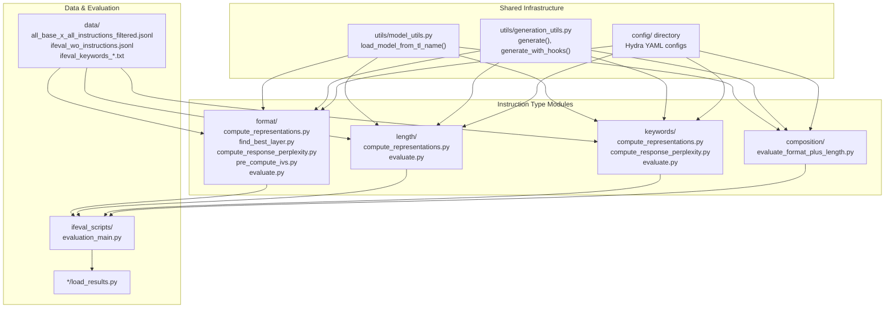
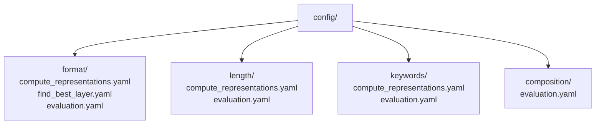

<!-- source: DeepWiki mcp.deepwiki.com · repo microsoft/llm-steer-instruct · page 1 Overview · fetched 2026-10-26 -->

# Overview

<details>
<summary>Relevant source files</summary>

The following files were used as context for generating this wiki page:

- [.gitignore](.gitignore)
- [README.md](README.md)
- [ifeval_scripts/README.md](ifeval_scripts/README.md)

</details>


## Purpose and Scope

This documentation provides a comprehensive technical reference for the **llm-steer-instruct** repository, which implements an activation steering framework for improving instruction-following behavior in large language models (LLMs). This page introduces the repository's architecture, core concepts, and organization, serving as an entry point to more detailed documentation.

For detailed explanations of the underlying activation steering methodology, see [Activation Steering Methodology](#2.1). For practical guidance on running experiments, see [Getting Started](#9).

**Sources:** [README.md:1-165]()

## What is llm-steer-instruct?

The llm-steer-instruct repository implements the method presented in the ICLR 2025 paper "Improving Instruction-Following in Language Models through Activation Steering." The core approach computes **steering vectors** as the difference in model activations between paired inputs—one with an instruction and one without—and applies these vectors during inference to guide generation toward satisfying desired constraints such as specific formatting, length requirements, or keyword inclusion/exclusion.

The method operates at the model activation level rather than requiring fine-tuning, making it computationally efficient and interpretable. The repository provides a complete pipeline for:

1. **Computing representations** from paired inputs using transformer models
2. **Searching for optimal steering layers** using validation data
3. **Pre-computing steering vectors** for efficient inference
4. **Evaluating instruction adherence** using the IFEval benchmark
5. **Analyzing results** through perplexity-based quality assessment

**Sources:** [README.md:1-14](), [README.md:119-120]()

## System Architecture

The repository is organized around three primary instruction-type modules (**format**, **length**, **keywords**) plus a **composition** module for multi-instruction steering. All modules share common infrastructure for model loading, generation, and configuration management.



**Sources:** [README.md:16-48](), [.gitignore:1-16]()

## Key Components

### Infrastructure Layer

The repository provides shared utilities used across all instruction-type modules:

| Component | Location | Key Functions | Purpose |
|-----------|----------|---------------|---------|
| Model Loading | `utils/model_utils.py` | `load_model_from_tl_name()` | Loads models using transformer_lens and HuggingFace, provides HookedTransformer interface |
| Generation | `utils/generation_utils.py` | `generate()`, `generate_with_hooks()`, `activation_addition_hook()`, `direction_projection_hook()` | Handles text generation with and without steering hooks |
| Configuration | `config/` | Hydra YAML files | Declarative experiment configuration for reproducibility |

**Sources:** [README.md:44]()

### Instruction Type Modules

Each instruction type has its own directory with a complete pipeline:

#### Format Instructions (`format/`)
The most comprehensive pipeline with 5 stages:
- `compute_representations.py`: Extract hidden states from paired inputs
- `find_best_layer.py`: Search for optimal steering layer
- `compute_response_perplexity.py`: Compute quality metrics using GPT-2
- `pre_compute_ivs.py`: Pre-compute steering vectors
- `evaluate.py`: Generate and evaluate outputs

**Sources:** [README.md:62-81]()

#### Length Instructions (`length/`)
Simplified 2-stage pipeline for sentence/word constraints:
- `compute_representations.py`: Extract representations for length constraints
- `evaluate.py`: Evaluate with length steering

**Sources:** [README.md:84-92]()

#### Keyword Instructions (`keywords/`)
3-stage pipeline for word inclusion/exclusion:
- `compute_representations.py`: Compute keyword representations
- `compute_response_perplexity.py`: Quality assessment
- `evaluate.py`: Evaluate keyword adherence

**Sources:** [README.md:95-106]()

#### Multi-Instruction Composition (`composition/`)
Combines steering vectors from multiple instruction types:
- `evaluate_format_plus_length.py`: Apply multiple steering vectors simultaneously

**Sources:** [README.md:109-114]()

## Activation Steering Pipeline

The following diagram illustrates the complete workflow from data to evaluation, mapping each stage to specific Python scripts:

```mermaid
graph LR
    subgraph "Stage 1: Data Preparation"
        IFEvalData["IFEval Dataset<br/>data/all_base_x_all_instructions_filtered.jsonl"]
        BaseQueries["Base Queries<br/>data/ifeval_wo_instructions.jsonl"]
    end
    
    subgraph "Stage 2: Representation Extraction"
        ComputeReps["compute_representations.py<br/>(format/ length/ keywords/)"]
        RepsStorage["HDF5 Storage<br/>*/representations/*.h5"]
    end
    
    subgraph "Stage 3: Layer Optimization"
        LayerSearch["find_best_layer.py<br/>(format/)"]
        PerpCompute["compute_response_perplexity.py<br/>(format/ keywords/)"]
        ValidationOut["*/layer_search_out/*.jsonl"]
    end
    
    subgraph "Stage 4: Vector Pre-computation"
        PreComputeIV["pre_compute_ivs.py<br/>(format/)"]
        IVStorage["HDF5 Storage<br/>format/pre_computed_ivs/*.h5"]
    end
    
    subgraph "Stage 5: Evaluation"
        Evaluate["evaluate.py<br/>(format/ length/ keywords/)<br/>evaluate_format_plus_length.py<br/>(composition/)"]
        EvalOut["*/out/*.jsonl"]
    end
    
    subgraph "Stage 6: Analysis"
        IFEvalMain["ifeval_scripts/evaluation_main.py"]
        LoadResults["*/load_results.py"]
        Metrics["Accuracy Metrics<br/>follow_all_instructions"]
    end
    
    IFEvalData --> ComputeReps
    BaseQueries --> ComputeReps
    ComputeReps --> RepsStorage
    
    RepsStorage --> LayerSearch
    LayerSearch --> ValidationOut
    ValidationOut --> PerpCompute
    PerpCompute --> PreComputeIV
    
    RepsStorage --> PreComputeIV
    PreComputeIV --> IVStorage
    
    IVStorage --> Evaluate
    RepsStorage --> Evaluate
    Evaluate --> EvalOut
    
    EvalOut --> IFEvalMain
    IFEvalMain --> LoadResults
    LoadResults --> Metrics
```



**Sources:** [README.md:62-114](), [.gitignore:11-15]()

## Data Flow and Artifacts

The repository maintains a clear separation between intermediate artifacts and final outputs:

| Artifact Type | Location Pattern | Format | Purpose |
|---------------|------------------|--------|---------|
| Representations | `*/representations/*.h5` | HDF5 | Cached hidden states from paired inputs |
| Layer Search Results | `*/layer_search_out/*.jsonl` | JSONL | Validation outputs at different layers |
| Pre-computed Vectors | `format/pre_computed_ivs/*.h5` | HDF5 | Steering vectors for inference |
| Evaluation Outputs | `*/out/*.jsonl` | JSONL | Generated responses with metadata |
| Old Versions | `*/representations_old/`, `*/out_old/` | Various | Archived previous runs |

The `.gitignore` file excludes these artifacts from version control, as they are computationally expensive but reproducible:

**Sources:** [.gitignore:1-16]()

## Configuration System

The repository uses [Hydra](https://hydra.cc) for declarative configuration management. Each module has dedicated YAML files under `config/`:



Configuration files control:
- Model selection (`model_name`, `cross_model` flag)
- Steering parameters (layer, weight, method)
- Data paths and constraints
- Evaluation settings

For detailed information on configuration parameters, see [Configuration Management with Hydra](#3.3).

**Sources:** [README.md:18](), [README.md:66-114]()

## Cross-Model Transfer Capability

A key feature of the system is the ability to transfer steering vectors from instruction-tuned models to base models. For example, representations computed on `gemma-2-9b-it` can steer `gemma-2-9b`:

1. Compute representations using instruction-tuned model
2. Enable `cross_model: true` in evaluation config
3. Set `model_name` to base model variant
4. Run evaluation using transferred steering vectors

This capability is documented in detail in [Cross-Model Experiments](#7.1).

**Sources:** [README.md:81]()

## Evaluation Framework

The repository integrates with the official [IFEval](https://github.com/google-research/google-research/tree/master/instruction_following_eval) framework for standardized evaluation of instruction-following behavior. The `ifeval_scripts/` directory contains the evaluation code, which computes metrics such as:

- `follow_all_instructions`: Binary metric for complete instruction adherence
- `follow_instruction_x`: Per-instruction adherence metrics
- Response quality assessment via perplexity

For details on evaluation metrics and procedures, see [IFEval Framework Integration](#6.2) and [Results Analysis and Metrics](#6.3).

**Sources:** [ifeval_scripts/README.md:1-44](), [README.md:18]()

## Repository Directory Structure

The repository follows a modular organization:

```
llm-steer-instruct/
├── config/              # Hydra YAML configurations for all modules
├── data/                # IFEval dataset, filtered prompts, keyword lists
├── format/              # Format instruction experiments (5-stage pipeline)
├── keywords/            # Keyword instruction experiments (3-stage pipeline)
├── length/              # Length instruction experiments (2-stage pipeline)
├── composition/         # Multi-instruction steering experiments
├── utils/               # Shared infrastructure (model_utils, generation_utils)
├── ifeval_scripts/      # Official IFEval evaluation code
├── requirements.txt     # Python dependencies
└── README.md            # Repository documentation
```

For a comprehensive guide to the directory structure, see [Directory Organization](#8.1).

**Sources:** [README.md:22-48]()

## Documentation Roadmap

This wiki is organized into the following major sections:

### Core Concepts ([#2](#2))
Understanding the fundamental methodology and constraint taxonomy that underlies all experiments.

### Infrastructure and Utilities ([#3](#3))
Documentation of shared components: model loading ([#3.1](#3.1)), generation utilities ([#3.2](#3.2)), and configuration management ([#3.3](#3.3)).

### Steering Vector Pipeline ([#4](#4))
Complete pipeline from representation extraction ([#4.1](#4.1)) through layer optimization ([#4.2](#4.2)), pre-computation ([#4.3](#4.3)), and inference-time application ([#4.4](#4.4)).

### Instruction Type Modules ([#5](#5))
Detailed documentation for format ([#5.1](#5.1)), length ([#5.2](#5.2)), keyword ([#5.3](#5.3)), and composition ([#5.4](#5.4)) modules.

### Data and Evaluation ([#6](#6))
Data sources ([#6.1](#6.1)), IFEval integration ([#6.2](#6.2)), metrics analysis ([#6.3](#6.3)), and perplexity assessment ([#6.4](#6.4)).

### Advanced Features ([#7](#7))
Cross-model experiments ([#7.1](#7.1)) and steering method comparisons ([#7.2](#7.2)).

### Project Structure and Outputs ([#8](#8))
Directory organization ([#8.1](#8.1)) and artifact management ([#8.2](#8.2)).

### Getting Started ([#9](#9))
Installation guide ([#9.1](#9.1)) and first experiment walkthrough ([#9.2](#9.2)).

## Quick Start

To begin using the repository:

1. **Installation**: Follow the setup instructions in [Installation and Setup](#9.1)
2. **First Experiment**: Run through the complete pipeline in [Running Your First Experiment](#9.2)
3. **Understanding**: Read [Activation Steering Methodology](#2.1) to understand the core technique
4. **Exploration**: Browse instruction-type modules ([#5](#5)) for specific use cases

**Sources:** [README.md:52-57](), [README.md:62-114]()

## Responsible AI Considerations

The repository includes a [transparency note](https://github.com/microsoft/llm-steer-instruct/blob/main/assets/Activation_Steering_for_Instruction%20_Following_RAI_transparency_note.pdf) outlining responsible AI considerations. Key points include:

- The method was tested on open-source models (Phi 3.5, Gemma, Mistral)
- Evaluated on IFEval dataset with GPT-4o assisting in quality scoring
- Limitations include potential text quality reduction and incomplete instruction adherence
- Users should balance instruction-following with quality and integrate with content filters
- Developed for research purposes primarily in English

**Sources:** [README.md:118-119]()

---

