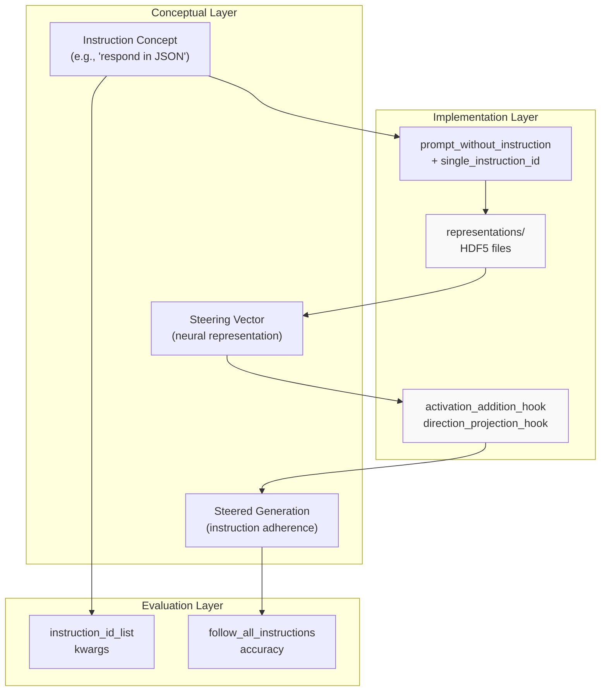
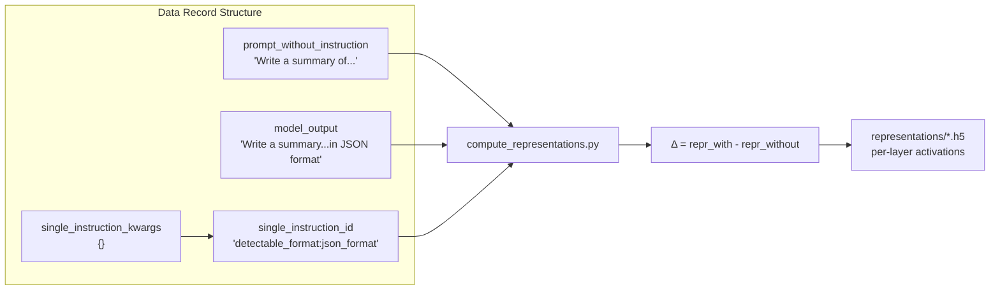
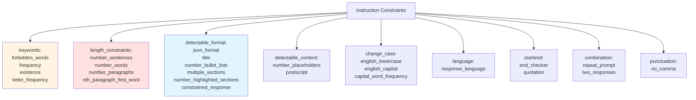
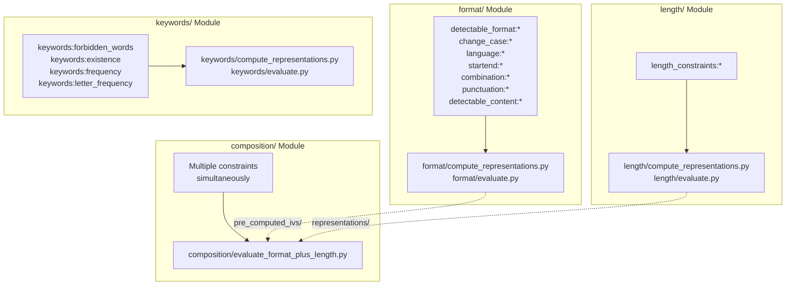
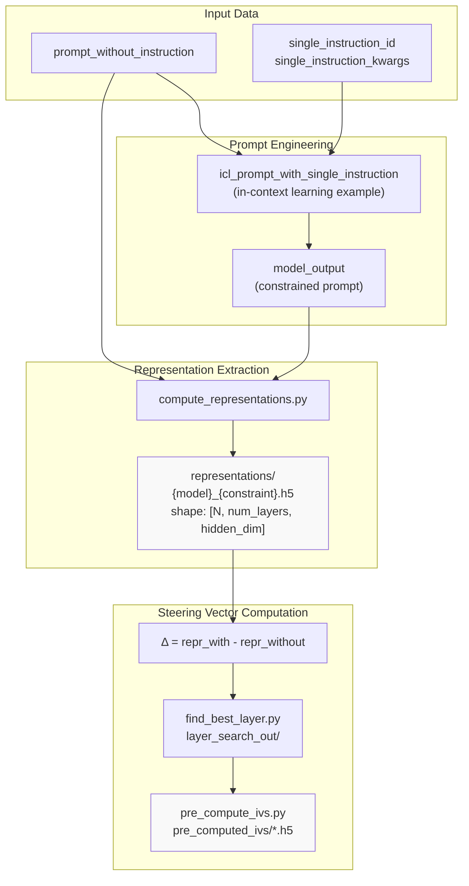
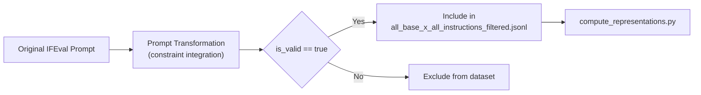

<!-- source: DeepWiki mcp.deepwiki.com · repo microsoft/llm-steer-instruct · page 2 Core Concepts · fetched 2026-10-26 -->

# Core Concepts

<details>
<summary>Relevant source files</summary>

The following files were used as context for generating this wiki page:

- [README.md](README.md)
- [data/format/all_base_x_all_instructions_filtered.jsonl](data/format/all_base_x_all_instructions_filtered.jsonl)
- [ifeval_scripts/README.md](ifeval_scripts/README.md)

</details>


This document introduces the fundamental concepts underlying the activation steering approach used in this repository and the taxonomy of instructions that the system can handle. It provides conceptual background for understanding how the system improves instruction-following behavior in language models.

For detailed implementation of activation steering, see [Activation Steering Methodology](#2.1). For comprehensive documentation of constraint types, see [Instruction Types and Constraint Taxonomy](#2.2). For details on how prompts are engineered, see [Prompt Transformation System](#2.3).

---

## Overview

The llm-steer-instruct system applies **activation steering** to improve language models' ability to follow specific instructions. The approach is based on two core ideas:

1. **Steering vectors represent instruction-following behavior**: The difference in a model's internal activations when processing a prompt with versus without an instruction captures the neural pattern associated with that instruction.

2. **Instructions are categorized by constraint type**: The system handles a taxonomy of instruction types (format, length, keywords, etc.) that are evaluated using the IFEval framework.

The relationship between these concepts is illustrated below:



**Sources:** [README.md:9-12](), [data/format/all_base_x_all_instructions_filtered.jsonl:1-45]()

---

## Activation Steering Fundamentals

### Paired Input Methodology

Activation steering operates on the principle that the difference between a model's internal states on related inputs reveals the neural pattern associated with a specific behavior. The system computes steering vectors from **paired inputs**:

| Input Type | Description | Field in Data |
|------------|-------------|---------------|
| **Base prompt** | Query without instruction | `prompt_without_instruction` |
| **Constrained prompt** | Query with instruction applied | `model_output` |
| **Steering vector** | Difference in activations | Computed from HDF5 representations |

The pairing structure appears in the data format:



**Sources:** [data/format/all_base_x_all_instructions_filtered.jsonl:1](), [README.md:11-12]()

### Steering Vector Properties

Steering vectors have three key properties exploited by the system:

1. **Layer-specific**: Each steering vector is computed for specific transformer layers, requiring layer search to identify optimal steering locations
2. **Linearly composable**: Multiple steering vectors can be applied simultaneously for multi-instruction scenarios (see [Multi-Instruction Composition](#5.4))
3. **Transferable**: Steering vectors from instruction-tuned models can improve base models (see [Cross-Model Experiments](#7.1))

---

## Instruction Constraint Taxonomy

### Primary Constraint Categories

The system handles instructions organized into a hierarchical taxonomy. The top-level categories are:



**Sources:** [data/format/all_base_x_all_instructions_filtered.jsonl:1-50]()

### Instruction ID Structure

Each instruction is identified by a composite key: `{category}:{subtype}_{modifier}`. Examples from the data:

| Full Instruction ID | Category | Subtype | Modifier | Example Kwargs |
|---------------------|----------|---------|----------|----------------|
| `keywords:forbidden_words` | keywords | forbidden_words | - | `{'forbidden_words': ['moser', 'glassworks']}` |
| `length_constraints:number_sentences_at least` | length_constraints | number_sentences | at least | `{'relation': 'at least', 'num_sentences': 60}` |
| `detectable_format:json_format` | detectable_format | json_format | - | `{}` |
| `keywords:frequency_less than` | keywords | frequency | less than | `{'relation': 'less than', 'keyword': 'right', 'frequency': 2}` |

The `instruction_id_list` field contains all instructions applied to a prompt, while `single_instruction_id` identifies individual constraints for steering vector computation.

**Sources:** [data/format/all_base_x_all_instructions_filtered.jsonl:1-10]()

### Module-to-Constraint Mapping

Different modules handle different constraint categories:



**Sources:** [README.md:22-47]()

---

## Data Flow and Representation Pipeline

### From Natural Language to Steering Vectors

The system transforms natural language instructions into steering vectors through a structured pipeline:



**Sources:** [README.md:64-77](), [data/format/all_base_x_all_instructions_filtered.jsonl:1]()

### Key Data Structures

The system uses specific JSON structures throughout the pipeline:

**Input Record** (`all_base_x_all_instructions_filtered.jsonl`):
```json
{
  "single_instruction_id": "detectable_format:json_format",
  "single_instruction_kwargs": {},
  "prompt_without_instruction": "Write a summary of...",
  "model_output": "Write a summary... in JSON format.",
  "instruction_id_list": ["detectable_format:json_format"],
  "instruction_id_list_for_eval": ["detectable_format:json_format"],
  "kwargs": [{}]
}
```

**HDF5 Representation Structure**:
- Dataset keys: `{prompt_hash}_{instruction_id}`
- Shape: `[num_layers, hidden_dimension]`
- Stores last token activations per layer

**Sources:** [data/format/all_base_x_all_instructions_filtered.jsonl:19-20]()

---

## Validation and Constraint Filtering

### The `is_valid` Field

Data records include an `is_valid` field indicating whether the constraint was successfully applied during prompt engineering. This filters prompts where constraint integration was problematic:



All records in `all_base_x_all_instructions_filtered.jsonl` have `"is_valid": true`, meaning only successfully transformed prompts are used for steering vector computation.

**Sources:** [data/format/all_base_x_all_instructions_filtered.jsonl:1-50]()

---

## Relationship to Evaluation

### IFEval Integration

The constraint taxonomy directly aligns with the IFEval evaluation framework. Each `instruction_id_list_for_eval` corresponds to specific IFEval checkers:

| Instruction Family | IFEval Checker | Verification Method |
|-------------------|----------------|---------------------|
| `detectable_format:json_format` | `is_json_format` | Parse response as JSON |
| `length_constraints:number_sentences` | `check_number_sentences` | Count sentences using NLTK |
| `keywords:forbidden_words` | `check_forbidden_words` | String matching (case-insensitive) |
| `startend:end_checker` | `check_ending` | Suffix matching |
| `detectable_format:number_bullet_lists` | `check_bullet_list` | Count markdown bullets |

The system evaluates steering effectiveness using the `follow_all_instructions` metric, which requires all constraints in `instruction_id_list_for_eval` to be satisfied.

**Sources:** [ifeval_scripts/README.md:1-44](), [data/format/all_base_x_all_instructions_filtered.jsonl:1]()

---

## Summary

The core concepts underlying this system are:

1. **Activation steering** computes instruction-specific neural patterns from paired inputs (with/without instruction)
2. **Constraint taxonomy** organizes instructions into 9 major categories with specific subtypes and parameters
3. **Modular implementation** maps constraint families to specialized modules (`format/`, `length/`, `keywords/`, `composition/`)
4. **Evaluation alignment** ensures steering targets match IFEval's standardized instruction-following metrics

These concepts enable the system to systematically improve instruction adherence across diverse constraint types by manipulating model activations during inference.

**Sources:** [README.md:1-165](), [data/format/all_base_x_all_instructions_filtered.jsonl:1-50](), [ifeval_scripts/README.md:1-44]()

---

