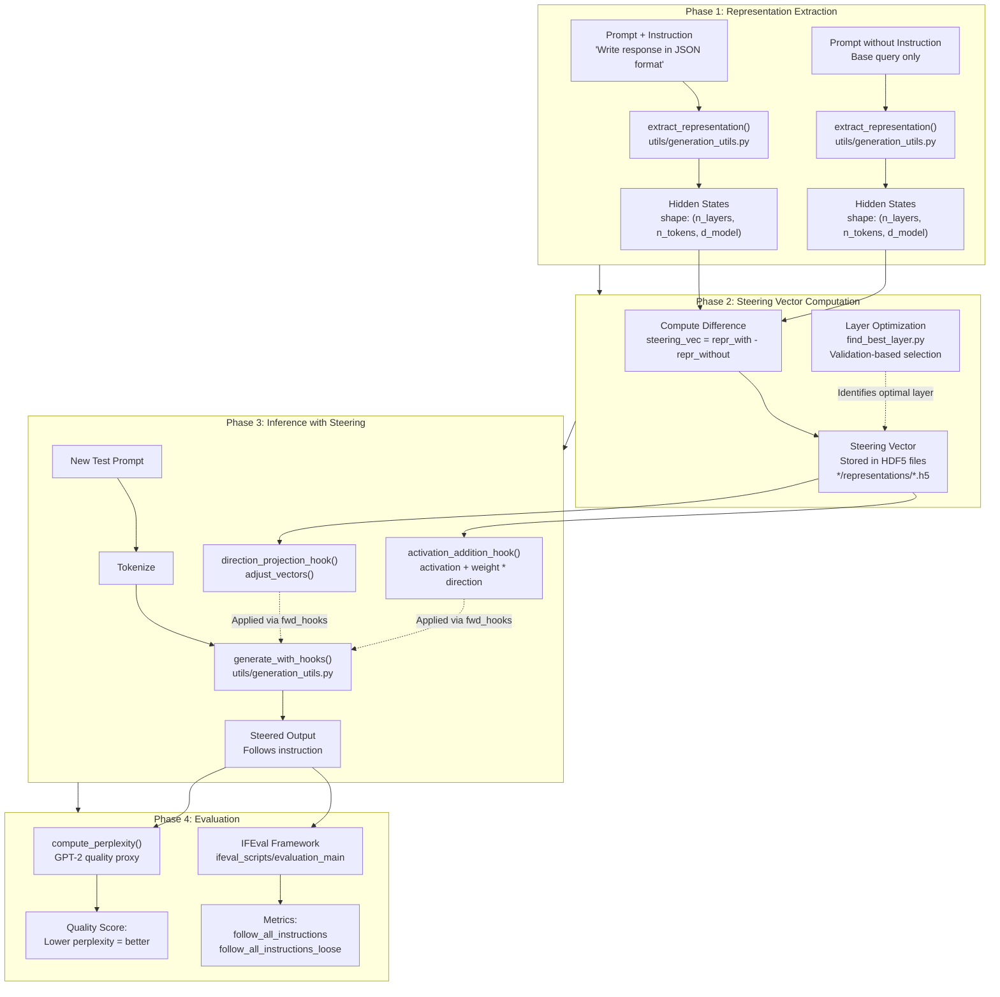
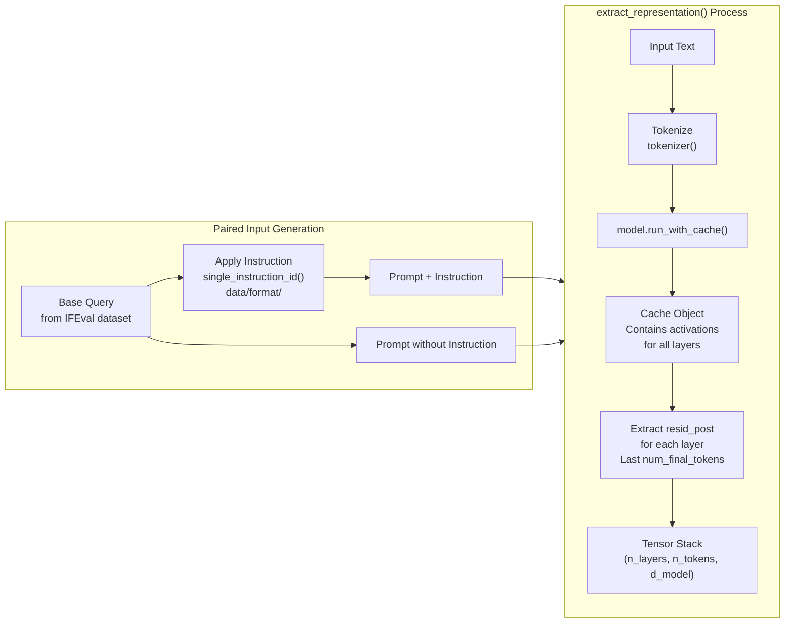
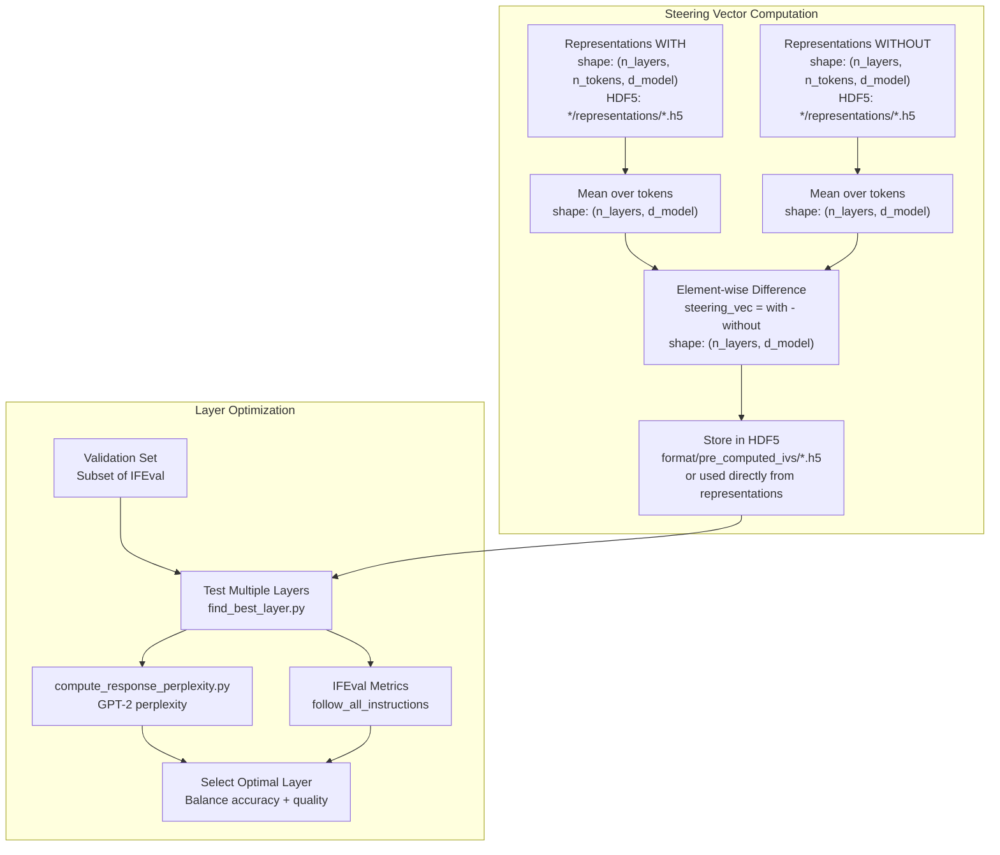
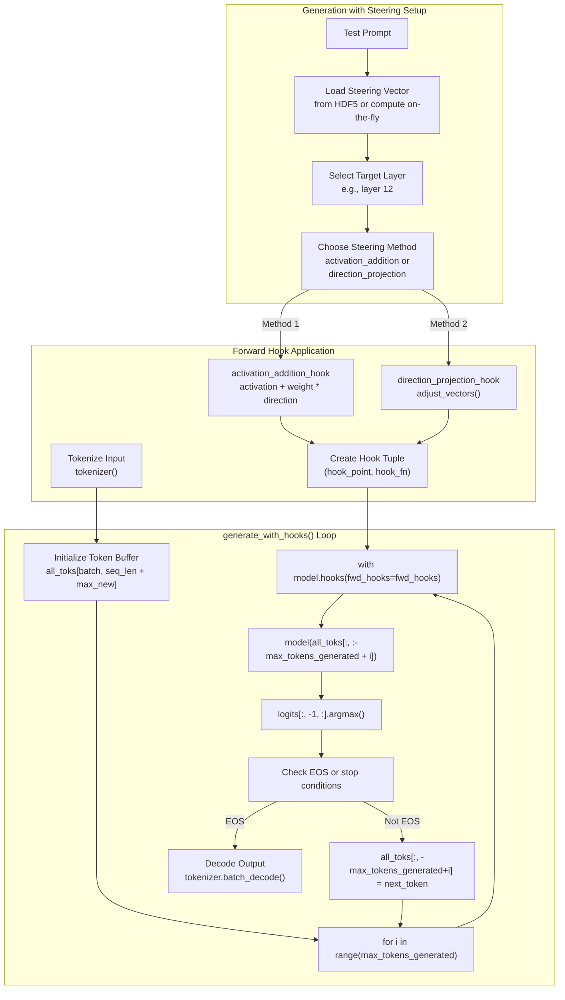
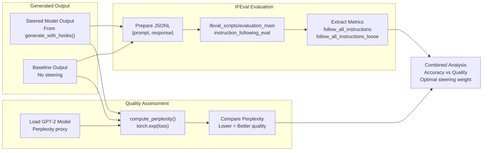
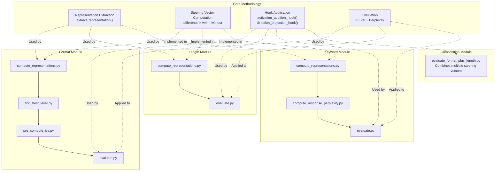

<!-- source: DeepWiki mcp.deepwiki.com · repo microsoft/llm-steer-instruct · page 2.1 Activation Steering Methodology · fetched 2026-10-26 -->

# Activation Steering Methodology

<details>
<summary>Relevant source files</summary>

The following files were used as context for generating this wiki page:

- [README.md](README.md)
- [config/length/length_evaluation.yaml](config/length/length_evaluation.yaml)
- [ifeval_scripts/README.md](ifeval_scripts/README.md)
- [utils/generation_utils.py](utils/generation_utils.py)

</details>


## Purpose and Scope

This document provides a detailed technical explanation of the activation steering methodology that underlies all experiments in this repository. Activation steering is the core technique used to improve instruction-following behavior in language models without fine-tuning. 

The methodology consists of four phases: (1) representation extraction from paired inputs, (2) steering vector computation, (3) inference-time steering application via forward hooks, and (4) evaluation. This document covers the theoretical foundations, mathematical formulations, and code implementations of each phase.

For information about specific instruction types that use this methodology, see [Instruction Types and Constraint Taxonomy](#2.2). For the complete pipeline implementation details, see [Steering Vector Pipeline](#4).

**Sources:** [README.md:9-14]()

---

## Overview of the Four-Phase Methodology

The activation steering approach computes a **steering vector** that represents the difference in model behavior when processing instructions. This vector is then added to the model's residual stream during inference to guide generation toward satisfying desired constraints.



**Diagram: Complete Four-Phase Activation Steering Pipeline**

**Sources:** [README.md:11-12](), [utils/generation_utils.py:122-135](), [utils/generation_utils.py:62-96](), [utils/generation_utils.py:43-60]()

---

## Phase 1: Representation Extraction

The first phase extracts hidden state representations from the model when processing paired inputs: one with an instruction and one without. These representations capture the model's internal state at each layer.

### Technical Implementation

The `extract_representation()` function in `utils/generation_utils.py` performs this extraction:

| Parameter | Type | Purpose |
|-----------|------|---------|
| `model` | `HookedTransformer` | The language model with cache support |
| `tokenizer` | `AutoTokenizer` | Tokenizer for text processing |
| `problem` | `str` | Input prompt (with or without instruction) |
| `device` | `str` | Computation device ('cuda' or 'cpu') |
| `num_final_tokens` | `int` | Number of final tokens to extract (default: 8) |

**Returns:** `numpy.ndarray` of shape `(n_layers, num_final_tokens, d_model)` containing the residual stream activations from `resid_post` for each layer.



**Diagram: Representation Extraction Process and Data Flow**

### Storage Format

Extracted representations are stored in HDF5 files with the following structure:

```
representations/
├── format/representations/*.h5
├── length/representations/*.h5
└── keywords/representations/*.h5

HDF5 Structure:
- Dataset key: "{base_query_id}_{constraint_type}"
- Shape: (n_layers, num_final_tokens, d_model)
- Data type: float32
```

**Sources:** [utils/generation_utils.py:122-135](), [README.md:64-67](), [README.md:85-88](), [README.md:96-99]()

---

## Phase 2: Steering Vector Computation

Steering vectors are computed as the **difference** between representations extracted with and without instructions. This difference captures the activation patterns specific to instruction-following behavior.

### Mathematical Formulation

For a given instruction constraint `c` at layer `l`:

```
steering_vector[l] = mean(repr_with_instruction[l]) - mean(repr_without_instruction[l])
```

Where:
- `repr_with_instruction[l]` has shape `(num_final_tokens, d_model)`
- `repr_without_instruction[l]` has shape `(num_final_tokens, d_model)`
- `mean()` averages over the token dimension
- Result: `steering_vector[l]` has shape `(d_model,)`



**Diagram: Steering Vector Computation and Layer Selection**

### Layer Selection Process

The optimal steering layer is identified through validation experiments:

| Script | Purpose | Output |
|--------|---------|--------|
| `format/find_best_layer.py` | Tests steering at multiple layers | `layer_search_out/*.jsonl` |
| `format/compute_response_perplexity.py` | Computes GPT-2 perplexity | `*_perplexity.jsonl` |
| Analysis | Selects layer maximizing accuracy while maintaining low perplexity | Optimal layer index |

### Pre-Computation for Format Instructions

For format instructions, steering vectors are pre-computed and stored for efficient inference:

```
format/pre_computed_ivs/
├── {model_name}_{constraint_type}_layer{N}_ivs.h5
└── Contains: steering vectors for specific constraints at optimal layers
```

**Sources:** [README.md:68-77](), [README.md:72-74](), [README.md:76-77]()

---

## Phase 3: Inference-Time Steering Application

During inference, steering vectors are applied to the model's residual stream using **forward hooks**. The repository implements two primary steering methods.

### Steering Methods

#### Method 1: Activation Addition

Adds a weighted steering vector to the residual stream at a specific layer:

```python
def activation_addition_hook(activation, hook, direction, weight=1):
    return activation + (direction * weight)
```

**Formula:** `activation_steered = activation_original + α × steering_vector`

Where `α` is the steering weight (configurable via `steering_weights` parameter).

#### Method 2: Direction Projection

Adjusts activations to achieve a target projection value along the steering direction:

```python
def direction_projection_hook(activation, hook, direction, value_along_direction):
    adjusted_activations = adjust_vectors(activation.squeeze(), direction, value_along_direction)
    return adjusted_activations.unsqueeze(0)
```

This uses the `adjust_vectors()` helper function [utils/generation_utils.py:25-40]() which:
1. Computes current projection: `current_proj = activation · direction`
2. Calculates needed adjustment: `δ = target_value - current_proj`
3. Adjusts activation: `activation_steered = activation + δ × direction`



**Diagram: Inference-Time Steering Application via Forward Hooks**

### Hook Configuration

The `generate_with_hooks()` function accepts a list of forward hooks:

```python
fwd_hooks = [
    (f"blocks.{layer_idx}.hook_resid_post", 
     lambda act, hook: activation_addition_hook(act, hook, steering_vector, weight=1.0))
]
```

Hook points follow the TransformerLens naming convention:
- `blocks.{layer_idx}.hook_resid_post` - After layer residual stream
- Applied during each forward pass in the generation loop

**Sources:** [utils/generation_utils.py:43-50](), [utils/generation_utils.py:52-60](), [utils/generation_utils.py:62-96](), [utils/generation_utils.py:25-40]()

---

## Phase 4: Evaluation and Quality Assessment

The final phase evaluates the effectiveness of steering through instruction adherence metrics and text quality measures.

### Evaluation Framework



**Diagram: Evaluation Pipeline with IFEval and Perplexity Metrics**

### Key Metrics

| Metric | Description | Implementation |
|--------|-------------|----------------|
| `follow_all_instructions` | Strict adherence to all constraints | IFEval framework |
| `follow_all_instructions_loose` | Loose adherence (allows minor violations) | IFEval framework |
| `perplexity` | Text quality proxy using GPT-2 | `compute_perplexity()` [utils/generation_utils.py:98-119]() |
| `response_length` | Generated text length in characters | Direct measurement |

### Perplexity Computation

The `compute_perplexity()` function uses GPT-2 as a quality proxy:

```
perplexity = exp(cross_entropy_loss)
```

Where cross-entropy loss is computed over the generated text tokens. Lower perplexity indicates better fluency and coherence.

**Sources:** [utils/generation_utils.py:98-119](), [README.md:72-74](), [README.md:100-102](), [ifeval_scripts/README.md:18-31]()

---

## Steering Method Comparison

The repository supports three steering configurations:

| Configuration | `steering` Parameter | Behavior | Use Case |
|--------------|---------------------|----------|----------|
| **No Steering** | `'none'` | Baseline generation without modifications | Baseline comparison |
| **Activation Addition** | `'add_vector_{constraint_type}'` | Adds weighted steering vector | Primary steering method |
| **Direction Projection** | Uses `direction_projection_hook` | Projects activation to target value | Alternative steering approach |

Configuration example from [config/length/length_evaluation.yaml:16]():
```yaml
steering: 'none'  # or 'add_vector_length_specific', 'add_vector_conciseness', 'add_vector_verbosity'
steering_weights: [1]
source_layer_idx: 12
```

### Weight Sensitivity

Multiple steering weights can be tested to find the optimal balance between instruction adherence and text quality:

```yaml
steering_weights: [0.5, 1.0, 1.5, 2.0]
```

Higher weights increase instruction-following at the potential cost of output quality (higher perplexity).

**Sources:** [config/length/length_evaluation.yaml:16-17](), [utils/generation_utils.py:43-60]()

---

## Cross-Module Applicability

The activation steering methodology is consistently applied across all instruction types:



**Diagram: Methodology Application Across Instruction Modules**

Each instruction type implements the same four-phase methodology but may differ in:
- **Complexity of constraints:** Format instructions have 28+ subtypes
- **Pipeline stages:** Format uses 5 stages, length uses 2, keywords uses 3
- **Pre-computation:** Only format instructions pre-compute vectors
- **Composition:** Multiple steering vectors can be combined simultaneously

**Sources:** [README.md:22-48](), [README.md:62-82](), [README.md:84-92](), [README.md:95-106](), [README.md:109-114]()

---

## Summary of Code Entities

| Component | Location | Purpose |
|-----------|----------|---------|
| `extract_representation()` | [utils/generation_utils.py:122-135]() | Extract hidden states from model |
| `activation_addition_hook()` | [utils/generation_utils.py:43-50]() | Add weighted steering vector to activations |
| `direction_projection_hook()` | [utils/generation_utils.py:52-60]() | Project activations to target value |
| `adjust_vectors()` | [utils/generation_utils.py:25-40]() | Mathematical adjustment for projection |
| `generate_with_hooks()` | [utils/generation_utils.py:62-96]() | Generation loop with forward hooks |
| `compute_perplexity()` | [utils/generation_utils.py:98-119]() | Quality assessment via GPT-2 |
| `compute_representations.py` | `format/`, `length/`, `keywords/` | Extract paired representations |
| `find_best_layer.py` | `format/` | Identify optimal steering layer |
| `pre_compute_ivs.py` | `format/` | Pre-compute steering vectors |
| `evaluate.py` | `format/`, `length/`, `keywords/` | Apply steering and evaluate |

**Sources:** [utils/generation_utils.py:1-135](), [README.md:22-48]()

---

