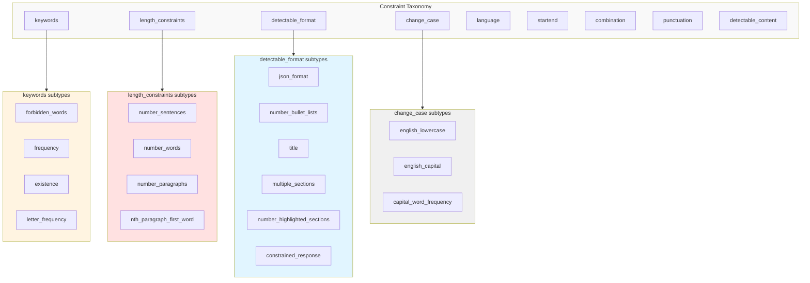
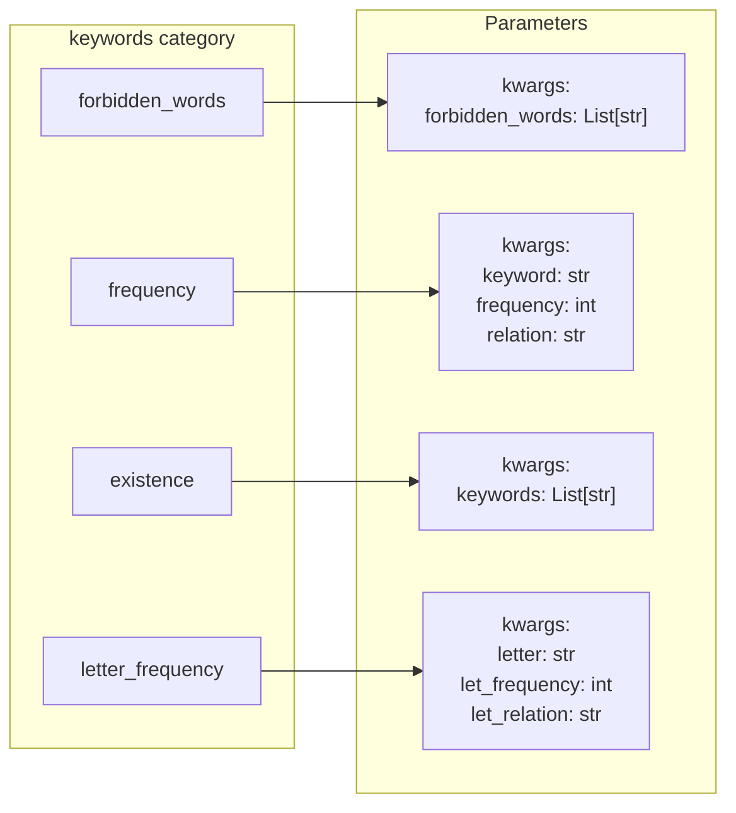
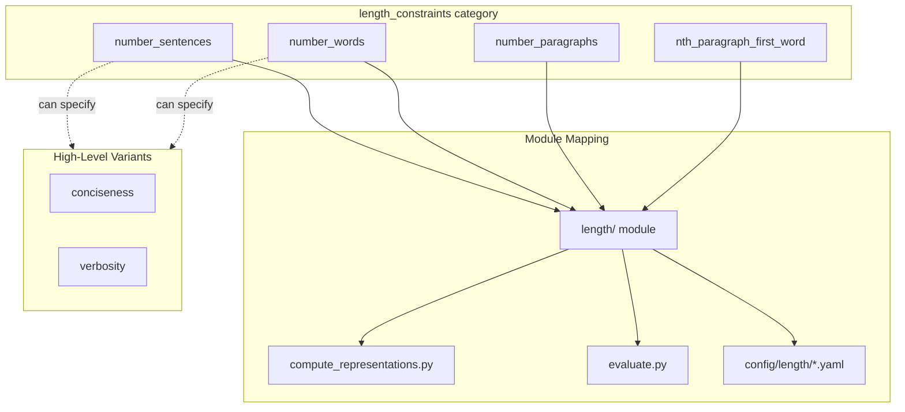
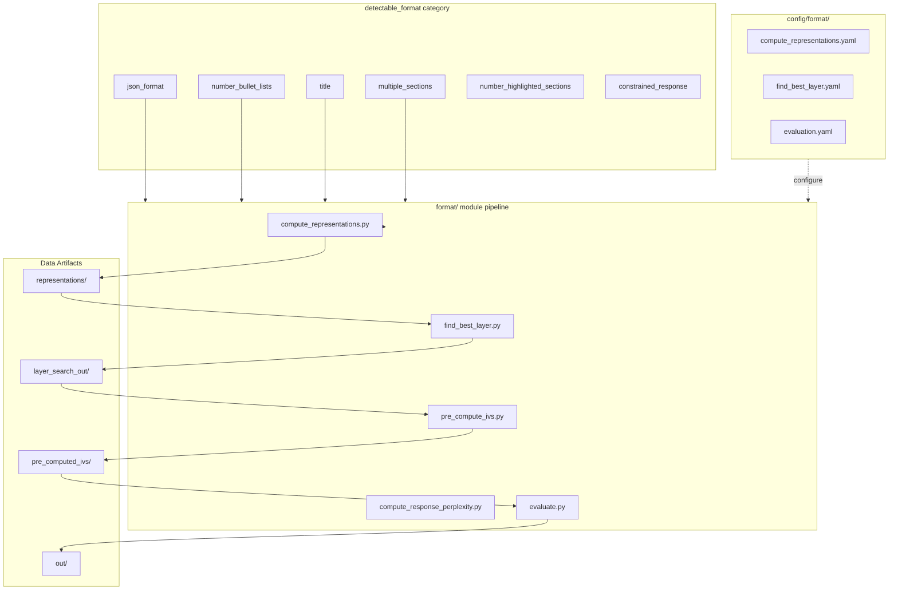
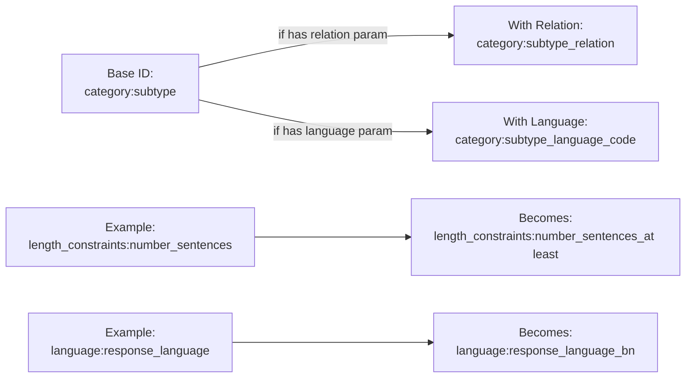
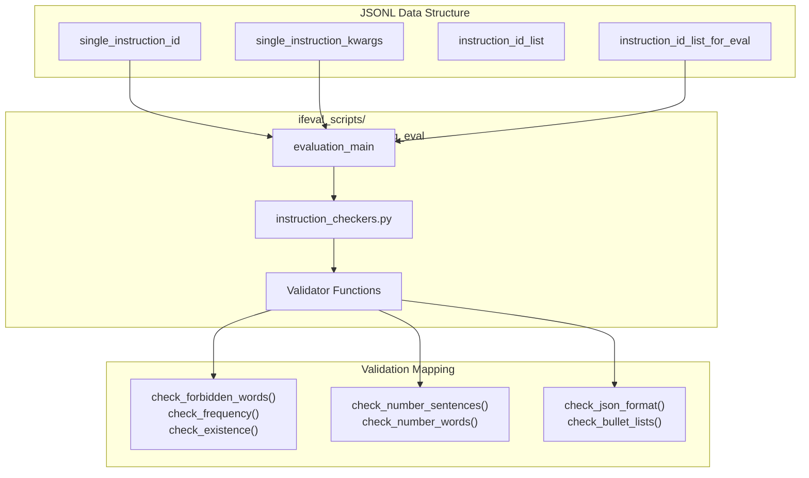

<!-- source: DeepWiki mcp.deepwiki.com · repo microsoft/llm-steer-instruct · page 2.2 Instruction Types and Constraint Taxonomy · fetched 2026-10-26 -->

# Instruction Types and Constraint Taxonomy

Relevant source files

The following files were used as context for generating this wiki page:

- [README.md](README.md)
- [data/format/all_base_x_all_instructions_filtered.jsonl](data/format/all_base_x_all_instructions_filtered.jsonl)
- [ifeval_scripts/README.md](ifeval_scripts/README.md)

## Purpose and Scope

This page documents the comprehensive constraint taxonomy used throughout the llm-steer-instruct codebase. The taxonomy defines verifiable instruction types that can be systematically enforced through activation steering. Each constraint category includes specific subtypes with associated validation logic implemented in the IFEval framework.

For information about how these constraints are applied to prompts, see [Prompt Transformation System](#2.3). For the steering methodology that enforces these constraints, see [Activation Steering Methodology](#2.1).

## Constraint Taxonomy Overview

The codebase organizes constraints into nine primary categories, each containing multiple subtypes. These constraints are defined by `single_instruction_id` strings that combine a category with a specific subtype (e.g., `keywords:forbidden_words`, `detectable_format:json_format`).

**Sources:** [data/format/all_base_x_all_instructions_filtered.jsonl:1-49]()

## Constraint Data Structure

Each constraint instance in the dataset follows a standardized JSONL record structure that connects natural language prompts with structured constraint metadata:

| Field | Type | Description | Example |
|-------|------|-------------|---------|
| `single_instruction_id` | string | Category and subtype identifier | `"keywords:forbidden_words"` |
| `single_instruction_kwargs` | dict | Parameters for the constraint | `{"forbidden_words": ["moser", "glassworks"]}` |
| `single_instruction_kwargs_str` | string | String representation of kwargs | `"{'forbidden_words': ['moser', 'glassworks']}"` |
| `prompt_without_instruction` | string | Base query without constraint | `"Write a summary of..."` |
| `model_output` | string | Prompt with integrated constraint | `"Write a summary... Do not include..."` |
| `instruction_id_list` | list | List of constraint IDs applied | `["keywords:forbidden_words"]` |
| `kwargs` | list | List of parameter dicts | `[{"forbidden_words": [...]}]` |
| `prompt_hash` | string | Unique identifier for the prompt | `"a21da7cc39d8ced6e3ed093b3072a2a2"` |

**Sources:** [data/format/all_base_x_all_instructions_filtered.jsonl:1-49]()

## Category 1: keywords

The `keywords` category constrains word usage in model outputs, supporting inclusion, exclusion, and frequency requirements.

### Subtypes and Parameters

#### keywords:forbidden_words
Prohibits specific words from appearing in the response.
- **Parameters:** `forbidden_words: List[str]`
- **Example:** `{"forbidden_words": ["moser", "glassworks", "pravcice", "karlovy", "vary"]}`
- **Prompt Integration:** "Do not include the following keywords: Moser, Glassworks, Pravcice, Karlovy, Vary"

#### keywords:frequency
Constrains the number of times a specific keyword appears.
- **Parameters:** `keyword: str, frequency: int, relation: str`
- **Relations:** `"at least"`, `"less than"`
- **Example:** `{"relation": "at least", "keyword": "para", "frequency": 1}`
- **Prompt Integration:** "Use the word para at least once."

#### keywords:existence
Requires specific keywords to be present in the response.
- **Parameters:** `keywords: List[str]`
- **Example:** `{"keywords": ["people", "skills"]}`
- **Prompt Integration:** "Use the keyword 'people' and 'skills'."

#### keywords:letter_frequency
Constrains the frequency of specific letters.
- **Parameters:** `letter: str, let_frequency: int, let_relation: str`
- **Relations:** `"at least"`, `"less than"`
- **Example:** `{"let_relation": "at least", "letter": "o", "let_frequency": 25}`
- **Prompt Integration:** "Make sure the letter o appears at least 25 times in your response."

**Sources:** [data/format/all_base_x_all_instructions_filtered.jsonl:1-11]()

## Category 2: length_constraints

The `length_constraints` category controls the structural length of responses at different granularities (sentences, words, paragraphs).

### Subtypes and Module Mapping

#### length_constraints:number_sentences
Controls sentence count with relational operators.
- **Parameters:** `num_sentences: int, relation: str`
- **Relations:** `"at least"`, `"less than"`
- **Instruction ID Variants:** `number_sentences_at least`, `number_sentences_less than`
- **Example:** `{"relation": "at least", "num_sentences": 60}`
- **Prompt Integration:** "Use at least 60 sentences."

#### length_constraints:number_words
Controls word count with relational operators.
- **Parameters:** `num_words: int, relation: str`
- **Relations:** `"at least"`, `"less than"`
- **Instruction ID Variants:** `number_words_at least`, `number_words_less than`
- **Example:** `{"relation": "at least", "num_words": 300}`
- **Prompt Integration:** "Your answer must be at least 300 words."

#### length_constraints:number_paragraphs
Requires an exact number of paragraphs.
- **Parameters:** `num_paragraphs: int`
- **Example:** `{"num_paragraphs": 6}`
- **Prompt Integration:** "There should be exactly 6 paragraphs separated by the markdown divider: ***"

#### length_constraints:nth_paragraph_first_word
Constrains the first word of a specific paragraph.
- **Parameters:** `first_word: str, num_paragraphs: int, nth_paragraph: int`
- **Example:** `{"first_word": "president", "num_paragraphs": 6, "nth_paragraph": 2}`
- **Prompt Integration:** "The second paragraph must start with the word \"President\"."

**Sources:** [data/format/all_base_x_all_instructions_filtered.jsonl:2,12,21,23,26,29,34,39,42,50](), [README.md:84-93]()

## Category 3: detectable_format

The `detectable_format` category defines structural formatting requirements like JSON, bullet lists, sections, and titles. This is the most extensively used category in the format module.

### Format Module Integration

#### detectable_format:json_format
Requires the response to be valid JSON.
- **Parameters:** None (empty dict)
- **Prompt Integration:** "Write... in JSON format."

#### detectable_format:number_bullet_lists
Requires an exact number of bullet points.
- **Parameters:** `num_bullets: int`
- **Example:** `{"num_bullets": 3}`
- **Prompt Integration:** "Your answer should contain exactly 3 bullet points in markdown format. Use * to indicate bullets, like:* xyz* abc* opq"

#### detectable_format:title
Requires a title wrapped in double angular brackets.
- **Parameters:** None (empty dict)
- **Prompt Integration:** "Your answer must contain a title, wrapped in double angular brackets, i.e. <<title>>."

#### detectable_format:multiple_sections
Requires multiple sections with specific markers.
- **Parameters:** `section_spliter: str, num_sections: int`
- **Example:** `{"section_spliter": "SECTION", "num_sections": 2}`
- **Prompt Integration:** "Make sure to include at least two sections marking the beginning of each section with 'SECTION X'."

#### detectable_format:number_highlighted_sections
Requires highlighted text sections.
- **Parameters:** `num_highlights: int`
- **Example:** `{"num_highlights": 2}`
- **Prompt Integration:** "Highlight at least 2 text sections, i.e. *highlighted section*."

#### detectable_format:constrained_response
Requires choosing from predefined response options.
- **Parameters:** None (empty dict)
- **Prompt Integration:** "Choose from: [Option 1] [Option 2] [Option 3] Just choose one phrase from above as your answer."

**Sources:** [data/format/all_base_x_all_instructions_filtered.jsonl:8,11,13,20,22,25,28,30,33,38,40,41,43,46,47,49](), [README.md:62-82]()

## Category 4: change_case

The `change_case` category controls letter casing in responses.

#### change_case:english_lowercase
Requires all lowercase letters (no capitals).
- **Parameters:** None (empty dict)
- **Prompt Integration:** "make sure no capital letters are used."

#### change_case:english_capital
Requires all capital letters.
- **Parameters:** None (empty dict)
- **Prompt Integration:** "Answer in all capital letters."

#### change_case:capital_word_frequency
Requires a minimum number of all-caps words.
- **Parameters:** None (empty dict, defaults to 5 words)
- **Prompt Integration:** "In your response, use words with all capital letters (such as \"SUMMARY\") at least 5 times."

**Sources:** [data/format/all_base_x_all_instructions_filtered.jsonl:6,16,18,37,39,45]()

## Category 5: language

The `language` category enforces responses in specific languages.

#### language:response_language
Requires the entire response in a specified language.
- **Parameters:** `language: str` (ISO 639-1 language codes)
- **Example:** `{"language": "bn"}` (Bengali), `{"language": "mr"}` (Marathi)
- **Instruction ID Variants:** Language-specific IDs like `response_language_bn`, `response_language_mr`
- **Prompt Integration:** "but the response must be entirely in the Bengali language, no other language is allowed."

**Sources:** [data/format/all_base_x_all_instructions_filtered.jsonl:10,32,37]()

## Category 6: startend

The `startend` category constrains the beginning or ending of responses.

#### startend:quotation
Wraps the entire response in double quotation marks.
- **Parameters:** None (empty dict)
- **Prompt Integration:** "Wrap your entire response with double quotation marks."

#### startend:end_checker
Requires the response to end with a specific phrase.
- **Parameters:** `end_phrase: str`
- **Example:** `{"end_phrase": "Is there anything else I can help with?"}`
- **Prompt Integration:** "Your summary must end with the exact phrase \"Is there anything else I can help with?\"."

**Sources:** [data/format/all_base_x_all_instructions_filtered.jsonl:3,14,27,30,36,41]()

## Category 7: combination

The `combination` category handles meta-constraints that combine or repeat instructions.

#### combination:repeat_prompt
Requires repeating the request before providing the answer.
- **Parameters:** `prompt_to_repeat: str`
- **Prompt Integration:** "First repeat the request word for word without change, then give your answer (1. do not say any words or characters before repeating the request; 2. the request you need to repeat does not include this sentence)"

#### combination:two_responses
Requires two distinct responses separated by asterisks.
- **Parameters:** None (empty dict)
- **Prompt Integration:** "Separate the summary into two distinct parts, each part should be separated by 6 asterisk symbols, like below: [Part 1]******[Part 2]"

**Sources:** [data/format/all_base_x_all_instructions_filtered.jsonl:4,17,19,28,31,38,44]()

## Category 8: punctuation

The `punctuation` category controls punctuation usage.

#### punctuation:no_comma
Prohibits commas in the response.
- **Parameters:** None (empty dict)
- **Prompt Integration:** "Make sure to not include commas in your entire response."

**Sources:** [data/format/all_base_x_all_instructions_filtered.jsonl:44,50]()

## Category 9: detectable_content

The `detectable_content` category requires specific content elements like placeholders or postscripts.

#### detectable_content:number_placeholders
Requires placeholder text in square brackets.
- **Parameters:** `num_placeholders: int`
- **Example:** `{"num_placeholders": 3}`
- **Prompt Integration:** "Your answer must contain at least 3 placeholders represented by square brackets, such as [address]."

#### detectable_content:postscript
Requires a postscript with specific marker.
- **Parameters:** `postscript_marker: str`
- **Example:** `{"postscript_marker": "P.P.S"}`
- **Prompt Integration:** "At the end of your response, explicitly add a postscript starting with P.P.S."

**Sources:** [data/format/all_base_x_all_instructions_filtered.jsonl:13,15,35,40]()

## Constraint ID Naming Convention

Constraint IDs follow a hierarchical naming pattern that enables programmatic processing:

### Naming Rules

1. **Base Form:** `{category}:{subtype}` (e.g., `keywords:frequency`)
2. **Relation Suffixes:** Append `_{relation}` when `relation` parameter exists
   - `keywords:frequency` → `keywords:frequency_at least` or `keywords:frequency_less than`
   - `length_constraints:number_words` → `length_constraints:number_words_at least`
3. **Language Suffixes:** Append `_{language_code}` for language constraints
   - `language:response_language` → `language:response_language_bn` (Bengali)
4. **Field Storage:** Both forms stored in different fields:
   - `single_instruction_id`: Base form without suffixes
   - `instruction_id_list`: Contains suffixed variants used for evaluation

**Sources:** [data/format/all_base_x_all_instructions_filtered.jsonl:1-49]()

## Integration with IFEval Framework

The constraint taxonomy directly maps to validation logic in the `instruction_following_eval` framework:

The `instruction_id_list_for_eval` field contains the constraint IDs that map to specific checker functions in the IFEval framework. Each constraint type has corresponding validation logic that verifies whether a model's response satisfies the constraint.

**Sources:** [README.md:18](), [ifeval_scripts/README.md:1-44]()

## Constraint Application in Different Modules

Different modules utilize specific subsets of the constraint taxonomy:

| Module | Primary Constraints | Config Location | Purpose |
|--------|-------------------|-----------------|---------|
| `format/` | `detectable_format:*`, `change_case:*`, `language:*`, `startend:*`, `combination:*`, `punctuation:*`, `detectable_content:*` | `config/format/` | 28+ format subtypes |
| `length/` | `length_constraints:*` | `config/length/` | Sentence/word/paragraph counts |
| `keywords/` | `keywords:forbidden_words`, `keywords:existence` | `config/keywords/` | Word inclusion/exclusion |
| `composition/` | Multiple from format + length | `config/composition/` | Multi-constraint steering |

**Sources:** [README.md:16-115]()

## Data File Structure

The primary data file `all_base_x_all_instructions_filtered.jsonl` serves as the complete constraint catalog:

```mermaid
graph LR
    subgraph SourceData["data/format/"]
        all_base["all_base_x_all_instructions_filtered.jsonl"]
    end
    
    subgraph RecordFields["Record Fields"]
        hash["prompt_hash:<br/>unique identifier"]
        base_prompt["prompt_without_instruction:<br/>original query"]
        constrained["model_output:<br/>query + constraint"]
        metadata["single_instruction_id<br/>single_instruction_kwargs<br/>instruction_id_list"]
    end
    
    subgraph UsageByModules["Used By Modules"]
        format_compute["format/compute_representations.py"]
        length_compute["length/compute_representations.py"]
        keywords_compute["keywords/compute_representations.py"]
    end
    
    all_base --> RecordFields
    RecordFields --> UsageByModules
```

Each record enables paired comparison by providing both the constrained and unconstrained versions of the same query, which is fundamental to computing steering vectors as differences in representations.

**Sources:** [data/format/all_base_x_all_instructions_filtered.jsonl:1-49]()

---

