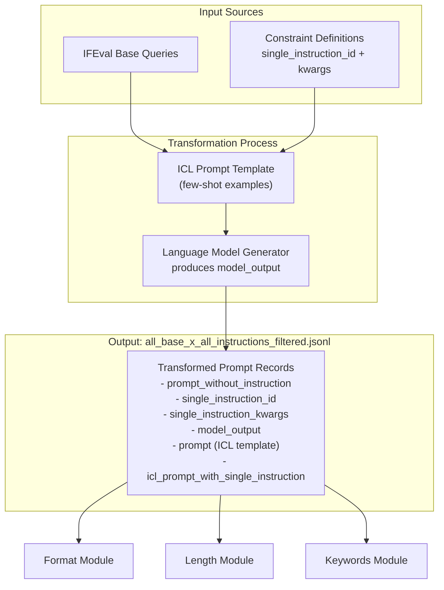
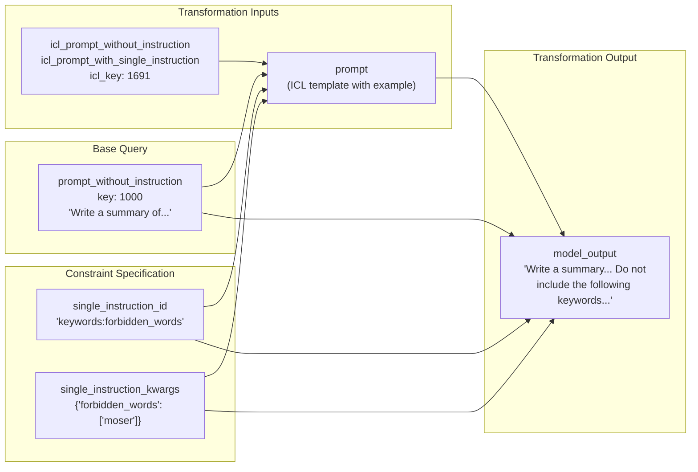
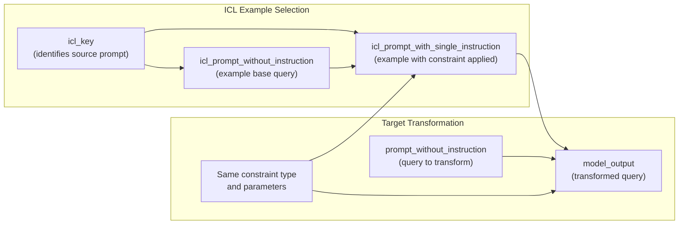
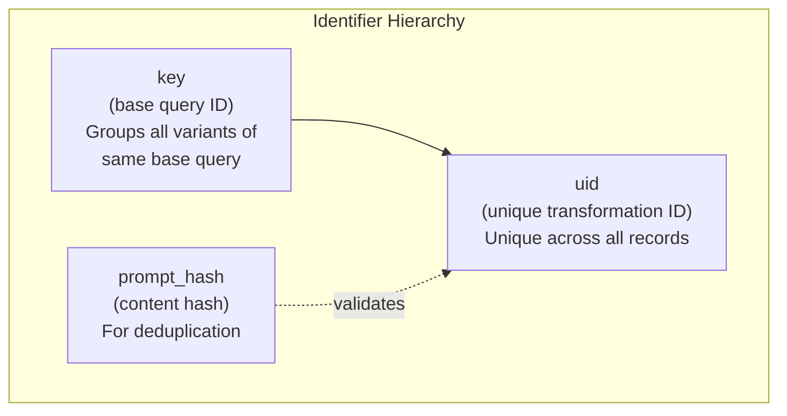
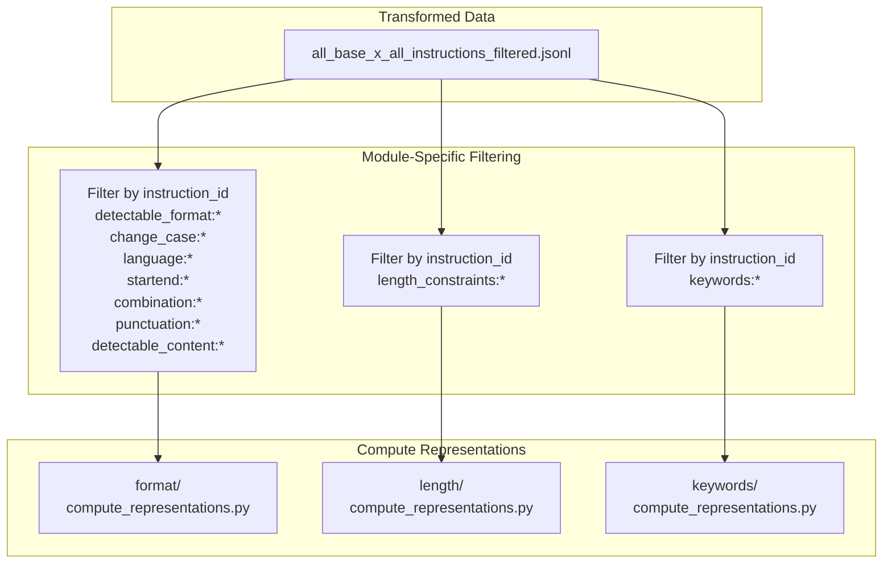

<!-- source: DeepWiki mcp.deepwiki.com · repo microsoft/llm-steer-instruct · page 2.3 Prompt Transformation System · fetched 2026-10-26 -->

# Prompt Transformation System

<details>
<summary>Relevant source files</summary>

The following files were used as context for generating this wiki page:

- [data/format/all_base_x_all_instructions_filtered.jsonl](data/format/all_base_x_all_instructions_filtered.jsonl)

</details>


## Purpose and Scope

The Prompt Transformation System is the foundational data preparation layer that converts base queries from the IFEval dataset into instruction-constrained prompts. This system takes a simple query (e.g., "Write a summary of...") and systematically integrates specific constraints (e.g., "use JSON format", "no commas", "at least 300 words") to create training and evaluation data for instruction-following experiments.

This page documents the structure of the transformed data file, the instruction taxonomy, and the prompt engineering methodology used to apply constraints. For information about the underlying constraint taxonomy, see [Instruction Types and Constraint Taxonomy](#2.2). For how these transformed prompts are used in representation computation, see [Representation Computation](#4.1).

## Overview: Prompt Transformation Architecture

The system uses a few-shot in-context learning (ICL) approach to consistently transform base queries by adding constraints, producing the primary data artifact used throughout the steering pipeline.



**Sources:** [data/format/all_base_x_all_instructions_filtered.jsonl:1-100]()

## Data File Structure

### Primary Data Artifact

The system produces `data/format/all_base_x_all_instructions_filtered.jsonl`, a JSONL file where each line represents a single prompt-constraint pairing. Each record contains multiple representations of the same query at different stages of transformation.

### Record Schema

The following table describes the key fields in each JSONL record:

| Field | Type | Description |
|-------|------|-------------|
| `prompt_without_instruction` | string | Original base query from IFEval without any constraints |
| `single_instruction_id` | string | Identifier for the constraint type (e.g., `keywords:forbidden_words`) |
| `single_instruction_kwargs` | object | Parameters for the constraint (e.g., `{"forbidden_words": ["moser", "glassworks"]}`) |
| `single_instruction_kwargs_str` | string | String representation of kwargs for readability |
| `model_output` | string | The transformed query with the constraint integrated |
| `prompt` | string | Full ICL template used to generate the transformation |
| `icl_key` | integer | Index into the ICL example set |
| `icl_prompt_without_instruction` | string | ICL example's base query |
| `icl_prompt_with_single_instruction` | string | ICL example's transformed query |
| `prompt_hash` | string | Hash identifier for deduplication |
| `instruction_id_list` | array | List of instruction IDs (supports multi-instruction) |
| `kwargs` | array | List of kwargs objects (supports multi-instruction) |
| `is_valid` | boolean | Validation flag for the transformation |
| `key` | integer | Base query identifier |
| `uid` | integer | Unique identifier for this specific transformation |

**Sources:** [data/format/all_base_x_all_instructions_filtered.jsonl:1-10]()

### Field Relationships



**Sources:** [data/format/all_base_x_all_instructions_filtered.jsonl:1-2]()

## Instruction Types and Parameters

### Instruction ID Taxonomy

The `single_instruction_id` field follows a hierarchical naming convention: `category:subcategory[_relation]`. The following table shows the major categories observed in the dataset:

| Category | Subcategories | Example IDs | Purpose |
|----------|---------------|-------------|---------|
| `keywords` | `forbidden_words`, `frequency`, `existence`, `letter_frequency` | `keywords:forbidden_words`, `keywords:frequency_at least` | Control word/letter usage |
| `length_constraints` | `number_sentences`, `number_words`, `number_paragraphs`, `nth_paragraph_first_word` | `length_constraints:number_sentences_at least`, `length_constraints:number_words_less than` | Specify output length |
| `detectable_format` | `json_format`, `number_bullet_lists`, `multiple_sections`, `title`, `number_highlighted_sections`, `constrained_response` | `detectable_format:json_format`, `detectable_format:number_bullet_lists` | Define structural formats |
| `change_case` | `english_lowercase`, `english_capital`, `capital_word_frequency` | `change_case:english_lowercase` | Control capitalization |
| `language` | `response_language` | `language:response_language_bn` | Specify output language |
| `startend` | `quotation`, `end_checker` | `startend:quotation`, `startend:end_checker` | Control start/end formatting |
| `combination` | `repeat_prompt`, `two_responses` | `combination:repeat_prompt` | Meta-instructions about response structure |
| `punctuation` | `no_comma` | `punctuation:no_comma` | Control punctuation usage |
| `detectable_content` | `number_placeholders`, `postscript` | `detectable_content:postscript` | Require specific content elements |

### Relation Suffixes

Many instruction IDs include relation suffixes that specify comparison operators:
- `_at least`: Minimum threshold (e.g., `length_constraints:number_words_at least`)
- `_less than`: Maximum threshold (e.g., `length_constraints:number_sentences_less than`)
- No suffix: Exact match or boolean constraint

**Sources:** [data/format/all_base_x_all_instructions_filtered.jsonl:1-100]()

### Constraint Parameters (kwargs)

The `single_instruction_kwargs` field contains constraint-specific parameters. Examples:

```json
// Forbidden words
{"forbidden_words": ["moser", "glassworks", "pravcice", "karlovy", "vary"]}

// Sentence count with relation
{"relation": "at least", "num_sentences": 60}

// Keyword existence
{"keywords": ["people", "skills"]}

// Letter frequency
{"let_relation": "at least", "letter": "o", "let_frequency": 25}

// Language specification
{"language": "bn"}

// Bullet list count
{"num_bullets": 3}

// End phrase
{"end_phrase": "Is there anything else I can help with?"}
```

**Sources:** [data/format/all_base_x_all_instructions_filtered.jsonl:1-17]()

## In-Context Learning Prompt Template

### Template Structure

The transformation uses a standardized ICL template with the following structure:

```mermaid
graph TD
    subgraph "ICL Prompt Template Structure"
        Instruction["System Instruction<br/>'Given a simple question, we want to make<br/>the question a bit harder by adding constraints...'"]
        
        subgraph "Few-Shot Example"
            ExampleOriginal["<original_question><br/>icl_prompt_without_instruction<br/></original_question>"]
            ExampleConstraint["<constraint><br/>single_instruction_id<br/>single_instruction_kwargs<br/></constraint>"]
            ExampleOutput["<output><br/>icl_prompt_with_single_instruction<br/></output>"]
        end
        
        subgraph "Target Query"
            TargetOriginal["<original_question><br/>prompt_without_instruction<br/></original_question>"]
            TargetConstraint["<constraint><br/>single_instruction_id<br/>single_instruction_kwargs<br/></constraint>"]
            TargetOutput["<output>"]
        end
    end
    
    Instruction --> ExampleOriginal
    ExampleOriginal --> ExampleConstraint
    ExampleConstraint --> ExampleOutput
    ExampleOutput --> TargetOriginal
    TargetOriginal --> TargetConstraint
    TargetConstraint --> TargetOutput
```



**Sources:** [data/format/all_base_x_all_instructions_filtered.jsonl:1]()

### Actual Template Example

From line 1 of the data file, the full `prompt` field contains:

```
Given a simple question, we want to make the question a bit harder by adding contraints to the way it can be answered. You will be given the original question and a constraint to add to it, and should output the harder question with the constraint integrated into it. Nothing else should be added or removed from the question. Only the constraint should be added to the question.

For example:
<original_question>	
Request:  1. What are the best places to visit in Bohemia, Czech Republic?  2. Include a list of recommended hotels.
<\original_question>
<constraint>
keywords:forbidden_words
{'forbidden_words': ['moser', 'glassworks', 'pravcice', 'karlovy', 'vary']}
<\constraint>
<output>
Request:  1. What are the best places to visit in Bohemia, Czech Republic?  2. Include a list of recommended hotels.  4. Do not include the following keywords: Moser, Glassworks, Pravcice, Karlovy, Vary
<\output>

<original_question>
Write a summary of the wikipedia page "https://en.wikipedia.org/wiki/Raymond_III,_Count_of_Tripoli".
<\original_question>
<constraint>
keywords:forbidden_words
{'forbidden_words': ['moser', 'glassworks', 'pravcice', 'karlovy', 'vary']}
<\constraint>
<output>
```

Key characteristics:
1. **System instruction**: Emphasizes that ONLY the constraint should be added, nothing else modified
2. **XML-like delimiters**: Uses `<original_question>`, `<constraint>`, `<output>` tags
3. **One-shot learning**: Provides exactly one example before the target
4. **Explicit constraint display**: Shows both the instruction ID and the kwargs dictionary

**Sources:** [data/format/all_base_x_all_instructions_filtered.jsonl:1]()

## Transformation Process

### Constraint Integration Patterns

The system follows specific patterns for integrating different constraint types into the base query:

```mermaid
graph TD
    subgraph "Integration Patterns"
        Pattern1["Append to Query<br/>(most common)<br/>'...query. Do not include X.'"]
        Pattern2["Prepend to Query<br/>(rare)<br/>'First repeat... Then: query'"]
        Pattern3["Wrap Query<br/>'\"query\"'"]
        Pattern4["Replace Query Format<br/>'query in JSON format'"]
        Pattern5["Add Structural Requirements<br/>'query. Use exactly 3 bullet points.'"]
    end
    
    subgraph "Instruction Categories"
        Keywords[keywords:*]
        Length[length_constraints:*]
        Format[detectable_format:*]
        StartEnd[startend:*]
        Language[language:*]
    end
    
    Keywords --> Pattern1
    Length --> Pattern1
    Format --> Pattern4
    Format --> Pattern5
    StartEnd --> Pattern2
    StartEnd --> Pattern3
    Language --> Pattern1
```

**Sources:** [data/format/all_base_x_all_instructions_filtered.jsonl:1-50]()

### Integration Examples by Category

#### Keywords: Forbidden Words

**Base:** `"Write a summary of the wikipedia page..."`

**Constraint:** `{"forbidden_words": ["moser", "glassworks", "pravcice", "karlovy", "vary"]}`

**Output:** `"Write a summary of the wikipedia page... Do not include the following keywords: Moser, Glassworks, Pravcice, Karlovy, Vary."`

**Pattern:** Append natural language instruction listing the forbidden words

**Sources:** [data/format/all_base_x_all_instructions_filtered.jsonl:1]()

#### Length Constraints: Sentence Count

**Base:** `"Write a summary of the wikipedia page..."`

**Constraint:** `{"relation": "at least", "num_sentences": 60}`

**Output:** `"Write a summary of the wikipedia page... Use at least 60 sentences."`

**Pattern:** Append quantified length requirement

**Sources:** [data/format/all_base_x_all_instructions_filtered.jsonl:2]()

#### Detectable Format: JSON

**Base:** `"Write a summary of the wikipedia page..."`

**Constraint:** `{}`

**Output:** `"Write a summary of the wikipedia page... in JSON format."`

**Pattern:** Modify query to specify output format

**Sources:** [data/format/all_base_x_all_instructions_filtered.jsonl:19]()

#### Start/End: Quotation Wrapper

**Base:** `"Write a summary of the wikipedia page..."`

**Constraint:** `{}`

**Output:** `"Write a summary of the wikipedia page... Wrap your entire response with double quotation marks."`

**Pattern:** Append wrapping instruction

**Sources:** [data/format/all_base_x_all_instructions_filtered.jsonl:3]()

#### Language: Response Language

**Base:** `"Write a summary of the wikipedia page..."`

**Constraint:** `{"language": "bn"}`

**Output:** `"Write a summary of the wikipedia page..., but the response must be entirely in the Bengali language, no other language is allowed."`

**Pattern:** Append language specification with emphasis on exclusivity

**Sources:** [data/format/all_base_x_all_instructions_filtered.jsonl:10]()

## ICL Example Selection

### Example Pairing Strategy

The system uses the `icl_key` field to select appropriate few-shot examples. Each record includes:



**Example from data:**
- Target query (key=1000): `"Write a summary of the wikipedia page..."`
- ICL example (icl_key=1691): `"Request: 1. What are the best places to visit in Bohemia, Czech Republic? 2. Include a list of recommended hotels."`
- Both use: `keywords:forbidden_words` with the same `forbidden_words` list

This ensures the model sees how to apply the specific constraint type before transforming the target query.

**Sources:** [data/format/all_base_x_all_instructions_filtered.jsonl:1]()

## Multi-Instruction Support

### Composite Constraint Fields

While most records contain single instructions, the schema supports multiple constraints through array fields:

| Field | Single-Instruction | Multi-Instruction |
|-------|-------------------|-------------------|
| `instruction_id_list` | `["keywords:forbidden_words"]` | `["keywords:forbidden_words", "length_constraints:number_words_at least"]` |
| `kwargs` | `[{"forbidden_words": [...]}]` | `[{"forbidden_words": [...]}, {"relation": "at least", "num_words": 300}]` |
| `instruction_id_list_og` | Original instruction list before preprocessing | Same as `instruction_id_list` in most cases |

The `instruction_id_list_for_eval` field is used during evaluation to determine which constraints to check.

**Sources:** [data/format/all_base_x_all_instructions_filtered.jsonl:1-5]()

## Record Validation and Metadata

### Validation Fields

- **`is_valid`**: Boolean flag indicating whether the transformation is considered valid
- **`prompt_hash`**: MD5 hash of the prompt for deduplication and tracking

### Identifier Fields

The system uses multiple identifiers for different tracking purposes:



**Example:**
- `key: 1000` - All records transforming "Write a summary of the wikipedia page..."
- `uid: 2, 4, 5, 6...` - Each specific transformation (different constraints)
- `prompt_hash: "a21da7cc39d8ced6e3ed093b3072a2a2"` - Unique to the specific ICL prompt

**Sources:** [data/format/all_base_x_all_instructions_filtered.jsonl:1-100]()

## Usage in Downstream Modules

### Data Flow to Instruction Modules

The transformed prompts in `all_base_x_all_instructions_filtered.jsonl` serve as input to the representation computation phase:



Each module's `compute_representations.py` script:
1. Loads `all_base_x_all_instructions_filtered.jsonl`
2. Filters records by relevant `single_instruction_id` patterns
3. Extracts `prompt_without_instruction` (base query)
4. Extracts `model_output` (query with constraint)
5. Generates paired representations for steering vector computation

**Sources:** [data/format/all_base_x_all_instructions_filtered.jsonl:1-100]()

## File Statistics and Coverage

Based on the provided sample (100 records):

### Instruction Type Distribution

| Instruction Category | Count in Sample | Examples |
|---------------------|-----------------|----------|
| `keywords:*` | ~20% | `forbidden_words`, `frequency`, `existence`, `letter_frequency` |
| `length_constraints:*` | ~18% | `number_sentences`, `number_words`, `number_paragraphs` |
| `detectable_format:*` | ~22% | `json_format`, `number_bullet_lists`, `multiple_sections`, `title` |
| `change_case:*` | ~8% | `english_lowercase`, `english_capital`, `capital_word_frequency` |
| `startend:*` | ~8% | `quotation`, `end_checker` |
| `language:*` | ~8% | `response_language_bn`, `response_language_mr`, `response_language_ur` |
| `combination:*` | ~8% | `repeat_prompt`, `two_responses` |
| `detectable_content:*` | ~6% | `number_placeholders`, `postscript` |
| `punctuation:*` | ~2% | `no_comma` |

### Base Query Diversity

The sample includes queries with different `key` values:
- `key: 1000` - Wikipedia summary task (many variants)
- `key: 1001` - Japan travel itinerary task (many variants)
- `key: 1005` - Resume writing task (many variants)
- `key: 1012` - Email resignation task (many variants)
- `key: 1019` - Question generation task (few variants)

This demonstrates the systematic pairing of each base query with multiple constraint types.

**Sources:** [data/format/all_base_x_all_instructions_filtered.jsonl:1-100]()

---

