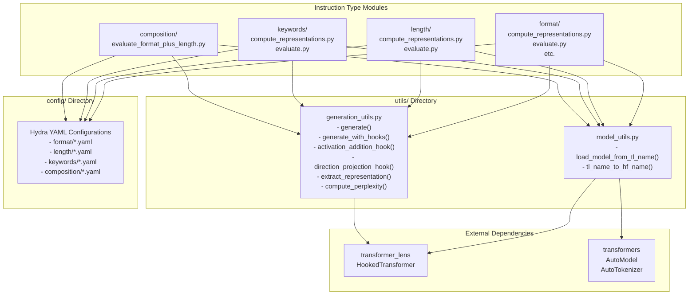
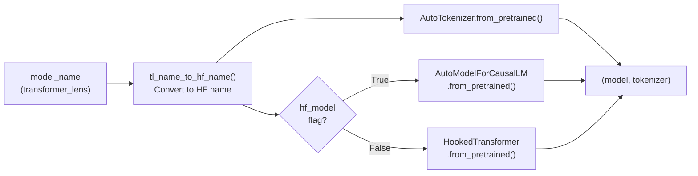
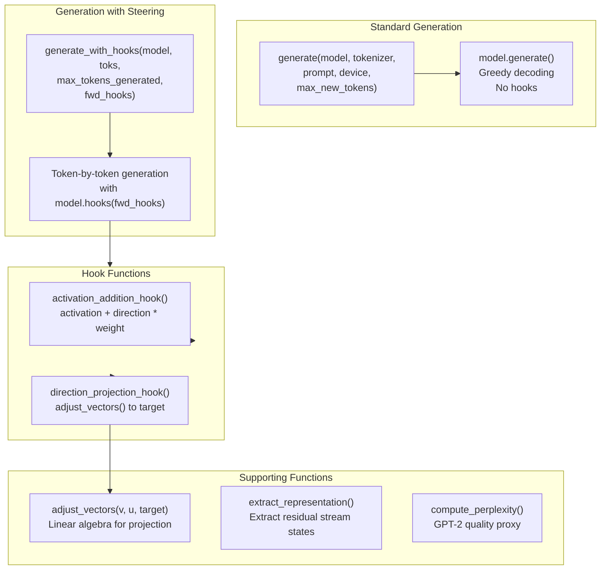
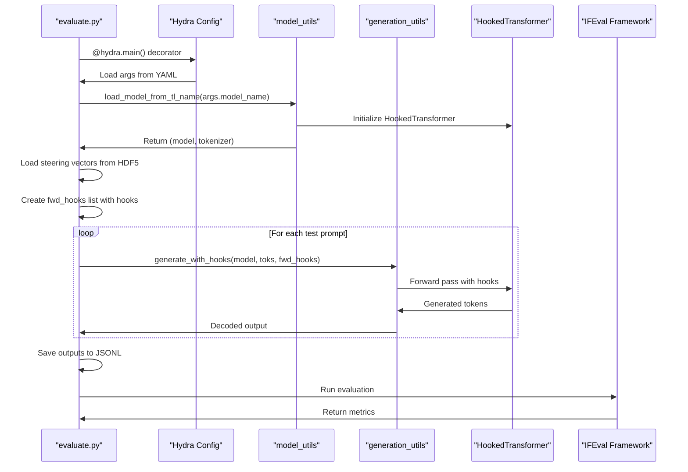

<!-- source: DeepWiki mcp.deepwiki.com · repo microsoft/llm-steer-instruct · page 3 Infrastructure and Utilities · fetched 2026-10-26 -->

# Infrastructure and Utilities

<details>
<summary>Relevant source files</summary>

The following files were used as context for generating this wiki page:

- [config/length/length_evaluation.yaml](config/length/length_evaluation.yaml)
- [utils/generation_utils.py](utils/generation_utils.py)
- [utils/model_utils.py](utils/model_utils.py)

</details>


## Purpose and Scope

This document describes the shared infrastructure components in the `utils/` directory that provide foundational capabilities used across all instruction-type modules (format, length, keywords, and composition). These utilities abstract model loading, text generation, activation manipulation, and configuration management to ensure consistent behavior across experiments.

For instruction-specific implementation details, see [Instruction Type Modules](#5). For the specific pipeline stages that use these utilities, see [Steering Vector Pipeline](#4).

## Infrastructure Architecture

The infrastructure layer consists of three core components that all instruction modules depend on:



**Sources:** [utils/model_utils.py:1-30](), [utils/generation_utils.py:1-135](), [config/length/length_evaluation.yaml:1-30]()

The infrastructure provides three key services:

| Component | Primary Functions | Purpose |
|-----------|------------------|---------|
| Model Loading | `load_model_from_tl_name()`, `tl_name_to_hf_name()` | Load models from transformer_lens or HuggingFace, providing unified interface |
| Generation | `generate()`, `generate_with_hooks()` | Text generation with optional activation steering hooks |
| Activation Hooks | `activation_addition_hook()`, `direction_projection_hook()` | Inject steering vectors into model's residual stream |
| Configuration | Hydra YAML files | Declarative experiment configuration with parameter overrides |

## Model Loading System

The model loading system in [utils/model_utils.py]() provides a unified interface for loading models from both transformer_lens and HuggingFace. The primary function is `load_model_from_tl_name()`.

### Function: `load_model_from_tl_name()`

**Signature:**
```python
def load_model_from_tl_name(model_name, device='cuda', cache_dir=None, hf_token=None, hf_model=False)
```

**Parameters:**
- `model_name`: transformer_lens model identifier (e.g., `'phi-3'`, `'gemma-2-9b'`)
- `device`: Target device for model ('cuda' or 'cpu')
- `cache_dir`: Directory for caching downloaded models
- `hf_token`: HuggingFace authentication token for gated models
- `hf_model`: If True, returns HuggingFace model instead of HookedTransformer

**Returns:** Tuple of `(model, tokenizer)`

**Implementation Details:**



**Sources:** [utils/model_utils.py:10-30]()

The function first converts transformer_lens model names to HuggingFace names using `tl_name_to_hf_name()` [utils/model_utils.py:4-8](). For most models (Llama, Gemma, Mistral), it loads the HuggingFace model first, then wraps it in a `HookedTransformer` for mechanistic interpretability support [utils/model_utils.py:21-23]().

### Why HookedTransformer?

The `HookedTransformer` class from transformer_lens provides critical capabilities for activation steering:
- **Activation caching**: The `run_with_cache()` method extracts hidden states at all layers
- **Forward hooks**: Allows injection of custom functions during forward passes
- **Residual stream access**: Direct access to `resid_post` activations at each layer

These features enable the representation extraction and steering vector application that form the core of the activation steering methodology. See [Activation Steering Methodology](#2.1) for conceptual details.

**Sources:** [utils/model_utils.py:1-30]()

## Generation Utilities

The generation utilities in [utils/generation_utils.py]() provide functions for text generation with and without activation steering. These utilities are used across all evaluation scripts.

### Core Generation Functions



**Sources:** [utils/generation_utils.py:5-96]()

### Function: `generate()`

Standard inference without steering. Used for baseline evaluations [utils/generation_utils.py:5-22]().

**Key Features:**
- Greedy decoding (`do_sample=False`)
- Automatically detects HookedTransformer vs. standard transformers models [utils/generation_utils.py:14-18]()
- Handles special EOS tokens (includes token 32007 for Phi models)

### Function: `generate_with_hooks()`

Token-by-token generation with forward hooks for activation steering [utils/generation_utils.py:62-95]().

**Signature:**
```python
def generate_with_hooks(model, toks, max_tokens_generated=64, fwd_hooks=[], verbose=False, return_decoded=True)
```

**Implementation Pattern:**
1. Initialize token buffer with input tokens [utils/generation_utils.py:71-72]()
2. For each generation step:
   - Apply forward hooks via `model.hooks(fwd_hooks=fwd_hooks)` [utils/generation_utils.py:77]()
   - Forward pass through model [utils/generation_utils.py:78]()
   - Greedy decode next token [utils/generation_utils.py:79]()
   - Check stopping conditions (EOS, special patterns) [utils/generation_utils.py:80-86]()
3. Return decoded text [utils/generation_utils.py:92-93]()

**Sources:** [utils/generation_utils.py:62-95]()

### Activation Manipulation Hooks

The system provides two methods for injecting steering vectors:

#### `activation_addition_hook()`

Adds a scaled steering vector to activations [utils/generation_utils.py:43-49]():

```
activation_new = activation + (direction * weight)
```

**Parameters:**
- `activation`: Current residual stream activations
- `direction`: Steering vector (precomputed difference)
- `weight`: Scaling factor (typically 1-5)

#### `direction_projection_hook()`

Projects activations to have a specific value along a direction [utils/generation_utils.py:52-59]():

```
activation_new = activation + (target - current_projection) * direction
```

Uses `adjust_vectors()` [utils/generation_utils.py:25-40]() to compute the adjustment needed. This method is more precise than addition when the desired activation level is known.

**Sources:** [utils/generation_utils.py:25-59]()

### Supporting Functions

#### `extract_representation()`

Extracts residual stream representations for the final tokens of a prompt [utils/generation_utils.py:122-135]().

**Returns:** NumPy array of shape `(n_layers, num_final_tokens, d_model)`

Used by `compute_representations.py` scripts across all instruction modules to extract paired representations (with and without instructions).

#### `compute_perplexity()`

Computes perplexity using GPT-2 as a quality proxy [utils/generation_utils.py:98-119]().

**Features:**
- Truncates to last 1024 tokens if longer [utils/generation_utils.py:104-105]()
- Error handling for problematic inputs [utils/generation_utils.py:109-115]()
- Returns `torch.exp(loss)` as perplexity score

Used in layer search to identify layers that maintain output quality while steering. See [Layer Search and Optimization](#4.2) for details.

**Sources:** [utils/generation_utils.py:98-135]()

## Configuration Management

The repository uses Hydra for configuration management, with YAML files in the `config/` directory organizing parameters by instruction type and pipeline stage.

### Configuration Structure

```
config/
├── format/
│   ├── compute_representations.yaml
│   ├── find_best_layer.yaml
│   ├── compute_response_perplexity.yaml
│   ├── pre_compute_ivs.yaml
│   └── evaluation.yaml
├── length/
│   ├── compute_representations.yaml
│   └── length_evaluation.yaml
├── keywords/
│   ├── compute_representations.yaml
│   ├── compute_response_perplexity.yaml
│   └── keywords_evaluation.yaml
└── composition/
    └── evaluation.yaml
```

**Sources:** [config/length/length_evaluation.yaml:1-30]()

### Configuration Parameters

Typical parameters across configuration files:

| Parameter Category | Examples | Purpose |
|-------------------|----------|---------|
| **Model Settings** | `model_name`, `device`, `transformers_cache_dir` | Model selection and environment |
| **Data Paths** | `base_queries_path`, `output_path`, `representations_folder` | Input/output file locations |
| **Generation** | `max_generation_length`, `max_new_tokens` | Generation limits |
| **Steering** | `steering`, `steering_weights`, `source_layer_idx` | Steering method and parameters |
| **Experiment** | `n_examples`, `dry_run`, `constraint_type` | Experiment scope |

### Example Configuration

From [config/length/length_evaluation.yaml:1-19]():

```yaml
device: 'cuda'
model_name: 'phi-3'
max_generation_length: 1024

steering: 'add_vector_conciseness'
source_layer_idx: 12
steering_weights: [1]

base_queries_path: 'data/ifeval_wo_instructions.jsonl'
representations_folder: 'representations'
length_rep_file: high_level_50examples_hs.h5
```

This configuration specifies:
- Using the Phi-3 model on CUDA
- Applying conciseness steering at layer 12
- Loading base queries from IFEval dataset
- Reading steering vectors from HDF5 file

### Hydra Integration

Each script uses Hydra's `@hydra.main()` decorator to load configurations:

```python
@hydra.main(config_path="../../config/length", config_name="length_evaluation", version_base=None)
def main(args):
    # Access parameters via args.parameter_name
    model, tokenizer = load_model_from_tl_name(args.model_name, device=args.device)
```

**Benefits:**
- **Command-line overrides**: Parameters can be overridden at runtime
- **Reproducibility**: Complete experiment configuration captured in YAML
- **Modularity**: Different stages use different configurations
- **Logging suppression**: Configured via `defaults` section [config/length/length_evaluation.yaml:22-30]()

**Sources:** [config/length/length_evaluation.yaml:1-30]()

## Integration Pattern

The following diagram illustrates how a typical evaluation script integrates all infrastructure components:



**Sources:** [utils/model_utils.py:10-30](), [utils/generation_utils.py:62-95](), [config/length/length_evaluation.yaml:1-30]()

### Typical Usage Pattern

1. **Script initialization**: Import utilities and define Hydra main function
2. **Model loading**: Call `load_model_from_tl_name()` with config parameters
3. **Data loading**: Read base queries and steering vectors from paths in config
4. **Hook creation**: Instantiate hook functions with steering vectors and layers
5. **Generation loop**: Call `generate_with_hooks()` for each test case
6. **Output**: Save results to JSONL files specified in config
7. **Evaluation**: Run IFEval framework on outputs

This pattern is consistent across:
- [format/evaluate.py]() - Format instruction evaluation
- [length/evaluate.py]() - Length constraint evaluation  
- [keywords/evaluate.py]() - Keyword constraint evaluation
- [composition/evaluate_format_plus_length.py]() - Multi-instruction evaluation

For detailed examples of these usage patterns, see [Instruction Type Modules](#5).

**Sources:** [utils/model_utils.py:1-30](), [utils/generation_utils.py:1-135](), [config/length/length_evaluation.yaml:1-30]()

## Cross-Module Reusability

The infrastructure utilities enable consistent behavior across all instruction types:

| Utility | Format Module | Length Module | Keywords Module | Composition Module |
|---------|--------------|---------------|----------------|-------------------|
| `load_model_from_tl_name()` | ✓ | ✓ | ✓ | ✓ |
| `generate()` | ✓ (baseline) | ✓ (baseline) | ✓ (baseline) | ✓ (baseline) |
| `generate_with_hooks()` | ✓ | ✓ | ✓ | ✓ |
| `activation_addition_hook()` | ✓ | ✓ | ✓ | ✓ |
| `direction_projection_hook()` | ✓ | ✓ | ✓ | - |
| `extract_representation()` | ✓ | ✓ | ✓ | - |
| `compute_perplexity()` | ✓ | - | ✓ | - |

The composition module reuses pre-computed vectors from format and steering vectors computed on-the-fly for length, demonstrating the flexibility of the infrastructure layer.

**Sources:** [utils/model_utils.py:1-30](), [utils/generation_utils.py:1-135]()

---

**Next Sections:**
- For detailed documentation of model loading, see [Model Loading System](#3.1)
- For detailed documentation of generation utilities, see [Generation Utilities](#3.2)
- For detailed documentation of Hydra configuration, see [Configuration Management with Hydra](#3.3)
- For how these utilities are used in the steering pipeline, see [Steering Vector Pipeline](#4)

---

