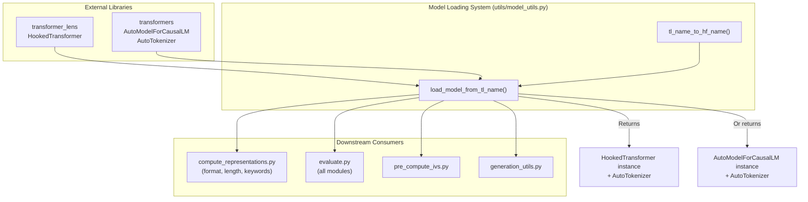
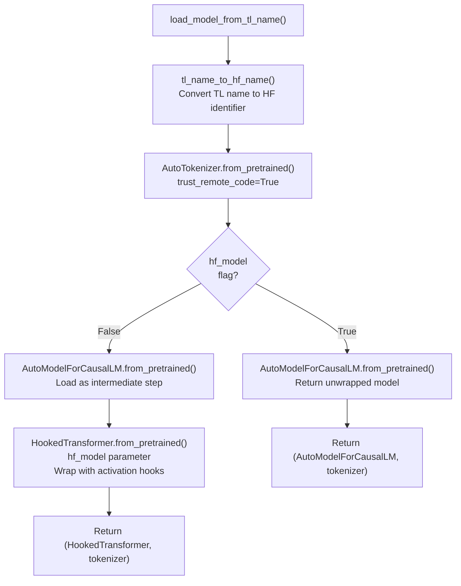
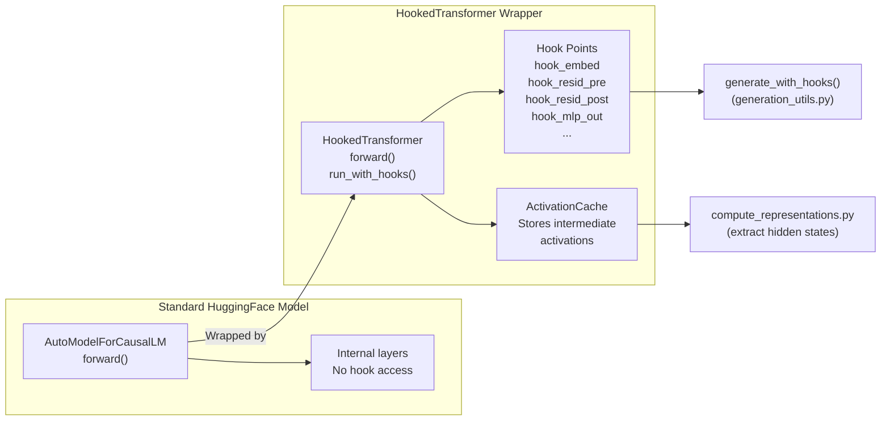

<!-- source: DeepWiki mcp.deepwiki.com · repo microsoft/llm-steer-instruct · page 3.1 Model Loading System · fetched 2026-10-26 -->

# Model Loading System

<details>
<summary>Relevant source files</summary>

The following files were used as context for generating this wiki page:

- [utils/model_utils.py](utils/model_utils.py)

</details>


## Purpose and Scope

The Model Loading System provides a unified interface for loading large language models from both the `transformer_lens` and HuggingFace `transformers` libraries. This infrastructure component serves as the foundation for all model interactions in the repository, abstracting away the complexity of loading different model families (Llama, Gemma, Mistral) and wrapping them in `HookedTransformer` objects that enable activation steering.

This page documents the model loading functions in [utils/model_utils.py](). For information about how loaded models are used during generation and steering, see [3.2 Generation Utilities](#3.2). For details on configuration parameters that control model loading, see [3.3 Configuration Management with Hydra](#3.3).

**Sources:** [utils/model_utils.py:1-30]()

---

## Architecture Overview

The Model Loading System bridges two major Python libraries to provide mechanistic interpretability capabilities while maintaining compatibility with standard HuggingFace models:



**Diagram: Model Loading System Architecture**

The system performs two critical functions:
1. **Name translation**: Converts `transformer_lens` model aliases to full HuggingFace model identifiers
2. **Model wrapping**: Loads HuggingFace models and wraps them in `HookedTransformer` objects that expose activation hooks for steering

**Sources:** [utils/model_utils.py:1-30]()

---

## Core Functions

### load_model_from_tl_name

The `load_model_from_tl_name` function is the primary entry point for all model loading operations in the repository.

**Function Signature:**
```python
load_model_from_tl_name(model_name, device='cuda', cache_dir=None, hf_token=None, hf_model=False)
```

**Parameters:**

| Parameter | Type | Default | Description |
|-----------|------|---------|-------------|
| `model_name` | `str` | Required | Transformer Lens model name (e.g., `"gemma-2-9b"`, `"llama-3-8b"`) |
| `device` | `str` | `'cuda'` | Device for model placement (`'cuda'`, `'cpu'`, or specific CUDA device) |
| `cache_dir` | `str` | `None` | Directory for caching downloaded model weights |
| `hf_token` | `str` | `None` | HuggingFace authentication token for gated models |
| `hf_model` | `bool` | `False` | If `True`, returns raw `AutoModelForCausalLM` instead of `HookedTransformer` |

**Returns:**

| Return Type | Condition | Contents |
|-------------|-----------|----------|
| `(HookedTransformer, AutoTokenizer)` | `hf_model=False` (default) | Model wrapped for activation access, tokenizer |
| `(AutoModelForCausalLM, AutoTokenizer)` | `hf_model=True` | Unwrapped HuggingFace model, tokenizer |

**Sources:** [utils/model_utils.py:10-30]()

### tl_name_to_hf_name

Helper function that translates `transformer_lens` model aliases to official HuggingFace model identifiers.

**Function Signature:**
```python
tl_name_to_hf_name(model_name)
```

This function wraps `loading_from_pretrained.get_official_model_name()` from the `transformer_lens` library to perform the name resolution. For example:
- `"gemma-2-9b"` → `"google/gemma-2-9b"`
- `"llama-3-8b"` → `"meta-llama/Llama-3-8b"`

**Sources:** [utils/model_utils.py:4-8]()

---

## Loading Process Flow

The model loading process follows a multi-stage pipeline that handles different model families with specific requirements:



**Diagram: Model Loading Process Flow**

**Key Implementation Details:**

1. **Name Resolution** [utils/model_utils.py:11](): The transformer_lens name is converted to the official HuggingFace identifier to ensure correct model retrieval.

2. **Tokenizer Loading** [utils/model_utils.py:14](): The tokenizer is loaded with `trust_remote_code=True` to support models with custom tokenization logic. Authentication tokens and cache directories are passed through.

3. **Two-Stage Model Loading** [utils/model_utils.py:21-23](): For most modern model families (Llama, Gemma, Mistral), the function performs a two-stage load:
   - First loads the HuggingFace `AutoModelForCausalLM` instance
   - Then wraps it in `HookedTransformer.from_pretrained()` with the `hf_model` parameter
   
   This two-stage approach is necessary because `HookedTransformer` needs access to the underlying model architecture to properly instrument activation hooks.

4. **Direct HF Return Path** [utils/model_utils.py:16-18](): When `hf_model=True`, the function returns immediately after loading the HuggingFace model, bypassing the `HookedTransformer` wrapper. This path is rarely used in the main codebase.

**Sources:** [utils/model_utils.py:10-30]()

---

## Model Family Support

The loading system explicitly handles different model families with tailored logic:

| Model Family | Handling Strategy | Loading Path |
|--------------|-------------------|--------------|
| **Llama** | Two-stage load (HF → Hooked) | [utils/model_utils.py:21-23]() |
| **Gemma** | Two-stage load (HF → Hooked) | [utils/model_utils.py:21-23]() |
| **Mistral** | Two-stage load (HF → Hooked) | [utils/model_utils.py:21-23]() |
| **Others** | Direct `HookedTransformer.from_pretrained()` | [utils/model_utils.py:27]() |

The conditional logic at [utils/model_utils.py:21]() shows a hardcoded `if True` statement, indicating that the two-stage loading path is currently used for all models. The commented logic suggests this was originally intended only for specific model families, but has been generalized.

**Authentication Requirements:**

Models from certain organizations (Meta's Llama, Google's Gemma) require HuggingFace authentication tokens. The `hf_token` parameter is passed through to both `AutoTokenizer` and `AutoModelForCausalLM` constructors [utils/model_utils.py:14,17,22]().

**Sources:** [utils/model_utils.py:21-27]()

---

## HookedTransformer Integration

The `HookedTransformer` class from `transformer_lens` is central to the activation steering methodology:



**Diagram: HookedTransformer Wrapper Capabilities**

**Key Capabilities Enabled by HookedTransformer:**

1. **Hook Points**: Named locations in the forward pass where custom functions can intercept and modify activations. Critical for applying steering vectors (see [3.2 Generation Utilities](#3.2)).

2. **Activation Caching**: Automatic storage of intermediate activations using `ActivationCache`, enabling representation extraction without re-running the model (see [4.1 Representation Computation](#4.1)).

3. **Consistent API**: Unified interface across different model architectures, abstracting away implementation differences between model families.

The wrapper is constructed at [utils/model_utils.py:23]() with explicit parameters:
- `model_name`: Original transformer_lens name for proper hook point mapping
- `hf_model`: The loaded HuggingFace model to wrap
- `tokenizer`: The tokenizer for consistent text processing
- `device`: Target device for computation
- `cache_dir`: Directory for caching transformer_lens metadata

**Sources:** [utils/model_utils.py:2,23]()

---

## Integration with Downstream Systems

The Model Loading System is invoked by all major components of the repository:

**Primary Consumers:**

1. **Representation Computation** (see [4.1](#4.1)): 
   - `format/compute_representations.py`
   - `length/compute_representations.py`
   - `keywords/compute_representations.py`
   
   These scripts call `load_model_from_tl_name()` to load models for extracting hidden states from paired inputs (with/without instructions).

2. **Evaluation Scripts** (see [5.1](#5.1), [5.2](#5.2), [5.3](#5.3), [5.4](#5.4)):
   - `format/evaluate.py`
   - `length/evaluate.py`
   - `keywords/evaluate.py`
   - `composition/evaluate_format_plus_length.py`
   
   These scripts load models for inference with steering applied via forward hooks.

3. **Layer Search** (see [4.2](#4.2)):
   - `format/find_best_layer.py`
   
   Loads models to test steering effectiveness across different layers.

4. **Pre-computation** (see [4.3](#4.3)):
   - `format/pre_compute_ivs.py`
   
   Loads models to compute and cache steering vectors.

**Configuration Integration:**

All consumers specify the model through Hydra configuration files (see [3.3](#3.3)). The `model_name` parameter in configuration YAML files is passed directly to `load_model_from_tl_name()`. Common configuration patterns:

```yaml
model_name: "gemma-2-9b"
device: "cuda"
cache_dir: "/path/to/cache"
```

**Cross-Model Experiments** (see [7.1](#7.1)):

The system supports loading different models for representation extraction and evaluation. For example, computing representations on `"gemma-2-9b-it"` (instruction-tuned) and applying steering to `"gemma-2-9b"` (base model). This is enabled by calling `load_model_from_tl_name()` with different `model_name` parameters in different stages.

**Sources:** [utils/model_utils.py:1-30]()

---

## Error Handling and Edge Cases

**Cache Directory Management:**

The `cache_dir` parameter is passed through to all underlying library calls [utils/model_utils.py:14,17,22,23](), but the function does not validate directory existence or permissions. Consumers should ensure cache directories are writable before calling.

**Local Files Only:**

The `local_files_only=False` parameter is explicitly set in HuggingFace calls [utils/model_utils.py:17,23](), meaning the system will attempt to download models from HuggingFace Hub if not found in cache. Network access is required on first load.

**Trust Remote Code:**

The tokenizer is loaded with `trust_remote_code=True` [utils/model_utils.py:14](), which is necessary for models with custom tokenization logic (e.g., Gemma) but introduces potential security risks. This should only be used with trusted model sources.

**Sources:** [utils/model_utils.py:14,17,23]()

---

## Summary

The Model Loading System provides a critical abstraction layer that:

1. **Unifies** access to models from both `transformer_lens` and HuggingFace `transformers`
2. **Wraps** standard models in `HookedTransformer` objects for activation manipulation
3. **Handles** authentication, caching, and device placement consistently
4. **Supports** multiple model families with appropriate loading strategies
5. **Enables** all downstream steering and evaluation capabilities through a single interface

The two-stage loading process (HuggingFace model → HookedTransformer wrapper) is the key architectural decision that allows the repository to combine standard pre-trained models with mechanistic interpretability tools for activation steering experiments.

**Sources:** [utils/model_utils.py:1-30]()

---

