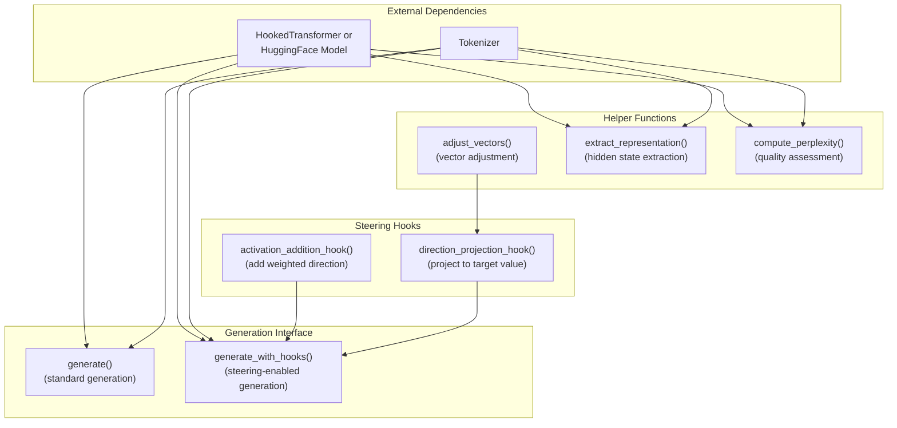
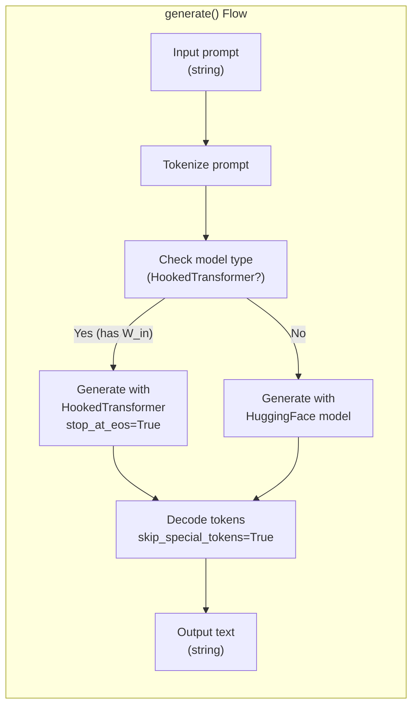
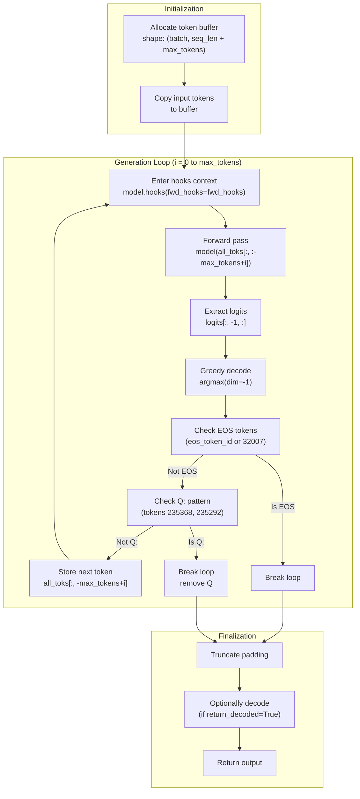
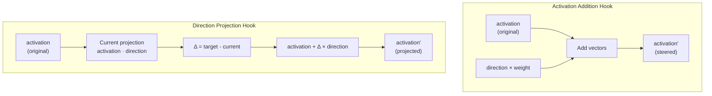
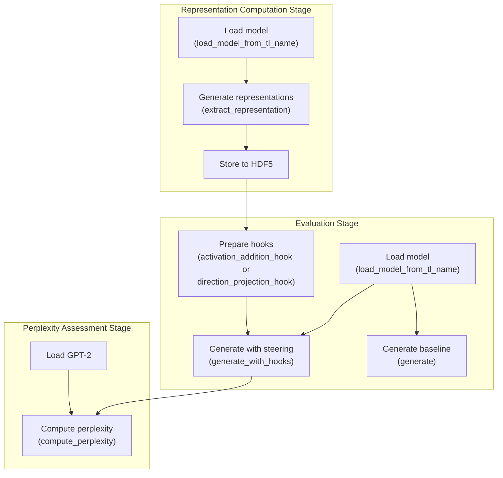

<!-- source: DeepWiki mcp.deepwiki.com · repo microsoft/llm-steer-instruct · page 3.2 Generation Utilities · fetched 2026-10-26 -->

# Generation Utilities

<details>
<summary>Relevant source files</summary>

The following files were used as context for generating this wiki page:

- [config/length/length_evaluation.yaml](config/length/length_evaluation.yaml)
- [utils/generation_utils.py](utils/generation_utils.py)
- [utils/model_utils.py](utils/model_utils.py)

</details>


## Purpose and Scope

This page documents the generation utilities module located in [utils/generation_utils.py](). This module provides the core text generation capabilities for the activation steering framework, including standard generation, generation with forward hooks for steering, and activation manipulation functions. These utilities form the foundation for applying steering vectors during inference across all instruction-type modules.

For information about model loading and initialization, see [Model Loading System](#3.1). For details on how these utilities are used in specific instruction pipelines, see [Steering Vector Pipeline](#4).

**Sources:** [utils/generation_utils.py:1-135]()

## Overview

The generation utilities module provides two primary generation interfaces and associated hook functions that enable activation steering. The module bridges standard transformer generation with mechanistic interpretability capabilities through `transformer_lens`'s `HookedTransformer` framework.



**Sources:** [utils/generation_utils.py:1-135]()

## Standard Generation Function

The `generate()` function provides standard text generation without any steering interventions. It serves as the baseline for comparing steered vs. unsteered outputs.

### Function Signature

```python
generate(model, tokenizer, prompt, device, max_new_tokens=512)
```

### Parameters and Behavior

| Parameter | Type | Description |
|-----------|------|-------------|
| `model` | `HookedTransformer` or `AutoModelForCausalLM` | The language model to use for generation |
| `tokenizer` | `AutoTokenizer` | The tokenizer for the model |
| `prompt` | `str` | Input text prompt |
| `device` | `str` or `torch.device` | Device for computation (e.g., 'cuda') |
| `max_new_tokens` | `int` | Maximum number of tokens to generate (default: 512) |

### Implementation Details

The function implements greedy decoding (deterministic generation with `do_sample=False`) and handles both `HookedTransformer` and standard HuggingFace models differently:

- **HookedTransformer detection**: Uses `hasattr(model, 'W_in')` to check if the model is a `HookedTransformer` instance [utils/generation_utils.py:14]()
- **Special token handling**: For HookedTransformer models, includes token 32007 (Phi-specific) as an additional EOS token [utils/generation_utils.py:16]()
- **Prompt length tracking**: Extracts only the newly generated tokens by tracking the input prompt length [utils/generation_utils.py:12,18]()



**Sources:** [utils/generation_utils.py:5-22]()

## Generation with Steering Hooks

The `generate_with_hooks()` function is the core mechanism for applying activation steering during text generation. It enables forward hooks to be injected at specific layers during the generation process.

### Function Signature

```python
generate_with_hooks(
    model,
    toks,
    max_tokens_generated=64,
    fwd_hooks=[],
    verbose=False,
    return_decoded=True
)
```

### Parameters

| Parameter | Type | Description |
|-----------|------|-------------|
| `model` | `HookedTransformer` | The model (must support `.hooks()` context manager) |
| `toks` | `torch.Tensor` | Tokenized input with shape `(batch_size, seq_len)` |
| `max_tokens_generated` | `int` | Maximum tokens to generate (default: 64) |
| `fwd_hooks` | `list` | List of forward hooks to apply during generation |
| `verbose` | `bool` | Whether to show progress bar |
| `return_decoded` | `bool` | Whether to return decoded strings or token tensors |

### Generation Loop Architecture

The function implements autoregressive generation with hooks applied at each forward pass:



### Special Stopping Conditions

The function implements several specialized stopping conditions beyond standard EOS detection:

1. **Standard EOS**: Stops when `model.tokenizer.eos_token_id` is generated [utils/generation_utils.py:80]()
2. **Phi-specific EOS**: Stops when token 32007 is generated [utils/generation_utils.py:80]()
3. **Q&A format detection**: Stops when detecting a new question pattern (`Q:`) to prevent the model from generating follow-up questions [utils/generation_utils.py:82-86]()

**Sources:** [utils/generation_utils.py:62-96]()

## Activation Manipulation Hooks

The module provides two primary hook functions for manipulating activations during generation. These hooks are passed to `generate_with_hooks()` via the `fwd_hooks` parameter.

### Activation Addition Hook

The `activation_addition_hook()` implements the simplest form of steering by adding a weighted direction vector to the residual stream.

```python
def activation_addition_hook(activation, hook, direction, weight=1):
    return activation + (direction * weight)
```

| Parameter | Type | Description |
|-----------|------|-------------|
| `activation` | `torch.Tensor` | Current activation tensor from the model |
| `hook` | `Hook` | Hook object (provided by `transformer_lens`) |
| `direction` | `torch.Tensor` | Steering direction vector |
| `weight` | `float` | Scaling factor for the steering direction (default: 1) |

This hook implements the equation: `activation' = activation + weight × direction`

**Usage Pattern:**
```python
hook = (layer_name, partial(activation_addition_hook, direction=steering_vec, weight=2.0))
```

**Sources:** [utils/generation_utils.py:43-49]()

### Direction Projection Hook

The `direction_projection_hook()` implements a more sophisticated steering approach by adjusting activations to have a specific projection value along a direction vector.

```python
def direction_projection_hook(
    activation, hook, direction, value_along_direction
):
    adjusted_activations = adjust_vectors(
        activation.squeeze(), direction, value_along_direction
    )
    return adjusted_activations.unsqueeze(0)
```

| Parameter | Type | Description |
|-----------|------|-------------|
| `activation` | `torch.Tensor` | Current activation tensor |
| `hook` | `Hook` | Hook object |
| `direction` | `torch.Tensor` | Unit direction vector |
| `value_along_direction` | `torch.Tensor` | Target projection value(s) |

This hook uses `adjust_vectors()` to ensure the activation has a specific component along the steering direction, regardless of its current value.

**Sources:** [utils/generation_utils.py:52-59]()

### Hook Comparison



| Aspect | Activation Addition | Direction Projection |
|--------|-------------------|---------------------|
| **Control** | Indirect (via weight) | Direct (target value) |
| **Computation** | Simple addition | Projection + adjustment |
| **Use Case** | General steering | Precise control of component |
| **Parameters** | `weight` (scalar) | `value_along_direction` (per-example) |

**Sources:** [utils/generation_utils.py:43-59]()

## Helper Functions

### Vector Adjustment Function

The `adjust_vectors()` function is the mathematical core of direction projection, implementing precise control over activation components.

```python
def adjust_vectors(v, u, target_values):
    current_projections = v @ u
    delta = target_values - current_projections
    adjusted_v = v + delta[:, None] * u
    return adjusted_v
```

**Mathematical Operation:**
Given vectors `v` (batch of activations), unit vector `u` (direction), and `target_values`:
1. Compute current projection: `proj = v · u`
2. Compute required delta: `Δ = target - proj`
3. Adjust vector: `v' = v + Δu`

| Parameter | Shape | Description |
|-----------|-------|-------------|
| `v` | `(n, d)` | Batch of vectors to adjust |
| `u` | `(d,)` | Unit direction vector |
| `target_values` | `(n,)` | Desired projection values |
| **Returns** | `(n, d)` | Adjusted vectors |

**Sources:** [utils/generation_utils.py:25-40]()

### Representation Extraction

The `extract_representation()` function extracts hidden states from a model's residual stream for computing steering vectors.

```python
extract_representation(model, tokenizer, problem, device, num_final_tokens=8)
```

**Key Features:**
- Uses `model.run_with_cache()` to capture intermediate activations [utils/generation_utils.py:130]()
- Extracts from `resid_post` (residual stream after each layer) [utils/generation_utils.py:132]()
- Returns representations from all layers for the final N tokens [utils/generation_utils.py:132]()
- Output shape: `(n_layers, num_final_tokens, hidden_dim)` converted to NumPy

| Parameter | Type | Description |
|-----------|------|-------------|
| `model` | `HookedTransformer` | Model to extract from |
| `tokenizer` | `AutoTokenizer` | Tokenizer for encoding |
| `problem` | `str` | Input prompt |
| `device` | `str` or `torch.device` | Computation device |
| `num_final_tokens` | `int` | Number of final tokens to extract (default: 8) |

**Sources:** [utils/generation_utils.py:122-135]()

### Perplexity Computation

The `compute_perplexity()` function computes perplexity scores using a separate model (typically GPT-2) as a proxy for response quality.

```python
compute_perplexity(text, device='cuda', perplexity_model=None, perplexity_tokenizer=None)
```

**Implementation Details:**
- Computes negative log-likelihood loss over tokens [utils/generation_utils.py:110-111]()
- Handles long texts by truncating to last 1024 tokens [utils/generation_utils.py:104-105]()
- Returns `exp(loss)` as perplexity score [utils/generation_utils.py:118]()
- Includes error handling for edge cases [utils/generation_utils.py:109-115]()

| Parameter | Type | Description |
|-----------|------|-------------|
| `text` | `str` | Text to evaluate |
| `device` | `str` | Computation device |
| `perplexity_model` | Model | Pre-loaded perplexity model (e.g., GPT-2) |
| `perplexity_tokenizer` | Tokenizer | Tokenizer for perplexity model |

**Usage Context:** This function is called in `compute_response_perplexity.py` scripts to assess the quality of generated responses and inform layer selection. See [Perplexity-Based Quality Assessment](#6.4) for details.

**Sources:** [utils/generation_utils.py:98-119]()

## Integration Patterns Across Modules

The generation utilities are used consistently across all instruction-type modules with standard patterns.

### Standard Usage Pattern



### Module-Specific Variations

| Module | Uses `generate` | Uses `generate_with_hooks` | Uses `extract_representation` | Uses `compute_perplexity` |
|--------|----------------|---------------------------|------------------------------|--------------------------|
| **Format** | ✓ (baseline) | ✓ (steered) | ✓ (compute_representations) | ✓ (find_best_layer) |
| **Length** | ✓ (baseline) | ✓ (steered) | ✓ (compute_representations) | ✗ |
| **Keywords** | ✓ (baseline) | ✓ (steered) | ✓ (compute_representations) | ✓ (compute_response_perplexity) |
| **Composition** | ✓ (baseline) | ✓ (multi-hook) | ✗ (uses pre-computed) | ✗ |

**Key Observations:**
- All modules use both `generate()` (baseline) and `generate_with_hooks()` (steered generation)
- Representation extraction is used during the initial computation phase
- Perplexity computation is used selectively for quality assessment
- Composition module applies multiple hooks simultaneously for multi-instruction steering

**Sources:** [utils/generation_utils.py:1-135](), [config/length/length_evaluation.yaml:1-30]()

### Example Hook Configuration

From a typical evaluation configuration, hooks are constructed as tuples of `(layer_name, hook_function)`:

```python
# Activation addition example
fwd_hooks = [(f'blocks.{layer_idx}.hook_resid_post', 
              partial(activation_addition_hook, 
                     direction=steering_vec, 
                     weight=steering_weight))]

# Direction projection example
fwd_hooks = [(f'blocks.{layer_idx}.hook_resid_post',
              partial(direction_projection_hook,
                     direction=steering_vec,
                     value_along_direction=target_values))]
```

The layer name format `blocks.{layer_idx}.hook_resid_post` references the residual stream after the specified transformer layer in the `HookedTransformer` architecture.

**Sources:** [utils/generation_utils.py:43-59](), [config/length/length_evaluation.yaml:14-18]()

## Configuration Parameters

Generation utilities are controlled via Hydra configuration files. Key parameters include:

| Parameter | Example Value | Purpose |
|-----------|--------------|---------|
| `max_generation_length` | 1024 | Maximum tokens for `generate_with_hooks()` |
| `steering_weights` | `[1, 2, 3]` | Weight values to sweep for activation addition |
| `source_layer_idx` | 12 | Layer index to apply steering hooks |
| `steering` | `'add_vector_length_specific'` | Specifies which steering mode to use |

**Sources:** [config/length/length_evaluation.yaml:8-18]()

---

