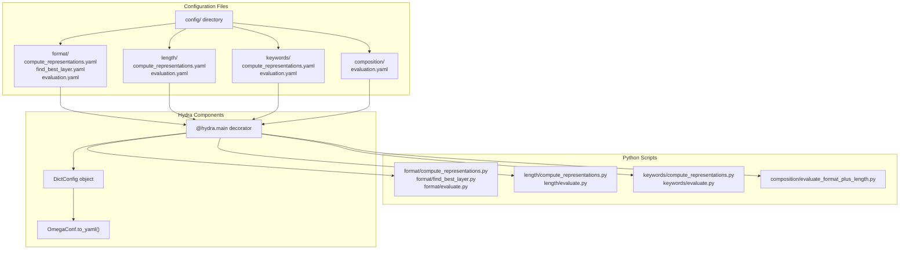
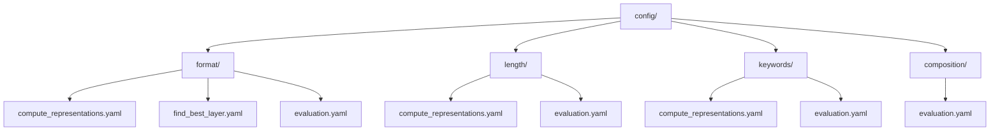
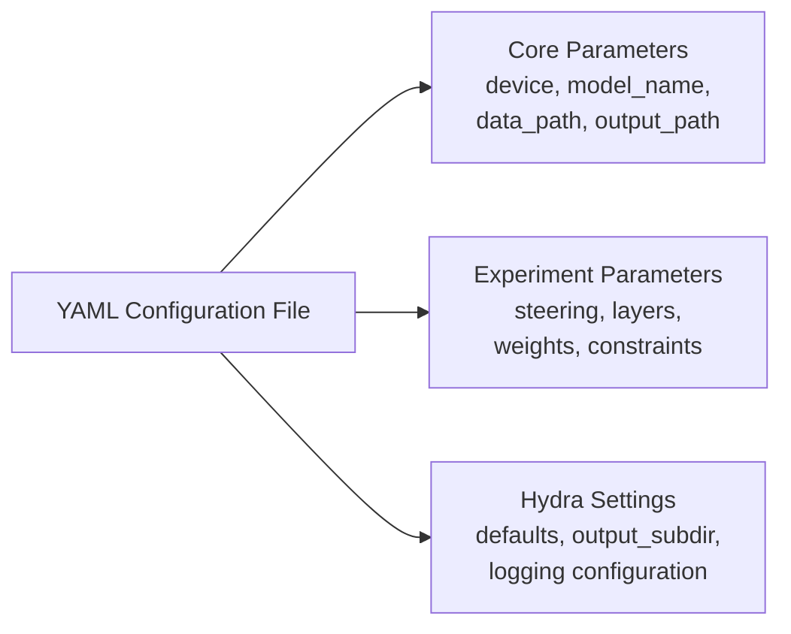
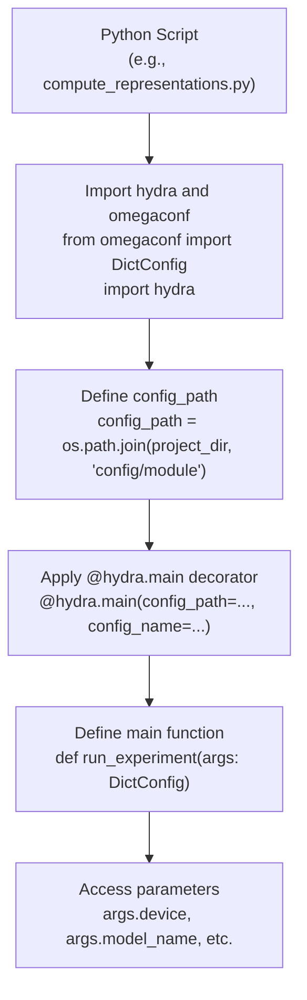
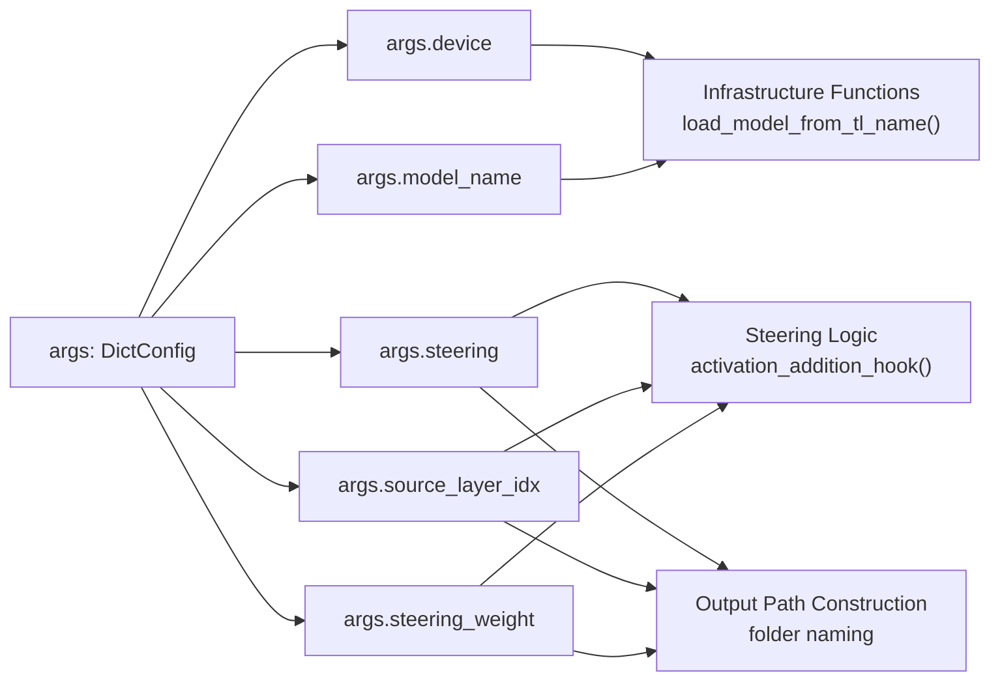
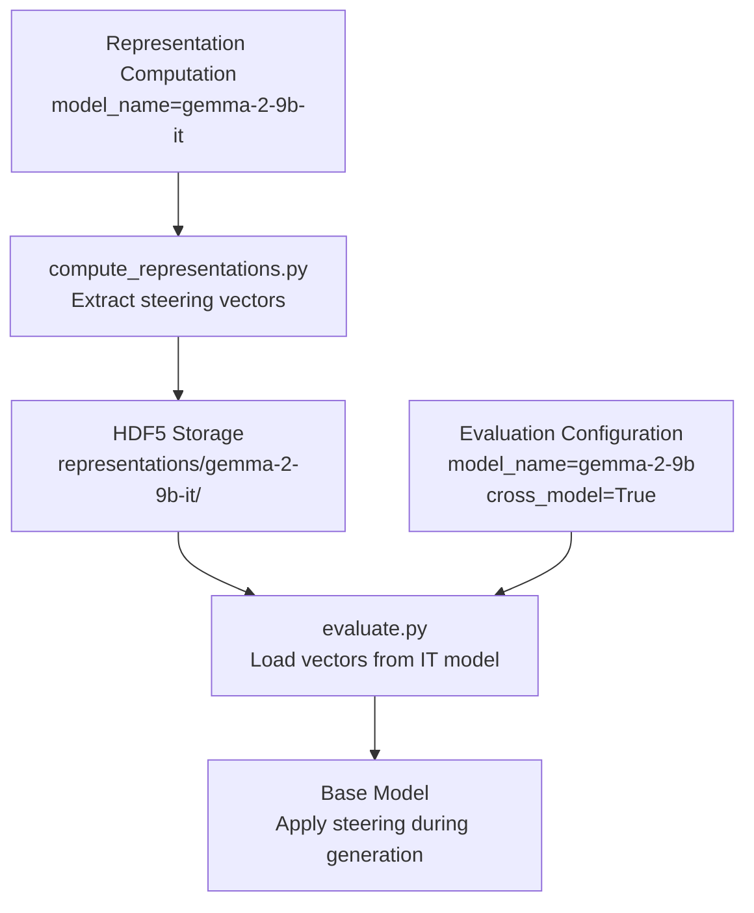
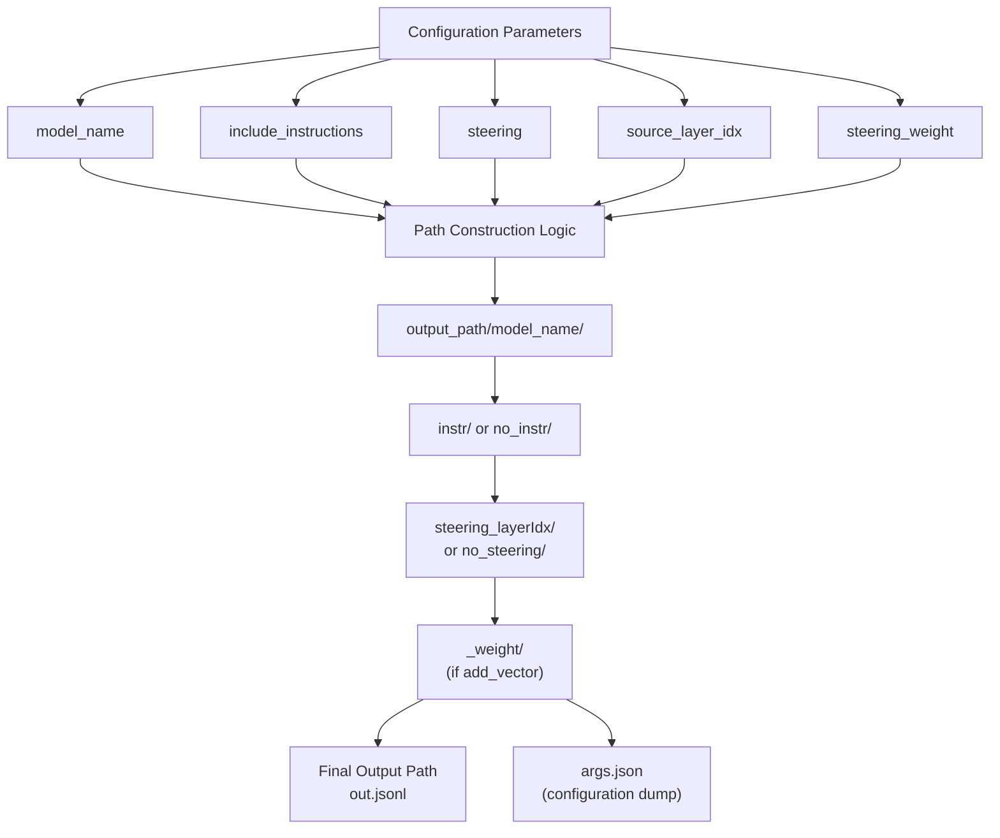
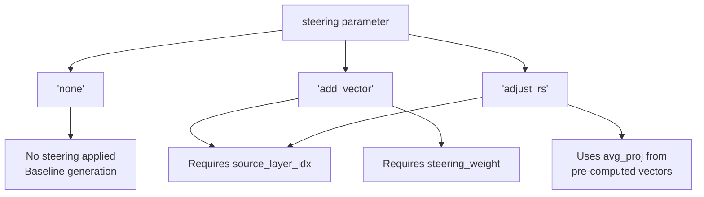

<!-- source: DeepWiki mcp.deepwiki.com · repo microsoft/llm-steer-instruct · page 3.3 Configuration Management with Hydra · fetched 2026-10-26 -->

# Configuration Management with Hydra

<details>
<summary>Relevant source files</summary>

The following files were used as context for generating this wiki page:

- [README.md](README.md)
- [composition/evaluate_format_plus_length.py](composition/evaluate_format_plus_length.py)
- [composition/load_results.py](composition/load_results.py)
- [config/composition/evaluation.yaml](config/composition/evaluation.yaml)
- [config/keywords/compute_representations.yaml](config/keywords/compute_representations.yaml)
- [config/length/compute_representations.yaml](config/length/compute_representations.yaml)
- [ifeval_scripts/README.md](ifeval_scripts/README.md)
- [keywords/compute_representations.py](keywords/compute_representations.py)
- [keywords/compute_response_perplexity.py](keywords/compute_response_perplexity.py)
- [keywords/load_results.py](keywords/load_results.py)
- [length/compute_representations.py](length/compute_representations.py)
- [requirements.txt](requirements.txt)

</details>


## Purpose and Scope

This document explains the Hydra-based configuration management system used throughout the llm-steer-instruct repository. Hydra provides declarative YAML-based configuration files that control experimental parameters across all instruction-type modules (format, length, keywords, and composition). This page covers the configuration directory structure, common configuration patterns, key parameters, and how scripts integrate with Hydra.

For information about how models are loaded using these configurations, see [Model Loading System](#3.1). For details on generation parameters and hooks, see [Generation Utilities](#3.2). For examples of running complete experiments with these configurations, see [Running Your First Experiment](#9.2).

## Hydra Integration Architecture

The repository uses Hydra 1.3.2 to manage configurations for all experiments. Each major script that performs model inference or data processing is decorated with `@hydra.main` to automatically load and parse YAML configuration files.



Sources: [README.md:18-48](), [composition/evaluate_format_plus_length.py:1-28](), [length/compute_representations.py:1-24](), [keywords/compute_representations.py:1-23]()

## Configuration Directory Structure

All configuration files are organized in the `config/` directory with subdirectories mirroring the main module structure:



Each instruction-type module has dedicated YAML files for different pipeline stages. The format module has the most comprehensive configuration files (5 stages), while length uses 2 files, and keywords uses 3 files.

Sources: [README.md:22-48]()

## Configuration File Structure

All configuration files follow a common structure with Hydra-specific settings and experiment parameters.

### Common Configuration Pattern



### Hydra-Specific Settings

Every configuration file includes Hydra settings to control output and logging behavior:

```yaml
defaults:
  - _self_
  - override hydra/hydra_logging: disabled
  - override hydra/job_logging: disabled

hydra:
  output_subdir: null
  run:
    dir: .
```

These settings disable Hydra's default output directory creation and keep the working directory as the project root, ensuring output files are written to predictable locations.

Sources: [config/composition/evaluation.yaml:31-39](), [config/keywords/compute_representations.yaml:13-21](), [config/length/compute_representations.yaml:11-19]()

## Key Configuration Parameters

### Infrastructure Parameters

These parameters are common across all configuration files:

| Parameter | Type | Purpose | Example Values |
|-----------|------|---------|----------------|
| `device` | string | Computation device | `'cuda'`, `'cpu'` |
| `model_name` | string | Model identifier | `'phi-3'`, `'gemma-2-9b'`, `'gemma-2-2b-it'` |
| `transformers_cache_dir` | string or null | HuggingFace cache location | `null` (default), custom path |
| `seed` | int | Random seed for reproducibility | `42` |
| `dry_run` | bool | Test mode flag | `False`, `True` |

Sources: [config/composition/evaluation.yaml:1-7](), [config/keywords/compute_representations.yaml:1-4](), [config/length/compute_representations.yaml:1-2]()

### Representation Computation Parameters

Used by `compute_representations.py` scripts:

| Parameter | Type | Purpose | Example Values |
|-----------|------|---------|----------------|
| `max_new_tokens` | int | Tokens to generate during extraction | `2` |
| `num_final_tokens` | int | Number of final tokens to extract | `1` |
| `n_examples` | int | Number of examples to process | `1`, `50` |
| `constraint_type` | string | Type of constraint being processed | `'include'`, `'exclude'`, `'high-level'`, `'sentences'` |

Sources: [config/keywords/compute_representations.yaml:7-11](), [config/length/compute_representations.yaml:4-9]()

### Evaluation Parameters

Used by `evaluate.py` scripts:

| Parameter | Type | Purpose | Example Values |
|-----------|------|---------|----------------|
| `data_path` | string | Path to evaluation data | `'data/format/ifeval_single_instr_format.jsonl'` |
| `output_path` | string | Output directory name | `'format_plus_length_out'` |
| `max_generation_length` | int | Maximum tokens in generated response | `2048` |
| `include_instructions` | bool | Whether to include explicit instructions | `True`, `False` |
| `steering` | string | Steering method | `'none'`, `'add_vector'`, `'adjust_rs'` |
| `source_layer_idx` | int | Layer for steering application | `-1` (auto), `12`, `26` |
| `steering_weight` | float | Weight for activation addition | `1.0`, `20`, `40` |

Sources: [config/composition/evaluation.yaml:4-18]()

### Composition-Specific Parameters

The composition module combines format and length steering with additional parameters:

| Parameter | Type | Purpose | Example Values |
|-----------|------|---------|----------------|
| `representations_folder` | string | Path to format representations | `'all'`, `'subset_0.1'` |
| `use_perplexity` | bool | Use perplexity-based layer selection | `True`, `False` |
| `include_length_instr` | bool | Include length instruction in prompt | `True`, `False` |
| `length_steering` | string | Length steering direction | `'conciseness'`, `'verbosity'`, `'none'` |
| `length_steering_weight` | float | Weight for length steering | `20`, `40` |
| `length_source_layer_idx` | int | Layer for length steering | `12` |
| `length_representations_folder` | string | Path to length representations | `'length/representations'` |
| `length_rep_file` | string | Specific representation file | `'high_level_50examples_hs.h5'` |

Sources: [config/composition/evaluation.yaml:13-28]()

## Using Hydra in Scripts

### The @hydra.main Decorator Pattern

All scripts that use Hydra follow this pattern:



### Example: compute_representations.py Integration

The `length/compute_representations.py` script demonstrates the standard pattern:

```python
# Define configuration path
config_path = os.path.join(project_dir, 'config/length')

# Apply Hydra decorator
@hydra.main(config_path=config_path, config_name='compute_representations')
def compute_representations(args: DictConfig):
    # Access configuration parameters
    model, tokenizer = load_model_from_tl_name(
        args.model_name, 
        device=args.device, 
        cache_dir=args.transformers_cache_dir
    )
    # ... rest of the function
```

Sources: [length/compute_representations.py:19-74]()

### Example: evaluate_format_plus_length.py Integration

The composition evaluation script shows a more complex configuration usage:

```python
config_path = os.path.join(project_dir, 'config/composition')

@hydra.main(config_path=config_path, config_name='evaluation')
def run_experiment(args: DictConfig):
    print(OmegaConf.to_yaml(args))  # Print full configuration
    
    # Use format steering parameters
    if args.steering != 'none':
        if args.source_layer_idx == -1:
            # Load best layer based on configuration flags
            use_perplexity_flag = '_with_perplexity' if args.use_perplexity else ''
            include_instr_flag = '_instr' if args.include_instructions else '_no_instr'
            file_path = f'{folder}/pre_computed_ivs_best_layer_validation{use_perplexity_flag}{include_instr_flag}.h5'
    
    # Use length steering parameters
    if args.length_steering != 'none':
        if 'conciseness' in args.length_steering:
            length_instr_dir = length_specific_representations[0]
        elif 'verbosity' in args.length_steering:
            length_instr_dir = length_specific_representations[4]
```

Sources: [composition/evaluate_format_plus_length.py:23-116]()

### DictConfig Access Patterns

Configuration parameters are accessed as attributes of the `DictConfig` object:



Sources: [composition/evaluate_format_plus_length.py:71-220](), [keywords/compute_representations.py:22-82]()

## Configuration Overrides

### Command-Line Override Syntax

Hydra supports command-line parameter overrides without modifying YAML files. The standard syntax is:

```bash
python script.py parameter=value
```

### Common Override Patterns

**Override model and device:**
```bash
python length/compute_representations.py model_name=gemma-2-2b-it device=cuda
```

**Override steering parameters:**
```bash
python format/evaluate.py steering=add_vector source_layer_idx=12 steering_weight=1.5
```

**Override data paths:**
```bash
python keywords/compute_representations.py \
    base_queries_path=data/custom_queries.jsonl \
    n_examples=100
```

**Enable dry run mode:**
```bash
python composition/evaluate_format_plus_length.py dry_run=True
```

### Cross-Model Configuration

For cross-model experiments (transferring steering vectors from instruction-tuned to base models), the configuration parameters work together:



The cross-model transfer relies on configuration specifying both the evaluation model and the path to representations computed on the instruction-tuned variant.

Sources: [README.md:78-82]()

## Configuration and Output Path Mapping

Output paths are systematically constructed from configuration parameters, ensuring reproducible and organized results:



Example path construction from `composition/evaluate_format_plus_length.py`:

```python
folder = os.path.join(script_dir, args.output_path, args.model_name)

if args.include_instructions:
    folder += '/instr'
else:
    folder += '/no_instr'

if args.steering != 'none':
    folder += f'/{args.steering}_{args.source_layer_idx}'
    if args.use_perplexity:
        folder += '_perplexity'
    if args.steering == 'add_vector':
        folder += f'_{args.steering_weight}'
else:
    folder += '/no_steering'

if args.length_steering != 'none':
    folder += f'_{args.length_steering}_L{args.length_source_layer_idx}_w{args.length_steering_weight}'
```

The configuration is also dumped to `args.json` in each output directory for full reproducibility:

```python
with open(f'{folder}/args.json', 'w') as f:
    f.write(OmegaConf.to_yaml(args))
```

Sources: [composition/evaluate_format_plus_length.py:189-220](), [keywords/load_results.py:13-40](), [composition/load_results.py:13-40]()

## Configuration Validation and Defaults

### Parameter Dependencies

Some parameters have logical dependencies enforced in the code:



### Special Values

| Parameter | Special Value | Meaning |
|-----------|---------------|---------|
| `source_layer_idx` | `-1` | Auto-select best layer from validation results |
| `transformers_cache_dir` | `null` | Use HuggingFace default cache directory |
| `use_perplexity` | `True` | Consider perplexity when selecting best layer |
| `dry_run` | `True` | Process only first 3 examples for testing |
| `representations_folder` | `'all'` | Use representations from all training examples |
| `representations_folder` | `'subset_0.1'` | Use representations from 10% subset |

Sources: [config/composition/evaluation.yaml:15-18](), [composition/evaluate_format_plus_length.py:68-87]()

---

