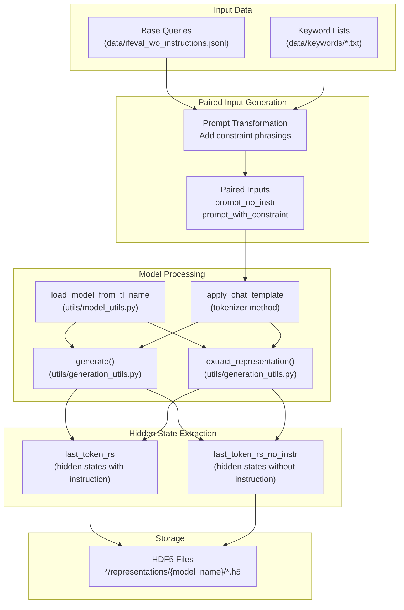
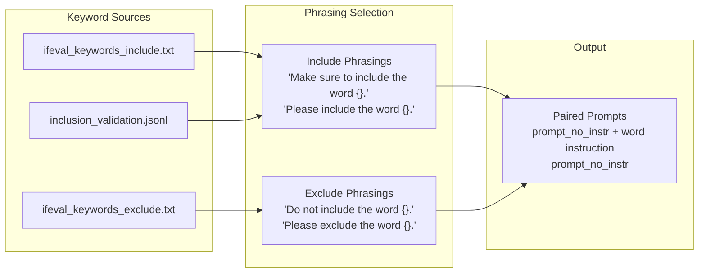
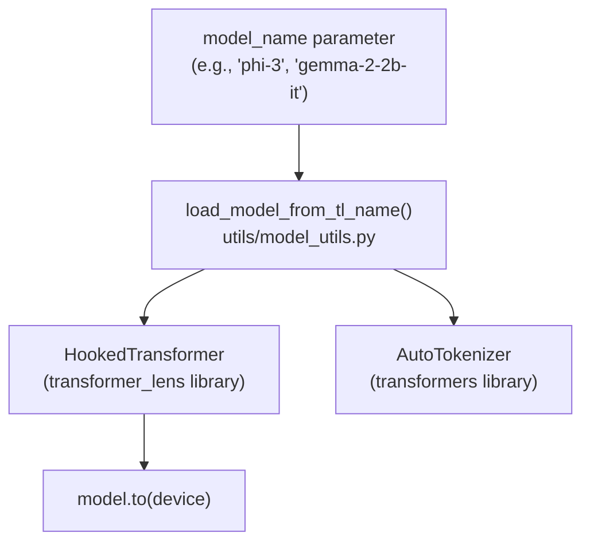
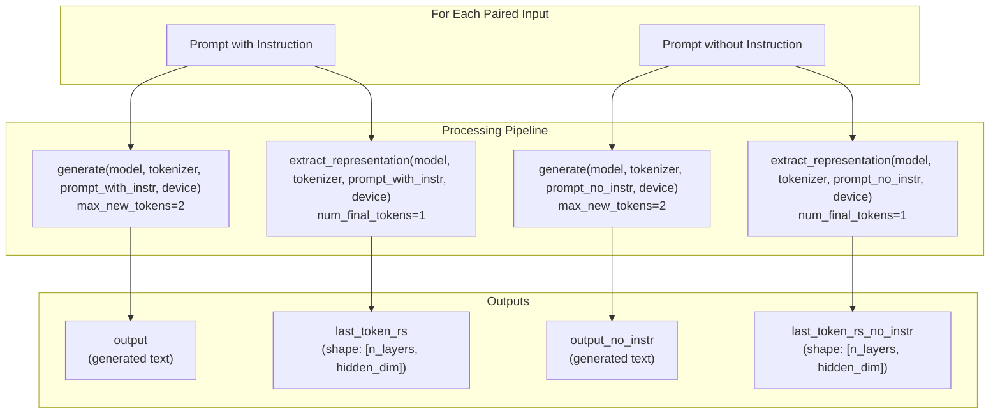
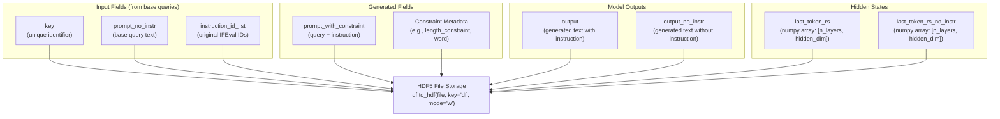
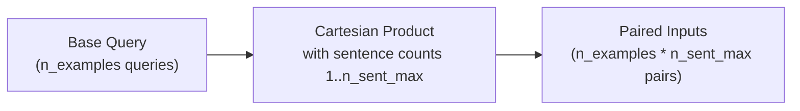
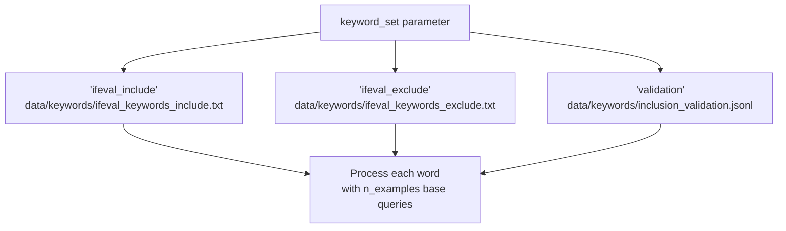

<!-- source: DeepWiki mcp.deepwiki.com · repo microsoft/llm-steer-instruct · page 4.1 Representation Computation · fetched 2026-10-26 -->

# Representation Computation

<details>
<summary>Relevant source files</summary>

The following files were used as context for generating this wiki page:

- [README.md](README.md)
- [config/keywords/compute_representations.yaml](config/keywords/compute_representations.yaml)
- [config/length/compute_representations.yaml](config/length/compute_representations.yaml)
- [ifeval_scripts/README.md](ifeval_scripts/README.md)
- [keywords/compute_representations.py](keywords/compute_representations.py)
- [keywords/compute_response_perplexity.py](keywords/compute_response_perplexity.py)
- [keywords/load_results.py](keywords/load_results.py)
- [length/compute_representations.py](length/compute_representations.py)

</details>


## Purpose and Scope

This page documents the representation computation phase of the activation steering pipeline, which extracts hidden states from paired inputs (with and without instructions) and stores them for subsequent processing. For information about how these representations are used to find optimal steering layers, see [Layer Search and Optimization](#4.2). For information about how representations are converted into steering vectors, see [Pre-Computing Instruction Vectors](#4.3).

Representation computation is implemented separately for each instruction type module (format, length, keywords), with each having its own `compute_representations.py` script. Despite implementation differences, all modules follow the same fundamental approach: generate paired prompts, run the model on both versions, extract hidden states, and store results in HDF5 format.

## Overview of Representation Computation

Representation computation is the first phase in the steering vector pipeline. It produces the raw activation data needed to compute steering directions by capturing how the model's internal representations differ when processing instructions versus base queries.



**Sources:** [README.md:64-67](), [README.md:85-88](), [README.md:96-99](), [length/compute_representations.py:1-131](), [keywords/compute_representations.py:1-124]()

## Paired Input Generation

Each representation computation process creates paired inputs by taking base queries and adding constraint-specific instructions. The pairing ensures that the only difference between the two inputs is the presence or absence of the instruction, allowing the steering vector to capture the instruction-specific representation.

### Base Query Loading

All modules load base queries from `data/ifeval_wo_instructions.jsonl`, which contains prompts stripped of their original IFEval instructions. The file structure includes:

| Field | Description |
|-------|-------------|
| `model_output` | The base query text (renamed to `prompt_no_instr`) |
| `instruction_id_list` | List of instruction IDs originally associated with the prompt |
| `key` | Unique identifier for the prompt |

**Sources:** [length/compute_representations.py:26-34](), [keywords/compute_representations.py:26-33]()

### Constraint-Specific Transformations

Each module implements constraint-specific logic to generate prompts with instructions:

#### Length Constraints

The length module supports two constraint types configured via `constraint_type` parameter:

**Sentence-based constraints** (`constraint_type: 'sentences'`):
- Generates prompts with specific sentence count requirements (1 to `n_sent_max`)
- Uses varied phrasings: `"Answer using {} sentences."`, `"Respond with {} sentences."`, etc.
- Special handling for single-sentence requests with dedicated phrasings

**High-level constraints** (`constraint_type: 'high-level'`):
- Generates prompts across five verbosity levels: extra short, short, medium, verbose, extra verbose
- Uses natural language phrasings: `"Be extremely concise."`, `"Be verbose."`, etc.

**Sources:** [length/compute_representations.py:37-69]()

#### Keyword Constraints

The keyword module generates inclusion or exclusion instructions for specific words:



The module filters out base queries that already have keyword-related instructions in their `instruction_id_list` to avoid interference.

**Sources:** [keywords/compute_representations.py:37-75](), [config/keywords/compute_representations.yaml:9-11]()

#### Format Constraints

While the format module's `compute_representations.py` is not provided in the files, the README indicates it follows a similar pattern, processing format-specific constraints from the IFEval dataset's detectable_format categories.

**Sources:** [README.md:64-67]()

## Model Forward Pass and Hidden State Extraction

After generating paired inputs, the scripts perform model forward passes to extract hidden states. This process uses utilities from `utils/generation_utils.py` and `utils/model_utils.py`.

### Model Loading

Models are loaded using `load_model_from_tl_name`, which returns a `HookedTransformer` instance and tokenizer:



**Sources:** [length/compute_representations.py:74-76](), [keywords/compute_representations.py:80-82](), [config/keywords/compute_representations.yaml:6](), [config/length/compute_representations.yaml:4]()

### Chat Template Application

Before model processing, prompts are formatted using the tokenizer's chat template:

```python
messages = [{"role": "user", "content": example}]
formatted_prompt = tokenizer.apply_chat_template(
    messages, 
    add_generation_prompt=True, 
    tokenize=False
)
```

This ensures prompts follow the model's expected chat format (e.g., special tokens for user/assistant turns).

**Sources:** [length/compute_representations.py:97-100](), [keywords/compute_representations.py:94-97]()

### Hidden State Extraction Process

For each paired input, the system performs two operations:

1. **Generation** (`generate()`): Produces a short output (typically 2 tokens configured via `max_new_tokens`)
2. **Representation Extraction** (`extract_representation()`): Captures hidden states from the final token(s) of the prompt



The `num_final_tokens` parameter (typically set to 1) specifies how many final tokens' hidden states to extract. The `extract_representation` function returns hidden states across all layers of the model.

**Sources:** [length/compute_representations.py:102-110](), [keywords/compute_representations.py:99-107](), [config/keywords/compute_representations.yaml:8](), [config/length/compute_representations.yaml:6]()

## HDF5 Storage Format

Computed representations are stored in HDF5 files using pandas DataFrame serialization. This format enables efficient storage and retrieval of large numpy arrays (hidden states) alongside metadata.

### File Naming Conventions

Each module uses a consistent naming pattern:

| Module | File Path Pattern |
|--------|------------------|
| Length (sentences) | `length/representations/{model_name}/{n_sent_max}sentences_{n_examples}examples_hs.h5` |
| Length (high-level) | `length/representations/{model_name}/high_level_{n_examples}examples_hs.h5` |
| Keywords | `keywords/representations/{model_name}/{constraint_type}_{keyword_set}_{n_examples}examples_hs.h5` |

**Sources:** [length/compute_representations.py:117-124](), [keywords/compute_representations.py:115-119]()

### DataFrame Schema

The stored DataFrames contain the following columns:



The critical fields are `last_token_rs` and `last_token_rs_no_instr`, which store the model's hidden states (residual stream activations) at all layers for the final prompt token. These arrays have shape `[n_layers, hidden_dim]` where `n_layers` depends on the model architecture and `hidden_dim` is the model's hidden dimension.

**Sources:** [length/compute_representations.py:115-126](), [keywords/compute_representations.py:112-119]()

## Module-Specific Implementations

### Format Instructions Module

The format instructions module (`format/compute_representations.py`) processes format-specific constraints from the IFEval dataset. While the implementation file is not provided, the README indicates it follows the standard representation computation pattern.

**Configuration:** `config/format/compute_representations.yaml`

**Output Directory:** `format/representations/{model_name}/`

**Pipeline Position:** First stage in the 5-stage format pipeline (compute → layer search → perplexity → pre-compute → evaluate)

**Sources:** [README.md:64-67]()

### Length Instructions Module

The length module computes representations for two distinct constraint types:

#### Sentence Count Constraints

Generates `n_examples * n_sent_max` paired inputs by combining each base query with sentence count requirements from 1 to `n_sent_max`:



For single sentences, uses specialized phrasings like `"Answer using 1 sentence."` vs. `"Respond with one sentence."` to provide variation.

**Sources:** [length/compute_representations.py:37-52](), [config/length/compute_representations.yaml:7-8]()

#### High-Level Verbosity Constraints

Generates `n_examples * 5` paired inputs by combining each base query with five verbosity levels:

| Level | Index | Example Phrasing |
|-------|-------|-----------------|
| Extra Short | 0 | `"Be extremely concise."` |
| Short | 1 | `"Be concise."` |
| Medium | 2 | `"Don't be too concise or too verbose."` |
| Verbose | 3 | `"Be verbose."` |
| Extra Verbose | 4 | `"Be extremely verbose."` |

The `length_constraint` field stores the level index (0-4) for later use.

**Sources:** [length/compute_representations.py:54-68]()

#### Execution Parameters

| Parameter | Default | Description |
|-----------|---------|-------------|
| `device` | `'cuda'` | Device for model execution |
| `model_name` | `'phi-3'` | Model identifier |
| `max_new_tokens` | `2` | Tokens to generate (minimal for representation extraction) |
| `num_final_tokens` | `1` | Number of final prompt tokens to extract representations from |
| `constraint_type` | `'high-level'` | Type of length constraint (`'sentences'` or `'high-level'`) |
| `n_sent_max` | `10` | Maximum sentence count (for sentence-based constraints) |
| `n_examples` | `50` | Number of base queries to use |

**Sources:** [config/length/compute_representations.yaml:1-9]()

### Keyword Instructions Module

The keyword module computes representations for word inclusion and exclusion constraints. It processes keyword lists and generates paired inputs for each (base_query, word) combination.

#### Keyword Set Selection

The `keyword_set` parameter determines which word list to use:



The validation set extracts words from the `likely_words` field in the JSONL file, providing a curated set for validation purposes.

**Sources:** [keywords/compute_representations.py:40-57]()

#### Filtering and Expansion

The module filters out base queries that already have keyword-related instructions in their `instruction_id_list`:

```python
data_no_instr_df = data_no_instr_df[
    ~data_no_instr_df['instruction_id_list'].apply(
        lambda x: any(['keyword' in instr for instr in x])
    )
]
```

Then generates `n_examples * len(word_list)` paired inputs by creating one pair for each (query, word) combination.

**Sources:** [keywords/compute_representations.py:60-75]()

#### Execution Parameters

| Parameter | Default | Description |
|-----------|---------|-------------|
| `device` | `'cuda'` | Device for model execution |
| `base_queries_path` | `'data/ifeval_wo_instructions.jsonl'` | Path to base queries |
| `model_name` | `'phi-3'` | Model identifier |
| `max_new_tokens` | `2` | Tokens to generate |
| `num_final_tokens` | `1` | Number of final prompt tokens for representation extraction |
| `constraint_type` | `'include'` | Constraint type (`'include'` or `'exclude'`) |
| `keyword_set` | `'ifeval_include'` | Keyword list to use |
| `n_examples` | `1` | Number of base queries to use |

**Sources:** [config/keywords/compute_representations.yaml:1-11]()

## Configuration Management

All representation computation scripts use Hydra for configuration management, allowing flexible parameter control via YAML files and command-line overrides.

### Common Configuration Pattern

Each module's configuration follows this structure:

```yaml
device: 'cuda'
transformers_cache_dir: null
model_name: 'phi-3'
max_new_tokens: 2
num_final_tokens: 1

# Module-specific parameters
constraint_type: ...
n_examples: ...

# Hydra configuration (disables logging)
defaults:
  - _self_
  - override hydra/hydra_logging: disabled
  - override hydra/job_logging: disabled

hydra:
  output_subdir: null
  run:
    dir: .
```

The Hydra logging is disabled to avoid cluttering the output directory, and the working directory is set to `.` to maintain expected relative paths.

**Sources:** [config/keywords/compute_representations.yaml:1-21](), [config/length/compute_representations.yaml:1-19]()

### Running with Custom Parameters

Scripts can be run with parameter overrides:

```bash
# Override model and constraint type
python length/compute_representations.py \
    model_name='gemma-2-2b-it' \
    constraint_type='sentences' \
    n_sent_max=15 \
    n_examples=100

# Override keyword set and device
python keywords/compute_representations.py \
    keyword_set='ifeval_exclude' \
    constraint_type='exclude' \
    device='cuda:1'
```

**Sources:** [README.md:64-67](), [README.md:85-88](), [README.md:96-99]()

## Computational Considerations

Representation computation is the most computationally intensive phase of the pipeline, as it requires running full model forward passes for every paired input. Key considerations:

- **Batch Processing:** The scripts process inputs sequentially with progress bars (using `tqdm`). For large-scale experiments, parallelization across multiple GPUs could be implemented.

- **Token Limit:** `max_new_tokens=2` is used because only the prompt representations are needed, not full generations. This minimizes computation time.

- **Caching Strategy:** HDF5 files serve as a cache, allowing downstream stages (layer search, pre-computation, evaluation) to reuse representations without re-running the model.

- **Memory Management:** Hidden states for all layers are kept in memory during extraction. For very large models, this may require significant GPU memory.

**Sources:** [length/compute_representations.py:88-113](), [keywords/compute_representations.py:86-110](), [config/keywords/compute_representations.yaml:7](), [config/length/compute_representations.yaml:5]()

---

