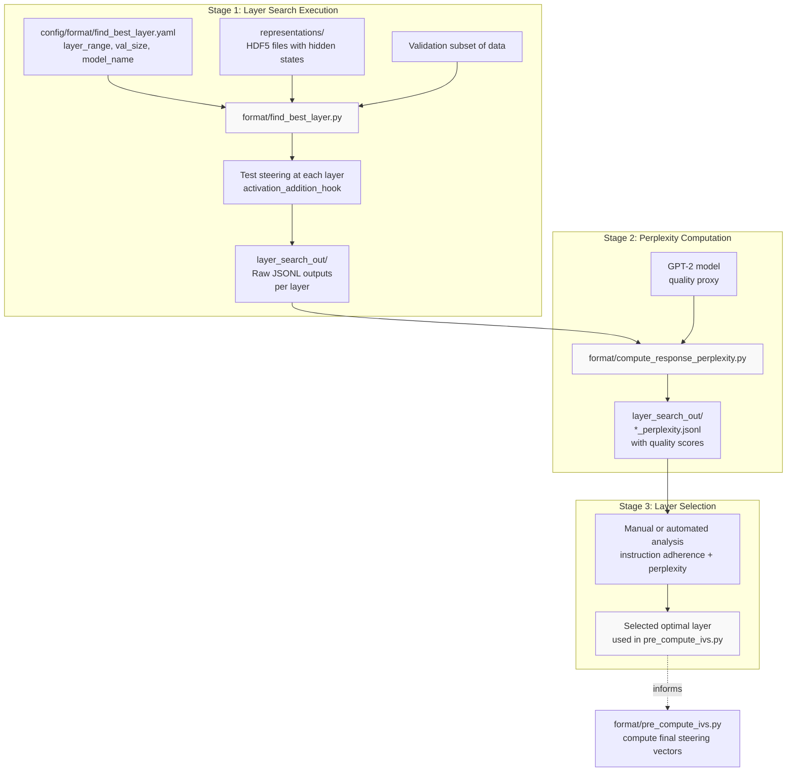
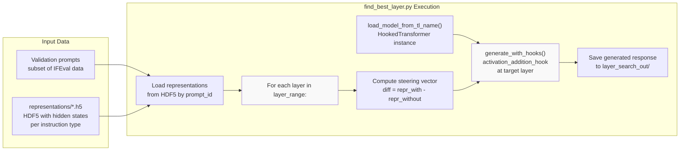
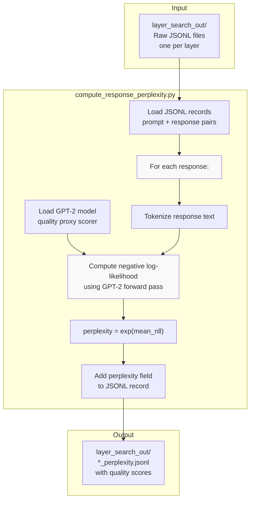
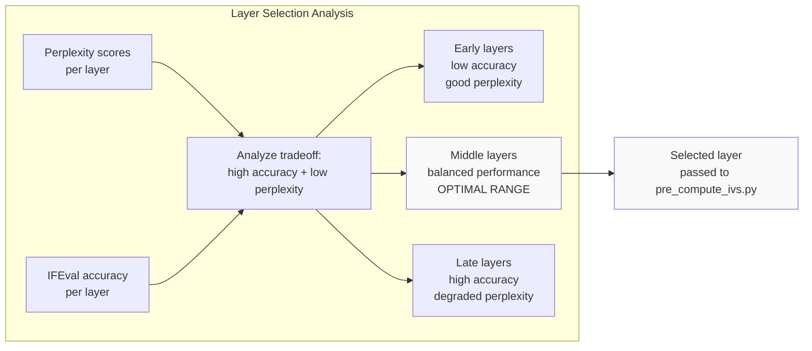
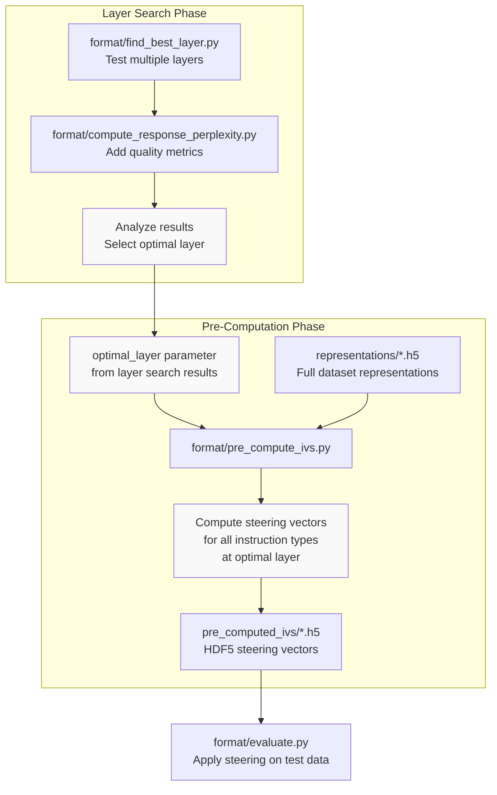

<!-- source: DeepWiki mcp.deepwiki.com · repo microsoft/llm-steer-instruct · page 4.2 Layer Search and Optimization · fetched 2026-10-26 -->

# Layer Search and Optimization

<details>
<summary>Relevant source files</summary>

The following files were used as context for generating this wiki page:

- [.gitignore](.gitignore)
- [README.md](README.md)
- [ifeval_scripts/README.md](ifeval_scripts/README.md)

</details>


## Purpose and Scope

This document describes the layer search and optimization process used to identify the optimal layers for applying activation steering. Layer search is a critical validation step in the steering vector pipeline that determines where in the model's architecture steering vectors should be applied to maximize instruction-following performance while maintaining response quality.

The layer search process involves:
1. Running validation experiments with steering applied at different layers
2. Computing perplexity scores to assess response quality
3. Selecting optimal layers based on instruction adherence and quality metrics

For information about how representations are computed before layer search, see [Representation Computation](#4.1). For details on how the selected layers are used to pre-compute steering vectors, see [Pre-Computing Instruction Vectors](#4.3).

**Note:** Layer search is primarily implemented for format instructions. Length and keyword instruction modules use simplified approaches that compute steering vectors directly from representations without explicit layer search validation.

## Layer Search Workflow

The layer search process consists of two main stages executed sequentially:



**Diagram: Complete Layer Search and Selection Pipeline**

Sources: [README.md:68-77](), [.gitignore:11]()

## Layer Search Execution

### Configuration and Parameters

Layer search is configured through Hydra YAML files that specify the search space and validation parameters:

| Parameter | Description | Example Value |
|-----------|-------------|---------------|
| `layer_range` | Range of layers to test | `[10, 15, 20, 25, 30]` |
| `val_size` | Number of validation examples | `100` |
| `model_name` | Target model for validation | `gemma-2-9b-it` |
| `steering_method` | How to apply steering | `activation_addition` |
| `weight` | Steering vector scaling factor | `1.0` |

The configuration file `config/format/find_best_layer.yaml` defines these parameters and is loaded by the `find_best_layer.py` script using Hydra decorators.

Sources: [README.md:69-71]()

### Validation Process



**Diagram: Layer Search Execution Flow**

The `find_best_layer.py` script iterates through the specified layer range, applying steering at each layer and collecting outputs. For each validation example and layer combination:

1. **Load representations**: Retrieves pre-computed hidden states from HDF5 files based on `prompt_id` and instruction type
2. **Compute steering vector**: Calculates the difference between "with instruction" and "without instruction" representations
3. **Apply steering**: Uses `generate_with_hooks()` to inject the steering vector via `activation_addition_hook` at the target layer
4. **Store output**: Saves the generated response to JSONL files organized by layer

Sources: [README.md:68-71]()

## Perplexity-Based Quality Assessment

### Perplexity Computation

After layer search generates responses, the `compute_response_perplexity.py` script augments the results with quality scores:



**Diagram: Perplexity Computation Pipeline**

The perplexity computation serves as a quality proxy because:
- **Lower perplexity** indicates text that is more fluent and natural according to GPT-2's language model
- **Higher perplexity** suggests degraded quality, unnatural phrasing, or incoherent responses
- GPT-2 provides a fast, reproducible quality metric without requiring human evaluation

Sources: [README.md:72-74](), [README.md:100-102]()

### Quality-Accuracy Tradeoff

Layer selection must balance two competing objectives:

| Metric | Description | Optimization Goal |
|--------|-------------|-------------------|
| **Instruction Adherence** | Measured by IFEval `follow_all_instructions` | Maximize |
| **Response Perplexity** | GPT-2 negative log-likelihood | Minimize |



**Diagram: Layer Selection Tradeoff Analysis**

Empirically, middle-to-later layers often provide the best balance, achieving strong instruction adherence without excessive perplexity degradation. The exact optimal layer varies by:
- Model architecture and size
- Instruction type (format, length, keywords)
- Specific constraint being steered

Sources: [README.md:72-77]()

## Output Artifacts and Storage

### Directory Structure

Layer search produces organized artifacts in the `layer_search_out/` directories:

```
format/layer_search_out/
├── layer_10_validation_outputs.jsonl       # Raw outputs for layer 10
├── layer_10_validation_outputs_perplexity.jsonl  # With perplexity scores
├── layer_15_validation_outputs.jsonl
├── layer_15_validation_outputs_perplexity.jsonl
├── layer_20_validation_outputs.jsonl
├── layer_20_validation_outputs_perplexity.jsonl
├── ...
└── args.txt                                 # Stored configuration parameters
```

The `.gitignore` file excludes `*/layer_search_out_old` directories, indicating that old validation runs are preserved for comparison while new runs overwrite the main `layer_search_out/` directory.

Sources: [.gitignore:11](), [README.md:68-71]()

### JSONL Record Format

Each validation output record contains:

```json
{
  "prompt_id": "abc123",
  "instruction_type": "json_format",
  "prompt": "Write your response in JSON format. How do I...",
  "response": "{\n  \"answer\": \"To do this...\"\n}",
  "layer": 20,
  "weight": 1.0,
  "perplexity": 15.3
}
```

| Field | Description |
|-------|-------------|
| `prompt_id` | Unique identifier linking to source data |
| `instruction_type` | Specific constraint being validated |
| `prompt` | Input prompt with instruction |
| `response` | Model-generated output with steering |
| `layer` | Layer where steering was applied |
| `weight` | Steering vector scaling factor |
| `perplexity` | GPT-2 quality score (added by compute_response_perplexity.py) |

This structured format enables systematic comparison across layers and automated selection of optimal configurations.

Sources: [README.md:68-77]()

## Integration with Pre-Computation Phase

### Layer Selection to Pre-Computation Flow



**Diagram: Layer Search to Pre-Computation Integration**

The selected optimal layer from the validation process becomes a key parameter for `pre_compute_ivs.py`, which:

1. **Loads representations**: Accesses the full training dataset representations (not just validation subset)
2. **Computes steering vectors**: Calculates `repr_with - repr_without` at the optimal layer for all instruction types
3. **Stores vectors**: Saves pre-computed steering vectors to HDF5 files in `pre_computed_ivs/` directory
4. **Enables efficient inference**: Evaluation scripts load pre-computed vectors instead of computing them on-the-fly

This caching strategy significantly improves inference efficiency during full evaluation on test data.

Sources: [README.md:75-77](), [README.md:78-81]()

## Simplified Approaches in Other Modules

### Length Instructions

The length instruction module uses a simplified approach without explicit layer search:

- **No `find_best_layer.py` script**: Layer selection is not performed
- **Direct evaluation**: `length/evaluate.py` computes steering vectors on-the-fly during evaluation
- **Fixed layer strategy**: May use a predetermined layer based on format instruction findings or apply steering across multiple layers simultaneously

This simplification reflects that length constraints may be less sensitive to layer selection than complex format constraints.

Sources: [README.md:84-92]()

### Keyword Instructions

The keyword module includes perplexity computation but no dedicated layer search script:

- **Perplexity computation**: `keywords/compute_response_perplexity.py` exists for quality assessment
- **No explicit layer search**: Optimal layers may be determined through manual experimentation or inherited from format instruction findings
- **Validation evaluation**: The `evaluate.py` script supports a `validation` mode for testing different configurations

Sources: [README.md:95-106]()

### Module Comparison Table

| Module | Layer Search Script | Perplexity Script | Pre-Compute Script | Approach |
|--------|---------------------|-------------------|-------------------|----------|
| **Format** | `find_best_layer.py` | `compute_response_perplexity.py` | `pre_compute_ivs.py` | Full pipeline with validation |
| **Length** | ❌ | ❌ | ❌ | Direct evaluation |
| **Keywords** | ❌ | `compute_response_perplexity.py` | ❌ | Quality-aware direct evaluation |

Sources: [README.md:62-106]()

## Layer Search Configuration Reference

### Configuration File Structure

The `config/format/find_best_layer.yaml` file specifies layer search parameters:

```yaml
# Model configuration
model_name: gemma-2-9b-it
device: cuda

# Layer search parameters
layer_range: [10, 15, 20, 25, 30]
val_size: 100

# Steering configuration
steering_method: activation_addition
weight: 1.0

# Data paths
representations_dir: format/representations/
output_dir: format/layer_search_out/

# Instruction types to validate
instruction_types:
  - json_format
  - bullet_list
  - title_format
  # ... additional types
```

### Key Configuration Parameters

| Parameter | Type | Description |
|-----------|------|-------------|
| `layer_range` | List[int] | Layers to test for steering application |
| `val_size` | int | Number of validation examples per instruction type |
| `steering_method` | str | `activation_addition` or `direction_projection` |
| `weight` | float | Scaling factor for steering vectors |
| `instruction_types` | List[str] | Specific instruction constraints to validate |

These parameters enable systematic exploration of the layer search space and reproducible validation experiments.

Sources: [README.md:69-71]()

---

